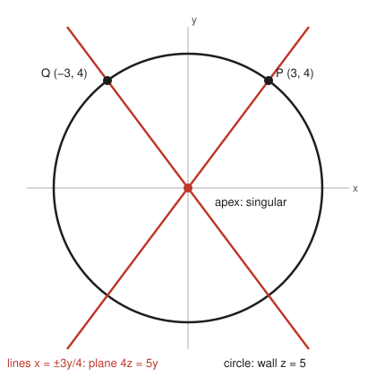

# Smooth and singular points: the Jacobian test for a clean tangent direction

[Syllabus](../../../SYLLABUS.md) → [Algebraic geometry](../README.md) → [Affine and Projective Varieties](../README.md#s02) → Smooth and singular points

---

## General Overview

A torch hangs at the origin and points up the z-axis. Its beam spreads at 45 degrees, so a point (x, y, z) above the bulb, in metres, lies on the edge of the beam exactly when x² + y² = z². The equation also holds for the mirror image below the bulb. Its full zero set is a cone: two funnels, tip to tip at the bulb ([Affine varieties](01-affine-varieties-and-coordinate-rings.md)).

Stand at the point P = (3, 4, 5) on the cone. Up close, the surface looks like a flat sheet. It has one tangent plane, 3x + 4y − 5z = 0, and one normal direction, so a renderer can shade it and a robot can slide along it.

Now stand at the tip, the **apex** (0, 0, 0). No plane fits there. The cone keeps two funnels and a pointed tip however far you zoom in. A point like P is **smooth**. A point like the apex is **singular**.

The test that tells them apart uses only partial derivatives. The cone's equation is f = x² + y² − z² = 0. Its rates of change are 2x, 2y and −2z. At P they are 6, 8 and −10, not all zero, so P is smooth. At the apex all three are zero, so the apex is singular. They vanish together nowhere else, so the apex is the cone's only singular point.

**A point of a variety is smooth when the matrix of partial derivatives of its equations reaches full rank, the number of coordinates minus the variety's dimension, and singular when the rank drops; the singular points are found by solving the equations together with the vanishing of that matrix's minors (determinants of its square pieces).**

**What kind of fact this is:** a definition (smooth means the tangent space has the variety's own dimension) and a theorem, the Jacobian criterion, which turns that definition into a rank test; the rank test is proved on this card, and the fact that singular points are rare on any variety is stated with its source.

### The picture: two slices of the cone, one smooth and one singular

Two planes cut the cone in two curves. The wall z = 5 cuts it in a circle of radius 5 m through P. The plane 4z = 5y passes through the apex and P, and cuts the cone in two straight lines that cross at the apex.

<p align="center"></p>

Top view, to scale, real points only, with z dropped. The black circle is the wall's slice: it is smooth everywhere. The red lines are the slice by 4z = 5y: smooth except at the apex, where two branches cross. The lines also seem to cross the circle at (±3, −4). In space they do not: there the lines are at z = −5, below the bulb, and the circle is at z = 5.

---

## The formula

Notation first. The field k is the number system the coordinates come from. Here it is ℝ, the real numbers, or ℂ, the complex numbers; a finite field $`\mathbb{F}_p`$ (whole numbers modulo a prime p) appears only where named. Two names are new on this card:

- **The singular locus**, written $`\mathrm{Sing}\, V`$, is the set of singular points of a variety V.
- **The local ring at P**, written $`\mathcal{O}_{V,P}`$, is the set of fractions g/h of polynomial functions on V whose denominator h is not zero at P. These are the functions defined at and near P. Its maximal ideal $`\mathfrak{m}_P`$ is the part that vanishes at P.

From earlier cards: V is a variety in $`\mathbb{A}^n`$, affine n-space; $`I(V) = \langle f_1, \dots, f_s \rangle`$ is its vanishing ideal, every polynomial zero on V ([Affine varieties](01-affine-varieties-and-coordinate-rings.md)); $`\dim V`$ and the tangent space $`T_P V`$ come from [Dimension and tangent space](07-dimension-and-tangent-spaces.md). The **Jacobian matrix** $`J(P)`$ lists the partial derivatives of the equations at P, one row per equation. ("Jacobian" here always means this matrix of the equations.)

```math
P \in V \text{ is smooth} \iff \mathrm{rank}\, J(P) = n - \dim V, \qquad J(P) = \Big(\tfrac{\partial f_i}{\partial x_j}(P)\Big)_{i \le s,\ j \le n}, \qquad \dim T_P V = n - \mathrm{rank}\, J(P)
```

**Read it aloud:** a point is smooth when the equations' rates of change at that point have rank n minus the dimension; the tangent space has dimension n minus that rank, so smooth means the tangent space is exactly as big as the variety.

For one equation in three unknowns, a surface like the cone, n − dim V = 3 − 2 = 1. Rank 1 means "some partial derivative is not zero":

```math
\mathrm{Sing}\, V(f) = V\Big(f,\ \tfrac{\partial f}{\partial x},\ \tfrac{\partial f}{\partial y},\ \tfrac{\partial f}{\partial z}\Big), \qquad \text{for the cone: } V(x^2 + y^2 - z^2,\ 2x,\ 2y,\ -2z) = \{(0, 0, 0)\}
```

**Read it aloud:** the singular points of a surface are the points where the equation and all its partial derivatives vanish together; for the cone, only the apex.

| Symbol | Plain meaning | In our example | Push it up and the answer… |
| --- | --- | --- | --- |
| $`k`$ | the field of the coordinates | ℝ; $`\mathbb{F}_2`$, $`\mathbb{F}_7`$, $`\mathbb{F}_{13}`$ where named | over $`\mathbb{F}_2`$ every point of the cone tests singular |
| $`P`$; $`Q`$; $`v = (a, b, c)`$; $`t`$ | a point of V; the figure's second marked point; a direction or a step from P; how far along the line P + tv | P = (3, 4, 5); Q = (−3, 4, 5); v = (1, 0, 0) | — |
| $`f_1, \dots, f_s`$ | the s equations that generate $`I(V)`$ | f = $`x^2 + y^2 - z^2`$; for a slice, also 4z − 5y | a repeated factor breaks the test |
| $`\partial f / \partial x`$ | partial derivative: the rate of f in x, others frozen | $`f_x = 2x`$, $`f_y = 2y`$, $`f_z = -2z`$ | — |
| $`\nabla f(P)`$ | gradient: the row of partials at P | (6, 8, −10) at P; (0, 0, 0) at the apex | — |
| $`J(P)`$ | Jacobian matrix: one row of partials per equation | rows (2x, 2y, −2z) and (0, −5, 4) for the slice | — |
| $`\mathrm{rank}\, J(P)`$ | number of independent rows | 1 at P on the cone; 0 at the apex | a drop below n − dim V means singular |
| $`n`$; $`\dim V`$ | number of coordinates; dimension of V | 3; cone 2, slice curves 1 | — |
| $`T_P V`$ | tangent space: directions v with $`J(P)\,v = 0`$ | the plane 3x + 4y − 5z = 0 at P; all of space at the apex | bigger than dim V means singular |
| $`\mathrm{Sing}\, V`$ | the singular points | {apex} for the cone and for the slice 4z = 5y; empty for the wall's circle | — |
| $`\mathcal{O}_{V,P}`$ | local ring: fractions g/h on V with h(P) ≠ 0 | x/z at P, value 3/5 | — |
| $`\mathfrak{m}_P`$ | the functions in $`\mathcal{O}_{V,P}`$ that vanish at P | x − 3, y − 4, z − 5 at P | $`\dim \mathfrak{m}_P/\mathfrak{m}_P^2 = \dim T_P V`$ |

### When it holds

- **The equations must generate the vanishing ideal $`I(V)`$.** Write the unit circle as $`(x^2 + y^2 - 1)^2 = 0`$. Every partial derivative then carries the factor $`x^2 + y^2 - 1`$, so all 4 test points are flagged singular, though the circle is smooth.
- **The point must lie on V.** The hyperboloid $`x^2 + y^2 - z^2 = 1`$ has zero gradient at the origin, but the origin is not on it (the equation gives −1 there). It has no singular point.
- **The target rank is n − dim V, not 1.** A curve in 3-space needs rank 2. At the apex of the slice 4z = 5y one row, (0, −5, 4), is not zero, yet the rank is 1: the point is singular.
- **The field matters.** Over $`\mathbb{F}_2`$, $`x^2 + y^2 - z^2 = (x + y + z)^2`$, a plane counted twice. All 4 points of it test singular, the first bullet's failure in disguise.
- **"Smooth means a smooth graph" needs ℝ or ℂ.** That reading uses the implicit function theorem, which needs limits. Over a finite field the rank test is the definition itself.

---

## Why it works

### Step 0: zoom in, and keep the lowest-order terms

Shift the origin to P and expand f. A polynomial expands exactly, with no remainder: a constant, then a linear part, then a quadratic part, and so on. On V the constant is zero.

If the linear part is not zero, it dominates close to P, and V looks like the plane where that linear part vanishes. If the linear part is zero, the lowest part has degree 2 or more, and every line through P meets V with order at least 2 or lies in V (Step 2). The partial derivatives at P are exactly the coefficients of the linear part. That is the whole test.

### Step 1: the cone, expanded at P and at the apex

Write a point near P as P + v, with v = (a, b, c). Then:

```math
f(3 + a,\ 4 + b,\ 5 + c) = 2(3a + 4b - 5c) + (a^2 + b^2 - c^2)
```

The linear part is $`6a + 8b - 10c`$: the gradient (6, 8, −10) times v. Its zero set is the tangent plane 3x + 4y − 5z = 0, after shifting back. That plane contains the line from the apex through P, as every tangent plane of a cone must.

At the apex the same expansion is $`f(a, b, c) = a^2 + b^2 - c^2`$. There is no linear part at all.

### Step 2: the line test, a second road with no derivatives

Put the line P + tv into f and read the lowest power of t. That power is the **order** at which the line meets V at P.

- Order 1: the line crosses V cleanly at P. This happens exactly when the gradient times v is not zero, so v points off the tangent plane.
- Order 2 or more: the line touches V at P. This happens for v inside the tangent plane.

At P, direction (1, 0, 0) gives $`6t + t^2`$: order 1. Direction (−1, 2, 1) lies in the tangent plane and gives $`4t^2`$: order 2. At the apex every line gives order 2 or lies wholly in the cone: (1, 0, 0) gives $`t^2`$, and (0, 1, 1) gives 0.

So P is smooth because some line crosses cleanly. The apex is singular because no line does. This test only substitutes and multiplies, yet it agrees with the gradient test at every cone point in the code's box.

### Step 3: a nonzero gradient gives a smooth graph

Over ℝ or ℂ, a nonzero rate in one unknown makes the zero set a smooth graph near the point ([Inverse and implicit function theorems](../../06-Calculus%20and%20analysis/07-Several%20Variables/07-inverse-and-implicit-function-theorems.md)). At P the rate in z is −10, not zero. So near P the cone is the graph of $`z = \sqrt{x^2 + y^2}`$, with slopes:

```math
z_x = -\frac{f_x}{f_z} = -\frac{6}{-10} = \frac{3}{5}, \qquad z_y = -\frac{f_y}{f_z} = \frac{4}{5}
```

These match $`x/z`$ and $`y/z`$ at (3, 4, 5), the slopes of $`\sqrt{x^2 + y^2}`$ found directly.

### Step 4: a zero gradient means no tangent plane

At the apex the linear part is zero, so every direction satisfies $`J\,v = 0`$. The tangent space is all of 3-space, of dimension 3, while the cone has dimension 2. [Dimension and tangent space](07-dimension-and-tangent-spaces.md) shows this is forced: the cone's own lines through the apex point in three independent directions, so no plane holds them.

The lowest-degree part of f at a point is called the **tangent cone**: the shape V has when zoomed in. At P it is the linear part, a plane. At the apex it is $`x^2 + y^2 - z^2`$ again, so the cone is its own zoomed-in shape. A point is smooth exactly when the lowest-degree part has degree 1, a linear form: then the tangent cone is the tangent plane, counted once. Looking flat as a set is not enough. On the surface $`z^2 = x^3`$ (a cusp curve slid along the y-axis), the lowest part at the origin is $`z^2`$. Its zeros form the flat plane z = 0, but counted twice, and the gradient $`(-3x^2, 0, 2z)`$ is zero there, so the origin is singular. The code prints this case.

### Step 5: several equations, and the rank n − dim V

Each slice curve here is cut by two equations, so J has two rows. Each row is the normal of one surface. The curve is smooth at P when the two normals are independent, rank 2 = 3 − 1. Then the two tangent planes meet in a single line, the curve's tangent line.

Rank drops below 2 exactly when every 2 × 2 **minor** is zero. A minor is the determinant of a square piece of the matrix: here, columns i and j of both rows. For the slice by 4z = 5y the rows are (2x, 2y, −2z) and (0, −5, 4). The three minors are −10x, 8x and 8y − 10z.

Set them to zero: x = 0 and 4y = 5z. Together with 4z = 5y, this forces y = z = 0. So the slice is singular only at the apex, where its two lines cross.

For the wall z = 5 the rows are (2x, 2y, −2z) and (0, 0, 1), with minors 0, 2x and 2y. They vanish only where x = y = 0. The cone then gives z = 0, which is off the wall. So the circle is smooth everywhere.

In general, $`\mathrm{Sing}\, V`$ is V together with all minors of size n − dim V. Those minors are polynomials. So the singular points form a variety of their own, found by the same algebra as V.

### Step 6: why the rank can never exceed n − dim V

The tangent space is never smaller than the variety: $`\dim T_P V \ge \dim V`$, stated with its source in [Dimension and tangent space](07-dimension-and-tangent-spaces.md). So $`\mathrm{rank}\, J(P) \le n - \dim V`$ always, and singular points are where the inequality is strict.

Over ℂ, for a variety in one piece, equality holds everywhere except on a smaller closed set. So singular points are rare. A curve has finitely many. The singular points of a surface form at most finitely many curves and points. The proof needs more than fits here; it is Theorem I.5.3 in Hartshorne's *Algebraic Geometry*, listed in Sources.

### Step 7: the same test with no calculus: the local ring

Over a finite field, a partial derivative is only a formal rule (bring the power down), with no limit behind it. The local ring gives the tangent space by algebra alone, without choosing equations. In $`\mathcal{O}_{V,P}`$, take the functions that vanish at P, the ideal $`\mathfrak{m}_P`$, and ignore products of two of them, $`\mathfrak{m}_P^2`$. What is left, $`\mathfrak{m}_P/\mathfrak{m}_P^2`$, is the first-order part of the functions at P.

At P, the shifted coordinates x − 3, y − 4 and z − 5 span it. The cone's equation adds one relation. From Step 1, f = 0 on V says twice the linear part equals minus a sum of products of two functions vanishing at P:

```math
2\big(3(x - 3) + 4(y - 4) - 5(z - 5)\big) = -\big((x - 3)^2 + (y - 4)^2 - (z - 5)^2\big) \in \mathfrak{m}_P^2
```

So one combination of the three becomes zero, and the dimension is 3 − 1 = 2. At the apex, f is already a sum of products, so no relation appears, and the dimension is 3. In both cases the answer is n − rank J(P), the tangent-space dimension.

<details>
<summary>Why the dimension of m/m² is always n − rank J(P)</summary>

In the polynomial ring, the polynomials vanishing at P = (a₁, …, aₙ) modulo products of two of them are spanned by $`x_1 - a_1, \dots, x_n - a_n`$. Each polynomial vanishing at P is, modulo products, its linear part.

Passing to V divides by the equations $`f_1, \dots, f_s`$. Modulo products, each $`f_i`$ is its linear part, the i-th row of J(P) times the shifted coordinates. So the quotient has dimension n minus the number of independent rows:

$`\displaystyle \dim \mathfrak{m}_P/\mathfrak{m}_P^2 = n - \mathrm{rank}\, J(P)`$

Allowing denominators that are not zero at P does not change this quotient. Such a denominator h has h(P) ≠ 0, so 1/h is a nonzero constant plus an element of $`\mathfrak{m}_P`$, and multiplying by it only rescales the first-order part.

</details>

The local ring also says which functions make sense at a point. The function x/z is in $`\mathcal{O}_{V,P}`$ at P, with value 3/5. It is not in the local ring at the apex. Along the lines through the apex in directions (3, 4, 5), (−3, 4, 5) and (1, 0, 1), x/z is constant at 3/5, −3/5 and 1. A function defined at the apex would have one value there. Later cards on plane curves and on localisation build on this ring.

---

## Worked numbers, by hand

| Step | Arithmetic | Value |
| --- | --- | --- |
| P on the cone? | 3² + 4² − 5² = 9 + 16 − 25 | 0, yes |
| partial derivatives | $`f_x = 2x`$, $`f_y = 2y`$, $`f_z = -2z`$ | at P: (6, 8, −10) |
| rank at P | one nonzero row; 3 − 2 = 1 needed | **rank 1: P is smooth** |
| tangent plane at P | 6x + 8y − 10z = 0, halved | 3x + 4y − 5z = 0 |
| slopes of the graph z(x, y) at P | −6/(−10) and −8/(−10) | 3/5 and 4/5 |
| where all partials vanish | 2x = 0, 2y = 0, −2z = 0 | (0, 0, 0) |
| is (0, 0, 0) on the cone? | 0 + 0 − 0 | 0, yes |
| tangent space at the apex | J = (0, 0, 0), so 3 − 0 | dimension 3, not 2 |
| the cone's singular points | the one solution above | **Sing V = {apex}** |
| slice 4z = 5y: minors | (2x)(−5), (2x)(4), (2y)(4) − (−2z)(−5) | −10x, 8x, 8y − 10z |
| solve with 4z = 5y | x = 0; 8y = 10z and 4z = 5y | y = z = 0: the apex only |
| slice by the wall z = 5: minors | rows (2x, 2y, −2z), (0, 0, 1) | 0, 2x, 2y: zero only off the wall |

The torch's beam edge has a clean tangent plane at every point except the bulb itself. A plane through the bulb that cuts it in two lines, such as 4z = 5y, picks up that singular point as their crossing.

### What breaks if you drop a piece

| Mistake | Comes out at | What went wrong |
| --- | --- | --- |
| Test the circle written as $`(x^2 + y^2 - 1)^2 = 0`$ | 4 of 4 points flagged singular; 0 of 4 with $`x^2 + y^2 - 1`$ | the equation was not the vanishing ideal's generator |
| Work over $`\mathbb{F}_2`$ with f as written | all 4 points of the cone flagged singular | there f = $`(x + y + z)^2`$, a doubled plane |
| Ask for one nonzero row on a curve in 3-space | the apex of the slice 4z = 5y passes as "smooth" | the rank needed is n − dim V = 2; it is 1 |
| Forget that P must be on V | the hyperboloid $`x^2 + y^2 - z^2 = 1`$ "singular" at the origin | the equation gives −1 there: no singular point |

The code prints all four.

---

## Code, from first principles, and it actually runs

Nothing is imported that knows the answer. Polynomials are tables of exponents and whole-number coefficients, so every result is exact; the one fraction type only reduces ratios such as 6/10 to 3/5. The script takes three independent roads:

1. **Derivatives and rank:** differentiate term by term, then take the rank of J(P) from its minors.
2. **The line test:** put P + tv into f for 124 directions v and read the lowest power of t. This road never differentiates. It must flag exactly the same points as road 1.
3. **A finite instance:** over $`\mathbb{F}_7`$ and $`\mathbb{F}_{13}`$, test every point. The cone must have p² points and the crossing lines 2p − 1, each with exactly 1 singular point.

### Python

```python
# Smooth and singular points: the Jacobian test on the cone x^2 + y^2 = z^2.
# Standard library only. A polynomial is a dict {(a, b, c): coefficient} for
# coefficient * x^a y^b z^c, with whole-number coefficients, so all is exact.
# Road 1: partial derivatives and the rank of the Jacobian matrix.
# Road 2: put the line P + t v into f and read the lowest power of t; no derivatives.
# Road 3: count every point over F_p and test each one.
from fractions import Fraction as Fr

def P(*terms): return {(a, b, c): k for k, a, b, c in terms}
def mul(f, g):
    h = {}
    for e, a in f.items():
        for k, b in g.items():
            m = (e[0] + k[0], e[1] + k[1], e[2] + k[2]); h[m] = h.get(m, 0) + a * b
    return {m: c for m, c in h.items() if c}
def sub(f, g):
    h = dict(f)
    for e, c in g.items(): h[e] = h.get(e, 0) - c
    return {m: c for m, c in h.items() if c}
def d(f, i):
    h = {}
    for e, c in f.items():
        if e[i]: m = list(e); m[i] -= 1; h[tuple(m)] = c * e[i]
    return h
def ev(f, p, q=0):
    s = sum(c * p[0] ** e[0] * p[1] ** e[1] * p[2] ** e[2] for e, c in f.items())
    return s % q if q else s
def show(f):
    out = ""
    for e in sorted(f, reverse=True):
        c = f[e]; mono = "".join(v + ("^" + str(k) if k > 1 else "") for v, k in zip("xyz", e) if k)
        body = (str(abs(c)) if abs(c) != 1 or not mono else "") + mono
        out += (("-" if c < 0 else "") if not out else (" - " if c < 0 else " + ")) + body
    return out or "0"
def on_line(f, p, v):  # coefficients of f(p + t v), a polynomial in t
    tot = [0] * 5
    for e, c in f.items():
        poly = [c]
        for i in range(3):
            for _ in range(e[i]):
                poly = [(poly[k] if k < len(poly) else 0) * p[i] + (poly[k - 1] * v[i] if k else 0) for k in range(len(poly) + 1)]
        for k, a in enumerate(poly): tot[k] += a
    return tot
def order(f, p, v):
    t = on_line(f, p, v); return next((k for k, a in enumerate(t) if a), None)
def rank(rows, q=0):
    rows = [[a % q if q else a for a in r] for r in rows]
    if all(a == 0 for r in rows for a in r): return 0
    if len(rows) == 1: return 1
    (a, b, c), (u, v, w) = rows
    m = [a * v - b * u, a * w - c * u, b * w - c * v]
    return 2 if any(x % q if q else x for x in m) else 1
def jac(fs, p, q=0): return [[ev(d(f, i), p, q) for i in range(3)] for f in fs]

y, z = P((1, 0, 1, 0)), P((1, 0, 0, 1))
f = P((1, 2, 0, 0), (1, 0, 2, 0), (-1, 0, 0, 2))
print("field: the real numbers, exact whole-number arithmetic; F_p only where named")
print("cone f =", show(f), "| f_x =", show(d(f, 0)), "| f_y =", show(d(f, 1)), "| f_z =", show(d(f, 2)))
Pt, O = (3, 4, 5), (0, 0, 0)
for name, p in [("P", Pt), ("apex", O)]:
    g = jac([f], p)[0]; r = rank([g])
    print(f"{name} {p}: f = {ev(f, p)}; gradient {tuple(g)}; rank {r}; {'smooth' if r == 1 else 'singular'}")
assert ev(f, Pt) == 0 and rank(jac([f], Pt)) == 1 and rank(jac([f], O)) == 0
g = jac([f], Pt)[0]
print(f"tangent plane at P: 3x + 4y - 5z = 0 (gradient / 2); contains the line from the apex through P: {'yes' if sum(a * b for a, b in zip(g, Pt)) == 0 else 'no'}")
zx, zy = Fr(-g[0], g[2]), Fr(-g[1], g[2])
print(f"implicit slopes at P: z_x = {zx}, z_y = {zy}; length of gradient squared {sum(a * a for a in g)}")
assert (zx, zy) == (Fr(3, 5), Fr(4, 5))  # z = sqrt(x^2 + y^2) gives x/z and y/z at (3, 4)
for p, v in [(Pt, (1, 0, 0)), (Pt, (-1, 2, 1)), (O, (1, 0, 0)), (O, (0, 1, 1))]:
    t = on_line(f, p, v)
    tx = " + ".join((str(a) if a != 1 else "") + ("t" if k == 1 else f"t^{k}") for k, a in enumerate(t) if a) or "0"
    print(f"f({p} + t{v}) = {tx} | order", order(f, p, v) or "none: the line lies in the cone")
dirs = [(a, b, c) for a in range(-2, 3) for b in range(-2, 3) for c in range(-2, 3) if (a, b, c) != O]
for name, p in [("P", Pt), ("apex", O)]:
    o = [order(f, p, v) for v in dirs]
    print(f"line test at {name}, {len(dirs)} directions: order 1: {o.count(1)}, order 2: {o.count(2)}, line inside the cone: {o.count(None)}")
B = range(-6, 7)
cone = [(a, b, c) for a in B for b in B for c in B if ev(f, (a, b, c)) == 0]
sj = [p for p in cone if rank(jac([f], p)) == 0]
sl = [p for p in cone if all(order(f, p, v) != 1 for v in dirs)]
same = all(on_line(f, p, v)[1] == sum(a * b for a, b in zip(jac([f], p)[0], v)) for p in cone for v in dirs)
print(f"box [-6, 6]^3: {len(cone)} cone points; singular by Jacobian: {', '.join(map(str, sj))}; by line test: {', '.join(map(str, sl))}")
print(f"t coefficient of f(p + tv) = gradient . v at all {len(cone)} points and {len(dirs)} directions: {'yes' if same else 'no'}")
assert sj == sl == [O] and same
for name, p in [("P", Pt), ("apex", O)]:
    print(f"tangent space T_P V at {name}: dimension 3 - {rank(jac([f], p))} = {3 - rank(jac([f], p))}  (dim V = 2)")
cu = P((1, 0, 0, 2), (-1, 3, 0, 0)); low = {e: c for e, c in cu.items() if sum(e) == 2}   # the surface z^2 = x^3
print(f"cusp z^2 = x^3, f = {show(cu)}: lowest part at the origin {show(low)}, zero set the plane z = 0 in the box; gradient {tuple(jac([cu], O)[0])}, rank {rank(jac([cu], O))}: singular")
assert ev(cu, O) == 0 and rank(jac([cu], O)) == 0 and all((ev(low, p) == 0) == (p[2] == 0) for p in [(a, b, c) for a in B for b in B for c in B])
rul = [(3, 4, 5), (-3, 4, 5), (1, 0, 1)]
print("local ring: x/z at P =", Fr(Pt[0], Pt[2]), "| at the apex along rulings", ", ".join(f"{r}: {Fr(r[0], r[2])}" for r in rul), "-> no single value")
wall, through = sub(z, P((5, 0, 0, 0))), sub(mul(P((4, 0, 0, 0)), z), mul(P((5, 0, 0, 0)), y))
def mins(J): return ", ".join(show(sub(mul(J[0][i], J[1][j]), mul(J[0][j], J[1][i]))) for i, j in [(0, 1), (0, 2), (1, 2)])
J = [[d(h, i) for i in range(3)] for h in (f, through)]
print("slice by the wall z = 5: 2x2 minors:", mins([[d(h, i) for i in range(3)] for h in (f, wall)]), "| integer points", sum(ev(wall, p) == 0 for p in cone), "| ranks:", ", ".join(map(str, sorted({rank(jac([f, wall], p)) for p in cone if ev(wall, p) == 0}))))
pts = [p for p in cone if ev(through, p) == 0]
print("slice by 4z = 5y: Jacobian rows (" + ", ".join(show(e) for e in J[0]) + "), (" + ", ".join(show(e) for e in J[1]) + ")")
print("  2x2 minors:", mins(J), "| integer points:", ", ".join(map(str, pts)))
print("  ranks:", ", ".join(f"{p} {rank(jac([f, through], p))}" for p in pts), "-> singular only at the apex")
assert [p for p in pts if rank(jac([f, through], p)) < 2] == [O] and all(rank(jac([f, wall], p)) == 2 for p in cone if ev(wall, p) == 0)
for q in (7, 13):
    F = [(a, b, c) for a in range(q) for b in range(q) for c in range(q) if ev(f, (a, b, c), q) == 0]
    S = [(a, b, c) for a in range(q) for b in range(q) for c in range(q) if ev(through, (a, b, c), q) == 0 and ev(f, (a, b, c), q) == 0]
    sf = sum(rank(jac([f], p, q), q) == 0 for p in F); ss = sum(rank(jac([f, through], p, q), q) < 2 for p in S)
    print(f"over F_{q}: cone {len(F)} points, {sf} singular; slice 4z = 5y {len(S)} points, {ss} singular")
    assert len(F) == q * q and len(S) == 2 * q - 1 and sf == ss == 1
s3 = P((1, 1, 0, 0), (1, 0, 1, 0), (1, 0, 0, 1))
F2 = [(a, b, c) for a in range(2) for b in range(2) for c in range(2) if ev(f, (a, b, c), 2) == 0]
s2 = sum(rank(jac([f], p, 2), 2) == 0 for p in F2)
print(f"mistake 1, over F_2: f = (x + y + z)^2 there; cone {len(F2)} points, {s2} flagged singular")
assert all(ev(f, p, 2) == ev(mul(s3, s3), p, 2) for p in F2) and s2 == 4
c1 = P((1, 2, 0, 0), (1, 0, 2, 0), (-1, 0, 0, 0)); c2 = mul(c1, c1)
pc = [(1, 0, 0), (-1, 0, 0), (0, 1, 0), (0, -1, 0)]
print("mistake 2, circle written as (" + show(c1) + ")^2 =", show(c2) + ": flagged", sum(rank(jac([c2], p)) == 0 for p in pc), "of 4; as", show(c1) + ": flagged", sum(rank(jac([c1], p)) == 0 for p in pc), "of 4")
assert sum(rank(jac([c2], p)) == 0 for p in pc) == 4 and sum(rank(jac([c1], p)) == 0 for p in pc) == 0
row = jac([through], O)[0]
print(f"mistake 3, slice apex: row {tuple(row)} is not zero ('smooth'), but rank {rank(jac([f, through], O))} < 2: singular")
h = sub(f, P((1, 0, 0, 0)))
gz = [p for p in [(a, b, c) for a in B for b in B for c in B] if rank(jac([h], p)) == 0]
print(f"mistake 4, hyperboloid {show(h)}: gradient zero only at {', '.join(map(str, gz))}, where h = {ev(h, O)}: no singular point")
assert gz == [O] and ev(h, O) != 0
print("figure, top view: circle radius 5 (wall z = 5); lines x = 3y/4 and x = -3y/4 (plane 4z = 5y); apex (0,0); P (3,4); Q (-3,4)")
print("ALL CHECKS PASS")
```

**Ran 2026-11-17 on macOS, Python 3.14.10, standard library only. All checks passed. Output, pasted from the run:**

```
field: the real numbers, exact whole-number arithmetic; F_p only where named
cone f = x^2 + y^2 - z^2 | f_x = 2x | f_y = 2y | f_z = -2z
P (3, 4, 5): f = 0; gradient (6, 8, -10); rank 1; smooth
apex (0, 0, 0): f = 0; gradient (0, 0, 0); rank 0; singular
tangent plane at P: 3x + 4y - 5z = 0 (gradient / 2); contains the line from the apex through P: yes
implicit slopes at P: z_x = 3/5, z_y = 4/5; length of gradient squared 200
f((3, 4, 5) + t(1, 0, 0)) = 6t + t^2 | order 1
f((3, 4, 5) + t(-1, 2, 1)) = 4t^2 | order 2
f((0, 0, 0) + t(1, 0, 0)) = t^2 | order 2
f((0, 0, 0) + t(0, 1, 1)) = 0 | order none: the line lies in the cone
line test at P, 124 directions: order 1: 120, order 2: 4, line inside the cone: 0
line test at apex, 124 directions: order 1: 0, order 2: 108, line inside the cone: 16
box [-6, 6]^3: 65 cone points; singular by Jacobian: (0, 0, 0); by line test: (0, 0, 0)
t coefficient of f(p + tv) = gradient . v at all 65 points and 124 directions: yes
tangent space T_P V at P: dimension 3 - 1 = 2  (dim V = 2)
tangent space T_P V at apex: dimension 3 - 0 = 3  (dim V = 2)
cusp z^2 = x^3, f = -x^3 + z^2: lowest part at the origin z^2, zero set the plane z = 0 in the box; gradient (0, 0, 0), rank 0: singular
local ring: x/z at P = 3/5 | at the apex along rulings (3, 4, 5): 3/5, (-3, 4, 5): -3/5, (1, 0, 1): 1 -> no single value
slice by the wall z = 5: 2x2 minors: 0, 2x, 2y | integer points 12 | ranks: 2
slice by 4z = 5y: Jacobian rows (2x, 2y, -2z), (0, -5, 4)
  2x2 minors: -10x, 8x, 8y - 10z | integer points: (-3, -4, -5), (-3, 4, 5), (0, 0, 0), (3, -4, -5), (3, 4, 5)
  ranks: (-3, -4, -5) 2, (-3, 4, 5) 2, (0, 0, 0) 1, (3, -4, -5) 2, (3, 4, 5) 2 -> singular only at the apex
over F_7: cone 49 points, 1 singular; slice 4z = 5y 13 points, 1 singular
over F_13: cone 169 points, 1 singular; slice 4z = 5y 25 points, 1 singular
mistake 1, over F_2: f = (x + y + z)^2 there; cone 4 points, 4 flagged singular
mistake 2, circle written as (x^2 + y^2 - 1)^2 = x^4 + 2x^2y^2 - 2x^2 + y^4 - 2y^2 + 1: flagged 4 of 4; as x^2 + y^2 - 1: flagged 0 of 4
mistake 3, slice apex: row (0, -5, 4) is not zero ('smooth'), but rank 1 < 2: singular
mistake 4, hyperboloid x^2 + y^2 - z^2 - 1: gradient zero only at (0, 0, 0), where h = -1: no singular point
figure, top view: circle radius 5 (wall z = 5); lines x = 3y/4 and x = -3y/4 (plane 4z = 5y); apex (0,0); P (3,4); Q (-3,4)
ALL CHECKS PASS
```

### Rust

Same numbers, same labels, built with `rustc --edition 2021 -O`.

```rust
// Smooth and singular points: the Jacobian test on the cone x^2 + y^2 = z^2.
// std only. A polynomial maps exponents [a, b, c] to the coefficient of x^a y^b z^c,
// with whole-number coefficients, so every answer is exact.
// Road 1: partial derivatives and the rank of the Jacobian matrix.
// Road 2: put the line P + t v into f and read the lowest power of t; no derivatives.
// Road 3: count every point over F_p and test each one.
use std::collections::BTreeMap;
type Poly = BTreeMap<[u32; 3], i64>;
type Pt = [i64; 3];

fn poly(terms: &[(i64, u32, u32, u32)]) -> Poly { terms.iter().map(|&(k, a, b, c)| ([a, b, c], k)).collect() }
fn clean(h: Poly) -> Poly { h.into_iter().filter(|(_, c)| *c != 0).collect() }
fn mul(f: &Poly, g: &Poly) -> Poly {
    let mut h = Poly::new();
    for (e, a) in f { for (k, b) in g { *h.entry([e[0] + k[0], e[1] + k[1], e[2] + k[2]]).or_insert(0) += a * b; } }
    clean(h)
}
fn sub(f: &Poly, g: &Poly) -> Poly {
    let mut h = f.clone();
    for (e, c) in g { *h.entry(*e).or_insert(0) -= c; }
    clean(h)
}
fn d(f: &Poly, i: usize) -> Poly {
    let mut h = Poly::new();
    for (e, c) in f { if e[i] > 0 { let mut m = *e; m[i] -= 1; h.insert(m, c * e[i] as i64); } }
    h
}
fn ev(f: &Poly, p: Pt, q: i64) -> i64 {
    let s: i64 = f.iter().map(|(e, c)| c * p[0].pow(e[0]) * p[1].pow(e[1]) * p[2].pow(e[2])).sum();
    if q > 0 { s.rem_euclid(q) } else { s }
}
fn show(f: &Poly) -> String {
    let mut out = String::new();
    for (e, &c) in f.iter().rev() {
        let mono: String = "xyz".chars().zip(e.iter()).filter(|(_, &k)| k > 0)
            .map(|(v, &k)| if k > 1 { format!("{}^{}", v, k) } else { v.to_string() }).collect();
        let body = format!("{}{}", if c.abs() != 1 || mono.is_empty() { c.abs().to_string() } else { String::new() }, mono);
        let sign = if out.is_empty() { if c < 0 { "-" } else { "" } } else if c < 0 { " - " } else { " + " };
        out += &format!("{}{}", sign, body);
    }
    if out.is_empty() { "0".to_string() } else { out }
}
fn on_line(f: &Poly, p: Pt, v: Pt) -> Vec<i64> {
    let mut tot = vec![0i64; 5];
    for (e, &c) in f {
        let mut pl = vec![c];
        for i in 0..3 { for _ in 0..e[i] {
            pl = (0..=pl.len()).map(|k| if k < pl.len() { pl[k] * p[i] } else { 0 } + if k > 0 { pl[k - 1] * v[i] } else { 0 }).collect();
        } }
        for (k, a) in pl.iter().enumerate() { tot[k] += a; }
    }
    tot
}
fn order(f: &Poly, p: Pt, v: Pt) -> Option<usize> { on_line(f, p, v).iter().position(|&a| a != 0) }
fn rank(rows: &[Pt], q: i64) -> usize {
    let md = |a: i64| if q > 0 { a.rem_euclid(q) } else { a };
    let r: Vec<Pt> = rows.iter().map(|r| [md(r[0]), md(r[1]), md(r[2])]).collect();
    if r.iter().all(|x| x.iter().all(|&a| a == 0)) { return 0; }
    if r.len() == 1 { return 1; }
    let ([a, b, c], [u, v, w]) = (r[0], r[1]);
    if [a * v - b * u, a * w - c * u, b * w - c * v].iter().any(|&m| md(m) != 0) { 2 } else { 1 }
}
fn jac(fs: &[&Poly], p: Pt, q: i64) -> Vec<Pt> { fs.iter().map(|f| [ev(&d(f, 0), p, q), ev(&d(f, 1), p, q), ev(&d(f, 2), p, q)]).collect() }
fn tp(p: Pt) -> String { format!("({}, {}, {})", p[0], p[1], p[2]) }
fn gcd(a: i64, b: i64) -> i64 { if b == 0 { a.abs() } else { gcd(b, a % b) } }
fn fr(n: i64, m: i64) -> String {
    let g = gcd(n, m) * m.signum();
    if m / g == 1 { format!("{}", n / g) } else { format!("{}/{}", n / g, m / g) }
}
fn join(v: &[String]) -> String { v.join(", ") }

fn main() {
    let (y, z) = (poly(&[(1, 0, 1, 0)]), poly(&[(1, 0, 0, 1)]));
    let f = poly(&[(1, 2, 0, 0), (1, 0, 2, 0), (-1, 0, 0, 2)]);
    println!("field: the real numbers, exact whole-number arithmetic; F_p only where named");
    println!("cone f = {} | f_x = {} | f_y = {} | f_z = {}", show(&f), show(&d(&f, 0)), show(&d(&f, 1)), show(&d(&f, 2)));
    let (pt, o): (Pt, Pt) = ([3, 4, 5], [0, 0, 0]);
    for (name, p) in [("P", pt), ("apex", o)] {
        let g = jac(&[&f], p, 0)[0]; let r = rank(&[g], 0);
        println!("{} {}: f = {}; gradient {}; rank {}; {}", name, tp(p), ev(&f, p, 0), tp(g), r, if r == 1 { "smooth" } else { "singular" });
    }
    assert!(ev(&f, pt, 0) == 0 && rank(&jac(&[&f], pt, 0), 0) == 1 && rank(&jac(&[&f], o, 0), 0) == 0);
    let g = jac(&[&f], pt, 0)[0];
    let through_p = (0..3).map(|i| g[i] * pt[i]).sum::<i64>() == 0;
    println!("tangent plane at P: 3x + 4y - 5z = 0 (gradient / 2); contains the line from the apex through P: {}", if through_p { "yes" } else { "no" });
    let (zx, zy) = (fr(-g[0], g[2]), fr(-g[1], g[2]));
    println!("implicit slopes at P: z_x = {}, z_y = {}; length of gradient squared {}", zx, zy, g.iter().map(|a| a * a).sum::<i64>());
    assert!(zx == "3/5" && zy == "4/5"); // z = sqrt(x^2 + y^2) gives x/z and y/z at (3, 4)
    for (p, v) in [(pt, [1, 0, 0]), (pt, [-1, 2, 1]), (o, [1, 0, 0]), (o, [0, 1, 1])] {
        let t = on_line(&f, p, v);
        let parts: Vec<String> = t.iter().enumerate().filter(|(_, &a)| a != 0)
            .map(|(k, &a)| format!("{}{}", if a != 1 { a.to_string() } else { String::new() }, if k == 1 { "t".to_string() } else { format!("t^{}", k) })).collect();
        let tx = if parts.is_empty() { "0".to_string() } else { parts.join(" + ") };
        let ord = match order(&f, p, v) { Some(k) => k.to_string(), None => "none: the line lies in the cone".to_string() };
        println!("f({} + t{}) = {} | order {}", tp(p), tp(v), tx, ord);
    }
    let mut dirs: Vec<Pt> = vec![];
    for a in -2..3 { for b in -2..3 { for c in -2..3 { if [a, b, c] != o { dirs.push([a, b, c]); } } } }
    for (name, p) in [("P", pt), ("apex", o)] {
        let os: Vec<Option<usize>> = dirs.iter().map(|&v| order(&f, p, v)).collect();
        let cnt = |w: Option<usize>| os.iter().filter(|&&x| x == w).count();
        println!("line test at {}, {} directions: order 1: {}, order 2: {}, line inside the cone: {}", name, dirs.len(), cnt(Some(1)), cnt(Some(2)), cnt(None));
    }
    let mut boxp: Vec<Pt> = vec![];
    for a in -6..7 { for b in -6..7 { for c in -6..7 { boxp.push([a, b, c]); } } }
    let cone: Vec<Pt> = boxp.iter().cloned().filter(|&p| ev(&f, p, 0) == 0).collect();
    let sj: Vec<Pt> = cone.iter().cloned().filter(|&p| rank(&jac(&[&f], p, 0), 0) == 0).collect();
    let sl: Vec<Pt> = cone.iter().cloned().filter(|&p| dirs.iter().all(|&v| order(&f, p, v) != Some(1))).collect();
    let same = cone.iter().all(|&p| { let g = jac(&[&f], p, 0)[0]; dirs.iter().all(|&v| on_line(&f, p, v)[1] == (0..3).map(|i| g[i] * v[i]).sum::<i64>()) });
    let js = |v: &[Pt]| join(&v.iter().map(|&p| tp(p)).collect::<Vec<_>>());
    println!("box [-6, 6]^3: {} cone points; singular by Jacobian: {}; by line test: {}", cone.len(), js(&sj), js(&sl));
    println!("t coefficient of f(p + tv) = gradient . v at all {} points and {} directions: {}", cone.len(), dirs.len(), if same { "yes" } else { "no" });
    assert!(sj == vec![o] && sl == vec![o] && same);
    for (name, p) in [("P", pt), ("apex", o)] {
        let r = rank(&jac(&[&f], p, 0), 0);
        println!("tangent space T_P V at {}: dimension 3 - {} = {}  (dim V = 2)", name, r, 3 - r);
    }
    let cu = poly(&[(1, 0, 0, 2), (-1, 3, 0, 0)]); // the surface z^2 = x^3
    let low: Poly = cu.iter().filter(|(e, _)| e.iter().sum::<u32>() == 2).map(|(e, c)| (*e, *c)).collect();
    println!("cusp z^2 = x^3, f = {}: lowest part at the origin {}, zero set the plane z = 0 in the box; gradient {}, rank {}: singular", show(&cu), show(&low), tp(jac(&[&cu], o, 0)[0]), rank(&jac(&[&cu], o, 0), 0));
    assert!(ev(&cu, o, 0) == 0 && rank(&jac(&[&cu], o, 0), 0) == 0 && boxp.iter().all(|&p| (ev(&low, p, 0) == 0) == (p[2] == 0)));
    let rul: Vec<String> = [[3, 4, 5], [-3, 4, 5], [1, 0, 1]].iter().map(|&r: &Pt| format!("{}: {}", tp(r), fr(r[0], r[2]))).collect();
    println!("local ring: x/z at P = {} | at the apex along rulings {} -> no single value", fr(pt[0], pt[2]), join(&rul));
    let wall = sub(&z, &poly(&[(5, 0, 0, 0)]));
    let through = sub(&mul(&poly(&[(4, 0, 0, 0)]), &z), &mul(&poly(&[(5, 0, 0, 0)]), &y));
    let jf = |a: &Poly, b: &Poly| -> Vec<Vec<Poly>> { [a, b].iter().map(|h| (0..3).map(|i| d(h, i)).collect()).collect() };
    let mins = |j: &Vec<Vec<Poly>>| join(&[(0, 1), (0, 2), (1, 2)].iter().map(|&(i, k)| show(&sub(&mul(&j[0][i], &j[1][k]), &mul(&j[0][k], &j[1][i])))).collect::<Vec<_>>());
    let jm = jf(&f, &through);
    let wpts: Vec<Pt> = cone.iter().cloned().filter(|&p| ev(&wall, p, 0) == 0).collect();
    let mut wr: Vec<usize> = wpts.iter().map(|&p| rank(&jac(&[&f, &wall], p, 0), 0)).collect();
    wr.sort(); wr.dedup();
    println!("slice by the wall z = 5: 2x2 minors: {} | integer points {} | ranks: {}", mins(&jf(&f, &wall)), wpts.len(), join(&wr.iter().map(|r| r.to_string()).collect::<Vec<_>>()));
    let pts: Vec<Pt> = cone.iter().cloned().filter(|&p| ev(&through, p, 0) == 0).collect();
    let row = |k: usize| join(&jm[k].iter().map(show).collect::<Vec<_>>());
    println!("slice by 4z = 5y: Jacobian rows ({}), ({})", row(0), row(1));
    println!("  2x2 minors: {} | integer points: {}", mins(&jm), js(&pts));
    let rk: Vec<String> = pts.iter().map(|&p| format!("{} {}", tp(p), rank(&jac(&[&f, &through], p, 0), 0))).collect();
    println!("  ranks: {} -> singular only at the apex", join(&rk));
    let bad: Vec<Pt> = pts.iter().cloned().filter(|&p| rank(&jac(&[&f, &through], p, 0), 0) < 2).collect();
    assert!(bad == vec![o] && wpts.iter().all(|&p| rank(&jac(&[&f, &wall], p, 0), 0) == 2));
    for q in [7i64, 13] {
        let mut all: Vec<Pt> = vec![];
        for a in 0..q { for b in 0..q { for c in 0..q { all.push([a, b, c]); } } }
        let fp: Vec<Pt> = all.iter().cloned().filter(|&p| ev(&f, p, q) == 0).collect();
        let sp: Vec<Pt> = fp.iter().cloned().filter(|&p| ev(&through, p, q) == 0).collect();
        let sf = fp.iter().filter(|&&p| rank(&jac(&[&f], p, q), q) == 0).count();
        let ss = sp.iter().filter(|&&p| rank(&jac(&[&f, &through], p, q), q) < 2).count();
        println!("over F_{}: cone {} points, {} singular; slice 4z = 5y {} points, {} singular", q, fp.len(), sf, sp.len(), ss);
        assert!(fp.len() as i64 == q * q && sp.len() as i64 == 2 * q - 1 && sf == 1 && ss == 1);
    }
    let s3 = poly(&[(1, 1, 0, 0), (1, 0, 1, 0), (1, 0, 0, 1)]);
    let mut f2: Vec<Pt> = vec![];
    for a in 0..2 { for b in 0..2 { for c in 0..2 { if ev(&f, [a, b, c], 2) == 0 { f2.push([a, b, c]); } } } }
    let s2 = f2.iter().filter(|&&p| rank(&jac(&[&f], p, 2), 2) == 0).count();
    println!("mistake 1, over F_2: f = (x + y + z)^2 there; cone {} points, {} flagged singular", f2.len(), s2);
    assert!(f2.iter().all(|&p| ev(&f, p, 2) == ev(&mul(&s3, &s3), p, 2)) && s2 == 4);
    let c1 = poly(&[(1, 2, 0, 0), (1, 0, 2, 0), (-1, 0, 0, 0)]); let c2 = mul(&c1, &c1);
    let pc: [Pt; 4] = [[1, 0, 0], [-1, 0, 0], [0, 1, 0], [0, -1, 0]];
    let (n2, n1) = (pc.iter().filter(|&&p| rank(&jac(&[&c2], p, 0), 0) == 0).count(), pc.iter().filter(|&&p| rank(&jac(&[&c1], p, 0), 0) == 0).count());
    println!("mistake 2, circle written as ({})^2 = {}: flagged {} of 4; as {}: flagged {} of 4", show(&c1), show(&c2), n2, show(&c1), n1);
    assert!(n2 == 4 && n1 == 0);
    println!("mistake 3, slice apex: row {} is not zero ('smooth'), but rank {} < 2: singular", tp(jac(&[&through], o, 0)[0]), rank(&jac(&[&f, &through], o, 0), 0));
    let h = sub(&f, &poly(&[(1, 0, 0, 0)]));
    let gz: Vec<Pt> = boxp.iter().cloned().filter(|&p| rank(&jac(&[&h], p, 0), 0) == 0).collect();
    println!("mistake 4, hyperboloid {}: gradient zero only at {}, where h = {}: no singular point", show(&h), js(&gz), ev(&h, o, 0));
    assert!(gz == vec![o] && ev(&h, o, 0) != 0);
    println!("figure, top view: circle radius 5 (wall z = 5); lines x = 3y/4 and x = -3y/4 (plane 4z = 5y); apex (0,0); P (3,4); Q (-3,4)");
    println!("ALL CHECKS PASS");
}
```

**Ran 2026-11-17 on macOS, rustc 1.98.1, no crates. All checks passed. Output, pasted from the run:**

```
field: the real numbers, exact whole-number arithmetic; F_p only where named
cone f = x^2 + y^2 - z^2 | f_x = 2x | f_y = 2y | f_z = -2z
P (3, 4, 5): f = 0; gradient (6, 8, -10); rank 1; smooth
apex (0, 0, 0): f = 0; gradient (0, 0, 0); rank 0; singular
tangent plane at P: 3x + 4y - 5z = 0 (gradient / 2); contains the line from the apex through P: yes
implicit slopes at P: z_x = 3/5, z_y = 4/5; length of gradient squared 200
f((3, 4, 5) + t(1, 0, 0)) = 6t + t^2 | order 1
f((3, 4, 5) + t(-1, 2, 1)) = 4t^2 | order 2
f((0, 0, 0) + t(1, 0, 0)) = t^2 | order 2
f((0, 0, 0) + t(0, 1, 1)) = 0 | order none: the line lies in the cone
line test at P, 124 directions: order 1: 120, order 2: 4, line inside the cone: 0
line test at apex, 124 directions: order 1: 0, order 2: 108, line inside the cone: 16
box [-6, 6]^3: 65 cone points; singular by Jacobian: (0, 0, 0); by line test: (0, 0, 0)
t coefficient of f(p + tv) = gradient . v at all 65 points and 124 directions: yes
tangent space T_P V at P: dimension 3 - 1 = 2  (dim V = 2)
tangent space T_P V at apex: dimension 3 - 0 = 3  (dim V = 2)
cusp z^2 = x^3, f = -x^3 + z^2: lowest part at the origin z^2, zero set the plane z = 0 in the box; gradient (0, 0, 0), rank 0: singular
local ring: x/z at P = 3/5 | at the apex along rulings (3, 4, 5): 3/5, (-3, 4, 5): -3/5, (1, 0, 1): 1 -> no single value
slice by the wall z = 5: 2x2 minors: 0, 2x, 2y | integer points 12 | ranks: 2
slice by 4z = 5y: Jacobian rows (2x, 2y, -2z), (0, -5, 4)
  2x2 minors: -10x, 8x, 8y - 10z | integer points: (-3, -4, -5), (-3, 4, 5), (0, 0, 0), (3, -4, -5), (3, 4, 5)
  ranks: (-3, -4, -5) 2, (-3, 4, 5) 2, (0, 0, 0) 1, (3, -4, -5) 2, (3, 4, 5) 2 -> singular only at the apex
over F_7: cone 49 points, 1 singular; slice 4z = 5y 13 points, 1 singular
over F_13: cone 169 points, 1 singular; slice 4z = 5y 25 points, 1 singular
mistake 1, over F_2: f = (x + y + z)^2 there; cone 4 points, 4 flagged singular
mistake 2, circle written as (x^2 + y^2 - 1)^2 = x^4 + 2x^2y^2 - 2x^2 + y^4 - 2y^2 + 1: flagged 4 of 4; as x^2 + y^2 - 1: flagged 0 of 4
mistake 3, slice apex: row (0, -5, 4) is not zero ('smooth'), but rank 1 < 2: singular
mistake 4, hyperboloid x^2 + y^2 - z^2 - 1: gradient zero only at (0, 0, 0), where h = -1: no singular point
figure, top view: circle radius 5 (wall z = 5); lines x = 3y/4 and x = -3y/4 (plane 4z = 5y); apex (0,0); P (3,4); Q (-3,4)
ALL CHECKS PASS
```

The two outputs match line for line.

### Lean

Lean proves the rank test over any field, and the singular points of the cone and of one slice.

- Take equations that generate $`I(V)`$, and a point P on V. Then $`\dim T_P V = n - \mathrm{rank}\, J(P)`$, over any field.
- Keep the same equations and point P. Then P is smooth exactly when $`\mathrm{rank}\, J(P) = n - \dim V`$.
- Take any field where 2 ≠ 0, such as ℝ, $`\mathbb{F}_7`$ or $`\mathbb{F}_{13}`$. Then the cone's equation and its three partial derivatives vanish together only at the apex.
- Take ℝ or ℂ, and a point P on the slice by 4z = 5y. Then $`\mathrm{rank}\, J(P) < 2`$ exactly when P is the apex.
- At P = (3, 4, 5) the gradient is (6, 8, −10), and the implicit slopes are 3/5 and 4/5.
- Take the line P + tv. Then direction (1, 0, 0) gives $`6t + t^2`$, and direction (−1, 2, 1) gives $`4t^2`$.
- At P the slice's three 2 × 2 minors are −30, 24 and −18, not all zero.
- Over $`\mathbb{F}_7`$ the cone has 49 points, 1 of them singular, and the slice 4z = 5y has 13 points.
- Over $`\mathbb{F}_2`$ all 4 points of the cone test singular. The hyperboloid's equation gives −1 at the origin.

The wall's circle, the cusp surface, the local ring and the counts over $`\mathbb{F}_{13}`$ are left to the Python and Rust checks.

```lean
-- Smooth and singular points: the Jacobian rank test gives the tangent space dimension n − rank J(P), the cone x² + y² = z² is singular only at its apex, and so is its slice by the plane 4z = 5y.
import Mathlib.RingTheory.Nullstellensatz
import Mathlib.RingTheory.KrullDimension.Polynomial
import Mathlib.Algebra.MvPolynomial.PDeriv
import Mathlib.LinearAlgebra.Matrix.Rank
import Mathlib.Data.ZMod.Basic

open MvPolynomial

/-- The Jacobian criterion. Let V be the zero set of equations f₁, …, f_s in n unknowns over a
field k, where the equations generate the vanishing ideal I(V), and let P be a point of V.
Let J(P) be the matrix of partial derivatives ∂fᵢ/∂xⱼ at P and let the tangent space T_P V be
the directions v with J(P) v = 0. Then dim T_P V = n − rank J(P), and P is smooth
(dim T_P V = dim V, the Krull dimension of the coordinate ring k[V]) exactly when
rank J(P) = n − dim V, written here as rank J(P) + dim V = n. -/
theorem jacobian_criterion_rank_test {k : Type*} [Field k] {n s : ℕ}
    (f : Fin s → MvPolynomial (Fin n) k) (V : Set (Fin n → k))
    (hV : V = zeroLocus k (Ideal.span (Set.range f)))
    (hI : vanishingIdeal k V = Ideal.span (Set.range f))
    (P : Fin n → k) (hP : P ∈ V) :
    let J : Matrix (Fin s) (Fin n) k := Matrix.of fun i j => eval P (pderiv j (f i))
    Module.finrank k (LinearMap.ker J.mulVecLin) = n - J.rank ∧
      (((Module.finrank k (LinearMap.ker J.mulVecLin) : ℕ) : WithBot ℕ∞) =
          ringKrullDim (MvPolynomial (Fin n) k ⧸ vanishingIdeal k V) ↔
        ((J.rank : ℕ) : WithBot ℕ∞) +
          ringKrullDim (MvPolynomial (Fin n) k ⧸ vanishingIdeal k V) = n) := by
  intro J
  have hrn := LinearMap.finrank_range_add_finrank_ker J.mulVecLin
  rw [Module.finrank_fin_fun] at hrn
  have hr : J.rank + Module.finrank k (LinearMap.ker J.mulVecLin) = n := hrn
  have hker : Module.finrank k (LinearMap.ker J.mulVecLin) = n - J.rank := by omega
  refine ⟨hker, ?_⟩
  generalize ringKrullDim (MvPolynomial (Fin n) k ⧸ vanishingIdeal k V) = d
  generalize Module.finrank k (LinearMap.ker J.mulVecLin) = a at hr
  generalize J.rank = r at hr
  subst hr
  constructor
  · rintro rfl
    norm_cast
  · intro h
    induction d using WithBot.recBotCoe with
    | bot =>
      exfalso
      have : ((r : ℕ) : WithBot ℕ∞) + ⊥ = ⊥ := WithBot.add_bot _
      rw [this] at h
      exact WithBot.bot_ne_coe (a := ((r + a : ℕ) : ℕ∞)) (by simpa using h)
    | coe e =>
      induction e using ENat.recTopCoe with
      | top =>
        exfalso
        have : ((r : ℕ) : WithBot ℕ∞) + ((⊤ : ℕ∞) : WithBot ℕ∞) = ((⊤ : ℕ∞) : WithBot ℕ∞) := by
          rw [← WithBot.coe_natCast, ← WithBot.coe_add]; simp
        rw [this] at h
        exact ENat.top_ne_natCast _ (WithBot.coe_injective (h.trans (WithBot.coe_natCast _).symm))
      | coe m =>
        have : r + m = r + a := by exact_mod_cast h
        have : m = a := by omega
        subst this; rfl

/-- The cone x² + y² − z² = 0 has exactly one singular point, its apex: the only point where the
equation and its three partial derivatives 2x, 2y, −2z all vanish is (0, 0, 0). This holds over
ℝ, ℂ, 𝔽₇ and 𝔽₁₃, over any field where 2 ≠ 0; over 𝔽₂ it fails. -/
theorem cone_singular_locus_is_apex {k : Type*} [Field k] (h2 : (2 : k) ≠ 0) :
    {P : Fin 3 → k | eval P (X 0 ^ 2 + X 1 ^ 2 - X 2 ^ 2 : MvPolynomial (Fin 3) k) = 0 ∧
      ∀ j, eval P (pderiv j (X 0 ^ 2 + X 1 ^ 2 - X 2 ^ 2 : MvPolynomial (Fin 3) k)) = 0} = {0} := by
  ext P
  simp only [Set.mem_ofPred_eq, Set.mem_singleton_iff, Fin.forall_fin_succ, IsEmpty.forall_iff, and_true]
  simp [h2]
  constructor
  · rintro ⟨-, h0, h1, h2'⟩
    funext i
    fin_cases i <;> simp [h0, h1, h2']
  · rintro rfl
    simp

/-- The slice of the cone by the plane 4z = 5y, a curve in 3-space cut by two equations, over ℝ or
ℂ (any field of characteristic zero): at a point P of the curve, the Jacobian matrix with rows
(2x, 2y, −2z) and (0, −5, 4) has rank below the needed 3 − 1 = 2 exactly when P is the apex, where
the slice's two lines cross. -/
theorem slice_singular_only_at_apex {k : Type*} [Field k] [CharZero k] (P : Fin 3 → k)
    (hcone : eval P (X 0 ^ 2 + X 1 ^ 2 - X 2 ^ 2 : MvPolynomial (Fin 3) k) = 0)
    (hplane : eval P (4 * X 2 - 5 * X 1 : MvPolynomial (Fin 3) k) = 0) :
    let J : Matrix (Fin 2) (Fin 3) k := Matrix.of fun i j =>
      eval P (pderiv j (![X 0 ^ 2 + X 1 ^ 2 - X 2 ^ 2, 4 * X 2 - 5 * X 1] i))
    J.rank < 2 ↔ P = 0 := by
  intro J
  have hle : J.rank ≤ 2 := J.rank_le_height
  have key : J.rank < 2 ↔ ¬ LinearIndependent k J.row := by
    rw [linearIndependent_iff_card_eq_finrank_span, Set.finrank, ← Matrix.rank_eq_finrank_span_row,
      Fintype.card_fin]; omega
  rw [key, Fintype.linearIndependent_iff]
  simp only [Fin.sum_univ_two, not_forall, Fin.forall_fin_two]
  have hJ : ∀ i j, J.row i j = J i j := fun _ _ => rfl
  simp only [J, Matrix.row, Matrix.of_apply] at *
  have h4 : (4 : MvPolynomial (Fin 3) k) = C 4 := (map_ofNat C 4).symm
  have h5 : (5 : MvPolynomial (Fin 3) k) = C 5 := (map_ofNat C 5).symm
  simp [h4, h5, pderiv_X, Pi.single_apply, funext_iff, Fin.forall_fin_succ] at *
  constructor
  · rintro ⟨x, ⟨e0, e1, e2⟩, hx⟩
    have ha : x 0 ≠ 0 := by
      intro ha
      apply hx ha
      have : x 1 * (-5) = 0 := by linear_combination e1 - 2 * P 1 * ha
      simpa using this
    have hb : x 1 = 0 := by
      have : (9 : k) * x 1 = 0 := by
        linear_combination -(2 * x 0 * hplane) - 5 * e1 - 4 * e2
      simpa using this
    have p1 : P 1 = 0 := by rw [hb] at e1; simpa [ha] using e1
    have p2 : P 2 = 0 := by rw [hb] at e2; simpa [ha] using e2
    exact ⟨e0.resolve_left ha, p1, p2⟩
  · rintro ⟨h0, h1, h2⟩
    refine ⟨![1, 0], ?_, by simp⟩
    simp [h0, h1, h2]

-- P = (3, 4, 5) is on the cone: 3² + 4² − 5² = 0.
example : (3 : ℤ) ^ 2 + 4 ^ 2 - 5 ^ 2 = 0 := by norm_num
-- The gradient (2x, 2y, −2z) at P is (6, 8, −10).
example : ((2 : ℤ) * 3, (2 : ℤ) * 4, (-2 : ℤ) * 5) = (6, 8, -10) := by norm_num
-- The tangent plane 3x + 4y − 5z = 0 contains P itself, the line from the apex through P.
example : (3 : ℤ) * 3 + 4 * 4 - 5 * 5 = 0 := by norm_num
-- Implicit slopes at P: z_x = −6/(−10) = 3/5 and z_y = −8/(−10) = 4/5.
example : -(6 : ℚ) / (-10) = 3 / 5 ∧ -(8 : ℚ) / (-10) = 4 / 5 := by norm_num
-- Line test at P: direction (1, 0, 0) gives 6t + t², order 1.
example : ∀ t : ℤ, (3 + t) ^ 2 + 4 ^ 2 - 5 ^ 2 = 6 * t + t ^ 2 := by intro t; ring
-- Line test at P: direction (−1, 2, 1), inside the tangent plane, gives 4t², order 2.
example : ∀ t : ℤ, (3 - t) ^ 2 + (4 + 2 * t) ^ 2 - (5 + t) ^ 2 = 4 * t ^ 2 := by intro t; ring
-- Line test at the apex: direction (0, 1, 1) gives 0, the line lies in the cone.
example : ∀ t : ℤ, (0 * t) ^ 2 + t ^ 2 - t ^ 2 = 0 := by intro t; ring
-- Slice 4z = 5y: the 2 × 2 minors −10x, 8x, 8y − 10z at P = (3, 4, 5) are −30, 24, −18, not all zero.
example : (2 * 3 * (-5) : ℤ) = -30 ∧ (2 * 3 * 4 : ℤ) = 24 ∧ (2 * 4 * 4 - (-2 * 5) * (-5) : ℤ) = -18 := by
  norm_num
-- Over 𝔽₇ the cone has 49 = 7² points, and exactly 1 of them has zero gradient.
example : (Finset.univ.filter fun p : ZMod 7 × ZMod 7 × ZMod 7 =>
    p.1 ^ 2 + p.2.1 ^ 2 - p.2.2 ^ 2 = 0).card = 49 := by decide
example : (Finset.univ.filter fun p : ZMod 7 × ZMod 7 × ZMod 7 =>
    p.1 ^ 2 + p.2.1 ^ 2 - p.2.2 ^ 2 = 0 ∧ 2 * p.1 = 0 ∧ 2 * p.2.1 = 0 ∧ -2 * p.2.2 = 0).card = 1 := by
  decide
-- Over 𝔽₇ the slice 4z = 5y has 13 = 2 · 7 − 1 points.
example : (Finset.univ.filter fun p : ZMod 7 × ZMod 7 × ZMod 7 =>
    p.1 ^ 2 + p.2.1 ^ 2 - p.2.2 ^ 2 = 0 ∧ 4 * p.2.2 = 5 * p.2.1).card = 13 := by decide
-- Over 𝔽₂ the cone has 4 points and all 4 have zero gradient, since 2 = 0 there.
example : (Finset.univ.filter fun p : ZMod 2 × ZMod 2 × ZMod 2 =>
    p.1 ^ 2 + p.2.1 ^ 2 - p.2.2 ^ 2 = 0 ∧ 2 * p.1 = 0 ∧ 2 * p.2.1 = 0 ∧ -2 * p.2.2 = 0).card = 4 := by
  decide
-- The hyperboloid x² + y² − z² − 1 gives −1 at the origin, so the origin is not on it.
example : (0 : ℤ) ^ 2 + 0 ^ 2 - 0 ^ 2 - 1 = -1 := by norm_num

#print axioms jacobian_criterion_rank_test
#print axioms cone_singular_locus_is_apex
#print axioms slice_singular_only_at_apex
```

**Checked 2026-11-17 on macOS, Lean 4.36.0-rc2, Mathlib v4.36.0-rc2. Every proof is complete and uses only Lean's standard axioms. Output, pasted from the run:**

```
'jacobian_criterion_rank_test' depends on axioms: [propext, Classical.choice, Quot.sound]
'cone_singular_locus_is_apex' depends on axioms: [propext, Classical.choice, Quot.sound]
'slice_singular_only_at_apex' depends on axioms: [propext, Classical.choice, Quot.sound]
```

> [!TIP]
> **Try changing**
> - Guess first: is the hyperboloid $`x^2 + y^2 - z^2 = 1`$ singular anywhere? The mistake-4 line answers it: the gradient is zero only at (0, 0, 0), where the equation gives −1. Moving the cone off its apex removes the only singular point.
> - Guess first: does every line through P cross the cone cleanly? The line-test row for P says no: 120 of 124 directions give order 1, and 4, such as (−1, 2, 1), lie in the tangent plane and give order 2.
> - Guess first: how many points has the slice 4z = 5y over $`\mathbb{F}_{13}`$? Two lines of 13 points sharing the apex: 2 × 13 − 1 = 25, printed with 1 singular point.
> - Guess first: how many directions at the apex give a whole line inside the cone? The apex row prints 16: the directions with a² + b² = c², such as (0, 1, 1).

---

## The usual mistake

> [!warning]
> **Testing the equations as written instead of the vanishing ideal.** The Jacobian criterion is about generators of $`I(V)`$. A repeated factor makes every partial derivative vanish on V. Written as $`(x^2 + y^2 - 1)^2 = 0`$, the smooth unit circle flags all 4 test points singular. Replace the equation by its square-free part (the equation with repeated factors removed), $`x^2 + y^2 - 1`$, and none is flagged.
>
> Smaller traps:
> - **Using rank 1 for every variety.** A curve in 3-space needs rank 2. At the apex of the slice 4z = 5y, the row (0, −5, 4) is not zero, yet the rank is 1 and the point is singular.
> - **Skipping f(P) = 0.** The hyperboloid $`x^2 + y^2 - z^2 = 1`$ has zero gradient at the origin, but the origin gives −1, so it is not on the surface. Sing V is empty.
> - **Ignoring the field.** Over $`\mathbb{F}_2`$, all 4 points of the cone test singular, because there $`x^2 + y^2 - z^2 = (x + y + z)^2`$.
> - **Reading a top view as a meeting.** In the figure, the lines seem to cross the circle at (±3, −4). In space the line points are at z = −5 and the circle is at z = 5.

---

## Where you meet it in real life

- **Robot arms.** The arm's joint angles map to the hand's position. Where the Jacobian matrix of that map loses rank, the hand cannot move in some direction however fast the joints turn. Engineers call these kinematic singularities, and they are this rank drop.
- **Shading curved surfaces.** Renderers that draw a surface from its equation use the gradient as the surface normal. At a singular point the gradient is zero and there is no normal, so the apex of a cone needs special handling.
- **Optimisation with constraints.** Lagrange multipliers need the constraints' gradients to be independent at the optimum. That is the rank test of this card, applied to the feasible set.
- **The light cone.** In a flat world with two space directions x and y in light-seconds, and time z in seconds, a flash at the origin reaches the events with $`x^2 + y^2 = z^2`$: this card's cone. Its apex, the flash itself, is the one singular point.
- **Computer algebra.** Programs find $`\mathrm{Sing}\, V`$ by adding the minors of J to the equations and solving the larger system, exactly as Step 5 does by hand.

> **Say it back**
> A point of a variety is smooth when the variety near it looks like a flat piece of its own dimension, and singular when it does not. The test is the rank of the matrix of partial derivatives: it must equal n minus the dimension. For the cone $`x^2 + y^2 = z^2`$, the gradient (2x, 2y, −2z) is zero only at the apex, so the apex is its only singular point. For a curve cut from it, the 2 × 2 minors find the singular points, and the plane 4z = 5y through the apex gives two lines crossing there. The test needs equations that generate the vanishing ideal, and it can be stated with no calculus through the local ring.

---

## What this builds on

- [Dimension and tangent space](07-dimension-and-tangent-spaces.md): the dimension dim V and the tangent space $`T_P V`$, which this card compares to decide smoothness.
- [Partial derivatives](../../06-Calculus%20and%20analysis/07-Several%20Variables/01-partial-derivatives.md): rates in one variable with the others frozen, the entries of the Jacobian matrix.
- [Inverse and implicit function theorems](../../06-Calculus%20and%20analysis/07-Several%20Variables/07-inverse-and-implicit-function-theorems.md): a nonzero rate makes the zero set a smooth graph near the point, the geometric meaning of a smooth point over ℝ or ℂ.

## Where this goes next

- [Degree](09-degree-and-the-hilbert-polynomial.md): counts the points where a general line or plane of the right size meets a variety; at a singular point every line meets with order 2 or more, as the line test showed, so it counts more than once there.
- [Regular value theorem](../../23-Differential%20geometry%20and%20Lie%20groups/03-Manifolds/06-submanifolds-and-the-regular-value-theorem.md): when every point of a level set has full rank, the whole set is a smooth manifold, the global version of this card's local test.

The question this card leaves open: the apex of the cone and the crossing of two lines are both singular, so how is one singular point told from another, and can a singular point be pulled apart into smooth ones?

---

## Sources

Verified 2026-11-17: every link below resolves to the publisher's page.

- Hartshorne, Robin. *Algebraic Geometry*. Springer, 1977. [doi:10.1007/978-1-4757-3849-0](https://doi.org/10.1007/978-1-4757-3849-0). Section I.5: nonsingular varieties by the Jacobian rank, the local ring version, and Theorem I.5.3 that singular points form a proper closed subset.
- Zariski, Oscar. "The concept of a simple point of an abstract algebraic variety." *Transactions of the American Mathematical Society* 62 (1947): 1–52. [doi:10.1090/S0002-9947-1947-0021694-1](https://doi.org/10.1090/S0002-9947-1947-0021694-1). The definition of a smooth ("simple") point through the local ring, which works over any field.
- Reid, Miles. *Undergraduate Algebraic Geometry*. Cambridge University Press, 1988. [doi:10.1017/CBO9781139163699](https://doi.org/10.1017/CBO9781139163699). Tangent spaces and nonsingularity by the Jacobian, with worked curves and surfaces.
- Shafarevich, Igor R. *Basic Algebraic Geometry 1*, 3rd ed. Springer, 2013. [doi:10.1007/978-3-642-37956-7](https://doi.org/10.1007/978-3-642-37956-7). Chapter II: the tangent space, singular points and the local ring, with the dimension of the tangent space at least that of the variety.
- Cox, David A., John Little, and Donal O'Shea. *Ideals, Varieties, and Algorithms*, 4th ed. Springer, 2015. [doi:10.1007/978-3-319-16721-3](https://doi.org/10.1007/978-3-319-16721-3). Singular points of curves and surfaces found by solving the equations together with their partial derivatives.
