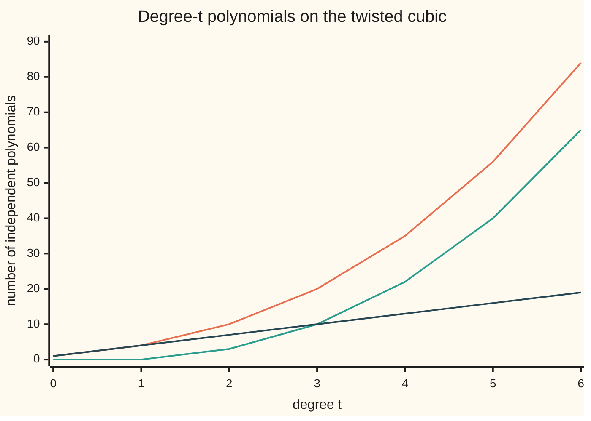

# Degree: how many points a slice meets, and the polynomial that records it

[Syllabus](../../../SYLLABUS.md) → [Algebraic geometry](../README.md) → [Affine and Projective Varieties](../README.md#s02) → Degree

---

## General Overview

Design software draws a bend in a pipe, or the edge of a car panel, as a cubic path: each coordinate is a cubic polynomial in one parameter u. The simplest such path is $`(u, u^2, u^3)`$, called the **twisted cubic**. Every cubic path in space that does not lie in one plane is this curve after a change of coordinates.

Cut the curve with the flat plane $`11x - 6y + z = 6`$. Put the path into the plane's equation: $`11u - 6u^2 + u^3 = 6`$, which factors as $`(u - 1)(u - 2)(u - 3) = 0`$. The plane meets the curve at three points: (1, 1, 1), (2, 4, 8) and (3, 9, 27).

No plane can meet the curve more than three times, because the equation in u is a cubic. Counted the right way, every plane meets it exactly three times. "The right way" means: over the complex numbers, with points at infinity, and with a touching point counted twice, or three times where the plane hugs the curve tightest: the plane $`z = 0`$ gives $`u^3 = 0`$. That number, 3, is the curve's **degree**.

There is a second road to the same 3, with no slicing at all. Take the polynomials in x, y and z of degree at most t, and look at them only on the curve. On the curve they become polynomials in u of degree at most 3t, and every one of those appears. So the curve carries exactly $`3t + 1`$ independent polynomial functions of degree at most t. That count grows by 3 for each step in t, and the 3 is the degree again.

**The degree of a variety is the number of points where a general slice of the complementary size meets it; the same number, divided by d!, is the top coefficient of the count of independent polynomial functions on it, and the Hilbert polynomial records that count, with the dimension d as its degree in t.**

**What kind of fact this is:** degree and the Hilbert function are definitions. That the count becomes a polynomial, and that its top coefficient gives the slice count, are theorems. This card proves both for the twisted cubic, proves the slicing step in general in Why it works, and states Hilbert's general theorem with its source.

### The picture: all polynomials, the ones the curve kills, and what is left



Orange: all monomials of degree t in four coordinates, growing like a cubic in t. Green: the independent ones that vanish on the curve. Dark blue: the difference, the Hilbert function $`3t + 1`$, a straight line of slope 3. Both checks print every point.

---

## The formula

Notation already in use. The field $`k`$ is the number system of the coordinates: the rationals $`\mathbb{Q}`$ for the arithmetic, the complex numbers $`\mathbb{C}`$ for the point counts. A rank does not change when the field grows, so the counts agree. Projective n-space $`\mathbb{P}^n`$ and homogeneous coordinates $`(x : y : z : w)`$ come from [Projective space](03-projective-space-and-homogeneous-coordinates.md). A homogeneous ideal $`I`$ (one generated by equations whose terms all have one degree) and its variety $`V = V(I)`$ come from [Projective varieties](04-projective-varieties-and-closure.md). The dimension $`\dim V`$ comes from [Dimension and tangent space](07-dimension-and-tangent-spaces.md).

The twisted cubic in $`\mathbb{P}^3`$ is the set of points $`(a^2 b : a b^2 : b^3 : a^3)`$, with $`u = b/a`$ the path's parameter. Its ideal is generated by three quadrics (degree-2 equations):

```math
I = \langle\, x^2 - yw,\; xy - zw,\; y^2 - xz \,\rangle
```

New on this card: $`\mathrm{HF}_V`$, $`\mathrm{HP}_V`$ and $`\deg V`$. The **Hilbert function** counts, in each degree t, the independent degree-t polynomials left over once those that vanish on V are discarded:

```math
\mathrm{HF}_V(t) = \dim_k k[x_0, \dots, x_n]_t - \dim_k I_t = \binom{t + n}{n} - \dim_k I_t
```

**Read it aloud:** the Hilbert function at t is the number of monomials of degree t in n + 1 variables, minus the number of independent degree-t polynomials in the ideal.

Hilbert's theorem: for all large t, this count is a polynomial in t, the **Hilbert polynomial**. Its degree in t is the dimension, and its top coefficient gives the degree:

```math
\mathrm{HP}_V(t) = \frac{\deg V}{d!}\, t^d + (\text{lower powers of } t), \qquad d = \dim V, \qquad \deg V = \#\,(V \cap L) \text{ for a general } L \cong \mathbb{P}^{n-d}
```

**Read it aloud:** the Hilbert polynomial has degree d, the dimension; its top coefficient is the degree divided by d factorial; and the degree is the number of points where V meets a general linear space of the complementary dimension n − d.

For the twisted cubic, $`n = 3`$ and $`\mathrm{HF}(t) = \mathrm{HP}(t) = 3t + 1`$ for every $`t \geq 0`$. The power of t is 1, so the dimension is 1: a curve. The top coefficient is 3, so the degree is $`3 \times 1! = 3`$: a general plane ($`L \cong \mathbb{P}^{2}`$) meets it in 3 points.

| Symbol | Plain meaning | In our example | Push it up and the answer… |
| --- | --- | --- | --- |
| $`k`$ | the field of coefficients and coordinates | $`\mathbb{Q}`$ to compute, $`\mathbb{C}`$ to count points | over $`\mathbb{R}`$ points go missing; the dimension counts do not change |
| $`n`$ | the dimension of the surrounding projective space | 3 | more variables, more monomials: $`\binom{t+n}{n}`$ grows |
| $`x, y, z, w`$ | homogeneous coordinates, $`x_0, \dots, x_n`$ in general | $`(u : u^2 : u^3 : 1)`$ on the curve | — |
| $`u`$; $`a, b`$ | the path's parameter; coordinates on a line with $`u = b/a`$ | $`u = 1, 2, 3`$ on the plane | — |
| $`t`$ | the degree of the polynomials being counted | 0 to 7 in the code | HF climbs by 3 per step |
| $`k[x_0, \dots, x_n]_t`$ | all polynomials of degree exactly t: $`\binom{t+n}{n}`$ monomials | 10 at $`t = 2`$ | grows like $`t^n / n!`$ |
| $`I`$; $`I_t`$ | the ideal of all equations of V; its degree-t part | three quadrics; $`\dim I_2 = 3`$ | more equations, smaller V, smaller HF |
| $`V`$ | the variety: the common zeros of I | the twisted cubic | — |
| $`\mathrm{HF}_V(t)`$; $`R_t`$; $`\mathrm{HF}_{I + \langle h \rangle}(t)`$ | the Hilbert function: the size of $`R_t`$, the degree-t polynomials modulo $`I_t`$; the same count with h added to the equations | $`3t + 1`$: 1, 4, 7, 10, …; with a plane h: 1, 3, 3, 3, 3 | — |
| $`\mathrm{HP}_V(t)`$; $`c`$ | the Hilbert polynomial: HF for all large t; c its top coefficient | $`3t + 1`$; $`c = 3`$ | — |
| $`d = \dim V`$ | the dimension: the power of t in HP | 1 | one more power of t per dimension |
| $`\deg V`$; $`N`$; $`L`$, $`h`$ | the degree; N a number of points; the slicing linear space, and for a plane its equation h | 3; $`N = 3`$; $`h = 11x - 6y + z - 6w`$ | a higher degree means more crossings |

### When it holds

- **Count over $`\mathbb{C}`$.** Over the reals, the plane $`z = 8`$ meets the curve only at $`u = 2`$. The other two crossings have complex u and do not show in a drawing.
- **Count in projective space.** The plane $`x = 0`$ meets the drawn curve only at $`u = 0`$. It also touches the curve at the point at infinity $`(0 : 0 : 1 : 0)`$, a crossing counted twice, which no affine picture shows.
- **Count with multiplicity.** A plane that contains a tangent line touches the curve there. The plane $`5x - 4y + z = 2`$ gives $`(u - 1)^2 (u - 2)`$: two distinct points, one of them counted twice.
- **The slice must be general.** The bad planes for the twisted cubic are those where the cubic in u has a repeated root, the zero set of its discriminant (the number that is zero exactly when two roots coincide). Of 1000 random planes in the code, 6 land there. For a surface, the slicing line must also not lie inside it.
- **HF equals HP only for large t, and only with the full ideal.** The plane cubic $`y^2 z = x^3 - x z^2`$ has $`\mathrm{HF}(0) = 1`$ but $`\mathrm{HP}(0) = 0`$. Dropping one of the twisted cubic's three equations changes V, and the degree becomes 4.

---

## Why it works

### Step 0: slicing by a plane takes one difference of the count

Multiply the polynomials of degree t − 1 on V by the plane's equation h. Each one becomes a polynomial of degree t that vanishes on the slice. When h vanishes on no piece of V, nothing is lost in the multiplication. So the polynomials on the slice number $`\mathrm{HF}_V(t) - \mathrm{HF}_V(t - 1)`$.

A difference lowers a polynomial's degree by one. After d slices, V is a finite set of points, and a finite set of N points carries exactly N independent functions. That N is the degree, and it is the top coefficient times $`d!`$.

### Step 1: count the monomials, then subtract what the ideal kills

A **monomial** of degree t is a product such as $`x^2 z w`$ whose exponents add to t. Monomials of degree t in n + 1 variables number $`\binom{t+n}{n}`$: this is sharing t identical items among n + 1 boxes, counted in [Stars and bars](../../04-Combinatorics%20and%20graphs/02-Repeats%2C%20Groups%20and%20Double%20Counting/02-stars-and-bars.md).

The degree-t part of the ideal is spanned by each generator times each monomial of the right degree. For the twisted cubic at $`t = 2`$, that is the three quadrics themselves, and they are independent: $`\dim I_2 = 3`$. So $`\mathrm{HF}(2) = 10 - 3 = 7`$. At $`t = 3`$, the three quadrics times x, y, z and w give 12 cubics, but only 10 are independent: $`\mathrm{HF}(3) = 20 - 10 = 10`$. The code finds every rank by exact row reduction.

### Step 2: three roads give 3t + 1 for the twisted cubic

- **Substitution.** On the curve, each monomial of degree t becomes a monomial of degree 3t in a and b. For example $`x^2 z w`$ becomes $`a^4 b^2 \cdot b^3 \cdot a^3 = a^7 b^5`$. Every such monomial is reached: there are $`3t + 1`$ of them, from $`a^{3t}`$ to $`b^{3t}`$. The code counts the distinct images.
- **Rank.** Monomials minus the rank of $`I_t`$, as in Step 1. Rank and substitution agree for $`t = 0`$ to 7. So $`I_t`$ is every degree-t polynomial that vanishes on the curve, not just some of them.
- **Standard monomials.** In the grevlex order (graded reverse lexicographic) with $`x > y > z > w`$ ([Monomial orders](../01-Polynomial%20Systems/02-monomial-orders-and-division.md)), the three quadrics have leading terms $`x^2`$, $`xy`$ and $`y^2`$, and they form a Grobner basis ([Grobner bases](../01-Polynomial%20Systems/03-grobner-bases-and-buchberger.md)). The **standard monomials** are those that none of these leading terms divides: any power of z times any power of w, times 1, x or y. In degree t they number $`(t + 1) + t + t = 3t + 1`$. The code confirms that the leading monomials of $`I_t`$ are exactly the other monomials, degree by degree.

### Step 3: a slice subtracts one step, exactly

Write $`R_t`$ for the degree-t polynomials taken modulo $`I_t`$, that is, with two counted as equal when they differ by a member of $`I_t`$. Its size is $`\mathrm{HF}_V(t)`$. Multiplying by h maps $`R_{t-1}`$ into $`R_t`$. What is left over is $`R_t`$ modulo the multiples of h: the degree-t polynomials modulo the equations of V together with h. Write $`\mathrm{HF}_{I + \langle h \rangle}(t)`$ for its size.

If the map is one to one, sizes subtract:

```math
\mathrm{HF}_{I + \langle h \rangle}(t) = \mathrm{HF}_V(t) - \mathrm{HF}_V(t - 1)
```

**Read it aloud:** the Hilbert function of V's equations with h added is the variety's Hilbert function minus its value one degree lower.

For a general plane, this count is the Hilbert function of the slice $`V \cap \{h = 0\}`$ itself, at least for large t (fold below). For a tangent plane it is not: the slice is 2 points, but the count keeps the double point and settles at 3 (Step 4).

For the twisted cubic: $`(3t + 1) - (3t - 2) = 3`$ for every $`t \geq 1`$. The code computes this count directly, from the ideal with h added, for five different planes. Every time it prints 1, 3, 3, 3, 3.

For the house example, the cone $`x^2 + y^2 = z^2`$ in $`\mathbb{P}^3`$ has $`\mathrm{HF}(t) = (t + 1)^2`$. Slice it by the plane $`z = w`$, and the step gives $`(t + 1)^2 - t^2 = 2t + 1`$. That is the Hilbert function of the conic $`x^2 + y^2 = w^2`$ cut from the cone, which the code computes separately.

<details>
<summary>Detailed proof: why multiplying by h loses nothing</summary>

Suppose V is irreducible (one piece) and $`I`$ is its full ideal. Then $`I`$ is prime: if a product $`fg`$ of two polynomials vanishes on V, then V splits into the zeros of f and the zeros of g, so one of them holds all of V.

Now take a polynomial f of degree t − 1 with $`hf \in I`$. The plane does not contain V, so $`h \notin I`$. Primality forces $`f \in I`$. So the only f that h sends to zero is already zero modulo $`I`$, and the map is one to one.

When V has several pieces, the same argument works as long as h vanishes on none of them. A plane that contains a whole piece breaks it; that is part of the bad set.

The left-over space is $`R_t / hR_{t-1}`$, the degree-t part of $`k[x_0, \dots, x_n] / (I + \langle h \rangle)`$. Its size is the difference of sizes:

$`\displaystyle \dim_k \big(R_t / hR_{t-1}\big) = \mathrm{HF}_V(t) - \mathrm{HF}_V(t-1).`$

For a general plane, the ideal $`I + \langle h \rangle`$ can miss a few equations of the slice in low degrees, but agrees with the slice's full ideal for all large t, so the two Hilbert polynomials agree. For a tangent plane it does not: it keeps the double point's slope, which is how the count stays 3 (Step 4).

</details>

### Step 4: a finite set of N points carries N functions

A polynomial on N points is just a list of N values, so at most N are independent. For t large enough, every list of values is reached. For each point, take a linear form vanishing at one other point but not at it, and multiply the N − 1 forms together, one for each other point. The product is not zero at the chosen point and is zero at all the others. So $`\mathrm{HF}`$ of N distinct points settles at N.

For the plane $`11x - 6y + z - 6w`$, the code builds the table of values of every degree-t monomial at the three points (1, 1, 1), (2, 4, 8) and (3, 9, 27). Its rank is 3 for $`t = 1`$ to 4: the three points carry three independent functions, as the slice count says.

When two points merge, as on the tangent plane, the count with h added still reads 3. That is the honest meaning of "counted twice": the double point carries two functions, a value and a slope.

### Step 5: read degree and dimension off the polynomial

Hilbert proved in 1890 that $`\mathrm{HF}_V(t)`$ agrees with a polynomial for all large t. The [Hilbert's basis theorem](../01-Polynomial%20Systems/08-hilbert-basis-theorem.md) card has the finiteness behind it; Cox, Little and O'Shea prove the polynomial statement in chapter 9.

Now apply Step 3 d times, with d general planes. Each difference turns $`c\, t^d`$ into $`c\, d\, t^{d-1}`$ plus lower terms. After d steps, $`c \cdot d!`$ remains, a constant, and the variety has become a finite set of points. By Step 4, that constant is the number of points. So:

- the power of t in HP is the number of slices needed to reach points, which is the dimension;
- the top coefficient times $`d!`$ is the number of points, which is the degree.

The code fits HP through $`t = 3`$ to 6, predicts $`t = 7`$, and checks the prediction against the computed rank:

| Variety | HF for t = 0, 1, 2, 3, … | HP | Dimension | Degree |
| --- | --- | --- | --- | --- |
| all of $`\mathbb{P}^3`$ | 1, 4, 10, 20, … | $`\tfrac{1}{6}t^3 + t^2 + \tfrac{11}{6}t + 1`$ | 3 | $`\tfrac16 \cdot 3! = 1`$ |
| the cone $`x^2 + y^2 = z^2`$ | 1, 4, 9, 16, … | $`t^2 + 2t + 1`$ | 2 | $`1 \cdot 2! = 2`$ |
| its slice $`z = w`$, a conic | 1, 3, 5, 7, … | $`2t + 1`$ | 1 | 2 |
| the twisted cubic | 1, 4, 7, 10, … | $`3t + 1`$ | 1 | **3** |
| plane cubic $`y^2 z = x^3 - x z^2`$ | 1, 3, 6, 9, … | $`3t`$ | 1 | 3 |
| $`x^2 - yw`$ and $`xy - zw`$ only | 1, 4, 8, 12, … | $`4t`$ | 1 | 4 |

### Step 6: the constant term sees the shape

The twisted cubic and the plane cubic both have degree 3, but their constants differ: 1 against 0. For a curve, 1 minus the constant is the **arithmetic genus**, a count of holes. [Genus](../03-Plane%20Curves/06-genus-and-the-degree-genus-formula.md) gives it for a plane curve of degree d as $`(d - 1)(d - 2)/2`$, which is 1 for the plane cubic. The twisted cubic has genus 0: the single parameter u traces all of it, so it is a line in disguise. The plane cubic has genus 1: it is an elliptic curve, a doughnut over $`\mathbb{C}`$, the curve of [The group law](../04-Elliptic%20Curves/01-elliptic-curves-and-the-group-law.md).

---

## Worked numbers, by hand

| Step | Arithmetic | Value |
| --- | --- | --- |
| monomials of degree 2 in x, y, z, w | $`\binom{5}{3}`$ | 10 |
| the ideal in degree 2 | $`x^2 - yw`$, $`xy - zw`$, $`y^2 - xz`$, independent | 3 |
| Hilbert function at 2 | 10 − 3 | 7 |
| the same by substitution | $`a^6, a^5 b, \dots, b^6`$ | 7 |
| Hilbert function at 3 | 20 − 10 | 10 |
| Hilbert polynomial | slope 10 − 7 = 3; then 10 = 3 × 3 + 1 at t = 3 | $`3t + 1`$ |
| dimension and degree | power of t is 1; $`3 \times 1!`$ | 1 and 3 |
| the plane $`11x - 6y + z = 6`$ | $`u^3 - 6u^2 + 11u - 6 = (u-1)(u-2)(u-3)`$ | 3 points |
| the slice's Hilbert function | $`(3t + 1) - (3(t - 1) + 1)`$ | **3** |

Solving the plane's cubic and counting polynomials both give 3. The second needs no roots, only the curve's equations.

### What breaks if you drop a piece

| Mistake | Comes out at | What went wrong |
| --- | --- | --- |
| Count real points only, plane $`z = 8`$ | 1, not 3 | $`u^3 = 8`$ leaves $`u^2 + 2u + 4`$, discriminant −12: two complex roots |
| Count in the affine chart only, plane $`x = 0`$ | 1, not 3 | two crossings lie at the point at infinity |
| Count distinct points only, the tangent plane | 2, not 3 | $`u = 1`$ is a double root |
| Drop the equation $`y^2 - xz`$ | degree 4, not 3 | the stray line $`x = w = 0`$ joins the curve |

The code prints every row.

---

## Code, from first principles, and it actually runs

The code works exactly over the rationals, with fractions for every rank. It takes three roads to the Hilbert function of the twisted cubic: monomials minus the rank of the ideal, distinct images under substitution, and standard monomials. It then takes two roads to the slice count: exact roots of the cubic in u, with points at infinity added, and the Hilbert function of the ideal with the plane added. It fits Hilbert polynomials for six varieties and tests each against one more computed value. A seeded random-number generator (SplitMix64, written out in both languages) picks 1000 planes so that both programs print the same counts. Each plane's repeated-root test is made twice: by the discriminant, and by the rank of a Sylvester matrix (the table whose rank drops exactly when two polynomials share a root) built from the cubic's two partial derivatives.

### Python

```python
# Degree and the Hilbert polynomial -- the check behind the card.
# Standard library only.  Fraction keeps every rank exact over Q.  The twisted cubic
# (u, u^2, u^3) is the projective curve (x : y : z : w) = (a^2 b : a b^2 : b^3 : a^3).
# Road 1: HF(t) = monomials of degree t minus the rank of the ideal's degree-t part.
# Road 2: substitute the curve and count the distinct monomials a^i b^j it reaches.
# Road 3: count standard monomials, those outside the leading terms x^2, xy, y^2.
# Then planes slice the curve, and Hilbert polynomials are fitted and read.
from fractions import Fraction as Q
from math import comb, factorial
def monos(n, t):
    if n == 1: return [(t,)]
    return [(a,) + r for a in range(t, -1, -1) for r in monos(n - 1, t - a)]
def grevlex(e): return (sum(e), tuple(-c for c in reversed(e)))
def deg(p): return sum(next(iter(p)))
def times(p, m): return {tuple(a + b for a, b in zip(e, m)): c for e, c in p.items()}
def pivots(cols, rows):            # exact row reduction; returns the leading columns
    rows, piv = [r[:] for r in rows], []
    for j in range(len(cols)):
        k = next((i for i in range(len(piv), len(rows)) if rows[i][j]), None)
        if k is None: continue
        r = len(piv); rows[r], rows[k] = rows[k], rows[r]
        for i in range(r + 1, len(rows)):
            if rows[i][j]:
                f = rows[i][j] / rows[r][j]
                rows[i] = [a - f * b for a, b in zip(rows[i], rows[r])]
        piv.append(cols[j])
    return piv
def ideal_piece(gens, n, t):        # the degree-t part of the ideal, columns in grevlex order
    cols = sorted(monos(n, t), key=grevlex, reverse=True)
    rows = [times(g, m) for g in gens if deg(g) <= t for m in monos(n, t - deg(g))]
    return cols, pivots(cols, [[Q(r.get(c, 0)) for c in cols] for r in rows])
def hf(gens, n, t): cols, piv = ideal_piece(gens, n, t); return len(cols) - len(piv)
def fit(ts, vs):                   # Lagrange interpolation, power basis, lowest degree first
    out = [Q(0)] * len(ts)
    for ti, vi in zip(ts, vs):
        b, den = [Q(1)], Q(1)
        for tj in ts:
            if tj != ti:
                b = [(b[k - 1] if k else 0) - tj * (b[k] if k < len(b) else 0) for k in range(len(b) + 1)]
                den *= ti - tj
        out = [o + vi * c / den for o, c in zip(out, b)]
    while len(out) > 1 and out[-1] == 0: out.pop()
    return out
def show(p):
    s = ""
    for k in range(len(p) - 1, -1, -1):
        c = p[k]
        if c == 0: continue
        a = abs(c); num = "" if (a == 1 and k) else (str(a) if a.denominator == 1 else f"({a})")
        s += (" - " if c < 0 else " + ") + num + ("t^%d" % k if k > 1 else "t" if k == 1 else "")
    s = s[3:] if s.startswith(" + ") else "-" + s[3:]
    return s or "0"
def at(p, t): return sum(c * t ** k for k, c in enumerate(p))
X2, XY, Y2 = {(2, 0, 0, 0): 1, (0, 1, 0, 1): -1}, {(1, 1, 0, 0): 1, (0, 0, 1, 1): -1}, {(0, 2, 0, 0): 1, (1, 0, 1, 0): -1}
TC = [X2, XY, Y2]
def image(e): return (2 * e[0] + e[1] + 3 * e[3], e[0] + 2 * e[1] + 3 * e[2])   # x^p y^q z^r w^s -> a^i b^j
print("twisted cubic (u, u^2, u^3) = (x : y : z : w) = (a^2 b : a b^2 : b^3 : a^3); field Q, counts as over C")
vanish = all(sum(c for e, c in g.items() if image(e) == im) == 0 for g in TC for im in map(image, g))
print(f"equations x^2 - yw, xy - zw, y^2 - xz; each vanishes on the curve: {'yes' if vanish else 'no'}")
print("t | monomials | ideal I_t | HF = monomials - ideal | images a^i b^j | standard monomials")
H = []
for t in range(8):
    cols, piv = ideal_piece(TC, 4, t)
    ims = len({image(e) for e in cols})
    std = [e for e in cols if e[0] + e[1] <= 1]
    assert set(piv) == set(cols) - set(std)          # leading monomials are exactly those of x^2, xy, y^2
    H.append(len(cols) - len(piv))
    print(f"{t} | {len(cols)} | {len(piv)} | {H[-1]} | {ims} | {len(std)}")
    assert len(cols) == comb(t + 3, 3) and H[-1] == ims == len(std)
hp = fit(range(3, 7), H[3:7])
print(f"HP fitted through t = 3..6: {show(hp)}; predicts HF(7) = {at(hp, 7)}, computed {H[7]}")
print(f"read off: dimension = degree of HP = {len(hp) - 1}; degree = leading coefficient x 1! = {hp[-1]}")
assert hp == [1, 3] and at(hp, 7) == H[7]
def cubic_u(h): return [h[3], h[0], h[1], h[2]]     # x, y, z, w coefficients -> d + c u + b u^2 + a u^3
def ldiv(p, r):                                       # divide by (u - r) if r is a root
    q, acc = [], Q(0)
    for c in reversed(p): acc = acc * r + c; q.append(acc)
    return (list(reversed(q[:-1])), True) if acc == 0 else (p, False)
def lin(h): return {(1, 0, 0, 0): h[0], (0, 1, 0, 0): h[1], (0, 0, 1, 0): h[2], (0, 0, 0, 1): h[3]}
planes = [("11x - 6y + z - 6w", (11, -6, 1, -6)), ("z - 8w, a slicer layer", (0, 0, 1, -8)), ("x = 0", (1, 0, 0, 0)),
          ("5x - 4y + z - 2w, tangent", (5, -4, 1, -2)), ("z = 0, triple touch", (0, 0, 1, 0))]
res = {}
for name, h in planes:
    p = [Q(c) for c in cubic_u(h)]
    while p[-1] == 0: p.pop()
    inf, roots = 3 - (len(p) - 1), []
    for r in range(-30, 31):
        ok = True
        while ok and len(p) > 1: p, ok = ldiv(p, r); roots += [r] if ok else []
    left, res[name[:5]] = len(p) - 1, (roots, p, inf)
    sl = [hf(TC + [lin({k: v for k, v in zip(range(4), h)})], 4, t) for t in range(5)]
    print(f"plane {name}: rational roots u = {roots}; other complex {left}; at infinity {inf}; "
          f"total {len(roots) + left + inf}; slice HF t = 0..4: {sl}")
    assert len(roots) + left + inf == 3 and sl[1:] == [3, 3, 3, 3]
pts = [(u, u * u, u ** 3, 1) for u in (1, 2, 3)]
ev = []
for t in range(1, 5):
    cols = monos(4, t)
    ev.append(len(pivots(cols, [[Q(p[0] ** e[0] * p[1] ** e[1] * p[2] ** e[2] * p[3] ** e[3]) for e in cols] for p in pts])))
print(f"points (1, 1, 1), (2, 4, 8), (3, 9, 27): degree-t forms separate them, rank t = 1..4: {ev}")
assert ev == [3, 3, 3, 3]
s = 2026
def splitmix():
    global s
    s = (s + 0x9E3779B97F4A7C15) % 2 ** 64; z = s
    z = (z ^ (z >> 30)) * 0xBF58476D1CE4E5B9 % 2 ** 64; z = (z ^ (z >> 27)) * 0x94D049BB133111EB % 2 ** 64
    return z ^ (z >> 31)
cnt = {"three real": 0, "one real": 0, "repeated": 0, "zero plane": 0}
for _ in range(1000):
    h = [splitmix() % 19 - 9 for _ in range(4)]
    d, c, b, a = cubic_u(h)
    D = 18 * a * b * c * d - 4 * b ** 3 * d + b * b * c * c - 4 * a * c ** 3 - 27 * a * a * d * d
    cnt["zero plane" if not any(h) else "three real" if D > 0 else "one real" if D < 0 else "repeated"] += 1
    syl = [[3 * a, 2 * b, c, 0], [0, 3 * a, 2 * b, c], [b, 2 * c, 3 * d, 0], [0, b, 2 * c, 3 * d]]   # Sylvester: F_u, F_v
    assert (len(pivots(range(4), [[Q(v) for v in row] for row in syl])) < 4) == (D == 0)   # shared root = repeated
print("1000 random planes, SplitMix64 seed 2026, coefficients -9..9: " + ", ".join(f"{k} {v}" for k, v in cnt.items()))
assert sum(cnt.values()) == 1000 and cnt["zero plane"] == 0
CONE = [{(2, 0, 0, 0): 1, (0, 2, 0, 0): 1, (0, 0, 2, 0): -1}]
models = [("P^3, no equations", [], 4), ("twisted cubic", TC, 4), ("cone x^2 + y^2 = z^2 in P^3", CONE, 4),
          ("its slice z = w, a conic", CONE + [{(0, 0, 1, 0): 1, (0, 0, 0, 1): -1}], 4),
          ("plane cubic y^2 z = x^3 - x z^2", [{(0, 2, 1): 1, (3, 0, 0): -1, (1, 0, 2): 1}], 3),
          ("two quadrics x^2 - yw, xy - zw", [X2, XY], 4)]
got = {}
for name, gens, n in models:
    v = H if gens is TC else [hf(gens, n, t) for t in range(8)]
    p = fit(range(3, 7), v[3:7]); d = len(p) - 1
    assert at(p, 7) == v[7]
    got[name] = (p[-1] * factorial(d), v, p[-1])
    print(f"{name}: HF t = 0..7 {v}; HP {show(p)}; dim {d}; degree {p[-1] * factorial(d)}")
assert [got[m[0]][0] for m in models] == [1, 3, 2, 2, 3, 4] and got["plane cubic y^2 z = x^3 - x z^2"][1][0] == 1
(rb, qb, _), (rc, _, ic), (rd, _, _) = res["z - 8"], res["x = 0"], res["5x - "]
qd = qb[1] ** 2 - 4 * qb[0] * qb[2]
print(f"mistake 1, real points only: plane z = 8w, real roots {rb}, leftover u^2 + 2u + 4 has discriminant {qd}: {len(rb)}, not 3")
print(f"mistake 2, affine chart only: plane x = 0 shows u = {rc[0]} alone: {len(rc)}, not 3; {ic} more lie at infinity")
print(f"mistake 3, distinct points only: the tangent plane shows u = {sorted(set(rd))}: {len(set(rd))}, not 3")
assert qd < 0 and qb == [4, 2, 1] and len(rb) == len(rc) == 1 and len(set(rd)) == 2 and res["z = 0"][0] == [0, 0, 0]
print(f"mistake 4, drop y^2 - xz: degree {got['two quadrics x^2 - yw, xy - zw'][0]}, not 3; the line x = w = 0 joins in")
print(f"mistake 5, cone's leading coefficient as degree: {got['cone x^2 + y^2 = z^2 in P^3'][2]}, not {got['cone x^2 + y^2 = z^2 in P^3'][0]}; forgot the 2!")
print(f"chart, t = 0..6: monomials {[comb(t + 3, 3) for t in range(7)]}; ideal {[comb(t + 3, 3) - H[t] for t in range(7)]}; HF {H[:7]}")
print("ALL CHECKS PASS")
```

**Ran 2026-11-17 on macOS, Python 3.14.10, standard library only. All checks passed. Output, pasted from the run:**

```
twisted cubic (u, u^2, u^3) = (x : y : z : w) = (a^2 b : a b^2 : b^3 : a^3); field Q, counts as over C
equations x^2 - yw, xy - zw, y^2 - xz; each vanishes on the curve: yes
t | monomials | ideal I_t | HF = monomials - ideal | images a^i b^j | standard monomials
0 | 1 | 0 | 1 | 1 | 1
1 | 4 | 0 | 4 | 4 | 4
2 | 10 | 3 | 7 | 7 | 7
3 | 20 | 10 | 10 | 10 | 10
4 | 35 | 22 | 13 | 13 | 13
5 | 56 | 40 | 16 | 16 | 16
6 | 84 | 65 | 19 | 19 | 19
7 | 120 | 98 | 22 | 22 | 22
HP fitted through t = 3..6: 3t + 1; predicts HF(7) = 22, computed 22
read off: dimension = degree of HP = 1; degree = leading coefficient x 1! = 3
plane 11x - 6y + z - 6w: rational roots u = [1, 2, 3]; other complex 0; at infinity 0; total 3; slice HF t = 0..4: [1, 3, 3, 3, 3]
plane z - 8w, a slicer layer: rational roots u = [2]; other complex 2; at infinity 0; total 3; slice HF t = 0..4: [1, 3, 3, 3, 3]
plane x = 0: rational roots u = [0]; other complex 0; at infinity 2; total 3; slice HF t = 0..4: [1, 3, 3, 3, 3]
plane 5x - 4y + z - 2w, tangent: rational roots u = [1, 1, 2]; other complex 0; at infinity 0; total 3; slice HF t = 0..4: [1, 3, 3, 3, 3]
plane z = 0, triple touch: rational roots u = [0, 0, 0]; other complex 0; at infinity 0; total 3; slice HF t = 0..4: [1, 3, 3, 3, 3]
points (1, 1, 1), (2, 4, 8), (3, 9, 27): degree-t forms separate them, rank t = 1..4: [3, 3, 3, 3]
1000 random planes, SplitMix64 seed 2026, coefficients -9..9: three real 223, one real 771, repeated 6, zero plane 0
P^3, no equations: HF t = 0..7 [1, 4, 10, 20, 35, 56, 84, 120]; HP (1/6)t^3 + t^2 + (11/6)t + 1; dim 3; degree 1
twisted cubic: HF t = 0..7 [1, 4, 7, 10, 13, 16, 19, 22]; HP 3t + 1; dim 1; degree 3
cone x^2 + y^2 = z^2 in P^3: HF t = 0..7 [1, 4, 9, 16, 25, 36, 49, 64]; HP t^2 + 2t + 1; dim 2; degree 2
its slice z = w, a conic: HF t = 0..7 [1, 3, 5, 7, 9, 11, 13, 15]; HP 2t + 1; dim 1; degree 2
plane cubic y^2 z = x^3 - x z^2: HF t = 0..7 [1, 3, 6, 9, 12, 15, 18, 21]; HP 3t; dim 1; degree 3
two quadrics x^2 - yw, xy - zw: HF t = 0..7 [1, 4, 8, 12, 16, 20, 24, 28]; HP 4t; dim 1; degree 4
mistake 1, real points only: plane z = 8w, real roots [2], leftover u^2 + 2u + 4 has discriminant -12: 1, not 3
mistake 2, affine chart only: plane x = 0 shows u = 0 alone: 1, not 3; 2 more lie at infinity
mistake 3, distinct points only: the tangent plane shows u = [1, 2]: 2, not 3
mistake 4, drop y^2 - xz: degree 4, not 3; the line x = w = 0 joins in
mistake 5, cone's leading coefficient as degree: 1, not 2; forgot the 2!
chart, t = 0..6: monomials [1, 4, 10, 20, 35, 56, 84]; ideal [0, 0, 3, 10, 22, 40, 65]; HF [1, 4, 7, 10, 13, 16, 19]
ALL CHECKS PASS
```

### Rust

Same numbers, same labels. Fractions are an `i128` struct whose products and sums use `checked_mul` and `checked_add`, so an overflow stops the run.

```rust
// Degree and the Hilbert polynomial -- the same check as the Python, in Rust.
// No crates.  Fractions are an i128 struct using checked_mul and checked_add, so overflow stops the run.
// The twisted cubic (u, u^2, u^3) is the projective curve (x : y : z : w) = (a^2 b : a b^2 : b^3 : a^3).
// Road 1: HF(t) = monomials of degree t minus the rank of the ideal's degree-t part.
// Road 2: substitute the curve and count the distinct monomials a^i b^j it reaches.
// Road 3: count standard monomials, those outside the leading terms x^2, xy, y^2.
// Then planes slice the curve, and Hilbert polynomials are fitted and read.
use std::collections::BTreeSet;
use std::fmt;
#[derive(Clone, Copy, PartialEq, Debug)]
struct Q { n: i128, d: i128 }
fn gcd(a: i128, b: i128) -> i128 { if b == 0 { a.abs() } else { gcd(b, a % b) } }
fn q(n: i128, d: i128) -> Q { let g = gcd(n, d).max(1); let s = if d < 0 { -1 } else { 1 }; Q { n: s * n / g, d: s * d / g } }
fn m(a: i128, b: i128) -> i128 { a.checked_mul(b).expect("overflow") }
fn add(a: Q, b: Q) -> Q { q(m(a.n, b.d).checked_add(m(b.n, a.d)).expect("overflow"), m(a.d, b.d)) }
fn sub(a: Q, b: Q) -> Q { add(a, Q { n: -b.n, d: b.d }) }
fn mul(a: Q, b: Q) -> Q { q(m(a.n, b.n), m(a.d, b.d)) }
fn div(a: Q, b: Q) -> Q { assert!(b.n != 0); q(m(a.n, b.d), m(a.d, b.n)) }
fn i(n: i128) -> Q { Q { n, d: 1 } }
impl fmt::Display for Q { fn fmt(&self, f: &mut fmt::Formatter) -> fmt::Result {
    if self.d == 1 { write!(f, "{}", self.n) } else { write!(f, "{}/{}", self.n, self.d) } } }
type Mono = Vec<i64>;
type Poly = Vec<(Mono, i128)>;
fn monos(n: usize, t: i64) -> Vec<Mono> {
    if n == 1 { return vec![vec![t]]; }
    (0..=t).rev().flat_map(|a| monos(n - 1, t - a).into_iter().map(move |r| [vec![a], r].concat())).collect()
}
fn grevlex(e: &Mono) -> (i64, Vec<i64>) { (e.iter().sum(), e.iter().rev().map(|c| -c).collect()) }
fn deg(p: &Poly) -> i64 { p[0].0.iter().sum() }
fn pivots(cols: &[Mono], rows: Vec<Vec<Q>>) -> Vec<Mono> {   // exact row reduction; leading columns
    let mut rows = rows; let mut piv: Vec<Mono> = vec![];
    for j in 0..cols.len() {
        let r = piv.len();
        let k = match (r..rows.len()).find(|&k| rows[k][j].n != 0) { Some(k) => k, None => continue };
        rows.swap(r, k); piv.push(cols[j].clone());
        for x in r + 1..rows.len() {
            if rows[x][j].n == 0 { continue; }
            let (f, base) = (div(rows[x][j], rows[r][j]), rows[r].clone());
            for (a, b) in rows[x].iter_mut().zip(base.iter()) { *a = sub(*a, mul(f, *b)); }
        }
    }
    piv
}
fn ideal_piece(gens: &[Poly], n: usize, t: i64) -> (Vec<Mono>, Vec<Mono>) {
    let mut cols = monos(n, t); cols.sort_by(|a, b| grevlex(b).cmp(&grevlex(a)));
    let mut rows = vec![];
    for g in gens { if deg(g) <= t { for mm in monos(n, t - deg(g)) {
        let mut row = vec![i(0); cols.len()];
        for (e, c) in g { let s: Mono = e.iter().zip(&mm).map(|(a, b)| a + b).collect();
            let k = cols.iter().position(|x| *x == s).unwrap(); row[k] = add(row[k], i(*c)); }
        rows.push(row);
    } } }
    let piv = pivots(&cols, rows); (cols, piv)
}
fn hf(gens: &[Poly], n: usize, t: i64) -> usize { let (c, p) = ideal_piece(gens, n, t); c.len() - p.len() }
fn fit(ts: &[i64], vs: &[usize]) -> Vec<Q> {          // Lagrange interpolation, lowest degree first
    let mut out = vec![i(0); ts.len()];
    for (&ti, &vi) in ts.iter().zip(vs) {
        let (mut b, mut den) = (vec![i(1)], i(1));
        for &tj in ts { if tj != ti {
            b = (0..=b.len()).map(|k| sub(if k > 0 { b[k - 1] } else { i(0) }, mul(i(tj as i128), if k < b.len() { b[k] } else { i(0) }))).collect();
            den = mul(den, i((ti - tj) as i128));
        } }
        for k in 0..out.len() { out[k] = add(out[k], div(mul(i(vi as i128), b[k]), den)); }
    }
    while out.len() > 1 && out[out.len() - 1].n == 0 { out.pop(); }
    out
}
fn show(p: &[Q]) -> String {
    let mut s = String::new();
    for k in (0..p.len()).rev() {
        let (c, a) = (p[k], Q { n: p[k].n.abs(), d: p[k].d }); if c.n == 0 { continue; }
        let num = if a.n == 1 && a.d == 1 && k > 0 { String::new() } else if a.d == 1 { a.to_string() } else { format!("({})", a) };
        let tp = if k > 1 { format!("t^{}", k) } else if k == 1 { "t".to_string() } else { String::new() };
        s += &format!("{}{}{}", if c.n < 0 { " - " } else { " + " }, num, tp);
    }
    if s.is_empty() { "0".into() } else if s.starts_with(" + ") { s[3..].to_string() } else { format!("-{}", &s[3..]) }
}
fn at(p: &[Q], t: i128) -> Q { p.iter().rev().fold(i(0), |acc, &c| add(mul(acc, i(t)), c)) }
fn ls<T: fmt::Display>(v: &[T]) -> String { format!("[{}]", v.iter().map(|x| x.to_string()).collect::<Vec<_>>().join(", ")) }
fn image(e: &Mono) -> (i64, i64) { (2 * e[0] + e[1] + 3 * e[3], e[0] + 2 * e[1] + 3 * e[2]) }
fn pl(t: &[(&[i64], i128)]) -> Poly { t.iter().map(|(e, c)| (e.to_vec(), *c)).collect() }
fn ldiv(p: &[Q], r: i128) -> (Vec<Q>, bool) {          // divide by (u - r) if r is a root
    let mut qv = vec![]; let mut acc = i(0);
    for &c in p.iter().rev() { acc = add(mul(acc, i(r)), c); qv.push(acc); }
    if acc.n == 0 { let mut o: Vec<Q> = qv[..qv.len() - 1].to_vec(); o.reverse(); (o, true) } else { (p.to_vec(), false) }
}
fn main() {
    let (x2, xy) = (pl(&[(&[2, 0, 0, 0], 1), (&[0, 1, 0, 1], -1)]), pl(&[(&[1, 1, 0, 0], 1), (&[0, 0, 1, 1], -1)]));
    let tc = vec![x2.clone(), xy.clone(), pl(&[(&[0, 2, 0, 0], 1), (&[1, 0, 1, 0], -1)])];
    println!("twisted cubic (u, u^2, u^3) = (x : y : z : w) = (a^2 b : a b^2 : b^3 : a^3); field Q, counts as over C");
    let vanish = tc.iter().all(|g| g.iter().all(|(e0, _)| g.iter().filter(|(e, _)| image(e) == image(e0)).map(|(_, c)| c).sum::<i128>() == 0));
    println!("equations x^2 - yw, xy - zw, y^2 - xz; each vanishes on the curve: {}", if vanish { "yes" } else { "no" });
    println!("t | monomials | ideal I_t | HF = monomials - ideal | images a^i b^j | standard monomials");
    let mut h: Vec<usize> = vec![];
    for t in 0..8 {
        let (cols, piv) = ideal_piece(&tc, 4, t);
        let ims: BTreeSet<(i64, i64)> = cols.iter().map(image).collect();
        let std: BTreeSet<Mono> = cols.iter().filter(|e| e[0] + e[1] <= 1).cloned().collect();
        assert!(piv.iter().cloned().collect::<BTreeSet<Mono>>() == cols.iter().filter(|e| !std.contains(*e)).cloned().collect());
        h.push(cols.len() - piv.len());
        println!("{} | {} | {} | {} | {} | {}", t, cols.len(), piv.len(), h[t as usize], ims.len(), std.len());
        assert!(cols.len() == ((t + 1) * (t + 2) * (t + 3) / 6) as usize && h[t as usize] == ims.len() && ims.len() == std.len());
    }
    let ts: Vec<i64> = (3..7).collect(); let hp = fit(&ts, &h[3..7]);
    println!("HP fitted through t = 3..6: {}; predicts HF(7) = {}, computed {}", show(&hp), at(&hp, 7), h[7]);
    println!("read off: dimension = degree of HP = {}; degree = leading coefficient x 1! = {}", hp.len() - 1, hp[hp.len() - 1]);
    assert!(hp == vec![i(1), i(3)] && at(&hp, 7) == i(h[7] as i128));
    let planes: [(&str, [i128; 4]); 5] = [("11x - 6y + z - 6w", [11, -6, 1, -6]), ("z - 8w, a slicer layer", [0, 0, 1, -8]),
        ("x = 0", [1, 0, 0, 0]), ("5x - 4y + z - 2w, tangent", [5, -4, 1, -2]), ("z = 0, triple touch", [0, 0, 1, 0])];
    let mut res: Vec<(Vec<i128>, Vec<Q>, usize)> = vec![];
    for (name, hv) in planes.iter() {
        let mut p: Vec<Q> = [hv[3], hv[0], hv[1], hv[2]].iter().map(|&c| i(c)).collect();
        while p[p.len() - 1].n == 0 { p.pop(); } let (inf, mut roots) = (3 - (p.len() - 1), vec![]);
        for r in -30..31i128 { let mut ok = true;
            while ok && p.len() > 1 { let (np, o) = ldiv(&p, r); p = np; ok = o; if ok { roots.push(r); } } }
        let left = p.len() - 1; let mut g = tc.clone();
        g.push((0..4).map(|k| { let mut e = vec![0; 4]; e[k] = 1; (e, hv[k]) }).collect());
        let sl: Vec<usize> = (0..5).map(|t| hf(&g, 4, t)).collect();
        println!("plane {}: rational roots u = {}; other complex {}; at infinity {}; total {}; slice HF t = 0..4: {}",
            name, ls(&roots), left, inf, roots.len() + left + inf, ls(&sl));
        assert!(roots.len() + left + inf == 3 && sl[1..] == [3, 3, 3, 3]);
        res.push((roots, p, inf));
    }
    let pts: Vec<[i128; 4]> = [1i128, 2, 3].iter().map(|&u| [u, u * u, u * u * u, 1]).collect();
    let ev: Vec<usize> = (1..5).map(|t| { let cols = monos(4, t);
        let rows = pts.iter().map(|p| cols.iter().map(|e| i((0..4).map(|k| p[k].pow(e[k] as u32)).product())).collect()).collect();
        pivots(&cols, rows).len() }).collect();
    println!("points (1, 1, 1), (2, 4, 8), (3, 9, 27): degree-t forms separate them, rank t = 1..4: {}", ls(&ev));
    assert!(ev == vec![3, 3, 3, 3]);
    let mut s: u64 = 2026;
    let mut splitmix = || { s = s.wrapping_add(0x9E3779B97F4A7C15); let mut z = s;
        z = (z ^ (z >> 30)).wrapping_mul(0xBF58476D1CE4E5B9); z = (z ^ (z >> 27)).wrapping_mul(0x94D049BB133111EB); z ^ (z >> 31) };
    let mut cnt = [0usize; 4]; for _ in 0..1000 {
        let hv: Vec<i128> = (0..4).map(|_| (splitmix() % 19) as i128 - 9).collect(); let (d, c, b, a) = (hv[3], hv[0], hv[1], hv[2]);
        let dd = 18 * a * b * c * d - 4 * b.pow(3) * d + b * b * c * c - 4 * a * c.pow(3) - 27 * a * a * d * d;
        cnt[if hv.iter().all(|&v| v == 0) { 3 } else if dd > 0 { 0 } else if dd < 0 { 1 } else { 2 }] += 1; // Sylvester: F_u, F_v
        let syl = [[3 * a, 2 * b, c, 0], [0, 3 * a, 2 * b, c], [b, 2 * c, 3 * d, 0], [0, b, 2 * c, 3 * d]].iter().map(|r| r.iter().map(|&v| i(v)).collect()).collect();
        assert!((pivots(&monos(4, 1), syl).len() < 4) == (dd == 0)); }
    println!("1000 random planes, SplitMix64 seed 2026, coefficients -9..9: three real {}, one real {}, repeated {}, zero plane {}", cnt[0], cnt[1], cnt[2], cnt[3]);
    assert!(cnt.iter().sum::<usize>() == 1000 && cnt[3] == 0);
    let cone = vec![pl(&[(&[2, 0, 0, 0], 1), (&[0, 2, 0, 0], 1), (&[0, 0, 2, 0], -1)])];
    let mut cs = cone.clone(); cs.push(pl(&[(&[0, 0, 1, 0], 1), (&[0, 0, 0, 1], -1)]));
    let models: Vec<(&str, Vec<Poly>, usize)> = vec![("P^3, no equations", vec![], 4), ("twisted cubic", tc.clone(), 4),
        ("cone x^2 + y^2 = z^2 in P^3", cone, 4), ("its slice z = w, a conic", cs, 4),
        ("plane cubic y^2 z = x^3 - x z^2", vec![pl(&[(&[0, 2, 1], 1), (&[3, 0, 0], -1), (&[1, 0, 2], 1)])], 3),
        ("two quadrics x^2 - yw, xy - zw", vec![x2, xy], 4)];
    let mut got: Vec<(Q, Vec<usize>, Q)> = vec![];
    for (k, (name, gens, n)) in models.iter().enumerate() {
        let v: Vec<usize> = if k == 1 { h.clone() } else { (0..8).map(|t| hf(gens, *n, t)).collect() };
        let p = fit(&ts, &v[3..7]); let d = p.len() - 1;
        assert!(at(&p, 7) == i(v[7] as i128));
        let dg = mul(p[d], i((1..=d as i128).product())); got.push((dg, v.clone(), p[d]));
        println!("{}: HF t = 0..7 {}; HP {}; dim {}; degree {}", name, ls(&v), show(&p), d, dg);
    }
    assert!(got.iter().map(|g| g.0).collect::<Vec<Q>>() == vec![i(1), i(3), i(2), i(2), i(3), i(4)] && got[4].1[0] == 1);
    let (rb, qb) = (&res[1].0, &res[1].1); let (rc, ic) = (&res[2].0, res[2].2); let rd = &res[3].0;
    let qd = sub(mul(qb[1], qb[1]), mul(i(4), mul(qb[0], qb[2])));
    println!("mistake 1, real points only: plane z = 8w, real roots {}, leftover u^2 + 2u + 4 has discriminant {}: {}, not 3", ls(rb), qd, rb.len());
    println!("mistake 2, affine chart only: plane x = 0 shows u = {} alone: {}, not 3; {} more lie at infinity", rc[0], rc.len(), ic);
    let dset: Vec<i128> = rd.iter().cloned().collect::<BTreeSet<i128>>().into_iter().collect();
    println!("mistake 3, distinct points only: the tangent plane shows u = {}: {}, not 3", ls(&dset), dset.len());
    assert!(qd.n < 0 && *qb == vec![i(4), i(2), i(1)] && rb.len() == 1 && rc.len() == 1 && dset.len() == 2 && res[4].0 == vec![0, 0, 0]);
    println!("mistake 4, drop y^2 - xz: degree {}, not 3; the line x = w = 0 joins in", got[5].0);
    println!("mistake 5, cone's leading coefficient as degree: {}, not {}; forgot the 2!", got[2].2, got[2].0);
    let mons: Vec<usize> = (0..7).map(|t| (t + 1) * (t + 2) * (t + 3) / 6).collect();
    let idl: Vec<usize> = (0..7).map(|t| mons[t] - h[t]).collect(); // the chart's three lines
    println!("chart, t = 0..6: monomials {}; ideal {}; HF {}", ls(&mons), ls(&idl), ls(&h[..7]));
    println!("ALL CHECKS PASS");
}
```

**Ran 2026-11-17 on macOS, rustc 1.98.1, no crates. All checks passed. Output, pasted from the run:**

```
twisted cubic (u, u^2, u^3) = (x : y : z : w) = (a^2 b : a b^2 : b^3 : a^3); field Q, counts as over C
equations x^2 - yw, xy - zw, y^2 - xz; each vanishes on the curve: yes
t | monomials | ideal I_t | HF = monomials - ideal | images a^i b^j | standard monomials
0 | 1 | 0 | 1 | 1 | 1
1 | 4 | 0 | 4 | 4 | 4
2 | 10 | 3 | 7 | 7 | 7
3 | 20 | 10 | 10 | 10 | 10
4 | 35 | 22 | 13 | 13 | 13
5 | 56 | 40 | 16 | 16 | 16
6 | 84 | 65 | 19 | 19 | 19
7 | 120 | 98 | 22 | 22 | 22
HP fitted through t = 3..6: 3t + 1; predicts HF(7) = 22, computed 22
read off: dimension = degree of HP = 1; degree = leading coefficient x 1! = 3
plane 11x - 6y + z - 6w: rational roots u = [1, 2, 3]; other complex 0; at infinity 0; total 3; slice HF t = 0..4: [1, 3, 3, 3, 3]
plane z - 8w, a slicer layer: rational roots u = [2]; other complex 2; at infinity 0; total 3; slice HF t = 0..4: [1, 3, 3, 3, 3]
plane x = 0: rational roots u = [0]; other complex 0; at infinity 2; total 3; slice HF t = 0..4: [1, 3, 3, 3, 3]
plane 5x - 4y + z - 2w, tangent: rational roots u = [1, 1, 2]; other complex 0; at infinity 0; total 3; slice HF t = 0..4: [1, 3, 3, 3, 3]
plane z = 0, triple touch: rational roots u = [0, 0, 0]; other complex 0; at infinity 0; total 3; slice HF t = 0..4: [1, 3, 3, 3, 3]
points (1, 1, 1), (2, 4, 8), (3, 9, 27): degree-t forms separate them, rank t = 1..4: [3, 3, 3, 3]
1000 random planes, SplitMix64 seed 2026, coefficients -9..9: three real 223, one real 771, repeated 6, zero plane 0
P^3, no equations: HF t = 0..7 [1, 4, 10, 20, 35, 56, 84, 120]; HP (1/6)t^3 + t^2 + (11/6)t + 1; dim 3; degree 1
twisted cubic: HF t = 0..7 [1, 4, 7, 10, 13, 16, 19, 22]; HP 3t + 1; dim 1; degree 3
cone x^2 + y^2 = z^2 in P^3: HF t = 0..7 [1, 4, 9, 16, 25, 36, 49, 64]; HP t^2 + 2t + 1; dim 2; degree 2
its slice z = w, a conic: HF t = 0..7 [1, 3, 5, 7, 9, 11, 13, 15]; HP 2t + 1; dim 1; degree 2
plane cubic y^2 z = x^3 - x z^2: HF t = 0..7 [1, 3, 6, 9, 12, 15, 18, 21]; HP 3t; dim 1; degree 3
two quadrics x^2 - yw, xy - zw: HF t = 0..7 [1, 4, 8, 12, 16, 20, 24, 28]; HP 4t; dim 1; degree 4
mistake 1, real points only: plane z = 8w, real roots [2], leftover u^2 + 2u + 4 has discriminant -12: 1, not 3
mistake 2, affine chart only: plane x = 0 shows u = 0 alone: 1, not 3; 2 more lie at infinity
mistake 3, distinct points only: the tangent plane shows u = [1, 2]: 2, not 3
mistake 4, drop y^2 - xz: degree 4, not 3; the line x = w = 0 joins in
mistake 5, cone's leading coefficient as degree: 1, not 2; forgot the 2!
chart, t = 0..6: monomials [1, 4, 10, 20, 35, 56, 84]; ideal [0, 0, 3, 10, 22, 40, 65]; HF [1, 4, 7, 10, 13, 16, 19]
ALL CHECKS PASS
```

### Lean

Lean proves the twisted cubic's degree and Hilbert function, the slicing step for any one-piece variety, and the worked numbers.

- Take any plane $`\alpha x + \beta y + \gamma z + \delta w = 0`$ over $`\mathbb{C}`$. Then its points on the curve are the roots of the cubic $`\delta + \alpha u + \beta u^2 + \gamma u^3`$ in u. Counted with multiplicity, plus 3 minus the cubic's degree at the point at infinity, they number exactly 3.
- Take the twisted cubic's three equations, over any field. Then $`\mathrm{HF}(t) = 3t + 1`$ for every $`t \geq 0`$.
- Suppose V is one piece, so its full ideal $`I`$ is prime, and the plane's equation h is not in $`I`$. Then $`\mathrm{HF}_{I + \langle h \rangle}(t) = \mathrm{HF}_V(t) - \mathrm{HF}_V(t - 1)`$ for every $`t \geq 1`$.
- The worked numbers hold: monomials minus the ideal give HF for $`t = 0`$ to 7, and the three planes' cubics factor as shown.
- Degree is $`3 \times 1! = 3`$ for the twisted cubic and $`1 \times 2! = 2`$ for the cone.

Hilbert's 1890 theorem, Step 4's point count, the random planes and the other varieties are left to the Python and Rust checks.

```lean
-- Degree: every plane meets the twisted cubic in exactly 3 points counted over ℂ, at infinity and with multiplicity, its Hilbert function is 3t + 1, and slicing a variety by a plane subtracts one step of its Hilbert function.
import Mathlib.RingTheory.MvPolynomial.Homogeneous
import Mathlib.RingTheory.Ideal.Span
import Mathlib.LinearAlgebra.Dimension.Finrank
import Mathlib.LinearAlgebra.Quotient.Basic
import Mathlib.Algebra.Polynomial.Roots
import Mathlib.Analysis.Complex.Polynomial.Basic
import Mathlib.Data.Nat.Choose.Basic
import Mathlib.Data.Nat.Factorial.Basic
import Mathlib.Tactic.NormNum
import Mathlib.Tactic.Ring
import Mathlib.Algebra.Polynomial.Basis
import Mathlib.LinearAlgebra.FiniteDimensional.Lemmas
import Mathlib.Tactic.ComputeDegree
import Mathlib.Tactic.LinearCombination

/-! The field is `K` (the card's k). Polynomials in the variables `σ` are `MvPolynomial σ K`;
the degree-t forms are Mathlib's `homogeneousSubmodule σ K t`. For the twisted cubic the
variables are `Fin 4`, with `X 0, X 1, X 2, X 3` the card's x, y, z, w. -/

open MvPolynomial

namespace DegreeCard

/-- The card's Hilbert function `HF(t)`: the dimension over K of the degree-t forms, with two
counted as equal when they differ by a member of the ideal `I` (that is, of `I_t`). -/
noncomputable def hilbertFn {σ K : Type*} [Field K] (I : Ideal (MvPolynomial σ K)) (t : ℕ) : ℕ :=
  Module.finrank K (homogeneousSubmodule σ K t ⧸
    (I.restrictScalars K).comap (homogeneousSubmodule σ K t).subtype)

/-- The twisted cubic's ideal ⟨x² − yw, xy − zw, y² − xz⟩ in K[x, y, z, w]. -/
noncomputable def twistedCubicIdeal (K : Type*) [Field K] : Ideal (MvPolynomial (Fin 4) K) :=
  Ideal.span {X 0 ^ 2 - X 1 * X 3, X 0 * X 1 - X 2 * X 3, X 1 ^ 2 - X 0 * X 2}

/-- The monomial x^i y^j z^k w^l. -/
noncomputable def cubicMon (K : Type*) [Field K] (i j k l : ℕ) : MvPolynomial (Fin 4) K :=
  X 0 ^ i * X 1 ^ j * X 2 ^ k * X 3 ^ l

/-- The standard monomial of degree t whose image on the curve (w = 1) is u^n. -/
noncomputable def cubicStd (K : Type*) [Field K] (t n : ℕ) : MvPolynomial (Fin 4) K :=
  if n % 3 = 0 then X 2 ^ (n / 3) * X 3 ^ (t - n / 3)
  else if n % 3 = 1 then X 0 * X 2 ^ (n / 3) * X 3 ^ (t - n / 3 - 1)
  else X 1 * X 2 ^ (n / 3) * X 3 ^ (t - n / 3 - 1)

theorem cubicMon_eq_std_of_le_one (K : Type*) [Field K] (i j k l t n : ℕ) (hij : i + j ≤ 1)
    (ht : t = i + j + k + l) (hn : n = i + 2 * j + 3 * k) :
    cubicMon K i j k l = cubicStd K t n := by
  rcases (show (i = 0 ∧ j = 0) ∨ (i = 1 ∧ j = 0) ∨ (i = 0 ∧ j = 1) by omega) with
    ⟨rfl, rfl⟩ | ⟨rfl, rfl⟩ | ⟨rfl, rfl⟩
  · have h1 : n % 3 = 0 := by omega
    have h2 : n / 3 = k := by omega
    have h3 : t - k = l := by omega
    simp [cubicStd, cubicMon, h1, h2, h3]
  · have h1 : n % 3 = 1 := by omega
    have h2 : n / 3 = k := by omega
    have h3 : t - k - 1 = l := by omega
    simp [cubicStd, cubicMon, h1, h2, h3]
  · have h1 : n % 3 = 2 := by omega
    have h2 : n / 3 = k := by omega
    have h3 : t - k - 1 = l := by omega
    simp [cubicStd, cubicMon, h1, h2, h3]

#print axioms cubicMon_eq_std_of_le_one

theorem cubicMon_sub_std_mem (K : Type*) [Field K] (s : ℕ) :
    ∀ i j k l t n : ℕ, i + j ≤ s → t = i + j + k + l → n = i + 2 * j + 3 * k →
      cubicMon K i j k l - cubicStd K t n ∈ twistedCubicIdeal K := by
  induction s with
  | zero =>
    intro i j k l t n hs ht hn
    rw [cubicMon_eq_std_of_le_one K i j k l t n (by omega) ht hn, sub_self]
    exact Ideal.zero_mem _
  | succ s ih =>
    intro i j k l t n hs ht hn
    have gen : ∀ g ∈ ({X 0 ^ 2 - X 1 * X 3, X 0 * X 1 - X 2 * X 3, X 1 ^ 2 - X 0 * X 2} :
        Set (MvPolynomial (Fin 4) K)), ∀ m, m * g ∈ twistedCubicIdeal K :=
      fun g hg m => Ideal.mul_mem_left _ m (Ideal.subset_span hg)
    by_cases h1 : i + j ≤ 1
    · rw [cubicMon_eq_std_of_le_one K i j k l t n h1 ht hn, sub_self]
      exact Ideal.zero_mem _
    by_cases hi : 2 ≤ i
    · obtain ⟨i, rfl⟩ : ∃ i', i = i' + 2 := ⟨i - 2, by omega⟩
      have e : cubicMon K (i + 2) j k l - cubicStd K t n =
          cubicMon K i j k l * (X 0 ^ 2 - X 1 * X 3) +
            (cubicMon K i (j + 1) k (l + 1) - cubicStd K t n) := by
        simp only [cubicMon]; ring
      rw [e]
      exact Ideal.add_mem _ (gen _ (by simp) _) (ih _ _ _ _ _ _ (by omega) (by omega) (by omega))
    by_cases hj : 2 ≤ j
    · obtain ⟨j, rfl⟩ : ∃ j', j = j' + 2 := ⟨j - 2, by omega⟩
      have e : cubicMon K i (j + 2) k l - cubicStd K t n =
          cubicMon K i j k l * (X 1 ^ 2 - X 0 * X 2) +
            (cubicMon K (i + 1) j (k + 1) l - cubicStd K t n) := by
        simp only [cubicMon]; ring
      rw [e]
      exact Ideal.add_mem _ (gen _ (by simp) _) (ih _ _ _ _ _ _ (by omega) (by omega) (by omega))
    obtain ⟨rfl, rfl⟩ : i = 1 ∧ j = 1 := by omega
    have e : cubicMon K 1 1 k l - cubicStd K t n =
        cubicMon K 0 0 k l * (X 0 * X 1 - X 2 * X 3) +
          (cubicMon K 0 0 (k + 1) (l + 1) - cubicStd K t n) := by
      simp only [cubicMon]; ring
    rw [e]
    exact Ideal.add_mem _ (gen _ (by simp) _) (ih _ _ _ _ _ _ (by omega) (by omega) (by omega))

#print axioms cubicMon_sub_std_mem

theorem cubicStd_mem (K : Type*) [Field K] (t n : ℕ) (hn : n ≤ 3 * t) :
    cubicStd K t n ∈ homogeneousSubmodule (Fin 4) K t := by
  rw [mem_homogeneousSubmodule]
  unfold cubicStd
  split_ifs with h0 h1
  · have := (isHomogeneous_X_pow (R := K) (2 : Fin 4) (n / 3)).mul
      (isHomogeneous_X_pow (R := K) (3 : Fin 4) (t - n / 3))
    rwa [show n / 3 + (t - n / 3) = t by omega] at this
  · have := ((isHomogeneous_X (R := K) (0 : Fin 4)).mul
      (isHomogeneous_X_pow (R := K) (2 : Fin 4) (n / 3))).mul
      (isHomogeneous_X_pow (R := K) (3 : Fin 4) (t - n / 3 - 1))
    rwa [show 1 + n / 3 + (t - n / 3 - 1) = t by omega] at this
  · have := ((isHomogeneous_X (R := K) (1 : Fin 4)).mul
      (isHomogeneous_X_pow (R := K) (2 : Fin 4) (n / 3))).mul
      (isHomogeneous_X_pow (R := K) (3 : Fin 4) (t - n / 3 - 1))
    rwa [show 1 + n / 3 + (t - n / 3 - 1) = t by omega] at this

#print axioms cubicStd_mem

/-- The curve's parametrization with w = 1: x ↦ u, y ↦ u², z ↦ u³, w ↦ 1. -/
noncomputable def cubicParam (K : Type*) [Field K] : MvPolynomial (Fin 4) K →ₐ[K] Polynomial K :=
  aeval ![Polynomial.X, Polynomial.X ^ 2, Polynomial.X ^ 3, 1]

theorem cubicParam_std (K : Type*) [Field K] (t n : ℕ) :
    cubicParam K (cubicStd K t n) = Polynomial.X ^ n := by
  unfold cubicStd
  split_ifs with h0 h1
  · simp [cubicParam, ← pow_mul]
    congr 1; omega
  · simp [cubicParam, ← pow_mul, ← pow_succ']
    congr 1; omega
  · simp [cubicParam, ← pow_mul, ← pow_add]
    congr 1; omega

#print axioms cubicParam_std

theorem cubicParam_ideal (K : Type*) [Field K] (p : MvPolynomial (Fin 4) K)
    (hp : p ∈ twistedCubicIdeal K) : cubicParam K p = 0 := by
  have : twistedCubicIdeal K ≤ RingHom.ker (cubicParam K) := by
    apply Ideal.span_le.mpr
    intro g hg
    simp only [Set.mem_insert_iff, Set.mem_singleton_iff] at hg
    rcases hg with rfl | rfl | rfl <;> simp [cubicParam, RingHom.mem_ker] <;> ring
  exact this hp

#print axioms cubicParam_ideal

theorem homogeneousComponent_mul_linear {σ K : Type*} [Field K]
    (h : MvPolynomial σ K) (hlin : h.IsHomogeneous 1) (a : MvPolynomial σ K) (n : ℕ) :
    homogeneousComponent (n + 1) (a * h) = homogeneousComponent n a * h := by
  induction a using MvPolynomial.induction_on' with
  | monomial d c =>
    have h1 : monomial d c * h ∈ homogeneousSubmodule σ K (d.degree + 1) :=
      (isHomogeneous_monomial c rfl).mul hlin
    rw [homogeneousComponent_of_mem h1,
      homogeneousComponent_of_mem (isHomogeneous_monomial (R := K) c (d := d) rfl)]
    by_cases hn : n = d.degree
    · simp [hn]
    · simp [hn]
  | add p q hp hq => simp [add_mul, hp, hq]

#print axioms homogeneousComponent_mul_linear

theorem finite_homogeneousSubmodule {σ K : Type*} [Fintype σ] [Field K] (n : ℕ) :
    Module.Finite K (homogeneousSubmodule σ K n) :=
  Module.Finite.iff_fg.mpr (homogeneousSubmodule_fg σ K n)

#print axioms finite_homogeneousSubmodule

/-- Degree 3 as a slice count. Over ℂ, take any plane αx + βy + γz + δw = 0 (not all four
coefficients zero). Put the curve's points (u, u², u³), u = b/a, into it: the plane holds the
point exactly when u is a root of the cubic δ + αu + βu² + γu³. Counted over ℂ, with each root
taken as often as it repeats, and with the missing degree 3 − (degree of the cubic) counted at
the curve's point at infinity (0 : 0 : 1 : 0), the plane meets the curve exactly 3 times. -/
theorem twisted_cubic_meets_every_plane_three_times (α β γ δ : ℂ)
    (hplane : ¬(α = 0 ∧ β = 0 ∧ γ = 0 ∧ δ = 0)) :
    let p : Polynomial ℂ := Polynomial.C δ + Polynomial.C α * Polynomial.X +
      Polynomial.C β * Polynomial.X ^ 2 + Polynomial.C γ * Polynomial.X ^ 3
    (∀ u : ℂ, α * u + β * u ^ 2 + γ * u ^ 3 + δ = 0 ↔ p.IsRoot u) ∧
      Multiset.card p.roots + (3 - p.natDegree) = 3 := by
  intro p
  refine ⟨fun u => ?_, ?_⟩
  · simp only [p, Polynomial.IsRoot.def, Polynomial.eval_add, Polynomial.eval_mul,
      Polynomial.eval_C, Polynomial.eval_X, Polynomial.eval_pow]
    constructor <;> intro h <;> linear_combination h
  · have hdeg : p.natDegree ≤ 3 := by
      simp only [p]; compute_degree
    rw [IsAlgClosed.card_roots_eq_natDegree]
    omega

/-- The twisted cubic's Hilbert function. Over any field, the degree-t forms in x, y, z, w,
taken modulo the ideal ⟨x² − yw, xy − zw, y² − xz⟩, number exactly 3t + 1 for every t ≥ 0.
So the Hilbert polynomial is 3t + 1: dimension 1 (the power of t) and degree 3 × 1! = 3. -/
theorem twisted_cubic_hilbert_function (K : Type*) [Field K] (t : ℕ) :
    hilbertFn (twistedCubicIdeal K) t = 3 * t + 1 := by
  unfold hilbertFn
  set W := ((twistedCubicIdeal K).restrictScalars K).comap
    (homogeneousSubmodule (Fin 4) K t).subtype with hWdef
  have hW : ∀ v : homogeneousSubmodule (Fin 4) K t,
      v ∈ W ↔ (v : MvPolynomial (Fin 4) K) ∈ twistedCubicIdeal K := fun v => Iff.rfl
  let f : Fin (3 * t + 1) → homogeneousSubmodule (Fin 4) K t ⧸ W := fun n =>
    Submodule.Quotient.mk ⟨cubicStd K t n, cubicStd_mem K t n (by omega)⟩
  let ψ : (homogeneousSubmodule (Fin 4) K t ⧸ W) →ₗ[K] Polynomial K :=
    W.liftQ ((cubicParam K).toLinearMap ∘ₗ (homogeneousSubmodule (Fin 4) K t).subtype)
      (fun v hv => by
        rw [LinearMap.mem_ker]
        exact cubicParam_ideal K _ ((hW v).mp hv))
  have hψf : ψ ∘ f = fun n : Fin (3 * t + 1) => (Polynomial.X : Polynomial K) ^ (n : ℕ) := by
    funext n
    simp [ψ, f, cubicParam_std]
  have hli : LinearIndependent K f := by
    apply LinearIndependent.of_comp ψ
    rw [hψf]
    have := (Polynomial.basisMonomials K).linearIndependent.comp
      (fun n : Fin (3 * t + 1) => (n : ℕ)) Fin.val_injective
    convert this using 1
    funext n
    simp [Polynomial.coe_basisMonomials, Polynomial.X_pow_eq_monomial]
  have hsp : ⊤ ≤ Submodule.span K (Set.range f) := by
    set S := Submodule.span K (Set.range f)
    let T : Submodule K (MvPolynomial (Fin 4) K) :=
      (S.comap W.mkQ).map (homogeneousSubmodule (Fin 4) K t).subtype
    have hVT : homogeneousSubmodule (Fin 4) K t ≤ T := by
      rw [homogeneousSubmodule_eq_finsupp_supported, AddMonoidAlgebra.supported_eq_span_single,
        Submodule.span_le]
      rintro _ ⟨d, hd, rfl⟩
      replace hd : d.degree = t := hd
      have hdeg : d 0 + d 1 + d 2 + d 3 = t := by
        rw [← hd, Finsupp.degree_eq_sum, Fin.sum_univ_four]
      have hmon : (AddMonoidAlgebra.single d 1 : MvPolynomial (Fin 4) K) =
          cubicMon K (d 0) (d 1) (d 2) (d 3) := by
        rw [single_eq_monomial, monomial_eq, Finsupp.prod_fintype _ _ (by simp),
          Fin.prod_univ_four]
        simp [cubicMon]
      have hmem : (AddMonoidAlgebra.single d 1 : MvPolynomial (Fin 4) K) ∈
          homogeneousSubmodule (Fin 4) K t := isHomogeneous_monomial _ hd
      refine ⟨⟨_, hmem⟩, ?_, rfl⟩
      have hn : d 0 + 2 * d 1 + 3 * d 2 < 3 * t + 1 := by omega
      have : Submodule.Quotient.mk (p := W) ⟨_, hmem⟩ = f ⟨d 0 + 2 * d 1 + 3 * d 2, hn⟩ := by
        apply (Submodule.Quotient.eq W).mpr
        rw [hW]
        simp only [Submodule.coe_sub]
        rw [hmon]
        exact cubicMon_sub_std_mem K _ _ _ _ _ _ _ le_rfl hdeg.symm rfl
      show W.mkQ _ ∈ S
      rw [Submodule.mkQ_apply, this]
      exact Submodule.subset_span ⟨_, rfl⟩
    intro q _
    obtain ⟨v, rfl⟩ := Submodule.Quotient.mk_surjective W q
    obtain ⟨v', hv', hvv⟩ := hVT v.2
    have : v' = v := Subtype.ext hvv
    subst this
    exact hv'
  rw [Module.finrank_eq_card_basis (Module.Basis.mk hli hsp), Fintype.card_fin]

/-- Slicing by a plane takes one difference of the count. Let `I` be the full ideal of an
irreducible projective variety V (a prime ideal, generated by homogeneous equations: every
homogeneous piece of a member is again a member), and `h` a linear form (a plane) that does not
vanish on all of V (`h ∉ I`). Then the Hilbert function of V's equations with h added is V's
Hilbert function minus its value one degree lower:
HF_{I + ⟨h⟩}(t + 1) = HF_V(t + 1) − HF_V(t). -/
theorem slice_subtracts_one_step {σ K : Type*} [Fintype σ] [Field K]
    (I : Ideal (MvPolynomial σ K)) (hprime : I.IsPrime)
    (hhom : ∀ p ∈ I, ∀ n : ℕ, homogeneousComponent n p ∈ I)
    (h : MvPolynomial σ K) (hlin : h.IsHomogeneous 1) (hnot : h ∉ I) (t : ℕ) :
    hilbertFn (I ⊔ Ideal.span {h}) (t + 1) + hilbertFn I t = hilbertFn I (t + 1) := by
  have := fun n => finite_homogeneousSubmodule (σ := σ) (K := K) n
  have hh0 : h ≠ 0 := fun h0 => hnot (h0 ▸ I.zero_mem)
  let μ : homogeneousSubmodule σ K t →ₗ[K] homogeneousSubmodule σ K (t + 1) :=
    (LinearMap.mulLeft K h).restrict (fun x hx => by
      have := hlin.mul hx
      rw [add_comm] at this
      exact this)
  have hμ : ∀ u, (μ u : MvPolynomial σ K) = h * u := fun u => rfl
  have hinj : Function.Injective μ := by
    intro u v huv
    apply Subtype.ext
    have := congrArg Subtype.val huv
    rw [hμ, hμ] at this
    exact mul_left_cancel₀ hh0 this
  let W : Ideal (MvPolynomial σ K) → (n : ℕ) → Submodule K (homogeneousSubmodule σ K n) :=
    fun J n => (J.restrictScalars K).comap (homogeneousSubmodule σ K n).subtype
  have hW : ∀ J n (v : homogeneousSubmodule σ K n), v ∈ W J n ↔ (v : MvPolynomial σ K) ∈ J :=
    fun J n v => Iff.rfl
  have key : ∀ J n, hilbertFn J n + Module.finrank K (W J n) =
      Module.finrank K (homogeneousSubmodule σ K n) :=
    fun J n => Submodule.finrank_quotient_add_finrank _
  have hA : W (I ⊔ Ideal.span {h}) (t + 1) = W I (t + 1) ⊔ LinearMap.range μ := by
    apply le_antisymm
    · intro v hv
      rw [hW] at hv
      obtain ⟨y, hy, z, hz, hyz⟩ := Submodule.mem_sup.mp hv
      obtain ⟨a, rfl⟩ := Ideal.mem_span_singleton'.mp hz
      rw [Submodule.mem_sup]
      refine ⟨⟨homogeneousComponent (t + 1) y, homogeneousComponent_mem _ _⟩,
        (hW _ _ _).mpr (hhom y hy _),
        μ ⟨homogeneousComponent t a, homogeneousComponent_mem _ _⟩, ⟨_, rfl⟩, ?_⟩
      apply Subtype.ext
      simp only [Submodule.coe_add, hμ]
      have hv' : (v : MvPolynomial σ K) = homogeneousComponent (t + 1) v :=
        (homogeneousComponent_eq_self v.2).symm
      rw [hv', ← hyz, map_add, homogeneousComponent_mul_linear h hlin, mul_comm]
    · apply sup_le
      · intro v hv
        rw [hW] at hv ⊢
        exact Ideal.mem_sup_left hv
      · rintro _ ⟨u, rfl⟩
        rw [hW, hμ]
        exact Ideal.mem_sup_right (Ideal.mul_mem_right _ _ (Ideal.mem_span_singleton_self h))
  have hB : W I (t + 1) ⊓ LinearMap.range μ = (W I t).map μ := by
    apply le_antisymm
    · rintro v ⟨hv1, ⟨u, rfl⟩⟩
      rw [SetLike.mem_coe, hW, hμ] at hv1
      rcases hprime.mem_or_mem hv1 with h' | h'
      · exact absurd h' hnot
      · exact ⟨u, (hW _ _ _).mpr h', rfl⟩
    · rintro _ ⟨u, hu, rfl⟩
      refine ⟨?_, ⟨u, rfl⟩⟩
      rw [SetLike.mem_coe, hW, hμ]
      exact I.mul_mem_left h ((hW _ _ _).mp hu)
  have hrange : Module.finrank K (LinearMap.range μ) =
      Module.finrank K (homogeneousSubmodule σ K t) := LinearMap.finrank_range_of_inj hinj
  have hmap : Module.finrank K ((W I t).map μ) = Module.finrank K (W I t) :=
    (Submodule.equivMapOfInjective μ hinj _).finrank_eq.symm
  have hsi := Submodule.finrank_sup_add_finrank_inf_eq (W I (t + 1)) (LinearMap.range μ)
  rw [← hA, hB, hmap, hrange] at hsi
  have k1 := key (I ⊔ Ideal.span {h}) (t + 1)
  have k2 := key I t
  have k3 := key I (t + 1)
  have hle : Module.finrank K (W I t) ≤ Module.finrank K (homogeneousSubmodule σ K t) :=
    Submodule.finrank_le _
  omega

/-! The card's worked numbers. -/

-- Monomials of degree t in x, y, z, w number C(t + 3, 3), for t = 0..7.
example : (List.range 8).map (fun t => Nat.choose (t + 3) 3) = [1, 4, 10, 20, 35, 56, 84, 120] := by
  decide

-- HF = monomials − ideal, for t = 0..7: 1, 4, 7, …, 22, which is 3t + 1.
example : List.zipWith (· - ·) [1, 4, 10, 20, 35, 56, 84, 120] [0, 0, 3, 10, 22, 40, 65, 98] =
    (List.range 8).map (fun t => 3 * t + 1) := by
  decide

-- By hand: C(5, 3) − 3 = 7 at t = 2, and C(6, 3) − 10 = 10 at t = 3; slope 3, and 10 = 3 × 3 + 1.
example : Nat.choose 5 3 - 3 = 7 ∧ Nat.choose 6 3 - 10 = 10 ∧ 10 - 7 = 3 ∧ 3 * 3 + 1 = 10 := by
  decide

-- Degree = leading coefficient × d!: 3 × 1! = 3 for the twisted cubic, 1 × 2! = 2 for the cone,
-- and (1/6) × 3! = 1 for all of P³.
example : 3 * Nat.factorial 1 = 3 ∧ 1 * Nat.factorial 2 = 2 ∧ (1 / 6 : ℚ) * (Nat.factorial 3 : ℚ) = 1 := by
  norm_num [Nat.factorial]

-- The plane 11x − 6y + z = 6 holds (1, 1, 1), (2, 4, 8) and (3, 9, 27).
example : 11 * 1 - 6 * 1 + 1 = (6 : ℤ) ∧ 11 * 2 - 6 * 4 + 8 = (6 : ℤ) ∧ 11 * 3 - 6 * 9 + 27 = (6 : ℤ) := by
  norm_num

-- u³ − 6u² + 11u − 6 = (u − 1)(u − 2)(u − 3).
example (u : ℤ) : u ^ 3 - 6 * u ^ 2 + 11 * u - 6 = (u - 1) * (u - 2) * (u - 3) := by
  ring

-- The tangent plane 5x − 4y + z = 2 gives u³ − 4u² + 5u − 2 = (u − 1)²(u − 2).
example (u : ℤ) : u ^ 3 - 4 * u ^ 2 + 5 * u - 2 = (u - 1) ^ 2 * (u - 2) := by
  ring

-- The plane z = 8: u³ − 8 = (u − 2)(u² + 2u + 4), and u² + 2u + 4 has discriminant −12.
example (u : ℤ) : u ^ 3 - 8 = (u - 2) * (u ^ 2 + 2 * u + 4) := by
  ring

example : (2 : ℤ) ^ 2 - 4 * 1 * 4 = -12 := by
  norm_num

-- x²zw becomes a⁴b² · b³ · a³ = a⁷b⁵ on the curve.
example : 2 * 2 + 0 + 3 * 1 = 7 ∧ 2 * 1 + 3 * 1 = 5 := by
  norm_num

-- The cone's slice: (t + 1)² − t² = 2t + 1.
example (t : ℕ) : (t + 1) ^ 2 = t ^ 2 + (2 * t + 1) := by
  ring

-- The plane cubic's genus (3 − 1)(3 − 2)/2 = 1.
example : (3 - 1) * (3 - 2) / 2 = 1 := by
  decide

#print axioms twisted_cubic_meets_every_plane_three_times
#print axioms twisted_cubic_hilbert_function
#print axioms slice_subtracts_one_step

end DegreeCard
```

**Checked 2026-11-17 on macOS, Lean 4.36.0-rc2, Mathlib v4.36.0-rc2. Every proof is complete and uses only Lean's standard axioms. Output, pasted from the run:**

```
'DegreeCard.cubicMon_eq_std_of_le_one' depends on axioms: [propext, Classical.choice, Quot.sound]
'DegreeCard.cubicMon_sub_std_mem' depends on axioms: [propext, Classical.choice, Quot.sound]
'DegreeCard.cubicStd_mem' depends on axioms: [propext, Classical.choice, Quot.sound]
'DegreeCard.cubicParam_std' depends on axioms: [propext, Classical.choice, Quot.sound]
'DegreeCard.cubicParam_ideal' depends on axioms: [propext, Classical.choice, Quot.sound]
'DegreeCard.homogeneousComponent_mul_linear' depends on axioms: [propext, Classical.choice, Quot.sound]
'DegreeCard.finite_homogeneousSubmodule' depends on axioms: [propext, Classical.choice, Quot.sound]
'DegreeCard.twisted_cubic_meets_every_plane_three_times' depends on axioms: [propext, Classical.choice, Quot.sound]
'DegreeCard.twisted_cubic_hilbert_function' depends on axioms: [propext, Classical.choice, Quot.sound]
'DegreeCard.slice_subtracts_one_step' depends on axioms: [propext, Classical.choice, Quot.sound]
```

> [!TIP]
> **Try changing**
> - Guess first: in the Python, turn the cone into the sphere $`x^2 + y^2 + z^2 = w^2`$ by changing its last entry to `(0, 0, 2, 0): 1, (0, 0, 0, 2): -1`. Answer: HP stays $`t^2 + 2t + 1`$, degree 2. Every quadric surface has degree 2. Its slice $`z = w`$ is now $`x^2 + y^2 = 0`$, two complex lines, and still reads $`2t + 1`$.
> - Guess first: fit every Hilbert polynomial through $`t = 0`$ to 3 instead of 3 to 6. In the Python's models loop, change `fit(range(3, 7), v[3:7])` to `fit(range(0, 4), v[0:4])`; in the Rust, change `fit(&ts, &v[3..7])` to `fit(&[0, 1, 2, 3], &v[0..4])`. Answer: the run stops at the plane cubic. Its $`\mathrm{HF}(0) = 1`$ is not $`\mathrm{HP}(0) = 0`$, so the fitted curve misses $`\mathrm{HF}(7)`$.
> - Guess first: draw the random coefficients from −1 to 1 (`% 3 - 1`) instead of −9 to 9. Answer: the repeated-root count jumps from 6 to 264, and 13 draws are all zeros, which is no plane at all; the assert stops the run. Small coefficients land on the bad set often.

---

## The usual mistake

> [!warning]
> **Reading the top coefficient of the Hilbert polynomial as the degree.** The top coefficient is the degree divided by $`d!`$. The cone's HP is $`t^2 + 2t + 1`$, with top coefficient 1, but a general line meets the cone in 2 points: $`1 \times 2! = 2`$. The factorial comes from taking d differences in Step 5.
>
> Smaller traps:
> - **Counting only real points.** The plane $`z = 8`$ meets the drawn curve once, at (2, 4, 8). The degree is still 3.
> - **Forgetting points at infinity.** The plane $`x = 0`$ shows 1 crossing in the picture. The other 2 are one double crossing at $`(0 : 0 : 1 : 0)`$.
> - **Reading HF at small t.** The plane cubic has $`\mathrm{HF}(0) = 1`$, but $`\mathrm{HP}(0) = 0`$. Fit the polynomial where the values have settled.
> - **Using too few equations.** With only $`x^2 - yw`$ and $`xy - zw`$, the Hilbert polynomial is $`4t`$: degree 4, because the line $`x = w = 0`$ is now part of the variety.

---

## Where you meet it in real life

- **Computer-aided design.** A cubic Bézier curve in space that does not lie in one plane lies on a twisted cubic, so a cutting plane meets one segment at most 3 times. Intersection routines solve one cubic per segment and know when they have every crossing.
- **Ray tracing and 3D printing.** A slicer cuts a model into flat layers. A straight ray meets a surface of degree 4, such as a torus, at most 4 times, which bounds the roots a renderer must find.
- **Solving polynomial systems.** Computer algebra systems compute the Hilbert polynomial of a system's ideal from a Grobner basis. A constant HP means finitely many solutions, and the constant is their number, counted with multiplicity.

> **Say it back**
> The degree of a variety is the number of points where a general slice of complementary size meets it, counted over $`\mathbb{C}`$, in projective space and with multiplicity. The Hilbert function counts independent degree-t polynomials on the variety: all monomials minus those in the ideal. For large t it is a polynomial, whose power of t is the dimension and whose top coefficient times $`d!`$ is the degree. The twisted cubic has Hilbert polynomial $`3t + 1`$: a curve of degree 3, and every plane meets it three times. Slicing by a plane subtracts one step of the count, which is why the slice count and the growth rate agree.

---

## What this builds on

- [Smooth and singular points](08-smooth-and-singular-points.md): the tangent line at a point, which is what a tangent plane contains when it meets the curve twice at one point.
- [Stars and bars](../../04-Combinatorics%20and%20graphs/02-Repeats%2C%20Groups%20and%20Double%20Counting/02-stars-and-bars.md): the count $`\binom{t+n}{n}`$ of monomials of degree t, the number this card subtracts from.
- [Dimension and tangent space](07-dimension-and-tangent-spaces.md): the dimension, which this card reads off as the power of t.
- [Finitely many solutions](../01-Polynomial%20Systems/07-solving-zero-dimensional-systems.md): standard monomials count the solutions of a finite system, the case $`d = 0`$ of this card.

## Where this goes next

- [Bezout's theorem](../03-Plane%20Curves/03-bezouts-theorem.md): two plane curves meet in exactly the product of their degrees, counted the same way as here.
- [Genus](../03-Plane%20Curves/06-genus-and-the-degree-genus-formula.md): the degree-genus formula $`p_a = (d - 1)(d - 2)/2`$ for a plane curve of degree d, which gives 1 for the plane cubic, matching $`1 - \mathrm{HP}(0) = 1`$ here; and how singular points lower the number of holes.
- [Cohomology of projective space](../05-Cohomology%20and%20the%20Hodge%20Conjecture/03-cohomology-of-projective-space.md): the hyperplane class h, under which a curve of degree d counts as d lines, and the Betti numbers of projective space.
- [Proj](../06-Schemes%20and%20Modern%20Language/10-proj-of-a-graded-ring.md): building projective schemes from graded rings, the way Spec builds affine ones.
- [Hilbert's syzygy theorem](../07-Exact%20Sequences%2C%20Ext%20and%20Tor/06-hilbert-syzygy-theorem.md): every module over a polynomial ring has a free resolution of length at most the number of variables.
- [Flat, smooth and etale](../08-Sheaf%20Cohomology%20and%20Differentials/03-flat-smooth-and-etale-morphisms.md): families without jumps, and maps that look locally like isomorphisms.

This card counts how a variety meets a plane; how two curves of given degrees meet each other, and why the answer is a product, is the open question.

---

## Sources

Verified 2026-11-17: every link below resolves to the publisher's page.

- Hilbert, David. "Ueber die Theorie der algebraischen Formen." *Mathematische Annalen* 36 (1890): 473–534. [doi:10.1007/BF01208503](https://doi.org/10.1007/BF01208503). The original proof that the count of independent forms becomes a polynomial.
- Cox, David A., John Little, and Donal O'Shea. *Ideals, Varieties, and Algorithms*, 4th ed. Springer, 2015. [doi:10.1007/978-3-319-16721-3](https://doi.org/10.1007/978-3-319-16721-3). Chapter 9: the Hilbert function by standard monomials, and dimension read from the Hilbert polynomial.
- Harris, Joe. *Algebraic Geometry: A First Course*. Springer, 1992. [doi:10.1007/978-1-4757-2189-8](https://doi.org/10.1007/978-1-4757-2189-8). The twisted cubic and its three quadrics, Hilbert polynomials, and degree as a slice count.
- Hartshorne, Robin. *Algebraic Geometry*. Springer, 1977. [doi:10.1007/978-1-4757-3849-0](https://doi.org/10.1007/978-1-4757-3849-0). Section I.7: the Hilbert polynomial of a projective variety, and degree as its top coefficient times $`d!`$.
