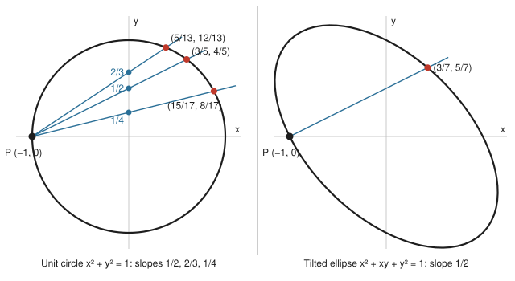

# Conics: every smooth degree-two curve is a line in disguise

[Syllabus](../../../SYLLABUS.md) → [Algebraic geometry](../README.md) → [Plane Curves](../README.md#s03) → Conics

---

## General Overview

The fractions $`(3/5, 4/5)`$ lie on the unit circle $`x^2 + y^2 = 1`$, because $`9/25 + 16/25 = 1`$. Clear the denominator 5 and this is the 3-4-5 right triangle. So every point of the circle with fraction coordinates is a whole-number right triangle, and listing those points lists the triangles.

Here is how to list them all. Stand at one known point of the circle, $`P = (-1, 0)`$. Draw a straight line out of $`P`$ with slope $`t`$. The line crosses the circle at exactly one more point. When $`t`$ is a fraction, that point has fraction coordinates: slope 1/2 lands on $`(3/5, 4/5)`$, slope 2/3 on $`(5/13, 12/13)`$, slope 1/4 on $`(15/17, 8/17)`$. Every fraction point of the circle other than $`P`$ comes from exactly one slope.

So the circle's fraction points match the fractions $`t`$ one for one, with $`P`$ itself matched to the vertical line. The circle behaves like a line of numbers, bent round. The same trick works for any **conic** (a curve given by an equation of degree two in $`x`$ and $`y`$) that is **smooth** (not broken into a pair of lines) and has one fraction point, a **rational point**, to start from. A single 3 by 3 matrix of the equation's coefficients says which conic it is and whether it is smooth.

**A smooth conic with one rational point is a line in disguise: lines through that point meet the conic once more, and the slope of each line is a rational coordinate for every other rational point.**

**What kind of fact this is:** a theorem, proved on this card in Why it works; the classification from the matrix is a theorem too, proved there; the test for whether a conic has a rational point at all (Legendre's theorem) is stated with a source, not proved.

### The picture: one point, many lines

<p align="center"></p>

Drawn to scale, 120 units per unit, real points only. On the left, each line crosses the $`y`$-axis at height $`t`$, its own slope. So the $`y`$-axis is a copy of the circle: each blue dot matches one red dot. On the right, the same move lists the triangles with a 120° angle and whole sides; slope 1/2 gives the triangle with sides 3, 5 and 7.

---

## The formula

Notation in use. The number systems are the rationals $`\mathbb{Q}`$, the reals $`\mathbb{R}`$, the complex numbers $`\mathbb{C}`$, and $`\mathbb{F}_p`$, the integers mod a prime $`p`$. Homogeneous coordinates $`(x : y : z)`$ and the line at infinity come from [Projective space](../02-Affine%20and%20Projective%20Varieties/03-projective-space-and-homogeneous-coordinates.md). This card works over $`\mathbb{Q}`$ unless it says otherwise.

A conic is the solution set of

```math
F(x, y) = a x^2 + b xy + c y^2 + d x + e y + f = 0, \qquad F(x, y) = \begin{pmatrix} x & y & 1 \end{pmatrix} M \begin{pmatrix} x \\ y \\ 1 \end{pmatrix}, \qquad M = \begin{pmatrix} a & b/2 & d/2 \\ b/2 & c & e/2 \\ d/2 & e/2 & f \end{pmatrix}
```

**Read it aloud:** a conic is a degree-two equation in $`x`$ and $`y`$; put its six coefficients into a symmetric 3 by 3 matrix $`M`$, halving the three cross terms, and the equation is the row $`(x, y, 1)`$ times $`M`$ times the same column.

The **classification** reads two determinants. Let $`A`$ be the top-left 2 by 2 block of $`M`$, so $`\det A = ac - b^2/4`$:

```math
\det M \neq 0 \;\Longleftrightarrow\; \text{smooth}; \qquad \text{then}\quad \det A > 0 \Rightarrow \text{ellipse},\quad \det A = 0 \Rightarrow \text{parabola},\quad \det A < 0 \Rightarrow \text{hyperbola}
```

**Read it aloud:** the big determinant decides whether the conic is one smooth curve or breaks into lines; the small one decides how the curve meets infinity, and so its shape. Over $`\mathbb{R}`$ an ellipse has real points exactly when $`a \det M < 0`$; otherwise, as with $`x^2 + y^2 + 1 = 0`$, it has none.

The **rational parametrisation** of the circle from $`P = (-1, 0)`$ uses the line $`y = t(x + 1)`$:

```math
(x, y) = \left( \frac{1 - t^2}{1 + t^2},\; \frac{2t}{1 + t^2} \right), \qquad t = \frac{y}{x + 1}
```

**Read it aloud:** slope $`t`$ gives the point with $`x`$ equal to one minus $`t`$ squared over one plus $`t`$ squared, and $`y`$ equal to two $`t`$ over the same; going back, the slope is $`y`$ over $`x + 1`$.

For any conic and any rational point $`P = (x_0, y_0)`$ on it, the same move works. Walk along the line $`x = x_0 + s`$, $`y = y_0 + ts`$, where $`s`$ is the step in $`x`$:

```math
F(x_0 + s,\; y_0 + ts) = A_2\, s^2 + A_1\, s, \qquad s = -\frac{A_1}{A_2}, \qquad A_2 = a + bt + ct^2, \quad A_1 = 2a x_0 + b(y_0 + t x_0) + 2c\, t\, y_0 + d + e t
```

**Read it aloud:** along the line, the conic's equation becomes a quadratic in the step $`s`$ with no constant term, because $`P`$ is on the conic; one root is $`s = 0`$, which is $`P`$, and the other is minus $`A_1`$ over $`A_2`$, a fraction whenever $`t`$ is.

With $`t = 1/2`$ on the circle: $`A_2 = 5/4`$, $`A_1 = -2`$, $`s = 8/5`$, and the point is $`(-1 + 8/5,\; 4/5) = (3/5, 4/5)`$.

| Symbol | Plain meaning | In our example | Push it up and the answer… |
| --- | --- | --- | --- |
| $`x, y`$; $`z`$; $`v`$ | the plane's coordinates; the third homogeneous coordinate, 0 at infinity; the column $`(x, y, z)`$ | $`(3/5, 4/5)`$; $`z = 1`$ in the plane | — |
| $`a, b, c, d, e, f`$ | the six coefficients of the equation | circle: $`1, 0, 1, 0, 0, -1`$ | $`b`$ tilts the curve: $`b = 1`$ gives the tilted ellipse |
| $`F`$ | the conic's polynomial; the conic is where $`F = 0`$ | $`x^2 + y^2 - 1`$ | — |
| $`M`$ | the symmetric 3 by 3 matrix of coefficients | circle: the diagonal $`1, 1, -1`$ | — |
| $`A`$; $`(x_c, y_c)`$ | the top-left 2 by 2 block of $`M`$: the degree-two part; the centre, where both partial derivatives of $`F`$ vanish (when $`\det A \neq 0`$) | circle: the diagonal $`1, 1`$; $`F`$ at the centre $`-1`$ | — |
| $`\det M`$ | zero exactly when the conic breaks into lines | circle $`-1`$; tilted ellipse $`-3/4`$ | at zero the conic breaks into lines |
| $`\det A`$ | sign gives the shape: ellipse, parabola or hyperbola | circle $`1`$; tilted ellipse $`3/4`$ | above 0 ellipse, at 0 parabola, below 0 hyperbola |
| rank; $`L`$, $`L'`$ | how many independent rows $`M`$ has: 3 smooth, 2 two lines, 1 one double line; the two lines of a line pair, in Step 4's fold | circle 3; $`x^2 - y^2`$ 2 | — |
| $`P = (x_0, y_0)`$; $`Q`$ | the one rational point the method starts from; any other rational point on the conic | $`(-1, 0)`$; $`Q = (3/5, 4/5)`$ | — |
| $`t`$; $`\theta`$ | the slope of the line through $`P`$: the new coordinate; the angle at the centre, with $`\tan(\theta/2) = t`$ | $`t = 1/2`$ | a steeper line lands further round the circle |
| $`s`$; $`A_2, A_1, A_0`$ | the step in $`x`$ from $`P`$ to the second point; the coefficients of $`s^2`$, $`s`$ and 1 along the line | $`s = 8/5`$, $`A_2 = 5/4`$, $`A_1 = -2`$ at $`t = 1/2`$; $`A_0 = F(P) = 0`$ always | — |
| $`m, n`$; $`p`$ | whole numbers with $`t = n/m`$, the seeds of the triples recipe; a prime, for counting points mod $`p`$ | $`m = 2, n = 1`$; $`p = 7`$ | bigger seeds give longer sides |

### When it holds

- **The conic is smooth: $`\det M \neq 0`$.** For $`x^2 - y^2 = 0`$, two crossing lines, every line from $`(1, 1)`$ lands on $`y = -x`$: slope 1/2 gives $`(-1/3, 1/3)`$. The other line, $`y = x`$, is never reached.
- **The start point is on the conic.** From $`(0, 0)`$, inside the circle, the slope-1/2 line needs $`x^2 = 4/5`$, which is not the square of a fraction. Both crossings are irrational.
- **The start point is rational.** Over $`\mathbb{Q}`$ some smooth conics have none: $`x^2 + y^2 = 3`$ has real points but no rational point, so there is nowhere to start.
- **The field does not have $`1 + 1 = 0`$.** The matrix halves $`b`$, $`d`$ and $`e`$. Over $`\mathbb{F}_2`$ that halving fails, and the classification needs a different form.
- **Points at infinity are counted.** The tangent line at $`P`$ (slope "infinity" for the circle) gives $`P`$ itself. Over $`\mathbb{F}_p`$ a slope with $`A_2 = 0`$ gives a point on the line at infinity. Counted in [Projective space](../02-Affine%20and%20Projective%20Varieties/03-projective-space-and-homogeneous-coordinates.md), the match between slopes and points is exact.

---

## Why it works

### Step 0: a line meets a conic twice, and one meeting is already known

Put a line into a degree-two equation and you get a quadratic: two roots. If one root is a known fraction, the other is a fraction too. The two roots of $`A_2 s^2 + A_1 s + A_0 = 0`$ (with $`A_0`$ the constant term) add up to $`-A_1/A_2`$. Subtract the known root and the other is left, with no square root anywhere.

So the whole card rests on one known rational point. Lines through it carry rationality to every other point.

### Step 1: the circle, worked out

[Pythagorean triples](../../02-Number%20theory/07-For%20the%20Curious/01-pythagorean-triples.md) already gives the recipe $`m^2 - n^2,\ 2mn,\ m^2 + n^2`$ for every primitive triple. Here is where the recipe comes from.

Put $`y = t(x + 1)`$ into $`x^2 + y^2 = 1`$:

```math
x^2 + t^2 (x + 1)^2 - 1 = (x + 1)\big[(1 + t^2)\, x - (1 - t^2)\big] = 0
```

**Read it aloud:** the equation factors; the factor $`x + 1`$ is the known point $`P`$, and the other factor gives the new point.

So $`x = (1 - t^2)/(1 + t^2)`$ and $`y = t(x + 1) = 2t/(1 + t^2)`$. Write $`t = n/m`$ and multiply top and bottom by $`m^2`$:

```math
(x, y) = \left( \frac{m^2 - n^2}{m^2 + n^2},\; \frac{2mn}{m^2 + n^2} \right)
```

That is the triples recipe, read off a line. Seeds $`m = 2`$, $`n = 1`$ (slope 1/2) give 3, 4, 5. Seeds 3 and 2 (slope 2/3) give 5, 12, 13.

### Step 2: nothing is missed, nothing is repeated

Take any rational point $`Q`$ on the circle other than $`P`$. The line $`PQ`$ has slope $`t = y/(x + 1)`$, a fraction, and Step 1 sends that $`t`$ back to $`Q`$. Two different slopes give two different lines through $`P`$, which share only $`P`$, so they give two different points.

The one gap is $`P`$ itself. It belongs to the vertical line $`x = -1`$, the tangent at $`P`$, whose slope is "infinity". In projective terms the slopes form $`\mathbb{P}^1(\mathbb{Q})`$, the fractions plus one point at infinity, and the match is exact. That is the sense in which the circle is a line in disguise. The [Birational equivalence](../02-Affine%20and%20Projective%20Varieties/06-birational-equivalence-and-function-fields.md) card names this: the circle is birational to the line, and here the two maps are inverse everywhere.

The figure shows one more way to see it. Each line through $`P`$ crosses the $`y`$-axis at height $`t`$. So the map is a projection from $`P`$ of the circle onto the $`y`$-axis (stereographic projection).

### Step 3: any conic in any position

Nothing in Steps 0 to 2 used the circle's shape. For a general conic, put $`x = x_0 + s`$, $`y = y_0 + ts`$ into $`F`$. The constant term is $`F(x_0, y_0) = 0`$, so $`s`$ factors out:

```math
F(x_0 + s,\; y_0 + ts) = s\,(A_2\, s + A_1)
```

The second meeting is $`s = -A_1/A_2`$, rational when $`t`$ is. Step 2's argument runs unchanged.

The tilted ellipse $`x^2 + xy + y^2 = 1`$ also passes through $`P = (-1, 0)`$. Its slope-$`t`$ point is

```math
(x, y) = \left( \frac{1 - t^2}{1 + t + t^2},\; \frac{t(2 + t)}{1 + t + t^2} \right)
```

Slope 1/2 gives $`(3/7, 5/7)`$. By the law of cosines (side squared equals the other two squared minus twice their product times the cosine), a triangle with a 120° angle has $`c^2 = a^2 + ab + b^2`$, since the cosine of 120° is $`-1/2`$. So $`(3/7, 5/7)`$ is the triangle with sides 3, 5 and 7: $`9 + 15 + 25 = 49`$. Slope 1/3 gives 7, 8, 13 and slope 2/3 gives 5, 16, 19.

### Step 4: smoothness is $`\det M \neq 0`$

A **singular point** is a point of the curve where both partial derivatives of $`F`$ vanish, so no single tangent line exists. Work in homogeneous coordinates $`v = (x, y, z)`$, where $`F = v^{\mathsf T} M v`$ ([Quadratic forms](../../03-Algebra/07-Eigenvalues%20and%20Symmetric%20Matrices/05-quadratic-forms-and-positive-definite.md) writes forms this way). The three partial derivatives are the entries of $`2Mv`$.

So a singular point is a nonzero $`v`$ with $`Mv = 0`$. Such a $`v`$ exists exactly when $`\det M = 0`$. It then lies on the conic automatically, since $`v^{\mathsf T} M v = v^{\mathsf T} 0 = 0`$.

- For $`x^2 - y^2`$, $`M`$ has kernel $`(0 : 0 : 1)`$: the two lines $`y = x`$ and $`y = -x`$ cross at the origin.
- For $`(x + y)^2 - 1`$, the kernel is $`(1 : -1 : 0)`$, a point at infinity: the two lines $`x + y = \pm 1`$ are parallel and meet there.

A singular conic is two lines (rank 2) or one line counted twice (rank 1). Over $`\mathbb{R}`$ the two lines may be complex, leaving one real point, as in $`x^2 + y^2 = 0`$.

<details>
<summary>Detailed proof: a smooth conic contains no line, and a line pair is never one line in disguise</summary>

Suppose a conic contains a line $`L`$. Divide $`F`$ by the linear polynomial of $`L`$. The remainder vanishes all along $`L`$, so it is zero, and $`F`$ is a product of two linear factors: two lines $`L`$ and $`L'`$. At the point where $`L`$ and $`L'`$ cross, both factors vanish, and the product rule makes every partial derivative of $`F`$ vanish. That point is singular, a contradiction.

For a line pair, the slope map from a point on one line only ever reaches the other line, as Step 0 shows: the known meeting is on the first line, the second meeting on the second. From the crossing point both meetings coincide, since

$`\displaystyle A_1 = 2a x_0 + b y_0 + d + t\,(b x_0 + 2c y_0 + e) = 0`$

there, for every $`t`$: both brackets are entries of $`2Mv`$ at the singular point. So no single slope coordinate covers a line pair.

</details>

### Step 5: the shape is how the conic meets infinity

The points at infinity are where $`z = 0`$, so the conic meets the line at infinity where $`a x^2 + b xy + c y^2 = 0`$. That is the degree-two part, the quadratic form of $`A`$. The [Quadratic forms](../../03-Algebra/07-Eigenvalues%20and%20Symmetric%20Matrices/05-quadratic-forms-and-positive-definite.md) card reads its sign pattern off $`\det A`$.

- $`\det A > 0`$: the form is definite, never zero for real $`(x, y) \neq 0`$. No real points at infinity: a closed curve, an **ellipse**.
- $`\det A < 0`$: two real directions where the form is zero. The curve runs off to infinity two ways: a **hyperbola**, with its two asymptotes.
- $`\det A = 0`$: one double direction. The curve touches the line at infinity: a **parabola**.

The [Ellipses and hyperbolas](../../05-Geometry%20and%20trig/04-Coordinates%20and%20Curves/05-ellipses-and-hyperbolas.md) card makes this test with no $`xy`$ term, by completing squares. The determinant does it for any tilt, and [Circles and parabolas](../../05-Geometry%20and%20trig/04-Coordinates%20and%20Curves/04-circles-and-parabolas.md) gives the circle and parabola from their distance rules.

**Real points of an ellipse.** When $`\det A \neq 0`$ the conic has a **centre** $`(x_c, y_c)`$, the one point where both partial derivatives of $`F`$ vanish. Put $`v = (x_c, y_c, 1)`$. By Step 4 the first two entries of $`Mv`$ are half those derivatives, so 0, and $`F(x_c, y_c) = v^{\mathsf T} M v`$ is then the third entry of $`Mv`$. Add $`x_c`$ times the first row of $`M`$ and $`y_c`$ times the second to the third row. The determinant does not change, and, as $`M`$ is symmetric, the new third row is $`Mv`$ laid flat: $`(0, 0, F(x_c, y_c))`$. Expand along it:

```math
\det M = \det A \cdot F(x_c, y_c)
```

**Read it aloud:** the big determinant is the small one times the value of $`F`$ at the centre.

Measured from the centre, $`F`$ has no first-degree terms, so it is its degree-two part plus $`F(x_c, y_c)`$. For an ellipse the degree-two part has the sign of $`a`$ everywhere except at the centre, where it is 0. So the ellipse has real points exactly when $`F(x_c, y_c)`$ has the opposite sign to $`a`$; as $`\det A > 0`$, that is $`a \det M < 0`$. The code evaluates $`F`$ at each centre: $`-1`$ on the circle, real; 1 on $`x^2 + y^2 + 1`$, none; and 2/3 on the shifted, tilted ellipse $`x^2 + xy + y^2 + x + y + 1`$, none either.

### Step 6: the counting check over a finite field

A line $`\mathbb{P}^1(\mathbb{F}_p)`$ has $`p + 1`$ points. If a smooth conic is a line in disguise, it must have $`p + 1`$ points too, once the points at infinity are counted. Over $`\mathbb{F}_7`$ the code counts 8 for every smooth conic in the table. That includes $`x^2 + y^2 + 1`$, which has no real points: over $`\mathbb{F}_p`$ every conic has a point to start from. Two lines meeting in a point have $`2(p + 1) - 1 = 15`$ points instead.

The rational question is harder. Whether a conic over $`\mathbb{Q}`$ has a rational point at all is settled by Legendre's theorem, stated in the sources, not proved here. For $`x^2 + y^2 = 3`$, a short argument shows there is none. Squares mod 3 are only 0 or 1. So $`x^2 + y^2 = 3z^2`$ forces 3 to divide both $`x`$ and $`y`$, then $`z`$, and dividing by 3 forever is impossible.

---

## Worked numbers, by hand

| Step | Arithmetic | Value |
| --- | --- | --- |
| circle's matrix $`M`$ | diagonal $`1, 1, -1`$ | $`\det M = -1`$, smooth |
| circle's block $`A`$ | diagonal $`1, 1`$ | $`\det A = 1 > 0`$, ellipse; $`a \det M = -1 < 0`$, real |
| line from $`P = (-1, 0)`$, slope $`t = 1/2`$ | $`A_2 = 1 + 1/4`$, $`A_1 = -2`$ | $`s = 8/5`$ |
| second point | $`(-1 + 8/5,\ (1/2)(8/5))`$ | $`(3/5, 4/5)`$ |
| on the circle | $`9/25 + 16/25`$ | 1 |
| back to the slope | $`(4/5) / (3/5 + 1)`$ | $`1/2`$ |
| clear denominators | multiply by 5 | **3, 4, 5** |
| slopes 2/3 and 1/4 | same steps | $`(5/13, 12/13)`$ and $`(15/17, 8/17)`$: 5, 12, 13 and 8, 15, 17 |
| tilted ellipse $`x^2 + xy + y^2 = 1`$ | $`\det M = -3/4`$, $`\det A = 3/4`$ | smooth ellipse |
| its slope-1/2 point | $`((1 - 1/4)/(7/4),\ (5/4)/(7/4))`$ | $`(3/7, 5/7)`$: **sides 3, 5, 7** with a 120° angle |

Slope 1/2 through $`(-1, 0)`$ is the 3-4-5 triangle on the circle and the 3-5-7 triangle on the tilted ellipse. The code lists all 16 primitive right triangles with long side up to 100 from slopes, and finds the same 16 by brute force.

### What breaks if you drop a piece

| Mistake | Comes out at | What went wrong |
| --- | --- | --- |
| Start at $`(0, 0)`$, not on the circle | $`x^2 = 4/5`$: no rational point | Neither meeting is known, so neither need be rational |
| Use the line pair $`x^2 - y^2 = 0`$ | slopes 1/2 and 3 give $`(-1/3, 1/3)`$ and $`(1/2, -1/2)`$, both on $`y = -x`$ | $`\det M = 0`$: two lines, and the slope map reaches only one |
| Classify $`x^2 - y^2`$ by $`\det A`$ alone | $`\det A = -1`$: "hyperbola" | $`\det M = 0`$ first: it is two lines |
| Try $`x^2 + y^2 = 3`$ | 0 whole-number solutions with $`z`$ up to 60 | No rational start point: squares mod 3 are only 0 and 1 |

The code prints every row.

---

## Code, from first principles, and it actually runs

The code works in exact fractions and imports no algebra routine. It takes three roads. First, substitution: every point a slope produces goes back into its conic exactly, and the slope comes back out. Second, an independent method: brute-force search for whole-number triangles, which must give the same set as the slopes, for right triangles and for 120° triangles. Third, a finite count: for each conic in the table, the determinant test, the rank by elimination, and the number of points over $`\mathbb{F}_7`$ must agree, 8 for smooth and 15 for two lines. The type column has a road of its own. The code reads the signs of the degree-two part at whole-number points from −3 to 3 to count the real directions at infinity (two, one or none, for the conics printed), and it evaluates $`F`$ at the centre. Both must match the type the determinants give, and $`F`$ at the centre must equal $`\det M / \det A`$. The code also lists the circle's points over $`\mathbb{F}_7`$ slope by slope.

### Python

```python
# Conics and rational parametrisation -- the check behind the card.  Standard library
# only; Fraction keeps every step exact.  A conic a x^2 + b xy + c y^2 + d x + e y + f = 0
# is stored as (a, b, c, d, e, f).  Lines through one rational point P give every other one.
from fractions import Fraction as Q
from math import gcd, isqrt

def F(C, x, y): a, b, c, d, e, f = C; return a*x*x + b*x*y + c*y*y + d*x + e*y + f
def matrix(C):
    a, b, c, d, e, f = map(Q, C)
    return [[a, b / 2, d / 2], [b / 2, c, e / 2], [d / 2, e / 2, f]]
def det3(M):
    return (M[0][0] * (M[1][1] * M[2][2] - M[1][2] * M[2][1]) - M[0][1] * (M[1][0] * M[2][2] - M[1][2] * M[2][0])
            + M[0][2] * (M[1][0] * M[2][1] - M[1][1] * M[2][0]))
def rank(M):                                   # Gaussian elimination: a second road to det M = 0
    R, r = [row[:] for row in M], 0
    for col in range(3):
        piv = next((i for i in range(r, 3) if R[i][col] != 0), None)
        if piv is None: continue
        R[r], R[piv] = R[piv], R[r]
        for i in range(3):
            if i != r and R[i][col] != 0:
                k = R[i][col] / R[r][col]; R[i] = [u - k * v for u, v in zip(R[i], R[r])]
        r += 1
    return r
def kind(C):
    M = matrix(C); D = det3(M); dA = M[0][0] * M[1][1] - M[0][1] ** 2
    if D == 0: return "degenerate: lines"
    if dA < 0: return "hyperbola"
    if dA == 0: return "parabola"
    return "ellipse" if M[0][0] * D < 0 else "ellipse, no real points"
def directions(C):                             # second road to the shape: real directions at infinity, from the
    a, b, c = C[:3]                            # signs of a x^2 + b xy + c y^2 at whole-number (x, y), -3 to 3
    v = {a*x*x + b*x*y + c*y*y for x in range(-3, 4) for y in range(-3, 4) if (x, y) != (0, 0)}
    return 2 if min(v) < 0 < max(v) else (1 if 0 in v else 0)
def at_centre(C):                              # F at the centre, where both partial derivatives vanish
    a, b, c, d, e, f = C; D = 4 * a * c - b * b
    return None if D == 0 else F(C, Q(b * e - 2 * c * d, D), Q(b * d - 2 * a * e, D))
def count(C, p):                               # projective points over F_p: nonzero solutions / (p - 1)
    a, b, c, d, e, f = C
    n = sum(1 for x in range(p) for y in range(p) for z in range(p) if (x, y, z) != (0, 0, 0)
            and (a*x*x + b*x*y + c*y*y + d*x*z + e*y*z + f*z*z) % p == 0)
    return n // (p - 1)
def coeffs(C, P, t):                           # F(x0 + s, y0 + t s) = A2 s^2 + A1 s, as F(P) = 0
    a, b, c, d, e, f = C; x0, y0 = P
    A2 = a + b * t + c * t * t
    A1 = 2 * a * x0 + b * (y0 + t * x0) + 2 * c * t * y0 + d + e * t
    return A2, A1
def second(C, P, t):                           # the line through P of slope t meets C once more
    A2, A1 = coeffs(C, P, t); s = -A1 / A2
    return (P[0] + s, P[1] + t * s)
def kernel(M):                                 # a nonzero v with M v = 0: cross product of two rows
    cr = lambda a, b: [a[1] * b[2] - a[2] * b[1], a[2] * b[0] - a[0] * b[2], a[0] * b[1] - a[1] * b[0]]
    v = next(w for w in (cr(M[0], M[1]), cr(M[0], M[2]), cr(M[1], M[2])) if any(w))
    f = next(u for u in v if u != 0); return [u / f for u in v]
def pt(v): return "(" + ", ".join(str(u) for u in v) + ")"
def yn(c): return "yes" if c else "no"
def triple(v):                                 # clear denominators: (x, y) -> whole sides over c
    c = v[0].denominator * v[1].denominator // gcd(v[0].denominator, v[1].denominator)
    a, b = int(v[0] * c), int(v[1] * c); g = gcd(gcd(a, b), c)
    return tuple(sorted((a // g, b // g))) + (c // g,)

circle, eis, P = (1, 0, 1, 0, 0, -1), (1, 1, 1, 0, 0, -1), (Q(-1), Q(0))
print("unit circle x^2 + y^2 = 1, start point P = (-1, 0), line y = t(x + 1)")
A2, A1 = coeffs(circle, P, Q(1, 2)); print(f"  t = 1/2: A2 = {A2}, A1 = {A1}, step s = -A1/A2 = {-A1 / A2}")
for t in (Q(1, 2), Q(2, 3), Q(1, 4)):
    X = second(circle, P, t); closed = ((1 - t * t) / (1 + t * t), 2 * t / (1 + t * t))
    print(f"  t = {t}: second point {pt(X)}, on circle: {yn(F(circle, *X) == 0)}; closed form {pt(closed)};"
          f" back to t = y/(x + 1) = {X[1] / (X[0] + 1)}; triple {triple(X)}")
    assert X == closed and X[1] / (X[0] + 1) == t and F(circle, *X) == 0
by_slope = {triple(second(circle, P, Q(n, m))) for m in range(2, 31) for n in range(1, m)}
brute = {(a, b, c) for c in range(1, 101) for a in range(1, c) for b in range(a + 1, c)
         if a * a + b * b == c * c and gcd(gcd(a, b), c) == 1}
by_slope = {v for v in by_slope if v[2] <= 100}
print(f"primitive triples, long side <= 100: by slopes {len(by_slope)}, by brute force {len(brute)}, same: {yn(by_slope == brute)}")
print("  " + " ".join(f"{a}-{b}-{c}" for a, b, c in sorted(brute, key=lambda v: (v[2], v[0]))))
print("120-degree conic x^2 + xy + y^2 = 1 (a^2 + ab + b^2 = c^2), same start P = (-1, 0)")
for t in (Q(1, 2), Q(1, 3), Q(2, 3)):
    X = second(eis, P, t); a, b, c = triple(X)
    print(f"  t = {t}: {pt(X)}, on conic: {yn(F(eis, *X) == 0)}; sides {a}, {b}, {c}: {a*a} + {a*b} + {b*b} = {c*c}")
    assert F(eis, *X) == 0 and a * a + a * b + b * b == c * c
eis_slope = {v for v in (triple(second(eis, P, Q(n, m))) for m in range(2, 31) for n in range(1, m)) if v[2] <= 50}
eis_brute = {(a, b, c) for c in range(1, 51) for a in range(1, c) for b in range(a, c)
             if a * a + a * b + b * b == c * c and gcd(gcd(a, b), c) == 1}
print(f"primitive 120-degree triangles, long side <= 50: by slopes {len(eis_slope)}, by brute force {len(eis_brute)}, same: {yn(eis_slope == eis_brute)}")
print("  " + " ".join(f"{a}-{b}-{c}" for a, b, c in sorted(eis_brute, key=lambda v: (v[2], v[0]))))
assert by_slope == brute and len(brute) == 16 and eis_slope == eis_brute and len(eis_brute) == 7

table = [("x^2 + y^2 - 1", circle), ("x^2 + xy + y^2 - 1", eis), ("xy - 1", (0, 1, 0, 0, 0, -1)),
         ("x^2 - y", (1, 0, 0, 0, -1, 0)), ("x^2 + y^2 + 1", (1, 0, 1, 0, 0, 1)),
         ("x^2 + y^2 - 3", (1, 0, 1, 0, 0, -3)), ("x^2 + xy + y^2 + x + y + 1", (1, 1, 1, 1, 1, 1)),
         ("x^2 - y^2", (1, 0, -1, 0, 0, 0)), ("x^2 + 2xy + y^2 - 1", (1, 2, 1, 0, 0, -1))]
print(f"{'conic':<28}{'det M':>7}{'det A':>7}{'rank':>6}  {'type':<25}{'points over F_7':>15}{'at infinity':>13}{'F at centre':>13}")
for name, C in table:
    M = matrix(C); D = det3(M); dA = M[0][0] * M[1][1] - M[0][1] ** 2; n7 = count(C, 7)
    n, Fc = directions(C), at_centre(C)
    print(f"{name:<28}{str(D):>7}{str(dA):>7}{rank(M):>6}  {kind(C):<25}{n7:>15}{n:>13}{'-' if Fc is None else str(Fc):>13}")
    assert (D != 0) == (rank(M) == 3) and (n7 == 8 if D != 0 else n7 == 15)
    assert Fc is None or Fc * dA == D           # Step 5: F at the centre is det M / det A
    assert D == 0 or kind(C) == ("hyperbola" if n == 2 else "parabola" if n == 1
                                 else "ellipse" if C[0] * Fc < 0 else "ellipse, no real points")
inv = lambda v: pow(v % 7, 5, 7)               # 1/v mod 7, since v^6 = 1 mod 7
by7 = [((1 - t * t) * inv(1 + t * t) % 7, 2 * t * inv(1 + t * t) % 7) for t in range(7)]
on7 = {(x, y) for x in range(7) for y in range(7) if (x * x + y * y - 1) % 7 == 0}
print("circle over F_7 from P = (6, 0), slopes 0 to 6: " + " ".join(pt(v) for v in by7) +
      f"; with P: {len(set(by7) | {(6, 0)})} points, all of x^2 + y^2 = 1 mod 7: {yn(set(by7) | {(6, 0)} == on7)}")
assert len(set(by7)) == 7 and set(by7) | {(6, 0)} == on7 and len(on7) == count(circle, 7)
sols = [(x, y, z) for z in range(1, 61) for x in range(0, 2 * z) for y in range(x, 2 * z) if x*x + y*y == 3*z*z]
print(f"x^2 + y^2 = 3: whole-number solutions of x^2 + y^2 = 3z^2 with 1 <= z <= 60: {len(sols)};"
      f" squares mod 3: {sorted({k * k % 3 for k in range(3)})}")
assert sols == []
X = 1 / (1 + Q(1, 4))                         # line y = x/2 through (0, 0), not on the circle
print(f"mistake, start off the curve at (0, 0), slope 1/2: x^2 = {X}, a rational square: "
      f"{yn(isqrt(X.numerator) ** 2 == X.numerator and isqrt(X.denominator) ** 2 == X.denominator)}")
for t in (Q(1, 2), Q(3)):
    Y = second((1, 0, -1, 0, 0, 0), (Q(1), Q(1)), t)
    print(f"mistake, two lines x^2 - y^2 = 0 from (1, 1), slope {t}: {pt(Y)}, on y = -x: {yn(Y[1] == -Y[0])}")
    assert Y[1] == -Y[0]
M = matrix(table[7][1])
print(f"mistake, x^2 - y^2 read by det A alone: det A = {M[0][0] * M[1][1] - M[0][1] ** 2} says hyperbola;"
      f" det M = {det3(M)} says two lines y = x, y = -x")
M7 = matrix(table[8][1]); k6, k7 = kernel(M), kernel(M7)
print("kernel of M, the singular point: x^2 - y^2 ({} : {} : {}); x^2 + 2xy + y^2 - 1 ({} : {} : {})".format(*k6, *k7))
assert all(sum(X[r][j] * v[j] for j in range(3)) == 0 for v, X in ((k6, M), (k7, M7)) for r in range(3))
for t in (Q(2), Q(3)):                         # the house example: lines through the node
    x, y = t * t - 1, t * (t * t - 1)
    print(f"house example y^2 = x^2(x + 1), line of slope {t} through the node: ({x}, {y}); {y*y} = {x*x*(x+1)}")
    assert y * y == x * x * (x + 1)
print(f"try: circle, slope 1/3: {pt(second(circle, P, Q(1, 3)))}; xy = 1 from (1, 1), slope 4: "
      f"{pt(second((0, 1, 0, 0, 0, -1), (Q(1), Q(1)), Q(4)))}; points over F_11: circle {count(circle, 11)}, "
      f"x^2 - y^2 {count((1, 0, -1, 0, 0, 0), 11)}")
M = matrix((1, 2, 1, 0, 0, -1))                # x^2 + xy + y^2 - 1 with b = 1 put in unhalved
print(f"mistake, b not halved in x^2 + xy + y^2 - 1: det A = {M[0][0] * M[1][1] - M[0][1] ** 2}, which says parabola")
fx = lambda cx, v: f"({float(cx + 120 * v[0]):.2f}, {float(170 - 120 * v[1]):.2f})"
print("figure, 120 units per unit: circle P " + fx(160, P) + ", points " + " ".join(
    fx(160, second(circle, P, t)) for t in (Q(1, 2), Q(2, 3), Q(1, 4))) + ", on the y-axis " + " ".join(
    fx(160, (0, t)) for t in (Q(1, 2), Q(2, 3), Q(1, 4))) + "; 120-degree conic P " + fx(480, P)
    + ", point " + fx(480, second(eis, P, Q(1, 2))))
print("ALL CHECKS PASS")
```

**Ran 2026-11-17 on macOS, Python 3.14.10, standard library only. All checks passed. Output, pasted from the run:**

```
unit circle x^2 + y^2 = 1, start point P = (-1, 0), line y = t(x + 1)
  t = 1/2: A2 = 5/4, A1 = -2, step s = -A1/A2 = 8/5
  t = 1/2: second point (3/5, 4/5), on circle: yes; closed form (3/5, 4/5); back to t = y/(x + 1) = 1/2; triple (3, 4, 5)
  t = 2/3: second point (5/13, 12/13), on circle: yes; closed form (5/13, 12/13); back to t = y/(x + 1) = 2/3; triple (5, 12, 13)
  t = 1/4: second point (15/17, 8/17), on circle: yes; closed form (15/17, 8/17); back to t = y/(x + 1) = 1/4; triple (8, 15, 17)
primitive triples, long side <= 100: by slopes 16, by brute force 16, same: yes
  3-4-5 5-12-13 8-15-17 7-24-25 20-21-29 12-35-37 9-40-41 28-45-53 11-60-61 16-63-65 33-56-65 48-55-73 13-84-85 36-77-85 39-80-89 65-72-97
120-degree conic x^2 + xy + y^2 = 1 (a^2 + ab + b^2 = c^2), same start P = (-1, 0)
  t = 1/2: (3/7, 5/7), on conic: yes; sides 3, 5, 7: 9 + 15 + 25 = 49
  t = 1/3: (8/13, 7/13), on conic: yes; sides 7, 8, 13: 49 + 56 + 64 = 169
  t = 2/3: (5/19, 16/19), on conic: yes; sides 5, 16, 19: 25 + 80 + 256 = 361
primitive 120-degree triangles, long side <= 50: by slopes 7, by brute force 7, same: yes
  3-5-7 7-8-13 5-16-19 11-24-31 7-33-37 13-35-43 16-39-49
conic                         det M  det A  rank  type                     points over F_7  at infinity  F at centre
x^2 + y^2 - 1                    -1      1     3  ellipse                                8            0           -1
x^2 + xy + y^2 - 1             -3/4    3/4     3  ellipse                                8            0           -1
xy - 1                          1/4   -1/4     3  hyperbola                              8            2           -1
x^2 - y                        -1/4      0     3  parabola                               8            1            -
x^2 + y^2 + 1                     1      1     3  ellipse, no real points                8            0            1
x^2 + y^2 - 3                    -3      1     3  ellipse                                8            0           -3
x^2 + xy + y^2 + x + y + 1      1/2    3/4     3  ellipse, no real points                8            0          2/3
x^2 - y^2                         0     -1     2  degenerate: lines                     15            2            0
x^2 + 2xy + y^2 - 1               0      0     2  degenerate: lines                     15            1            -
circle over F_7 from P = (6, 0), slopes 0 to 6: (1, 0) (0, 1) (5, 5) (2, 2) (2, 5) (5, 2) (0, 6); with P: 8 points, all of x^2 + y^2 = 1 mod 7: yes
x^2 + y^2 = 3: whole-number solutions of x^2 + y^2 = 3z^2 with 1 <= z <= 60: 0; squares mod 3: [0, 1]
mistake, start off the curve at (0, 0), slope 1/2: x^2 = 4/5, a rational square: no
mistake, two lines x^2 - y^2 = 0 from (1, 1), slope 1/2: (-1/3, 1/3), on y = -x: yes
mistake, two lines x^2 - y^2 = 0 from (1, 1), slope 3: (1/2, -1/2), on y = -x: yes
mistake, x^2 - y^2 read by det A alone: det A = -1 says hyperbola; det M = 0 says two lines y = x, y = -x
kernel of M, the singular point: x^2 - y^2 (0 : 0 : 1); x^2 + 2xy + y^2 - 1 (1 : -1 : 0)
house example y^2 = x^2(x + 1), line of slope 2 through the node: (3, 6); 36 = 36
house example y^2 = x^2(x + 1), line of slope 3 through the node: (8, 24); 576 = 576
try: circle, slope 1/3: (4/5, 3/5); xy = 1 from (1, 1), slope 4: (-1/4, -4); points over F_11: circle 12, x^2 - y^2 23
mistake, b not halved in x^2 + xy + y^2 - 1: det A = 0, which says parabola
figure, 120 units per unit: circle P (40.00, 170.00), points (232.00, 74.00) (206.15, 59.23) (265.88, 113.53), on the y-axis (160.00, 110.00) (160.00, 90.00) (160.00, 140.00); 120-degree conic P (360.00, 170.00), point (531.43, 84.29)
ALL CHECKS PASS
```

### Rust

Same numbers, same labels. Fractions are an `i128` struct whose products use `checked_mul`, so an overflow stops the run.

```rust
// Conics and rational parametrisation -- the same check as the Python, in Rust.  No crates.
// Fractions are an i128 struct using checked_mul, so overflow stops the run.  A conic
// a x^2 + b xy + c y^2 + d x + e y + f = 0 is stored as [a, b, c, d, e, f].  Lines through
// one rational point P give every other one.
use std::{collections::BTreeSet, fmt};
#[derive(Clone, Copy, PartialEq, Debug)]
struct Q { n: i128, d: i128 }
fn gcd(a: i128, b: i128) -> i128 { if b == 0 { a.abs() } else { gcd(b, a % b) } }
fn q(n: i128, d: i128) -> Q {
    assert!(d != 0, "division by zero"); let (g, s) = (gcd(n, d), if d < 0 { -1 } else { 1 }); Q { n: s * n / g, d: s * d / g } }
fn m(a: i128, b: i128) -> i128 { a.checked_mul(b).expect("overflow") }
fn add(a: Q, b: Q) -> Q { q(m(a.n, b.d) + m(b.n, a.d), m(a.d, b.d)) }
fn neg(a: Q) -> Q { Q { n: -a.n, d: a.d } }  fn sub(a: Q, b: Q) -> Q { add(a, neg(b)) }
fn mul(a: Q, b: Q) -> Q { q(m(a.n, b.n), m(a.d, b.d)) }  fn div(a: Q, b: Q) -> Q { q(m(a.n, b.d), m(a.d, b.n)) }
fn i(n: i128) -> Q { q(n, 1) }
impl fmt::Display for Q {
    fn fmt(&self, f: &mut fmt::Formatter) -> fmt::Result { if self.d == 1 { write!(f, "{}", self.n) } else { write!(f, "{}/{}", self.n, self.d) } } }
type C = [i128; 6];
fn ev(c: &C, x: Q, y: Q) -> Q {
    let t = [mul(x, x), mul(x, y), mul(y, y), x, y, i(1)]; (0..6).fold(i(0), |s, k| add(s, mul(i(c[k]), t[k]))) }
fn matrix(c: &C) -> [[Q; 3]; 3] {
    let h = |v: i128| q(v, 2); [[i(c[0]), h(c[1]), h(c[3])], [h(c[1]), i(c[2]), h(c[4])], [h(c[3]), h(c[4]), i(c[5])]] }
fn det2(a: Q, b: Q, c: Q, d: Q) -> Q { sub(mul(a, d), mul(b, c)) }  // a d - b c
fn det3(x: &[[Q; 3]; 3]) -> Q {                             // expansion along the top row
    let mi = |a: usize, b: usize| det2(x[1][a], x[1][b], x[2][a], x[2][b]);
    add(sub(mul(x[0][0], mi(1, 2)), mul(x[0][1], mi(0, 2))), mul(x[0][2], mi(0, 1))) }
fn det_a(x: &[[Q; 3]; 3]) -> Q { det2(x[0][0], x[0][1], x[1][0], x[1][1]) }
fn rank(x: &[[Q; 3]; 3]) -> usize {                      // Gaussian elimination: a second road to det M = 0
    let (mut r, mut rr) = (*x, 0usize);
    for col in 0..3 {
        let piv = match (rr..3).find(|&k| r[k][col].n != 0) { Some(p) => p, None => continue }; r.swap(rr, piv);
        for k in 0..3 { if k != rr && r[k][col].n != 0 {
            let f = div(r[k][col], r[rr][col]); for j in 0..3 { r[k][j] = sub(r[k][j], mul(f, r[rr][j])); } } }
        rr += 1;
    }
    rr
}
fn kind(c: &C) -> &'static str {
    let x = matrix(c); let (d, da) = (det3(&x), det_a(&x));
    if d.n == 0 { "degenerate: lines" } else if da.n < 0 { "hyperbola" } else if da.n == 0 { "parabola" }
    else if mul(x[0][0], d).n < 0 { "ellipse" } else { "ellipse, no real points" }
}
fn directions(c: &C) -> usize {                           // second road to the shape: real directions at infinity, from the
    let v: Vec<i128> = (-3..4i128).flat_map(|x| (-3..4i128).map(move |y| (x, y))).filter(|&p| p != (0, 0))
        .map(|(x, y)| c[0] * x * x + c[1] * x * y + c[2] * y * y).collect();   // signs of a x^2 + b xy + c y^2, -3 to 3
    if v.iter().any(|&s| s < 0) && v.iter().any(|&s| s > 0) { 2 } else if v.contains(&0) { 1 } else { 0 } }
fn at_centre(c: &C) -> Option<Q> {                         // F at the centre, where both partial derivatives vanish
    let d = 4 * c[0] * c[2] - c[1] * c[1];
    if d == 0 { None } else { Some(ev(c, q(c[1] * c[4] - 2 * c[2] * c[3], d), q(c[1] * c[3] - 2 * c[0] * c[4], d))) } }
fn count(c: &C, p: i128) -> i128 {                         // projective points over F_p: nonzero solutions / (p - 1)
    let mut n = 0;
    for x in 0..p { for y in 0..p { for z in 0..p { let v = c[0]*x*x + c[1]*x*y + c[2]*y*y + c[3]*x*z + c[4]*y*z + c[5]*z*z;
        if (x, y, z) != (0, 0, 0) && v.rem_euclid(p) == 0 { n += 1; } } } }
    n / (p - 1) }
fn coeffs(c: &C, p: (Q, Q), t: Q) -> (Q, Q) {             // F(x0 + s, y0 + t s) = A2 s^2 + A1 s, as F(P) = 0
    let (x0, y0) = p; let k = |v: i128| i(v);
    let a2 = add(add(k(c[0]), mul(k(c[1]), t)), mul(k(c[2]), mul(t, t)));
    let a1 = [mul(k(2 * c[0]), x0), mul(k(c[1]), add(y0, mul(t, x0))), mul(k(2 * c[2]), mul(t, y0)), k(c[3]), mul(k(c[4]), t)]
        .iter().fold(i(0), |s, &v| add(s, v));
    (a2, a1)
}
fn second(c: &C, p: (Q, Q), t: Q) -> (Q, Q) {             // the line through P of slope t meets C once more
    let (a2, a1) = coeffs(c, p, t); let s = neg(div(a1, a2)); (add(p.0, s), add(p.1, mul(t, s))) }
fn kernel(x: &[[Q; 3]; 3]) -> [Q; 3] {                     // a nonzero v with M v = 0: cross product of two rows
    let cr = |a: [Q; 3], b: [Q; 3]| [sub(mul(a[1], b[2]), mul(a[2], b[1])), sub(mul(a[2], b[0]), mul(a[0], b[2])), sub(mul(a[0], b[1]), mul(a[1], b[0]))];
    let v = [cr(x[0], x[1]), cr(x[0], x[2]), cr(x[1], x[2])].into_iter().find(|w| w.iter().any(|e| e.n != 0)).unwrap();
    let f = *v.iter().find(|e| e.n != 0).unwrap(); [div(v[0], f), div(v[1], f), div(v[2], f)] }
fn pt(v: (Q, Q)) -> String { format!("({}, {})", v.0, v.1) } fn yn(b: bool) -> &'static str { if b { "yes" } else { "no" } }
fn triple(v: (Q, Q)) -> (i128, i128, i128) {               // clear denominators: (x, y) -> whole sides over c
    let c = v.0.d * v.1.d / gcd(v.0.d, v.1.d);
    let (a, b) = (v.0.n * (c / v.0.d), v.1.n * (c / v.1.d)); let g = gcd(gcd(a, b), c);
    (a.min(b) / g, a.max(b) / g, c / g) }
fn listing(s: &BTreeSet<(i128, i128, i128)>) -> String {
    let mut v: Vec<_> = s.iter().cloned().collect(); v.sort_by_key(|t| (t.2, t.0));
    v.iter().map(|t| format!("{}-{}-{}", t.0, t.1, t.2)).collect::<Vec<_>>().join(" ") }

fn main() {
    let (circle, eis, p): (C, C, (Q, Q)) = ([1, 0, 1, 0, 0, -1], [1, 1, 1, 0, 0, -1], (i(-1), i(0)));
    println!("unit circle x^2 + y^2 = 1, start point P = (-1, 0), line y = t(x + 1)");
    let (a2, a1) = coeffs(&circle, p, q(1, 2)); println!("  t = 1/2: A2 = {}, A1 = {}, step s = -A1/A2 = {}", a2, a1, neg(div(a1, a2)));
    for t in [q(1, 2), q(2, 3), q(1, 4)] {
        let x = second(&circle, p, t);
        let tt = mul(t, t); let closed = (div(sub(i(1), tt), add(i(1), tt)), div(mul(i(2), t), add(i(1), tt)));
        let back = div(x.1, add(x.0, i(1))); let tr = triple(x);
        println!("  t = {}: second point {}, on circle: {}; closed form {}; back to t = y/(x + 1) = {}; triple ({}, {}, {})",
                 t, pt(x), yn(ev(&circle, x.0, x.1).n == 0), pt(closed), back, tr.0, tr.1, tr.2);
        assert!(x == closed && back == t && ev(&circle, x.0, x.1).n == 0);
    }
    let slopes = |c: &C, cap: i128| -> BTreeSet<(i128, i128, i128)> {
        (2..31).flat_map(|mm| (1..mm).map(move |n| q(n, mm))).map(|t| triple(second(c, p, t))).filter(|v| v.2 <= cap).collect()
    };
    let by_slope = slopes(&circle, 100);
    let mut brute = BTreeSet::new();
    for c in 1..101i128 { for a in 1..c { for b in a + 1..c {
        if a * a + b * b == c * c && gcd(gcd(a, b), c) == 1 { brute.insert((a, b, c)); }
    } } }
    println!("primitive triples, long side <= 100: by slopes {}, by brute force {}, same: {}", by_slope.len(), brute.len(), yn(by_slope == brute));
    println!("  {}", listing(&brute));
    println!("120-degree conic x^2 + xy + y^2 = 1 (a^2 + ab + b^2 = c^2), same start P = (-1, 0)");
    for t in [q(1, 2), q(1, 3), q(2, 3)] {
        let x = second(&eis, p, t); let (a, b, c) = triple(x);
        println!("  t = {}: {}, on conic: {}; sides {}, {}, {}: {} + {} + {} = {}", t, pt(x), yn(ev(&eis, x.0, x.1).n == 0), a, b, c, a * a, a * b, b * b, c * c);
        assert!(ev(&eis, x.0, x.1).n == 0 && a * a + a * b + b * b == c * c);
    }
    let eis_slope = slopes(&eis, 50);
    let mut eis_brute = BTreeSet::new();
    for c in 1..51i128 { for a in 1..c { for b in a..c {
        if a * a + a * b + b * b == c * c && gcd(gcd(a, b), c) == 1 { eis_brute.insert((a, b, c)); }
    } } }
    println!("primitive 120-degree triangles, long side <= 50: by slopes {}, by brute force {}, same: {}", eis_slope.len(), eis_brute.len(), yn(eis_slope == eis_brute));
    println!("  {}", listing(&eis_brute));
    assert!(by_slope == brute && brute.len() == 16 && eis_slope == eis_brute && eis_brute.len() == 7);

    let table: [(&str, C); 9] = [("x^2 + y^2 - 1", circle), ("x^2 + xy + y^2 - 1", eis), ("xy - 1", [0, 1, 0, 0, 0, -1]),
        ("x^2 - y", [1, 0, 0, 0, -1, 0]), ("x^2 + y^2 + 1", [1, 0, 1, 0, 0, 1]),
        ("x^2 + y^2 - 3", [1, 0, 1, 0, 0, -3]), ("x^2 + xy + y^2 + x + y + 1", [1, 1, 1, 1, 1, 1]),
        ("x^2 - y^2", [1, 0, -1, 0, 0, 0]), ("x^2 + 2xy + y^2 - 1", [1, 2, 1, 0, 0, -1])];
    println!("{:<28}{:>7}{:>7}{:>6}  {:<25}{:>15}{:>13}{:>13}", "conic", "det M", "det A", "rank", "type", "points over F_7", "at infinity", "F at centre");
    for (name, c) in &table {
        let x = matrix(c); let (d, da, n7) = (det3(&x), det_a(&x), count(c, 7)); let (n, fc) = (directions(c), at_centre(c));
        println!("{:<28}{:>7}{:>7}{:>6}  {:<25}{:>15}{:>13}{:>13}", name, d.to_string(), da.to_string(), rank(&x), kind(c), n7, n,
                 fc.map_or("-".to_string(), |v| v.to_string()));
        assert!((d.n != 0) == (rank(&x) == 3) && (if d.n != 0 { n7 == 8 } else { n7 == 15 }));
        assert!(fc.map_or(true, |v| mul(v, da) == d));             // Step 5: F at the centre is det M / det A
        assert!(d.n == 0 || kind(c) == if n == 2 { "hyperbola" } else if n == 1 { "parabola" }
                else if c[0] * fc.unwrap().n < 0 { "ellipse" } else { "ellipse, no real points" });
    }
    let inv = |v: i128| v.rem_euclid(7).pow(5) % 7;                // 1/v mod 7, since v^6 = 1 mod 7
    let by7: Vec<(i128, i128)> = (0..7).map(|t: i128| (((1 - t * t) * inv(1 + t * t)).rem_euclid(7), (2 * t * inv(1 + t * t)) % 7)).collect();
    let on7: BTreeSet<(i128, i128)> = (0..7).flat_map(|x| (0..7).map(move |y| (x, y))).filter(|&(x, y)| (x * x + y * y - 1) % 7 == 0).collect();
    let mut all7: BTreeSet<(i128, i128)> = by7.iter().cloned().collect(); let n7s = all7.len(); all7.insert((6, 0));
    println!("circle over F_7 from P = (6, 0), slopes 0 to 6: {}; with P: {} points, all of x^2 + y^2 = 1 mod 7: {}",
             by7.iter().map(|v| format!("({}, {})", v.0, v.1)).collect::<Vec<_>>().join(" "), all7.len(), yn(all7 == on7));
    assert!(n7s == 7 && all7 == on7 && on7.len() as i128 == count(&circle, 7));
    let mut sols = 0;
    for z in 1..61i128 { for x in 0..2 * z { for y in x..2 * z { if x * x + y * y == 3 * z * z { sols += 1; } } } }
    let sq: BTreeSet<i128> = (0..3).map(|k| k * k % 3).collect();
    println!("x^2 + y^2 = 3: whole-number solutions of x^2 + y^2 = 3z^2 with 1 <= z <= 60: {}; squares mod 3: {:?}", sols, sq.iter().collect::<Vec<_>>());
    assert!(sols == 0);
    let x2 = div(i(1), add(i(1), q(1, 4)));                // line y = x/2 through (0, 0), not on the circle
    let isq = |v: i128| { let r = (v as f64).sqrt().round() as i128; r * r == v };
    println!("mistake, start off the curve at (0, 0), slope 1/2: x^2 = {}, a rational square: {}", x2, yn(isq(x2.n) && isq(x2.d)));
    for t in [q(1, 2), i(3)] {
        let y = second(&[1, 0, -1, 0, 0, 0], (i(1), i(1)), t);
        println!("mistake, two lines x^2 - y^2 = 0 from (1, 1), slope {}: {}, on y = -x: {}", t, pt(y), yn(y.1 == neg(y.0)));
        assert!(y.1 == neg(y.0));
    }
    let mx = matrix(&table[7].1);
    println!("mistake, x^2 - y^2 read by det A alone: det A = {} says hyperbola; det M = {} says two lines y = x, y = -x", det_a(&mx), det3(&mx));
    let (k6, m7) = (kernel(&mx), matrix(&table[8].1)); let k7 = kernel(&m7);
    println!("kernel of M, the singular point: x^2 - y^2 ({} : {} : {}); x^2 + 2xy + y^2 - 1 ({} : {} : {})", k6[0], k6[1], k6[2], k7[0], k7[1], k7[2]);
    assert!([(k6, mx), (k7, m7)].iter().all(|(v, x)| (0..3).all(|r| (0..3).fold(i(0), |s, j| add(s, mul(x[r][j], v[j]))).n == 0)));
    for t in [i(2), i(3)] {                                 // the house example: lines through the node
        let x = sub(mul(t, t), i(1)); let y = mul(t, x);
        println!("house example y^2 = x^2(x + 1), line of slope {} through the node: ({}, {}); {} = {}", t, x, y, mul(y, y), mul(mul(x, x), add(x, i(1))));
        assert!(mul(y, y) == mul(mul(x, x), add(x, i(1))));
    }
    let (hyp, mb) = ([0, 1, 0, 0, 0, -1], matrix(&[1, 2, 1, 0, 0, -1]));   // mb: b = 1 put in unhalved
    println!("try: circle, slope 1/3: {}; xy = 1 from (1, 1), slope 4: {}; points over F_11: circle {}, x^2 - y^2 {}",
             pt(second(&circle, p, q(1, 3))), pt(second(&hyp, (i(1), i(1)), i(4))), count(&circle, 11), count(&[1, 0, -1, 0, 0, 0], 11));
    println!("mistake, b not halved in x^2 + xy + y^2 - 1: det A = {}, which says parabola", det_a(&mb));
    let fl = |a: Q| a.n as f64 / a.d as f64;
    let fx = |cx: f64, v: (Q, Q)| format!("({:.2}, {:.2})", cx + 120.0 * fl(v.0), 170.0 - 120.0 * fl(v.1));
    let ts = [q(1, 2), q(2, 3), q(1, 4)];
    let pts: Vec<String> = ts.iter().map(|&t| fx(160.0, second(&circle, p, t))).collect();
    let axis: Vec<String> = ts.iter().map(|&t| fx(160.0, (i(0), t))).collect();
    println!("figure, 120 units per unit: circle P {}, points {}, on the y-axis {}; 120-degree conic P {}, point {}",
             fx(160.0, p), pts.join(" "), axis.join(" "), fx(480.0, p), fx(480.0, second(&eis, p, q(1, 2))));
    println!("ALL CHECKS PASS");
}
```

**Ran 2026-11-17 on macOS, rustc 1.98.1, no crates. All checks passed. Output, pasted from the run:**

```
unit circle x^2 + y^2 = 1, start point P = (-1, 0), line y = t(x + 1)
  t = 1/2: A2 = 5/4, A1 = -2, step s = -A1/A2 = 8/5
  t = 1/2: second point (3/5, 4/5), on circle: yes; closed form (3/5, 4/5); back to t = y/(x + 1) = 1/2; triple (3, 4, 5)
  t = 2/3: second point (5/13, 12/13), on circle: yes; closed form (5/13, 12/13); back to t = y/(x + 1) = 2/3; triple (5, 12, 13)
  t = 1/4: second point (15/17, 8/17), on circle: yes; closed form (15/17, 8/17); back to t = y/(x + 1) = 1/4; triple (8, 15, 17)
primitive triples, long side <= 100: by slopes 16, by brute force 16, same: yes
  3-4-5 5-12-13 8-15-17 7-24-25 20-21-29 12-35-37 9-40-41 28-45-53 11-60-61 16-63-65 33-56-65 48-55-73 13-84-85 36-77-85 39-80-89 65-72-97
120-degree conic x^2 + xy + y^2 = 1 (a^2 + ab + b^2 = c^2), same start P = (-1, 0)
  t = 1/2: (3/7, 5/7), on conic: yes; sides 3, 5, 7: 9 + 15 + 25 = 49
  t = 1/3: (8/13, 7/13), on conic: yes; sides 7, 8, 13: 49 + 56 + 64 = 169
  t = 2/3: (5/19, 16/19), on conic: yes; sides 5, 16, 19: 25 + 80 + 256 = 361
primitive 120-degree triangles, long side <= 50: by slopes 7, by brute force 7, same: yes
  3-5-7 7-8-13 5-16-19 11-24-31 7-33-37 13-35-43 16-39-49
conic                         det M  det A  rank  type                     points over F_7  at infinity  F at centre
x^2 + y^2 - 1                    -1      1     3  ellipse                                8            0           -1
x^2 + xy + y^2 - 1             -3/4    3/4     3  ellipse                                8            0           -1
xy - 1                          1/4   -1/4     3  hyperbola                              8            2           -1
x^2 - y                        -1/4      0     3  parabola                               8            1            -
x^2 + y^2 + 1                     1      1     3  ellipse, no real points                8            0            1
x^2 + y^2 - 3                    -3      1     3  ellipse                                8            0           -3
x^2 + xy + y^2 + x + y + 1      1/2    3/4     3  ellipse, no real points                8            0          2/3
x^2 - y^2                         0     -1     2  degenerate: lines                     15            2            0
x^2 + 2xy + y^2 - 1               0      0     2  degenerate: lines                     15            1            -
circle over F_7 from P = (6, 0), slopes 0 to 6: (1, 0) (0, 1) (5, 5) (2, 2) (2, 5) (5, 2) (0, 6); with P: 8 points, all of x^2 + y^2 = 1 mod 7: yes
x^2 + y^2 = 3: whole-number solutions of x^2 + y^2 = 3z^2 with 1 <= z <= 60: 0; squares mod 3: [0, 1]
mistake, start off the curve at (0, 0), slope 1/2: x^2 = 4/5, a rational square: no
mistake, two lines x^2 - y^2 = 0 from (1, 1), slope 1/2: (-1/3, 1/3), on y = -x: yes
mistake, two lines x^2 - y^2 = 0 from (1, 1), slope 3: (1/2, -1/2), on y = -x: yes
mistake, x^2 - y^2 read by det A alone: det A = -1 says hyperbola; det M = 0 says two lines y = x, y = -x
kernel of M, the singular point: x^2 - y^2 (0 : 0 : 1); x^2 + 2xy + y^2 - 1 (1 : -1 : 0)
house example y^2 = x^2(x + 1), line of slope 2 through the node: (3, 6); 36 = 36
house example y^2 = x^2(x + 1), line of slope 3 through the node: (8, 24); 576 = 576
try: circle, slope 1/3: (4/5, 3/5); xy = 1 from (1, 1), slope 4: (-1/4, -4); points over F_11: circle 12, x^2 - y^2 23
mistake, b not halved in x^2 + xy + y^2 - 1: det A = 0, which says parabola
figure, 120 units per unit: circle P (40.00, 170.00), points (232.00, 74.00) (206.15, 59.23) (265.88, 113.53), on the y-axis (160.00, 110.00) (160.00, 90.00) (160.00, 140.00); 120-degree conic P (360.00, 170.00), point (531.43, 84.29)
ALL CHECKS PASS
```

The two outputs match line for line.

### Lean

Lean proves the slope match on any smooth conic, the determinant test for smoothness, and the circle's case over $`\mathbb{Q}`$.

- Suppose $`1 + 1 \neq 0`$ in the field, $`\det M \neq 0`$, and $`P`$ is on the conic. Then each slope $`t`$ with $`A_1 \neq 0`$ and $`A_2 \neq 0`$ gives a second point on the conic.
- Take the same conic and $`P = (x_0, y_0)`$. Then those slopes match the conic's points with $`x \neq x_0`$ one for one.
- Suppose $`1 + 1 \neq 0`$ in the field. Then the conic has a singular point, a nonzero $`v`$ where all three partial derivatives vanish, exactly when $`\det M = 0`$.
- Take the circle $`x^2 + y^2 = 1`$ over $`\mathbb{Q}`$ and $`P = (-1, 0)`$. Then every rational slope $`t`$ gives one rational point, and each point other than $`P`$ comes from exactly one $`t`$.
- Take any rational slope $`t`$ and its point $`(x, y)`$ on the circle. Then $`y/(x + 1) = t`$.
- The circle has $`\det M = -1`$, the tilted ellipse $`-3/4`$, and the line pair $`x^2 - y^2`$ has 0.
- At slope 1/2 on the circle, $`A_2 = 5/4`$, $`A_1 = -2`$ and the point is $`(3/5, 4/5)`$.
- Slopes 2/3 and 1/4 give $`(5/13, 12/13)`$ and $`(15/17, 8/17)`$.
- On the tilted ellipse $`x^2 + xy + y^2 = 1`$, slope 1/2 gives $`(3/7, 5/7)`$.
- The sides 3-4-5, 5-12-13 and 8-15-17 fit $`a^2 + b^2 = c^2`$.
- The sides 3-5-7, 7-8-13 and 5-16-19 fit $`a^2 + ab + b^2 = c^2`$, the 120° rule.
- Over $`\mathbb{F}_7`$ the circle $`x^2 + y^2 = 1`$ has 8 points, and squares mod 3 are only 0 and 1.
- Take the line pair $`x^2 - y^2`$ and the point $`(1, 1)`$. Then slopes 1/2 and 3 give $`(-1/3, 1/3)`$ and $`(1/2, -1/2)`$, both on $`y = -x`$.

The shape test by $`\det A`$, real points, other point counts and the triangle lists are left to the Python and Rust checks.

```lean
-- Conics: lines through one point on a smooth conic match its other points one for one with their slopes, a conic is singular exactly when its matrix has determinant 0, and the card's circle, triangles and counts are exact.
import Mathlib.LinearAlgebra.Matrix.Determinant.Basic
import Mathlib.LinearAlgebra.Matrix.Notation
import Mathlib.Data.Set.Function
import Mathlib.Data.ZMod.Basic
import Mathlib.Tactic.NormNum
import Mathlib.Tactic.FieldSimp
import Mathlib.LinearAlgebra.Matrix.ToLinearEquiv
import Mathlib.Tactic.LinearCombination
import Mathlib.Tactic.Positivity
import Mathlib.Tactic.Linarith
import Mathlib.Tactic.FinCases

/-- The conic's polynomial F(x, y) = a x^2 + b xy + c y^2 + d x + e y + f. -/
def conicF {K : Type*} [Field K] (a b c d e f x y : K) : K :=
  a * x ^ 2 + b * x * y + c * y ^ 2 + d * x + e * y + f

/-- The conic's symmetric 3 by 3 matrix M, with the three cross terms b, d, e halved. -/
def conicMatrix {K : Type*} [Field K] (a b c d e f : K) : Matrix (Fin 3) (Fin 3) K :=
  !![a, b / 2, d / 2; b / 2, c, e / 2; d / 2, e / 2, f]

/-- A_2(t) = a + b t + c t^2: the coefficient of s^2 in F(x0 + s, y0 + t s). -/
def coeffA2 {K : Type*} [Field K] (a b c t : K) : K :=
  a + b * t + c * t ^ 2

/-- A_1(t) = 2 a x0 + b (y0 + t x0) + 2 c t y0 + d + e t: the coefficient of s in
F(x0 + s, y0 + t s). -/
def coeffA1 {K : Type*} [Field K] (a b c d e x0 y0 t : K) : K :=
  2 * a * x0 + b * (y0 + t * x0) + 2 * c * t * y0 + d + e * t

/-- The second meeting point of the line of slope t through P = (x0, y0) with the conic:
step s = -A_1/A_2 in x, so the point (x0 + s, y0 + t s). -/
def secondPoint {K : Type*} [Field K] (a b c d e x0 y0 t : K) : K × K :=
  (x0 - coeffA1 a b c d e x0 y0 t / coeffA2 a b c t,
   y0 - t * (coeffA1 a b c d e x0 y0 t / coeffA2 a b c t))

/-- Halving: over a field where 2 ≠ 0, 2 u = 0 forces u = 0. -/
theorem conic_half_eq_zero {K : Type*} [Field K] (h2 : (2 : K) ≠ 0) {u : K}
    (h : 2 * u = 0) : u = 0 :=
  (mul_eq_zero.mp h).resolve_left h2

/-- Writing b = 2 b', d = 2 d', e = 2 e' turns the conic's matrix into one with no halves. -/
theorem conicMatrix_double {K : Type*} [Field K] (h2 : (2 : K) ≠ 0) (a b c d e f : K) :
    conicMatrix a (2 * b) c (2 * d) (2 * e) f = !![a, b, d; b, c, e; d, e, f] := by
  simp only [conicMatrix, mul_div_cancel_left₀ _ h2]

/-- A symmetric 3 by 3 matrix with a nonzero vector in its kernel has determinant 0. -/
theorem sym3_det_eq_zero_of_kernel {K : Type*} [Field K] (a b c d e f x y z : K)
    (hne : ¬(x = 0 ∧ y = 0 ∧ z = 0))
    (h1 : a * x + b * y + d * z = 0) (h2 : b * x + c * y + e * z = 0)
    (h3 : d * x + e * y + f * z = 0) :
    (!![a, b, d; b, c, e; d, e, f] : Matrix (Fin 3) (Fin 3) K).det = 0 := by
  refine Matrix.exists_mulVec_eq_zero_iff.mp ⟨![x, y, z], ?_, ?_⟩
  · intro h
    apply hne
    refine ⟨?_, ?_, ?_⟩
    · simpa using congrFun h 0
    · simpa using congrFun h 1
    · simpa using congrFun h 2
  · ext i
    fin_cases i
    · simp [Matrix.mulVec, dotProduct, Fin.sum_univ_three]; linear_combination h1
    · simp [Matrix.mulVec, dotProduct, Fin.sum_univ_three]; linear_combination h2
    · simp [Matrix.mulVec, dotProduct, Fin.sum_univ_three]; linear_combination h3

/-- If a conic contains the whole line through P = (x0, y0) of slope t, its matrix is
singular. -/
theorem conic_det_eq_zero_of_line {K : Type*} [Field K] (h2 : (2 : K) ≠ 0)
    (a b c d e f x0 y0 t : K) (hP : conicF a b c d e f x0 y0 = 0)
    (hA2 : coeffA2 a b c t = 0) (hA1 : coeffA1 a b c d e x0 y0 t = 0) :
    (conicMatrix a b c d e f).det = 0 := by
  obtain ⟨b, rfl⟩ : ∃ b', b = 2 * b' := ⟨b / 2, by field_simp⟩
  obtain ⟨d, rfl⟩ : ∃ d', d = 2 * d' := ⟨d / 2, by field_simp⟩
  obtain ⟨e, rfl⟩ : ∃ e', e = 2 * e' := ⟨e / 2, by field_simp⟩
  rw [conicMatrix_double h2]
  simp only [conicF] at hP
  simp only [coeffA2] at hA2
  have hL1 : a * x0 + b * (y0 + t * x0) + c * t * y0 + d + e * t = 0 :=
    conic_half_eq_zero h2 (by simp only [coeffA1] at hA1; linear_combination hA1)
  -- M P = (p1, p2, p3) and M D = (q1, q2, q3) for P = (x0, y0, 1), D = (1, t, 0).
  by_cases hz : b * x0 + c * y0 + e = 0 ∧ b + c * t = 0
  · obtain ⟨hp2, -⟩ := hz
    refine sym3_det_eq_zero_of_kernel a b c d e f x0 y0 1 (by simp) ?_ ?_ ?_
    · linear_combination hL1 - t * hp2
    · linear_combination hp2
    · linear_combination hP - x0 * hL1 + (x0 * t - y0) * hp2
  · set p2 := b * x0 + c * y0 + e with hp2def
    set q2 := b + c * t with hq2def
    refine sym3_det_eq_zero_of_kernel a b c d e f (q2 * x0 - p2) (q2 * y0 - p2 * t) q2
      ?_ ?_ ?_ ?_
    · rintro ⟨h1, -, h3⟩
      apply hz
      refine ⟨?_, h3⟩
      rw [h3] at h1
      linear_combination -h1
    · linear_combination q2 * hL1 - p2 * hA2
    · ring
    · linear_combination q2 * hP - (x0 * q2 + p2) * hL1 + x0 * p2 * hA2

/-- A smooth conic with one point is a line in disguise. Over a field where 1 + 1 ≠ 0, take
a conic a x^2 + b xy + c y^2 + d x + e y + f = 0 whose matrix M has det M ≠ 0 (smooth), and a
point P = (x0, y0) of the field on it. Then the line of slope t through P meets the conic once
more, at (x0 - A_1/A_2, y0 - t A_1/A_2), and this matches the slopes t (with A_2(t) ≠ 0, the
second meeting in the plane, and A_1(t) ≠ 0, the line not tangent at P) one for one with all
the other points of the conic off the vertical line through P. (The vertical line, the slopes
with A_2 = 0 and the tangent slope account for the points at infinity and P itself, counted
projectively.) Over ℚ this says the slopes are a rational coordinate for every other rational
point. -/
theorem smooth_conic_rational_parametrisation {K : Type*} [Field K] (h2 : (2 : K) ≠ 0)
    (a b c d e f x0 y0 : K) (hsmooth : (conicMatrix a b c d e f).det ≠ 0)
    (hP : conicF a b c d e f x0 y0 = 0) :
    Set.BijOn (secondPoint a b c d e x0 y0)
      {t | coeffA2 a b c t ≠ 0 ∧ coeffA1 a b c d e x0 y0 t ≠ 0}
      {Q | conicF a b c d e f Q.1 Q.2 = 0 ∧ Q.1 ≠ x0} := by
  refine ⟨?_, ?_, ?_⟩
  · -- Maps to: F(x0 + s, y0 + t s) = s (A_2 s + A_1) = 0 with s = -A_1/A_2 ≠ 0.
    rintro t ⟨hA2, hA1⟩
    simp only [Set.mem_ofPred_eq, secondPoint]
    refine ⟨?_, ?_⟩
    · set s := coeffA1 a b c d e x0 y0 t / coeffA2 a b c t with hsdef
      have hAs : coeffA2 a b c t * s = coeffA1 a b c d e x0 y0 t := mul_div_cancel₀ _ hA2
      have hexp : conicF a b c d e f (x0 - s) (y0 - t * s) = conicF a b c d e f x0 y0 +
          s * (coeffA2 a b c t * s - coeffA1 a b c d e x0 y0 t) := by
        simp only [conicF, coeffA2, coeffA1]; ring
      rw [hexp, hP, hAs, sub_self, mul_zero, add_zero]
    · intro h
      have : coeffA1 a b c d e x0 y0 t / coeffA2 a b c t = 0 := by linear_combination -h
      rcases div_eq_zero_iff.mp this with h' | h'
      · exact hA1 h'
      · exact hA2 h'
  · -- One to one: the x-step s ≠ 0 is read off the first coordinate, then t from the second.
    rintro t ⟨hA2, hA1⟩ t' ⟨hA2', hA1'⟩ h
    simp only [secondPoint, Prod.mk.injEq] at h
    obtain ⟨h1, h2'⟩ := h
    have hs : coeffA1 a b c d e x0 y0 t / coeffA2 a b c t =
        coeffA1 a b c d e x0 y0 t' / coeffA2 a b c t' := by linear_combination -h1
    have hs0 : coeffA1 a b c d e x0 y0 t / coeffA2 a b c t ≠ 0 := div_ne_zero hA1 hA2
    rw [← hs] at h2'
    have : (t - t') * (coeffA1 a b c d e x0 y0 t / coeffA2 a b c t) = 0 := by
      linear_combination -h2'
    exact sub_eq_zero.mp ((mul_eq_zero.mp this).resolve_right hs0)
  · -- Onto: the slope of the line from P to Q works, since the conic holds no line.
    rintro ⟨x, y⟩ ⟨hQ, hx⟩
    simp only at hQ hx
    have hs : x - x0 ≠ 0 := sub_ne_zero.mpr hx
    set t := (y - y0) / (x - x0) with ht
    have hy : y = y0 + t * (x - x0) := by rw [ht]; field_simp; ring
    have hline : coeffA2 a b c t * (x - x0) + coeffA1 a b c d e x0 y0 t = 0 := by
      have hexp : conicF a b c d e f x y = conicF a b c d e f x0 y0 +
          (x - x0) * (coeffA2 a b c t * (x - x0) + coeffA1 a b c d e x0 y0 t) := by
        rw [hy]; simp only [conicF, coeffA2, coeffA1]; ring
      rw [hQ, hP, zero_add] at hexp
      exact (mul_eq_zero.mp hexp.symm).resolve_left hs
    have hA2 : coeffA2 a b c t ≠ 0 := by
      intro hA2
      rw [hA2, zero_mul, zero_add] at hline
      exact hsmooth (conic_det_eq_zero_of_line h2 a b c d e f x0 y0 t hP hA2 hline)
    have hA1 : coeffA1 a b c d e x0 y0 t ≠ 0 := by
      intro hA1
      rw [hA1, add_zero] at hline
      exact hs ((mul_eq_zero.mp hline).resolve_left hA2)
    refine ⟨t, ⟨hA2, hA1⟩, ?_⟩
    have hdiv : coeffA1 a b c d e x0 y0 t / coeffA2 a b c t = -(x - x0) := by
      rw [div_eq_iff hA2]; linear_combination hline
    simp only [secondPoint, hdiv, Prod.mk.injEq]
    constructor
    · ring
    · rw [hy]; ring

/-- Smoothness is det M ≠ 0. Over a field where 1 + 1 ≠ 0, the projective conic
a x^2 + b xy + c y^2 + d xz + e yz + f z^2 = 0 has a singular point, a point (x : y : z) not
all zero where all three partial derivatives vanish, exactly when det M = 0. -/
theorem conic_singular_iff_det_eq_zero {K : Type*} [Field K] (h2 : (2 : K) ≠ 0)
    (a b c d e f : K) :
    (∃ x y z : K, (x, y, z) ≠ (0, 0, 0) ∧
        2 * a * x + b * y + d * z = 0 ∧
        b * x + 2 * c * y + e * z = 0 ∧
        d * x + e * y + 2 * f * z = 0) ↔
      (conicMatrix a b c d e f).det = 0 := by
  obtain ⟨b, rfl⟩ : ∃ b', b = 2 * b' := ⟨b / 2, by field_simp⟩
  obtain ⟨d, rfl⟩ : ∃ d', d = 2 * d' := ⟨d / 2, by field_simp⟩
  obtain ⟨e, rfl⟩ : ∃ e', e = 2 * e' := ⟨e / 2, by field_simp⟩
  rw [conicMatrix_double h2]
  constructor
  · rintro ⟨x, y, z, hne, e1, e2, e3⟩
    refine sym3_det_eq_zero_of_kernel a b c d e f x y z ?_
      (conic_half_eq_zero h2 (by linear_combination e1))
      (conic_half_eq_zero h2 (by linear_combination e2))
      (conic_half_eq_zero h2 (by linear_combination e3))
    rintro ⟨rfl, rfl, rfl⟩
    exact hne rfl
  · intro hdet
    obtain ⟨v, hv, hMv⟩ := Matrix.exists_mulVec_eq_zero_iff.mpr hdet
    have c0 := congrFun hMv 0
    have c1 := congrFun hMv 1
    have c2 := congrFun hMv 2
    simp [Matrix.mulVec, dotProduct, Fin.sum_univ_three] at c0 c1 c2
    refine ⟨v 0, v 1, v 2, ?_, ?_, ?_, ?_⟩
    · intro h
      simp only [Prod.mk.injEq] at h
      apply hv
      ext i
      fin_cases i
      · exact h.1
      · exact h.2.1
      · exact h.2.2
    · linear_combination 2 * c0
    · linear_combination 2 * c1
    · linear_combination 2 * c2

/-- The unit circle from P = (-1, 0): the slope t gives the point
((1 - t^2)/(1 + t^2), 2t/(1 + t^2)), and every rational slope matches exactly one rational
point of x^2 + y^2 = 1 other than P, with the slope read back as t = y/(x + 1). -/
theorem circle_rational_parametrisation :
    Set.BijOn (fun t : ℚ => ((1 - t ^ 2) / (1 + t ^ 2), 2 * t / (1 + t ^ 2))) Set.univ
        {Q : ℚ × ℚ | Q.1 ^ 2 + Q.2 ^ 2 = 1 ∧ Q ≠ (-1, 0)} ∧
      ∀ t : ℚ, (2 * t / (1 + t ^ 2)) / ((1 - t ^ 2) / (1 + t ^ 2) + 1) = t := by
  have hden : ∀ t : ℚ, 1 + t ^ 2 ≠ 0 := fun t => by positivity
  have hback : ∀ t : ℚ, (2 * t / (1 + t ^ 2)) / ((1 - t ^ 2) / (1 + t ^ 2) + 1) = t := by
    intro t
    have h1 := hden t
    rw [div_add_one h1, div_div_div_cancel_right₀ h1]
    have : (1 - t ^ 2 + (1 + t ^ 2)) = 2 := by ring
    rw [this]
    field_simp
  refine ⟨⟨?_, ?_, ?_⟩, hback⟩
  · intro t _
    have h1 := hden t
    refine ⟨?_, ?_⟩
    · field_simp
      ring
    · intro h
      simp only [Prod.mk.injEq] at h
      have h' := h.1
      rw [div_eq_iff h1] at h'
      linarith
  · intro t _ t' _ h
    rw [← hback t, ← hback t']
    simp only [Prod.mk.injEq] at h
    rw [h.1, h.2]
  · rintro ⟨x, y⟩ ⟨hQ, hne⟩
    simp only at hQ
    have hx : x + 1 ≠ 0 := by
      intro hx
      have hx' : x = -1 := by linarith
      subst hx'
      have : y = 0 := by nlinarith
      exact hne (by rw [this])
    refine ⟨y / (x + 1), Set.mem_univ _, ?_⟩
    have hd : (x + 1) ^ 2 + y ^ 2 = 2 * (x + 1) := by linear_combination hQ
    simp only [Prod.mk.injEq]
    constructor
    · rw [div_eq_iff (hden _)]
      field_simp
      linear_combination (-x - 1) * hQ
    · rw [div_eq_iff (hden _)]
      field_simp
      linear_combination (-y) * hQ

-- The circle's matrix has det M = -1; the tilted ellipse x^2 + xy + y^2 - 1 has det M = -3/4.
example : (conicMatrix (1 : ℚ) 0 1 0 0 (-1)).det = -1 := by
  simp [conicMatrix, Matrix.det_fin_three]
example : (conicMatrix (1 : ℚ) 1 1 0 0 (-1)).det = -3 / 4 := by
  simp [conicMatrix, Matrix.det_fin_three]; norm_num
-- The line pair x^2 - y^2 has det M = 0.
example : (conicMatrix (1 : ℚ) 0 (-1) 0 0 0).det = 0 := by
  simp [conicMatrix, Matrix.det_fin_three]
-- Circle from (-1, 0), slope 1/2: A_2 = 5/4, A_1 = -2, second point (3/5, 4/5).
example : coeffA2 (1 : ℚ) 0 1 (1 / 2) = 5 / 4 ∧ coeffA1 (1 : ℚ) 0 1 0 0 (-1) 0 (1 / 2) = -2 ∧
    secondPoint (1 : ℚ) 0 1 0 0 (-1) 0 (1 / 2) = (3 / 5, 4 / 5) := by
  norm_num [coeffA2, coeffA1, secondPoint]
-- Slopes 2/3 and 1/4 on the circle give (5/13, 12/13) and (15/17, 8/17).
example : secondPoint (1 : ℚ) 0 1 0 0 (-1) 0 (2 / 3) = (5 / 13, 12 / 13) ∧
    secondPoint (1 : ℚ) 0 1 0 0 (-1) 0 (1 / 4) = (15 / 17, 8 / 17) := by
  norm_num [coeffA2, coeffA1, secondPoint]
-- Tilted ellipse x^2 + xy + y^2 = 1 from (-1, 0), slope 1/2: the point (3/7, 5/7).
example : secondPoint (1 : ℚ) 1 1 0 0 (-1) 0 (1 / 2) = (3 / 7, 5 / 7) := by
  norm_num [coeffA2, coeffA1, secondPoint]
-- The right triangles 3-4-5, 5-12-13, 8-15-17.
example : 3 ^ 2 + 4 ^ 2 = 5 ^ 2 ∧ 5 ^ 2 + 12 ^ 2 = 13 ^ 2 ∧ 8 ^ 2 + 15 ^ 2 = 17 ^ 2 := by
  norm_num
-- The 120-degree triangles a^2 + ab + b^2 = c^2: 3-5-7, 7-8-13, 5-16-19.
example : 3 ^ 2 + 3 * 5 + 5 ^ 2 = 7 ^ 2 ∧ 7 ^ 2 + 7 * 8 + 8 ^ 2 = 13 ^ 2 ∧
    5 ^ 2 + 5 * 16 + 16 ^ 2 = 19 ^ 2 := by
  norm_num
-- The circle x^2 + y^2 = 1 over F_7 has 8 points.
example : (Finset.univ.filter (fun p : ZMod 7 × ZMod 7 => p.1 ^ 2 + p.2 ^ 2 = 1)).card = 8 := by
  decide
-- Squares mod 3 are only 0 and 1.
example : ∀ k : ZMod 3, k ^ 2 = 0 ∨ k ^ 2 = 1 := by decide
-- Line pair x^2 - y^2 from (1, 1), slopes 1/2 and 3: (-1/3, 1/3) and (1/2, -1/2), both on y = -x.
example : secondPoint (1 : ℚ) 0 (-1) 0 0 1 1 (1 / 2) = (-1 / 3, 1 / 3) ∧
    secondPoint (1 : ℚ) 0 (-1) 0 0 1 1 3 = (1 / 2, -1 / 2) := by
  norm_num [coeffA2, coeffA1, secondPoint]

#print axioms conic_half_eq_zero
#print axioms conicMatrix_double
#print axioms sym3_det_eq_zero_of_kernel
#print axioms conic_det_eq_zero_of_line
#print axioms smooth_conic_rational_parametrisation
#print axioms conic_singular_iff_det_eq_zero
#print axioms circle_rational_parametrisation
```

**Checked 2026-11-17 on macOS, Lean 4.36.0-rc2, Mathlib v4.36.0-rc2. Every proof is complete and uses only Lean's standard axioms. Output, pasted from the run:**

```
'conic_half_eq_zero' depends on axioms: [propext, Classical.choice, Quot.sound]
'conicMatrix_double' depends on axioms: [propext, Classical.choice, Quot.sound]
'sym3_det_eq_zero_of_kernel' depends on axioms: [propext, Classical.choice, Quot.sound]
'conic_det_eq_zero_of_line' depends on axioms: [propext, Classical.choice, Quot.sound]
'smooth_conic_rational_parametrisation' depends on axioms: [propext, Classical.choice, Quot.sound]
'conic_singular_iff_det_eq_zero' depends on axioms: [propext, Classical.choice, Quot.sound]
'circle_rational_parametrisation' depends on axioms: [propext, Classical.choice, Quot.sound]
```

> [!TIP]
> **Try changing**
> - Guess first: which triangle does slope 1/3 give on the circle? Put `Q(1, 3)` in the first loop: $`(4/5, 3/5)`$, the 3-4-5 triangle with its legs swapped. Seeds 3 and 1 are both odd, so the recipe's sides share a factor 2.
> - Guess first: does a hyperbola work too? Use $`xy = 1`$, the tuple `(0, 1, 0, 0, 0, -1)`, from $`(1, 1)`$ with slope 4: the point is $`(-1/4, -4)`$, on the other branch.
> - Guess first: how many points has a smooth conic over $`\mathbb{F}_{11}`$? Change `count(C, 7)` to `count(C, 11)`: the circle has 12, which is $`p + 1`$, and the line pair $`x^2 - y^2`$ has 23, which is $`2p + 1`$.

---

## The usual mistake

> [!warning]
> **Assuming every conic over $`\mathbb{Q}`$ can be parametrised.** The method needs one rational point to start from. The circle $`x^2 + y^2 = 3`$ is a smooth real ellipse, yet it has no rational point at all, so no slope ever lands on it. Find a point first, or prove there is none (Legendre's theorem), before drawing lines.
>
> - **Starting from a point off the curve.** From $`(0, 0)`$ the slope-1/2 line needs $`x^2 = 4/5`$: irrational.
> - **Reading the shape before checking smoothness.** $`x^2 - y^2`$ has $`\det A = -1`$, which looks like a hyperbola, but $`\det M = 0`$: it is the two lines $`y = \pm x`$.
> - **Forgetting the halves in $`M`$.** The off-diagonal entries are $`b/2`$, $`d/2`$, $`e/2`$. Put $`b = 1`$ in place of $`1/2`$ for $`x^2 + xy + y^2 - 1`$ and $`\det A = 0`$: "parabola", for a closed ellipse.
> - **Dropping the start point.** Fractions $`t`$ alone miss $`P`$, which belongs to the tangent line. Over $`\mathbb{F}_7`$ the 7 finite slopes give 7 points; the 8th is $`P`$.

---

## Where you meet it in real life

- **Integer right triangles.** Builders, puzzle setters and test-question writers use the triples 3-4-5, 5-12-13 and 8-15-17. Every one comes from a slope through $`(-1, 0)`$.
- **Exact circles in design software.** Drawing programs store circle arcs as rational curves, the weighted form of $`((1 - t^2)/(1 + t^2), 2t/(1 + t^2))`$, so circles stay exact under scaling and rotation.
- **Rotation without trigonometry.** The point at slope $`t`$ is the cosine and sine of the angle $`\theta`$ at the centre, with $`\tan(\theta/2) = t`$. Engineers use this half-angle substitution to turn trigonometric equations into polynomial ones.
- **Integration.** The same half-angle substitution turns any rational function of sine and cosine into a rational function of $`t`$, which partial fractions then integrate.
- **The nodal cubic.** This shelf's house example, $`y^2 = x^2(x + 1)`$, yields to the same trick from its node (the point where it crosses itself): slope 2 gives $`(3, 6)`$ and slope 3 gives $`(8, 24)`$.

> **Say it back**
> A conic is a degree-two curve, and its six coefficients fill a symmetric 3 by 3 matrix $`M`$. If $`\det M \neq 0`$ the conic is smooth, and the sign of the 2 by 2 block's determinant says ellipse, parabola or hyperbola. Given one rational point on a smooth conic, each line through it meets the conic once more, at a rational point, because the other root of a quadratic with one rational root is rational. The slopes of those lines match the rational points one for one, so the conic is a line in disguise. On the unit circle this lists every Pythagorean triple.

---

## What this builds on

- [Birational equivalence](../02-Affine%20and%20Projective%20Varieties/06-birational-equivalence-and-function-fields.md): two curves are birational when maps given by fractions run both ways; this card's slope map makes a smooth conic with a rational point birational to the line.
- [Circles and parabolas](../../05-Geometry%20and%20trig/04-Coordinates%20and%20Curves/04-circles-and-parabolas.md): the circle and the parabola from their distance rules, the shapes this card classifies.
- [Pythagorean triples](../../02-Number%20theory/07-For%20the%20Curious/01-pythagorean-triples.md): the recipe $`m^2 - n^2, 2mn, m^2 + n^2`$, which Step 1 derives as a line through $`(-1, 0)`$.
- [Ellipses and hyperbolas](../../05-Geometry%20and%20trig/04-Coordinates%20and%20Curves/05-ellipses-and-hyperbolas.md): the sign test for conics with no $`xy`$ term, which the matrix test extends to any tilt.
- [Quadratic forms](../../03-Algebra/07-Eigenvalues%20and%20Symmetric%20Matrices/05-quadratic-forms-and-positive-definite.md): writing a degree-two expression as $`v^{\mathsf T} M v`$ and reading definiteness off determinants and eigenvalues.

## Where this goes next

- [Intersection multiplicity](02-intersection-multiplicity-and-tangency.md): the next card. It counts how many times a line meets a curve at one point, which is why the tangent at $`P`$ gives $`P`$ back.
- [Bezout's theorem](03-bezouts-theorem.md): a line meets a conic in exactly two points, projectively, with multiplicity, over $`\mathbb{C}`$; Step 0's two roots are its smallest case.
- [Nodes and cusps](04-singularities-nodes-and-cusps.md): the singular points of Step 4 in higher degree, including the node of the house example.
- [Genus](06-genus-and-the-degree-genus-formula.md): why smooth conics (genus 0) are lines in disguise and smooth cubics are not.
- [The group law](../04-Elliptic%20Curves/01-elliptic-curves-and-the-group-law.md): the same chord through known rational points, on a cubic, where it adds points instead of listing them.
- [Proj](../06-Schemes%20and%20Modern%20Language/10-proj-of-a-graded-ring.md): building projective schemes from graded rings, the way Spec builds affine ones.

This card turns one rational point into all of them on a degree-two curve; on a smooth cubic, where a line meets the curve three times, what can one or two known points produce?

---

## Sources

Verified 2026-11-17: every link below resolves to the publisher's page.

- Reid, Miles. *Undergraduate Algebraic Geometry*. Cambridge University Press, 1988. [doi:10.1017/CBO9781139163699](https://doi.org/10.1017/CBO9781139163699). Section 1, "Plane conics": parametrising a conic from one point, and the classification of conics.
- Silverman, Joseph H., and John T. Tate. *Rational Points on Elliptic Curves*, 2nd ed. Springer, 2015. [doi:10.1007/978-3-319-18588-0](https://doi.org/10.1007/978-3-319-18588-0). Chapter 1, "Geometry and Arithmetic": rational points on conics by lines through one point, and the Pythagorean triples.
- Cassels, J. W. S. *Lectures on Elliptic Curves*. Cambridge University Press, 1991. [doi:10.1017/CBO9781139172530](https://doi.org/10.1017/CBO9781139172530). Chapters 1 and 3: curves of genus 0 and the local-global principle for conics, which decides whether a rational point exists.
- Ireland, Kenneth, and Michael Rosen. *A Classical Introduction to Modern Number Theory*, 2nd ed. Springer, 1990. [doi:10.1007/978-1-4757-2103-4](https://doi.org/10.1007/978-1-4757-2103-4). Chapter 17, "Diophantine Equations": Legendre's theorem on when $`a x^2 + b y^2 + c z^2 = 0`$ has a nonzero solution.
