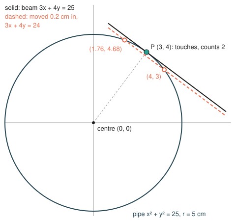

# Intersection multiplicity: how tightly two curves touch where they meet

[Syllabus](../../../SYLLABUS.md) → [Algebraic geometry](../README.md) → [Plane Curves](../README.md#s03) → Intersection multiplicity

---

## General Overview

A laser alignment beam runs past a steel pipe of radius 5 cm. Cut across, the pipe is the circle $`x^2 + y^2 = 25`$, with x and y in cm from the pipe's centre. The beam runs along the straight line $`3x + 4y = 25`$. It grazes the pipe at one point, P = (3, 4).

Move the beam 0.2 cm towards the centre and it cuts the pipe at two points, (4, 3) and (1.76, 4.68). Move it 0.01 cm and the two points are still there, 0.63 cm apart. Move it outwards instead and it misses: no real point at all, but two complex ones. In every position the beam meets the pipe twice. At the graze the two meetings sit on top of each other.

**Intersection multiplicity** is the number that says how many meetings are stacked at one point. It is written $`(F \cdot G)_P`$, where F and G are the two curves' equations. For the graze it is 2. A clean crossing gets 1.

This card computes that number two ways. The first is the **local ring** with F and G set to zero: a small algebra of functions near P, whose size is the multiplicity. The second is the **resultant**: one determinant whose root at x = 3 is double. Both give 2, and both explain why a tangency counts as two.

**Intersection multiplicity counts how many simple crossings have merged at a meeting point: it is the size of the local ring at that point divided by both equations, a tangency gives at least 2, and the resultant shows the same number as the order of a repeated root.**

**What kind of fact this is:** a definition, plus two theorems proved in Why it works: the resultant gives the same count (proved for a curve and a line, quoted with its source in general), and, for two curves smooth at P, the count is 1 exactly when their tangent lines differ.

The field is ℚ for coefficients, and points are counted over the complex numbers ℂ. The beam and the pipe share no point at infinity, so here the plane count is already the full count: projective, with multiplicity, over ℂ.

[Circles and parabolas](../../05-Geometry%20and%20trig/04-Coordinates%20and%20Curves/04-circles-and-parabolas.md) already puts a tangent line into a dish and gets one repeated root, $`(x - 40)^2 = 0`$, with discriminant 0. This card turns that repeated root into a number that works for any two curves.

### The picture: one graze, two crossings

<p align="center"></p>

Drawn to scale, real points only. The solid beam touches at P. The dashed beam, moved 0.2 cm in, crosses at the two open dots. Slide the dashed beam back out and the two dots run together into P.

---

## The formula

Two short definitions first.

- The **local ring at P**, written $`\mathcal{O}_P`$, holds every fraction of polynomials whose denominator is not zero at P ([Smooth and singular points](../02-Affine%20and%20Projective%20Varieties/08-smooth-and-singular-points.md) introduces it for any variety; here the variety is the whole plane). In it, anything that is not zero at P has an inverse.
- The **ideal** $`\langle F, G\rangle`$ is every combination $`AF + BG`$, with A and B taken from that ring. Dividing by it means treating F and G as zero.

The definition:

```math
(F \cdot G)_P = \dim_{\mathbb{C}} \; \mathcal{O}_P \,/\, \langle F, G \rangle
```

**Read it aloud:** the intersection multiplicity of F and G at P is the dimension of the local ring at P once F and G are set to zero.

The dimension counts independent pieces. For the graze, a function near P, with the pipe and beam set to zero, is pinned down by two numbers: its value at P and its slope along the beam. So the dimension is 2.

The resultant road. Write $`\mathrm{Res}_y(F, G)`$ for the resultant in y, the determinant that removes y ([The resultant](../01-Polynomial%20Systems/06-resultants-and-common-roots.md)). It is a polynomial in x alone, and its roots record the meetings:

```math
\mathrm{Res}_y(F, G) = c \prod_{a} (x - a)^{\,\sum_{P:\; x(P) = a} (F \cdot G)_P}
```

**Read it aloud:** the resultant in y is a constant times one factor $`x - a`$ for each x-value a where the curves meet, repeated as many times as the multiplicities of the meeting points above that x-value add up to.

For the pipe and the beam:

```math
\mathrm{Res}_y(x^2 + y^2 - 25,\; 3x + 4y - 25) = 25x^2 - 150x + 225 = 25(x - 3)^2
```

The root x = 3 is double, and only P sits above it, so $`(F \cdot G)_P = 2`$.

| Symbol | Plain meaning | In our example | Push it up and the answer… |
| --- | --- | --- | --- |
| $`x`$, $`y`$ | position across the pipe, in cm from its centre | P at (3, 4) | — |
| $`F`$, $`G`$; $`\nabla F(P)`$ | the two curves' equations, each set to zero; F's gradient at P, its two rates of change | $`x^2 + y^2 - 25`$ and $`3x + 4y - 25`$; (6, 8) | — |
| $`P`$; $`a`$ | the meeting point being measured; an x-value where the curves meet | (3, 4); a = 3 | — |
| $`u`$, $`v`$; $`p`$, $`q`$ | position measured from P: $`u = x - 3`$, $`v = y - 4`$; in Step 3's fold, any coordinates at P in which the line is $`q = 0`$ | P is $`u = v = 0`$ | — |
| $`\mathcal{O}_P`$; $`\mathfrak{m}_P`$ | the local ring: fractions whose denominator is not zero at P; its functions that are zero at P | holds $`1/(x+1)`$, not $`1/(x-3)`$; holds $`x - 3`$ | — |
| $`\langle F, G\rangle`$; $`A`$, $`B`$ | the ideal: every $`AF + BG`$, with A and B from the local ring | contains $`25(x - 3)^2`$ | — |
| $`(F \cdot G)_P`$; $`r`$ | the intersection multiplicity; the same count read as the lowest power along a line | 2; r = 2 | a tighter touch |
| $`N`$ | the cut-off degree: terms of degree N and above dropped | 1 to 5 | the count climbs, then stops at 2 |
| $`\mathrm{Res}_y(F, G)`$; $`c`$ | the resultant in y, a polynomial in x; its nonzero constant factor | $`25x^2 - 150x + 225`$; c = 25 | — |
| $`s`$ | how far the beam is moved in, in cm | 0.2 | the chord grows like $`2\sqrt{10s}`$ |
| $`t`$; $`d = (d_1, d_2)`$ | a step along a line through P; the line's direction | $`d = (4, -3)`$, the beam | — |
| $`\mathbb{Q}`$, $`\mathbb{C}`$ | the field of coefficients, and the complex numbers where points are counted | — | — |

### When it holds

- **Points counted over ℂ.** Over the real numbers the beam $`3x + 4y = 30`$ meets the pipe 0 times. The total of 2 needs the two complex points.
- **No shared piece.** If F and G share a factor, they meet along a whole curve and the dimension is infinite. The pipe against the pipe times the beam gives a resultant of 0 and a count that keeps climbing: 1, 2, 3, 4, 5.
- **One meeting point per x-value, for the resultant.** The resultant adds up all meetings above one x-value. The vertical beam x = 3 gives $`(x - 3)^2`$, but that is two crossings, (3, 4) and (3, −4), each of multiplicity 1.
- **A constant top y-coefficient, for the resultant.** At least one equation's highest power of y must have a nonzero number as its coefficient, as the pipe's $`y^2`$ does. If neither has, meetings can slip off to infinity and the factors miss them.
- **Plane total versus full total.** Curves can also meet at infinity. Two pipes touching at P have plane total 2, where Bezout's theorem counts 4.

---

## Why it works

### Step 0: a tangency is two crossings that have merged

Slide a line across a circle. While it cuts, it crosses at two points. As it reaches the edge, the two points run together. The algebra keeps both: the quadratic that finds them keeps two roots, which become one repeated root. Intersection multiplicity is the honest count of that merged pair. The local ring measures it at P alone, without moving anything.

### Step 1: watch the two points merge

Put each beam into the pipe: solve the beam for y, substitute, and multiply by 16. Each time the result is a quadratic in x.

| Beam | Quadratic | Discriminant | Real points |
| --- | --- | --- | --- |
| $`3x + 4y = 24`$ | $`25x^2 - 144x + 176`$ | 3136 | (4, 3) and (1.76, 4.68) |
| $`3x + 4y = 25`$ | $`25x^2 - 150x + 225`$ | 0 | (3, 4), twice |
| $`3x + 4y = 30`$ | $`25x^2 - 180x + 500`$ | −17600 | none: x = 18/5 ± 2.6533i |

The **discriminant** is the middle coefficient squared minus four times the other two. It is positive for two real roots, 0 for a repeated root and negative for two complex roots. Counted with repeats, every row has 2 roots. Only the tangent row puts both at one point.

How fast do they separate? A beam moved s cm in sits $`5 - s`$ cm from the centre. By Pythagoras the chord is $`2\sqrt{25 - (5 - s)^2} = 2\sqrt{10s - s^2}`$.

| Moved in | Chord | Chord ÷ √(move) |
| --- | --- | --- |
| 0.2 cm | 2.8000 cm | 6.2610 |
| 0.01 cm | 0.6321 cm | 6.3214 |
| 0.0001 cm | 0.0632 cm | 6.3245 |

The last column settles at $`2\sqrt{10} = 6.3246`$. The chord grows like a square root of the move. A square root is the mark of two roots splitting apart; three merged roots would split like a cube root.

### Step 2: along a line, the multiplicity is the lowest power of t

Walk along the beam from P with step t: $`(x, y) = (3 + 4t,\ 4 - 3t)`$. Put that into the pipe's equation:

```math
(3 + 4t)^2 + (4 - 3t)^2 - 25 = 25t^2
```

The lowest power of t is $`t^2`$. So F vanishes to order 2 along the beam at P. Walk along the radius instead, $`(3 + 3t,\ 4 + 4t)`$, and the result is $`25t^2 + 50t`$: order 1, a clean crossing.

Why does only the tangent give order 2? Expand F about P. The coefficient of t is $`\nabla F(P) \cdot d`$, where the **gradient** $`\nabla F(P) = (6, 8)`$ lists F's two rates of change at P and $`d = (d_1, d_2)`$ is the walking direction. That coefficient is zero exactly when d is at right angles to (6, 8): along the tangent. The beam's normal (3, 4) points the same way as (6, 8), so the beam is the tangent.

For the pipe the $`t^2`$ coefficient is $`d_1^2 + d_2^2 = 25`$, never zero for the real direction (4, −3). So the order is exactly 2, not 3. A line that reaches order 3 is an inflection tangent, met on [Inflections and Cayley-Bacharach](09-inflections-and-the-cayley-bacharach-theorem.md).

### Step 3: the local ring gives the same 2

On the beam, $`y = (25 - 3x)/4`$. Setting G to zero turns every function into a function of x alone. Setting F to zero then sets $`25(x - 3)^2/16`$ to zero.

In the local ring, anything not zero at P can be divided by. So the quotient is the functions of x near 3 with $`(x - 3)^2`$ treated as zero. Every such function reduces to $`a + b(x - 3)`$: its value at P and its slope along the beam. Two numbers, so dimension 2.

<details>
<summary>Detailed proof: for a curve and a line, the local count equals the order along the line</summary>

Choose coordinates p, q at P with the line as $`q = 0`$. Dividing $`\mathcal{O}_P`$ by q leaves fractions in p alone whose denominators are not zero at $`p = 0`$. Restricted to the line, F becomes a polynomial in p.

That polynomial is $`p^r`$ times a polynomial that is not zero at $`p = 0`$, where r is its lowest power. The second factor is invertible in the local ring, so dividing by F is the same as dividing by $`p^r`$. Every fraction then reduces to a polynomial in p of degree below r, and the r powers $`1, p, \dots, p^{r-1}`$ are independent. So the dimension is r: the order along the line from Step 2.

</details>

### Step 4: a computer finds the dimension by cutting off high powers

The local ring is infinite. The code makes it finite. Measure from P with $`u = x - 3`$ and $`v = y - 4`$, and drop every term of degree N or more. What is left is the polynomials of degree below N, a space with one coordinate per monomial. Multiply F and G by every monomial, cut off the same way, and find the rank of the result by row reduction. The dimension at cut-off N is the number of monomials minus that rank.

| Cut-off N | 1 | 2 | 3 | 4 | 5 |
| --- | --- | --- | --- | --- | --- |
| Dimension | 1 | 2 | 2 | 2 | 2 |

The count climbs, then stops at 2. Two equal values in a row mean it has stopped for good, so the multiplicity is 2.

<details>
<summary>Detailed proof: why the cut-off count stops at the multiplicity</summary>

Write A for the local ring with F and G set to zero, and $`\mathfrak{m}_P`$ for the functions that vanish at P. The count at cut-off N is the dimension of A with every product of N functions from $`\mathfrak{m}_P`$ also set to zero.

The products of N such functions form a shrinking chain of pieces of A as N grows. If two neighbours in the chain are equal, that piece equals $`\mathfrak{m}_P`$ times that same piece. Nakayama's lemma says such a finitely generated piece is zero. So the chain shrinks strictly until it reaches zero, and then stays there.

While it shrinks, the count climbs by at least 1 per step. Once the piece is zero, the count equals the dimension of A, the multiplicity, and stops. Removing the high terms also makes fractions unnecessary. Once terms of degree N are dropped, a polynomial that is not zero at P already has a polynomial inverse: a finite geometric series, as $`1/(1 - u) = 1 + u + \dots + u^{N-1}`$.

</details>

### Step 5: the resultant sees the same double root

For the beam, the resultant in y is a 3 by 3 determinant. Its rows are the pipe's coefficients in y, then the beam's twice, each shifted one step:

```math
\det \begin{pmatrix} 1 & 0 & x^2 - 25 \\ 4 & 3x - 25 & 0 \\ 0 & 4 & 3x - 25 \end{pmatrix} = (3x - 25)^2 + 16(x^2 - 25) = 25(x - 3)^2
```

That is Step 1's tangent quadratic again. When G is a line whose y-coefficient is a nonzero number, the resultant is that number to a power, times F restricted to the line, up to sign. So its root order at x = 3 is the order along the line from Step 2, which Step 3 showed is the local count.

For two curves of any degree, the same holds under the conditions in When it holds. Kirwan, chapter 3, shows that a short list of rules allows only one such count, and that the resultant's root orders obey them. The local count obeys the same rules, so the two agree.

One rule is worth seeing. Adding a multiple of F to G leaves the ideal $`\langle F, G\rangle`$ unchanged, so $`(F \cdot G)_P = (F \cdot (G + AF))_P`$ for any A.

A second pipe of radius 5 cm centred at (6, 8) also touches the first at P. Its equation minus the first pipe's is $`-12x - 16y + 100`$, which is −4 times the beam. So the two pipes meet at P as pipe and beam do, with multiplicity 2. The code agrees: cut-off counts 1, 2, 2, 2, and resultant $`400x^2 - 2400x + 3600`$, with x = 3 a double root.

### Step 6: why a tangency counts as at least two, for any two curves

Take two curves, each smooth at P: each has a nonzero gradient there, so each has one tangent line. At cut-off N = 2 only the constant and the two first-degree terms survive. F and G contribute their gradients, and every multiple $`uF`$, $`vF`$, $`uG`$, $`vG`$ is cut off.

- **Different tangent lines.** The two gradients are independent, the rank is 2, and the count is 3 − 2 = 1. The count at N = 1 is also 1, and two equal counts in a row are final (Step 4), so the multiplicity is exactly 1.
- **The same tangent line.** The gradients point the same way, the rank is 1, and the count is 3 − 1 = 2. Since the count only climbs, the multiplicity is at least 2.

So for two smooth curves, multiplicity 1 means crossing at an angle, and multiplicity 2 or more means touching. That is the precise sense in which a tangency counts as two.

A singular point raises the floor. The house example, the nodal cubic $`y^2 = x^2(x + 1)`$, crosses itself at the origin O. Its equation has no first-degree terms there, so every line through O meets it at least twice:

| Line through O | Local count at O | Resultant in y |
| --- | --- | --- |
| $`y = 2x`$ | 2 | $`-x^3 + 3x^2`$: root 0 twice, and root 3 once, a second crossing |
| $`y = x`$, along one branch | 3 | $`-x^3`$: root 0 three times |

[Nodes and cusps](04-singularities-nodes-and-cusps.md) reads these branch directions from the lowest terms; this card only counts.

---

## Worked numbers, by hand

| Step | Arithmetic | Value |
| --- | --- | --- |
| beam as y in terms of x | $`3x + 4y = 25`$ | $`y = (25 - 3x)/4`$ |
| put it into the pipe, times 16 | $`16x^2 + (25 - 3x)^2 - 400`$ | $`25x^2 - 150x + 225`$ |
| factor | $`25(x^2 - 6x + 9)`$ | $`25(x - 3)^2`$: x = 3 twice |
| Sylvester determinant | $`(3x - 25)^2 + 16(x^2 - 25)`$ | $`25x^2 - 150x + 225`$ again |
| walk along the beam | $`(3 + 4t)^2 + (4 - 3t)^2 - 25`$ | $`25t^2`$: order 2 |
| local quotient | functions $`a + b(x - 3)`$ | dimension 2 |
| gradient check | $`\nabla F(3, 4) = (6, 8) = 2 \times (3, 4)`$ | parallel to the beam's normal: tangent |
| beam moved 0.2 cm in | $`25x^2 - 144x + 176 = (x - 4)(25x - 44)`$ | (4, 3) and (44/25, 117/25), each 1 |
| their distance | $`2\sqrt{10 \times 0.2 - 0.2^2}`$, or Pythagoras on the two points | 2.8 cm |
| beam moved 0.01 cm in | $`2\sqrt{0.1 - 0.0001}`$ | 0.6321 cm |
| multiplicity at P | all roads | **$`(F \cdot G)_P = 2`$** |

The beam touches the pipe with multiplicity 2: a 0.01 cm misalignment inward already cuts a 0.63 cm chord, and the count of meetings, with multiplicity, stays 2 in every position.

### What breaks if you drop a piece

| Mistake | Comes out at | What went wrong |
| --- | --- | --- |
| Counting distinct real points | secant 2, tangent 1, miss 0 | The tangent hides a merged pair, and the miss hides two complex points; with multiplicity over ℂ all three are 2 |
| Reading a resultant root as one point: vertical beam x = 3 | $`(x - 3)^2`$, order 2 | Two crossings, (3, 4) and (3, −4), share x = 3; each has multiplicity 1 |
| Ignoring a shared piece: pipe against pipe times beam | resultant 0; counts 1, 2, 3, 4, 5 | The curves share the whole pipe, so the multiplicity is infinite |
| Stopping the cut-off at N = 1 | 1 | N = 1 keeps only the value at P; it reads 1 for every meeting. Continue until two counts agree |

The code prints the first three; the fourth is the first entry of the cut-off list.

---

## Code, from first principles, and it actually runs

The code reaches the multiplicity at P by three independent roads; the first and third share only the step that moves the origin to P. Road one is the local ring, made finite by the cut-off of Step 4 and measured by exact row reduction. Road two is the resultant in y, a permutation sum of the Sylvester determinant with polynomial entries, followed by repeated division by $`x - 3`$. Road three walks along a line through P and reads the lowest power of t. It also checks the secant points exactly, the chord lengths, the second pipe, the nodal cubic and the three mistakes.

### Python

```python
# Intersection multiplicity -- the check behind the card.  Imports: fractions,
# for exact rationals, and math, for binomial coefficients and one square root;
# neither knows any multiplicity.  A curve is a dict {(i, j): c} for c x^i y^j.
from fractions import Fraction as Q
from math import comb, sqrt
def shift(f, a, b):                       # f(u + a, v + b): the curve seen from P = (a, b)
    r = {}
    for (i, j), c in f.items():
        for p in range(i + 1):
            for q in range(j + 1):
                r[(p, q)] = r.get((p, q), 0) + c * comb(i, p) * a ** (i - p) * comb(j, q) * b ** (j - q)
    return {k: v for k, v in r.items() if v}
def mul2(f, g):
    r = {}
    for (i, j), c in f.items():
        for (k, l), d in g.items(): r[(i + k, j + l)] = r.get((i + k, j + l), 0) + c * d
    return {k: v for k, v in r.items() if v}
def rank(rows):                           # Gaussian elimination over the rationals
    rows, r = [[Q(x) for x in row] for row in rows], 0
    for c in range(len(rows[0]) if rows else 0):
        p = next((i for i in range(r, len(rows)) if rows[i][c] != 0), None)
        if p is None: continue
        rows[r], rows[p] = rows[p], rows[r]
        for i in range(len(rows)):
            if i != r and rows[i][c] != 0:
                k = rows[i][c] / rows[r][c]; rows[i] = [x - k * y for x, y in zip(rows[i], rows[r])]
        r += 1
    return r
def local_dim(f, g, P, N):                # road one: dim of k[u, v] / (F, G, every term of degree N)
    mons = [(i, d - i) for d in range(N) for i in range(d, -1, -1)]
    idx, rows = {m: k for k, m in enumerate(mons)}, []
    for h in (shift(f, *P), shift(g, *P)):
        for a, b in mons:
            row = [0] * len(mons)
            for (i, j), c in h.items():
                if i + a + j + b < N: row[idx[(i + a, j + b)]] += c
            rows.append(row)
    return len(mons) - rank(rows)
def trim(p): return list(p)[:max((i + 1 for i, c in enumerate(p) if c != 0), default=0)]
def add1(p, q): return trim([(p[i] if i < len(p) else 0) + (q[i] if i < len(q) else 0) for i in range(max(len(p), len(q)))])
def mul1(p, q):
    r = [0] * (len(p) + len(q) - 1) if p and q else []
    for i, j in ((i, j) for i in range(len(p)) for j in range(len(q))): r[i + j] += p[i] * q[j]
    return trim(r)
def in_y(f):                              # coefficients of y^0, y^1, ... as polynomials in x
    n = max(j for _, j in f)
    return [trim([f.get((i, j), 0) for i in range(max(i for i, _ in f) + 1)]) for j in range(n + 1)]
def perms(n):
    if n == 1: return [([0], 1)]
    return [(p[:i] + [n - 1] + p[i:], s * (-1) ** (n - 1 - i)) for p, s in perms(n - 1) for i in range(n)]
def res_y(f, g):                          # road two: the Sylvester determinant in y, a polynomial in x
    F, G = in_y(f)[::-1], in_y(g)[::-1]
    m, n = len(F) - 1, len(G) - 1
    S = [[[]] * i + F + [[]] * (n - 1 - i) for i in range(n)] + [[[]] * i + G + [[]] * (m - 1 - i) for i in range(m)]
    tot = []
    for p, s in perms(len(S)):
        term = [s]
        for r in range(len(S)): term = mul1(term, S[r][p[r]])
        tot = add1(tot, term)
    return tot
def order_at(p, a):                       # how many times x - a divides p
    k = 0
    while p:
        q, s = [], 0
        for c in reversed(p): s = s * a + c; q.append(s)
        if q[-1] != 0: return k
        p, k = q[-2::-1], k + 1
    return "infinite"
def along(f, P, d):                       # road three: f(P + t d), lowest power of t
    h = shift(f, *P)
    co = [sum(c * d[0] ** i * d[1] ** j for (i, j), c in h.items() if i + j == k) for k in range(5)]
    return next(k for k, c in enumerate(co) if c != 0), co
def show(p, v="x"):
    t = [(c, k) for k, c in enumerate(p) if c][::-1]
    s = " ".join(f"{'-' if c < 0 else '+'} {'' if abs(c) == 1 and k else abs(c)}{v if k else ''}{'^' + str(k) if k > 1 else ''}" for c, k in t)
    return (s[2:] if s.startswith("+") else "-" + s[2:]) if t else "0"

C = {(2, 0): 1, (0, 2): 1, (0, 0): -25}                 # the pipe: x^2 + y^2 = 25 (cm)
T = {(1, 0): 3, (0, 1): 4, (0, 0): -25}                 # the beam: 3x + 4y = 25, touching at (3, 4)
P = (3, 4)
print("pipe x^2 + y^2 = 25; beam 3x + 4y = 25; gradient of the pipe at P: (6, 8), beam normal (3, 4)")
print("local road at P, N = 1..5:", [local_dim(C, T, P, N) for N in range(1, 6)])
R = res_y(C, T)
print(f"resultant road: Res_y = {show(R)}, root x = 3 of order {order_at(R, 3)}")
print(f"line road: pipe along (3 + 4t, 4 - 3t) = {show(along(C, P, (4, -3))[1], 't')}, order {along(C, P, (4, -3))[0]}")
radial = {(1, 0): 4, (0, 1): -3}                          # the radius line 4x = 3y through P
print(f"radius line 4x - 3y = 0 at P: local {local_dim(C, radial, P, 5)}, along (3 + 3t, 4 + 4t) = "
      f"{show(along(C, P, (3, 4))[1], 't')}, order {along(C, P, (3, 4))[0]}")
tot = []
for c, name in ((24, "secant"), (25, "tangent"), (30, "miss")):
    L = {(1, 0): 3, (0, 1): 4, (0, 0): -c}
    R = res_y(C, L)
    disc = R[1] ** 2 - 4 * R[2] * R[0]
    print(f"beam 3x + 4y = {c} ({name}): Res_y = {show(R)}, discriminant {disc}")
    tot.append((c, R, disc))
pts = [(Q(4), Q(3)), (Q(44, 25), Q(117, 25))]
L24 = {(1, 0): 3, (0, 1): 4, (0, 0): -24}
print("secant points:", ", ".join(f"({a}, {b}) local {local_dim(C, L24, (a, b), 4)}" for a, b in pts))
print(f"miss: x = 18/5 +- {sqrt(17600) / 50:.4f} i, two complex points, none real")
for s in (Q(1, 5), Q(1, 100), Q(1, 10000)):
    ch = 2 * sqrt(10 * s - s * s)
    print(f"beam moved {float(s):.4f} cm in: chord {ch:.4f} cm, chord / sqrt(move) {ch / sqrt(s):.4f}")
print(f"square-root law: 2 sqrt(10) = {2 * sqrt(10):.4f}")
D = {(2, 0): 1, (1, 0): -12, (0, 2): 1, (0, 1): -16, (0, 0): 75}  # pipe of radius 5 centred at (6, 8)
RD = res_y(C, D)
print(f"two pipes, centres (0, 0) and (6, 8): local {[local_dim(C, D, P, N) for N in range(1, 5)]}, "
      f"Res_y = {show(RD)}, order {order_at(RD, 3)}")
same = all(D.get(k, 0) - C.get(k, 0) == -4 * T.get(k, 0) for k in set(D) | set(C) | set(T))
print(f"second pipe minus first = -4 x beam: {'yes' if same else 'no'}; plane total 2, Bezout 2 x 2 = 4")
Nd = {(0, 2): 1, (3, 0): -1, (2, 0): -1}                # house example: y^2 = x^2 (x + 1), node at O
for k in (2, 1):
    L = {(0, 1): 1, (1, 0): -k}
    R = res_y(Nd, L)
    print(f"nodal cubic and y = {k if k > 1 else ''}x: local at O {local_dim(Nd, L, (0, 0), 5)}, "
          f"Res_y = {show(R)}, order at 0: {order_at(R, 0)}, at 3: {order_at(R, 3)}")
V = {(1, 0): 1, (0, 0): -3}                             # mistake: a vertical beam x = 3
RV = res_y(C, V)
print(f"mistake, vertical beam x = 3: Res_y = {show(RV)}, order {order_at(RV, 3)}; "
      f"local at (3, 4) {local_dim(C, V, (3, 4), 4)}, at (3, -4) {local_dim(C, V, (3, -4), 4)}")
CT = mul2(C, T)                                         # mistake: a shared piece
print(f"mistake, pipe against pipe x beam: Res_y = {show(res_y(C, CT))}, local N = 1..5: "
      f"{[local_dim(C, CT, P, N) for N in range(1, 6)]}")
print("mistake, distinct real points: secant 2, tangent 1, miss 0; with multiplicity over C: 2, 2, 2")
s6, X5, cub = Q(1, 10 ** 6), {(1, 0): 1, (0, 0): -5}, {(0, 1): 1, (3, 0): -1}   # the four "try changing" answers
print(f"try: y = x^3 against y = 0 at O, N = 1..5: {[local_dim(cub, {(0, 1): 1}, (0, 0), N) for N in range(1, 6)]}; "
      f"beam x = 5: local {local_dim(C, X5, (5, 0), 5)}, Res_y = {show(res_y(C, X5))}; node with y = -x: "
      f"{local_dim(Nd, {(0, 1): 1, (1, 0): 1}, (0, 0), 5)}, with y = 0: {local_dim(Nd, {(0, 1): 1}, (0, 0), 5)}; "
      f"move 0.000001 cm: chord {2 * sqrt(10 * s6 - s6 * s6):.4f} cm, ratio {2 * sqrt(10 * s6 - s6 * s6) / sqrt(s6):.4f}")
print("figure, pipe r 5 centre (0, 0), tangent 3x + 4y = 25 at (3, 4), secant 3x + 4y = 24 at (4, 3) and (1.76, 4.68)")
assert [local_dim(C, T, P, N) for N in range(2, 6)] == [2] * 4                 # local ring gives 2
assert res_y(C, T) == [225, -150, 25] and order_at(res_y(C, T), 3) == 2        # resultant gives 2
assert along(C, P, (4, -3))[1][:3] == [0, 0, 25]                               # the line gives 2
assert local_dim(C, radial, P, 5) == 1 == along(C, P, (3, 4))[0]
assert [t[2] for t in tot] == [3136, 0, -17600] and order_at(tot[0][1], 4) == 1
assert all(a * a + b * b == 25 and 3 * a + 4 * b == 24 for a, b in pts)
assert local_dim(C, D, P, 4) == order_at(RD, 3) == 2 and order_at(RV, 3) == 2 and same
assert local_dim(Nd, {(0, 1): 1, (1, 0): -1}, (0, 0), 5) == 3 and res_y(C, CT) == []
s = Q(1, 5)                                             # chord formula against the two secant points
assert (pts[0][0] - pts[1][0]) ** 2 + (pts[0][1] - pts[1][1]) ** 2 == 4 * (10 * s - s * s)
print("ALL CHECKS PASS")
```

**Ran 2026-11-17 on macOS, Python 3.14.10, standard library only. All checks passed. Output, pasted from the run:**

```
pipe x^2 + y^2 = 25; beam 3x + 4y = 25; gradient of the pipe at P: (6, 8), beam normal (3, 4)
local road at P, N = 1..5: [1, 2, 2, 2, 2]
resultant road: Res_y = 25x^2 - 150x + 225, root x = 3 of order 2
line road: pipe along (3 + 4t, 4 - 3t) = 25t^2, order 2
radius line 4x - 3y = 0 at P: local 1, along (3 + 3t, 4 + 4t) = 25t^2 + 50t, order 1
beam 3x + 4y = 24 (secant): Res_y = 25x^2 - 144x + 176, discriminant 3136
beam 3x + 4y = 25 (tangent): Res_y = 25x^2 - 150x + 225, discriminant 0
beam 3x + 4y = 30 (miss): Res_y = 25x^2 - 180x + 500, discriminant -17600
secant points: (4, 3) local 1, (44/25, 117/25) local 1
miss: x = 18/5 +- 2.6533 i, two complex points, none real
beam moved 0.2000 cm in: chord 2.8000 cm, chord / sqrt(move) 6.2610
beam moved 0.0100 cm in: chord 0.6321 cm, chord / sqrt(move) 6.3214
beam moved 0.0001 cm in: chord 0.0632 cm, chord / sqrt(move) 6.3245
square-root law: 2 sqrt(10) = 6.3246
two pipes, centres (0, 0) and (6, 8): local [1, 2, 2, 2], Res_y = 400x^2 - 2400x + 3600, order 2
second pipe minus first = -4 x beam: yes; plane total 2, Bezout 2 x 2 = 4
nodal cubic and y = 2x: local at O 2, Res_y = -x^3 + 3x^2, order at 0: 2, at 3: 1
nodal cubic and y = x: local at O 3, Res_y = -x^3, order at 0: 3, at 3: 0
mistake, vertical beam x = 3: Res_y = x^2 - 6x + 9, order 2; local at (3, 4) 1, at (3, -4) 1
mistake, pipe against pipe x beam: Res_y = 0, local N = 1..5: [1, 2, 3, 4, 5]
mistake, distinct real points: secant 2, tangent 1, miss 0; with multiplicity over C: 2, 2, 2
try: y = x^3 against y = 0 at O, N = 1..5: [1, 2, 3, 3, 3]; beam x = 5: local 2, Res_y = x^2 - 10x + 25; node with y = -x: 3, with y = 0: 2; move 0.000001 cm: chord 0.0063 cm, ratio 6.3246
figure, pipe r 5 centre (0, 0), tangent 3x + 4y = 25 at (3, 4), secant 3x + 4y = 24 at (4, 3) and (1.76, 4.68)
ALL CHECKS PASS
```

### Rust

Same numbers, same labels, built with `rustc --edition 2021 -O`.

```rust
// Intersection multiplicity -- the same check as the Python, in Rust.  No crates.
// Exact rationals are an i128 pair with checked multiplication, so overflow stops
// the run.  A curve is a list of terms (i, j, c) for c x^i y^j.
use std::fmt;
use std::ops::{Add, Div, Mul, Neg, Sub};
#[derive(Clone, Copy, PartialEq, Debug)] struct Fr { n: i128, d: i128 }
fn gi(a: i128, b: i128) -> i128 { if b == 0 { a.abs() } else { gi(b, a % b) } }
fn fr(n: i128, d: i128) -> Fr { let g = gi(n, d) * d.signum(); Fr { n: n / g, d: d / g } }
fn z(n: i128) -> Fr { Fr { n, d: 1 } }
fn cm(a: i128, b: i128) -> i128 { a.checked_mul(b).expect("overflow") }
impl Add for Fr { type Output = Fr; fn add(self, o: Fr) -> Fr { fr(cm(self.n, o.d) + cm(o.n, self.d), cm(self.d, o.d)) } }
impl Neg for Fr { type Output = Fr; fn neg(self) -> Fr { Fr { n: -self.n, d: self.d } } }
impl Sub for Fr { type Output = Fr; fn sub(self, o: Fr) -> Fr { self + (-o) } }
impl Mul for Fr { type Output = Fr; fn mul(self, o: Fr) -> Fr { fr(cm(self.n, o.n), cm(self.d, o.d)) } }
impl Div for Fr { type Output = Fr; fn div(self, o: Fr) -> Fr { fr(cm(self.n, o.d), cm(self.d, o.n)) } }
impl fmt::Display for Fr { fn fmt(&self, f: &mut fmt::Formatter) -> fmt::Result {
    if self.d == 1 { write!(f, "{}", self.n) } else { write!(f, "{}/{}", self.n, self.d) } } }
type Curve = Vec<(usize, usize, Fr)>;
fn curve(t: &[(usize, usize, i128)]) -> Curve { t.iter().map(|&(i, j, c)| (i, j, z(c))).collect() }
fn pw(a: Fr, k: usize) -> Fr { (0..k).fold(z(1), |s, _| s * a) }
fn comb(n: usize, k: usize) -> i128 { (0..k).fold(1, |s, i| s * (n - i) as i128 / (i as i128 + 1)) }
fn tidy(m: Vec<((usize, usize), Fr)>) -> Curve {
    let mut r: Curve = Vec::new();
    for ((i, j), c) in m { match r.iter_mut().find(|t| t.0 == i && t.1 == j) { Some(t) => t.2 = t.2 + c, None => r.push((i, j, c)) } }
    r.into_iter().filter(|t| t.2 != z(0)).collect() }
fn shift(f: &Curve, a: Fr, b: Fr) -> Curve {   // f(u + a, v + b): the curve seen from P = (a, b)
    let mut m = Vec::new();
    for &(i, j, c) in f { for p in 0..=i { for q in 0..=j {
        m.push(((p, q), c * z(comb(i, p)) * pw(a, i - p) * z(comb(j, q)) * pw(b, j - q))); } } }
    tidy(m) }
fn mul2(f: &Curve, g: &Curve) -> Curve {
    tidy(f.iter().flat_map(|&(i, j, c)| g.iter().map(move |&(k, l, d)| ((i + k, j + l), c * d))).collect()) }
fn rank(mut rows: Vec<Vec<Fr>>) -> usize {      // Gaussian elimination over the rationals
    let (mut r, cols) = (0, if rows.is_empty() { 0 } else { rows[0].len() });
    for c in 0..cols {
        let p = match (r..rows.len()).find(|&i| rows[i][c] != z(0)) { Some(p) => p, None => continue }; rows.swap(r, p);
        for i in 0..rows.len() { if i != r && rows[i][c] != z(0) {
            let (k, pr) = (rows[i][c] / rows[r][c], rows[r].clone());
            for (x, y) in rows[i].iter_mut().zip(pr) { *x = *x - k * y; } } }
        r += 1;
    }
    r }
fn local_dim(f: &Curve, g: &Curve, p: (Fr, Fr), n: usize) -> usize {   // road one
    let mons: Vec<(usize, usize)> = (0..n).flat_map(|d| (0..=d).rev().map(move |i| (i, d - i))).collect();
    let mut rows = Vec::new();
    for h in [shift(f, p.0, p.1), shift(g, p.0, p.1)] {
        for &(a, b) in &mons {
            let mut row = vec![z(0); mons.len()];
            for &(i, j, c) in &h { if i + a + j + b < n {
                let k = mons.iter().position(|&m| m == (i + a, j + b)).unwrap(); row[k] = row[k] + c; } }
            rows.push(row); }
    }
    mons.len() - rank(rows) }
fn trim(mut p: Vec<Fr>) -> Vec<Fr> { while p.last() == Some(&z(0)) { p.pop(); } p }
fn add1(p: &[Fr], q: &[Fr]) -> Vec<Fr> {
    trim((0..p.len().max(q.len())).map(|i| *p.get(i).unwrap_or(&z(0)) + *q.get(i).unwrap_or(&z(0))).collect()) }
fn mul1(p: &[Fr], q: &[Fr]) -> Vec<Fr> {
    if p.is_empty() || q.is_empty() { return vec![]; }
    let mut r = vec![z(0); p.len() + q.len() - 1];
    for (i, &a) in p.iter().enumerate() { for (j, &b) in q.iter().enumerate() { r[i + j] = r[i + j] + a * b; } } trim(r) }
fn in_y(f: &Curve) -> Vec<Vec<Fr>> {            // coefficients of y^0, y^1, ... as polynomials in x
    let (n, m) = (f.iter().map(|t| t.1).max().unwrap(), f.iter().map(|t| t.0).max().unwrap());
    (0..=n).map(|j| trim((0..=m).map(|i| f.iter().find(|t| t.0 == i && t.1 == j).map_or(z(0), |t| t.2)).collect())).collect() }
fn perms(n: usize) -> Vec<(Vec<usize>, i128)> {
    if n == 1 { return vec![(vec![0], 1)]; } let mut out = Vec::new();
    for (p, s) in perms(n - 1) { for i in 0..n {
        let mut q = p.clone(); q.insert(i, n - 1); out.push((q, if (n - 1 - i) % 2 == 0 { s } else { -s })); } }
    out }
fn res_y(f: &Curve, g: &Curve) -> Vec<Fr> {     // road two: the Sylvester determinant in y
    let (mut ff, mut gg) = (in_y(f), in_y(g)); ff.reverse(); gg.reverse();
    let (m, n) = (ff.len() - 1, gg.len() - 1);
    let mut s: Vec<Vec<Vec<Fr>>> = Vec::new();
    for i in 0..n { let mut r = vec![vec![]; i]; r.extend(ff.clone()); r.extend(vec![vec![]; n - 1 - i]); s.push(r); }
    for i in 0..m { let mut r = vec![vec![]; i]; r.extend(gg.clone()); r.extend(vec![vec![]; m - 1 - i]); s.push(r); }
    let mut tot = vec![];
    for (p, sg) in perms(s.len()) { tot = add1(&tot, &(0..s.len()).fold(vec![z(sg)], |t, r| mul1(&t, &s[r][p[r]]))); }
    tot }
fn order_at(p: &[Fr], a: Fr) -> String {        // how many times x - a divides p
    let (mut p, mut k) = (p.to_vec(), 0);
    while !p.is_empty() {
        let (mut q, mut s) = (vec![], z(0)); for &c in p.iter().rev() { s = s * a + c; q.push(s); }
        if *q.last().unwrap() != z(0) { return k.to_string(); }
        q.pop(); q.reverse(); p = q; k += 1;
    }
    "infinite".to_string() }
fn along(f: &Curve, p: (Fr, Fr), d: (i128, i128)) -> (usize, Vec<Fr>) {   // road three
    let h = shift(f, p.0, p.1);
    let co: Vec<Fr> = (0..5).map(|k| h.iter().filter(|t| t.0 + t.1 == k)
        .fold(z(0), |s, t| s + t.2 * pw(z(d.0), t.0) * pw(z(d.1), t.1))).collect();
    (co.iter().position(|&c| c != z(0)).unwrap(), co) }
fn show(p: &[Fr], v: &str) -> String {
    let t: Vec<(Fr, usize)> = p.iter().enumerate().filter(|x| *x.1 != z(0)).map(|(k, &c)| (c, k)).rev().collect();
    if t.is_empty() { return "0".into(); }
    let s = t.iter().map(|&(c, k)| { let a = if c.n < 0 { -c } else { c };
        format!("{} {}{}{}", if c.n < 0 { "-" } else { "+" }, if a == z(1) && k > 0 { String::new() } else { a.to_string() },
                if k > 0 { v } else { "" }, if k > 1 { format!("^{}", k) } else { String::new() }) }).collect::<Vec<_>>().join(" ");
    if s.starts_with('+') { s[2..].to_string() } else { format!("-{}", &s[2..]) } }
fn ls(v: &[usize]) -> String { format!("[{}]", v.iter().map(|x| x.to_string()).collect::<Vec<_>>().join(", ")) }
fn fl(x: Fr) -> f64 { x.n as f64 / x.d as f64 }
fn main() {
    let c = curve(&[(2, 0, 1), (0, 2, 1), (0, 0, -25)]);           // the pipe: x^2 + y^2 = 25 (cm)
    let (t, p) = (curve(&[(1, 0, 3), (0, 1, 4), (0, 0, -25)]), (z(3), z(4)));   // the beam 3x + 4y = 25, P
    println!("pipe x^2 + y^2 = 25; beam 3x + 4y = 25; gradient of the pipe at P: (6, 8), beam normal (3, 4)");
    let loc: Vec<usize> = (1..6).map(|n| local_dim(&c, &t, p, n)).collect();
    println!("local road at P, N = 1..5: {}", ls(&loc));
    let r = res_y(&c, &t);
    println!("resultant road: Res_y = {}, root x = 3 of order {}", show(&r, "x"), order_at(&r, z(3)));
    let (o1, co1) = along(&c, p, (4, -3));
    println!("line road: pipe along (3 + 4t, 4 - 3t) = {}, order {}", show(&co1, "t"), o1);
    let radial = curve(&[(1, 0, 4), (0, 1, -3)]);                  // the radius line 4x = 3y through P
    let ((o2, co2), lr) = (along(&c, p, (3, 4)), local_dim(&c, &radial, p, 5));
    println!("radius line 4x - 3y = 0 at P: local {}, along (3 + 3t, 4 + 4t) = {}, order {}", lr, show(&co2, "t"), o2);
    let mut tot = vec![];
    for (k, name) in [(24, "secant"), (25, "tangent"), (30, "miss")] {
        let r = res_y(&c, &curve(&[(1, 0, 3), (0, 1, 4), (0, 0, -k)]));
        let disc = r[1] * r[1] - z(4) * r[2] * r[0];
        println!("beam 3x + 4y = {} ({}): Res_y = {}, discriminant {}", k, name, show(&r, "x"), disc);
        tot.push((r, disc));
    }
    let pts = [(z(4), z(3)), (fr(44, 25), fr(117, 25))];
    let l24 = curve(&[(1, 0, 3), (0, 1, 4), (0, 0, -24)]);
    let sp: Vec<String> = pts.iter().map(|&(a, b)| format!("({}, {}) local {}", a, b, local_dim(&c, &l24, (a, b), 4))).collect();
    println!("secant points: {}", sp.join(", "));
    println!("miss: x = 18/5 +- {:.4} i, two complex points, none real", 17600f64.sqrt() / 50.0);
    for s in [fr(1, 5), fr(1, 100), fr(1, 10000)] {
        let ch = 2.0 * fl(z(10) * s - s * s).sqrt();
        println!("beam moved {:.4} cm in: chord {:.4} cm, chord / sqrt(move) {:.4}", fl(s), ch, ch / fl(s).sqrt());
    }
    println!("square-root law: 2 sqrt(10) = {:.4}", 2.0 * 10f64.sqrt());
    let d = curve(&[(2, 0, 1), (1, 0, -12), (0, 2, 1), (0, 1, -16), (0, 0, 75)]); let rd = res_y(&c, &d);  // centred (6, 8)
    let ld: Vec<usize> = (1..5).map(|n| local_dim(&c, &d, p, n)).collect();
    println!("two pipes, centres (0, 0) and (6, 8): local {}, Res_y = {}, order {}", ls(&ld), show(&rd, "x"), order_at(&rd, z(3)));
    let co = |f: &Curve, i: usize, j: usize| f.iter().find(|t| t.0 == i && t.1 == j).map_or(z(0), |t| t.2);
    let same = (0..3).all(|i| (0..3).all(|j| co(&d, i, j) - co(&c, i, j) == z(-4) * co(&t, i, j)));
    println!("second pipe minus first = -4 x beam: {}; plane total 2, Bezout 2 x 2 = 4", if same { "yes" } else { "no" });
    let (nd, o) = (curve(&[(0, 2, 1), (3, 0, -1), (2, 0, -1)]), (z(0), z(0)));   // house example: y^2 = x^2 (x + 1)
    for k in [2, 1] {
        let l = curve(&[(0, 1, 1), (1, 0, -k)]);
        let r = res_y(&nd, &l);
        println!("nodal cubic and y = {}x: local at O {}, Res_y = {}, order at 0: {}, at 3: {}",
                 if k > 1 { k.to_string() } else { String::new() }, local_dim(&nd, &l, o, 5), show(&r, "x"),
                 order_at(&r, z(0)), order_at(&r, z(3)));
    }
    let v = curve(&[(1, 0, 1), (0, 0, -3)]);                       // mistake: a vertical beam x = 3
    let rv = res_y(&c, &v);
    println!("mistake, vertical beam x = 3: Res_y = {}, order {}; local at (3, 4) {}, at (3, -4) {}", show(&rv, "x"),
             order_at(&rv, z(3)), local_dim(&c, &v, (z(3), z(4)), 4), local_dim(&c, &v, (z(3), z(-4)), 4));
    let ct = mul2(&c, &t);                                         // mistake: a shared piece
    let lct: Vec<usize> = (1..6).map(|n| local_dim(&c, &ct, p, n)).collect();
    println!("mistake, pipe against pipe x beam: Res_y = {}, local N = 1..5: {}", show(&res_y(&c, &ct), "x"), ls(&lct));
    println!("mistake, distinct real points: secant 2, tangent 1, miss 0; with multiplicity over C: 2, 2, 2");
    let (s6, x5, cub, flat) = (fr(1, 1000000), curve(&[(1, 0, 1), (0, 0, -5)]), curve(&[(0, 1, 1), (3, 0, -1)]), curve(&[(0, 1, 1)]));
    let ch = 2.0 * fl(z(10) * s6 - s6 * s6).sqrt();                 // the four "try changing" answers
    println!("try: y = x^3 against y = 0 at O, N = 1..5: {}; beam x = 5: local {}, Res_y = {}; node with y = -x: {}, with y = 0: {}; \
              move 0.000001 cm: chord {:.4} cm, ratio {:.4}", ls(&(1..6).map(|n| local_dim(&cub, &flat, o, n)).collect::<Vec<_>>()),
             local_dim(&c, &x5, (z(5), z(0)), 5), show(&res_y(&c, &x5), "x"), local_dim(&nd, &curve(&[(0, 1, 1), (1, 0, 1)]), o, 5),
             local_dim(&nd, &flat, o, 5), ch, ch / fl(s6).sqrt());
    println!("figure, pipe r 5 centre (0, 0), tangent 3x + 4y = 25 at (3, 4), secant 3x + 4y = 24 at (4, 3) and (1.76, 4.68)");
    assert!(loc[1..] == [2, 2, 2, 2]);                                             // local ring gives 2
    assert!(r == vec![z(225), z(-150), z(25)] && order_at(&r, z(3)) == "2");       // resultant gives 2
    assert!(co1[..3] == [z(0), z(0), z(25)] && lr == 1 && o2 == 1);              // the line gives 2
    assert!(tot.iter().map(|x| x.1).collect::<Vec<_>>() == vec![z(3136), z(0), z(-17600)] && order_at(&tot[0].0, z(4)) == "1");
    assert!(pts.iter().all(|&(a, b)| a * a + b * b == z(25) && z(3) * a + z(4) * b == z(24)));
    assert!(ld[3] == 2 && order_at(&rd, z(3)) == "2" && order_at(&rv, z(3)) == "2" && same);
    assert!(local_dim(&nd, &curve(&[(0, 1, 1), (1, 0, -1)]), o, 5) == 3 && res_y(&c, &ct).is_empty());
    let s = fr(1, 5);                                              // chord formula against the secant points
    let (dx, dy) = (pts[0].0 - pts[1].0, pts[0].1 - pts[1].1);
    assert!(dx * dx + dy * dy == z(4) * (z(10) * s - s * s));
    println!("ALL CHECKS PASS");
}
```

**Ran 2026-11-17 on macOS, rustc 1.98.1, no crates. All checks passed. Output, pasted from the run:**

```
pipe x^2 + y^2 = 25; beam 3x + 4y = 25; gradient of the pipe at P: (6, 8), beam normal (3, 4)
local road at P, N = 1..5: [1, 2, 2, 2, 2]
resultant road: Res_y = 25x^2 - 150x + 225, root x = 3 of order 2
line road: pipe along (3 + 4t, 4 - 3t) = 25t^2, order 2
radius line 4x - 3y = 0 at P: local 1, along (3 + 3t, 4 + 4t) = 25t^2 + 50t, order 1
beam 3x + 4y = 24 (secant): Res_y = 25x^2 - 144x + 176, discriminant 3136
beam 3x + 4y = 25 (tangent): Res_y = 25x^2 - 150x + 225, discriminant 0
beam 3x + 4y = 30 (miss): Res_y = 25x^2 - 180x + 500, discriminant -17600
secant points: (4, 3) local 1, (44/25, 117/25) local 1
miss: x = 18/5 +- 2.6533 i, two complex points, none real
beam moved 0.2000 cm in: chord 2.8000 cm, chord / sqrt(move) 6.2610
beam moved 0.0100 cm in: chord 0.6321 cm, chord / sqrt(move) 6.3214
beam moved 0.0001 cm in: chord 0.0632 cm, chord / sqrt(move) 6.3245
square-root law: 2 sqrt(10) = 6.3246
two pipes, centres (0, 0) and (6, 8): local [1, 2, 2, 2], Res_y = 400x^2 - 2400x + 3600, order 2
second pipe minus first = -4 x beam: yes; plane total 2, Bezout 2 x 2 = 4
nodal cubic and y = 2x: local at O 2, Res_y = -x^3 + 3x^2, order at 0: 2, at 3: 1
nodal cubic and y = x: local at O 3, Res_y = -x^3, order at 0: 3, at 3: 0
mistake, vertical beam x = 3: Res_y = x^2 - 6x + 9, order 2; local at (3, 4) 1, at (3, -4) 1
mistake, pipe against pipe x beam: Res_y = 0, local N = 1..5: [1, 2, 3, 4, 5]
mistake, distinct real points: secant 2, tangent 1, miss 0; with multiplicity over C: 2, 2, 2
try: y = x^3 against y = 0 at O, N = 1..5: [1, 2, 3, 3, 3]; beam x = 5: local 2, Res_y = x^2 - 10x + 25; node with y = -x: 3, with y = 0: 2; move 0.000001 cm: chord 0.0063 cm, ratio 6.3246
figure, pipe r 5 centre (0, 0), tangent 3x + 4y = 25 at (3, 4), secant 3x + 4y = 24 at (4, 3) and (1.76, 4.68)
ALL CHECKS PASS
```

### Lean

Lean proves Step 6 for any two smooth curves, Step 5 for any curve and line, and the pipe and beam's 2, over ℂ.

- Take two curves through P, each smooth at P, with no shared piece. Then $`(F \cdot G)_P = 1`$ exactly when their tangent lines differ.
- Take the same two curves, now with one shared tangent line at P. Then $`(F \cdot G)_P \ge 2`$.
- Take a curve F and a line G, with no shared piece and a nonzero number as G's y-coefficient. Then at G's point P above x = a, $`(F \cdot G)_P`$ is the order of the root a of $`\mathrm{Res}_y(F, G)`$.
- Take the pipe as F and the beam as G. Then $`(F \cdot G)_P = 2`$ at P = (3, 4).
- Take the same pipe and beam. Then $`\mathrm{Res}_y(F, G) = 25(x - 3)^2`$.
- The pipe's gradient at P is (6, 8), parallel to the beam's normal (3, 4) and not to the radius line's.
- Walking from P along the beam gives $`25t^2`$, and along the radius $`25t^2 + 50t`$.
- The three beams' discriminants are 3136, 0 and −17600.
- The beam moved 0.2 cm in crosses at (4, 3) and (44/25, 117/25), 2.8 cm apart.
- The second pipe's equation minus the first pipe's is −4 times the beam.
- Putting y = 2x into the nodal cubic gives $`-x^3 + 3x^2`$, and putting y = x gives $`-x^3`$.

The cut-off counts, the chord lengths and the local counts at the node are left to the Python and Rust checks.

```lean
-- Intersection multiplicity: for two plane curves over ℂ meeting at P with no shared piece, the dimension of the local ring at P divided by both equations is 1 exactly when the curves cross with different tangent lines and at least 2 when they touch, it equals the root order of the resultant for a curve and a line, and the pipe x² + y² = 25 and the beam 3x + 4y = 25 meet at (3, 4) with multiplicity 2.
import Mathlib
import Mathlib.RingTheory.Localization.AtPrime.Basic
import Mathlib.RingTheory.Ideal.Quotient.Operations
import Mathlib.RingTheory.Polynomial.Resultant.Basic
import Mathlib.Algebra.MvPolynomial.PDeriv
import Mathlib.LinearAlgebra.Dimension.Finrank
import Mathlib.LinearAlgebra.LinearIndependent.Defs
import Mathlib.Basic.Complex.Basic
import Mathlib.Tactic.LinearCombination

open scoped Polynomial

/-- The maximal ideal `𝔪_P` of the point `P = (P 0, P 1)` in the plane ring `ℂ[x, y]`
(`x = X 0`, `y = X 1`): every polynomial that is zero at `P`. -/
noncomputable abbrev pointIdeal (P : Fin 2 → ℂ) : Ideal (MvPolynomial (Fin 2) ℂ) :=
  RingHom.ker (MvPolynomial.eval P)

instance (P : Fin 2 → ℂ) : (pointIdeal P).IsPrime := RingHom.ker_isPrime _

/-- The intersection multiplicity `(F · G)_P = dim_ℂ 𝒪_P / ⟨F, G⟩`: the local ring `𝒪_P`
(fractions whose denominator is not zero at `P`) with `F` and `G` set to zero, measured by
its dimension over `ℂ`. (Mathlib's `finrank` reads 0 when the dimension is infinite, which
happens only when `F` and `G` share a piece through `P`.) -/
noncomputable def intersectionMultiplicity (F G : MvPolynomial (Fin 2) ℂ) (P : Fin 2 → ℂ) : ℕ :=
  Module.finrank ℂ (Localization.AtPrime (pointIdeal P) ⧸
    Ideal.span {algebraMap _ (Localization.AtPrime (pointIdeal P)) F,
      algebraMap _ (Localization.AtPrime (pointIdeal P)) G})

/-- The gradient `∇F(P) = (∂F/∂x (P), ∂F/∂y (P))`. -/
noncomputable def gradientAt (F : MvPolynomial (Fin 2) ℂ) (P : Fin 2 → ℂ) : Fin 2 → ℂ :=
  ![MvPolynomial.eval P (MvPolynomial.pderiv 0 F), MvPolynomial.eval P (MvPolynomial.pderiv 1 F)]

/-- A curve written as a polynomial in `y` whose coefficients are polynomials in `x`
(`ℂ[x][y]`, the form the resultant in `y` needs), read as a plane polynomial in `ℂ[x, y]`. -/
noncomputable def toPlane : ℂ[X][X] →+* MvPolynomial (Fin 2) ℂ :=
  Polynomial.eval₂RingHom (Polynomial.eval₂RingHom MvPolynomial.C (MvPolynomial.X 0))
    (MvPolynomial.X 1)

/-- The line `b y + c x + e = 0`, as a polynomial in `y` with coefficients in `ℂ[x]`. -/
noncomputable def lineY (b c e : ℂ) : ℂ[X][X] :=
  Polynomial.C (Polynomial.C b) * Polynomial.X +
    Polynomial.C (Polynomial.C c * Polynomial.X + Polynomial.C e)

/-- The pipe `x² + y² - 25` in the plane ring. -/
noncomputable def pipe : MvPolynomial (Fin 2) ℂ :=
  MvPolynomial.X 0 ^ 2 + MvPolynomial.X 1 ^ 2 - 25

/-- The beam `3x + 4y - 25` in the plane ring. -/
noncomputable def beam : MvPolynomial (Fin 2) ℂ :=
  3 * MvPolynomial.X 0 + 4 * MvPolynomial.X 1 - 25

/-- The pipe `y² + (x² - 25)` as a polynomial in `y` over `ℂ[x]`. -/
noncomputable def pipeY : ℂ[X][X] :=
  Polynomial.X ^ 2 + Polynomial.C (Polynomial.X ^ 2 - 25)

/-- The `y`-value of the line `b y + c x + e = 0` above `x`, as a polynomial in `x`. -/
noncomputable def lineRoot (b c e : ℂ) : ℂ[X] :=
  Polynomial.C (-(c / b)) * Polynomial.X + Polynomial.C (-(e / b))

theorem C_mul_lineRoot (b c e : ℂ) (hb : b ≠ 0) :
    Polynomial.C b * lineRoot b c e = -(Polynomial.C c * Polynomial.X + Polynomial.C e) := by
  simp only [lineRoot, mul_add, ← mul_assoc, ← Polynomial.C_mul]
  rw [show b * -(c / b) = -c by field_simp, show b * -(e / b) = -e by field_simp]
  simp only [Polynomial.C_neg]; ring

theorem lineY_eq (b c e : ℂ) (hb : b ≠ 0) :
    lineY b c e = Polynomial.C (Polynomial.C b) * (Polynomial.X - Polynomial.C (lineRoot b c e)) := by
  rw [mul_sub, ← Polynomial.C_mul, C_mul_lineRoot b c e hb, lineY, Polynomial.C_neg, sub_neg_eq_add]

theorem natDegree_lineY (b c e : ℂ) (hb : b ≠ 0) : (lineY b c e).natDegree = 1 := by
  rw [lineY_eq b c e hb, Polynomial.natDegree_C_mul (by simpa using hb), Polynomial.natDegree_X_sub_C]

theorem resultant_lineY (F : ℂ[X][X]) (b c e : ℂ) (hb : b ≠ 0) :
    Polynomial.resultant F (lineY b c e) =
      Polynomial.C (b ^ F.natDegree * (-1) ^ F.natDegree) * F.eval (lineRoot b c e) := by
  have h1 := natDegree_lineY b c e hb
  have h2 := Polynomial.resultant_C_mul_right (f := F) (g := Polynomial.X - Polynomial.C (lineRoot b c e))
    (m := F.natDegree) (n := 1) (Polynomial.C b)
  have h3 := Polynomial.resultant_X_sub_C_right (f := F) (m := F.natDegree) (lineRoot b c e) le_rfl
  rw [h3, ← lineY_eq b c e hb] at h2
  rw [← h1] at h2
  rw [h2]
  simp only [Polynomial.C_mul, Polynomial.C_pow, Polynomial.C_neg, Polynomial.C_1]
  ring

theorem eval_lineRoot (b c e a : ℂ) : (lineRoot b c e).eval a = -(c * a + e) / b := by
  simp [lineRoot]; ring

theorem aeval_toPlane (F : ℂ[X][X]) (r : ℂ[X]) :
    MvPolynomial.aeval ![Polynomial.X, r] (toPlane F) = F.eval r := by
  have : ((MvPolynomial.aeval ![Polynomial.X, r] : MvPolynomial (Fin 2) ℂ →ₐ[ℂ] ℂ[X]) :
      MvPolynomial (Fin 2) ℂ →+* ℂ[X]).comp toPlane = Polynomial.evalRingHom r := by
    apply Polynomial.ringHom_ext'
    · apply Polynomial.ringHom_ext'
      · ext x; simp [toPlane]
      · simp [toPlane]
    · simp [toPlane]
  exact congrArg (fun φ => φ F) this

theorem eval_aeval_line (r : ℂ[X]) (a : ℂ) (s : MvPolynomial (Fin 2) ℂ) :
    (MvPolynomial.aeval ![Polynomial.X, r] s).eval a = MvPolynomial.eval ![a, r.eval a] s := by
  induction s using MvPolynomial.induction_on with
  | C x => simp
  | add p q hp hq => simp [hp, hq]
  | mul_X p i hp => fin_cases i <;> simp [hp]

theorem isUnit_mk_of_eval_ne_zero (a : ℂ) (k : ℕ) (p : ℂ[X]) (hp : p.eval a ≠ 0) :
    IsUnit (Ideal.Quotient.mk (Ideal.span {(Polynomial.X - Polynomial.C a) ^ k}) p) := by
  have h1 : IsCoprime (Polynomial.X - Polynomial.C a) p :=
    (Polynomial.irreducible_X_sub_C a).coprime_iff_not_dvd.2
      (by rwa [Polynomial.dvd_iff_isRoot])
  obtain ⟨u, v, huv⟩ := h1.pow_left (m := k)
  refine isUnit_iff_exists_inv.2 ⟨Ideal.Quotient.mk _ v, ?_⟩
  rw [← map_mul, mul_comm, ← sub_eq_zero, ← map_one (Ideal.Quotient.mk _), ← map_sub,
    Ideal.Quotient.eq_zero_iff_mem]
  rw [← huv]
  refine (Ideal.mem_span_singleton).2 ⟨-u, by ring⟩

theorem isUnit_algebraMap_localization (P : Fin 2 → ℂ) (s : MvPolynomial (Fin 2) ℂ)
    (hs : MvPolynomial.eval P s ≠ 0) :
    IsUnit (algebraMap (MvPolynomial (Fin 2) ℂ) (Localization.AtPrime (pointIdeal P)) s) :=
  IsLocalization.map_units (M := (pointIdeal P).primeCompl) _ ⟨s, by simpa [Ideal.primeCompl] using hs⟩

theorem intersectionMultiplicity_line (F : ℂ[X][X]) (b c e a : ℂ) (hb : b ≠ 0)
    (hf : F.eval (lineRoot b c e) ≠ 0) :
    intersectionMultiplicity (toPlane F) (toPlane (lineY b c e)) ![a, -(c * a + e) / b] =
      (F.eval (lineRoot b c e)).rootMultiplicity a := by
  set P : Fin 2 → ℂ := ![a, -(c * a + e) / b] with hP
  set r := lineRoot b c e with hr
  set f := F.eval r with hfdef
  set k := f.rootMultiplicity a with hk
  let R := Localization.AtPrime (pointIdeal P)
  let I : Ideal R := Ideal.span {algebraMap (MvPolynomial (Fin 2) ℂ) R (toPlane F), algebraMap (MvPolynomial (Fin 2) ℂ) R (toPlane (lineY b c e))}
  let J : Ideal ℂ[X] := Ideal.span {(Polynomial.X - Polynomial.C a) ^ k}
  let σ : (MvPolynomial (Fin 2) ℂ) →ₐ[ℂ] ℂ[X] := MvPolynomial.aeval ![Polynomial.X, r]
  have hσF : σ (toPlane F) = f := aeval_toPlane F r
  have hσG : σ (toPlane (lineY b c e)) = 0 := by
    rw [aeval_toPlane, lineY_eq b c e hb]; simp [hr]
  have hevσ : ∀ s, (σ s).eval a = MvPolynomial.eval P s := by
    intro s
    rw [eval_aeval_line, hr, eval_lineRoot]
  have hfJ : Ideal.Quotient.mk J f = 0 :=
    Ideal.Quotient.eq_zero_iff_mem.2 (Ideal.mem_span_singleton.2 (Polynomial.pow_rootMultiplicity_dvd f a))
  let Φ0 : (MvPolynomial (Fin 2) ℂ) →ₐ[ℂ] ℂ[X] ⧸ J := (Ideal.Quotient.mkₐ ℂ J).comp σ
  have hΦ0 : ∀ y : (pointIdeal P).primeCompl, IsUnit (Φ0 y) := by
    rintro ⟨y, hy⟩
    apply isUnit_mk_of_eval_ne_zero
    show (σ y).eval a ≠ 0
    rw [hevσ]
    simpa [Ideal.primeCompl] using hy
  let Φ1 : R →ₐ[ℂ] ℂ[X] ⧸ J := IsLocalization.liftAlgHom (M := (pointIdeal P).primeCompl) hΦ0
  have hΦ1 : ∀ s, Φ1 (algebraMap (MvPolynomial (Fin 2) ℂ) R s) = Ideal.Quotient.mk J (σ s) := by
    intro s
    show IsLocalization.lift _ (algebraMap (MvPolynomial (Fin 2) ℂ) R s) = _
    rw [IsLocalization.lift_eq]; rfl
  have hI : ∀ x ∈ I, Φ1 x = 0 := by
    intro x hx
    have : I ≤ RingHom.ker Φ1 := by
      rw [Ideal.span_le]
      rintro _ (rfl | rfl)
      · simp [hΦ1, hσF, hfJ]
      · simp [hΦ1, hσG]
    exact this hx
  let Φ : R ⧸ I →ₐ[ℂ] ℂ[X] ⧸ J := Ideal.Quotient.liftₐ I Φ1 hI
  let π : (MvPolynomial (Fin 2) ℂ) →ₐ[ℂ] R ⧸ I := (Ideal.Quotient.mkₐ ℂ I).comp (Algebra.algHom ℂ (MvPolynomial (Fin 2) ℂ) R)
  let τ : ℂ[X] →ₐ[ℂ] (MvPolynomial (Fin 2) ℂ) := Polynomial.aeval (MvPolynomial.X 0)
  have hπF : π (toPlane F) = 0 := by
    simp only [π, AlgHom.comp_apply, Ideal.Quotient.mkₐ_eq_mk]
    exact Ideal.Quotient.eq_zero_iff_mem.2 (Ideal.subset_span (Set.mem_insert _ _))
  have hπG : π (toPlane (lineY b c e)) = 0 := by
    simp only [π, AlgHom.comp_apply, Ideal.Quotient.mkₐ_eq_mk]
    exact Ideal.Quotient.eq_zero_iff_mem.2 (Ideal.subset_span (Set.mem_insert_of_mem _ rfl))
  have hπunit : ∀ s, MvPolynomial.eval P s ≠ 0 → IsUnit (π s) := by
    intro s hs
    exact (isUnit_algebraMap_localization P s hs).map (Ideal.Quotient.mk I)
  have hline : toPlane (lineY b c e) = MvPolynomial.C b * (MvPolynomial.X 1 - τ r) := by
    rw [lineY_eq b c e hb]
    simp [toPlane, τ, Polynomial.aeval_def, MvPolynomial.algebraMap_eq, ← hr]
  have hX1 : π (τ r) = π (MvPolynomial.X 1) := by
    have h0 : π (MvPolynomial.C b) * (π (MvPolynomial.X 1) - π (τ r)) = 0 := by
      rw [← map_sub, ← map_mul, ← hline, hπG]
    have hu : IsUnit (π (MvPolynomial.C b)) := hπunit _ (by simpa using hb)
    exact (sub_eq_zero.1 (hu.mul_right_eq_zero.1 h0)).symm
  have hπτσ : ∀ s, π (τ (σ s)) = π s := by
    have : (π.comp τ).comp σ = π := by
      apply MvPolynomial.algHom_ext
      intro i
      fin_cases i
      · simp [σ, τ]
      · simp only [σ, τ, AlgHom.comp_apply, MvPolynomial.aeval_X]
        exact hX1
    intro s
    exact congrArg (fun φ => φ s) this
  have hevτ : ∀ u : ℂ[X], MvPolynomial.eval P (τ u) = u.eval a := by
    intro u
    induction u using Polynomial.induction_on with
    | C x => simp [τ]
    | add p q hp hq => simp [hp, hq]
    | monomial n x _ => simp [τ, hP]
  have hJ : ∀ p ∈ J, (π.comp τ) p = 0 := by
    intro p hp
    obtain ⟨q, rfl⟩ := Ideal.mem_span_singleton.1 hp
    obtain ⟨u, hfu, hu⟩ := Polynomial.exists_eq_pow_rootMultiplicity_mul_and_not_dvd f hf a
    have hua : u.eval a ≠ 0 := by rwa [Polynomial.dvd_iff_isRoot] at hu
    have h0 : π (τ ((Polynomial.X - Polynomial.C a) ^ k)) * π (τ u) = 0 := by
      rw [← map_mul, ← map_mul, hk, ← hfu, ← hσF, hπτσ, hπF]
    have h1 := (hπunit _ (by rwa [hevτ])).mul_left_eq_zero.1 h0
    simp only [AlgHom.comp_apply, map_mul, h1, zero_mul]
  let Ψ : ℂ[X] ⧸ J →ₐ[ℂ] R ⧸ I := Ideal.Quotient.liftₐ J (π.comp τ) hJ
  have hΨ : ∀ p, Ψ (Ideal.Quotient.mk J p) = π (τ p) := fun p => rfl
  have hΦπ : ∀ s, Φ (π s) = Ideal.Quotient.mk J (σ s) := fun s => hΦ1 s
  have h1 : Φ.comp Ψ = AlgHom.id ℂ _ := by
    apply Ideal.Quotient.algHom_ext
    apply Polynomial.algHom_ext
    show Φ (Ψ (Ideal.Quotient.mk J Polynomial.X)) = Ideal.Quotient.mk J Polynomial.X
    rw [hΨ]
    simp only [τ, Polynomial.aeval_X]
    rw [hΦπ]
    simp [σ]
  have h2 : Ψ.comp Φ = AlgHom.id ℂ _ := by
    apply Ideal.Quotient.algHom_ext
    apply IsLocalization.algHom_ext (pointIdeal P).primeCompl
    apply MvPolynomial.algHom_ext
    intro i
    show Ψ (Φ (π (MvPolynomial.X i))) = π (MvPolynomial.X i)
    rw [hΦπ, hΨ, hπτσ]
  let E : (R ⧸ I) ≃ₐ[ℂ] ℂ[X] ⧸ J := AlgEquiv.ofAlgHom Φ Ψ h1 h2
  have := E.toLinearEquiv.finrank_eq
  unfold intersectionMultiplicity
  rw [this, finrank_quotient_span_eq_natDegree, Polynomial.natDegree_pow, Polynomial.natDegree_X_sub_C,
    mul_one]

theorem rootMultiplicity_resultant_lineY (F : ℂ[X][X]) (b c e a : ℂ) (hb : b ≠ 0)
    (hf : F.eval (lineRoot b c e) ≠ 0) :
    (Polynomial.resultant F (lineY b c e)).rootMultiplicity a =
      (F.eval (lineRoot b c e)).rootMultiplicity a := by
  rw [resultant_lineY F b c e hb]
  have hβ : b ^ F.natDegree * (-1) ^ F.natDegree ≠ 0 := by simp [hb]
  rw [Polynomial.rootMultiplicity_mul (mul_ne_zero (by simpa using hβ) hf),
    Polynomial.rootMultiplicity_C, zero_add]

theorem eval_lineRoot_ne_zero (F : ℂ[X][X]) (b c e a : ℂ) (hb : b ≠ 0)
    (hshare : ∀ h, h ∣ toPlane F → h ∣ toPlane (lineY b c e) → IsUnit h) :
    F.eval (lineRoot b c e) ≠ 0 := by
  intro hf
  have hdvd : lineY b c e ∣ F := by
    obtain ⟨q, hq⟩ := Polynomial.dvd_iff_isRoot.2 hf
    refine ⟨Polynomial.C (Polynomial.C b⁻¹) * q, ?_⟩
    rw [lineY_eq b c e hb, hq]
    have : (Polynomial.C (Polynomial.C b) : ℂ[X][X]) * Polynomial.C (Polynomial.C b⁻¹) = 1 := by
      rw [← Polynomial.C_mul, ← Polynomial.C_mul, mul_inv_cancel₀ hb, Polynomial.C_1, Polynomial.C_1]
    linear_combination (-(Polynomial.X - Polynomial.C (lineRoot b c e)) * q) * this
  have hu := hshare _ (map_dvd toPlane hdvd) dvd_rfl
  have h0 : MvPolynomial.eval ![a, -(c * a + e) / b] (toPlane (lineY b c e)) = 0 := by
    simp [toPlane, lineY]
    field_simp
    ring
  have := hu.map (MvPolynomial.eval ![a, -(c * a + e) / b])
  rw [h0] at this
  exact not_isUnit_zero this

theorem exists_decomp (P : Fin 2 → ℂ) (F : MvPolynomial (Fin 2) ℂ) :
    ∃ f₁ f₂ : MvPolynomial (Fin 2) ℂ, F = MvPolynomial.C (MvPolynomial.eval P F) +
      (MvPolynomial.X 0 - MvPolynomial.C (P 0)) * f₁ + (MvPolynomial.X 1 - MvPolynomial.C (P 1)) * f₂ := by
  induction F using MvPolynomial.induction_on with
  | C x => exact ⟨0, 0, by simp⟩
  | add p q hp hq =>
    obtain ⟨p₁, p₂, hp⟩ := hp
    obtain ⟨q₁, q₂, hq⟩ := hq
    refine ⟨p₁ + q₁, p₂ + q₂, ?_⟩
    rw [map_add, map_add]
    linear_combination hp + hq
  | mul_X p i hp =>
    obtain ⟨p₁, p₂, hp⟩ := hp
    fin_cases i
    · refine ⟨p + MvPolynomial.C (P 0) * p₁, MvPolynomial.C (P 0) * p₂, ?_⟩
      simp only [Fin.zero_eta, map_mul, MvPolynomial.eval_X]
      linear_combination (MvPolynomial.C (P 0)) * hp
    · refine ⟨MvPolynomial.C (P 1) * p₁, p + MvPolynomial.C (P 1) * p₂, ?_⟩
      simp only [Fin.mk_one, map_mul, MvPolynomial.eval_X]
      linear_combination (MvPolynomial.C (P 1)) * hp

theorem exists_decomp_grad (P : Fin 2 → ℂ) (F : MvPolynomial (Fin 2) ℂ) (hF : MvPolynomial.eval P F = 0) :
    ∃ f₁ f₂ : MvPolynomial (Fin 2) ℂ, F =
      (MvPolynomial.X 0 - MvPolynomial.C (P 0)) * f₁ + (MvPolynomial.X 1 - MvPolynomial.C (P 1)) * f₂ ∧
      MvPolynomial.eval P f₁ = gradientAt F P 0 ∧ MvPolynomial.eval P f₂ = gradientAt F P 1 := by
  obtain ⟨f₁, f₂, h⟩ := exists_decomp P F
  rw [hF, map_zero, zero_add] at h
  refine ⟨f₁, f₂, h, ?_, ?_⟩
  · simp only [gradientAt, Matrix.cons_val_zero]
    conv_rhs => rw [h]
    simp [Derivation.leibniz, MvPolynomial.pderiv_X]
  · simp only [gradientAt, Matrix.cons_val_one]
    conv_rhs => rw [h]
    simp [Derivation.leibniz, MvPolynomial.pderiv_X]

/-- The ring `𝒪_P / ⟨F, G⟩` whose dimension is the intersection multiplicity. -/
noncomputable abbrev LQ (F G : MvPolynomial (Fin 2) ℂ) (P : Fin 2 → ℂ) :=
  Localization.AtPrime (pointIdeal P) ⧸
    Ideal.span {algebraMap _ (Localization.AtPrime (pointIdeal P)) F,
      algebraMap _ (Localization.AtPrime (pointIdeal P)) G}

/-- A plane polynomial, read in `𝒪_P / ⟨F, G⟩`. -/
noncomputable def toQ (F G : MvPolynomial (Fin 2) ℂ) (P : Fin 2 → ℂ) :
    MvPolynomial (Fin 2) ℂ →ₐ[ℂ] LQ F G P :=
  (Ideal.Quotient.mkₐ ℂ _).comp (Algebra.algHom ℂ _ _)

theorem toQ_left (F G : MvPolynomial (Fin 2) ℂ) (P : Fin 2 → ℂ) : toQ F G P F = 0 :=
  Ideal.Quotient.eq_zero_iff_mem.2 (Ideal.subset_span (Set.mem_insert _ _))

theorem toQ_right (F G : MvPolynomial (Fin 2) ℂ) (P : Fin 2 → ℂ) : toQ F G P G = 0 :=
  Ideal.Quotient.eq_zero_iff_mem.2 (Ideal.subset_span (Set.mem_insert_of_mem _ rfl))

theorem isUnit_toQ (F G : MvPolynomial (Fin 2) ℂ) (P : Fin 2 → ℂ) (s : MvPolynomial (Fin 2) ℂ)
    (hs : MvPolynomial.eval P s ≠ 0) : IsUnit (toQ F G P s) :=
  (isUnit_algebraMap_localization P s hs).map (Ideal.Quotient.mk _)

theorem toQ_frac (F G : MvPolynomial (Fin 2) ℂ) (P : Fin 2 → ℂ) (q : LQ F G P) :
    ∃ r s, MvPolynomial.eval P s ≠ 0 ∧ q * toQ F G P s = toQ F G P r := by
  obtain ⟨x, rfl⟩ := Ideal.Quotient.mk_surjective q
  obtain ⟨⟨r, s⟩, rfl⟩ := IsLocalization.mk'_surjective (pointIdeal P).primeCompl x
  refine ⟨r, s, by simpa [Ideal.primeCompl] using s.2, ?_⟩
  simp only [toQ, AlgHom.comp_apply, Ideal.Quotient.mkₐ_eq_mk]
  rw [← map_mul]
  exact congrArg (Ideal.Quotient.mk _) (IsLocalization.mk'_spec _ r s)

/-- A map out of `𝒪_P / ⟨F, G⟩`, made from a map out of the plane ring that kills `F` and `G` and
sends every polynomial nonzero at `P` to a unit. -/
noncomputable def liftQ {F G : MvPolynomial (Fin 2) ℂ} {P : Fin 2 → ℂ} {B : Type*} [CommRing B]
    [Algebra ℂ B] (φ : MvPolynomial (Fin 2) ℂ →ₐ[ℂ] B)
    (hu : ∀ s, MvPolynomial.eval P s ≠ 0 → IsUnit (φ s)) (hF : φ F = 0) (hG : φ G = 0) :
    LQ F G P →ₐ[ℂ] B :=
  Ideal.Quotient.liftₐ _
    (IsLocalization.liftAlgHom (M := (pointIdeal P).primeCompl) (f := φ)
      (fun y => hu y (by simpa [Ideal.primeCompl] using y.2)))
    (by
      intro x hx
      have : Ideal.span {algebraMap _ (Localization.AtPrime (pointIdeal P)) F,
          algebraMap _ (Localization.AtPrime (pointIdeal P)) G} ≤
          RingHom.ker (IsLocalization.liftAlgHom (M := (pointIdeal P).primeCompl) (f := φ)
            (fun y => hu y (by simpa [Ideal.primeCompl] using y.2))) := by
        rw [Ideal.span_le]
        rintro _ (rfl | rfl)
        · simp [IsLocalization.lift_eq, hF]
        · simp [IsLocalization.lift_eq, hG]
      exact this hx)

theorem liftQ_toQ {F G : MvPolynomial (Fin 2) ℂ} {P : Fin 2 → ℂ} {B : Type*} [CommRing B]
    [Algebra ℂ B] (φ : MvPolynomial (Fin 2) ℂ →ₐ[ℂ] B)
    (hu : ∀ s, MvPolynomial.eval P s ≠ 0 → IsUnit (φ s)) (hF : φ F = 0) (hG : φ G = 0)
    (s : MvPolynomial (Fin 2) ℂ) : liftQ φ hu hF hG (toQ F G P s) = φ s := by
  show IsLocalization.lift (M := (pointIdeal P).primeCompl) _
    (algebraMap (MvPolynomial (Fin 2) ℂ) (Localization.AtPrime (pointIdeal P)) s) = φ s
  rw [IsLocalization.lift_eq]; rfl

theorem toQ_eq_algebraMap_of_det (F G : MvPolynomial (Fin 2) ℂ) (P : Fin 2 → ℂ)
    (hF : MvPolynomial.eval P F = 0) (hG : MvPolynomial.eval P G = 0)
    (hdet : gradientAt F P 0 * gradientAt G P 1 - gradientAt F P 1 * gradientAt G P 0 ≠ 0)
    (s : MvPolynomial (Fin 2) ℂ) :
    toQ F G P s = algebraMap ℂ (LQ F G P) (MvPolynomial.eval P s) := by
  obtain ⟨f₁, f₂, hFe, hf₁, hf₂⟩ := exists_decomp_grad P F hF
  obtain ⟨g₁, g₂, hGe, hg₁, hg₂⟩ := exists_decomp_grad P G hG
  set D := f₁ * g₂ - f₂ * g₁ with hD
  have hDu : IsUnit (toQ F G P D) := by
    apply isUnit_toQ
    simp only [hD, map_sub, map_mul, hf₁, hf₂, hg₁, hg₂]
    exact hdet
  have h0 : toQ F G P (MvPolynomial.X 0 - MvPolynomial.C (P 0)) = 0 := by
    have : toQ F G P D * toQ F G P (MvPolynomial.X 0 - MvPolynomial.C (P 0)) = 0 := by
      rw [← map_mul, show D * (MvPolynomial.X 0 - MvPolynomial.C (P 0)) = g₂ * F - f₂ * G by
        rw [hD]; linear_combination (-g₂) * hFe + f₂ * hGe]
      simp [toQ_left, toQ_right]
    exact hDu.mul_right_eq_zero.1 this
  have h1 : toQ F G P (MvPolynomial.X 1 - MvPolynomial.C (P 1)) = 0 := by
    have : toQ F G P D * toQ F G P (MvPolynomial.X 1 - MvPolynomial.C (P 1)) = 0 := by
      rw [← map_mul, show D * (MvPolynomial.X 1 - MvPolynomial.C (P 1)) = f₁ * G - g₁ * F by
        rw [hD]; linear_combination (-f₁) * hGe + g₁ * hFe]
      simp [toQ_left, toQ_right]
    exact hDu.mul_right_eq_zero.1 this
  obtain ⟨s₁, s₂, hs⟩ := exists_decomp P s
  conv_lhs => rw [hs]
  rw [map_add, map_add, map_mul, map_mul, h0, h1, zero_mul, zero_mul, add_zero, add_zero,
    ← MvPolynomial.algebraMap_eq, AlgHom.commutes]

theorem intersectionMultiplicity_eq_one_of_det (F G : MvPolynomial (Fin 2) ℂ) (P : Fin 2 → ℂ)
    (hF : MvPolynomial.eval P F = 0) (hG : MvPolynomial.eval P G = 0)
    (hdet : gradientAt F P 0 * gradientAt G P 1 - gradientAt F P 1 * gradientAt G P 0 ≠ 0) :
    intersectionMultiplicity F G P = 1 := by
  let ev : LQ F G P →ₐ[ℂ] ℂ := liftQ (MvPolynomial.aeval P) (fun s hs => by simpa using hs)
    (by simpa using hF) (by simpa using hG)
  have hinj : Function.Injective (Algebra.linearMap ℂ (LQ F G P)) := by
    intro x y hxy
    have := congrArg ev hxy
    simpa using this
  have hsurj : Function.Surjective (Algebra.linearMap ℂ (LQ F G P)) := by
    intro q
    obtain ⟨r, s, hs, hq⟩ := toQ_frac F G P q
    refine ⟨MvPolynomial.eval P r / MvPolynomial.eval P s, ?_⟩
    rw [toQ_eq_algebraMap_of_det F G P hF hG hdet, toQ_eq_algebraMap_of_det F G P hF hG hdet] at hq
    simp only [Algebra.linearMap_apply, div_eq_mul_inv, map_mul]
    rw [← hq, mul_assoc, ← map_mul, mul_inv_cancel₀ hs, map_one, mul_one]
  have e := LinearEquiv.ofBijective (Algebra.linearMap ℂ (LQ F G P)) ⟨hinj, hsurj⟩
  unfold intersectionMultiplicity
  rw [← e.finrank_eq, Module.finrank_self]

/-- The point `P + ε w` with `ε² = 0`: a point with a tangent direction `w` attached. -/
noncomputable def dualPoint (P w : Fin 2 → ℂ) : Fin 2 → TrivSqZeroExt ℂ ℂ :=
  fun i => TrivSqZeroExt.inl (P i) + TrivSqZeroExt.inr (w i)

theorem aeval_dualPoint_fst (P w : Fin 2 → ℂ) (F : MvPolynomial (Fin 2) ℂ) :
    (MvPolynomial.aeval (dualPoint P w) F).fst = MvPolynomial.eval P F := by
  induction F using MvPolynomial.induction_on with
  | C x => simp [TrivSqZeroExt.algebraMap_eq_inl]
  | add p q hp hq => simp [hp, hq]
  | mul_X p i hp => simp [hp, dualPoint]

theorem aeval_dualPoint_snd (P w : Fin 2 → ℂ) (F : MvPolynomial (Fin 2) ℂ) :
    (MvPolynomial.aeval (dualPoint P w) F).snd = gradientAt F P 0 * w 0 + gradientAt F P 1 * w 1 := by
  induction F using MvPolynomial.induction_on with
  | C x => simp [gradientAt, TrivSqZeroExt.algebraMap_eq_inl]
  | add p q hp hq =>
    simp only [map_add, TrivSqZeroExt.snd_add, hp, hq, gradientAt, Matrix.cons_val_zero,
      Matrix.cons_val_one]
    ring
  | mul_X p i hp =>
    have h1 := aeval_dualPoint_fst P w p
    simp only [gradientAt, Matrix.cons_val_zero, Matrix.cons_val_one] at hp
    fin_cases i <;>
    · simp [TrivSqZeroExt.snd_mul, h1, hp, dualPoint, gradientAt, Derivation.leibniz,
        MvPolynomial.pderiv_X]
      ring

theorem two_le_of_tangent (F G : MvPolynomial (Fin 2) ℂ) (P w : Fin 2 → ℂ)
    (hF : MvPolynomial.eval P F = 0) (hG : MvPolynomial.eval P G = 0)
    (hwF : gradientAt F P 0 * w 0 + gradientAt F P 1 * w 1 = 0)
    (hwG : gradientAt G P 0 * w 0 + gradientAt G P 1 * w 1 = 0) (hw : w ≠ 0)
    [Module.Finite ℂ (LQ F G P)] : 2 ≤ intersectionMultiplicity F G P := by
  have hzero : ∀ H : MvPolynomial (Fin 2) ℂ, MvPolynomial.eval P H = 0 →
      gradientAt H P 0 * w 0 + gradientAt H P 1 * w 1 = 0 →
      MvPolynomial.aeval (dualPoint P w) H = 0 := by
    intro H h1 h2
    ext
    · rw [aeval_dualPoint_fst, h1]; rfl
    · rw [aeval_dualPoint_snd, h2]; rfl
  let ψ : LQ F G P →ₐ[ℂ] TrivSqZeroExt ℂ ℂ := liftQ (MvPolynomial.aeval (dualPoint P w))
    (fun s hs => by
      rw [TrivSqZeroExt.isUnit_iff_isUnit_fst, aeval_dualPoint_fst]
      exact hs.isUnit)
    (hzero F hF hwF) (hzero G hG hwG)
  obtain ⟨i, hi⟩ : ∃ i, w i ≠ 0 := by
    by_contra h
    push Not at h
    exact hw (funext h)
  let v : Fin 2 → LQ F G P := ![1, toQ F G P (MvPolynomial.X i - MvPolynomial.C (P i))]
  have hψv : ψ.toLinearMap ∘ v = ![1, TrivSqZeroExt.inr (w i)] := by
    funext j
    fin_cases j
    · simp [v]
    · show ψ (toQ F G P (MvPolynomial.X i - MvPolynomial.C (P i))) = TrivSqZeroExt.inr (w i)
      rw [liftQ_toQ]
      ext
      · simp [dualPoint, TrivSqZeroExt.algebraMap_eq_inl]
      · simp [dualPoint, TrivSqZeroExt.algebraMap_eq_inl]
  have hli : LinearIndependent ℂ (ψ.toLinearMap ∘ v) := by
    rw [hψv, LinearIndependent.pair_iff]
    intro s t hst
    have h1 := congrArg TrivSqZeroExt.fst hst
    have h2 := congrArg TrivSqZeroExt.snd hst
    simp at h1 h2
    exact ⟨h1, by simpa [h1, hi] using h2⟩
  have := (LinearIndependent.of_comp _ hli).fintype_card_le_finrank
  simpa [intersectionMultiplicity] using this

theorem finite_quot_of_univariate (I : Ideal (MvPolynomial (Fin 2) ℂ))
    (h : ∀ i : Fin 2, ∃ p : ℂ[X], p ≠ 0 ∧ Polynomial.aeval (MvPolynomial.X i) p ∈ I) :
    Module.Finite ℂ (MvPolynomial (Fin 2) ℂ ⧸ I) := by
  have hX : ∀ i : Fin 2, IsIntegral ℂ (Ideal.Quotient.mk I (MvPolynomial.X i)) := by
    intro i
    obtain ⟨p, hp, hpI⟩ := h i
    apply IsAlgebraic.isIntegral
    refine ⟨p, hp, ?_⟩
    have := Polynomial.aeval_algHom_apply (Ideal.Quotient.mkₐ ℂ I) (MvPolynomial.X i) p
    rw [Ideal.Quotient.mkₐ_eq_mk] at this
    rw [this]
    exact Ideal.Quotient.eq_zero_iff_mem.2 hpI
  have : Algebra.IsIntegral ℂ (MvPolynomial (Fin 2) ℂ ⧸ I) := by
    constructor
    intro x
    obtain ⟨s, rfl⟩ := Ideal.Quotient.mk_surjective x
    induction s using MvPolynomial.induction_on with
    | C a =>
      rw [← MvPolynomial.algebraMap_eq, ← Ideal.Quotient.algebraMap_eq, ← IsScalarTower.algebraMap_apply]
      exact isIntegral_algebraMap
    | add p q hp hq => rw [map_add]; exact hp.add hq
    | mul_X p i hp => rw [map_mul]; exact hp.mul (hX i)
  have : Algebra.FiniteType ℂ (MvPolynomial (Fin 2) ℂ ⧸ I) :=
    Algebra.FiniteType.of_surjective (Ideal.Quotient.mkₐ ℂ I) (Ideal.Quotient.mkₐ_surjective ℂ I)
  exact Algebra.IsIntegral.finite

theorem finite_LQ (F G : MvPolynomial (Fin 2) ℂ) (P : Fin 2 → ℂ)
    (h : Module.Finite ℂ (MvPolynomial (Fin 2) ℂ ⧸ Ideal.span {F, G})) :
    Module.Finite ℂ (LQ F G P) := by
  let B := MvPolynomial (Fin 2) ℂ ⧸ Ideal.span {F, G}
  have hker : ∀ a ∈ Ideal.span {F, G}, toQ F G P a = 0 := by
    intro a ha
    have : Ideal.span {F, G} ≤ RingHom.ker (toQ F G P) := by
      rw [Ideal.span_le, Set.insert_subset_iff, Set.singleton_subset_iff]
      exact ⟨RingHom.mem_ker.2 (toQ_left F G P), RingHom.mem_ker.2 (toQ_right F G P)⟩
    exact this ha
  let θ : B →ₐ[ℂ] LQ F G P := Ideal.Quotient.liftₐ _ (toQ F G P) hker
  have hθ : ∀ s, θ (Ideal.Quotient.mk _ s) = toQ F G P s := fun s => rfl
  have : IsArtinianRing B := IsArtinianRing.of_finite ℂ B
  have hsurj : Function.Surjective θ := by
    intro q
    obtain ⟨r, s, hs, hq⟩ := toQ_frac F G P q
    obtain ⟨n, y, hy⟩ := IsArtinian.exists_pow_succ_smul_dvd (Ideal.Quotient.mk (Ideal.span {F, G}) s) (1 : B)
    have hy' := congrArg θ hy
    simp only [smul_eq_mul, mul_one, map_mul, map_pow, hθ] at hy'
    have hu := isUnit_toQ F G P s hs
    have h1 : toQ F G P s * θ y = 1 := by
      have := (hu.pow n).mul_left_cancel (a := toQ F G P s ^ n) (b := toQ F G P s * θ y) (c := 1)
      apply this
      rw [mul_one, ← mul_assoc, ← pow_succ, hy']
    refine ⟨Ideal.Quotient.mk _ r * y, ?_⟩
    rw [map_mul, hθ, ← hq, mul_assoc, h1, mul_one]
  exact Module.Finite.of_surjective θ.toLinearMap hsurj

theorem smul_eq_C_algebraMap_mul (b : ℂ[X]) (p : (RatFunc ℂ)[X]) :
    b • p = Polynomial.C (algebraMap ℂ[X] (RatFunc ℂ) b) * p := by
  rw [Algebra.smul_def, Polynomial.algebraMap_apply]

theorem exists_C_mem_span (F G : ℂ[X][X]) (hne : F ≠ 0) (h : ∀ d, d ∣ F → d ∣ G → IsUnit d) :
    ∃ a : ℂ[X], a ≠ 0 ∧ Polynomial.C a ∈ Ideal.span {F, G} := by
  have hφ : Function.Injective (algebraMap ℂ[X] (RatFunc ℂ)) := IsFractionRing.injective ℂ[X] (RatFunc ℂ)
  have hmapinj : Function.Injective (Polynomial.map (algebraMap ℂ[X] (RatFunc ℂ))) := Polynomial.map_injective (algebraMap ℂ[X] (RatFunc ℂ)) hφ
  by_cases hc : IsRelPrime (F.map (algebraMap ℂ[X] (RatFunc ℂ))) (G.map (algebraMap ℂ[X] (RatFunc ℂ)))
  · have := IsPrincipalIdealRing.principal (Ideal.span {F.map (algebraMap ℂ[X] (RatFunc ℂ)), G.map (algebraMap ℂ[X] (RatFunc ℂ))})
    obtain ⟨u, v, huv⟩ := hc.isCoprime
    obtain ⟨b₁, hb₁, hU⟩ := IsLocalization.integerNormalization_spec (nonZeroDivisors ℂ[X]) u
    obtain ⟨b₂, hb₂, hV⟩ := IsLocalization.integerNormalization_spec (nonZeroDivisors ℂ[X]) v
    set U := IsLocalization.integerNormalization (nonZeroDivisors ℂ[X]) u
    set V := IsLocalization.integerNormalization (nonZeroDivisors ℂ[X]) v
    refine ⟨b₁ * b₂, mul_ne_zero (nonZeroDivisors.ne_zero hb₁) (nonZeroDivisors.ne_zero hb₂), ?_⟩
    refine Ideal.mem_span_pair.2 ⟨Polynomial.C b₂ * U, Polynomial.C b₁ * V, ?_⟩
    apply hmapinj
    simp only [Polynomial.map_add, Polynomial.map_mul, Polynomial.map_C, hU, hV,
      smul_eq_C_algebraMap_mul, map_mul]
    linear_combination (Polynomial.C ((algebraMap ℂ[X] (RatFunc ℂ)) b₁) * Polynomial.C ((algebraMap ℂ[X] (RatFunc ℂ)) b₂)) * huv
  · exfalso
    unfold IsRelPrime at hc
    push Not at hc
    obtain ⟨d, hdF, hdG, hdu⟩ := hc
    have hd0 : d ≠ 0 := by
      rintro rfl
      apply hne
      apply hmapinj
      simpa using hdF
    obtain ⟨b, hb, hD0⟩ := IsLocalization.integerNormalization_spec (nonZeroDivisors ℂ[X]) d
    set D0 := IsLocalization.integerNormalization (nonZeroDivisors ℂ[X]) d
    have hb0 : (algebraMap ℂ[X] (RatFunc ℂ)) b ≠ 0 := by
      rw [map_ne_zero_iff (algebraMap ℂ[X] (RatFunc ℂ)) hφ]; exact nonZeroDivisors.ne_zero hb
    have hD00 : D0 ≠ 0 := by
      intro h0
      rw [h0, Polynomial.map_zero, smul_eq_C_algebraMap_mul] at hD0
      exact mul_ne_zero (Polynomial.C_ne_zero.2 hb0) hd0 hD0.symm
    set D := D0.primPart
    have hc0 : D0.content ≠ 0 := by rwa [Ne, Polynomial.content_eq_zero_iff]
    have hcφ : (algebraMap ℂ[X] (RatFunc ℂ)) D0.content ≠ 0 := by rwa [map_ne_zero_iff (algebraMap ℂ[X] (RatFunc ℂ)) hφ]
    have hsplit : D0.map (algebraMap ℂ[X] (RatFunc ℂ)) = Polynomial.C ((algebraMap ℂ[X] (RatFunc ℂ)) D0.content) * D.map (algebraMap ℂ[X] (RatFunc ℂ)) := by
      conv_lhs => rw [D0.eq_C_content_mul_primPart]
      rw [Polynomial.map_mul, Polynomial.map_C]
    have hDd : d = D.map (algebraMap ℂ[X] (RatFunc ℂ)) * Polynomial.C (((algebraMap ℂ[X] (RatFunc ℂ)) b)⁻¹ * (algebraMap ℂ[X] (RatFunc ℂ)) D0.content) := by
      rw [smul_eq_C_algebraMap_mul] at hD0
      have hinv : Polynomial.C ((algebraMap ℂ[X] (RatFunc ℂ)) b)⁻¹ * Polynomial.C ((algebraMap ℂ[X] (RatFunc ℂ)) b) = (1 : (RatFunc ℂ)[X]) := by
        rw [← Polynomial.C_mul, inv_mul_cancel₀ hb0, Polynomial.C_1]
      rw [Polynomial.C_mul]
      linear_combination (-(Polynomial.C ((algebraMap ℂ[X] (RatFunc ℂ)) b)⁻¹)) * hD0 + Polynomial.C ((algebraMap ℂ[X] (RatFunc ℂ)) b)⁻¹ * hsplit - d * hinv
    have hmapD : D.map (algebraMap ℂ[X] (RatFunc ℂ)) ∣ d := ⟨_, hDd⟩
    have hprim : D.IsPrimitive := Polynomial.isPrimitive_primPart D0
    have hDF : D ∣ F := hprim.dvd_of_fraction_map_dvd_fraction_map (K := RatFunc ℂ) (hmapD.trans hdF)
    have hDG : D ∣ G := hprim.dvd_of_fraction_map_dvd_fraction_map (K := RatFunc ℂ) (hmapD.trans hdG)
    have hDu := (h D hDF hDG).map (Polynomial.mapRingHom (algebraMap ℂ[X] (RatFunc ℂ)))
    apply hdu
    rw [hDd]
    refine hDu.mul ?_
    exact Polynomial.isUnit_C.2 (IsUnit.mk0 _ (mul_ne_zero (inv_ne_zero hb0) hcφ))

/-- The inverse of `toPlane`: a plane polynomial written in `y` with coefficients in `x`. -/
noncomputable def fromPlane : MvPolynomial (Fin 2) ℂ →+* ℂ[X][X] :=
  MvPolynomial.eval₂Hom (Polynomial.C.comp Polynomial.C) ![Polynomial.C Polynomial.X, Polynomial.X]

theorem fromPlane_toPlane (p : ℂ[X][X]) : fromPlane (toPlane p) = p := by
  have : fromPlane.comp toPlane = RingHom.id _ := by
    apply Polynomial.ringHom_ext'
    · apply Polynomial.ringHom_ext'
      · ext x; simp [fromPlane, toPlane]
      · simp [fromPlane, toPlane]
    · simp [fromPlane, toPlane]
  exact congrArg (fun φ => φ p) this

theorem toPlane_fromPlane (s : MvPolynomial (Fin 2) ℂ) : toPlane (fromPlane s) = s := by
  have : toPlane.comp fromPlane = RingHom.id _ := by
    apply MvPolynomial.ringHom_ext
    · intro x; simp [fromPlane, toPlane]
    · intro i; fin_cases i <;> simp [fromPlane, toPlane]
  exact congrArg (fun φ => φ s) this

/-- `toPlane` as a ring isomorphism. -/
noncomputable def planeEquiv : ℂ[X][X] ≃+* MvPolynomial (Fin 2) ℂ :=
  RingEquiv.ofRingHom toPlane fromPlane (RingHom.ext toPlane_fromPlane)
    (RingHom.ext fromPlane_toPlane)

theorem exists_univariate_mem (e : ℂ[X][X] ≃+* MvPolynomial (Fin 2) ℂ) (i : Fin 2)
    (he : ∀ a, e (Polynomial.C a) = Polynomial.aeval (MvPolynomial.X i) a)
    (F G : MvPolynomial (Fin 2) ℂ) (hF0 : F ≠ 0) (hshare : ∀ h, h ∣ F → h ∣ G → IsUnit h) :
    ∃ p : ℂ[X], p ≠ 0 ∧ Polynomial.aeval (MvPolynomial.X i) p ∈ Ideal.span {F, G} := by
  obtain ⟨a, ha, hmem⟩ := exists_C_mem_span (e.symm F) (e.symm G) (by simpa using hF0)
    (fun d h1 h2 => by
      have h1' := map_dvd e h1
      have h2' := map_dvd e h2
      simp only [RingEquiv.apply_symm_apply] at h1' h2'
      simpa using (hshare _ h1' h2').map e.symm)
  refine ⟨a, ha, ?_⟩
  obtain ⟨c, d, hcd⟩ := Ideal.mem_span_pair.1 hmem
  refine Ideal.mem_span_pair.2 ⟨e c, e d, ?_⟩
  rw [← he, ← hcd, map_add, map_mul, map_mul, RingEquiv.apply_symm_apply, RingEquiv.apply_symm_apply]

theorem finite_LQ_of_coprime (F G : MvPolynomial (Fin 2) ℂ) (P : Fin 2 → ℂ) (hF0 : F ≠ 0)
    (hshare : ∀ h, h ∣ F → h ∣ G → IsUnit h) : Module.Finite ℂ (LQ F G P) := by
  apply finite_LQ
  apply finite_quot_of_univariate
  intro i
  fin_cases i
  · exact exists_univariate_mem planeEquiv 0
      (fun a => by simp [planeEquiv, toPlane, Polynomial.aeval_def, MvPolynomial.algebraMap_eq])
      F G hF0 hshare
  · exact exists_univariate_mem
      (planeEquiv.trans (MvPolynomial.renameEquiv ℂ (Equiv.swap 0 1)).toRingEquiv) 1
      (fun a => by
        simp only [RingEquiv.trans_apply, AlgEquiv.coe_toRingEquiv,
          MvPolynomial.renameEquiv_apply]
        rw [show planeEquiv (Polynomial.C a) = Polynomial.aeval (MvPolynomial.X 0) a by
          simp [planeEquiv, toPlane, Polynomial.aeval_def, MvPolynomial.algebraMap_eq]]
        rw [← Polynomial.aeval_algHom_apply]
        simp)
      F G hF0 hshare

theorem pipeY_eval_lineRoot :
    pipeY.eval (lineRoot 4 3 (-25)) =
      Polynomial.C (25 / 16 : ℂ) * (Polynomial.X - Polynomial.C 3) ^ 2 := by
  apply Polynomial.funext
  intro x
  simp [pipeY, lineRoot]
  ring

theorem natDegree_pipeY : pipeY.natDegree = 2 := by
  unfold pipeY
  exact Polynomial.natDegree_X_pow_add_C

theorem toPlane_pipeY : toPlane pipeY = pipe := by
  simp [toPlane, pipeY, pipe, Polynomial.eval₂_pow, map_ofNat]; ring

theorem toPlane_beam : toPlane (lineY 4 3 (-25)) = beam := by
  simp [toPlane, lineY, beam, map_ofNat]; ring

/-- **A tangency counts as two.** Let `F` and `G` be two plane curves over `ℂ` that both pass
through `P`, are both smooth there (nonzero gradient, so each has one tangent line), and share
no piece (every common factor is a nonzero constant). Then their intersection multiplicity at
`P` is 1 exactly when their tangent lines differ (the two gradients are linearly independent),
and when the tangent lines are the same it is at least 2. -/
theorem intersectionMultiplicity_eq_one_iff_tangents_differ
    (F G : MvPolynomial (Fin 2) ℂ) (P : Fin 2 → ℂ)
    (hF : MvPolynomial.eval P F = 0) (hG : MvPolynomial.eval P G = 0)
    (hFs : gradientAt F P ≠ 0) (hGs : gradientAt G P ≠ 0)
    (hshare : ∀ h, h ∣ F → h ∣ G → IsUnit h) :
    (intersectionMultiplicity F G P = 1 ↔
        LinearIndependent ℂ ![gradientAt F P, gradientAt G P]) ∧
      (¬ LinearIndependent ℂ ![gradientAt F P, gradientAt G P] →
        2 ≤ intersectionMultiplicity F G P) := by
  have hF0 : F ≠ 0 := by
    rintro rfl
    apply hFs
    ext i; fin_cases i <;> simp [gradientAt]
  have hu : ¬ (gradientAt F P 0 = 0 ∧ gradientAt F P 1 = 0) := by
    rintro ⟨h0, h1⟩
    apply hFs
    ext i; fin_cases i
    · exact h0
    · exact h1
  have hdep : ¬ LinearIndependent ℂ ![gradientAt F P, gradientAt G P] →
      2 ≤ intersectionMultiplicity F G P := by
    intro hli
    rw [LinearIndependent.pair_iff] at hli
    push Not at hli
    obtain ⟨s, t, hst, hne⟩ := hli
    have e0 := congrFun hst 0
    have e1 := congrFun hst 1
    simp only [Pi.add_apply, Pi.smul_apply, smul_eq_mul, Pi.zero_apply] at e0 e1
    have ht : t ≠ 0 := by
      intro ht
      have hs := hne.mt (not_not.2 ht)
      rw [ht, zero_mul, add_zero] at e0 e1
      exact hu ⟨(mul_eq_zero.1 e0).resolve_left (by simpa using hs),
        (mul_eq_zero.1 e1).resolve_left (by simpa using hs)⟩
    have hwG : gradientAt G P 0 * gradientAt F P 1 + gradientAt G P 1 * (-gradientAt F P 0) = 0 := by
      have : t * (gradientAt G P 0 * gradientAt F P 1 + gradientAt G P 1 * (-gradientAt F P 0)) = 0 := by
        linear_combination (gradientAt F P 1) * e0 - (gradientAt F P 0) * e1
      exact (mul_eq_zero.1 this).resolve_left ht
    have := finite_LQ_of_coprime F G P hF0 hshare
    refine two_le_of_tangent F G P ![gradientAt F P 1, -gradientAt F P 0] hF hG ?_ ?_ ?_
    · simp; ring
    · simpa using hwG
    · intro hw
      apply hu
      have h0 := congrFun hw 0
      have h1 := congrFun hw 1
      simp at h0 h1
      exact ⟨h1, h0⟩
  refine ⟨⟨fun h1 => ?_, fun hli => ?_⟩, hdep⟩
  · by_contra hli
    have := hdep hli
    omega
  · apply intersectionMultiplicity_eq_one_of_det F G P hF hG
    intro hdet
    rw [LinearIndependent.pair_iff] at hli
    have ha := hli (gradientAt G P 1) (-gradientAt F P 1) (by
      ext i; fin_cases i
      · simp; linear_combination hdet
      · simp; ring)
    have hb := hli (gradientAt G P 0) (-gradientAt F P 0) (by
      ext i; fin_cases i
      · simp; ring
      · simp; linear_combination -hdet)
    exact hu ⟨neg_eq_zero.1 hb.2, neg_eq_zero.1 ha.2⟩

/-- **The resultant sees the same count, for a curve and a line.** Let `F` be a curve over
`ℂ`, written in `y` with coefficients in `x`, and let `G` be the line `b y + c x + e = 0`
with `b ≠ 0` (a constant top `y`-coefficient, so only one meeting point `P` sits above each
`x`-value `a`), sharing no piece with `F`. Then the order of `a` as a root of the resultant
`Res_y(F, G)` equals the intersection multiplicity of `F` and `G` at `P = (a, -(c a + e)/b)`. -/
theorem rootMultiplicity_resultant_eq_intersectionMultiplicity_line
    (F : ℂ[X][X]) (b c e a : ℂ) (hb : b ≠ 0)
    (hshare : ∀ h, h ∣ toPlane F → h ∣ toPlane (lineY b c e) → IsUnit h) :
    (Polynomial.resultant F (lineY b c e)).rootMultiplicity a =
      intersectionMultiplicity (toPlane F) (toPlane (lineY b c e)) ![a, -(c * a + e) / b] := by
  have hf := eval_lineRoot_ne_zero F b c e a hb hshare
  rw [rootMultiplicity_resultant_lineY F b c e a hb hf, intersectionMultiplicity_line F b c e a hb hf]

/-- **The pipe and the beam.** The beam `3x + 4y = 25` touches the pipe `x² + y² = 25` at
`P = (3, 4)` with intersection multiplicity 2, and the resultant in `y` is
`Res_y(x² + y² - 25, 3x + 4y - 25) = 25 (x - 3)²`, with `x = 3` a double root. -/
theorem pipe_beam_multiplicity_two :
    intersectionMultiplicity pipe beam ![3, 4] = 2 ∧
      Polynomial.resultant pipeY (lineY 4 3 (-25)) =
        Polynomial.C 25 * (Polynomial.X - Polynomial.C 3) ^ 2 := by
  have hf : pipeY.eval (lineRoot 4 3 (-25)) ≠ 0 := by
    rw [pipeY_eval_lineRoot]
    exact mul_ne_zero (by simp) (pow_ne_zero _ (Polynomial.X_sub_C_ne_zero 3))
  constructor
  · have h := intersectionMultiplicity_line pipeY 4 3 (-25) 3 (by norm_num) hf
    have hP : (![3, -(3 * 3 + -25) / 4] : Fin 2 → ℂ) = ![3, 4] := by
      ext i; fin_cases i <;> norm_num
    rw [hP, toPlane_pipeY, toPlane_beam, pipeY_eval_lineRoot,
      Polynomial.rootMultiplicity_mul (mul_ne_zero (by simp) (pow_ne_zero _ (Polynomial.X_sub_C_ne_zero 3))),
      Polynomial.rootMultiplicity_C, Polynomial.rootMultiplicity_X_sub_C_pow] at h
    simpa using h
  · rw [resultant_lineY pipeY 4 3 (-25) (by norm_num), natDegree_pipeY, pipeY_eval_lineRoot,
      ← mul_assoc, ← Polynomial.C_mul]
    norm_num

-- The pipe and beam in ℂ[x][y] are the plane polynomials of the card.
example : toPlane pipeY = pipe ∧ toPlane (lineY 4 3 (-25)) = beam := by
  constructor <;> simp [toPlane, pipeY, lineY, pipe, beam, Polynomial.eval₂_pow, map_ofNat] <;> ring

-- P = (3, 4) is on the pipe and on the beam.
example : (3 : ℤ) ^ 2 + 4 ^ 2 = 25 ∧ 3 * 3 + 4 * 4 = (25 : ℤ) := by norm_num

-- Gradient of the pipe at P is (6, 8) = 2 × (3, 4), the beam's normal: the 2 × 2
-- determinant is 0, so the tangent lines agree. The radius line 4x - 3y has normal (4, -3).
example : (2 * 3, 2 * 4) = ((6 : ℤ), (8 : ℤ)) ∧ (6 * 4 - 8 * 3 : ℤ) = 0 ∧
    (6 * (-3) - 8 * 4 : ℤ) ≠ 0 := by norm_num

-- Put the beam into the pipe, times 16: 25x² - 150x + 225 = 25 (x - 3)².
example (x : ℤ) : 16 * x ^ 2 + (25 - 3 * x) ^ 2 - 400 = 25 * (x - 3) ^ 2 := by ring

-- The Sylvester determinant: (3x - 25)² + 16 (x² - 25) = 25 (x - 3)².
example (x : ℤ) : (3 * x - 25) ^ 2 + 16 * (x ^ 2 - 25) = 25 * (x - 3) ^ 2 := by ring

-- Walking along the beam: (3 + 4t)² + (4 - 3t)² - 25 = 25t², order 2;
-- along the radius: (3 + 3t)² + (4 + 4t)² - 25 = 25t² + 50t, order 1.
example (t : ℤ) : (3 + 4 * t) ^ 2 + (4 - 3 * t) ^ 2 - 25 = 25 * t ^ 2 := by ring
example (t : ℤ) : (3 + 3 * t) ^ 2 + (4 + 4 * t) ^ 2 - 25 = 25 * t ^ 2 + 50 * t := by ring

-- Discriminants of the three beams: secant 3136, tangent 0, miss -17600.
example : (144 : ℤ) ^ 2 - 4 * 25 * 176 = 3136 ∧ (150 : ℤ) ^ 2 - 4 * 25 * 225 = 0 ∧
    (180 : ℤ) ^ 2 - 4 * 25 * 500 = -17600 := by norm_num

-- The secant beam 3x + 4y = 24: 25x² - 144x + 176 = (x - 4)(25x - 44), with the
-- points (4, 3) and (44/25, 117/25) on both, 2.8 cm apart (distance squared 196/25).
example (x : ℤ) : 25 * x ^ 2 - 144 * x + 176 = (x - 4) * (25 * x - 44) := by ring
example : (4 : ℚ) ^ 2 + 3 ^ 2 = 25 ∧ 3 * 4 + 4 * 3 = (24 : ℚ) ∧
    (44 / 25 : ℚ) ^ 2 + (117 / 25) ^ 2 = 25 ∧ 3 * (44 / 25) + 4 * (117 / 25) = (24 : ℚ) ∧
    (4 - 44 / 25 : ℚ) ^ 2 + (3 - 117 / 25) ^ 2 = 4 * (10 * (1 / 5) - (1 / 5) ^ 2) := by norm_num

-- The second pipe, centre (6, 8): its equation minus the first pipe's is -4 times the beam.
example (x y : ℤ) : ((x - 6) ^ 2 + (y - 8) ^ 2 - 25) - (x ^ 2 + y ^ 2 - 25) =
    -4 * (3 * x + 4 * y - 25) := by ring

-- The nodal cubic y² = x²(x + 1) against y = 2x gives -x³ + 3x², against y = x gives -x³.
example (x : ℤ) : (2 * x) ^ 2 - x ^ 2 * (x + 1) = -x ^ 3 + 3 * x ^ 2 := by ring
example (x : ℤ) : x ^ 2 - x ^ 2 * (x + 1) = -x ^ 3 := by ring

-- The vertical beam x = 3 meets the pipe at (3, 4) and (3, -4).
example : (3 : ℤ) ^ 2 + 4 ^ 2 = 25 ∧ (3 : ℤ) ^ 2 + (-4) ^ 2 = 25 := by norm_num

#print axioms C_mul_lineRoot
#print axioms lineY_eq
#print axioms natDegree_lineY
#print axioms resultant_lineY
#print axioms eval_lineRoot
#print axioms aeval_toPlane
#print axioms eval_aeval_line
#print axioms isUnit_mk_of_eval_ne_zero
#print axioms isUnit_algebraMap_localization
#print axioms intersectionMultiplicity_line
#print axioms rootMultiplicity_resultant_lineY
#print axioms eval_lineRoot_ne_zero
#print axioms exists_decomp
#print axioms exists_decomp_grad
#print axioms toQ_left
#print axioms toQ_right
#print axioms isUnit_toQ
#print axioms toQ_frac
#print axioms liftQ_toQ
#print axioms toQ_eq_algebraMap_of_det
#print axioms intersectionMultiplicity_eq_one_of_det
#print axioms aeval_dualPoint_fst
#print axioms aeval_dualPoint_snd
#print axioms two_le_of_tangent
#print axioms finite_quot_of_univariate
#print axioms finite_LQ
#print axioms smul_eq_C_algebraMap_mul
#print axioms exists_C_mem_span
#print axioms fromPlane_toPlane
#print axioms toPlane_fromPlane
#print axioms exists_univariate_mem
#print axioms finite_LQ_of_coprime
#print axioms pipeY_eval_lineRoot
#print axioms natDegree_pipeY
#print axioms toPlane_pipeY
#print axioms toPlane_beam
#print axioms intersectionMultiplicity_eq_one_iff_tangents_differ
#print axioms rootMultiplicity_resultant_eq_intersectionMultiplicity_line
#print axioms pipe_beam_multiplicity_two
```

**Checked 2026-11-17 on macOS, Lean 4.36.0-rc2, Mathlib v4.36.0-rc2. Every proof is complete and uses only Lean's standard axioms. Output, pasted from the run:**

```
'C_mul_lineRoot' depends on axioms: [propext, Classical.choice, Quot.sound]
'lineY_eq' depends on axioms: [propext, Classical.choice, Quot.sound]
'natDegree_lineY' depends on axioms: [propext, Classical.choice, Quot.sound]
'resultant_lineY' depends on axioms: [propext, Classical.choice, Quot.sound]
'eval_lineRoot' depends on axioms: [propext, Classical.choice, Quot.sound]
'aeval_toPlane' depends on axioms: [propext, Classical.choice, Quot.sound]
'eval_aeval_line' depends on axioms: [propext, Classical.choice, Quot.sound]
'isUnit_mk_of_eval_ne_zero' depends on axioms: [propext, Classical.choice, Quot.sound]
'isUnit_algebraMap_localization' depends on axioms: [propext, Classical.choice, Quot.sound]
'intersectionMultiplicity_line' depends on axioms: [propext, Classical.choice, Quot.sound]
'rootMultiplicity_resultant_lineY' depends on axioms: [propext, Classical.choice, Quot.sound]
'eval_lineRoot_ne_zero' depends on axioms: [propext, Classical.choice, Quot.sound]
'exists_decomp' depends on axioms: [propext, Classical.choice, Quot.sound]
'exists_decomp_grad' depends on axioms: [propext, Classical.choice, Quot.sound]
'toQ_left' depends on axioms: [propext, Classical.choice, Quot.sound]
'toQ_right' depends on axioms: [propext, Classical.choice, Quot.sound]
'isUnit_toQ' depends on axioms: [propext, Classical.choice, Quot.sound]
'toQ_frac' depends on axioms: [propext, Classical.choice, Quot.sound]
'liftQ_toQ' depends on axioms: [propext, Classical.choice, Quot.sound]
'toQ_eq_algebraMap_of_det' depends on axioms: [propext, Classical.choice, Quot.sound]
'intersectionMultiplicity_eq_one_of_det' depends on axioms: [propext, Classical.choice, Quot.sound]
'aeval_dualPoint_fst' depends on axioms: [propext, Classical.choice, Quot.sound]
'aeval_dualPoint_snd' depends on axioms: [propext, Classical.choice, Quot.sound]
'two_le_of_tangent' depends on axioms: [propext, Classical.choice, Quot.sound]
'finite_quot_of_univariate' depends on axioms: [propext, Classical.choice, Quot.sound]
'finite_LQ' depends on axioms: [propext, Classical.choice, Quot.sound]
'smul_eq_C_algebraMap_mul' depends on axioms: [propext, Classical.choice, Quot.sound]
'exists_C_mem_span' depends on axioms: [propext, Classical.choice, Quot.sound]
'fromPlane_toPlane' depends on axioms: [propext, Classical.choice, Quot.sound]
'toPlane_fromPlane' depends on axioms: [propext, Classical.choice, Quot.sound]
'exists_univariate_mem' depends on axioms: [propext, Classical.choice, Quot.sound]
'finite_LQ_of_coprime' depends on axioms: [propext, Classical.choice, Quot.sound]
'pipeY_eval_lineRoot' depends on axioms: [propext, Classical.choice, Quot.sound]
'natDegree_pipeY' depends on axioms: [propext, Classical.choice, Quot.sound]
'toPlane_pipeY' depends on axioms: [propext, Classical.choice, Quot.sound]
'toPlane_beam' depends on axioms: [propext, Classical.choice, Quot.sound]
'intersectionMultiplicity_eq_one_iff_tangents_differ' depends on axioms: [propext, Classical.choice, Quot.sound]
'rootMultiplicity_resultant_eq_intersectionMultiplicity_line' depends on axioms: [propext, Classical.choice, Quot.sound]
'pipe_beam_multiplicity_two' depends on axioms: [propext, Classical.choice, Quot.sound]
```

> [!TIP]
> **Try changing**
> Guess first, then add the line to the Python script before its asserts.
> - **A flatter touch.** Add `print([local_dim({(0, 1): 1, (3, 0): -1}, {(0, 1): 1}, (0, 0), N) for N in range(1, 6)])`: the curve $`y = x^3`$ against its tangent $`y = 0`$ at O. Guess the multiplicity. Answer: `[1, 2, 3, 3, 3]`, so 3. The tangent at an inflection meets three times.
> - **A vertical tangent.** Add `print(local_dim(C, {(1, 0): 1, (0, 0): -5}, (5, 0), 5), show(res_y(C, {(1, 0): 1, (0, 0): -5})))`: the beam x = 5. Guess whether the resultant still works. Answer: `2 x^2 - 10x + 25`, meaning local count 2 and resultant $`x^2 - 10x + 25 = (x - 5)^2`$. Here only (5, 0) lies above x = 5, so the double root is honest.
> - **The node's other branch.** Add `print(local_dim(Nd, {(0, 1): 1, (1, 0): 1}, (0, 0), 5), local_dim(Nd, {(0, 1): 1}, (0, 0), 5))`: the lines y = −x and y = 0 through the node. Answer: `3 2`. Along a branch 3; any other line 2.
> - **A smaller nudge.** Add `Q(1, 1000000)` to the list of moves. Guess the chord. Answer: 0.0063 cm, ratio 6.3246: the square-root law holds all the way down.

---

## The usual mistake

> [!warning]
> **Counting only the visible points.** A tangent line touches a circle at one visible point, so it is tempting to call that one meeting. It is two meetings in one place. Counted as 1, the number of meetings jumps from 2 to 1 to 0 as the beam slides out, and no theorem about counts can hold. Counted with multiplicity over ℂ, it is 2 in every position, and that constant is what Bezout's theorem builds on.
>
> - **A resultant root read as one point.** The vertical beam x = 3 gives $`(x - 3)^2`$, yet it crosses twice, at (3, 4) and (3, −4), each with multiplicity 1.
> - **Tangent read as exactly 2.** Tangent means at least 2: $`y = x^3`$ meets its tangent $`y = 0`$ three times at O.
> - **Stopping the cut-off too soon.** N = 1 always gives 1. Stop only when two counts in a row agree.
> - **Missing a shared factor.** Pipe against pipe times beam: resultant 0, counts 1, 2, 3, 4, 5 without end. The multiplicity is infinite.

---

## Where you meet it in real life

- **Ray tracing and collision checks.** A renderer finds where a ray hits a ball by solving a quadratic. A grazing ray, along the ball's outline, gives the double root. Near it, a tiny change in the ray moves the hit points by roughly its square root, so outline rays need extra care.
- **Laser and optical alignment.** A beam set to graze an edge is a multiplicity-2 contact. A 0.01 cm drift inward cuts a 0.63 cm chord, so a small drift shows up as a large cut.
- **Computer-aided design.** A fillet, the rounded arc that joins two straight edges, must meet each edge with multiplicity 2 so the join has no corner. Design software checks that by testing for a double root.
- **Root finding.** Newton's method, the standard way to refine a root, slows from doubling its correct digits each step to gaining a fixed fraction of a digit at a double root. Solvers use the multiplicity to switch methods.

> **Say it back**
> Intersection multiplicity counts how many simple crossings have merged at one meeting point. It is the dimension of the local ring at the point with both equations set to zero, and the resultant gives the same number as the order of a repeated root. For the beam grazing the pipe at (3, 4), all three roads give 2: a moved beam splits into two crossings whose distance grows like a square root. For two curves smooth at a point, the count is 1 exactly when their tangent lines differ, so a tangency counts as at least two. Counts are honest only over ℂ, with no shared factor, and with one meeting above each resultant root.

---

## What this builds on

- [Conics](01-conics-and-rational-parametrisation.md): a line through a point of a conic meets it once more, which is a meeting count of 2; this card says what happens when the two meetings coincide.
- [Circles and parabolas](../../05-Geometry%20and%20trig/04-Coordinates%20and%20Curves/04-circles-and-parabolas.md): the tangent as a repeated root, $`(x - 40)^2 = 0`$, which this card turns into a multiplicity.
- [Smooth and singular points](../02-Affine%20and%20Projective%20Varieties/08-smooth-and-singular-points.md): the local ring $`\mathcal{O}_{V,P}`$ and the gradient test for a tangent line, both used in Steps 3 and 6.
- [The resultant](../01-Polynomial%20Systems/06-resultants-and-common-roots.md): the Sylvester determinant that removes y in Step 5.

## Where this goes next

- [Bezout's theorem](03-bezouts-theorem.md): two curves of degrees m and n meet mn times, projective, with multiplicity, over ℂ; this card supplies the "with multiplicity".
- [Nodes and cusps](04-singularities-nodes-and-cusps.md): why lines through a node meet it at least twice, read from the lowest terms and the branch directions.
- [Inflections and Cayley-Bacharach](09-inflections-and-the-cayley-bacharach-theorem.md): tangents that meet a curve three times, as $`y = 0`$ meets $`y = x^3`$.

The question this card leaves open: the plane counts here can fall short, as with the two pipes' 2, so where are the missing meetings, and is the full count always the product of the degrees?

---

## Sources

Verified 2026-11-17: every link below resolves to the publisher's page.

- Kirwan, Frances. *Complex Algebraic Curves*. Cambridge University Press, 1992. [doi:10.1017/CBO9780511623929](https://doi.org/10.1017/CBO9780511623929). Chapter 3 defines intersection multiplicity through resultants, lists the rules that fix it, and proves Bezout's theorem from it.
- Cox, David A., John Little and Donal O'Shea. *Using Algebraic Geometry*. Springer, 1998. [doi:10.1007/978-1-4757-6911-1](https://doi.org/10.1007/978-1-4757-6911-1). Chapter 4, "Computation in Local Rings", defines the multiplicity as the dimension of a local quotient and computes it, the road taken by the code here.
- Reid, Miles. *Undergraduate Algebraic Geometry*. Cambridge University Press, 1988. [doi:10.1017/CBO9781139163699](https://doi.org/10.1017/CBO9781139163699). Meets conics with lines by restricting one equation to the line and counting roots with multiplicity.
- Brieskorn, Egbert, and Horst Knörrer. *Plane Algebraic Curves*. Birkhäuser, 1986. [doi:10.1007/978-3-0348-5097-1](https://doi.org/10.1007/978-3-0348-5097-1). A broad, historical treatment of plane curves, including how they meet and touch.
