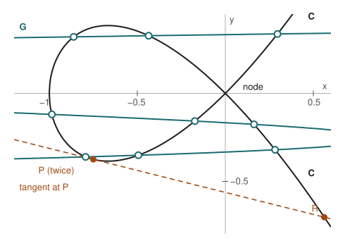

# Bezout's theorem: two curves meet in exactly the product of their degrees

[Syllabus](../../../SYLLABUS.md) → [Algebraic geometry](../README.md) → [Plane Curves](../README.md#s03) → Bezout's theorem

---

## General Overview

The house curve is the nodal cubic C: $`y^2 = x^2(x + 1)`$. It makes a loop to the left of the origin, crosses itself at the origin, its **node**, and runs off in two arms to the right.

Lay a straight line across it. The line $`4x + 16y + 9 = 0`$ touches C at P = (−3/4, −3/8) and crosses it again at R = (9/16, −45/64). That is two visible points. Counted honestly, it is three: the touch at P is two crossings that have merged.

Other lines seem to break the rule. The vertical line x = 5/4 crosses C twice, at (5/4, 15/8) and (5/4, −15/8). The line x = −2 misses C altogether. Yet each meets C three times. The vertical line's third meeting is a **point at infinity**, where the arms of C head straight up and down. The line x = −2 meets C at two complex points, (−2, 2i) and (−2, −2i), where i is the square root of −1, and at that same point at infinity.

Two cubics meet nine times. The cubic G, $`x = 4(9y^2 - 1)(6y + 1)`$, crosses C at nine real points, all visible in the picture. The smooth neighbour E, $`y^2 = x^2(x + 1) - 1/10`$, never meets C in the plane, not even at a complex point. All nine of its meetings sit at the one point at infinity.

**Two plane curves of degrees d and e that share no piece meet in exactly d × e points, once points at infinity are added, complex points are allowed, and each meeting is counted with its multiplicity.**

**What kind of fact this is:** a theorem, proved in Why it works by the resultant. Two steps are quoted with their source, Kirwan, chapter 3: that the resultant is not identically zero (Step 2's fold), and that a resultant's root order equals the intersection multiplicity, which [Intersection multiplicity](02-intersection-multiplicity-and-tangency.md) proves for a curve and a line.

The field is ℚ for coefficients. Points are counted over the complex numbers ℂ, in the projective plane, with multiplicity; any count that drops one of the three says so.

### The picture: one cubic, one line, one more cubic

<p align="center"></p>

Drawn to scale, real points only. The dashed line touches C at P and crosses at R: 2 + 1 = 3. The cubic G looks like three nearly level strands here. It leaves the window and turns back far outside it. Its nine crossings with C are the open dots: 3 × 3 = 9.

---

## The formula

Four ideas first, each with a card of its own.

- The **degree** of a curve is the highest total power in its equation. C has degree 3, from $`x^3`$. A line has degree 1.
- The **projective plane** $`\mathbb{P}^2`$ is the ordinary plane plus a line at infinity ([Projective space](../02-Affine%20and%20Projective%20Varieties/03-projective-space-and-homogeneous-coordinates.md)). A point is a ratio $`(x : y : z)`$ of three numbers, not all zero. The plane point (x, y) is $`(x : y : 1)`$, and the points with z = 0 are at infinity.
- **Homogenising** an equation means multiplying each term by enough powers of z to bring every term to the full degree ([Projective varieties](../02-Affine%20and%20Projective%20Varieties/04-projective-varieties-and-closure.md)). C becomes $`y^2z = x^3 + x^2z`$. At z = 0 this leaves $`x^3 = 0`$, so C has one point at infinity: O = (0 : 1 : 0), the far end of every vertical line.
- The **intersection multiplicity** $`(F \cdot G)_P`$ counts how many simple crossings have merged at a meeting point P ([Intersection multiplicity](02-intersection-multiplicity-and-tangency.md)). A clean crossing gives 1, a tangency at least 2.

O is the same point that [Elliptic curves](../../05-Geometry%20and%20trig/06-Beyond%20Euclid/05-elliptic-curves-and-point-addition.md) adds as a curve's zero. A curly 𝒪 elsewhere in this wing means something else: a local ring or a sheaf.

The theorem:

```math
\sum_{P \,:\, F(P) = G(P) = 0} (F \cdot G)_P \;=\; d \times e
```

**Read it aloud:** add up the intersection multiplicities at every point of the projective plane, over ℂ, where both equations vanish, and the total is the product of the two degrees.

For C and the tangent line, G is $`4x + 16y + 9`$: $`(F \cdot G)_P + (F \cdot G)_R = 2 + 1 = 3 = 3 \times 1`$. For C and E: $`(F \cdot E)_O = 9 = 3 \times 3`$.

| Symbol | Plain meaning | In our example | Push it up and the answer… |
| --- | --- | --- | --- |
| $`x`$, $`y`$; $`z`$; $`y_0`$, $`z_0`$ | position in the plane; the third coordinate, 1 in the plane and 0 at infinity; one root of the resultant | P = (−3/4, −3/8) | — |
| C; $`F`$; $`f`$ | the house cubic; its equation, set to zero; that equation near O, with y = 1 | $`F = y^2 - x^3 - x^2`$; $`f = z - x^3 - x^2z`$ | — |
| $`G`$ | the equation of whichever curve C is paired with; one partner, the cubic G, keeps the letter as its name | $`4x + 16y + 9`$ for the tangent line; $`x - 4(9y^2 - 1)(6y + 1)`$ for the cubic G | — |
| E | C's smooth neighbour | $`y^2 = x^2(x + 1) - 1/10`$ | — |
| $`d`$, $`e`$ | the degrees of F and G | 3 and 1; 3 and 3 | the count d × e grows |
| P, R; O | meeting points; C's one point at infinity, (0 : 1 : 0) | (−3/4, −3/8), (9/16, −45/64) | — |
| $`(F \cdot G)_P`$ | the intersection multiplicity at P | 2 at P; 9 at O for E | a tighter touch |
| $`\mathbb{P}^2`$; $`(x : y : z)`$ | the projective plane; a point as a ratio | P is (−3/4 : −3/8 : 1) | — |
| $`\mathrm{Res}_x(F, G)`$ | the resultant: a determinant that removes x, leaving a polynomial in y | $`-(8y + 3)^2(64y + 45)`$ for the tangent | — |
| $`a_i`$, $`b_j`$; $`\lambda`$; r, c | in the first fold: F's and G's coefficients of $`x^{d-i}`$ and $`x^{e-j}`$; a scale factor; a row and a column number | for C: $`a_0 = -1`$, $`a_1 = -z`$, $`a_2 = 0`$, $`a_3 = y^2z`$ | — |
| $`t`$; $`(u : w)`$ | the step along C, with $`(x, y) = (t^2 - 1, t^3 - t)`$; t written as a ratio u/w | t = 1/2 gives P; w = 0 gives O | — |
| ℚ, ℂ, $`\mathbb{F}_p`$; i | the field of coefficients; the complex numbers, where points are counted; the integers mod a prime p; the square root of −1 | (−2, 2i) is on C | — |

### When it holds

- **Points at infinity are counted.** Drop them and C meets E in 0 points, and meets the line x = 5/4 in 2.
- **Multiplicities are counted.** Drop them and the tangent line meets C in 2 points, P and R, not 3.
- **Complex points are counted.** Over the real numbers the line x = −2 meets C only at O. The beacon circles, 5 m around (0, 0) and 7 m around (4, 4), meet in 2 real points; Bezout's 2 × 2 = 4 needs two complex points at infinity.
- **No shared piece.** If F and G share a factor, the curves share a whole curve and meet infinitely often. C against 2F, the same curve written twice over, gives a resultant of 0.
- **Any field works once it is closed up.** Over $`\mathbb{F}_p`$ or ℚ, the d × e points exist in the field's algebraic closure, where every polynomial has all its roots.

---

## Why it works

### Step 0: the count cannot change, so make every curve into lines

Move a curve a little and its meeting points move a little. In the ordinary real plane they can vanish: two can merge and turn complex, or one can run off to infinity. Over ℂ in the projective plane there is nowhere for them to go, so the total stays fixed.

That suggests the answer. Replace the cubic G by three straight lines, y = 1/3, y = −1/3 and y = −1/6. Together they are one cubic, $`(3y - 1)(3y + 1)(6y + 1) = 0`$. Each line meets C three times, so the total is 3 + 3 + 3 = 9. The cubic G is these three lines bent into one curve, and it still meets C nine times. The proof below makes this exact with one polynomial whose degree never changes.

### Step 1: a curve and a line, by the fundamental theorem

Put a line into F and F usually becomes a polynomial of degree d in one variable. [The fundamental theorem of algebra](../../03-Algebra/10-For%20the%20Curious/01-fundamental-theorem-of-algebra.md) gives it exactly d roots over ℂ, counted with repeats. [Elliptic curves](../../05-Geometry%20and%20trig/06-Beyond%20Euclid/05-elliptic-curves-and-point-addition.md) already uses this: a line meets a cubic three times once O is added and a touch counts twice.

The one gap is a degree that drops. The vertical line x = 5/4 gives $`y^2 - 225/64`$, degree 2, not 3. Homogenise and the lost root comes back. Put $`x = 5z/4`$ into $`y^2z - x^3 - x^2z`$:

```math
y^2z - \tfrac{125}{64}z^3 - \tfrac{25}{16}z^3 = z\left(y^2 - \tfrac{225}{64}z^2\right)
```

The roots are $`y = \pm\tfrac{15}{8}z`$, the two visible points, and z = 0, the point O. A degree that drops always means a root at z = 0, at infinity.

### Step 2: two curves, by the resultant

For two curves, remove x with the **resultant** ([The resultant](../01-Polynomial%20Systems/06-resultants-and-common-roots.md)). Treat F and G as polynomials in x whose coefficients involve y. The resultant $`\mathrm{Res}_x(F, G)`$ is the determinant of their Sylvester matrix: F's coefficients written e times and G's d times, each row shifted one step. It is zero at a value of y exactly when F and G share a root x there.

For C and the tangent line:

```math
\mathrm{Res}_x(F, G) = -4096y^3 - 5952y^2 - 2736y - 405 = -(8y + 3)^2(64y + 45)
```

The double root y = −3/8 is P, counted twice. The single root y = −45/64 is R.

Homogenised, the resultant is a polynomial in y and z in which every term has degree exactly d × e. The fold proves it by a scaling argument. So the resultant has exactly d × e roots $`(y : z)`$, counted with repeats, by the fundamental theorem again.

<details>
<summary>Detailed proof: the resultant has degree exactly d × e</summary>

Write the homogenised F as $`a_0x^d + a_1x^{d-1} + \dots + a_d`$, where each $`a_i`$ is a polynomial in y and z with every term of degree i. Write G the same way with coefficients $`b_j`$ of degree j.

Multiply y and z by a number λ. Each $`a_i`$ becomes $`\lambda^i a_i`$, and each $`b_j`$ becomes $`\lambda^j b_j`$. Now multiply the r-th row of F's block in the Sylvester matrix by $`\lambda^{r}`$ and the r-th row of G's block by $`\lambda^{r}`$, counting rows from 0. Every entry in column c then carries exactly $`\lambda^{c}`$, counting columns from 0.

Taking those powers out of the columns and rows gives

$`\displaystyle \mathrm{Res}(\lambda y, \lambda z) = \lambda^{\,(0 + 1 + \dots + (d + e - 1)) - e(e-1)/2 - d(d-1)/2}\,\mathrm{Res}(y, z) = \lambda^{de}\,\mathrm{Res}(y, z)`$

since $`(d + e)(d + e - 1)/2 - e(e - 1)/2 - d(d - 1)/2 = de`$. So every term has degree de. The resultant is not identically zero when F and G share no factor and (1 : 0 : 0) does not lie on both curves at once (Kirwan, chapter 3).

</details>

### Step 3: each root is a line through one fixed point

A root $`(y_0 : z_0)`$ of the resultant marks the line $`z_0y = y_0z`$. Every such line passes through the point (1 : 0 : 0), the far end of the horizontal lines. The resultant's root order there is the sum of the intersection multiplicities of all meeting points on that line. For a curve and a line this is proved on [Intersection multiplicity](02-intersection-multiplicity-and-tangency.md); for two curves Kirwan proves it in chapter 3.

The count needs one condition: the fixed point (1 : 0 : 0) lies off at least one of the two curves. Then it is not a meeting point, so each meeting point lies on exactly one of these lines. C reaches infinity only at O, so (1 : 0 : 0) is never on C.

Add the root orders line by line. The total is the resultant's degree, d × e, and it is also the sum of the multiplicities at all meeting points. That is the theorem.

One line can hold several meeting points: for the three lines y = 1/3, −1/3 and −1/6, each root carries the three points on one level line. To read single multiplicities off the roots, move the fixed point off every line that joins two meeting points. There are finitely many such lines, so almost any choice works.

### Step 4: the shortfall in the plane is the count at infinity

In the plane, z = 1, the resultant is an ordinary polynomial in y. Its degree can fall short of d × e. The missing roots are at z = 0: meetings on the line at infinity.

The code finds the plane count by this road and by a second, independent method. The second road puts C's parametrisation $`(t^2 - 1, t^3 - t)`$ into G. That gives a polynomial in t of degree at most 3e, and each root t is a meeting point. The value t = ∞, where $`(t^2 - 1 : t^3 - t : 1)`$ tends to O, takes up the shortfall. (The node is hit twice, at t = 1 and t = −1, once for each branch through it.)

The shortfall must sit at O, because C meets the line at infinity nowhere else. A third road counts the meetings at O directly, with no resultant. In the chart y = 1, O is the origin. The code measures the local ring there (the fractions of polynomials whose denominator is not zero at O), with both equations set to zero, by the cut-off of Step 4 on [Intersection multiplicity](02-intersection-multiplicity-and-tangency.md): drop every term of degree at or above a cut-off, find the dimension by exact row reduction, and raise the cut-off until two counts agree.

| Partner of C | Degree | In the plane: resultant, parametrisation | At O: cut-off count | Total |
| --- | --- | --- | --- | --- |
| tangent line $`4x + 16y + 9 = 0`$ | 1 | 3, 3 | 0 | 3 |
| line x = 5/4 | 1 | 2, 2 | 1 | 3 |
| line x = −2 | 1 | 2, 2 | 1 | 3 |
| three lines y = 1/3, −1/3, −1/6 | 3 | 9, 9 | 0 | 9 |
| cubic G | 3 | 9, 9 | 0 | 9 |
| cubic E | 3 | 0, 0 | 9 | 9 |

The two plane roads agree on every row. The count at O comes from its own computation, so the total d × e on every row is checked, not assumed.

<details>
<summary>Detailed proof: why the parametrisation road counts O</summary>

Write t = u/w and clear denominators. C's points become $`(w(u^2 - w^2) : u^3 - uw^2 : w^3)`$, which at w = 0 is $`(0 : u^3 : 0)`$ = O. Putting this into the homogenised G gives a polynomial in u and w with every term of degree 3e.

Its roots $`(u : w)`$ are the meeting points, counted with multiplicity, and there are 3e of them. Setting w = 1 gives the polynomial in t. Each degree it loses is a root at w = 0, which is a meeting at O.

</details>

### Step 5: nine meetings at one point

C and E show why both projective space and multiplicity are needed. Their equations differ by a constant: E is $`10F + 1 = 0`$. So no point of the plane, real or complex, lies on both. In the plane the count is 0.

Homogenised, E's equation is $`10(y^2z - x^3 - x^2z) + z^3`$. At infinity, z = 0, both curves pass through O and nowhere else. Near O, set y = 1. C's equation becomes $`f = z - x^3 - x^2z`$, and E's becomes $`10f + z^3`$.

Two rules settle it. The first is shown on [Intersection multiplicity](02-intersection-multiplicity-and-tangency.md); Kirwan, chapter 3, proves both. Adding a multiple of one equation to the other leaves the multiplicity unchanged, and the multiplicity of a product is the sum over its factors:

```math
(f \cdot (10f + z^3))_O = (f \cdot z^3)_O = 3\,(f \cdot z)_O = 3 \times 3 = 9
```

The last 3 is the line at infinity z = 0 meeting C at O: putting z = 0 into f leaves $`-x^3`$, a triple root. O is a flex of C, a point where the tangent meets three times. E shares that flex and its tangent, and the two curves touch there nine times over.

The code's cut-off count at O agrees: 1, 2, 3, 4, 5, 6, 7, 8, 9, then 9 again, so 9.

Without the point O the count is 0. With O but no multiplicity it is 1. Only with both is it 9.

---

## Worked numbers, by hand

C against the tangent line, then the two cubics.

| Step | Arithmetic | Value |
| --- | --- | --- |
| put C's parametrisation into the line | $`4(t^2 - 1) + 16(t^3 - t) + 9`$ | $`16t^3 + 4t^2 - 16t + 5`$ |
| factor | check by multiplying out | $`16(t - 1/2)^2(t + 5/4)`$ |
| t = 1/2, a double root | $`(1/4 - 1,\ 1/8 - 1/2)`$ | P = (−3/4, −3/8), twice |
| t = −5/4 | $`(25/16 - 1,\ -125/64 + 5/4)`$ | R = (9/16, −45/64), once |
| R on the line | $`4 \times 9/16 + 16 \times (-45/64) + 9 = 9/4 - 45/4 + 9`$ | 0 |
| line and cubic | 2 + 1 | **3 = 3 × 1** |
| x = 5/4 into C | $`y^2 = 25/16 \times 9/4 = 225/64`$ | (5/4, ±15/8), plus O |
| x = −2 into C | $`y^2 = 4 \times (-1) = -4`$ | (−2, ±2i), plus O |
| G meets C | nine sign changes, then halving | 9 real points |
| E minus C | $`E = 10F + 1`$, never both zero | 0 in the plane |
| E at O | $`3 \times (f \cdot z)_O = 3 \times 3`$ | **9 = 3 × 3** |

The nine points of G and C, from the code, as (x, y):

| (−0.9853, −0.1196) | (−0.8612, 0.3208) | (−0.7934, −0.3606) |
| --- | --- | --- |
| (−0.4940, −0.3514) | (−0.4354, 0.3272) | (−0.1731, −0.1574) |
| (0.1633, −0.1761) | (0.2828, −0.3203) | (0.2963, 0.3374) |

A line meets the house cubic 3 times and a cubic meets it 9 times, every time: the visible points fall short only when meetings merge, turn complex or sit at O.

### What breaks if you drop a piece

| Mistake | Comes out at | What went wrong |
| --- | --- | --- |
| Counting only the plane: C and E | 0 | All nine meetings are at O, on the line at infinity |
| Counting distinct points: C and the tangent | 2 | P is a double meeting; with multiplicity, 2 + 1 = 3 |
| Counting real points: beacon circles of 5 m and 7 m | 2, not 4 | The other two are complex, at (1 : i : 0) and (1 : −i : 0) |
| Ignoring a shared piece: C against 2F | resultant 0 | The curves are the same; they meet at every point |

The beacon circles come from [Normal forms](../01-Polynomial%20Systems/04-reduced-grobner-bases-and-ideal-membership.md): $`x^2 + y^2 = 25`$ and $`(x - 4)^2 + (y - 4)^2 = 49`$, in metres, with real fixes (4, −3) and (−3, 4). Every circle's top-degree part is $`x^2 + y^2`$, which is zero at (1 : ±i : 0), so any two circles meet at those two points at infinity. The code prints all four rows.

---

## Code, from first principles, and it actually runs

The code counts each partner of C in the plane by two independent methods. Road one is the resultant: exact Sylvester determinants at ten values of y, joined into one polynomial by Newton interpolation. Road two puts C's parametrisation into the partner. Each road's degree is the plane count. Road three counts the meetings at O on its own, by the cut-off count of Step 4, and the code asserts that the plane count plus the count at O is 3e. The code also puts every exact point back into both equations, finds G's nine points by both roads, and prints the beacon circles, the shared curve, the four mistakes and the answers to the Try changing box.

### Python

```python
# Bezout's theorem -- the check behind the card.  Standard library only.  House cubic C:
# y^2 = x^2(x + 1), equation F = y^2 - x^3 - x^2; its one point at infinity is O = (0 : 1 : 0).
# Each partner G is counted in the plane by two roads: the resultant Res_x(F, G), from Sylvester
# determinants at ten values of y, and G(t^2 - 1, t^3 - t), a polynomial in t.  A third road
# counts the meetings at O: the cut-off local count.  Plane plus O must give 3 x deg G.
from fractions import Fraction as Q
from functools import reduce
def trim(p): return p[:max((i + 1 for i, c in enumerate(p) if c != 0), default=0)]
def add(p, q): return trim([(p[i] if i < len(p) else 0) + (q[i] if i < len(q) else 0) for i in range(max(len(p), len(q)))])
def mul(p, q):                                   # polynomials as coefficient lists, low first
    out = [Q(0)] * max(len(p) + len(q) - 1, 0)
    for i, j in ((i, j) for i in range(len(p)) for j in range(len(q))): out[i + j] += p[i] * q[j]
    return trim(out)
def ev(p, v): return reduce(lambda s, c: s * v + c, reversed(p), 0 * v)   # Horner's rule
def show(p, v):                                  # leading term first
    out = ""
    for k in [k for k in range(len(p) - 1, -1, -1) if p[k] != 0]:
        a = abs(p[k])
        out += (" - " if p[k] < 0 else " + ") + (f"{a}" if a != 1 or k == 0 else "") \
            + (v if k else "") + (f"^{k}" if k > 1 else "")
    return (out[3:] if out[1] == "+" else "-" + out[3:]) if out else "0"
def deg(G): return max(i + j for i, j in G)      # a curve is {(i, j): c} for c x^i y^j
def elim(M):                                     # exact Gaussian elimination: rank and determinant
    M, d, r = [row[:] for row in M], Q(1), 0
    for c in range(len(M[0])):
        p = next((i for i in range(r, len(M)) if M[i][c] != 0), None)
        if p is None: d = Q(0); continue
        if p != r: M[r], M[p], d = M[p], M[r], -d
        d *= M[r][c]
        for i in (i for i in range(r + 1, len(M)) if M[i][c] != 0):
            f = M[i][c] / M[r][c]
            for k in range(c, len(M[0])): M[i][k] -= f * M[r][k]
        r += 1
    return r, d
def xrow(G, y):                                  # G's coefficients in x at this y, top first,
    n = deg(G); out = [Q(0)] * (n + 1)           # padded to the full degree of G
    for (i, j), c in G.items(): out[n - i] += c * y ** j
    return out
def sylvester(G, H, y):                         # n shifted rows of G's coefficients, m of H's
    a, b = xrow(G, y), xrow(H, y); m, n = len(a) - 1, len(b) - 1
    rows = [[Q(0)] * k + a + [Q(0)] * (n - 1 - k) for k in range(n)]
    return elim(rows + [[Q(0)] * k + b + [Q(0)] * (m - 1 - k) for k in range(m)])[1]
def resultant(G, H):                             # degree at most 9: ten samples fix it
    ys = [Q(k) for k in range(-4, 6)]; c = [sylvester(G, H, y) for y in ys]
    for k in range(1, 10):                       # Newton's divided differences
        for i in range(9, k - 1, -1): c[i] = (c[i] - c[i - 1]) / (ys[i] - ys[i - k])
    return reduce(lambda p, i: add(mul(p, [-ys[i], Q(1)]), [c[i]]), range(9, -1, -1), [])
def on_C(G):                                     # G(t^2 - 1, t^3 - t)
    X, Y = [Q(-1), Q(0), Q(1)], [Q(0), Q(-1), Q(0), Q(1)]
    return reduce(add, (reduce(mul, [X] * i + [Y] * j, [Q(c)]) for (i, j), c in G.items()), [])
def at_O(G, H, N):                               # road three: dim k[x, z] / (G, H, all terms of degree N),
    gs = [{(i, deg(K) - i - j): c for (i, j), c in K.items()} for K in (G, H)]   # in the chart y = 1
    mons = [(i, d - i) for d in range(N) for i in range(d + 1)]; ix = {m: k for k, m in enumerate(mons)}
    rows = [[Q(0)] * len(mons) for _ in range(2 * len(mons))]
    for r, (g, (a, b)) in enumerate((g, m) for g in gs for m in mons):
        for (i, j), c in g.items():
            if i + j + a + b < N: rows[r][ix[(i + a, j + b)]] += c
    return len(mons) - elim(rows)[0]
def mult_O(G, H):                                # raise N until two counts agree: then the count is final
    s = [at_O(G, H, 1)]
    while len(s) < 2 or s[-1] != s[-2]: s.append(at_O(G, H, len(s) + 1))
    return s
def roots(p, lo, hi, n=2400):                    # sign changes on a grid, then halving
    p, out = [float(c) for c in p], []
    for k in range(n):
        a, b = lo + (hi - lo) * k / n, lo + (hi - lo) * (k + 1) / n
        if (ev(p, a) > 0) != (ev(p, b) > 0):
            for _ in range(60):
                m = (a + b) / 2
                if (ev(p, a) > 0) != (ev(p, m) > 0): b = m
                else: a = m
            out.append((a + b) / 2)
    return out
def distinct(p):                                 # roots in C counted once: deg p - deg gcd(p, p')
    a, b = p, trim([i * p[i] for i in range(1, len(p))])
    while b:                                     # Euclid: (a, b) becomes (b, a mod b)
        while len(a) >= len(b):
            f, s = a[-1] / b[-1], len(a) - len(b)
            a = trim([c - f * b[i - s] if i >= s else c for i, c in enumerate(a)])
        a, b = b, a
    return len(p) - len(a)
def yn(c): return "yes" if c else "no"
F = {(0, 2): 1, (3, 0): -1, (2, 0): -1}
L = {(0, 3): 54, (0, 2): 9, (0, 1): -6, (0, 0): -1}                  # (3y - 1)(3y + 1)(6y + 1)
G = {(1, 0): 1, (0, 3): -216, (0, 2): -36, (0, 1): 24, (0, 0): 4}   # x = 4(9y^2 - 1)(6y + 1)
E = {(0, 2): 10, (3, 0): -10, (2, 0): -10, (0, 0): 1}                # y^2 = x^2(x + 1) - 1/10
T, W = {(1, 0): 4, (0, 1): 16, (0, 0): 9}, {(1, 0): 1, (0, 0): 2}
partners = [("tangent line 4x + 16y + 9 = 0", T, (3, 0)),
            ("line x = 5/4", {(1, 0): 4, (0, 0): -5}, (2, 1)), ("line x = -2", W, (2, 1)),
            ("three lines y = 1/3, -1/3, -1/6", L, (9, 0)),
            ("cubic G: x = 4(9y^2 - 1)(6y + 1)", G, (9, 0)),
            ("cubic E: y^2 = x^2(x + 1) - 1/10", E, (0, 9))]
print("C: y^2 = x^2(x + 1); (t^2 - 1, t^3 - t) lies on C:", yn(on_C(F) == []))
plane = {}
for name, H, want in partners:
    R, P, e, cut = resultant(F, H), on_C(H), deg(H), mult_O(F, H)
    plane[name] = len(R) - 1
    print(f"{name}: degree {e}, Bezout 3 x {e} = {3 * e}")
    print(f"    in the plane: resultant road {len(R) - 1}, parametrisation road {len(P) - 1}")
    print(f"    at O, cut-off counts {cut}: {cut[-1]}; total {len(R) - 1} + {cut[-1]} = {len(R) - 1 + cut[-1]}")
    assert len(R) == len(P) and (len(R) - 1, cut[-1]) == want and len(R) - 1 + cut[-1] == 3 * e
    if e == 1: print(f"    Res_x = {show(R, 'y')}; on C: {show(P, 't')}")
P0, R0 = (Q(-3, 4), Q(-3, 8)), (Q(9, 16), Q(-45, 64))
assert all(y * y == x * x * (x + 1) and 4 * x + 16 * y + 9 == 0 for x, y in (P0, R0))
ok = on_C(T) == mul([Q(1, 4), -1, 1], [20, 16]) and resultant(F, T) == mul([9, 48, 64], [-45, -64])
print(f"tangent: P = ({P0[0]}, {P0[1]}) at t = 1/2, R = ({R0[0]}, {R0[1]}) at t = -5/4; on C "
      f"16(t - 1/2)^2(t + 5/4), Res_x -(8y + 3)^2(64y + 45): {yn(ok)}")
print("line x = 5/4 meets C at (5/4, 15/8), (5/4, -15/8) and O = (0 : 1 : 0):", yn(Q(15, 8) ** 2 == Q(25, 16) * Q(9, 4)))
print(f"line x = -2: y^2 = (-2)^2(-2 + 1) = {(-2) ** 2 * (-2 + 1)}, so y = 2i or -2i, and O")
tG, yG, tL = roots(on_C(G), -3, 3), roots(resultant(F, G), -1, 1), roots(on_C(L), -3, 3)
pts = sorted((t * t - 1, t ** 3 - t) for t in tG)
assert all(abs(y * y - x * x * (x + 1)) < 1e-9 and abs(ev([-4, -24, 36, 216], y) - x) < 1e-9 for x, y in pts)  # on both
print(f"C and G: {len(pts)} real points, (x, y) =")
for k in range(0, 9, 3): print("    " + "; ".join(f"({x:.4f}, {y:.4f})" for x, y in pts[k:k + 3]))
same = len(yG) == 9 and max(abs(a - b) for a, b in zip(sorted(y for _, y in pts), yG)) < 1e-9
print("    the same nine y-values from the resultant's roots:", yn(same))
print(f"C and the three lines: {len(tL)} real points, 3 on each line")
assert same and len(pts) == 9 and len(tL) == 9
print(f"C and E: Res_x(F, E) = {show(resultant(F, E), 'y')}, a nonzero constant; E on C's parametrisation: {show(on_C(E), 't')}")
B1 = {(2, 0): 1, (0, 2): 1, (0, 0): -25}                          # beacon A: 5 m around (0, 0)
B2 = {(2, 0): 1, (0, 2): 1, (1, 0): -8, (0, 1): -8, (0, 0): -17}  # beacon B: 7 m around (4, 4)
RB = resultant(B1, B2)
fix = all(x * x + y * y == 25 and (x - 4) ** 2 + (y - 4) ** 2 == 49 for x, y in [(4, -3), (-3, 4)])
top = [x * x + y * y for x, y in [(1, 1j), (1, -1j)]]             # both circles' degree-2 part
print(f"beacon circles: Res_x = {show(RB, 'y')}: {len(RB) - 1} in the plane + {5 - len(RB)} at infinity")
print(f"    real fixes (4, -3), (-3, 4) on both: {yn(fix)}; (1 : i : 0), (1 : -i : 0) on both: {yn(top == [0, 0])}")
assert fix and top == [0, 0] and len(RB) == 3 and ev(RB, Q(-3)) == 0 == ev(RB, Q(4))
Z = resultant(F, {k: 2 * v for k, v in F.items()})
print(f"C against 2F, a shared curve: Res_x = {show(Z, 'y')}, so no finite count")
assert Z == [] and distinct(on_C(T)) == 2 and ok and on_C(F) == [] and Q(15, 8) ** 2 == Q(25, 16) * Q(9, 4)
print(f"mistakes: C and E in the plane only: {plane[partners[5][0]]}; tangent line as distinct points: {distinct(on_C(T))}")
print(f"    C and x = -2 in the real plane: {len(roots(on_C(W), -3, 3))}; "
      f"beacon circles in the real plane: {len(roots(RB, -10, 10, 2401))}")
tries = [("cubic S", {(0, 1): 1, (3, 0): -1, (2, 0): 4, (0, 0): -3}), ("line y = 2x", {(0, 1): 1, (1, 0): -2}),
         ("line x = 0", {(1, 0): 1}), ("E flipped", {**E, (0, 0): -1})]          # the "try changing" answers
print("try: " + "; ".join(f"{n} {len(resultant(F, H)) - 1} + {mult_O(F, H)[-1]}, on C {show(on_C(H), 't')}" for n, H in tries))
print(f"figure, window x -1.2 to 0.6, y -0.8 to 0.45; P ({float(P0[0])}, {float(P0[1])}), "
      f"R ({float(R0[0])}, {float(R0[1])}); node (0, 0)")
print("ALL CHECKS PASS")
```

**Ran 2026-11-17 on macOS, Python 3.14.10, standard library only. All checks passed. Output, pasted from the run:**

```
C: y^2 = x^2(x + 1); (t^2 - 1, t^3 - t) lies on C: yes
tangent line 4x + 16y + 9 = 0: degree 1, Bezout 3 x 1 = 3
    in the plane: resultant road 3, parametrisation road 3
    at O, cut-off counts [0, 0]: 0; total 3 + 0 = 3
    Res_x = -4096y^3 - 5952y^2 - 2736y - 405; on C: 16t^3 + 4t^2 - 16t + 5
line x = 5/4: degree 1, Bezout 3 x 1 = 3
    in the plane: resultant road 2, parametrisation road 2
    at O, cut-off counts [1, 1]: 1; total 2 + 1 = 3
    Res_x = -64y^2 + 225; on C: 4t^2 - 9
line x = -2: degree 1, Bezout 3 x 1 = 3
    in the plane: resultant road 2, parametrisation road 2
    at O, cut-off counts [1, 1]: 1; total 2 + 1 = 3
    Res_x = -y^2 - 4; on C: t^2 + 1
three lines y = 1/3, -1/3, -1/6: degree 3, Bezout 3 x 3 = 9
    in the plane: resultant road 9, parametrisation road 9
    at O, cut-off counts [0, 0]: 0; total 9 + 0 = 9
cubic G: x = 4(9y^2 - 1)(6y + 1): degree 3, Bezout 3 x 3 = 9
    in the plane: resultant road 9, parametrisation road 9
    at O, cut-off counts [0, 0]: 0; total 9 + 0 = 9
cubic E: y^2 = x^2(x + 1) - 1/10: degree 3, Bezout 3 x 3 = 9
    in the plane: resultant road 0, parametrisation road 0
    at O, cut-off counts [1, 2, 3, 4, 5, 6, 7, 8, 9, 9]: 9; total 0 + 9 = 9
tangent: P = (-3/4, -3/8) at t = 1/2, R = (9/16, -45/64) at t = -5/4; on C 16(t - 1/2)^2(t + 5/4), Res_x -(8y + 3)^2(64y + 45): yes
line x = 5/4 meets C at (5/4, 15/8), (5/4, -15/8) and O = (0 : 1 : 0): yes
line x = -2: y^2 = (-2)^2(-2 + 1) = -4, so y = 2i or -2i, and O
C and G: 9 real points, (x, y) =
    (-0.9853, -0.1196); (-0.8612, 0.3208); (-0.7934, -0.3606)
    (-0.4940, -0.3514); (-0.4354, 0.3272); (-0.1731, -0.1574)
    (0.1633, -0.1761); (0.2828, -0.3203); (0.2963, 0.3374)
    the same nine y-values from the resultant's roots: yes
C and the three lines: 9 real points, 3 on each line
C and E: Res_x(F, E) = -1, a nonzero constant; E on C's parametrisation: 1
beacon circles: Res_x = 128y^2 - 128y - 1536: 2 in the plane + 2 at infinity
    real fixes (4, -3), (-3, 4) on both: yes; (1 : i : 0), (1 : -i : 0) on both: yes
C against 2F, a shared curve: Res_x = 0, so no finite count
mistakes: C and E in the plane only: 0; tangent line as distinct points: 2
    C and x = -2 in the real plane: 0; beacon circles in the real plane: 2
try: cubic S 6 + 3, on C -t^6 + 7t^4 + t^3 - 11t^2 - t + 2; line y = 2x 3 + 0, on C t^3 - 2t^2 - t + 2; line x = 0 2 + 1, on C t^2 - 1; E flipped 0 + 9, on C -1
figure, window x -1.2 to 0.6, y -0.8 to 0.45; P (-0.75, -0.375), R (0.5625, -0.703125); node (0, 0)
ALL CHECKS PASS
```

### Rust

Same numbers, same labels, built with `rustc --edition 2021 -O`.

```rust
// Bezout's theorem -- the same check as the Python, in Rust.  No crates.  House cubic C:
// y^2 = x^2(x + 1), equation F = y^2 - x^3 - x^2; its one point at infinity is O = (0 : 1 : 0).
// Each partner G is counted in the plane by two roads: the resultant Res_x(F, G), from Sylvester
// determinants at ten values of y, and G(t^2 - 1, t^3 - t), a polynomial in t.  A third road
// counts the meetings at O: the cut-off local count.  Plane plus O must give 3 x deg G.
// Fractions are i128 pairs in lowest terms; checked arithmetic stops the run on overflow.
#[derive(Clone, Copy, PartialEq)]
struct Q { n: i128, d: i128 }
fn gcd(a: i128, b: i128) -> i128 { if b == 0 { a.abs() } else { gcd(b, a % b) } }
fn q(n: i128, d: i128) -> Q { let g = gcd(n, d) * d.signum(); Q { n: n / g, d: d / g } }
fn z(n: i128) -> Q { q(n, 1) }
fn cm(x: i128, y: i128) -> i128 { x.checked_mul(y).unwrap() } // panics on overflow
fn qa(a: Q, b: Q) -> Q { q(cm(a.n, b.d).checked_add(cm(b.n, a.d)).unwrap(), cm(a.d, b.d)) }
fn qm(a: Q, b: Q) -> Q { q(cm(a.n, b.n), cm(a.d, b.d)) }
fn qneg(a: Q) -> Q { Q { n: -a.n, d: a.d } }  fn qdiv(a: Q, b: Q) -> Q { qm(a, q(b.d, b.n)) }
fn qs(a: Q) -> String { if a.d == 1 { format!("{}", a.n) } else { format!("{}/{}", a.n, a.d) } }  fn qf(a: Q) -> f64 { a.n as f64 / a.d as f64 }
type P = Vec<Q>; // polynomial, coefficients low first
type Curve = Vec<(u32, u32, i128)>; // (i, j, c) for c x^i y^j
fn trim(mut p: P) -> P { while p.last().map_or(false, |c| c.n == 0) { p.pop(); } p }
fn add(p: &P, r: &P) -> P {
    trim((0..p.len().max(r.len())).map(|i| qa(*p.get(i).unwrap_or(&z(0)), *r.get(i).unwrap_or(&z(0)))).collect()) }
fn mul(p: &P, r: &P) -> P {
    if p.is_empty() || r.is_empty() { return vec![]; } let mut out = vec![z(0); p.len() + r.len() - 1];
    for (i, a) in p.iter().enumerate() { for (j, b) in r.iter().enumerate() { out[i + j] = qa(out[i + j], qm(*a, *b)); } } trim(out) }
fn evq(p: &P, v: Q) -> Q { p.iter().rev().fold(z(0), |s, c| qa(qm(s, v), *c)) } // Horner's rule
fn evf(p: &[f64], v: f64) -> f64 { let mut s = 0.0; for c in p.iter().rev() { s = s * v + c; } s }
fn show(p: &P, v: &str) -> String {
    let mut out = String::new();
    for k in (0..p.len()).rev().filter(|&k| p[k].n != 0) {
        let a = Q { n: p[k].n.abs(), d: p[k].d }; out += if p[k].n < 0 { " - " } else { " + " };
        if a != z(1) || k == 0 { out += &qs(a); } if k > 0 { out += v; } if k > 1 { out += &format!("^{}", k); }
    }
    if out.is_empty() { "0".into() } else if &out[1..2] == "+" { out[3..].into() } else { format!("-{}", &out[3..]) }
}
fn deg(g: &Curve) -> usize { g.iter().map(|&(i, j, _)| (i + j) as usize).max().unwrap() }
fn elim(mut m: Vec<Vec<Q>>) -> (usize, Q) { // exact Gaussian elimination: rank and determinant
    let (w, mut d, mut r) = (m[0].len(), z(1), 0);
    for c in 0..w {
        let p = match (r..m.len()).find(|&i| m[i][c].n != 0) { Some(p) => p, None => { d = z(0); continue } };
        if p != r { m.swap(r, p); d = qneg(d); }
        d = qm(d, m[r][c]);
        for i in (r + 1..m.len()).filter(|&i| m[i][c].n != 0).collect::<Vec<_>>() {
            let f = qdiv(m[i][c], m[r][c]); for k in c..w { m[i][k] = qa(m[i][k], qneg(qm(f, m[r][k]))); } }
        r += 1;
    }
    (r, d)
}
fn xrow(g: &Curve, y: Q) -> Vec<Q> { // G's coefficients in x at this y, top first, full degree
    let (n, mut out) = (deg(g), vec![z(0); deg(g) + 1]);
    for &(i, j, c) in g { out[n - i as usize] = qa(out[n - i as usize], qm(z(c), (0..j).fold(z(1), |s, _| qm(s, y)))); }
    out
}
fn sylvester(g: &Curve, h: &Curve, y: Q) -> Q { // n shifted rows of G's coefficients, m of H's
    let (a, b) = (xrow(g, y), xrow(h, y)); let (m, n) = (a.len() - 1, b.len() - 1);
    let row = |src: &Vec<Q>, lead: usize, len: usize| [vec![z(0); lead], src.clone(), vec![z(0); len - 1 - lead]].concat();
    elim((0..n).map(|k| row(&a, k, n)).chain((0..m).map(|k| row(&b, k, m))).collect()).1
}
fn resultant(g: &Curve, h: &Curve) -> P { // degree at most 9: ten samples fix it
    let ys: Vec<Q> = (-4..6).map(z).collect();
    let mut c: Vec<Q> = ys.iter().map(|&y| sylvester(g, h, y)).collect();
    for k in 1..10 { for i in (k..10).rev() { c[i] = qdiv(qa(c[i], qneg(c[i - 1])), qa(ys[i], qneg(ys[i - k]))); } }
    (0..10).rev().fold(vec![], |p: P, i| add(&mul(&p, &vec![qneg(ys[i]), z(1)]), &vec![c[i]]))
}
fn on_c(g: &Curve) -> P { // G(t^2 - 1, t^3 - t)
    let (x, y) = (vec![z(-1), z(0), z(1)], vec![z(0), z(-1), z(0), z(1)]);
    g.iter().fold(vec![], |p, &(i, j, c)| add(&p, &(0..i).map(|_| &x).chain((0..j).map(|_| &y)).fold(vec![z(c)], |t, f| mul(&t, f))))
}
fn at_o(g: &Curve, h: &Curve, n: usize) -> usize { // road three: dim k[x, z] / (G, H, all terms of degree N), chart y = 1
    let mons: Vec<(usize, usize)> = (0..n).flat_map(|d| (0..=d).map(move |i| (i, d - i))).collect();
    let mut rows = vec![];
    for k in [g, h] { for &(a, b) in &mons {
        let mut row = vec![z(0); mons.len()];
        for &(i, j, c) in k { let (i, zj) = (i as usize, deg(k) - (i + j) as usize);
            if i + zj + a + b < n { let ix = mons.iter().position(|&m| m == (i + a, zj + b)).unwrap(); row[ix] = qa(row[ix], z(c)); } }
        rows.push(row); } }
    mons.len() - elim(rows).0
}
fn mult_o(g: &Curve, h: &Curve) -> Vec<usize> { // raise N until two counts agree: then the count is final
    let mut s = vec![at_o(g, h, 1)];
    while s.len() < 2 || s[s.len() - 1] != s[s.len() - 2] { s.push(at_o(g, h, s.len() + 1)); }
    s
}
fn roots(p: &P, lo: f64, hi: f64, n: usize) -> Vec<f64> { // sign changes on a grid, then halving
    let (pf, mut out): (Vec<f64>, Vec<f64>) = (p.iter().map(|&c| qf(c)).collect(), vec![]);
    for k in 0..n {
        let (mut a, mut b) = (lo + (hi - lo) * k as f64 / n as f64, lo + (hi - lo) * (k + 1) as f64 / n as f64);
        if (evf(&pf, a) > 0.0) == (evf(&pf, b) > 0.0) { continue; }
        for _ in 0..60 { let m = (a + b) / 2.0; if (evf(&pf, a) > 0.0) != (evf(&pf, m) > 0.0) { b = m } else { a = m } }
        out.push((a + b) / 2.0);
    }
    out
}
fn distinct(p: &P) -> usize { // roots in C counted once: deg p - deg gcd(p, p')
    let (mut a, mut b) = (p.clone(), trim((1..p.len()).map(|i| qm(z(i as i128), p[i])).collect()));
    while !b.is_empty() { // Euclid: (a, b) becomes (b, a mod b)
        while a.len() >= b.len() {
            let (f, s) = (qdiv(*a.last().unwrap(), *b.last().unwrap()), a.len() - b.len());
            a = trim(a.iter().enumerate().map(|(i, &c)| if i >= s { qa(c, qneg(qm(f, b[i - s]))) } else { c }).collect());
        }
        std::mem::swap(&mut a, &mut b);
    }
    p.len() - a.len()
}
fn yn(c: bool) -> &'static str { if c { "yes" } else { "no" } }
fn main() {
    let f: Curve = vec![(0, 2, 1), (3, 0, -1), (2, 0, -1)];
    let l: Curve = vec![(0, 3, 54), (0, 2, 9), (0, 1, -6), (0, 0, -1)]; // (3y - 1)(3y + 1)(6y + 1)
    let g: Curve = vec![(1, 0, 1), (0, 3, -216), (0, 2, -36), (0, 1, 24), (0, 0, 4)]; // x = 4(9y^2 - 1)(6y + 1)
    let e: Curve = vec![(0, 2, 10), (3, 0, -10), (2, 0, -10), (0, 0, 1)]; // y^2 = x^2(x + 1) - 1/10
    let (t, w): (Curve, Curve) = (vec![(1, 0, 4), (0, 1, 16), (0, 0, 9)], vec![(1, 0, 1), (0, 0, 2)]);
    let partners: Vec<(&str, Curve, (usize, usize))> = vec![
        ("tangent line 4x + 16y + 9 = 0", t.clone(), (3, 0)),
        ("line x = 5/4", vec![(1, 0, 4), (0, 0, -5)], (2, 1)), ("line x = -2", w.clone(), (2, 1)),
        ("three lines y = 1/3, -1/3, -1/6", l.clone(), (9, 0)),
        ("cubic G: x = 4(9y^2 - 1)(6y + 1)", g.clone(), (9, 0)),
        ("cubic E: y^2 = x^2(x + 1) - 1/10", e.clone(), (0, 9))];
    println!("C: y^2 = x^2(x + 1); (t^2 - 1, t^3 - t) lies on C: {}", yn(on_c(&f).is_empty()));
    let mut plane = vec![];
    for (name, h, want) in &partners {
        let (r, p, d, cut) = (resultant(&f, h), on_c(h), deg(h), mult_o(&f, h)); let o = *cut.last().unwrap();
        plane.push(r.len() - 1);
        println!("{}: degree {}, Bezout 3 x {} = {}", name, d, d, 3 * d);
        println!("    in the plane: resultant road {}, parametrisation road {}", r.len() - 1, p.len() - 1);
        println!("    at O, cut-off counts {:?}: {}; total {} + {} = {}", cut, o, r.len() - 1, o, r.len() - 1 + o);
        assert!(r.len() == p.len() && (r.len() - 1, o) == *want && r.len() - 1 + o == 3 * d);
        if d == 1 { println!("    Res_x = {}; on C: {}", show(&r, "y"), show(&p, "t")); }
    }
    let (p0, r0) = ((q(-3, 4), q(-3, 8)), (q(9, 16), q(-45, 64)));
    assert!([p0, r0].iter().all(|&(x, y)| qm(y, y) == qm(qm(x, x), qa(x, z(1))) && qa(qa(qm(z(4), x), qm(z(16), y)), z(9)) == z(0)));
    let (half, res_t) = (vec![q(-1, 2), z(1)], mul(&mul(&vec![z(3), z(8)], &vec![z(3), z(8)]), &vec![z(-45), z(-64)])); // -(8y + 3)^2(64y + 45)
    let ok = on_c(&t) == mul(&mul(&half, &half), &vec![z(20), z(16)]) && resultant(&f, &t) == res_t;
    println!("tangent: P = ({}, {}) at t = 1/2, R = ({}, {}) at t = -5/4; on C 16(t - 1/2)^2(t + 5/4), Res_x -(8y + 3)^2(64y + 45): {}",
             qs(p0.0), qs(p0.1), qs(r0.0), qs(r0.1), yn(ok));
    println!("line x = 5/4 meets C at (5/4, 15/8), (5/4, -15/8) and O = (0 : 1 : 0): {}", yn(qm(q(15, 8), q(15, 8)) == qm(q(25, 16), q(9, 4))));
    println!("line x = -2: y^2 = (-2)^2(-2 + 1) = {}, so y = 2i or -2i, and O", (-2i64).pow(2) * (-2 + 1));
    let (tg, yg, tl) = (roots(&on_c(&g), -3.0, 3.0, 2400), roots(&resultant(&f, &g), -1.0, 1.0, 2400), roots(&on_c(&l), -3.0, 3.0, 2400));
    let mut pts: Vec<(f64, f64)> = tg.iter().map(|&t| (t * t - 1.0, t * t * t - t)).collect();
    pts.sort_by(|a, b| a.partial_cmp(b).unwrap());
    assert!(pts.iter().all(|&(x, y)| (y * y - x * x * (x + 1.0)).abs() < 1e-9 && (evf(&[-4.0, -24.0, 36.0, 216.0], y) - x).abs() < 1e-9)); // each point on both curves
    println!("C and G: {} real points, (x, y) =", pts.len());
    for k in (0..9).step_by(3) { println!("    {}", pts[k..k + 3].iter().map(|(x, y)| format!("({:.4}, {:.4})", x, y)).collect::<Vec<_>>().join("; ")); }
    let mut ys: Vec<f64> = pts.iter().map(|p| p.1).collect(); ys.sort_by(|a, b| a.partial_cmp(b).unwrap());
    let same = yg.len() == 9 && ys.iter().zip(&yg).all(|(a, b)| (a - b).abs() < 1e-9);
    println!("    the same nine y-values from the resultant's roots: {}", yn(same));
    println!("C and the three lines: {} real points, 3 on each line", tl.len());
    assert!(same && pts.len() == 9 && tl.len() == 9);
    println!("C and E: Res_x(F, E) = {}, a nonzero constant; E on C's parametrisation: {}",
             show(&resultant(&f, &e), "y"), show(&on_c(&e), "t"));
    let b1: Curve = vec![(2, 0, 1), (0, 2, 1), (0, 0, -25)]; // beacon A: 5 m around (0, 0)
    let b2: Curve = vec![(2, 0, 1), (0, 2, 1), (1, 0, -8), (0, 1, -8), (0, 0, -17)]; // beacon B: 7 m around (4, 4)
    let rb = resultant(&b1, &b2);
    let fix = [(4i128, -3i128), (-3, 4)].iter().all(|&(x, y)| x * x + y * y == 25 && (x - 4).pow(2) + (y - 4).pow(2) == 49);
    let sq = |(a, b): (i128, i128)| (a * a - b * b, 2 * a * b); // (a + bi)^2
    let top: Vec<(i128, i128)> = [1, -1].iter().map(|&s| (sq((1, 0)).0 + sq((0, s)).0, sq((1, 0)).1 + sq((0, s)).1)).collect(); // degree-2 part
    println!("beacon circles: Res_x = {}: {} in the plane + {} at infinity", show(&rb, "y"), rb.len() - 1, 5 - rb.len());
    println!("    real fixes (4, -3), (-3, 4) on both: {}; (1 : i : 0), (1 : -i : 0) on both: {}", yn(fix), yn(top == vec![(0, 0), (0, 0)]));
    assert!(fix && top == vec![(0, 0), (0, 0)] && rb.len() == 3 && evq(&rb, z(-3)) == z(0) && evq(&rb, z(4)) == z(0));
    let zres = resultant(&f, &f.iter().map(|&(i, j, c)| (i, j, 2 * c)).collect());
    println!("C against 2F, a shared curve: Res_x = {}, so no finite count", show(&zres, "y"));
    assert!(zres.is_empty() && distinct(&on_c(&t)) == 2 && ok && on_c(&f).is_empty() && qm(q(15, 8), q(15, 8)) == qm(q(25, 16), q(9, 4)));
    println!("mistakes: C and E in the plane only: {}; tangent line as distinct points: {}", plane[5], distinct(&on_c(&t)));
    println!("    C and x = -2 in the real plane: {}; beacon circles in the real plane: {}", roots(&on_c(&w), -3.0, 3.0, 2400).len(), roots(&rb, -10.0, 10.0, 2401).len());
    let mut ef = e.clone(); ef[3].2 = -1;                       // E flipped: y^2 = x^2(x + 1) + 1/10
    let tries: Vec<(&str, Curve)> = vec![("cubic S", vec![(0, 1, 1), (3, 0, -1), (2, 0, 4), (0, 0, -3)]), ("line y = 2x", vec![(0, 1, 1), (1, 0, -2)]),
        ("line x = 0", vec![(1, 0, 1)]), ("E flipped", ef)];  // the "try changing" answers
    println!("try: {}", tries.iter().map(|(n, h)| format!("{} {} + {}, on C {}", n, resultant(&f, h).len() - 1, mult_o(&f, h).last().unwrap(),
             show(&on_c(h), "t"))).collect::<Vec<_>>().join("; "));
    println!("figure, window x -1.2 to 0.6, y -0.8 to 0.45; P ({}, {}), R ({}, {}); node (0, 0)", qf(p0.0), qf(p0.1), qf(r0.0), qf(r0.1));
    println!("ALL CHECKS PASS");
}
```

**Ran 2026-11-17 on macOS, rustc 1.98.1, no crates. All checks passed. Output, pasted from the run:**

```
C: y^2 = x^2(x + 1); (t^2 - 1, t^3 - t) lies on C: yes
tangent line 4x + 16y + 9 = 0: degree 1, Bezout 3 x 1 = 3
    in the plane: resultant road 3, parametrisation road 3
    at O, cut-off counts [0, 0]: 0; total 3 + 0 = 3
    Res_x = -4096y^3 - 5952y^2 - 2736y - 405; on C: 16t^3 + 4t^2 - 16t + 5
line x = 5/4: degree 1, Bezout 3 x 1 = 3
    in the plane: resultant road 2, parametrisation road 2
    at O, cut-off counts [1, 1]: 1; total 2 + 1 = 3
    Res_x = -64y^2 + 225; on C: 4t^2 - 9
line x = -2: degree 1, Bezout 3 x 1 = 3
    in the plane: resultant road 2, parametrisation road 2
    at O, cut-off counts [1, 1]: 1; total 2 + 1 = 3
    Res_x = -y^2 - 4; on C: t^2 + 1
three lines y = 1/3, -1/3, -1/6: degree 3, Bezout 3 x 3 = 9
    in the plane: resultant road 9, parametrisation road 9
    at O, cut-off counts [0, 0]: 0; total 9 + 0 = 9
cubic G: x = 4(9y^2 - 1)(6y + 1): degree 3, Bezout 3 x 3 = 9
    in the plane: resultant road 9, parametrisation road 9
    at O, cut-off counts [0, 0]: 0; total 9 + 0 = 9
cubic E: y^2 = x^2(x + 1) - 1/10: degree 3, Bezout 3 x 3 = 9
    in the plane: resultant road 0, parametrisation road 0
    at O, cut-off counts [1, 2, 3, 4, 5, 6, 7, 8, 9, 9]: 9; total 0 + 9 = 9
tangent: P = (-3/4, -3/8) at t = 1/2, R = (9/16, -45/64) at t = -5/4; on C 16(t - 1/2)^2(t + 5/4), Res_x -(8y + 3)^2(64y + 45): yes
line x = 5/4 meets C at (5/4, 15/8), (5/4, -15/8) and O = (0 : 1 : 0): yes
line x = -2: y^2 = (-2)^2(-2 + 1) = -4, so y = 2i or -2i, and O
C and G: 9 real points, (x, y) =
    (-0.9853, -0.1196); (-0.8612, 0.3208); (-0.7934, -0.3606)
    (-0.4940, -0.3514); (-0.4354, 0.3272); (-0.1731, -0.1574)
    (0.1633, -0.1761); (0.2828, -0.3203); (0.2963, 0.3374)
    the same nine y-values from the resultant's roots: yes
C and the three lines: 9 real points, 3 on each line
C and E: Res_x(F, E) = -1, a nonzero constant; E on C's parametrisation: 1
beacon circles: Res_x = 128y^2 - 128y - 1536: 2 in the plane + 2 at infinity
    real fixes (4, -3), (-3, 4) on both: yes; (1 : i : 0), (1 : -i : 0) on both: yes
C against 2F, a shared curve: Res_x = 0, so no finite count
mistakes: C and E in the plane only: 0; tangent line as distinct points: 2
    C and x = -2 in the real plane: 0; beacon circles in the real plane: 2
try: cubic S 6 + 3, on C -t^6 + 7t^4 + t^3 - 11t^2 - t + 2; line y = 2x 3 + 0, on C t^3 - 2t^2 - t + 2; line x = 0 2 + 1, on C t^2 - 1; E flipped 0 + 9, on C -1
figure, window x -1.2 to 0.6, y -0.8 to 0.45; P (-0.75, -0.375), R (0.5625, -0.703125); node (0, 0)
ALL CHECKS PASS
```

> [!TIP]
> **Try changing**
> Guess first, then add the entry to the `partners` list in the Python script.
> - **Two cubic graphs.** Add `("cubic S: y = x^3 - 4x^2 + 3", {(0, 1): 1, (3, 0): -1, (2, 0): 4, (0, 0): -3}, (6, 3))`. Guess how many of the nine meetings are in the plane. Answer: 6 in the plane + 3 at infinity. S also reaches infinity only at O, and meets C there three times over.
> - **A line through the node.** Add `("line y = 2x", {(0, 1): 1, (1, 0): -2}, (3, 0))`. Guess where the three meetings are. Answer: 3 + 0, with "on C: t^3 - 2t^2 - t + 2" = (t − 1)(t + 1)(t − 2). The node counts twice, once per branch (t = ±1), and (3, 6) once.
> - **A vertical line through the node.** Add `("line x = 0", {(1, 0): 1}, (2, 1))`. Answer: 2 + 1, with "on C: t^2 - 1". The node takes two, and O the third.
> - **Flip E's offset.** Change E's `(0, 0): 1` to `(0, 0): -1`, making $`y^2 = x^2(x + 1) + 1/10`$. Guess the split. Answer: still 0 in the plane + 9 at infinity. Any constant offset leaves all nine at O.

---

## The usual mistake

> [!warning]
> **Expecting d × e points you can see.** In the real plane two cubics can meet in anything from 0 to 9 points: C and E meet in 0, C and G in 9. The exact count d × e needs all three repairs at once: complex points, points at infinity and multiplicity. Without them, d × e is only a ceiling.
>
> - **Forgetting infinity.** The vertical line x = 5/4 meets C at 2 visible points. The third meeting is O.
> - **Forgetting multiplicity.** The tangent line meets C at 2 points, P and R, but 3 times.
> - **Forgetting complex points.** The line x = −2 meets C at no real point of the plane, yet 3 times: at (−2, 2i), (−2, −2i) and O. The beacon circles show 2 real fixes where Bezout counts 4.
> - **Missing a shared piece.** C against 2F has resultant 0. The theorem does not apply, and the count is infinite.

---

## Where you meet it in real life

- **Computer-aided design.** Font outlines and car body panels are built from cubic Bézier curves. Two of them cross at most 3 × 3 = 9 times, so an intersection routine that has found nine crossings can stop.
- **Solving polynomial systems.** Solvers that deform an easy system into a hard one follow d × e paths, the Bezout number. Each path ends at a solution or at infinity, so no solution is missed.
- **Elliptic curve cryptography.** The chord rule that adds points needs a line to meet a cubic exactly three times ([Elliptic curves](../../05-Geometry%20and%20trig/06-Beyond%20Euclid/05-elliptic-curves-and-point-addition.md)). Without the third point there is no sum.
- **Error-correcting codes.** Reed-Solomon codes, used in QR codes, rest on the line case: a low-degree polynomial has few roots, so two encoded messages cannot agree in many places. Algebraic-geometry codes, built on curves, use Bezout's bound the same way.

> **Say it back**
> Two plane curves of degrees d and e with no shared piece meet in exactly d × e points. The count needs complex points, points at infinity and multiplicity, all three. The house cubic meets the tangent line at P twice and R once, 3 = 3 × 1, and meets the cubic G at nine real points, 9 = 3 × 3. Its smooth neighbour E meets it nowhere in the plane, yet nine times at O, the point at infinity. The proof packs all meetings into one resultant whose degree is always d × e.

---

## What this builds on

- [Intersection multiplicity](02-intersection-multiplicity-and-tangency.md): the number that says how many crossings have merged at a point, and the rules used in Step 5.
- [The fundamental theorem of algebra](../../03-Algebra/10-For%20the%20Curious/01-fundamental-theorem-of-algebra.md): a degree-n polynomial has exactly n complex roots with repeats, which is the case of a curve meeting a line.
- [Elliptic curves](../../05-Geometry%20and%20trig/06-Beyond%20Euclid/05-elliptic-curves-and-point-addition.md): a line meets a cubic three times once O is added and a tangency counts twice.
- [The resultant](../01-Polynomial%20Systems/06-resultants-and-common-roots.md): the Sylvester determinant that removes x in Step 2.
- [Projective space](../02-Affine%20and%20Projective%20Varieties/03-projective-space-and-homogeneous-coordinates.md): the points at infinity and the coordinates (x : y : z).

## Where this goes next

- [Nodes and cusps](04-singularities-nodes-and-cusps.md): why a line through C's node meets it at least twice there, read from the branches.
- [Inflections and Cayley-Bacharach](09-inflections-and-the-cayley-bacharach-theorem.md): tangents that meet a cubic three times, like the line at infinity at O, and what nine meeting points of two cubics force on a third cubic.
- [Genus](06-genus-and-the-degree-genus-formula.md): Bezout counts the points where a curve's tangent passes through a fixed point, which fixes the number of holes.
- [Hyperelliptic curves and the canonical map](10-hyperelliptic-curves-and-the-canonical-map.md): a curve's differentials embed it, unless it doubles over the line.
- [The Chow ring](../09-Intersection%20Theory%20and%20Surfaces/01-chow-rings-and-intersection-products.md): subvarieties up to deformation, multiplied by intersecting.

The question this card leaves open: the nine points of two cubics are not free to sit anywhere, so how much does knowing eight of them say about the ninth?

---

## Sources

Verified 2026-11-17: every link below resolves to the publisher's page.

- Kirwan, Frances. *Complex Algebraic Curves*. Cambridge University Press, 1992. [doi:10.1017/CBO9780511623929](https://doi.org/10.1017/CBO9780511623929). Chapter 3 proves Bezout's theorem by the resultant, including that the root orders equal the intersection multiplicities.
- Cox, David A., John Little and Donal O'Shea. *Ideals, Varieties, and Algorithms*, 4th edition. Springer, 2015. [doi:10.1007/978-3-319-16721-3](https://doi.org/10.1007/978-3-319-16721-3). Chapter 8 builds projective space and proves Bezout's theorem for plane curves with resultants.
- Reid, Miles. *Undergraduate Algebraic Geometry*. Cambridge University Press, 1988. [doi:10.1017/CBO9781139163699](https://doi.org/10.1017/CBO9781139163699). Plane conics and cubics, with the line-and-cubic count behind the group law.
- Brieskorn, Egbert, and Horst Knörrer. *Plane Algebraic Curves*. Birkhäuser, 1986. [doi:10.1007/978-3-0348-5097-1](https://doi.org/10.1007/978-3-0348-5097-1). The history of Bezout's theorem and many worked pictures of curves meeting at infinity.
