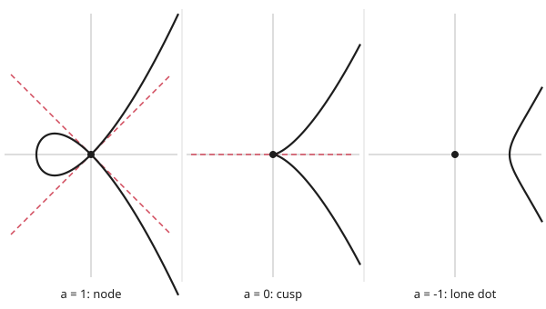
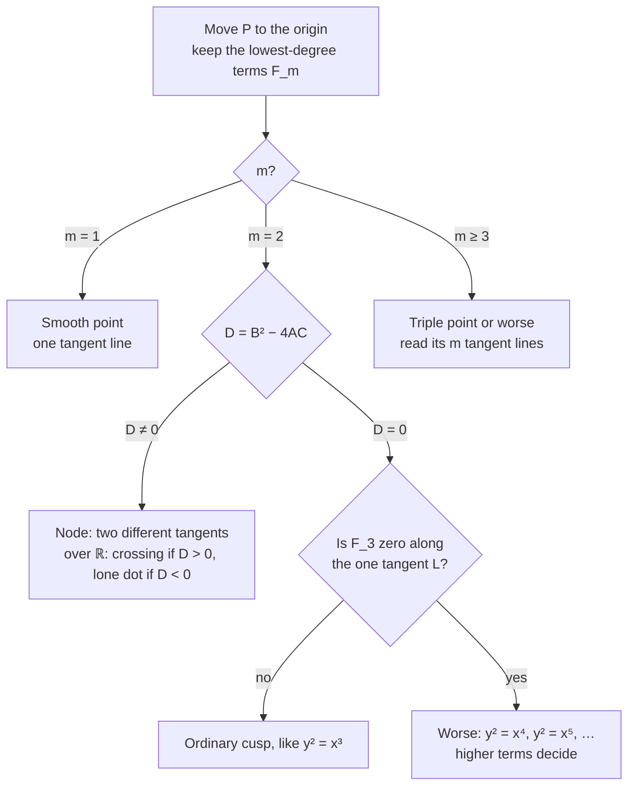

# Nodes and cusps: the standard ways a curve fails to be smooth

[Syllabus](../../../SYLLABUS.md) → [Algebraic geometry](../README.md) → [Plane Curves](../README.md#s03) → Nodes and cusps

---

## General Overview

Take the curve $`y^2 = x^2(x + 1)`$, this shelf's house example, the nodal cubic. Over the real numbers it is a loop on the left joined to two arms that run off to the right. At the origin the curve crosses itself. Two smooth arcs pass through one point, one with slope 1 and one with slope −1.

Now delete the $`x^2`$ term: $`y^2 = x^3`$. The loop shrinks to nothing, the two slopes merge into one, and the curve comes to a sharp point at the origin. A point moving along it as $`(t^2, t^3)`$ slows to a stop at the tip, then turns back along the other arm.

Both curves fail to be smooth at the origin: there the polynomial and both of its partial derivatives are zero, so no single tangent line is defined. The first failure is a **node**: two arcs crossing with two different tangent lines. The second is a **cusp**: one arc with a sharp tip and a doubled tangent line. This card shows how to read which one you have from the equation alone, by exact arithmetic.

The method is short. Move the bad point to the origin. Throw away every term except those of lowest total degree. That lowest degree is the **multiplicity** (how many times a typical line through the point meets the curve there), and those lowest terms, set to zero, are the **tangent cone** (the lines the curve hugs at the point). Two different tangent lines make a node. One doubled line makes a cusp, provided the cubic terms pass one test.

**Near a point, the lowest-degree terms of the equation dominate, so their degree is the multiplicity and their factors are the tangent lines: two different lines make a node, one doubled line makes a cusp when the cubic terms do not vanish along it.**

**What kind of fact this is:** multiplicity, tangent cone, node and cusp are definitions. That the multiplicity equals the lowest order of contact with a line, and that the tangent lines are exactly the lines of higher contact, are theorems proved on this card in Why it works. The cusp test is shown by a scaling argument in Step 5. That an ordinary cusp is exactly one branch, and that every node and every ordinary cusp looks, after a change of coordinates by power series, exactly like $`xy = 0`$ or $`y^2 = x^3`$, are theorems stated here, with proofs in the plane-curves book listed in Sources.

### The picture: one family, three kinds of point

<p align="center"></p>

Real points only, drawn to scale, 60 units per unit length. The three panels are $`y^2 = x^3 + a x^2`$ for $`a = 1`$, $`0`$ and $`-1`$. Dashed lines are the real tangent lines at the origin. As $`a`$ falls through 0, the node's two real tangents $`y = \pm\sqrt{a}\,x`$ merge into the cusp's one, then turn complex: the right panel's origin is a node whose two tangents $`y = \pm i x`$ no real drawing shows, so it appears as a lone dot.

---

## The formula

Notation already in use. The field $`k`$ is the number system the coefficients and coordinates come from; this card classifies over $`\mathbb{C}`$, the complex numbers, and draws over $`\mathbb{R}`$. A plane curve is the zero set of one polynomial $`F(x, y)`$. A point is **singular** when $`F`$, $`\partial F/\partial x`$ and $`\partial F/\partial y`$ all vanish there; [Smooth and singular points](../02-Affine%20and%20Projective%20Varieties/08-smooth-and-singular-points.md) calls this the Jacobian test. The intersection multiplicity $`(F \cdot G)_P`$ (how many times two curves meet at $`P`$, counted with tightness) comes from [Intersection multiplicity](02-intersection-multiplicity-and-tangency.md).

New on this card, in words first: $`m_P(F)`$, the **multiplicity** of the curve at $`P`$; a **node** and a **cusp**; and a **Puiseux series**, a power series in a fractional power of $`x`$ such as $`x^{1/2}`$.

Move the point $`P = (x_0, y_0)`$ to the origin and sort the terms by total degree:

```math
F(x_0 + x,\ y_0 + y) = F_m(x, y) + F_{m+1}(x, y) + \dots + F_d(x, y), \qquad F_m \neq 0, \qquad m_P(F) = m
```

**Read it aloud:** shift the curve so the point sits at the origin, group the terms by degree, and the lowest degree still present is the multiplicity.

Here $`F_k`$ collects the terms of total degree $`k`$ (for $`x^i y^j`$ that degree is $`i + j`$), and $`d`$ is the degree of $`F`$. Multiplicity 1 is a smooth point. Multiplicity 2 or more is a singular point. The **tangent cone** is the curve $`F_m = 0`$. Over $`\mathbb{C}`$ it is always $`m`$ lines through the origin, some possibly repeated.

For a double point, $`m = 2`$, the lowest part is a quadratic, and one number sorts it:

```math
F_2 = A x^2 + B xy + C y^2, \qquad D = B^2 - 4AC: \qquad D \neq 0 \Rightarrow \text{node}, \qquad D = 0 \text{ and } L \nmid F_3 \Rightarrow \text{ordinary cusp}
```

**Read it aloud:** write the lowest part as a quadratic; if its discriminant is not zero, the two tangent lines differ and the point is a node; if it is zero, the quadratic is a single line $`L`$ squared, and the point is an ordinary cusp when that line does not divide the cubic part.

"$`L`$ does not divide $`F_3`$" means $`F_3`$ is not zero along the tangent line. Over $`\mathbb{R}`$ a node splits in two: $`D > 0`$ gives a real crossing, $`D < 0`$ gives a lone dot with complex tangents.

For the house example $`F = y^2 - x^3 - x^2`$ at the origin: $`F_2 = -x^2 + y^2`$, so $`m = 2`$, with $`A = -1`$, $`B = 0`$, $`C = 1`$ and $`D = 4`$: a node, with tangent lines $`y = x`$ and $`y = -x`$. For $`y^2 = x^3`$: $`F_2 = y^2`$, $`D = 0`$, $`L = y`$, and $`F_3 = -x^3`$ is $`-1`$ along the direction $`(1, 0)`$ of $`L`$: an ordinary cusp.



| Symbol | Plain meaning | In our example | Push it up and the answer… |
| --- | --- | --- | --- |
| $`k`$ | the field: where coefficients and points live | $`\mathbb{C}`$ to classify, with $`i = \sqrt{-1}`$; $`\mathbb{R}`$ to draw | over $`\mathbb{R}`$ a node can hide as a lone dot |
| $`F`$, $`d`$ | the curve's polynomial, and its degree | $`y^2 - x^3 - x^2`$, $`d = 3`$ | — |
| $`P = (x_0, y_0)`$ | the point being examined | $`(0, 0)`$; also $`(-1, 0)`$ and $`(-2/3, 0)`$ | — |
| $`F_k`$ | the terms of total degree $`k`$ after moving $`P`$ to the origin | $`F_2 = -x^2 + y^2`$, $`F_3 = -x^3`$ | — |
| $`m = m_P(F)`$ | multiplicity: the lowest degree present | 2 | more arcs or a harder tangency meet at $`P`$ |
| $`F_m = 0`$ | the tangent cone: $`m`$ lines over $`\mathbb{C}`$ | $`y = x`$ and $`y = -x`$ | — |
| $`A, B, C`$ | coefficients of the quadratic part $`F_2`$ | $`-1, 0, 1`$ | — |
| $`D`$ | $`B^2 - 4AC`$: zero exactly when the two tangents coincide | 4 | positive: two real tangents; negative: complex ones |
| $`L`$; $`\alpha`$ | the one tangent line when $`D = 0`$; once $`L`$ is $`y = 0`$, the coefficient of $`x^3`$ | $`y`$ and $`-1`$, for $`y^2 = x^3`$ | $`\alpha = 0`$: worse than a cusp |
| $`(u, v)`$, $`s`$ | a direction through $`P`$, and the distance along it; $`s`$ is also the zoom scale in Steps 0 and 5 | $`(1, 1)`$, the line $`y = x`$ | — |
| $`t`$ | a parameter along the curve; also the slope in $`y = tx`$, and on the node and the cusp the two agree, since $`t = y/x`$ | $`(t^2 - 1, t^3 - t)`$; $`(t^2, t^3)`$ | — |
| $`c`$; $`a`$ | the constant in $`y^2 = x^3 + x^2 + c`$; the $`x^2`$ coefficient in the picture's $`y^2 = x^3 + a x^2`$ | $`c = -4/27`$; $`a = 1, 0, -1`$ | $`c`$ off $`0`$ and $`-4/27`$: smooth |

### When it holds

- **The point is on the curve.** If $`F(P) \neq 0`$, the shifted polynomial keeps a nonzero constant term, and there is no point to classify.
- **The classification is over $`\mathbb{C}`$.** Over $`\mathbb{R}`$ the same point can look like a crossing or a lone dot: $`y^2 = x^3 + x^2 - 4/27`$ has, at $`(-2/3, 0)`$, a node with $`D = -4`$ and no real tangent at all.
- **The cusp test needs the cubic terms.** The lowest part $`y^2`$ is shared by $`y^2 = x^3`$, $`y^2 = x^4`$ and $`y^2 = x^5`$, yet the second is two arcs touching and the third a sharper cusp. When $`F_3`$ vanishes along $`L`$, look at higher terms (the Newton polygon, below).
- **The polynomial has no repeated factor.** A square such as $`(y - x^2)^2`$ is singular at every one of its points. That is a smooth curve counted twice, not a node or a cusp.
- **Characteristic not 2.** The test $`D = B^2 - 4AC`$ and the cusp test divide by 2 in Why it works. Over $`\mathbb{F}_2`$, the integers mod 2, they need a separate check.

---

## Why it works

### Step 0: zoom in, and the lowest terms win

Look at the curve through a magnifying glass centred on $`P`$. Replace $`(x, y)`$ by $`(sx, sy)`$ with a small scale $`s`$. Each $`F_k`$ picks up a factor $`s^k`$, so

```math
F(x_0 + sx,\ y_0 + sy) = s^m \big( F_m(x, y) + s\, F_{m+1}(x, y) + s^2 F_{m+2}(x, y) + \dots \big)
```

**Read it aloud:** after zooming in by a factor $`s`$, the equation is $`s^m`$ times the lowest part plus terms that shrink with $`s`$.

Divide by $`s^m`$ and let $`s`$ shrink. What remains is $`F_m(x, y) = 0`$. Under a strong enough lens, the curve near $`P`$ looks like its tangent cone. Everything on this card reads that cone.

### Step 1: moving the point is a finite Taylor expansion

For a polynomial, the shift $`F(x_0 + x, y_0 + y)`$ is exact. Expand each $`(x_0 + x)^i (y_0 + y)^j`$ by the binomial theorem and collect terms. The result is the [Taylor series](../../06-Calculus%20and%20analysis/06-Series/05-taylor-series.md) of $`F`$ at $`P`$, which stops after degree $`d`$ because $`F`$ is a polynomial. So the coefficient of $`x^i y^j`$ in the shifted polynomial is a partial derivative at $`P`$ divided by $`i!\,j!`$.

That gives two independent ways to find $`m`$: expand and read the lowest degree, or differentiate and find the first order at which some partial derivative is not zero at $`P`$. Multiplicity 1 means the gradient (the pair of first partial derivatives) is not zero, which is the definition of a smooth point. The code does both.

For the neighbour $`y^2 = x^3 + x^2 - 4/27`$ at $`P = (-2/3, 0)`$, the shift gives

```math
-(x - \tfrac{2}{3})^3 - (x - \tfrac{2}{3})^2 + \tfrac{4}{27} + y^2 = -x^3 + x^2 + y^2
```

**Read it aloud:** moved to its bad point, the neighbour is exactly $`y^2 = x^3 - x^2`$, the lone dot in the picture's right panel.

### Step 2: lines through the point measure the multiplicity

Run a line through $`P`$ in a direction $`(u, v)`$ and put it into $`F`$. By Step 0 with $`(x, y) = (u, v)`$:

```math
F(x_0 + us,\ y_0 + vs) = s^m F_m(u, v) + s^{m+1} F_{m+1}(u, v) + \dots
```

**Read it aloud:** along any line through the point, the curve's equation vanishes to order at least the multiplicity, and to higher order exactly when the line lies in the tangent cone.

The order of vanishing in $`s`$ is the intersection multiplicity of the curve with the line at $`P`$, as defined in [Intersection multiplicity](02-intersection-multiplicity-and-tangency.md). So:

- Every line through $`P`$ meets the curve there at least $`m`$ times.
- Most lines meet it exactly $`m`$ times. The exceptions are the lines with $`F_m(u, v) = 0`$: the tangent lines.

On the node, the line $`y = tx`$ gives $`F(s, ts) = (t^2 - 1)s^2 - s^3`$. Order 2 for every slope except $`t = \pm 1`$, where the $`s^2`$ term dies and the order is 3. The minimum, 2, is the multiplicity. The two slopes with extra contact are the tangents. This is the third road in the code, and it never shifts $`F`$.

### Step 3: the tangent cone is a set of lines

$`F_m`$ is homogeneous: every term has degree $`m`$. Set $`y = tx`$ and it becomes $`x^m F_m(1, t)`$, a polynomial in the slope $`t`$. Over $`\mathbb{C}`$ that polynomial splits into linear factors, so $`F_m`$ splits into $`m`$ lines through the origin, counted with repetition. (If $`F_m(1, t)`$ has degree less than $`m`$, the missing factors are the vertical line $`x = 0`$.)

For $`m = 2`$ the slopes solve $`C t^2 + B t + A = 0`$. The quadratic formula gives two different slopes when $`D = B^2 - 4AC \neq 0`$ and one doubled slope when $`D = 0`$. Over $`\mathbb{R}`$, $`D < 0`$ means two complex slopes: on the lone dot, $`y^2 + x^2 = (y - ix)(y + ix)`$.

### Step 4: a node is two smooth branches crossing

A **branch** is one arc of the curve through $`P`$, traced by a single power series or a single parameter. When $`D \neq 0`$, the two tangent lines differ. Near $`P`$ the curve then splits into two smooth branches, one along each line.

On the house example this is visible. Solve for $`y`$: $`y = \pm x\sqrt{1 + x}`$. Expand the square root by its Taylor series:

```math
y = \pm\Big(x + \tfrac{1}{2}x^2 - \tfrac{1}{8}x^3 + \tfrac{1}{16}x^4 - \tfrac{5}{128}x^5 + \dots\Big)
```

**Read it aloud:** the node is two ordinary power series in $`x`$, one starting $`+x`$ and one starting $`-x`$: two smooth branches with slopes 1 and −1.

The parametrisation shows the same thing. The point $`(t^2 - 1, t^3 - t)`$ passes the origin twice, at $`t = -1`$ and $`t = 1`$, with velocities $`(-2, 2)`$ and $`(2, 2)`$: slopes −1 and 1.

[Bezout's theorem](03-bezouts-theorem.md) explains where that parametrisation comes from. A line meets a cubic in 3 points, in the projective plane over $`\mathbb{C}`$ and counted with multiplicity. A line $`y = tx`$ through the node spends 2 of them at the node, so it meets the curve exactly once more, at $`(t^2 - 1, t^3 - t)`$. For $`t = 2`$ that third point is $`(3, 6)`$.

<details>
<summary>Detailed proof: two different tangents give two smooth branches</summary>

Change coordinates linearly so the two tangent lines are $`x = 0`$ and $`y = 0`$. Then $`F = xy + (\text{terms of degree 3 and up})`$.

Look for a branch along $`y = 0`$: $`y`$ as a power series in $`x`$ that starts with an $`x^2`$ term. Put it into $`F`$ and compare coefficients of $`x^3`$, $`x^4`$, and so on, in turn. In the coefficient of each power of $`x`$, the term $`xy`$ brings in one new coefficient of the series. The higher terms bring in only earlier ones, because each has degree at least 3 and $`y`$ starts at $`x^2`$. So each new coefficient is fixed by the earlier ones, and the series exists and is unique. Swapping $`x`$ and $`y`$ gives the branch along $`x = 0`$.

Over $`\mathbb{C}`$ these series converge near $`P`$; that step is analysis, done in the plane-curves book in Sources. The node is then two smooth arcs crossing, and a change of coordinates by power series that straightens both arcs turns it into exactly $`xy = 0`$.

</details>

### Step 5: a cusp is one branch with a fractional power

When $`D = 0`$ there is one tangent line $`L`$. Change coordinates so $`L`$ is $`y = 0`$. Then $`F_2 = y^2`$ (up to a constant), and

```math
F = y^2 + \alpha x^3 + (\text{terms in } x^2 y,\ x y^2,\ y^3) + (\text{terms of degree 4 and up})
```

**Read it aloud:** after turning the tangent to horizontal, the quadratic part is $`y^2`$, and $`\alpha`$ (the Greek letter alpha) is the coefficient of $`x^3`$.

$`F_3`$ vanishes along $`y = 0`$ exactly when $`\alpha = F_3(1, 0) = 0`$. Now zoom unevenly: replace $`x`$ by $`s^2 x`$ and $`y`$ by $`s^3 y`$. Then $`y^2`$ and $`x^3`$ both carry $`s^6`$. Every other term carries more: $`x^2 y`$ has $`s^7`$, any term of degree 4 or more has at least $`s^8`$. So

```math
F(s^2 x,\ s^3 y) = s^6\,(y^2 + \alpha x^3) + s^7(\dots)
```

**Read it aloud:** under the uneven zoom, the curve tends to $`y^2 = -\alpha x^3`$, which is the standard cusp whenever $`\alpha \neq 0`$.

The branch is $`y \approx \pm\sqrt{-\alpha}\, x^{3/2}`$. That is a Puiseux series: a power series in $`x^{1/2}`$, not in $`x`$. The plus and minus signs give the two arms of one branch, not two branches, because the substitution $`x = t^2`$ joins them: $`(t^2, t^3)`$ covers both arms as $`t`$ runs from negative to positive. That the higher terms of $`F`$ do not split it into two branches is proved in the plane-curves book in Sources. Its velocity $`(2t, 3t^2)`$ is zero at $`t = 0`$, which is why a point moving along a cusp stops at the tip.

If $`\alpha = 0`$, the uneven zoom picks out other terms. The **Newton polygon** decides what comes next: mark a dot at $`(i, j)`$ for each term $`x^i y^j`$ of $`F`$. Each edge of the lower boundary of those dots gives branches whose exponent is minus one over the edge's slope: for $`y^2 - x^3`$ the edge from $`(0, 2)`$ to $`(3, 0)`$ has slope $`-2/3`$, and the branch is $`y \approx x^{3/2}`$. $`y^2 = x^4`$ is two smooth branches $`y = \pm x^2`$ touching (a **tacnode**), and $`y^2 = x^5`$ is one branch $`y = x^{5/2}`$. Over $`\mathbb{C}`$, every branch of every plane curve has a Puiseux series; the [Blowing up](05-blowing-up-a-point.md) card separates branches another way.

### Step 6: the house family, and its smooth neighbours

The neighbours $`y^2 = x^3 + x^2 + c`$ show where nodes sit among smooth curves. A singular point needs $`\partial F/\partial y = 2y = 0`$ and $`\partial F/\partial x = -(3x^2 + 2x) = 0`$, so $`y = 0`$ and $`x = 0`$ or $`x = -2/3`$. It also needs $`F = 0`$, which forces $`c = -x^3 - x^2`$: $`c = 0`$ or $`c = -4/27`$.

A second road agrees. The curve is singular exactly when $`x^3 + x^2 + c`$ has a repeated root, and that cubic's discriminant (the resultant of the cubic and its derivative, up to a constant, from [The resultant](../01-Polynomial%20Systems/06-resultants-and-common-roots.md)) is $`-c(4 + 27c)`$, zero at the same two values.

Every other $`c`$ gives a smooth curve, and crossing a singular value changes the shape. At $`c = 1/100`$ the cubic has one real root, and the real curve is one smooth piece. At $`c = -1/100`$ it has three, and the real curve is an oval plus an unbounded tail. The node at $`c = 0`$ is the moment the oval touches the tail.

---

## Worked numbers, by hand

| Step | Arithmetic | Value |
| --- | --- | --- |
| node: move $`P = (0, 0)`$ | nothing moves | $`F = -x^3 - x^2 + y^2`$ |
| node: lowest part | the degree-2 terms | $`F_2 = -x^2 + y^2`$, so $`m = 2`$ |
| node: discriminant | $`D = 0^2 - 4(-1)(1)`$ | 4, positive |
| node: tangent lines | $`y^2 - x^2 = (y - x)(y + x)`$ | slopes −1 and 1 |
| node: contact with $`y = x`$ | $`F(s, s) = -s^3`$ | order 3, more than $`m = 2`$ |
| node: parameter | $`t = \pm 1`$ in $`(2t, 3t^2 - 1)`$ | velocities $`(-2, 2)`$ and $`(2, 2)`$ |
| cusp: lowest part | $`F = -x^3 + y^2`$ | $`F_2 = y^2`$, $`m = 2`$, $`D = 0`$, $`L = y`$ |
| cusp: test | $`F_3 = -x^3`$ at the direction $`(1, 0)`$ of $`L`$ | −1, not 0 |
| cusp: parameter | $`(2t, 3t^2)`$ at $`t = 0`$ | velocity $`(0, 0)`$ |
| neighbour $`c = -4/27`$ at $`(-2/3, 0)`$ | shift, as in Step 1 | $`-x^3 + x^2 + y^2`$, $`D = -4`$ |

**The house example's origin is a node with tangents $`y = \pm x`$; $`y^2 = x^3`$ has an ordinary cusp with tangent $`y = 0`$; the neighbour at $`c = -4/27`$ has a node at $`(-2/3, 0)`$ that over $`\mathbb{R}`$ is a lone dot.**

The node is two smooth arcs crossing, the cusp is one arc that stops and turns, and the lone dot is a node whose two arcs are complex.

### What breaks if you drop a piece

| Mistake | Comes out at | What went wrong |
| --- | --- | --- |
| Use only the gradient | $`(0, 0)`$ for the cusp, the node and $`y^2 = x^4`$ alike | The Jacobian test says "singular", not which kind |
| Classify by the lowest part alone | $`y^2 = x^3`$, $`x^4`$, $`x^5`$ all start $`y^2`$; real arcs 1, 2, 1 | A doubled tangent is a cusp only if $`F_3`$ survives along it |
| Look only for real tangent lines | lone dot: $`m = 2`$ but 0 real tangents | Over $`\mathbb{C}`$ it is a node: $`y^2 + x^2 = (y - ix)(y + ix)`$ |
| Test with one line only | $`x = -1`$ meets the smooth point $`(-1, 0)`$ to order 2; $`y = x`$ meets the node to order 3 | A tangent line overcounts; take the minimum over all lines |

The code prints every row.

---

## Code, from first principles, and it actually runs

The code works in exact fractions and classifies seven points: the cusp, the house node, a smooth point on the same curve, the lone dot on the neighbour at $`c = -4/27`$, $`y^2 = x^4`$, $`y^2 = x^5`$ and a three-leaf quartic with a triple point. It takes three roads to the multiplicity and the tangent lines, plus a fourth check that counts real arcs, and it also confirms the cusp of $`y^2 = x^3 - 2`$ mod 3 at $`(2, 0)`$. It shifts $`F`$ by the binomial theorem and reads the lowest degree. It takes partial derivatives and finds the first nonzero order. It puts eight lines through the point into the unshifted $`F`$ and takes the least order of contact, marking the lines with more. It walks a circle of radius 0.05 round the point and counts sign changes of $`F`$, which counts the real arcs. The first three must agree exactly, the tangent lines must be the zeros of $`F_m`$, and each type must match the textbook answer. It then checks the parametrisations, the node's power series two ways, the Bezout count and the house family.

### Python

```python
# Nodes and cusps -- the check behind the card.
# Standard library only.  Fraction keeps every coefficient exact.  A curve is F(x, y) = 0,
# stored as {(i, j): coefficient of x^i y^j}.  At a point P the card reads the multiplicity m
# (the lowest degree left after moving P to the origin), the tangent cone (those lowest terms)
# and the type.  Three roads to m and the tangents: the Taylor shift, the partial derivatives,
# and the order of contact with lines.  A fourth road counts real arcs on a small circle.
from fractions import Fraction as Q
from math import comb, factorial, cos, sin, pi

def P(*terms): return {(i, j): Q(c) for c, i, j in terms}       # (c, i, j) is c x^i y^j
def mono(i, j): return ("x" if i == 1 else f"x^{i}" if i else "") + ("y" if j == 1 else f"y^{j}" if j else "")
def show(F):
    out = ""
    for (i, j) in sorted(F, key=lambda k: (-k[0] - k[1], -k[0])):
        c, m = F[(i, j)], mono(i, j)
        s = (str(abs(c)) if abs(c) != 1 or not m else "") + m
        out += (" - " if c < 0 else " + ") + s if out else ("-" if c < 0 else "") + s
    return out or "0"
def shift(F, a, b):                               # F(x + a, y + b), by the binomial theorem
    G = {}
    for (i, j), c in F.items():
        for r in range(i + 1):
            for s in range(j + 1):
                G[(r, s)] = G.get((r, s), 0) + c * comb(i, r) * a ** (i - r) * comb(j, s) * b ** (j - s)
    return {k: v for k, v in G.items() if v}
def lowest(G):
    m = min(i + j for i, j in G)
    return m, {k: v for k, v in G.items() if sum(k) == m}
def part(G, k): return {key: v for key, v in G.items() if sum(key) == k}
def d(F, v): return {(i - 1 + v, j - v): c * (j if v else i) for (i, j), c in F.items() if (j if v else i)}
def ev(F, a, b): return sum(c * a ** i * b ** j for (i, j), c in F.items())
def by_partials(F, a, b):                         # first k with a k-th partial nonzero at P
    for k in range(9):
        T = {}
        for i in range(k + 1):
            D = F
            for v in [0] * i + [1] * (k - i): D = d(D, v)
            val = ev(D, a, b) / (factorial(i) * factorial(k - i))
            if val: T[(i, k - i)] = val
        if T: return k, T
def pmul(p, q):
    r = [Q(0)] * (len(p) + len(q) - 1)
    for i, x in enumerate(p):
        for j, y in enumerate(q): r[i + j] += x * y
    return r
def ppow(p, n):
    r = [Q(1)]
    for _ in range(n): r = pmul(r, p)
    return r
def contact(F, a, b, u, v):                       # order of s in F(a + u s, b + v s)
    out = {}
    for (i, j), c in F.items():
        for k, t in enumerate(pmul(ppow([a, u], i), ppow([b, v], j))): out[k] = out.get(k, 0) + c * t
    return min(k for k, t in out.items() if t)
def arcs(F, a, b, r=0.05, n=7200):                # sign changes of F on a circle round P, halved
    f = lambda x, y: sum(float(c) * x ** i * y ** j for (i, j), c in F.items())
    s = [f(a + r * cos(2 * pi * (k + 0.5) / n), b + r * sin(2 * pi * (k + 0.5) / n)) > 0 for k in range(n)]
    return sum(s[k] != s[k - 1] for k in range(n)) // 2
def kind(m, G):
    if m == 1: return "smooth point"
    if m > 2: return f"point of multiplicity {m}"
    A, B, C = (G.get(k, 0) for k in ((2, 0), (1, 1), (0, 2)))
    D = B * B - 4 * A * C
    if D > 0: return f"D = {D}: node, two real tangents"
    if D < 0: return f"D = {D}: node, tangents complex, a lone real dot"
    u, v = (-B, 2 * A) if A else (1, 0)           # the one tangent direction
    return f"D = 0, F_3 on the tangent = {ev(part(G, 3), u, v)}: " + ("ordinary cusp" if ev(part(G, 3), u, v) else "not a cusp: higher terms decide")

DIRS = [(1, Q(t), f"slope {Q(t)}") for t in (-2, -1, Q(-1, 2), 0, Q(1, 2), 1, 2)] + [(0, 1, "vertical")]
curves = [("cusp y^2 = x^3", P((1, 0, 2), (-1, 3, 0)), (0, 0), "ordinary cusp"),
          ("node y^2 = x^2(x + 1)", P((1, 0, 2), (-1, 3, 0), (-1, 2, 0)), (0, 0), "two real tangents"),
          ("same node curve", P((1, 0, 2), (-1, 3, 0), (-1, 2, 0)), (-1, 0), "smooth point"),
          ("neighbour y^2 = x^3 + x^2 - 4/27", P((1, 0, 2), (-1, 3, 0), (-1, 2, 0), (Q(4, 27), 0, 0)), (Q(-2, 3), 0), "a lone real dot"),
          ("tacnode y^2 = x^4", P((1, 0, 2), (-1, 4, 0)), (0, 0), "higher terms decide"),
          ("y^2 = x^5", P((1, 0, 2), (-1, 5, 0)), (0, 0), "higher terms decide"),
          ("three-leaf (x^2 + y^2)^2 = xy(x - y)", P((1, 4, 0), (2, 2, 2), (1, 0, 4), (-1, 2, 1), (1, 1, 2)), (0, 0), "multiplicity 3")]
res = {}
print("field: C for the algebra, exact rationals; real points for arcs and pictures")
for name, F, (a, b), want in curves:
    a, b = Q(a), Q(b)
    G = shift(F, a, b); m, L = lowest(G); m2, T = by_partials(F, a, b); kd = kind(m, G)
    orders = [(contact(F, a, b, u, v), lab, ev(L, u, v) == 0) for u, v, lab in DIRS]
    m3 = min(o for o, _, _ in orders); tang = [lab for o, lab, _ in orders if o > m]
    n_arcs = arcs(F, float(a), float(b))
    print(f"{name}, P = ({a}, {b}): moved to P, F = {show(G)}")
    print(f"  m = {m} by shift, {m2} by partials, {m3} by lines; tangent cone {show(L)}; {kd}")
    print(f"  tangent lines found: {', '.join(tang) or 'none real'}; real arcs through P: {n_arcs}")
    assert m == m2 == m3 and T == L and tang == [lab for _, lab, z in orders if z] and kd.endswith(want)
    res[name] = (m, tang, n_arcs, orders)

t = [Q(k) for k in range(8)]; nd = lambda t: (t * t - 1, t ** 3 - t); cu = lambda t: (t * t, t ** 3); lo = lambda t: (t * t + 1, t ** 3 + t)  # degree 6: 8 points
F_n, F_c, F_l = curves[1][1], curves[0][1], shift(curves[3][1], Q(-2, 3), Q(0))   # F_l: the neighbour moved to its lone dot
assert all(ev(F_n, *nd(s)) == 0 and ev(F_c, *cu(s)) == 0 and ev(F_l, *lo(s)) == 0 for s in t)
o2 = contact(F_n, Q(0), Q(0), 1, Q(2)); x2, y2 = nd(Q(2))
print(f"Bezout: y = 2x meets the node cubic at (0, 0) to order {o2}, and once more at ({x2}, {y2}), where F = {ev(F_n, x2, y2)}; {o2} + 1 = 3, the degree")
vel = [(2 * t, 3 * t * t - 1) for t in (-1, 1)]
print(f"node (t^2 - 1, t^3 - t): t = -1 and t = 1 both give ({nd(Q(-1))[0]}, {nd(Q(1))[1]}); velocities (2t, 3t^2 - 1) = "
      f"{vel[0]}, {vel[1]}: slopes {Q(vel[0][1], vel[0][0])}, {Q(vel[1][1], vel[1][0])}")
print(f"cusp (t^2, t^3): t = 0 gives {cu(0)}, velocity (2t, 3t^2) = {(2 * 0, 3 * 0)}; acceleration (2, 6t) = {(2, 6 * 0)}, slope 0")
gi = lambda p, q: (p[0] * q[0] - p[1] * q[1], p[0] * q[1] + p[1] * q[0])   # complex product
i1 = (0, 1); i2 = gi(i1, i1); i3 = gi(i2, i1)
assert (i2[0] + 1, i2[1]) == (0, 0) and (i3[0] + i1[0], i3[1] + i1[1]) == (0, 0)
print(f"lone dot y^2 = x^3 - x^2 by (t^2 + 1, t^3 + t): real t keeps x >= 1; t = i gives ({i2[0] + 1}, {i3[1] + i1[1]})")
G3 = {k: (v + 1) % 3 - 1 for k, v in shift(P((1, 0, 2), (-1, 3, 0), (2, 0, 0)), Q(2), Q(0)).items() if v % 3}  # mod 3
print(f"mod 3: y^2 = x^3 - 2 moved to (2, 0) is {show(G3)}; {kind(2, G3)}")
s = [Q(1)]                                        # sqrt(1 + x) by s^2 = 1 + x, term by term
for n in range(1, 7): s.append((Q(n == 1) - sum(s[k] * s[n - k] for k in range(1, n))) / 2)
binom = [Q(1)]
for n in range(1, 7): binom.append(binom[-1] * (Q(1, 2) - n + 1) / n)
y = {(k + 1, 0): c for k, c in enumerate(s)}; sq = {}
for (i, _), c in y.items():
    for (j, _), e in y.items(): sq[(i + j, 0)] = sq.get((i + j, 0), 0) + c * e
left = {k: v for k, v in sq.items() if v and k[0] <= 7}
ser = " ".join(("" if k == 1 else "- " if c < 0 else "+ ") + (f"{abs(c)} " if abs(c) != 1 else "") + mono(k, 0) for (k, _), c in sorted(y.items()))
print(f"node branches y = +-x sqrt(1 + x) = +-({ser} ...); recurrence = binomial: {'yes' if s == binom else 'no'}")
print(f"  (branch)^2 up to x^7 = {show(left)}, which is x^2(x + 1)")
assert s == binom and left == {(3, 0): 1, (2, 0): 1}

fam = lambda c: -c * (4 + 27 * c)                 # discriminant of x^3 + x^2 + c
crit = sorted(-x ** 3 - x ** 2 for x in (Q(0), Q(-2, 3)))  # F_x = 0 forces 3x^2 + 2x = 0
def roots(c, lo=-2.0, h=1e-4):                    # real roots of x^3 + x^2 + c by sign changes
    g = [(lo + k * h) * (lo + k * h) * (lo + k * h) + (lo + k * h) * (lo + k * h) + c for k in range(40001)]
    return sum((g[k] > 0) != (g[k - 1] > 0) for k in range(1, 40001))
print(f"family y^2 = x^3 + x^2 + c: singular only at c = {', '.join(map(str, crit))} (from F_y = F_x = F = 0); discriminant -c(4 + 27c) zero there: {'yes' if all(fam(c) == 0 for c in crit) else 'no'}")
for c in (Q(1, 100), Q(-1, 100)):
    k = roots(float(c))
    print(f"  c = {c}: discriminant {fam(c)}, {k} real root(s) of x^3 + x^2 + c, so {'one smooth piece' if k == 1 else 'an oval and a tail'}")
    assert (k == 3) == (fam(c) > 0) and fam(c) != 0
grad = [(ev(d(F, 0), 0, 0), ev(d(F, 1), 0, 0)) for _, F, _, _ in curves[:2] + [curves[4]]]
print(f"mistake 1, gradient only: cusp, node, tacnode all give gradient {', '.join(f'({g[0]}, {g[1]})' for g in grad)}: singular, type unknown")
print(f"mistake 2, lowest terms only: y^2 = x^3, x^4, x^5 all start y^2; real arcs {res['cusp y^2 = x^3'][2]}, {res['tacnode y^2 = x^4'][2]}, {res['y^2 = x^5'][2]}")
print(f"mistake 3, real slopes only: the lone dot has m = {res['neighbour y^2 = x^3 + x^2 - 4/27'][0]} but {len(res['neighbour y^2 = x^3 + x^2 - 4/27'][1])} real tangents; y^2 + x^2 = (y - ix)(y + ix)")
o_smooth = contact(curves[2][1], Q(-1), Q(0), 0, 1); o_node = contact(F_n, Q(0), Q(0), 1, Q(1))
print(f"mistake 4, one line only: x = -1 meets the smooth point (-1, 0) to order {o_smooth}; y = x meets the node to order {o_node}")
assert grad == [(0, 0)] * 3 and o_smooth == 2 and o_node == 3 and res['tacnode y^2 = x^4'][2] == 2 and all(fam(e) == 0 for e in crit) and o2 == 2 and ev(F_n, x2, y2) == 0 and G3 == {(3, 0): -1, (0, 2): 1}
k = 60                                            # figure: 60 units per unit length
px = lambda cx, x, y: f"({cx + k * x:.2f}, {170 - k * y:.2f})"
print(f"figure, {k} units per unit: node origin {px(100, 0, 0)}, (-1, 0) at {px(100, -1, 0)}; cusp origin {px(300, 0, 0)}, "
      f"(1, 1) at {px(300, 1, 1)}; lone dot {px(500, 0, 0)}, branch start (1, 0) at {px(500, 1, 0)}")
print("ALL CHECKS PASS")
```

**Ran 2026-11-17 on macOS, Python 3.14.10, standard library only. All checks passed. Output, pasted from the run:**

```
field: C for the algebra, exact rationals; real points for arcs and pictures
cusp y^2 = x^3, P = (0, 0): moved to P, F = -x^3 + y^2
  m = 2 by shift, 2 by partials, 2 by lines; tangent cone y^2; D = 0, F_3 on the tangent = -1: ordinary cusp
  tangent lines found: slope 0; real arcs through P: 1
node y^2 = x^2(x + 1), P = (0, 0): moved to P, F = -x^3 - x^2 + y^2
  m = 2 by shift, 2 by partials, 2 by lines; tangent cone -x^2 + y^2; D = 4: node, two real tangents
  tangent lines found: slope -1, slope 1; real arcs through P: 2
same node curve, P = (-1, 0): moved to P, F = -x^3 + 2x^2 + y^2 - x
  m = 1 by shift, 1 by partials, 1 by lines; tangent cone -x; smooth point
  tangent lines found: vertical; real arcs through P: 1
neighbour y^2 = x^3 + x^2 - 4/27, P = (-2/3, 0): moved to P, F = -x^3 + x^2 + y^2
  m = 2 by shift, 2 by partials, 2 by lines; tangent cone x^2 + y^2; D = -4: node, tangents complex, a lone real dot
  tangent lines found: none real; real arcs through P: 0
tacnode y^2 = x^4, P = (0, 0): moved to P, F = -x^4 + y^2
  m = 2 by shift, 2 by partials, 2 by lines; tangent cone y^2; D = 0, F_3 on the tangent = 0: not a cusp: higher terms decide
  tangent lines found: slope 0; real arcs through P: 2
y^2 = x^5, P = (0, 0): moved to P, F = -x^5 + y^2
  m = 2 by shift, 2 by partials, 2 by lines; tangent cone y^2; D = 0, F_3 on the tangent = 0: not a cusp: higher terms decide
  tangent lines found: slope 0; real arcs through P: 1
three-leaf (x^2 + y^2)^2 = xy(x - y), P = (0, 0): moved to P, F = x^4 + 2x^2y^2 + y^4 - x^2y + xy^2
  m = 3 by shift, 3 by partials, 3 by lines; tangent cone -x^2y + xy^2; point of multiplicity 3
  tangent lines found: slope 0, slope 1, vertical; real arcs through P: 3
Bezout: y = 2x meets the node cubic at (0, 0) to order 2, and once more at (3, 6), where F = 0; 2 + 1 = 3, the degree
node (t^2 - 1, t^3 - t): t = -1 and t = 1 both give (0, 0); velocities (2t, 3t^2 - 1) = (-2, 2), (2, 2): slopes -1, 1
cusp (t^2, t^3): t = 0 gives (0, 0), velocity (2t, 3t^2) = (0, 0); acceleration (2, 6t) = (2, 0), slope 0
lone dot y^2 = x^3 - x^2 by (t^2 + 1, t^3 + t): real t keeps x >= 1; t = i gives (0, 0)
mod 3: y^2 = x^3 - 2 moved to (2, 0) is -x^3 + y^2; D = 0, F_3 on the tangent = -1: ordinary cusp
node branches y = +-x sqrt(1 + x) = +-(x + 1/2 x^2 - 1/8 x^3 + 1/16 x^4 - 5/128 x^5 + 7/256 x^6 - 21/1024 x^7 ...); recurrence = binomial: yes
  (branch)^2 up to x^7 = x^3 + x^2, which is x^2(x + 1)
family y^2 = x^3 + x^2 + c: singular only at c = -4/27, 0 (from F_y = F_x = F = 0); discriminant -c(4 + 27c) zero there: yes
  c = 1/100: discriminant -427/10000, 1 real root(s) of x^3 + x^2 + c, so one smooth piece
  c = -1/100: discriminant 373/10000, 3 real root(s) of x^3 + x^2 + c, so an oval and a tail
mistake 1, gradient only: cusp, node, tacnode all give gradient (0, 0), (0, 0), (0, 0): singular, type unknown
mistake 2, lowest terms only: y^2 = x^3, x^4, x^5 all start y^2; real arcs 1, 2, 1
mistake 3, real slopes only: the lone dot has m = 2 but 0 real tangents; y^2 + x^2 = (y - ix)(y + ix)
mistake 4, one line only: x = -1 meets the smooth point (-1, 0) to order 2; y = x meets the node to order 3
figure, 60 units per unit: node origin (100.00, 170.00), (-1, 0) at (40.00, 170.00); cusp origin (300.00, 170.00), (1, 1) at (360.00, 110.00); lone dot (500.00, 170.00), branch start (1, 0) at (560.00, 170.00)
ALL CHECKS PASS
```

### Rust

Same numbers, same labels. Fractions are an `i128` struct whose products use `checked_mul`, so an overflow stops the run.

```rust
// Nodes and cusps -- the same check as the Python, in Rust.
// No crates.  Fractions are an i128 struct using checked_mul, so overflow stops the run.
// A curve is F(x, y) = 0, stored as {(i, j): coefficient of x^i y^j}.  At a point P the
// card reads the multiplicity m, the tangent cone and the type.  Three roads to m and the
// tangents: the Taylor shift, the partial derivatives, and the order of contact with lines.
// A fourth road counts real arcs on a small circle.
use std::collections::BTreeMap;
use std::fmt;

#[derive(Clone, Copy, PartialEq, PartialOrd, Debug)]
struct Q { n: i128, d: i128 }
fn gcd(a: i128, b: i128) -> i128 { if b == 0 { a.abs() } else { gcd(b, a % b) } }
fn q(n: i128, d: i128) -> Q { assert!(d != 0); let g = gcd(n, d).max(1); let s = if d < 0 { -1 } else { 1 }; Q { n: s * n / g, d: s * d / g } }
fn mm(a: i128, b: i128) -> i128 { a.checked_mul(b).expect("overflow") }
fn add(a: Q, b: Q) -> Q { q(mm(a.n, b.d) + mm(b.n, a.d), mm(a.d, b.d)) }
fn sub(a: Q, b: Q) -> Q { add(a, Q { n: -b.n, d: b.d }) }
fn mul(a: Q, b: Q) -> Q { q(mm(a.n, b.n), mm(a.d, b.d)) }
fn div(a: Q, b: Q) -> Q { q(mm(a.n, b.d), mm(a.d, b.n)) }
fn pw(a: Q, e: u32) -> Q { (0..e).fold(i(1), |r, _| mul(r, a)) }
fn i(n: i128) -> Q { q(n, 1) }
fn nz(a: Q) -> bool { a.n != 0 }
impl fmt::Display for Q {
    fn fmt(&self, f: &mut fmt::Formatter) -> fmt::Result { if self.d == 1 { write!(f, "{}", self.n) } else { write!(f, "{}/{}", self.n, self.d) } }
}
type Poly = BTreeMap<(u32, u32), Q>;
fn poly(t: &[(Q, u32, u32)]) -> Poly { t.iter().map(|&(c, a, b)| ((a, b), c)).collect() }
fn put(g: &mut Poly, k: (u32, u32), v: Q) { let e = g.entry(k).or_insert(i(0)); *e = add(*e, v); }
fn clean(g: Poly) -> Poly { g.into_iter().filter(|(_, v)| nz(*v)).collect() }
fn mono(a: u32, b: u32) -> String {
    let p = |v: &str, e: u32| if e == 1 { v.to_string() } else if e > 0 { format!("{}^{}", v, e) } else { String::new() }; p("x", a) + &p("y", b) }
fn absq(c: Q) -> Q { Q { n: c.n.abs(), d: c.d } }
fn show(f: &Poly) -> String {
    let mut ks: Vec<(u32, u32)> = f.keys().cloned().collect();
    ks.sort_by_key(|k| (-((k.0 + k.1) as i64), -(k.0 as i64)));
    let mut out = String::new();
    for k in ks {
        let (c, m) = (f[&k], mono(k.0, k.1));
        let s = (if absq(c) != i(1) || m.is_empty() { absq(c).to_string() } else { String::new() }) + &m;
        if out.is_empty() { out = (if c.n < 0 { "-" } else { "" }).to_string() + &s } else { out += if c.n < 0 { " - " } else { " + " }; out += &s } }
    if out.is_empty() { "0".to_string() } else { out } }
fn binom(n: u32, k: u32) -> i128 { (0..k).fold(1i128, |r, t| r * (n - t) as i128 / (t + 1) as i128) }
fn shift(f: &Poly, a: Q, b: Q) -> Poly {   // F(x + a, y + b), by the binomial theorem
    let mut g = Poly::new();
    for (&(ii, jj), &c) in f { for r in 0..=ii { for s in 0..=jj {
        put(&mut g, (r, s), mul(mul(c, mul(i(binom(ii, r)), pw(a, ii - r))), mul(i(binom(jj, s)), pw(b, jj - s))));
    } } } clean(g) }
fn part(g: &Poly, k: u32) -> Poly { g.iter().filter(|(key, _)| key.0 + key.1 == k).map(|(a, b)| (*a, *b)).collect() }
fn lowest(g: &Poly) -> (u32, Poly) { let m = g.keys().map(|k| k.0 + k.1).min().unwrap(); (m, part(g, m)) }
fn d(f: &Poly, v: u32) -> Poly {
    f.iter().filter(|(k, _)| if v == 1 { k.1 > 0 } else { k.0 > 0 })
        .map(|(&(a, b), &c)| if v == 1 { ((a, b - 1), mul(c, i(b as i128))) } else { ((a - 1, b), mul(c, i(a as i128))) }).collect() }
fn ev(f: &Poly, a: Q, b: Q) -> Q { f.iter().fold(i(0), |s, (&(x, y), &c)| add(s, mul(c, mul(pw(a, x), pw(b, y))))) }
fn fact(n: u32) -> i128 { (1..=n as i128).product() }
fn by_partials(f: &Poly, a: Q, b: Q) -> (u32, Poly) {   // first k with a k-th partial nonzero at P
    for k in 0..9 {
        let mut t = Poly::new();
        for ii in 0..=k {
            let dd = (0..k).fold(f.clone(), |dd, n| d(&dd, if n < ii { 0 } else { 1 }));
            let val = div(ev(&dd, a, b), i(fact(ii) * fact(k - ii)));
            if nz(val) { t.insert((ii, k - ii), val); }
        }
        if !t.is_empty() { return (k, t); } }
    panic!("no nonzero partial")
}
fn pmul(p: &[Q], r: &[Q]) -> Vec<Q> {
    let mut o = vec![i(0); p.len() + r.len() - 1];
    for (a, &x) in p.iter().enumerate() { for (b, &y) in r.iter().enumerate() { o[a + b] = add(o[a + b], mul(x, y)); } } o }
fn ppow(p: &[Q], n: u32) -> Vec<Q> { (0..n).fold(vec![i(1)], |r, _| pmul(&r, p)) }
fn contact(f: &Poly, a: Q, b: Q, u: Q, v: Q) -> usize {   // order of s in F(a + u s, b + v s)
    let mut out: BTreeMap<usize, Q> = BTreeMap::new();
    for (&(x, y), &c) in f { for (k, t) in pmul(&ppow(&[a, u], x), &ppow(&[b, v], y)).into_iter().enumerate() {
        let e = out.entry(k).or_insert(i(0)); *e = add(*e, mul(c, t)); } }
    *out.iter().filter(|(_, t)| nz(**t)).map(|(k, _)| k).min().unwrap() }
fn fl(a: Q) -> f64 { a.n as f64 / a.d as f64 }
fn arcs(f: &Poly, a: f64, b: f64) -> usize {   // sign changes of F on a circle round P, halved
    let (r, n) = (0.05f64, 7200usize);
    let s: Vec<bool> = (0..n).map(|k| { let th = 2.0 * std::f64::consts::PI * (k as f64 + 0.5) / n as f64;
        let (x, y) = (a + r * th.cos(), b + r * th.sin());
        f.iter().map(|(&(p, qq), &c)| fl(c) * x.powi(p as i32) * y.powi(qq as i32)).sum::<f64>() > 0.0 }).collect();
    (0..n).filter(|&k| s[k] != s[(k + n - 1) % n]).count() / 2 }
fn kind(m: u32, g: &Poly) -> String {
    if m == 1 { return "smooth point".into(); }
    if m > 2 { return format!("point of multiplicity {}", m); }
    let gt = |k: (u32, u32)| *g.get(&k).unwrap_or(&i(0));
    let (a, b, c) = (gt((2, 0)), gt((1, 1)), gt((0, 2)));
    let dd = sub(mul(b, b), mul(i(4), mul(a, c)));
    if dd.n > 0 { return format!("D = {}: node, two real tangents", dd); }
    if dd.n < 0 { return format!("D = {}: node, tangents complex, a lone real dot", dd); }
    let (u, v) = if nz(a) { (sub(i(0), b), mul(i(2), a)) } else { (i(1), i(0)) };
    let f3 = ev(&part(g, 3), u, v);
    format!("D = 0, F_3 on the tangent = {}: {}", f3, if nz(f3) { "ordinary cusp" } else { "not a cusp: higher terms decide" })
}

fn main() {
    let mut dirs: Vec<(Q, Q, String)> = [q(-2, 1), q(-1, 1), q(-1, 2), i(0), q(1, 2), i(1), i(2)].iter().map(|&t| (i(1), t, format!("slope {}", t))).collect();
    dirs.push((i(0), i(1), "vertical".into()));
    let node = [(i(1), 0, 2), (i(-1), 3, 0), (i(-1), 2, 0)];
    let curves: Vec<(&str, Poly, (Q, Q), &str)> = vec![
        ("cusp y^2 = x^3", poly(&[(i(1), 0, 2), (i(-1), 3, 0)]), (i(0), i(0)), "ordinary cusp"),
        ("node y^2 = x^2(x + 1)", poly(&node), (i(0), i(0)), "two real tangents"),
        ("same node curve", poly(&node), (i(-1), i(0)), "smooth point"),
        ("neighbour y^2 = x^3 + x^2 - 4/27", poly(&[(i(1), 0, 2), (i(-1), 3, 0), (i(-1), 2, 0), (q(4, 27), 0, 0)]), (q(-2, 3), i(0)), "a lone real dot"),
        ("tacnode y^2 = x^4", poly(&[(i(1), 0, 2), (i(-1), 4, 0)]), (i(0), i(0)), "higher terms decide"),
        ("y^2 = x^5", poly(&[(i(1), 0, 2), (i(-1), 5, 0)]), (i(0), i(0)), "higher terms decide"),
        ("three-leaf (x^2 + y^2)^2 = xy(x - y)", poly(&[(i(1), 4, 0), (i(2), 2, 2), (i(1), 0, 4), (i(-1), 2, 1), (i(1), 1, 2)]), (i(0), i(0)), "multiplicity 3")];
    let mut res: Vec<(u32, usize, usize)> = vec![];
    println!("field: C for the algebra, exact rationals; real points for arcs and pictures");
    for (name, f, (a, b), want) in &curves {
        let g = shift(f, *a, *b); let (m, l) = lowest(&g); let (m2, t) = by_partials(f, *a, *b); let kd = kind(m, &g);
        let orders: Vec<(usize, &String, bool)> = dirs.iter().map(|(u, v, lab)| (contact(f, *a, *b, *u, *v), lab, !nz(ev(&l, *u, *v)))).collect();
        let m3 = orders.iter().map(|o| o.0).min().unwrap();
        let tang: Vec<String> = orders.iter().filter(|o| o.0 > m as usize).map(|o| o.1.clone()).collect();
        let n_arcs = arcs(f, fl(*a), fl(*b));
        println!("{}, P = ({}, {}): moved to P, F = {}", name, a, b, show(&g));
        println!("  m = {} by shift, {} by partials, {} by lines; tangent cone {}; {}", m, m2, m3, show(&l), kd);
        println!("  tangent lines found: {}; real arcs through P: {}", if tang.is_empty() { "none real".to_string() } else { tang.join(", ") }, n_arcs);
        let by_cone: Vec<String> = orders.iter().filter(|o| o.2).map(|o| o.1.clone()).collect();
        assert!(m == m2 && m2 as usize == m3 && t == l && tang == by_cone && kd.ends_with(want));
        res.push((m, tang.len(), n_arcs));
    }
    let nd = |t: Q| (sub(mul(t, t), i(1)), sub(pw(t, 3), t)); let cu = |t: Q| (mul(t, t), pw(t, 3)); let lo = |t: Q| (add(mul(t, t), i(1)), add(pw(t, 3), t));
    let (f_n, f_c, f_l) = (&curves[1].1, &curves[0].1, shift(&curves[3].1, q(-2, 3), i(0)));   // f_l: the neighbour moved to its lone dot
    assert!((0..8).all(|s| { let (x, y) = nd(i(s)); let (u, v) = cu(i(s)); let (w, z) = lo(i(s)); !nz(ev(f_n, x, y)) && !nz(ev(f_c, u, v)) && !nz(ev(&f_l, w, z)) }));
    let o2 = contact(f_n, i(0), i(0), i(1), i(2)); let (x2, y2) = nd(i(2));
    println!("Bezout: y = 2x meets the node cubic at (0, 0) to order {}, and once more at ({}, {}), where F = {}; {} + 1 = 3, the degree", o2, x2, y2, ev(f_n, x2, y2), o2);
    let vel: Vec<(i128, i128)> = [-1i128, 1].iter().map(|&t| (2 * t, 3 * t * t - 1)).collect();
    println!("node (t^2 - 1, t^3 - t): t = -1 and t = 1 both give ({}, {}); velocities (2t, 3t^2 - 1) = ({}, {}), ({}, {}): slopes {}, {}",
             nd(i(-1)).0, nd(i(1)).1, vel[0].0, vel[0].1, vel[1].0, vel[1].1, q(vel[0].1, vel[0].0), q(vel[1].1, vel[1].0));
    println!("cusp (t^2, t^3): t = 0 gives ({}, {}), velocity (2t, 3t^2) = ({}, {}); acceleration (2, 6t) = ({}, {}), slope 0", cu(i(0)).0, cu(i(0)).1, 2 * 0, 3 * 0, 2, 6 * 0);
    let gi = |p: (i64, i64), r: (i64, i64)| (p.0 * r.0 - p.1 * r.1, p.0 * r.1 + p.1 * r.0); let i1 = (0i64, 1i64); let i2 = gi(i1, i1); let i3 = gi(i2, i1); assert!((i2.0 + 1, i2.1) == (0, 0) && (i3.0 + i1.0, i3.1 + i1.1) == (0, 0));
    println!("lone dot y^2 = x^3 - x^2 by (t^2 + 1, t^3 + t): real t keeps x >= 1; t = i gives ({}, {})", i2.0 + 1, i3.1 + i1.1);
    let g3: Poly = shift(&poly(&[(i(1), 0, 2), (i(-1), 3, 0), (i(2), 0, 0)]), i(2), i(0)).into_iter().filter(|(_, v)| v.n % 3 != 0).map(|(k, v)| (k, i((v.n + 1).rem_euclid(3) - 1))).collect();   // mod 3
    println!("mod 3: y^2 = x^3 - 2 moved to (2, 0) is {}; {}", show(&g3), kind(2, &g3));
    let mut s = vec![i(1)];   // sqrt(1 + x) by s^2 = 1 + x, term by term
    for n in 1..7usize { let acc = (1..n).fold(i(0), |r, k| add(r, mul(s[k], s[n - k]))); s.push(div(sub(i((n == 1) as i128), acc), i(2))); }
    let mut bn = vec![i(1)]; for n in 1..7i128 { let last = bn[bn.len() - 1]; bn.push(div(mul(last, sub(q(1, 2), i(n - 1))), i(n))); }
    let mut sq = vec![i(0); 15];
    for a in 0..7 { for b in 0..7 { sq[a + b + 2] = add(sq[a + b + 2], mul(s[a], s[b])); } }
    let left: Poly = (0..15u32).filter(|&k| k <= 7 && nz(sq[k as usize])).map(|k| ((k, 0), sq[k as usize])).collect();
    let ser: Vec<String> = s.iter().enumerate().map(|(k, &c)| (if k == 0 { "" } else if c.n < 0 { "- " } else { "+ " }).to_string()
        + &(if absq(c) != i(1) { format!("{} ", absq(c)) } else { String::new() }) + &mono(k as u32 + 1, 0)).collect();
    println!("node branches y = +-x sqrt(1 + x) = +-({} ...); recurrence = binomial: {}", ser.join(" "), if s == bn { "yes" } else { "no" });
    println!("  (branch)^2 up to x^7 = {}, which is x^2(x + 1)", show(&left));
    assert!(s == bn && left == poly(&[(i(1), 3, 0), (i(1), 2, 0)]));
    let fam = |c: Q| mul(sub(i(0), c), add(i(4), mul(i(27), c)));   // discriminant of x^3 + x^2 + c
    let mut crit: Vec<Q> = [i(0), q(-2, 3)].iter().map(|&x| sub(sub(i(0), pw(x, 3)), pw(x, 2))).collect();
    crit.sort_by(|a, b| a.partial_cmp(b).unwrap());
    let roots = |c: f64| { let g: Vec<f64> = (0..40001).map(|k| { let x = -2.0 + k as f64 * 1e-4; x * x * x + x * x + c }).collect();
        (1..40001).filter(|&k| (g[k] > 0.0) != (g[k - 1] > 0.0)).count() };
    println!("family y^2 = x^3 + x^2 + c: singular only at c = {} (from F_y = F_x = F = 0); discriminant -c(4 + 27c) zero there: {}",
             crit.iter().map(|c| c.to_string()).collect::<Vec<_>>().join(", "), if crit.iter().all(|&c| !nz(fam(c))) { "yes" } else { "no" });
    for c in [q(1, 100), q(-1, 100)] {
        let k = roots(fl(c));
        println!("  c = {}: discriminant {}, {} real root(s) of x^3 + x^2 + c, so {}", c, fam(c), k, if k == 1 { "one smooth piece" } else { "an oval and a tail" });
        assert!((k == 3) == (fam(c).n > 0) && nz(fam(c)));
    }
    let grad: Vec<(Q, Q)> = [0usize, 1, 4].iter().map(|&n| (ev(&d(&curves[n].1, 0), i(0), i(0)), ev(&d(&curves[n].1, 1), i(0), i(0)))).collect();
    println!("mistake 1, gradient only: cusp, node, tacnode all give gradient {}: singular, type unknown",
             grad.iter().map(|g| format!("({}, {})", g.0, g.1)).collect::<Vec<_>>().join(", "));
    println!("mistake 2, lowest terms only: y^2 = x^3, x^4, x^5 all start y^2; real arcs {}, {}, {}", res[0].2, res[4].2, res[5].2);
    println!("mistake 3, real slopes only: the lone dot has m = {} but {} real tangents; y^2 + x^2 = (y - ix)(y + ix)", res[3].0, res[3].1);
    let o_smooth = contact(&curves[2].1, i(-1), i(0), i(0), i(1)); let o_node = contact(f_n, i(0), i(0), i(1), i(1));
    println!("mistake 4, one line only: x = -1 meets the smooth point (-1, 0) to order {}; y = x meets the node to order {}", o_smooth, o_node);
    assert!(grad.iter().all(|g| !nz(g.0) && !nz(g.1)) && o_smooth == 2 && o_node == 3 && res[4].2 == 2 && crit.iter().all(|&c| !nz(fam(c))) && o2 == 2 && !nz(ev(f_n, x2, y2)) && g3 == poly(&[(i(-1), 3, 0), (i(1), 0, 2)]));
    let k = 60.0f64;   // figure: 60 units per unit length
    let px = |cx: f64, x: f64, y: f64| format!("({:.2}, {:.2})", cx + k * x, 170.0 - k * y);
    println!("figure, 60 units per unit: node origin {}, (-1, 0) at {}; cusp origin {}, (1, 1) at {}; lone dot {}, branch start (1, 0) at {}",
             px(100.0, 0.0, 0.0), px(100.0, -1.0, 0.0), px(300.0, 0.0, 0.0), px(300.0, 1.0, 1.0), px(500.0, 0.0, 0.0), px(500.0, 1.0, 0.0));
    println!("ALL CHECKS PASS");
}
```

**Ran 2026-11-17 on macOS, rustc 1.98.1, no crates. All checks passed. Output, pasted from the run:**

```
field: C for the algebra, exact rationals; real points for arcs and pictures
cusp y^2 = x^3, P = (0, 0): moved to P, F = -x^3 + y^2
  m = 2 by shift, 2 by partials, 2 by lines; tangent cone y^2; D = 0, F_3 on the tangent = -1: ordinary cusp
  tangent lines found: slope 0; real arcs through P: 1
node y^2 = x^2(x + 1), P = (0, 0): moved to P, F = -x^3 - x^2 + y^2
  m = 2 by shift, 2 by partials, 2 by lines; tangent cone -x^2 + y^2; D = 4: node, two real tangents
  tangent lines found: slope -1, slope 1; real arcs through P: 2
same node curve, P = (-1, 0): moved to P, F = -x^3 + 2x^2 + y^2 - x
  m = 1 by shift, 1 by partials, 1 by lines; tangent cone -x; smooth point
  tangent lines found: vertical; real arcs through P: 1
neighbour y^2 = x^3 + x^2 - 4/27, P = (-2/3, 0): moved to P, F = -x^3 + x^2 + y^2
  m = 2 by shift, 2 by partials, 2 by lines; tangent cone x^2 + y^2; D = -4: node, tangents complex, a lone real dot
  tangent lines found: none real; real arcs through P: 0
tacnode y^2 = x^4, P = (0, 0): moved to P, F = -x^4 + y^2
  m = 2 by shift, 2 by partials, 2 by lines; tangent cone y^2; D = 0, F_3 on the tangent = 0: not a cusp: higher terms decide
  tangent lines found: slope 0; real arcs through P: 2
y^2 = x^5, P = (0, 0): moved to P, F = -x^5 + y^2
  m = 2 by shift, 2 by partials, 2 by lines; tangent cone y^2; D = 0, F_3 on the tangent = 0: not a cusp: higher terms decide
  tangent lines found: slope 0; real arcs through P: 1
three-leaf (x^2 + y^2)^2 = xy(x - y), P = (0, 0): moved to P, F = x^4 + 2x^2y^2 + y^4 - x^2y + xy^2
  m = 3 by shift, 3 by partials, 3 by lines; tangent cone -x^2y + xy^2; point of multiplicity 3
  tangent lines found: slope 0, slope 1, vertical; real arcs through P: 3
Bezout: y = 2x meets the node cubic at (0, 0) to order 2, and once more at (3, 6), where F = 0; 2 + 1 = 3, the degree
node (t^2 - 1, t^3 - t): t = -1 and t = 1 both give (0, 0); velocities (2t, 3t^2 - 1) = (-2, 2), (2, 2): slopes -1, 1
cusp (t^2, t^3): t = 0 gives (0, 0), velocity (2t, 3t^2) = (0, 0); acceleration (2, 6t) = (2, 0), slope 0
lone dot y^2 = x^3 - x^2 by (t^2 + 1, t^3 + t): real t keeps x >= 1; t = i gives (0, 0)
mod 3: y^2 = x^3 - 2 moved to (2, 0) is -x^3 + y^2; D = 0, F_3 on the tangent = -1: ordinary cusp
node branches y = +-x sqrt(1 + x) = +-(x + 1/2 x^2 - 1/8 x^3 + 1/16 x^4 - 5/128 x^5 + 7/256 x^6 - 21/1024 x^7 ...); recurrence = binomial: yes
  (branch)^2 up to x^7 = x^3 + x^2, which is x^2(x + 1)
family y^2 = x^3 + x^2 + c: singular only at c = -4/27, 0 (from F_y = F_x = F = 0); discriminant -c(4 + 27c) zero there: yes
  c = 1/100: discriminant -427/10000, 1 real root(s) of x^3 + x^2 + c, so one smooth piece
  c = -1/100: discriminant 373/10000, 3 real root(s) of x^3 + x^2 + c, so an oval and a tail
mistake 1, gradient only: cusp, node, tacnode all give gradient (0, 0), (0, 0), (0, 0): singular, type unknown
mistake 2, lowest terms only: y^2 = x^3, x^4, x^5 all start y^2; real arcs 1, 2, 1
mistake 3, real slopes only: the lone dot has m = 2 but 0 real tangents; y^2 + x^2 = (y - ix)(y + ix)
mistake 4, one line only: x = -1 meets the smooth point (-1, 0) to order 2; y = x meets the node to order 3
figure, 60 units per unit: node origin (100.00, 170.00), (-1, 0) at (40.00, 170.00); cusp origin (300.00, 170.00), (1, 1) at (360.00, 110.00); lone dot (500.00, 170.00), branch start (1, 0) at (560.00, 170.00)
ALL CHECKS PASS
```

The two outputs match line for line.

### Lean

Lean proves the card's line-contact, discriminant and uneven-zoom facts over $`\mathbb{C}`$ for every curve, and checks the worked numbers exactly.

- Take a point $`P`$ on the curve, with multiplicity $`m`$. Then every line through $`P`$ meets the curve there to order at least $`m`$.
- A line in direction $`(u, v)`$ meets it to order more than $`m`$ exactly when $`F_m(u, v) = 0`$. Some line meets it to order exactly $`m`$.
- Take a nonzero quadratic part $`F_2 = A x^2 + B xy + C y^2`$. Then $`D \neq 0`$ exactly when $`F_2`$ is two different lines multiplied together.
- Also, $`D = 0`$ exactly when $`F_2`$ is a constant times one line squared.
- Take a curve moved so $`P`$ is the origin, with lowest part $`y^2`$. Then the uneven zoom gives $`s^6 (y^2 + \alpha x^3) + s^7(\dots)`$.
- The numbers check exactly: $`D = 4`$ at the node, $`D = 0`$ at the cusp, and $`D = -4`$ at the lone dot.
- Both parametrisations lie on their curves, and the line $`y = 2x`$ meets the node cubic again at $`(3, 6)`$.

Branches, real arc counts, the partial-derivative road, the tacnode cases and the figure are left to the Python and Rust checks.

```lean
-- Nodes and cusps: every line through a point of a complex plane curve meets it to order at least the multiplicity, exactly the tangent lines meet it to higher order, a double point is a node exactly when its discriminant is nonzero, and the uneven zoom turns a doubled tangent into y^2 + αx^3.
import Mathlib.RingTheory.MvPolynomial.Homogeneous
import Mathlib.Algebra.MvPolynomial.Polynomial
import Mathlib.Algebra.Polynomial.Coeff
import Mathlib.Basic.Complex.Basic
import Mathlib.Algebra.Squarefree.Basic
import Mathlib.Tactic.Ring
import Mathlib.Tactic.NormNum
import Mathlib.Algebra.MvPolynomial.Funext
import Mathlib.Algebra.MvPolynomial.Monad
import Mathlib.Algebra.CharZero.Infinite
import Mathlib.Tactic.LinearCombination
import Mathlib.Tactic.FieldSimp
import Mathlib.Analysis.SpecialFunctions.Pow.Complex

open MvPolynomial

/-! Variables: `X 0` is `x` and `X 1` is `y`, so a plane curve is `F : MvPolynomial (Fin 2) ℂ`.
The point `P` is moved to the origin by `aeval (fun i => X i + C (P i)) F`, which is
`F(x₀ + x, y₀ + y)`. The line through `P` in direction `d = (u, v)` is
`s ↦ F(x₀ + u s, y₀ + v s)`, a polynomial in `s`. -/

lemma line_coeff_eq_eval_homogeneousComponent (G : MvPolynomial (Fin 2) ℂ) (d : Fin 2 → ℂ)
    (j : ℕ) :
    (aeval (fun i => Polynomial.C (d i) * Polynomial.X) G).coeff j =
      eval d (homogeneousComponent j G) := by
  rw [aeval_def, eval₂_eq', Polynomial.finsetSum_coeff, homogeneousComponent_apply, map_sum,
    Finset.sum_filter]
  refine Finset.sum_congr rfl fun m _ => ?_
  rw [eval_monomial, Finsupp.prod_fintype _ _ (by simp), Finsupp.degree_eq_sum]
  simp only [Fin.prod_univ_two, Fin.sum_univ_two, mul_pow]
  rw [show (Polynomial.C (d 0) ^ m 0 * Polynomial.X ^ m 0 * (Polynomial.C (d 1) ^ m 1 *
      Polynomial.X ^ m 1) : Polynomial ℂ) =
      Polynomial.C (d 0 ^ m 0 * d 1 ^ m 1) * Polynomial.X ^ (m 0 + m 1) by
    simp only [map_mul, map_pow, pow_add]; ring]
  rw [Algebra.algebraMap_eq_smul_one, smul_mul_assoc, one_mul, Polynomial.coeff_smul,
    Polynomial.coeff_C_mul, Polynomial.coeff_X_pow, smul_eq_mul]
  split_ifs with h1 h2 h2 <;> simp_all

#print axioms line_coeff_eq_eval_homogeneousComponent

lemma line_through_point_eq_aeval_shift (F : MvPolynomial (Fin 2) ℂ) (P d : Fin 2 → ℂ) :
    aeval (fun i => Polynomial.C (P i) + Polynomial.C (d i) * Polynomial.X) F =
      aeval (fun i => Polynomial.C (d i) * Polynomial.X) (aeval (fun i => X i + C (P i)) F) := by
  rw [aeval_eq_bind₁ (fun i => X i + C (P i)), aeval_bind₁]
  refine congrArg (fun g => aeval g F) (funext fun i => ?_)
  simp [add_comm]

#print axioms line_through_point_eq_aeval_shift

lemma quadratic_form_eq_of_coeffs (A B Cc A' B' C' : ℂ) (hA : A = A') (hB : B = B')
    (hC : Cc = C') :
    (C A * X 0 ^ 2 + C B * X 0 * X 1 + C Cc * X 1 ^ 2 : MvPolynomial (Fin 2) ℂ) =
      C A' * X 0 ^ 2 + C B' * X 0 * X 1 + C C' * X 1 ^ 2 := by
  rw [hA, hB, hC]

#print axioms quadratic_form_eq_of_coeffs

lemma linear_mul_linear (a b c d : ℂ) :
    ((C a * X 0 + C b * X 1) * (C c * X 0 + C d * X 1) : MvPolynomial (Fin 2) ℂ) =
      C (a * c) * X 0 ^ 2 + C (a * d + b * c) * X 0 * X 1 + C (b * d) * X 1 ^ 2 := by
  simp only [map_mul, map_add]; ring

#print axioms linear_mul_linear

lemma const_mul_linear_sq (e u v : ℂ) :
    (C e * (C u * X 0 + C v * X 1) ^ 2 : MvPolynomial (Fin 2) ℂ) =
      C (e * u ^ 2) * X 0 ^ 2 + C (2 * e * u * v) * X 0 * X 1 + C (e * v ^ 2) * X 1 ^ 2 := by
  simp only [map_mul, map_pow, map_ofNat]; ring

#print axioms const_mul_linear_sq

lemma quadratic_form_coeffs_eq {A B Cc A' B' C' : ℂ}
    (h : (C A * X 0 ^ 2 + C B * X 0 * X 1 + C Cc * X 1 ^ 2 : MvPolynomial (Fin 2) ℂ) =
      C A' * X 0 ^ 2 + C B' * X 0 * X 1 + C C' * X 1 ^ 2) :
    A = A' ∧ B = B' ∧ Cc = C' := by
  have h1 := congrArg (eval ![1, 0]) h
  have h2 := congrArg (eval ![0, 1]) h
  have h3 := congrArg (eval ![1, 1]) h
  simp at h1 h2 h3
  refine ⟨h1, ?_, h2⟩
  linear_combination h3 - h1 - h2

#print axioms quadratic_form_coeffs_eq

lemma zoom_coeff (G : MvPolynomial (Fin 2) ℂ) (x y : ℂ) (k : ℕ) :
    (aeval ![Polynomial.C x * Polynomial.X ^ 2, Polynomial.C y * Polynomial.X ^ 3] G).coeff k =
      ∑ m ∈ G.support, if 2 * m 0 + 3 * m 1 = k then G.coeff m * (x ^ m 0 * y ^ m 1) else 0 := by
  rw [aeval_def, eval₂_eq', Polynomial.finsetSum_coeff]
  refine Finset.sum_congr rfl fun m _ => ?_
  simp only [Fin.prod_univ_two, Matrix.cons_val_zero, Matrix.cons_val_one]
  rw [show ((Polynomial.C x * Polynomial.X ^ 2) ^ m 0 * (Polynomial.C y * Polynomial.X ^ 3) ^ m 1 :
      Polynomial ℂ) = Polynomial.C (x ^ m 0 * y ^ m 1) * Polynomial.X ^ (2 * m 0 + 3 * m 1) by
    simp only [map_mul, map_pow, mul_pow, pow_add, pow_mul]; ring]
  rw [Algebra.algebraMap_eq_smul_one, smul_mul_assoc, one_mul, Polynomial.coeff_smul,
    Polynomial.coeff_C_mul, Polynomial.coeff_X_pow, smul_eq_mul]
  split_ifs with h1 h2 h2 <;> simp_all

#print axioms zoom_coeff

lemma coeff_eq_of_homogeneousComponent_eq {G H : MvPolynomial (Fin 2) ℂ} {n : ℕ}
    (h : homogeneousComponent n G = H) (m : Fin 2 →₀ ℕ) (hm : m 0 + m 1 = n) :
    G.coeff m = H.coeff m := by
  rw [← h, coeff_homogeneousComponent, Finsupp.degree_eq_sum, Fin.sum_univ_two, ite_eq_left hm]

#print axioms coeff_eq_of_homogeneousComponent_eq

/-- Multiplicity is the least order of contact with a line, and the tangent lines are the
lines of higher contact. Move the point `P` of the curve `F = 0` to the origin and let `m` be
the lowest total degree left, with lowest part `F_m`. Then along every line through `P` the
equation vanishes to order at least `m`; the coefficient of `s^m` is `F_m(u, v)`, so a line
meets the curve to order more than `m` exactly when it lies in the tangent cone `F_m = 0`;
and some line meets it to order exactly `m`. Hypotheses as on the card: the point is on the
curve, the field is `ℂ`, and `F` has no repeated factor. -/
theorem multiplicity_eq_least_line_contact_and_tangents_have_higher_contact
    (F : MvPolynomial (Fin 2) ℂ) (P : Fin 2 → ℂ) (m : ℕ)
    (hP : eval P F = 0) (hsq : Squarefree F)
    (hlow : ∀ j < m, homogeneousComponent j (aeval (fun i => X i + C (P i)) F) = 0)
    (hm : homogeneousComponent m (aeval (fun i => X i + C (P i)) F) ≠ 0) :
    (∀ d : Fin 2 → ℂ, ∀ j < m,
      (aeval (fun i => Polynomial.C (P i) + Polynomial.C (d i) * Polynomial.X) F).coeff j = 0) ∧
    (∀ d : Fin 2 → ℂ,
      (aeval (fun i => Polynomial.C (P i) + Polynomial.C (d i) * Polynomial.X) F).coeff m = 0 ↔
        eval d (homogeneousComponent m (aeval (fun i => X i + C (P i)) F)) = 0) ∧
    (∃ d : Fin 2 → ℂ,
      (aeval (fun i => Polynomial.C (P i) + Polynomial.C (d i) * Polynomial.X) F).coeff m ≠ 0) := by
  simp only [line_through_point_eq_aeval_shift, line_coeff_eq_eval_homogeneousComponent]
  refine ⟨fun d j hj => by rw [hlow j hj, map_zero], fun _ => trivial, ?_⟩
  by_contra h
  push Not at h
  exact hm (MvPolynomial.funext fun x => by rw [h x, map_zero])

/-- A double point is a node exactly when `D = B^2 - 4AC ≠ 0`. A nonzero quadratic part
`F_2 = A x^2 + B xy + C y^2` over `ℂ` is a product of two different (non-proportional)
tangent lines exactly when `D ≠ 0`, and is a constant times one line squared exactly when
`D = 0`. -/
theorem double_point_is_node_iff_discriminant_ne_zero (A B Cc : ℂ)
    (h : ¬ (A = 0 ∧ B = 0 ∧ Cc = 0)) :
    (B ^ 2 - 4 * A * Cc ≠ 0 ↔
      ∃ a b c d : ℂ, a * d - b * c ≠ 0 ∧
        (C A * X 0 ^ 2 + C B * X 0 * X 1 + C Cc * X 1 ^ 2 : MvPolynomial (Fin 2) ℂ) =
          (C a * X 0 + C b * X 1) * (C c * X 0 + C d * X 1)) ∧
    (B ^ 2 - 4 * A * Cc = 0 ↔
      ∃ e u v : ℂ, ¬ (u = 0 ∧ v = 0) ∧
        (C A * X 0 ^ 2 + C B * X 0 * X 1 + C Cc * X 1 ^ 2 : MvPolynomial (Fin 2) ℂ) =
          C e * (C u * X 0 + C v * X 1) ^ 2) := by
  refine ⟨⟨fun hD => ?_, fun ⟨a, b, c, d, hdet, hF⟩ => ?_⟩,
    ⟨fun hD => ?_, fun ⟨e, u, v, huv, hF⟩ => ?_⟩⟩
  · obtain ⟨s, hs⟩ := Complex.isSquare (B ^ 2 - 4 * A * Cc)
    have hs0 : s ≠ 0 := by rintro rfl; simp at hs; exact hD hs
    by_cases hA : A = 0
    · subst hA
      have hB : B ≠ 0 := by intro hB; apply hD; rw [hB]; ring
      refine ⟨0, 1, B, Cc, by simpa using hB, ?_⟩
      rw [linear_mul_linear]
      exact quadratic_form_eq_of_coeffs _ _ _ _ _ _ (by ring) (by ring) (by ring)
    · refine ⟨1, (B + s) / (2 * A), A, (B - s) / 2, ?_, ?_⟩
      · have hdet : 1 * ((B - s) / 2) - (B + s) / (2 * A) * A = -s := by
          field_simp; ring
        rw [hdet]
        exact neg_ne_zero.mpr hs0
      · rw [linear_mul_linear]
        refine quadratic_form_eq_of_coeffs _ _ _ _ _ _ (by ring) (by field_simp; ring) ?_
        field_simp
        linear_combination -hs
  · rw [linear_mul_linear] at hF
    obtain ⟨rfl, rfl, rfl⟩ := quadratic_form_coeffs_eq hF
    intro h'
    apply hdet
    have : (a * d - b * c) ^ 2 = 0 := by linear_combination h'
    exact pow_eq_zero_iff (n := 2) (by norm_num) |>.mp this
  · by_cases hA : A = 0
    · subst hA
      have hB : B = 0 := by simpa using hD
      subst hB
      have hC : Cc ≠ 0 := fun hC => h ⟨rfl, rfl, hC⟩
      refine ⟨Cc, 0, 1, by simp, ?_⟩
      rw [const_mul_linear_sq]
      exact quadratic_form_eq_of_coeffs _ _ _ _ _ _ (by ring) (by ring) (by ring)
    · refine ⟨A, 1, B / (2 * A), by simp, ?_⟩
      rw [const_mul_linear_sq]
      refine quadratic_form_eq_of_coeffs _ _ _ _ _ _ (by ring) (by field_simp) ?_
      field_simp
      linear_combination -hD
  · rw [const_mul_linear_sq] at hF
    obtain ⟨rfl, rfl, rfl⟩ := quadratic_form_coeffs_eq hF
    ring

/-- The cusp's uneven zoom. Take a curve already moved so the point is the origin, with
multiplicity 2 and quadratic part `y^2` (the one tangent turned to `y = 0`), and let `α` be
its coefficient of `x^3`. Replacing `x` by `s^2 x` and `y` by `s^3 y` gives
`s^6 (y^2 + α x^3) + s^7 (…)`: every coefficient below `s^6` is zero and the `s^6`
coefficient is `y^2 + α x^3`. -/
theorem cusp_uneven_zoom (G : MvPolynomial (Fin 2) ℂ)
    (h0 : homogeneousComponent 0 G = 0) (h1 : homogeneousComponent 1 G = 0)
    (h2 : homogeneousComponent 2 G = X 1 ^ 2) (x y : ℂ) :
    (∀ j < 6, (aeval ![Polynomial.C x * Polynomial.X ^ 2, Polynomial.C y * Polynomial.X ^ 3]
        G).coeff j = 0) ∧
    (aeval ![Polynomial.C x * Polynomial.X ^ 2, Polynomial.C y * Polynomial.X ^ 3] G).coeff 6 =
      y ^ 2 + G.coeff (Finsupp.single 0 3) * x ^ 3 := by
  have hX : ∀ m : Fin 2 →₀ ℕ, (X 1 ^ 2 : MvPolynomial (Fin 2) ℂ).coeff m =
      if m 0 = 0 ∧ m 1 = 2 then 1 else 0 := by
    intro m
    rw [coeff_X_pow]
    congr 1
    apply propext
    constructor
    · rintro rfl; simp
    · rintro ⟨h0', h1'⟩
      ext i; fin_cases i <;> simp [h0', h1']
  have hlow : ∀ m : Fin 2 →₀ ℕ, m 0 + m 1 ≤ 2 → ¬ (m 0 = 0 ∧ m 1 = 2) → G.coeff m = 0 := by
    intro m hm hne
    rcases (show m 0 + m 1 = 0 ∨ m 0 + m 1 = 1 ∨ m 0 + m 1 = 2 by omega) with h | h | h
    · simpa using coeff_eq_of_homogeneousComponent_eq h0 m h
    · simpa using coeff_eq_of_homogeneousComponent_eq h1 m h
    · rw [coeff_eq_of_homogeneousComponent_eq h2 m h, hX, ite_eq_right hne]
  refine ⟨fun j hj => ?_, ?_⟩
  · rw [zoom_coeff]
    refine Finset.sum_eq_zero fun m _ => ?_
    split_ifs with hk
    · rw [hlow m (by omega) (by omega), zero_mul]
    · rfl
  · rw [zoom_coeff, Finset.sum_eq_add (Finsupp.single 0 3) (Finsupp.single 1 2)]
    · have hc : G.coeff (Finsupp.single 1 2) = 1 := by
        rw [coeff_eq_of_homogeneousComponent_eq h2 _ (by simp), hX]; simp
      simp [hc, add_comm]
    · intro h; have := congrArg (fun f => f 0) h; simp at this
    · intro m _ ⟨ha, hb⟩
      split_ifs with hk
      · exfalso
        have : (m 0 = 3 ∧ m 1 = 0) ∨ (m 0 = 0 ∧ m 1 = 2) := by omega
        rcases this with ⟨e0, e1⟩ | ⟨e0, e1⟩
        · exact ha (by ext i; fin_cases i <;> simp [e0, e1])
        · exact hb (by ext i; fin_cases i <;> simp [e0, e1])
      · rfl
    · intro hn; rw [Finsupp.notMem_support_iff.mp hn]; simp
    · intro hn; rw [Finsupp.notMem_support_iff.mp hn]; simp

/-! The card's worked numbers. -/

-- node y^2 = x^2(x + 1) at the origin: F_2 = -x^2 + y^2, so A = -1, B = 0, C = 1 and D = 4
example : (0 : ℤ) ^ 2 - 4 * (-1) * 1 = 4 := by norm_num

-- node: the line y = x gives F(s, s) = -s^3, order 3, more than m = 2
example (s : ℤ) : s ^ 2 - s ^ 3 - s ^ 2 = -s ^ 3 := by ring

-- node: the parametrisation (t^2 - 1, t^3 - t) lies on y^2 = x^2(x + 1)
example (t : ℤ) : (t ^ 3 - t) ^ 2 = (t ^ 2 - 1) ^ 2 * ((t ^ 2 - 1) + 1) := by ring

-- node: velocities (2t, 3t^2 - 1) at t = -1 and t = 1 are (-2, 2) and (2, 2)
example : (2 * (-1 : ℤ), 3 * (-1 : ℤ) ^ 2 - 1) = (-2, 2) ∧
    (2 * (1 : ℤ), 3 * (1 : ℤ) ^ 2 - 1) = (2, 2) := by norm_num

-- Bezout: y = 2x meets the node cubic once more, at (3, 6) = (2^2 - 1, 2^3 - 2)
example : ((2 : ℤ) ^ 2 - 1, (2 : ℤ) ^ 3 - 2) = (3, 6) ∧ (6 : ℤ) ^ 2 = 3 ^ 2 * (3 + 1) := by
  norm_num

-- cusp y^2 = x^3: F_2 = y^2 has D = 0^2 - 4·0·1 = 0, and F_3 = -x^3 is -1 at the direction (1, 0)
example : (0 : ℤ) ^ 2 - 4 * 0 * 1 = 0 ∧ -((1 : ℤ) ^ 3) = -1 := by norm_num

-- cusp: (t^2, t^3) lies on y^2 = x^3, with velocity (2t, 3t^2) = (0, 0) at t = 0
example (t : ℤ) : (t ^ 3) ^ 2 = (t ^ 2) ^ 3 := by ring
example : (2 * (0 : ℤ), 3 * (0 : ℤ) ^ 2) = (0, 0) := by norm_num

-- neighbour y^2 = x^3 + x^2 - 4/27 moved to (-2/3, 0) is -x^3 + x^2 + y^2, so D = 0^2 - 4·1·1 = -4
example (x y : ℚ) :
    y ^ 2 - (x - 2 / 3) ^ 3 - (x - 2 / 3) ^ 2 + 4 / 27 = -x ^ 3 + x ^ 2 + y ^ 2 := by ring
example : (0 : ℤ) ^ 2 - 4 * 1 * 1 = -4 := by norm_num

-- house family y^2 = x^3 + x^2 + c: singular only at c = -x^3 - x^2 for x = 0 or x = -2/3,
-- that is c = 0 or c = -4/27, the zeros of the discriminant -c(4 + 27c)
example : -((0 : ℚ) ^ 3) - 0 ^ 2 = 0 ∧ -((-2 / 3 : ℚ) ^ 3) - (-2 / 3) ^ 2 = -4 / 27 := by norm_num
example : -(0 : ℚ) * (4 + 27 * 0) = 0 ∧ -(-4 / 27 : ℚ) * (4 + 27 * (-4 / 27)) = 0 := by norm_num

#print axioms multiplicity_eq_least_line_contact_and_tangents_have_higher_contact
#print axioms double_point_is_node_iff_discriminant_ne_zero
#print axioms cusp_uneven_zoom
```

**Checked 2026-11-17 on macOS, Lean 4.36.0-rc2, Mathlib v4.36.0-rc2. Every proof is complete and uses only Lean's standard axioms. Output, pasted from the run:**

```
'line_coeff_eq_eval_homogeneousComponent' depends on axioms: [propext, Classical.choice, Quot.sound]
'line_through_point_eq_aeval_shift' depends on axioms: [propext, Classical.choice, Quot.sound]
'quadratic_form_eq_of_coeffs' depends on axioms: [propext, Classical.choice, Quot.sound]
'linear_mul_linear' depends on axioms: [propext, Classical.choice, Quot.sound]
'const_mul_linear_sq' depends on axioms: [propext, Classical.choice, Quot.sound]
'quadratic_form_coeffs_eq' depends on axioms: [propext, Classical.choice, Quot.sound]
'zoom_coeff' depends on axioms: [propext, Classical.choice, Quot.sound]
'coeff_eq_of_homogeneousComponent_eq' depends on axioms: [propext, Classical.choice, Quot.sound]
'multiplicity_eq_least_line_contact_and_tangents_have_higher_contact' depends on axioms: [propext, Classical.choice, Quot.sound]
'double_point_is_node_iff_discriminant_ne_zero' depends on axioms: [propext, Classical.choice, Quot.sound]
'cusp_uneven_zoom' depends on axioms: [propext, Classical.choice, Quot.sound]
```

> [!TIP]
> **Try changing**
> - Guess first: is $`y^2 = x^4`$ one arc through the origin or two? The output says 2 real arcs: it is two smooth branches $`y = \pm x^2`$ touching, not a cusp.
> - Guess first: how many tangent lines does the three-leaf quartic have at the origin? Three, found as slope 0, slope 1 and vertical; its multiplicity is 3.
> - Guess first: at $`c = -1/100`$, is the real neighbour one piece or two? Two: the cubic has 3 real roots, so an oval and a tail. At $`c = 1/100`$, one piece.
> - Guess first: which lines through the house node meet it to order 3? Slopes −1 and 1, the two tangents; every other test slope gives order 2.

---

## The usual mistake

> [!warning]
> **Calling every doubled tangent a cusp.** One repeated tangent line only says the point is not a node. $`y^2 = x^3`$, $`y^2 = x^4`$ and $`y^2 = x^5`$ all have lowest part $`y^2`$, yet the code finds 1, 2 and 1 real arcs. Only the first is an ordinary cusp; the second is two branches touching. Check $`F_3`$ along the tangent before naming the point.
>
> - **Stopping at the Jacobian test.** The gradient is $`(0, 0)`$ at the cusp, the node and $`y^2 = x^4`$ alike: it finds bad points but does not sort them.
> - **Trusting the real picture.** The lone dot at $`(-2/3, 0)`$ on $`y^2 = x^3 + x^2 - 4/27`$ has $`m = 2`$ and 0 real tangents. Over $`\mathbb{C}`$ it is a node like any other.
> - **Testing one line.** The vertical line meets the smooth point $`(-1, 0)`$ to order 2, and $`y = x`$ meets the node to order 3. The multiplicity is the least order over all lines.
> - **Forgetting to move the point.** At $`(-2/3, 0)`$ the unshifted $`F`$ has a constant term $`4/27`$; only after the shift does the lowest part, $`x^2 + y^2`$, appear.

---

## Where you meet it in real life

- **Fonts and drawing software.** The curves in fonts and vector drawings are cubic Bézier segments: cubics given by a parameter. A segment can have a loop (a node), a cusp, or neither, depending on where its last control point sits. Renderers test for these cases because a cusp or self-crossing breaks fills and offsets.
- **Rolling wheels and machine paths.** A point on the rim of a rolling wheel traces a cycloid, with a cusp each time the point touches the ground: its velocity is zero there, exactly like $`(t^2, t^3)`$ at $`t = 0`$.
- **Elliptic curves at a bad prime.** Read mod a prime that divides the discriminant, a Weierstrass cubic (the standard form $`y^2 = x^3 + ax + b`$) acquires a node or a cusp. [The curve mod p](../04-Elliptic%20Curves/05-reduction-mod-p-and-hasse.md) meets the cusp of $`y^2 = x^3 - 2`$ mod 3 at $`(2, 0)`$; moved there, the equation is $`-x^3 + y^2`$ mod 3, as the code prints. Which kind appears decides how the curve's group behaves at that prime.
- **Light in a cup.** The bright curve of reflected light on the surface of coffee in a cup is a caustic, and it comes to a cusp in the middle: the standard cusp is the stable way such curves fold.

> **Say it back**
> To read a bad point, move it to the origin and keep the lowest-degree terms. Their degree is the multiplicity, and their factors are the tangent lines; every line through the point meets the curve that many times, and the tangent lines meet it more. For a double point, two different tangents make a node, two smooth arcs crossing, as in $`y^2 = x^2(x + 1)`$. One doubled tangent makes an ordinary cusp, one arc with a sharp tip, as in $`y^2 = x^3`$, provided the cubic terms survive along the tangent. Over $`\mathbb{R}`$ a node can hide as a lone dot, so the classification is done over $`\mathbb{C}`$.

---

## What this builds on

- [Bezout's theorem](03-bezouts-theorem.md): a line meets a cubic in 3 points (projective, with multiplicity, over $`\mathbb{C}`$), so a line through the node meets the curve once more, which parametrises the house example.
- [Taylor series](../../06-Calculus%20and%20analysis/06-Series/05-taylor-series.md): moving the point to the origin is a Taylor expansion, finite for a polynomial, and the node's branches are the series of $`x\sqrt{1 + x}`$.

## Where this goes next

- [Blowing up](05-blowing-up-a-point.md): replaces the bad point by all the directions through it, so the node's two branches land at two different points and the cusp's branch becomes smooth.
- [Genus](06-genus-and-the-degree-genus-formula.md): each node or cusp lowers the genus of a curve, which is why both singular cubics here have a parametrisation by one variable.
- [Weierstrass form](../04-Elliptic%20Curves/02-weierstrass-forms-discriminant-and-j-invariant.md): a Weierstrass cubic with discriminant zero has exactly one node or one cusp, depending on whether its cubic has a double or a triple root.
- [The Jacobian](11-jacobians-and-abel-jacobi.md): degree-zero divisor classes on a curve form a group that is itself a g-dimensional variety.

This card names a point by its lowest terms and one cubic test; how to read every worse point, such as $`y^2 = x^4`$ or $`y^3 = x^4`$, in one uniform way is the question this card leaves open.

---

## Sources

Verified 2026-11-17: every link below resolves to the publisher's page.

- Reid, Miles. *Undergraduate Algebraic Geometry*. Cambridge University Press, 1988. [doi:10.1017/CBO9781139163699](https://doi.org/10.1017/CBO9781139163699). Plane cubics, the nodal and cuspidal cubic, and their parametrisation by lines through the singular point.
- Brieskorn, Egbert, and Horst Knörrer. *Plane Algebraic Curves*. Birkhäuser, 1986. [doi:10.1007/978-3-0348-5097-1](https://doi.org/10.1007/978-3-0348-5097-1). Multiplicity, the tangent cone, Puiseux series and the Newton polygon, and the normal forms of nodes and cusps.
- Wall, C. T. C. *Singular Points of Plane Curves*. Cambridge University Press, 2004. [doi:10.1017/CBO9780511617560](https://doi.org/10.1017/CBO9780511617560). The classification of plane curve singularities by branches and Puiseux exponents.
- Stone, Maureen C., and Tony D. DeRose. "A geometric characterization of parametric cubic curves." *ACM Transactions on Graphics* 8 (1989). [doi:10.1145/77055.77056](https://doi.org/10.1145/77055.77056). When a cubic Bézier segment has a loop, a cusp or neither.
