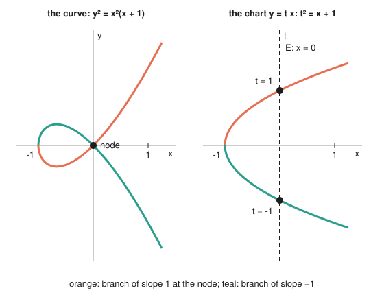

# Blowing up: replacing a point by all the directions through it to pull branches apart

[Syllabus](../../../SYLLABUS.md) → [Algebraic geometry](../README.md) → [Plane Curves](../README.md#s03) → Blowing up

---

## General Overview

The curve $`y^2 = x^2(x + 1)`$ is a loop with a crossing. Two arcs pass through the origin, one climbing with slope 1 and one falling with slope −1. That crossing is a **node**: a singular point (a point with no single tangent line) where two smooth branches meet at different angles.

At the node, a point-by-point view loses information. Both branches sit at $`(0, 0)`$, so the coordinates alone cannot say which branch a point belongs to. The direction can: on one branch the ratio $`y/x`$ tends to 1, on the other to −1.

**Blowing up** keeps that ratio. It replaces the one point $`(0, 0)`$ by a whole line of directions, one for each slope through it. Each branch arrives at the slope it was travelling along. So the two branches land at two different points, $`t = 1`$ and $`t = -1`$, and the crossing is gone. The new curve is $`t^2 = x + 1`$, a smooth parabola.

Polar coordinates already do this: at $`r = 0`$ every angle is allowed, so the origin becomes a whole circle of angles. A blow-up is the algebraic version, with slopes in place of angles.

**Blowing up a point replaces it by the line of all directions through it; a curve's branches then land at their own tangent directions, so branches that crossed are pulled apart, and repeating the move at any point still singular makes a plane curve smooth.**

**What kind of fact this is:** the blow-up is a construction, a definition. That one blow-up makes a point with distinct tangent directions smooth is a theorem, proved on this card in Why it works. That repetition always stops is a theorem stated here with its key steps and a named source.

### The picture: one curve, before and after

<p align="center"></p>

Real points only, drawn to scale from the parameter $`t`$ running from −3/2 to 3/2. The right panel is one chart of the blow-up, drawn to scale in its own coordinates $`(x, t)`$; the blow-up as a whole is a surface no flat drawing holds, so the pairing of the two panels is schematic. The dashed line is the new line of directions, $`E`$.

---

## The formula

Notation already in use. The field $`k`$ is the number system in use: $`\mathbb{Q}`$ for the algebra on this card, $`\mathbb{R}`$ for the drawing, $`\mathbb{F}_7`$ (the integers mod 7) for the counts. $`\mathbb{A}^2`$ is the ordinary plane $`k^2`$. $`\mathbb{P}^1`$ is the projective line: ratios $`(u : v)`$ with $`u, v`$ not both zero ([Projective space](../02-Affine%20and%20Projective%20Varieties/03-projective-space-and-homogeneous-coordinates.md)). The multiplicity $`m_P(F)`$ of a curve $`F = 0`$ at a point $`P`$ is the lowest degree among the terms of $`F`$ written around $`P`$; the lowest-degree part $`F_m`$ factors into the tangent lines ([Nodes and cusps](04-singularities-nodes-and-cusps.md)).

New on this card: the blow-up. The **blow-up of the plane at the origin** is the set of pairs (point, line through the origin) with the point on the line:

```math
\widetilde{\mathbb{A}}^2 = \{\, ((x, y), (u : v)) \in \mathbb{A}^2 \times \mathbb{P}^1 \;:\; xv = yu \,\}, \qquad \pi\big((x, y), (u : v)\big) = (x, y)
```

**Read it aloud:** a point of the blow-up is a point of the plane together with a direction $`(u : v)`$ through the origin that passes through it; the map $`\pi`$ forgets the direction.

Away from the origin, the direction is forced: it is $`(x : y)`$. At the origin, every direction is allowed, so the origin is replaced by a whole projective line, the **exceptional line** $`E`$.

The working form uses a chart, a patch with ordinary coordinates. Where $`u \neq 0`$, write the slope as $`t = v/u`$, so $`y = tx`$. For a curve $`F(x, y) = 0`$ with multiplicity $`m`$ at the origin:

```math
F(x, tx) = x^m\, \widetilde{F}(x, t), \qquad E = \{x = 0\}, \qquad \widetilde{F}(0, t) = F_m(1, t)
```

**Read it aloud:** put $`y = tx`$ into the equation; exactly $`m`$ factors of $`x`$ come out; what is left, $`\widetilde{F}`$, is the **strict transform**, the curve's own copy in the blow-up, and it meets $`E`$ at the roots of the lowest-degree part, which are the tangent slopes.

For the house curve, $`F = y^2 - x^3 - x^2`$, $`m = 2`$ and $`F_2 = y^2 - x^2`$:

```math
F(x, tx) = t^2x^2 - x^3 - x^2 = x^2\,(t^2 - x - 1), \qquad \widetilde{F}(0, t) = t^2 - 1 = 0 \;\Longrightarrow\; t = \pm 1
```

**Read it aloud:** substituting the slope pulls out $`x^2`$, leaving the parabola $`t^2 = x + 1`$, which crosses the line of directions at slopes 1 and −1, once each.

| Symbol | Plain meaning | In our example | Push it up and the answer… |
| --- | --- | --- | --- |
| $`F`$; a term $`c\, x^i y^j`$ | the curve's polynomial, the curve being $`F = 0`$; one of its terms | $`y^2 - x^3 - x^2`$; $`-x^3`$ | — |
| $`P`$; $`(x, y)`$ | the point being blown up; plane coordinates | the node $`(0, 0)`$ | — |
| $`m`$ | multiplicity: lowest degree of a term of $`F`$ at $`P`$ | 2 | more branches can meet there; one blow-up subtracts $`m(m-1)/2`$ from the genus count |
| $`F_m`$ | the lowest-degree part of $`F`$: its tangent lines | $`y^2 - x^2 = (y - x)(y + x)`$ | — |
| $`(u : v)`$; $`\mathbb{P}^1`$ | a direction through the origin; the projective line of all directions | $`(1 : 1)`$ and $`(1 : -1)`$ | — |
| $`\mathbb{A}^2`$; $`\widetilde{\mathbb{A}}^2`$; $`\pi`$ | the plane; the blow-up: points paired with a direction through them; the map down that forgets the direction | $`\pi`$ sends $`(0, \pm 1)`$ in the chart to the node | — |
| $`E`$ | the exceptional line: all directions at $`P`$, $`\pi^{-1}(P)`$ | $`x = 0`$ in the chart | — |
| $`t`$, $`s`$ | chart coordinates: the slope $`t = y/x`$, or $`s = x/y`$ | $`t = \pm 1`$ at the two branches | a steeper branch lands higher on $`E`$ |
| $`\widetilde{F}`$ | the strict transform: $`F(x, tx)`$ with $`x^m`$ divided out | $`t^2 - x - 1`$ | — |
| $`r`$; $`e_r`$ | a root of $`F_m(1, t)`$; how many times it repeats | $`r = \pm 1`$, each with $`e_r = 1`$ | a repeated root can leave a singular point |
| $`d`$; $`\delta_P`$ | the degree of the curve; the sum of $`m(m-1)/2`$ over every point blown up above $`P`$ (named on the Genus card) | 3; 1 at the node | a bigger budget of blow-ups |
| $`k`$; $`p`$ | the field of numbers in use; a prime, for counting points over $`\mathbb{F}_p`$ | $`\mathbb{Q}`$, $`\mathbb{R}`$ or $`\mathbb{F}_7`$; 7 | both counts grow with $`p`$ |

### When it holds

- **Blow up a singular point.** At a smooth point $`m = 1`$: one direction, one point over it, and nothing else changes. Blowing up $`(-1, 0)`$ leaves the node as it was.
- **Divide out exactly $`x^m`$.** The full substitution, the **total transform** $`x^2(t^2 - x - 1)`$, still contains $`E`$ twice, and every point of $`E`$ is then singular: 7 singular points over $`\mathbb{F}_7`$.
- **Tangent slopes in the field.** Over $`\mathbb{Q}`$, the curve $`y^2 = x^2(x + 2)`$ has tangent slopes $`\pm\sqrt{2}`$, so its strict transform has no rational point over the node. Over $`\mathbb{R}`$ it has two.
- **Two charts, not one.** The chart $`y = tx`$ misses the vertical direction. The chart $`x = sy`$ sees it; a curve with a vertical tangent at $`P`$ needs it.
- **A plane curve, at one point at a time.** For curves, repeated point blow-ups always end. For surfaces and beyond, points are not enough, and the general theorem is far harder (Where you meet it in real life).

---

## Why it works

### Step 0: the slope tells the branches apart

At the node the two branches share a position but not a direction. Along the orange branch $`y/x \to 1`$; along the teal branch $`y/x \to -1`$. A coordinate that records $`y/x`$ gives them different addresses.

The blow-up adds that coordinate. It costs one thing: at the origin $`y/x`$ has no value, so the origin is replaced by every possible value at once, the line $`E`$.

### Step 1: the blow-up is a surface covered by two charts

The equation $`xv = yu`$ says the point $`(x, y)`$ lies on the line through the origin in direction $`(u : v)`$.

- **Chart $`u \neq 0`$.** Scale so $`u = 1`$; then $`v = t`$ and $`y = tx`$. The pair $`(x, t)`$ is free: an ordinary plane.
- **Chart $`v \neq 0`$.** Scale so $`v = 1`$; then $`u = s`$ and $`x = sy`$. The pair $`(s, y)`$ is free: another plane.

Every direction has $`u \neq 0`$ or $`v \neq 0`$, so the two charts cover the blow-up. Where both apply, $`s = 1/t`$.

Away from the origin, $`\pi`$ has an inverse: $`(x, y) \mapsto ((x, y), (x : y))`$. So the blow-up changes nothing except at the origin, where $`\pi^{-1}(0, 0)`$ is the whole line $`E`$: $`x = 0`$ in the first chart, $`y = 0`$ in the second.

### Step 2: exactly $`x^m`$ comes out

Write $`F`$ as a sum of terms $`c\, x^i y^j`$. Putting $`y = tx`$ turns each into $`c\, x^{i+j} t^j`$: a term of degree $`i + j`$ picks up $`x^{i+j}`$. The lowest degree present is $`m`$, so $`x^m`$ divides everything and $`x^{m+1}`$ does not.

That factor $`x^m`$ is $`E`$ counted $`m`$ times. It is not part of the curve: it is the price of sending the whole origin to $`E`$. Divide it out and what remains is the strict transform $`\widetilde{F}`$. For the node, $`x^2(t^2 - x - 1)`$ leaves $`t^2 - x - 1`$.

### Step 3: the strict transform meets $`E`$ at the tangent directions

Set $`x = 0`$ in $`\widetilde{F}`$. Every term of degree above $`m`$ still carries a factor $`x`$ and vanishes. Only the degree-$`m`$ terms survive, with $`x`$ replaced by 1:

```math
\widetilde{F}(0, t) = F_m(1, t)
```

**Read it aloud:** where the new curve meets the line of directions is decided by the lowest-degree part alone, read along slope $`t`$.

$`F_m`$ is the product of the tangent lines, so its roots are the tangent slopes. For the node, $`F_2(1, t) = t^2 - 1`$, with roots 1 and −1. In the second chart, $`\widetilde{F} = 1 - s^2 - s^3 y`$ meets $`y = 0`$ at $`s = \pm 1`$: the same two points, since $`s = 1/t`$. At the vertical direction $`s = 0`$ it takes the value 1, so nothing lands there.

### Step 4: distinct tangent directions become smooth points

Take a root $`t = r`$ of $`F_m(1, t)`$ that is simple (not repeated). The slope of $`\widetilde{F}`$ in the $`t`$ direction at $`(0, r)`$ is the derivative of $`F_m(1, t)`$ at $`r`$, by Step 3. A simple root has a derivative that is not zero. So the gradient of $`\widetilde{F}`$ is not zero, and $`(0, r)`$ is a smooth point.

For the node, the gradient of $`t^2 - x - 1`$ is $`(-1, 2t)`$: $`(-1, 2)`$ at $`t = 1`$ and $`(-1, -2)`$ at $`t = -1`$. Its first entry is −1 everywhere, so the whole parabola is smooth, not just the two new points.

So a point where $`m`$ branches meet with $`m`$ different tangent slopes, an **ordinary** singular point, is made smooth by one blow-up, with $`m`$ separate points over it. The triple point of $`y^3 - x^2y + x^4`$, with slopes −1, 0 and 1, is one: its strict transform $`t^3 - t + x`$ is smooth at all three.

### Step 5: a repeated slope means blow up again

When two branches share a tangent slope, both land at the same point of $`E`$, and that point can still be singular. Translate it to the origin and blow up again.

The **tacnode** $`y^2 = x^4(x + 1)`$ has two branches tangent to each other, both with slope 0. One blow-up gives $`t^2 = x^2(x + 1)`$: the house node, sitting at $`t = 0`$. A second blow-up separates it, as above. Two blow-ups, two branches.

A **cusp** $`y^2 = x^3`$ is a single branch with a sharp point. One blow-up gives $`t^2 = x`$: smooth, with one point over the cusp, touching $`E`$ rather than crossing it.

<details>
<summary>Why the repetition always stops for a plane curve</summary>

Two facts make it stop.

First, multiplicities never grow. A point $`(0, r)`$ of $`\widetilde{F}`$ meets the line $`E`$ there with intersection multiplicity $`e_r`$, the number of times $`r`$ is a root of $`F_m(1, t)`$. A curve's multiplicity at a point is at most its intersection multiplicity with any line through it ([Intersection multiplicity](02-intersection-multiplicity-and-tangency.md)). So the new multiplicity is at most $`e_r`$, and the $`e_r`$ add up to at most $`m`$:

$`\displaystyle m_{(0, r)}(\widetilde{F}) \le e_r, \qquad \sum_r e_r \le m.`$

Second, each blow-up of a point of multiplicity $`m`$ uses up $`m(m-1)/2`$ from a fixed budget. For an irreducible plane curve of degree $`d`$ (one that does not split into two curves), the sum of $`m(m-1)/2`$ over every point ever blown up is at most $`(d-1)(d-2)/2`$, a whole number that does not change. Each singular point uses at least 1, so only finitely many blow-ups are possible. The [Genus](06-genus-and-the-degree-genus-formula.md) card names that sum $`\delta_P`$ and the budget the arithmetic genus.

The full proof is in the first two sources below. The checks show it on five curves; they do not prove it.

</details>

### Step 6: the parametrisation falls out

On the strict transform, $`x = t^2 - 1`$, and $`y = tx`$ gives $`y = t^3 - t`$. So every point of the nodal cubic comes from one slope $`t`$. Substituting back, $`(t^3 - t)^2 - (t^2 - 1)^3 - (t^2 - 1)^2 = t^2(t^2-1)^2 - (t^2-1)^2\,t^2 = 0`$ exactly.

The node is reached twice, at $`t = 1`$ and $`t = -1`$, once per branch. Every other point is reached once, since $`t = y/x`$ recovers it. This is the line-through-the-node method of [Conics](01-conics-and-rational-parametrisation.md), seen as a blow-up.

---

## Worked numbers, by hand

The node of $`y^2 = x^2(x + 1)`$, over $`\mathbb{Q}`$.

| Step | Arithmetic | Value |
| --- | --- | --- |
| multiplicity at $`(0, 0)`$ | lowest degree among $`y^2`$, $`x^3`$, $`x^2`$ | $`m = 2`$ |
| substitute $`y = tx`$ | $`t^2x^2 - x^3 - x^2`$ | $`x^2(t^2 - x - 1)`$ |
| strict transform | divide by $`x^2`$ | $`t^2 - x - 1`$ |
| meet $`E`$ | set $`x = 0`$: $`t^2 - 1 = 0`$ | $`t = -1`$, $`t = 1`$ |
| gradient at $`(0, -1)`$ and $`(0, 1)`$ | $`(-1, 2t)`$ | $`(-1, -2)`$ and $`(-1, 2)`$ |
| points over $`\mathbb{F}_7`$ | $`x = t^2 - 1`$ for each of the 7 values of $`t`$; $`t = \pm 1`$ both map to $`(0, 0)`$ | curve 6, strict transform 7 |
| finite check | 7 points upstairs, 2 of them over the node | **two branches, separated, smooth** |

The node is one point downstairs and two points upstairs, one per branch, and both are smooth: one blow-up resolves it.

The same move, repeated where needed, on five curves:

| Curve | What sits at the origin | Blow-ups | Points over it | Sum of $`m(m-1)/2`$ |
| --- | --- | ---: | ---: | ---: |
| $`y^2 = x^2(x + 1)`$ | node | 1 | 2 | 1 |
| $`y^2 = x^3`$ | cusp | 1 | 1 | 1 |
| $`y^2 = x^4(x + 1)`$ | tacnode | 2 | 2 | 2 |
| $`y^2 = x^5`$ | a sharper cusp | 2 | 1 | 2 |
| $`y^3 - x^2y + x^4 = 0`$ | ordinary triple point | 1 | 3 | 3 |

For the nodal cubic, $`(3 - 1)(3 - 2)/2 - 1 = 0`$: the [Genus](06-genus-and-the-degree-genus-formula.md) card reads this as genus 0, which matches the parametrisation by one slope $`t`$.

### What breaks if you drop a piece

| Mistake | Comes out at | What went wrong |
| --- | --- | --- |
| Keep the total transform $`x^2(t^2 - x - 1)`$ | 7 singular points over $`\mathbb{F}_7`$ | $`E`$ counted twice is still in the equation, singular all along |
| Divide by $`x`$ only once | 2 singular points over $`\mathbb{F}_7`$ | one copy of $`E`$ remains and crosses the parabola at $`t = \pm 1`$ |
| Blow up the smooth point $`(-1, 0)`$ | $`m = 1`$; node still singular | the move only helps where it is applied |
| Read $`y^2 = x^2(x + 2)`$ over $`\mathbb{Q}`$ | no rational point over the node | the slopes are $`\pm 1.41421356237`$, not in $`\mathbb{Q}`$; over $`\mathbb{R}`$ there are two |

The code prints all four.

---

## Code, from first principles, and it actually runs

Nothing imported does algebra. A polynomial is a table of terms with integer coefficients. The code blows up by substitution and division, finds the tangent slopes by testing every whole number within a bound (the slope polynomials here have leading coefficient 1, so their rational roots are whole numbers), stops the run if those roots, counted with repeats, do not account for all $`m`$ slopes, and recurses at each slope until the multiplicity is 1. It takes three roads to the house answer: the chart computation with its gradient test; the parametrisation $`x = t^2 - 1`$, $`y = t^3 - t`$ put back into $`F`$ exactly; and a count over $`\mathbb{F}_7`$, where the map $`(x, t) \mapsto (x, tx)`$ is checked to send 7 points onto 6, two to the node. Polynomials print in lex order with the second letter first.

### Python

```python
# Blowing up a point -- the check behind the card.  Standard library only.
# A curve F(x, y) = 0 over Q is a dict {(i, j): c} for its terms c x^i y^j.
# Blowing up the origin in the chart y = t x turns x^i y^j into x^(i+j) t^j;
# dividing out x^m, m the lowest degree present, leaves the strict transform.

def show(F, a="x", v="y"):                     # lex order, second letter first
    out = ""
    for (i, j), c in sorted(F.items(), key=lambda k: (-k[0][1], -k[0][0])):
        mono = (f"{a}^{i}" if i > 1 else a if i else "") + (f"{v}^{j}" if j > 1 else v if j else "")
        mag = str(abs(c)) if abs(c) != 1 or not mono else ""
        out += (" - " if c < 0 else " + ") + mag + mono
    return out[3:] if out[1] == "+" else "-" + out[3:]

def add(F, k, c):
    F[k] = F.get(k, 0) + c
    if F[k] == 0: del F[k]

def mult(F): return min(i + j for i, j in F)
def ev(F, a, b): return sum(c * a**i * b**j for (i, j), c in F.items())
def swap(F): return {(j, i): c for (i, j), c in F.items()}
def blow(F, m): return {(i + j - m, j): c for (i, j), c in F.items()}   # chart y = t x
def deriv(F, k):                               # k = 0: d/dx, k = 1: d/d(second letter)
    D = {}
    for (i, j), c in F.items():
        e = (i, j)[k]
        if e: add(D, (i - 1 + k, j - k), c * e)
    return D

def shift(F, r):                               # F(x, t + r), by Pascal's triangle
    G = {}
    for (i, j), c in F.items():
        row = [1]
        for _ in range(j): row = [1] + [row[n] + row[n + 1] for n in range(len(row) - 1)] + [1]
        for k in range(j + 1): add(G, (i, k), c * row[k] * r**(j - k))
    return G

def directions(F, m):                          # integer roots t of F_m(1, t)
    cone = {(0, j): c for (i, j), c in F.items() if i + j == m}
    assert cone.get((0, m)) == 1               # monic: no vertical direction, rational roots are integers
    H = max(abs(c) for c in cone.values()) + 1
    return [r for r in range(-H, H + 1) if ev(cone, 0, r) == 0]

def order(C, r):                               # how many times t = r is a root of C(0, t)
    k = 0
    while ev(C, 0, r) == 0: C, k = deriv(C, 1), k + 1
    return k

def resolve(F, pad="  "):                      # blow up until smooth: (blow-ups, sum m(m-1)/2, branches)
    m = mult(F)
    if m == 1: return 0, 0, 1
    G, roots = blow(F, m), directions(F, m)
    print(f"{pad}m = {m}, strict transform {show(G, 'x', 't')}, meets E at t = {roots}")
    on_E = {k: c for k, c in G.items() if k[0] == 0}   # strict transform at x = 0: F_m(1, t)
    assert sum(order(on_E, r) for r in roots) == m     # all m slopes found, with repeats: none irrational
    totals = [1, m * (m - 1) // 2, 0]
    for r in roots:
        totals = [s + n for s, n in zip(totals, resolve(shift(G, r), pad + "  "))]
    return tuple(totals)

def sing(F, p):                                # points over F_p where F and both slopes vanish
    return [(a, b) for a in range(p) for b in range(p)
            if all(ev(P, a, b) % p == 0 for P in (F, deriv(F, 0), deriv(F, 1)))]

def count(F, p): return sum(ev(F, a, b) % p == 0 for a in range(p) for b in range(p))

F = {(0, 2): 1, (3, 0): -1, (2, 0): -1}        # the nodal cubic y^2 = x^2(x + 1)
m = mult(F)
G = blow(F, m)
print(f"curve {show(F)} = 0 over Q; multiplicity at (0, 0): m = {m}")
print(f"chart y = t x: F(x, t x) = x^{m} * ({show(G, 'x', 't')})")
roots = directions(F, m)
print(f"strict transform meets E (x = 0) at t = {roots}, the two tangent slopes")
for r in roots:
    print(f"  at (0, {r}): gradient ({ev(deriv(G, 0), 0, r)}, {ev(deriv(G, 1), 0, r)}), not zero: smooth")
G2 = blow(swap(F), m)                          # chart x = s y: letters (s, y)
print(f"chart x = s y: strict transform {show(swap(G2), 's', 'y')}; on E (y = 0) "
      f"s = {[s for s in range(-2, 3) if ev(G2, 0, s) == 0]}, "
      f"so s = 1/t; vertical s = 0 gives {ev(G2, 0, 0)}")
X, Y = {2: 1, 0: -1}, {3: 1, 1: -1}            # road 2: lines y = t x through the node
def pmul(A, B):
    C = {}
    for a, u in A.items():
        for b, w in B.items(): C[a + b] = C.get(a + b, 0) + u * w
    return {k: c for k, c in C.items() if c}
def ppow(A, n):
    out = {0: 1}
    for _ in range(n): out = pmul(out, A)
    return out
sub = {}
for (i, j), c in F.items():
    for k, w in pmul(ppow(X, i), ppow(Y, j)).items(): sub[k] = sub.get(k, 0) + c * w
sub = {k: w for k, w in sub.items() if w}
over = [t for t in range(-3, 4) if ev({(i, 0): c for i, c in X.items()}, t, 0) == 0
        and ev({(i, 0): c for i, c in Y.items()}, t, 0) == 0]
print(f"road 2: x = t^2 - 1, y = t^3 - t; F(x(t), y(t)) has {len(sub)} nonzero coefficients; "
      f"parameters at the node t = {over}")
p, Gp = 7, blow(F, 2)                          # road 3: count over F_7
image = {(a, a * b % p) for a in range(p) for b in range(p) if ev(Gp, a, b) % p == 0}
print(f"over F_{p}: curve {count(F, p)} points, singular {sing(F, p)}; strict transform "
      f"{count(Gp, p)} points, singular {sing(Gp, p)}; image of (x, t) -> (x, t x): {len(image)} points")
print("resolving, chart by chart:")
chains = [("node", F), ("cusp", {(0, 2): 1, (3, 0): -1}),
          ("tacnode", {(0, 2): 1, (4, 0): -1, (5, 0): -1}), ("y^2 = x^5", {(0, 2): 1, (5, 0): -1}),
          ("triple point", {(0, 3): 1, (2, 1): -1, (4, 0): 1})]
results = {}
for name, C in chains:
    print(f"{name}: {show(C)}")
    results[name] = resolve(C)
    print(f"  -> blow-ups {results[name][0]}, sum of m(m - 1)/2 = {results[name][1]}, branches {results[name][2]}")
print(f"genus of the nodal cubic: (3 - 1)(3 - 2)/2 - sum = 1 - {results['node'][1]} = {1 - results['node'][1]}")
T, once = {(2, 2): 1, (3, 0): -1, (2, 0): -1}, {(1, 2): 1, (2, 0): -1, (1, 0): -1}
smooth_pt = swap(shift(swap(F), -1))           # F moved so (-1, 0) sits at the origin
K = {(0, 2): 1, (3, 0): -1, (2, 0): -2}
print(f"mistake 1, keep the total transform {show(T, 'x', 't')}: {len(sing(T, 7))} singular points over F_7")
print(f"mistake 2, divide by x once, {show(once, 'x', 't')}: {len(sing(once, 7))} singular points over F_7")
print(f"mistake 3, blow up the smooth point (-1, 0): m = {mult(smooth_pt)}; node still singular: "
      f"{'yes' if (0, 0) in sing(F, 7) else 'no'}")
print(f"mistake 4, {show(K)} over Q: rational points over the node {directions(K, 2)}; "
      f"slopes are +-{2 ** 0.5:.12g}")
q = 11
print(f"over F_{q}: curve {count(F, q)} points, strict transform {count(blow(F, 2), q)} points")
a, b = 3, 2                                    # figure: the parameter t = a/b = 3/2 ends both drawings
xe, ye = f"{a * a - b * b}/{b * b}", f"{a ** 3 - a * b * b}/{b ** 3}"
print(f"figure, node (0, 0); loop end (-1, 0); arm ends ({xe}, -{ye}), ({xe}, {ye}); "
      f"over the node (0, -1), (0, 1); parabola ends ({xe}, -{a}/{b}), ({xe}, {a}/{b})")
assert G == {(0, 2): 1, (1, 0): -1, (0, 0): -1} and roots == [-1, 1]      # t^2 - x - 1, slopes -1, 1
assert sub == {} and over == [-1, 1]           # the parametrisation lies on F; two parameters at the node
assert count(F, 7) == len(image) == count(Gp, 7) - 1 and sing(Gp, 7) == [] and sing(F, 7) == [(0, 0)]
assert [results[n] for n, _ in chains] == [(1, 1, 2), (1, 1, 1), (2, 2, 2), (2, 2, 1), (1, 3, 3)]
assert len(sing(T, 7)) == 7 and len(sing(once, 7)) == 2 and directions(K, 2) == []
print("ALL CHECKS PASS")
```

**Ran 2026-11-17 on macOS, Python 3.14.10, standard library only. All checks passed. Output, pasted from the run:**

```
curve y^2 - x^3 - x^2 = 0 over Q; multiplicity at (0, 0): m = 2
chart y = t x: F(x, t x) = x^2 * (t^2 - x - 1)
strict transform meets E (x = 0) at t = [-1, 1], the two tangent slopes
  at (0, -1): gradient (-1, -2), not zero: smooth
  at (0, 1): gradient (-1, 2), not zero: smooth
chart x = s y: strict transform -s^3y - s^2 + 1; on E (y = 0) s = [-1, 1], so s = 1/t; vertical s = 0 gives 1
road 2: x = t^2 - 1, y = t^3 - t; F(x(t), y(t)) has 0 nonzero coefficients; parameters at the node t = [-1, 1]
over F_7: curve 6 points, singular [(0, 0)]; strict transform 7 points, singular []; image of (x, t) -> (x, t x): 6 points
resolving, chart by chart:
node: y^2 - x^3 - x^2
  m = 2, strict transform t^2 - x - 1, meets E at t = [-1, 1]
  -> blow-ups 1, sum of m(m - 1)/2 = 1, branches 2
cusp: y^2 - x^3
  m = 2, strict transform t^2 - x, meets E at t = [0]
  -> blow-ups 1, sum of m(m - 1)/2 = 1, branches 1
tacnode: y^2 - x^5 - x^4
  m = 2, strict transform t^2 - x^3 - x^2, meets E at t = [0]
    m = 2, strict transform t^2 - x - 1, meets E at t = [-1, 1]
  -> blow-ups 2, sum of m(m - 1)/2 = 2, branches 2
y^2 = x^5: y^2 - x^5
  m = 2, strict transform t^2 - x^3, meets E at t = [0]
    m = 2, strict transform t^2 - x, meets E at t = [0]
  -> blow-ups 2, sum of m(m - 1)/2 = 2, branches 1
triple point: y^3 - x^2y + x^4
  m = 3, strict transform t^3 - t + x, meets E at t = [-1, 0, 1]
  -> blow-ups 1, sum of m(m - 1)/2 = 3, branches 3
genus of the nodal cubic: (3 - 1)(3 - 2)/2 - sum = 1 - 1 = 0
mistake 1, keep the total transform x^2t^2 - x^3 - x^2: 7 singular points over F_7
mistake 2, divide by x once, xt^2 - x^2 - x: 2 singular points over F_7
mistake 3, blow up the smooth point (-1, 0): m = 1; node still singular: yes
mistake 4, y^2 - x^3 - 2x^2 over Q: rational points over the node []; slopes are +-1.41421356237
over F_11: curve 10 points, strict transform 11 points
figure, node (0, 0); loop end (-1, 0); arm ends (5/4, -15/8), (5/4, 15/8); over the node (0, -1), (0, 1); parabola ends (5/4, -3/2), (5/4, 3/2)
ALL CHECKS PASS
```

### Rust

Same numbers, same labels, built with `rustc --edition 2021 -O`.

```rust
// Blowing up a point -- the same check as the Python, in Rust.  No crates.
// A curve F(x, y) = 0 over Q is a map {(i, j): c} for its terms c x^i y^j.
// Blowing up the origin in the chart y = t x turns x^i y^j into x^(i+j) t^j;
// dividing out x^m, m the lowest degree present, leaves the strict transform.
use std::collections::{BTreeMap, BTreeSet};
type P = BTreeMap<(u32, u32), i128>;

fn poly(terms: &[((u32, u32), i128)]) -> P { terms.iter().cloned().collect() }
fn ipow(a: i128, n: u32) -> i128 { (0..n).fold(1i128, |s, _| s.checked_mul(a).expect("overflow")) }

fn show(f: &P, a: &str, v: &str) -> String {      // lex order, second letter first
    let mut keys: Vec<_> = f.keys().cloned().collect();
    keys.sort_by_key(|&(i, j)| (std::cmp::Reverse(j), std::cmp::Reverse(i)));
    let mut out = String::new();
    for (i, j) in keys {
        let c = f[&(i, j)];
        let pa = if i > 1 { format!("{}^{}", a, i) } else if i == 1 { a.to_string() } else { String::new() };
        let pv = if j > 1 { format!("{}^{}", v, j) } else if j == 1 { v.to_string() } else { String::new() };
        let mono = pa + &pv;
        let mag = if c.abs() != 1 || mono.is_empty() { c.abs().to_string() } else { String::new() };
        out += if c < 0 { " - " } else { " + " };
        out += &(mag + &mono);
    }
    if &out[1..2] == "+" { out[3..].to_string() } else { format!("-{}", &out[3..]) }
}

fn add(f: &mut P, k: (u32, u32), c: i128) {
    let e = f.entry(k).or_insert(0);
    *e += c;
    if *e == 0 { f.remove(&k); }
}
fn mult(f: &P) -> u32 { f.keys().map(|&(i, j)| i + j).min().unwrap() }
fn ev(f: &P, a: i128, b: i128) -> i128 { f.iter().map(|(&(i, j), &c)| c * ipow(a, i) * ipow(b, j)).sum() }
fn swap(f: &P) -> P { f.iter().map(|(&(i, j), &c)| ((j, i), c)).collect() }
fn blow(f: &P, m: u32) -> P { f.iter().map(|(&(i, j), &c)| ((i + j - m, j), c)).collect() }
fn deriv(f: &P, k: u32) -> P {                     // k = 0: d/dx, k = 1: d/d(second letter)
    let mut d = P::new();
    for (&(i, j), &c) in f {
        let e = if k == 0 { i } else { j };
        if e > 0 { add(&mut d, (i - (1 - k), j - k), c * e as i128) }
    }
    d
}

fn shift(f: &P, r: i128) -> P {                    // F(x, t + r), by Pascal's triangle
    let mut g = P::new();
    for (&(i, j), &c) in f {
        let mut row: Vec<i128> = vec![1];
        for _ in 0..j {
            let mut next = vec![1];
            for n in 0..row.len() - 1 { next.push(row[n] + row[n + 1]) }
            next.push(1);
            row = next;
        }
        for k in 0..=j { add(&mut g, (i, k), c * row[k as usize] * ipow(r, j - k)) }
    }
    g
}

fn directions(f: &P, m: u32) -> Vec<i128> {        // integer roots t of F_m(1, t)
    let cone: P = f.iter().filter(|(&(i, j), _)| i + j == m).map(|(&(_, j), &c)| ((0, j), c)).collect();
    assert!(cone.get(&(0, m)) == Some(&1));        // monic: no vertical direction, rational roots are integers
    let h = cone.values().map(|c| c.abs()).max().unwrap() + 1;
    (-h..=h).filter(|&r| ev(&cone, 0, r) == 0).collect()
}

fn order(f: &P, r: i128) -> u32 {                 // how many times t = r is a root of F(0, t)
    let (mut c, mut k) = (f.clone(), 0);
    while ev(&c, 0, r) == 0 { c = deriv(&c, 1); k += 1; }
    k
}

fn resolve(f: &P, pad: &str) -> (u32, u32, u32) {  // blow up until smooth: (blow-ups, sum m(m-1)/2, branches)
    let m = mult(f);
    if m == 1 { return (0, 0, 1) }
    let (g, roots) = (blow(f, m), directions(f, m));
    println!("{}m = {}, strict transform {}, meets E at t = {:?}", pad, m, show(&g, "x", "t"), roots);
    let on_e: P = g.iter().filter(|(&(i, _), _)| i == 0).map(|(&k, &c)| (k, c)).collect();   // strict transform at x = 0: F_m(1, t)
    assert!(roots.iter().map(|&r| order(&on_e, r)).sum::<u32>() == m);   // all m slopes found, with repeats: none irrational
    let mut t = (1, m * (m - 1) / 2, 0);
    for r in roots {
        let s = resolve(&shift(&g, r), &format!("{}  ", pad));
        t = (t.0 + s.0, t.1 + s.1, t.2 + s.2);
    }
    t
}

fn sing(f: &P, p: i128) -> Vec<(i128, i128)> {     // points over F_p where F and both slopes vanish
    let (dx, dy) = (deriv(f, 0), deriv(f, 1));
    let mut out = vec![];
    for a in 0..p { for b in 0..p {
        if [f, &dx, &dy].iter().all(|q| ev(q, a, b).rem_euclid(p) == 0) { out.push((a, b)) }
    } }
    out
}
fn count(f: &P, p: i128) -> usize { (0..p).flat_map(|a| (0..p).map(move |b| (a, b))).filter(|&(a, b)| ev(f, a, b).rem_euclid(p) == 0).count() }
fn pmul(a: &BTreeMap<u32, i128>, b: &BTreeMap<u32, i128>) -> BTreeMap<u32, i128> {
    let mut c = BTreeMap::new();
    for (&i, &u) in a { for (&j, &w) in b { *c.entry(i + j).or_insert(0) += u * w } }
    c.into_iter().filter(|&(_, v)| v != 0).collect()
}
fn ppow(a: &BTreeMap<u32, i128>, n: u32) -> BTreeMap<u32, i128> {
    (0..n).fold([(0u32, 1i128)].into_iter().collect(), |s, _| pmul(&s, a))
}
fn yn(b: bool) -> &'static str { if b { "yes" } else { "no" } }

fn main() {
    let f = poly(&[((0, 2), 1), ((3, 0), -1), ((2, 0), -1)]);   // the nodal cubic y^2 = x^2(x + 1)
    let m = mult(&f);
    let g = blow(&f, m);
    println!("curve {} = 0 over Q; multiplicity at (0, 0): m = {}", show(&f, "x", "y"), m);
    println!("chart y = t x: F(x, t x) = x^{} * ({})", m, show(&g, "x", "t"));
    let roots = directions(&f, m);
    println!("strict transform meets E (x = 0) at t = {:?}, the two tangent slopes", roots);
    for &r in &roots {
        println!("  at (0, {}): gradient ({}, {}), not zero: smooth", r, ev(&deriv(&g, 0), 0, r), ev(&deriv(&g, 1), 0, r));
    }
    let g2 = blow(&swap(&f), m);                                  // chart x = s y: letters (s, y)
    let on_e: Vec<i128> = (-2..3).filter(|&s| ev(&g2, 0, s) == 0).collect();
    println!("chart x = s y: strict transform {}; on E (y = 0) s = {:?}, so s = 1/t; vertical s = 0 gives {}",
             show(&swap(&g2), "s", "y"), on_e, ev(&g2, 0, 0));
    let (xp, yp): (BTreeMap<u32, i128>, BTreeMap<u32, i128>) =   // road 2: lines y = t x through the node
        ([(2, 1), (0, -1)].into_iter().collect(), [(3, 1), (1, -1)].into_iter().collect());
    let mut sub: BTreeMap<u32, i128> = BTreeMap::new();
    for (&(i, j), &c) in &f {
        for (k, w) in pmul(&ppow(&xp, i), &ppow(&yp, j)) { *sub.entry(k).or_insert(0) += c * w }
    }
    sub.retain(|_, w| *w != 0);
    let upoly = |q: &BTreeMap<u32, i128>| -> P { q.iter().map(|(&i, &c)| ((i, 0), c)).collect() };
    let over: Vec<i128> = (-3..4).filter(|&t| ev(&upoly(&xp), t, 0) == 0 && ev(&upoly(&yp), t, 0) == 0).collect();
    println!("road 2: x = t^2 - 1, y = t^3 - t; F(x(t), y(t)) has {} nonzero coefficients; parameters at the node t = {:?}",
             sub.len(), over);
    let (p, gp) = (7i128, blow(&f, 2));                           // road 3: count over F_7
    let image: BTreeSet<(i128, i128)> = (0..p).flat_map(|a| (0..p).map(move |b| (a, b)))
        .filter(|&(a, b)| ev(&gp, a, b).rem_euclid(p) == 0).map(|(a, b)| (a, a * b % p)).collect();
    println!("over F_{}: curve {} points, singular {:?}; strict transform {} points, singular {:?}; image of (x, t) -> (x, t x): {} points",
             p, count(&f, p), sing(&f, p), count(&gp, p), sing(&gp, p), image.len());
    println!("resolving, chart by chart:");
    let chains: Vec<(&str, P)> = vec![("node", f.clone()), ("cusp", poly(&[((0, 2), 1), ((3, 0), -1)])),
        ("tacnode", poly(&[((0, 2), 1), ((4, 0), -1), ((5, 0), -1)])), ("y^2 = x^5", poly(&[((0, 2), 1), ((5, 0), -1)])),
        ("triple point", poly(&[((0, 3), 1), ((2, 1), -1), ((4, 0), 1)]))];
    let mut results = vec![];
    for (name, c) in &chains {
        println!("{}: {}", name, show(c, "x", "y"));
        let r = resolve(c, "  ");
        println!("  -> blow-ups {}, sum of m(m - 1)/2 = {}, branches {}", r.0, r.1, r.2);
        results.push(r);
    }
    println!("genus of the nodal cubic: (3 - 1)(3 - 2)/2 - sum = 1 - {} = {}", results[0].1, 1 - results[0].1 as i32);
    let t = poly(&[((2, 2), 1), ((3, 0), -1), ((2, 0), -1)]);
    let once = poly(&[((1, 2), 1), ((2, 0), -1), ((1, 0), -1)]);
    let smooth_pt = swap(&shift(&swap(&f), -1));                  // F moved so (-1, 0) sits at the origin
    let k = poly(&[((0, 2), 1), ((3, 0), -1), ((2, 0), -2)]);
    println!("mistake 1, keep the total transform {}: {} singular points over F_7", show(&t, "x", "t"), sing(&t, 7).len());
    println!("mistake 2, divide by x once, {}: {} singular points over F_7", show(&once, "x", "t"), sing(&once, 7).len());
    println!("mistake 3, blow up the smooth point (-1, 0): m = {}; node still singular: {}", mult(&smooth_pt), yn(sing(&f, 7).contains(&(0, 0))));
    println!("mistake 4, {} over Q: rational points over the node {:?}; slopes are +-{:.11}", show(&k, "x", "y"), directions(&k, 2), 2f64.sqrt());
    let q = 11;
    println!("over F_{}: curve {} points, strict transform {} points", q, count(&f, q), count(&blow(&f, 2), q));
    let (a, b) = (3i128, 2i128);                                  // figure: the parameter t = a/b = 3/2 ends both drawings
    let (xe, ye) = (format!("{}/{}", a * a - b * b, b * b), format!("{}/{}", ipow(a, 3) - a * b * b, ipow(b, 3)));
    println!("figure, node (0, 0); loop end (-1, 0); arm ends ({xe}, -{ye}), ({xe}, {ye}); over the node (0, -1), (0, 1); parabola ends ({xe}, -{a}/{b}), ({xe}, {a}/{b})");
    assert!(g == poly(&[((0, 2), 1), ((1, 0), -1), ((0, 0), -1)]) && roots == vec![-1, 1]);
    assert!(sub.is_empty() && over == vec![-1, 1]);
    assert!(count(&f, 7) == image.len() && image.len() == count(&gp, 7) - 1 && sing(&gp, 7).is_empty() && sing(&f, 7) == vec![(0, 0)]);
    assert!(results == vec![(1, 1, 2), (1, 1, 1), (2, 2, 2), (2, 2, 1), (1, 3, 3)]);
    assert!(sing(&t, 7).len() == 7 && sing(&once, 7).len() == 2 && directions(&k, 2).is_empty());
    println!("ALL CHECKS PASS");
}
```

**Ran 2026-11-17 on macOS, rustc 1.98.1, no crates. All checks passed. Output, pasted from the run:**

```
curve y^2 - x^3 - x^2 = 0 over Q; multiplicity at (0, 0): m = 2
chart y = t x: F(x, t x) = x^2 * (t^2 - x - 1)
strict transform meets E (x = 0) at t = [-1, 1], the two tangent slopes
  at (0, -1): gradient (-1, -2), not zero: smooth
  at (0, 1): gradient (-1, 2), not zero: smooth
chart x = s y: strict transform -s^3y - s^2 + 1; on E (y = 0) s = [-1, 1], so s = 1/t; vertical s = 0 gives 1
road 2: x = t^2 - 1, y = t^3 - t; F(x(t), y(t)) has 0 nonzero coefficients; parameters at the node t = [-1, 1]
over F_7: curve 6 points, singular [(0, 0)]; strict transform 7 points, singular []; image of (x, t) -> (x, t x): 6 points
resolving, chart by chart:
node: y^2 - x^3 - x^2
  m = 2, strict transform t^2 - x - 1, meets E at t = [-1, 1]
  -> blow-ups 1, sum of m(m - 1)/2 = 1, branches 2
cusp: y^2 - x^3
  m = 2, strict transform t^2 - x, meets E at t = [0]
  -> blow-ups 1, sum of m(m - 1)/2 = 1, branches 1
tacnode: y^2 - x^5 - x^4
  m = 2, strict transform t^2 - x^3 - x^2, meets E at t = [0]
    m = 2, strict transform t^2 - x - 1, meets E at t = [-1, 1]
  -> blow-ups 2, sum of m(m - 1)/2 = 2, branches 2
y^2 = x^5: y^2 - x^5
  m = 2, strict transform t^2 - x^3, meets E at t = [0]
    m = 2, strict transform t^2 - x, meets E at t = [0]
  -> blow-ups 2, sum of m(m - 1)/2 = 2, branches 1
triple point: y^3 - x^2y + x^4
  m = 3, strict transform t^3 - t + x, meets E at t = [-1, 0, 1]
  -> blow-ups 1, sum of m(m - 1)/2 = 3, branches 3
genus of the nodal cubic: (3 - 1)(3 - 2)/2 - sum = 1 - 1 = 0
mistake 1, keep the total transform x^2t^2 - x^3 - x^2: 7 singular points over F_7
mistake 2, divide by x once, xt^2 - x^2 - x: 2 singular points over F_7
mistake 3, blow up the smooth point (-1, 0): m = 1; node still singular: yes
mistake 4, y^2 - x^3 - 2x^2 over Q: rational points over the node []; slopes are +-1.41421356237
over F_11: curve 10 points, strict transform 11 points
figure, node (0, 0); loop end (-1, 0); arm ends (5/4, -15/8), (5/4, 15/8); over the node (0, -1), (0, 1); parabola ends (5/4, -3/2), (5/4, 3/2)
ALL CHECKS PASS
```

The two outputs match line for line.

### Lean

Lean proves the blow-up's shape and Steps 2 to 4 of Why it works over any field, and checks the worked numbers.

- Take a point $`(x, y)`$ other than the origin. Then it lies on exactly one direction, its own $`(x : y)`$.
- The origin lies on every direction, so the whole line $`E`$ sits over it.
- Take $`F`$ with multiplicity $`m`$ at the origin. Then $`F(x, tx) = x^m \widetilde{F}(x, t)`$ for a polynomial $`\widetilde{F}`$, the strict transform.
- Keep that $`F`$. Then $`x^{m+1}`$ does not divide $`F(x, tx)`$, so exactly $`x^m`$ comes out.
- Keep that $`F`$. Then $`\widetilde{F}(0, t) = F_m(1, t)`$ for every $`t`$, so $`\widetilde{F}`$ meets $`E`$ at the tangent slopes.
- Take a simple root $`r`$ of $`F_m(1, t)`$ in $`k`$. Then $`(0, r)`$ lies on $`\widetilde{F}`$, and its slope in the $`t`$ direction is not zero there.
- Take the node $`y^2 = x^2(x + 1)`$. Then $`F(x, tx) = x^2(t^2 - x - 1)`$, which meets $`E`$ at $`t = \pm 1`$.
- At those two points the gradient is $`(-1, 2)`$ or $`(-1, -2)`$, not zero.
- In the chart $`x = sy`$ the strict transform is $`1 - s^2 - s^3 y`$, which is 1 at $`s = 0`$.
- Take $`x = t^2 - 1`$ and $`y = t^3 - t`$. Then the point lies on the curve, and $`t = \pm 1`$ both give the node.
- Over $`\mathbb{F}_7`$ the curve has 6 points, singular only at the node. The strict transform has 7, none singular, and maps onto those 6.
- Over $`\mathbb{F}_7`$ the total transform has 7 singular points, and dividing by $`x`$ only once leaves 2.
- Over $`\mathbb{F}_{11}`$ the curve has 10 points and the strict transform 11.
- The cusp, the tacnode, $`y^2 = x^5`$ and the triple point factor as printed, one blow-up at a time.
- The genus count for the nodal cubic is 0.

The $`\pm\sqrt{2}`$ slopes, the smooth point $`(-1, 0)`$ and the last smoothness test for the other four curves are left to the Python and Rust checks.

```lean
-- Blowing up: in the chart y = t x, a plane curve of multiplicity m at the origin loses exactly x^m, what is left meets the line of directions at the tangent slopes, a simple tangent slope gives a smooth point there, and away from the origin the direction through a point is forced.
import Mathlib.RingTheory.MvPolynomial.Homogeneous
import Mathlib.Algebra.MvPolynomial.PDeriv
import Mathlib.Algebra.Polynomial.Div
import Mathlib.Algebra.Polynomial.AlgebraMap
import Mathlib.LinearAlgebra.Projectivization.Basic
import Mathlib.Data.ZMod.Basic
import Mathlib.Algebra.Polynomial.FieldDivision
import Mathlib.Tactic.LinearCombination
import Mathlib.Tactic.FieldSimp
import Mathlib.Tactic.Ring
import Mathlib.Tactic.NormNum

open MvPolynomial

/-! Coordinates: a plane curve over a field `k` is `F = 0` for `F : MvPolynomial (Fin 2) k`,
with `x = X 0` and `y = X 1`. The chart `y = t x` of the blow-up has coordinates `(x, t)`,
again written `X 0` and `X 1`; the exceptional line `E` is `x = 0` there.
`F` has multiplicity `m` at the origin when every term `c xⁱ yʲ` of `F` has `i + j ≥ m` and
the lowest-degree part `F_m = homogeneousComponent m F` is not zero. -/

/-- The substitution `y = t x` of the chart: it sends `F(x, y)` to `F(x, t x)`. -/
noncomputable def chartSubst {k : Type*} [Field k] (F : MvPolynomial (Fin 2) k) :
    MvPolynomial (Fin 2) k :=
  aeval (![X 0, X 0 * X 1] : Fin 2 → MvPolynomial (Fin 2) k) F

/-- The slope polynomial `F_m(1, t)`: the lowest-degree part of `F` read along slope `t`. -/
noncomputable def slopePoly {k : Type*} [Field k] (F : MvPolynomial (Fin 2) k) (m : ℕ) :
    Polynomial k :=
  aeval (![1, Polynomial.X] : Fin 2 → Polynomial k) (homogeneousComponent m F)

/-- The blow-up of the plane at the origin: pairs (point `(x, y)`, direction `(u : v)` in the
projective line `ℙ¹`) with the point on the line through the origin in that direction,
`x v = y u`. The test is the same for every representative `(u, v)` of the direction. -/
def blowUp (k : Type*) [Field k] : Set ((Fin 2 → k) × Projectivization k (Fin 2 → k)) :=
  {q | q.1 0 * q.2.rep 1 = q.1 1 * q.2.rep 0}

theorem blowup_eval_aeval_poly {k : Type*} [Field k] (f : Fin 2 → Polynomial k)
    (P : MvPolynomial (Fin 2) k) (t : k) :
    (aeval f P).eval t = eval (fun i => (f i).eval t) P := by
  induction P using MvPolynomial.induction_on with
  | C a => simp
  | add p q hp hq => simp [hp, hq]
  | mul_X p n hp => simp [hp]

#print axioms blowup_eval_aeval_poly

theorem blowup_eval_zero_line {k : Type*} [Field k] (P : MvPolynomial (Fin 2) k) (t : k) :
    eval ![0, t] P = (aeval (![0, Polynomial.X] : Fin 2 → Polynomial k) P).eval t := by
  rw [blowup_eval_aeval_poly]
  have hf : (fun i => (![(0 : Polynomial k), Polynomial.X] i).eval t) = ![0, t] := by
    funext i; fin_cases i <;> simp
  rw [hf]

#print axioms blowup_eval_zero_line

theorem blowup_aeval_pderiv {k : Type*} [Field k] (P : MvPolynomial (Fin 2) k) :
    aeval (![0, Polynomial.X] : Fin 2 → Polynomial k) (pderiv 1 P) =
      Polynomial.derivative (aeval (![0, Polynomial.X] : Fin 2 → Polynomial k) P) := by
  induction P using MvPolynomial.induction_on with
  | C a => simp
  | add p q hp hq => simp [hp, hq]
  | mul_X p n hp =>
    rw [Derivation.leibniz]
    fin_cases n
    · simp [hp, pderiv_X]
    · simp [hp, pderiv_X]; ring

#print axioms blowup_aeval_pderiv

theorem blowup_strict_transform_exists {k : Type*} [Field k]
    (F : MvPolynomial (Fin 2) k) (m : ℕ)
    (hlow : ∀ d ∈ F.support, m ≤ d.degree) :
    ∃ G : MvPolynomial (Fin 2) k, chartSubst F = X 0 ^ m * G ∧
      aeval (![0, Polynomial.X] : Fin 2 → Polynomial k) G = slopePoly F m := by
  refine ⟨∑ d ∈ F.support, C (F.coeff d) * X 0 ^ (d.degree - m) * X 1 ^ (d 1), ?_, ?_⟩
  · unfold chartSubst
    conv_lhs => rw [F.as_sum]
    rw [map_sum, Finset.mul_sum]
    refine Finset.sum_congr rfl fun d hd => ?_
    obtain ⟨e, he⟩ := Nat.exists_eq_add_of_le (hlow d hd)
    have hdeg : d.degree = d 0 + d 1 := by rw [Finsupp.degree_eq_sum, Fin.sum_univ_two]
    rw [aeval_monomial, Finsupp.prod_fintype _ _ (by simp), Fin.prod_univ_two, he,
      Nat.add_sub_cancel_left]
    have h0 : d 0 + d 1 = m + e := hdeg ▸ he
    simp only [Matrix.cons_val_zero, Matrix.cons_val_one, Matrix.cons_val_fin_one,
      algebraMap_eq, mul_pow]
    rw [show C (F.coeff d) * ((X 0 : MvPolynomial (Fin 2) k) ^ d 0 * (X 0 ^ d 1 * X 1 ^ d 1)) =
      C (F.coeff d) * X 0 ^ (d 0 + d 1) * X 1 ^ d 1 by ring, h0, pow_add]
    ring
  · unfold slopePoly
    rw [homogeneousComponent_apply, map_sum, map_sum, Finset.sum_filter]
    refine Finset.sum_congr rfl fun d hd => ?_
    by_cases h : d.degree = m
    · simp [h, aeval_monomial, Finsupp.prod_fintype _ _ (by simp : ∀ i, (![(1 : Polynomial k), Polynomial.X] i) ^ 0 = 1)]
    · have : d.degree - m ≠ 0 := by have := hlow d hd; omega
      simp [h, this]

#print axioms blowup_strict_transform_exists

theorem blowup_slopePoly_ne_zero {k : Type*} [Field k]
    (F : MvPolynomial (Fin 2) k) (m : ℕ) (hm : homogeneousComponent m F ≠ 0) :
    slopePoly F m ≠ 0 := by
  obtain ⟨d, hd⟩ := MvPolynomial.ne_zero_iff.mp hm
  rw [coeff_homogeneousComponent] at hd
  split_ifs at hd with hdeg
  swap; · exact absurd rfl hd
  intro h0
  have hc := congrArg (fun p => Polynomial.coeff p (d 1)) h0
  simp only [slopePoly, homogeneousComponent_apply, map_sum, Polynomial.coeff_zero] at hc
  simp [aeval_monomial, Finsupp.prod_fintype _ _ (by simp : ∀ i, (![(1 : Polynomial k), Polynomial.X] i) ^ 0 = 1), Polynomial.finsetSum_coeff] at hc
  rw [Finset.sum_eq_single d] at hc
  · simp at hc; exact hd hc
  · intro b hb hbd
    rw [Finset.mem_filter] at hb
    split_ifs with h1
    · exfalso; apply hbd
      have hb' : b.degree = b 0 + b 1 := by rw [Finsupp.degree_eq_sum, Fin.sum_univ_two]
      have hd' : d.degree = d 0 + d 1 := by rw [Finsupp.degree_eq_sum, Fin.sum_univ_two]
      ext i; fin_cases i
      · simp; omega
      · simp; omega
    · rfl
  · intro hdn
    exact absurd (Finset.mem_filter.mpr ⟨MvPolynomial.mem_support_iff.mpr hd, hdeg⟩) hdn

#print axioms blowup_slopePoly_ne_zero

/-- **Distinct tangent directions become smooth points.** Over a field `k`, let the plane curve
`F = 0` have multiplicity `m` at the origin, and let `G` be its strict transform in the chart
`y = t x`, so `F(x, t x) = x^m G(x, t)`. If `r ∈ k` is a simple root (a root that is not
repeated) of the slope polynomial `F_m(1, t)`, then the point `(x, t) = (0, r)` lies on the
strict transform, on the exceptional line, and the strict transform is smooth there: its
slope in the `t` direction at `(0, r)` is not zero. -/
theorem simple_tangent_slope_gives_smooth_point {k : Type*} [Field k]
    (F : MvPolynomial (Fin 2) k) (m : ℕ)
    (hlow : ∀ d ∈ F.support, m ≤ d.degree) (hm : homogeneousComponent m F ≠ 0)
    (G : MvPolynomial (Fin 2) k) (hG : chartSubst F = X 0 ^ m * G)
    (r : k) (hr : Polynomial.rootMultiplicity r (slopePoly F m) = 1) :
    eval ![0, r] G = 0 ∧ eval ![0, r] (pderiv 1 G) ≠ 0 := by
  obtain ⟨G0, hG0, hφ⟩ := blowup_strict_transform_exists F m hlow
  have hGG : G = G0 := by
    rw [hG] at hG0
    exact mul_left_cancel₀ (pow_ne_zero _ (X_ne_zero 0)) hG0
  subst hGG
  have hne : slopePoly F m ≠ 0 := by
    intro h; rw [h, Polynomial.rootMultiplicity_zero] at hr; exact zero_ne_one hr
  have hroot : (slopePoly F m).IsRoot r := ((Polynomial.rootMultiplicity_pos hne).mp (by omega))
  have hder : ¬ (Polynomial.derivative (slopePoly F m)).IsRoot r := by
    intro hd
    have := (Polynomial.one_lt_rootMultiplicity_iff_isRoot hne).mpr ⟨hroot, hd⟩
    omega
  refine ⟨?_, ?_⟩
  · rw [blowup_eval_zero_line, hφ]; exact hroot
  · rw [blowup_eval_zero_line, blowup_aeval_pderiv, hφ]; exact hder

/-- **Exactly `x^m` comes out, and the rest meets `E` at the tangent slopes.** Over a field
`k`, let the plane curve `F = 0` have multiplicity `m` at the origin. Substituting `y = t x`
gives `F(x, t x) = x^m G(x, t)` for a polynomial `G`, the strict transform, and `x^(m+1)`
does not divide `F(x, t x)`. Where `G` meets the exceptional line `x = 0` is decided by the
lowest-degree part alone: `G(0, t) = F_m(1, t)` for every `t`. -/
theorem strict_transform_meets_E_at_tangent_slopes {k : Type*} [Field k]
    (F : MvPolynomial (Fin 2) k) (m : ℕ)
    (hlow : ∀ d ∈ F.support, m ≤ d.degree) (hm : homogeneousComponent m F ≠ 0) :
    ∃ G : MvPolynomial (Fin 2) k,
      chartSubst F = X 0 ^ m * G ∧
      ¬ (X 0 ^ (m + 1) ∣ chartSubst F) ∧
      ∀ t : k, eval ![0, t] G = eval ![1, t] (homogeneousComponent m F) := by
  obtain ⟨G0, hG0, hφ⟩ := blowup_strict_transform_exists F m hlow
  refine ⟨G0, hG0, ?_, ?_⟩
  · rintro ⟨H, hH⟩
    rw [hG0, pow_succ, mul_assoc] at hH
    have h1 := mul_left_cancel₀ (pow_ne_zero _ (X_ne_zero 0)) hH
    apply blowup_slopePoly_ne_zero F m hm
    rw [← hφ, h1]
    simp
  · intro t
    rw [blowup_eval_zero_line, hφ, slopePoly, blowup_eval_aeval_poly]
    have hf : (fun i => (![(1 : Polynomial k), Polynomial.X] i).eval t) = ![1, t] := by
      funext i; fin_cases i <;> simp
    rw [hf]

/-- **The blow-up changes nothing away from the origin and puts a whole line over it.** Over a
field `k`, a point `p = (x, y)` other than the origin lies on exactly one direction of the
blow-up, its own direction `(x : y)`; the origin lies on every direction, so the whole
projective line `ℙ¹` of directions sits over it as the exceptional line `E`. -/
theorem blowup_direction_forced_off_origin (k : Type*) [Field k] :
    (∀ (p : Fin 2 → k) (hp : p ≠ 0) (ℓ : Projectivization k (Fin 2 → k)),
        (p, ℓ) ∈ blowUp k ↔ ℓ = Projectivization.mk k p hp) ∧
      ∀ ℓ : Projectivization k (Fin 2 → k), ((0 : Fin 2 → k), ℓ) ∈ blowUp k := by
  refine ⟨fun p hp ℓ => ?_, fun ℓ => by simp [blowUp]⟩
  simp only [blowUp, Set.mem_ofPred_eq]
  constructor
  · intro h
    rw [← Projectivization.mk_rep ℓ, Projectivization.mk_eq_mk_iff']
    by_cases h0 : p 0 = 0
    · have h1 : p 1 ≠ 0 := by
        intro h1; apply hp; funext i; fin_cases i <;> simp [h0, h1]
      have hv0 : ℓ.rep 0 = 0 := by
        rw [h0, zero_mul] at h
        exact (mul_eq_zero.mp h.symm).resolve_left h1
      refine ⟨ℓ.rep 1 / p 1, ?_⟩
      funext i; fin_cases i
      · simp [h0, hv0]
      · simp; field_simp
    · refine ⟨ℓ.rep 0 / p 0, ?_⟩
      funext i; fin_cases i
      · simp; field_simp
      · simp; field_simp; linear_combination -h
  · rintro rfl
    obtain ⟨a, ha⟩ := Projectivization.exists_smul_eq_mk_rep k p hp
    rw [← ha]
    simp only [Pi.smul_apply, Units.smul_def, smul_eq_mul]
    ring

-- The node y² = x²(x + 1): substituting y = t x pulls out x², leaving t² − x − 1.
example (x t : ℤ) : (t * x) ^ 2 - x ^ 3 - x ^ 2 = x ^ 2 * (t ^ 2 - x - 1) := by ring
-- On E (x = 0) the strict transform is t² − 1, zero at the two tangent slopes t = 1 and t = −1.
example : (1 : ℤ) ^ 2 - 0 - 1 = 0 ∧ (-1 : ℤ) ^ 2 - 0 - 1 = 0 := by norm_num
-- The gradient (−1, 2t) of t² − x − 1 is (−1, 2) at t = 1 and (−1, −2) at t = −1: not zero.
example : ((-1 : ℤ), 2 * 1) = (-1, 2) ∧ ((-1 : ℤ), 2 * (-1)) = (-1, -2) := by norm_num
-- The chart x = s y: F(s y, y) = y²(1 − s² − s³ y); on E (y = 0) it is 1 − s², and 1 at s = 0.
example (s y : ℤ) : y ^ 2 - (s * y) ^ 3 - (s * y) ^ 2 = y ^ 2 * (1 - s ^ 2 - s ^ 3 * y) := by ring
example : (1 : ℤ) - 1 ^ 2 = 0 ∧ (1 : ℤ) - (-1) ^ 2 = 0 ∧ (1 : ℤ) - 0 ^ 2 = 1 := by norm_num
-- The parametrisation x = t² − 1, y = t³ − t lies on the nodal cubic, and t = ±1 both give the node.
example (t : ℤ) : (t ^ 3 - t) ^ 2 - (t ^ 2 - 1) ^ 3 - (t ^ 2 - 1) ^ 2 = 0 := by ring
example : ((1 : ℤ) ^ 2 - 1, (1 : ℤ) ^ 3 - 1) = (0, 0) ∧
    ((-1 : ℤ) ^ 2 - 1, (-1 : ℤ) ^ 3 - (-1)) = (0, 0) := by norm_num
-- Over 𝔽₇ the nodal cubic has 6 points and the strict transform 7.
example : (Finset.univ.filter fun p : ZMod 7 × ZMod 7 =>
    p.2 ^ 2 - p.1 ^ 3 - p.1 ^ 2 = 0).card = 6 := by decide
example : (Finset.univ.filter fun p : ZMod 7 × ZMod 7 =>
    p.2 ^ 2 - p.1 - 1 = 0).card = 7 := by decide
-- Over 𝔽₇ the curve is singular only at the node, and the strict transform nowhere.
example : (Finset.univ.filter fun p : ZMod 7 × ZMod 7 =>
    p.2 ^ 2 - p.1 ^ 3 - p.1 ^ 2 = 0 ∧ -3 * p.1 ^ 2 - 2 * p.1 = 0 ∧ 2 * p.2 = 0) =
      {((0 : ZMod 7), (0 : ZMod 7))} := by decide
example : (Finset.univ.filter fun p : ZMod 7 × ZMod 7 =>
    p.2 ^ 2 - p.1 - 1 = 0 ∧ (-1 : ZMod 7) = 0 ∧ 2 * p.2 = 0).card = 0 := by decide
-- Over 𝔽₇ the map (x, t) ↦ (x, t x) sends the strict transform's 7 points onto the curve's 6.
example : ((Finset.univ.filter fun p : ZMod 7 × ZMod 7 => p.2 ^ 2 - p.1 - 1 = 0).image
    fun p => (p.1, p.2 * p.1)).card = 6 := by decide
-- Mistake 1: the total transform x²t² − x³ − x² has 7 singular points over 𝔽₇, all of E.
example : (Finset.univ.filter fun p : ZMod 7 × ZMod 7 =>
    p.1 ^ 2 * p.2 ^ 2 - p.1 ^ 3 - p.1 ^ 2 = 0 ∧
      2 * p.1 * p.2 ^ 2 - 3 * p.1 ^ 2 - 2 * p.1 = 0 ∧ 2 * p.1 ^ 2 * p.2 = 0).card = 7 := by decide
-- Mistake 2: dividing by x once, x t² − x² − x, leaves 2 singular points over 𝔽₇.
example : (Finset.univ.filter fun p : ZMod 7 × ZMod 7 =>
    p.1 * p.2 ^ 2 - p.1 ^ 2 - p.1 = 0 ∧
      p.2 ^ 2 - 2 * p.1 - 1 = 0 ∧ 2 * p.1 * p.2 = 0).card = 2 := by decide
-- Over 𝔽₁₁ the curve has 10 points and the strict transform 11.
example : (Finset.univ.filter fun p : ZMod 11 × ZMod 11 =>
    p.2 ^ 2 - p.1 ^ 3 - p.1 ^ 2 = 0).card = 10 := by decide
example : (Finset.univ.filter fun p : ZMod 11 × ZMod 11 =>
    p.2 ^ 2 - p.1 - 1 = 0).card = 11 := by decide
-- The cusp y² = x³: one blow-up gives t² − x.
example (x t : ℤ) : (t * x) ^ 2 - x ^ 3 = x ^ 2 * (t ^ 2 - x) := by ring
-- The tacnode y² = x⁴(x + 1): one blow-up gives the house node t² − x³ − x², a second gives u² − x − 1.
example (x t : ℤ) : (t * x) ^ 2 - x ^ 5 - x ^ 4 = x ^ 2 * (t ^ 2 - x ^ 3 - x ^ 2) := by ring
example (x u : ℤ) : (u * x) ^ 2 - x ^ 3 - x ^ 2 = x ^ 2 * (u ^ 2 - x - 1) := by ring
-- y² = x⁵: two blow-ups, t² − x³ and then u² − x.
example (x t : ℤ) : (t * x) ^ 2 - x ^ 5 = x ^ 2 * (t ^ 2 - x ^ 3) := by ring
example (x u : ℤ) : (u * x) ^ 2 - x ^ 3 = x ^ 2 * (u ^ 2 - x) := by ring
-- The triple point y³ − x²y + x⁴: m = 3, strict transform t³ − t + x, slopes −1, 0, 1.
example (x t : ℤ) : (t * x) ^ 3 - x ^ 2 * (t * x) + x ^ 4 = x ^ 3 * (t ^ 3 - t + x) := by ring
example : (-1 : ℤ) ^ 3 - (-1) = 0 ∧ (0 : ℤ) ^ 3 - 0 = 0 ∧ (1 : ℤ) ^ 3 - 1 = 0 := by norm_num
-- Sums of m(m − 1)/2: node 1, cusp 1, tacnode 1 + 1, y² = x⁵ 1 + 1, triple point 3.
example : 2 * (2 - 1) / 2 = 1 ∧ 2 * (2 - 1) / 2 + 2 * (2 - 1) / 2 = 2 ∧ 3 * (3 - 1) / 2 = 3 := by
  norm_num
-- Genus count for the nodal cubic: (3 − 1)(3 − 2)/2 − 1 = 0.
example : (3 - 1) * (3 - 2) / 2 - 1 = 0 := by norm_num
-- The figure's ends at t = 3/2: x = 5/4, y = 15/8.
example : ((3 : ℚ) / 2) ^ 2 - 1 = 5 / 4 ∧ ((3 : ℚ) / 2) ^ 3 - 3 / 2 = 15 / 8 := by norm_num

#print axioms simple_tangent_slope_gives_smooth_point
#print axioms strict_transform_meets_E_at_tangent_slopes
#print axioms blowup_direction_forced_off_origin
```

**Checked 2026-11-17 on macOS, Lean 4.36.0-rc2, Mathlib v4.36.0-rc2. Every proof is complete and uses only Lean's standard axioms. Output, pasted from the run:**

```
'blowup_eval_aeval_poly' depends on axioms: [propext, Classical.choice, Quot.sound]
'blowup_eval_zero_line' depends on axioms: [propext, Classical.choice, Quot.sound]
'blowup_aeval_pderiv' depends on axioms: [propext, Classical.choice, Quot.sound]
'blowup_strict_transform_exists' depends on axioms: [propext, Classical.choice, Quot.sound]
'blowup_slopePoly_ne_zero' depends on axioms: [propext, Classical.choice, Quot.sound]
'simple_tangent_slope_gives_smooth_point' depends on axioms: [propext, Classical.choice, Quot.sound]
'strict_transform_meets_E_at_tangent_slopes' depends on axioms: [propext, Classical.choice, Quot.sound]
'blowup_direction_forced_off_origin' depends on axioms: [propext, Classical.choice, Quot.sound]
```

> [!TIP]
> **Try changing**
> - Guess first: how many blow-ups does the tacnode $`y^2 = x^4(x + 1)`$ need? Two. The first lands on the house node at $`t = 0`$, the second splits it at $`t = \pm 1`$. It is in the `chains` list.
> - Guess first: does a cusp have two points over it? No: one blow-up, one point, since a cusp is one branch. The strict transform $`t^2 - x`$ touches $`E`$ instead of crossing it.
> - Guess first: three branches through one point with slopes −1, 0, 1. One blow-up, three points over it, and a sum of $`m(m-1)/2`$ of 3.
> - Guess first: over $`\mathbb{F}_{11}`$, how many points do the curve and its strict transform have? Set `q`: 10 and 11, again one more upstairs, because the node splits in two.

---

## The usual mistake

> [!warning]
> **Keeping the factor $`x^m`$.** Substituting $`y = tx`$ is only half the move. The factor $`x^m`$ is the exceptional line $`E`$ counted $`m`$ times, and leaving it in glues every direction back onto the curve. The total transform $`x^2(t^2 - x - 1)`$ is singular all along $`E`$: 7 singular points over $`\mathbb{F}_7`$, where the strict transform has none.
>
> - **Dividing out too little.** $`x(t^2 - x - 1)`$ still has 2 singular points over $`\mathbb{F}_7`$, at $`t = \pm 1`$.
> - **Trusting one chart.** The chart $`y = tx`$ never sees a vertical tangent. For the node the second chart confirms nothing lands at $`s = 0`$; for a curve with a vertical branch, that branch lives only there.
> - **Forgetting the field.** Over $`\mathbb{Q}`$, $`y^2 = x^2(x + 2)`$ shows no point over its node, though over $`\mathbb{R}`$ there are two, at slopes $`\pm 1.41421356237`$.
> - **Stopping when the equation looks simpler.** After one blow-up the tacnode becomes $`t^2 - x^3 - x^2`$, still singular. Check the multiplicity at every new point before stopping.

---

## Where you meet it in real life

- **Computer algebra.** Software that finds a curve's genus or a rational parametrisation first analyses its singular points, by blow-ups like these or by the equivalent Puiseux expansions (power series in fractional powers of $`x`$), then counts or reads off the result. The [Genus](06-genus-and-the-degree-genus-formula.md) card cites a book of such algorithms.
- **Singular points in dynamics.** When an equilibrium of a differential equation is too degenerate for the usual linear test, analysts blow it up: polar-style coordinates replace the point by a circle of directions, where the flow becomes readable.
- **Statistics and machine learning.** In models whose parameters are not identifiable at the true value, the learning curve depends on a number read off a resolution of singularities of the error function (the last source).
- **Mathematics itself.** In characteristic zero, every variety of every dimension can be made smooth by repeated blow-ups along smooth centres, a theorem proved in 1964. In positive characteristic (fields such as $`\mathbb{F}_p`$) the same question is unproved in dimension 4 and above, as of 2026.

> **Say it back**
> Blowing up a point replaces it by the line of all directions through it. In the chart $`y = tx`$, substituting the slope pulls out $`x^m`$, the new line counted $`m`$ times; dividing it out leaves the strict transform. The strict transform meets the new line at the tangent slopes, so the two branches of the node $`y^2 = x^2(x + 1)`$ land at $`t = 1`$ and $`t = -1`$, on the smooth parabola $`t^2 = x + 1`$. Branches that share a slope land together, so the move is repeated there. For a plane curve the repetition always stops, with a smooth curve.

---

## What this builds on

- [Nodes and cusps](04-singularities-nodes-and-cusps.md): the multiplicity $`m`$, the lowest-degree part whose factors are the tangent lines, and the node, cusp and tacnode this card resolves.
- [Projective space](../02-Affine%20and%20Projective%20Varieties/03-projective-space-and-homogeneous-coordinates.md): the projective line $`\mathbb{P}^1`$ of directions and its two charts, which become the exceptional line and the two charts of the blow-up.
- [Intersection multiplicity](02-intersection-multiplicity-and-tangency.md): how many times a curve meets a line at a point, which bounds the multiplicity after each blow-up.

## Where this goes next

- [Genus](06-genus-and-the-degree-genus-formula.md): the sum of $`m(m-1)/2`$ over every point blown up is the correction $`\delta_P`$ in the degree-genus formula, so the nodal cubic has genus 0.
- [Riemann surfaces](08-riemann-surfaces-and-the-weierstrass-p-function.md): a resolved complex curve is a smooth surface, the setting for the doughnut picture of a cubic.
- [Divisors and Riemann-Roch](07-divisors-and-riemann-roch.md): counting functions with given poles needs a smooth curve, which blowing up provides.
- [Flat, smooth and etale](../08-Sheaf%20Cohomology%20and%20Differentials/03-flat-smooth-and-etale-morphisms.md): families without jumps, and maps that look locally like isomorphisms.
- [Intersection numbers on a surface](../09-Intersection%20Theory%20and%20Surfaces/03-intersection-numbers-on-surfaces-and-blow-ups.md): blowing up a point makes a curve of self-intersection -1.

This card makes a curve smooth; how many holes the smooth curve has, and how its degree and singular points decide that number, is the question this card leaves open.

---

## Sources

Verified 2026-11-17: every link below resolves to the publisher's page.

- Brieskorn, Egbert, and Horst Knörrer. *Plane Algebraic Curves*. Birkhäuser, reprinted 2012. [doi:10.1007/978-3-0348-0493-6](https://doi.org/10.1007/978-3-0348-0493-6). Blowing up plane curve singularities by charts, and the resolution of every plane curve.
- Hartshorne, Robin. *Algebraic Geometry*. Springer, 1977. [doi:10.1007/978-1-4757-3849-0](https://doi.org/10.1007/978-1-4757-3849-0). The blow-up of a point (Chapter I, Section 4) and embedded resolution of curves on a surface (Chapter V, Section 3).
- Shafarevich, Igor R. *Basic Algebraic Geometry 1*, 3rd ed. Springer, 2013. [doi:10.1007/978-3-642-37956-7](https://doi.org/10.1007/978-3-642-37956-7). The blow-up as a set of pairs, its charts, and the strict transform of a curve.
- Hironaka, Heisuke. "Resolution of Singularities of an Algebraic Variety Over a Field of Characteristic Zero: I." *Annals of Mathematics* 79, no. 1 (1964). [doi:10.2307/1970486](https://doi.org/10.2307/1970486). Resolution by blow-ups in every dimension, in characteristic zero.
- Watanabe, Sumio. *Algebraic Geometry and Statistical Learning Theory*. Cambridge University Press, 2009. [doi:10.1017/CBO9780511800474](https://doi.org/10.1017/CBO9780511800474). Resolution of singularities applied to the learning curves of statistical models.
