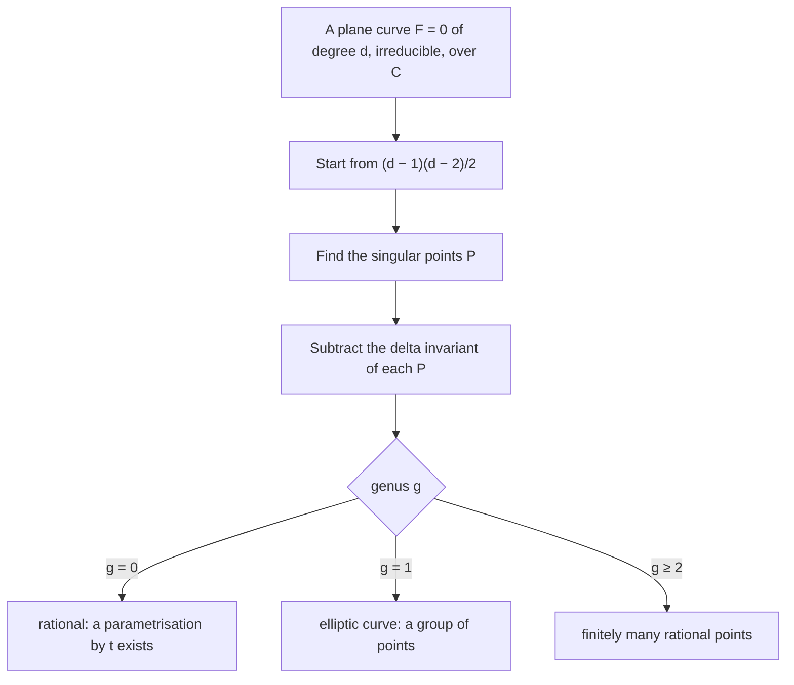

# Genus: the number of holes, and how degree and singular points fix it

[Syllabus](../../../SYLLABUS.md) → [Algebraic geometry](../README.md) → [Plane Curves](../README.md#s03) → Genus

---

## General Overview

Take the quartic curve $`x^4 - x^2 + y^4 + y^3 + y^2 = 0`$. Its real points draw a figure eight. The two loops cross at the origin, where the curve has a **node**: two branches pass through one point with two different tangents ([Nodes and cusps](04-singularities-nodes-and-cusps.md)).

Now let x and y be complex numbers. The curve's points then form a surface, not a line. Fill in its points at infinity and smooth out the node, and the surface is closed, like the surfaces in [Closed surfaces classified](../../17-Topology/03-Surfaces%20and%20Manifolds/02-surfaces-and-the-classification-theorem.md). Every closed two-sided surface is a sphere with some number of handles. That number is the curve's **genus**.

Change the equation slightly, to $`x^4 - x^2 + y^4 + y^3 + y^2 = 1`$. The node disappears and the real points form one loop around the old eight. This smooth quartic has genus 3: a surface with three handles. The figure eight has genus 2. The node pinched one handle shut.

Pairs of complex numbers (x, y) fill a space with four real dimensions, but no picture of that space is needed to get those numbers. The degree of the equation gives the genus of a smooth curve, and each singular point takes away a fixed amount. The genus then answers practical questions. Genus 0 means the curve can be traced by fractions in one parameter t. Genus 1 means an elliptic curve. For a curve with rational coefficients, genus 2 or more means only finitely many points with rational coordinates.

**A smooth plane curve of degree d has genus (d − 1)(d − 2)/2, and each singular point lowers that number by its delta invariant, so the degree and the singular points alone fix how many holes the curve has.**

**What kind of fact this is:** a theorem. Why it works proves the smooth case from Riemann-Hurwitz and Bezout, and gives the singular correction as key steps with a named source. The test "rational exactly when the genus is 0" is a theorem stated here: Step 4 gives one direction with Lüroth's theorem, and the other follows from Riemann-Roch, stated on [Divisors and Riemann-Roch](07-divisors-and-riemann-roch.md).

### The picture: from an equation to a verdict



The quartics land on the right-hand branch, the house cubic $`y^2 = x^2(x + 1)`$ on the left.

---

## The formula

Three new terms, one sentence each.

- The **genus** $`g`$ of an irreducible plane curve (one that does not split into two curves) is the number of handles on its **smooth model**: the closed surface made from its complex points after the singular points are separated by [Blowing up](05-blowing-up-a-point.md).
- The **arithmetic genus** $`p_a = (d-1)(d-2)/2`$ is the genus a smooth curve of degree $`d`$ would have.
- The **delta invariant** $`\delta_P`$ of a singular point $`P`$ is the number of handles that $`P`$ pinches off. Blow up $`P`$, then any singular points that appear, until the curve is smooth. Add $`m(m-1)/2`$ for each point met on the way, where $`m`$ is the multiplicity there: the lowest degree among the terms of $`F`$ at that point, which is how many times a typical line through it meets the curve there ([Nodes and cusps](04-singularities-nodes-and-cusps.md)).

A node needs one blow-up and has $`m = 2`$, so $`\delta = 1`$. An ordinary triple point (three branches with three different tangents) has $`\delta = 3 \cdot 2/2 = 3`$.

```math
g \;=\; \frac{(d-1)(d-2)}{2} \;-\; \sum_{P \text{ singular}} \delta_P
```

**Read it aloud:** the genus is one half of d minus one times d minus two, less the delta invariant of every singular point.

For the smooth quartic: $`3 \cdot 2 / 2 - 0 = 3`$. For the figure eight: $`3 - 1 = 2`$. For the house cubic: $`2 \cdot 1/2 - 1 = 0`$, so it is rational.

How fast the genus grows with the degree, for smooth curves:

```
degree 1:                                0
degree 2:                                0
degree 3: ##                             1
degree 4: ######                         3
degree 5: ############                   6
degree 6: ####################           10
degree 7: ############################## 15
```

Lines and conics have genus 0: [Conics](01-conics-and-rational-parametrisation.md) parametrises every one. Cubics are the first curves with a handle.

| Symbol | Plain meaning | In our example | Push it up and the answer… |
| --- | --- | --- | --- |
| $`F`$, $`d`$ | the curve's polynomial and its degree | the quartic, $`d = 4`$ | more handles, about $`d^2/2`$ |
| $`x`$, $`y`$, $`z`$ | coordinates; $`(x : y : z)`$ homogeneous, $`z = 1`$ for the affine part | the plane | — |
| $`g`$ | genus: handles on the smooth model | 3, then 2 | — |
| $`p_a`$ | arithmetic genus, $`(d-1)(d-2)/2`$ | 3 | — |
| $`P`$, $`m`$ | a singular point; its multiplicity | the origin, $`m = 2`$ | $`\delta_P`$ grows like $`m^2/2`$ |
| $`\delta_P`$ | delta invariant: handles pinched off at $`P`$ | 1 for the node | $`g`$ falls |
| $`\chi`$ | Euler characteristic, $`2 - 2g`$ for a closed two-sided surface | $`-4`$, then $`-2`$ | $`g`$ falls |
| $`F_y`$ | the derivative of $`F`$ in $`y`$ | $`4y^3 + 3y^2 + 2y`$ | — |
| $`D(x)`$ | the discriminant in $`y`$: zero where two $`y`$-values meet; not the divisor $`D`$ of [Divisors and Riemann-Roch](07-divisors-and-riemann-roch.md) | degree 12 | — |
| $`b`$ | branch points: where two sheets meet | 12, then 10 | $`g`$ rises |
| $`e`$ | how many sheets one branch joins at a point | 1 on each branch of the node | more branching |
| $`t`$ | a parameter for a rational curve | $`t = 2`$ gives $`(3, 6)`$ | — |

### When it holds

- **Irreducible.** The curve must be one curve. Two conics multiplied together have degree 4 and four nodes, and the formula gives $`3 - 4 = -1`$. No surface has genus $`-1`$; the "curve" is two spheres.
- **Over the complex numbers.** Genus counts handles on the complex points. Over the reals the figure eight is two loops crossing at one point and the smooth quartic is one oval. Nothing in either picture shows three handles.
- **Every singular point counted, at infinity too.** Write the curve with $`z`$ and look at $`z = 0`$. A singular point missed there leaves the genus too high.
- **The right delta.** $`\delta_P`$ is not the multiplicity: the node has $`m = 2`$ but $`\delta = 1`$, and subtracting 2 leaves the figure eight at genus 1 instead of 2. Nor is it always 1: a triple point counted as 1 instead of 3 leaves the trifolium below at genus 2, when it is rational.
- **A plane curve.** The formula uses the degree in the plane. A curve in space has its own degree, and the formula does not apply to it.

---

## Why it works

### Step 0: project the curve onto a line and count where sheets meet

Send each point $`(x, y)`$ of the curve to $`x`$. Over a typical $`x`$ there are $`d`$ points, one for each root $`y`$ of $`F(x, y) = 0`$. So the curve's surface lies over the x-line in $`d`$ sheets. The x-line with its point at infinity is a sphere.

Sheets meet only over finitely many **branch points**. There two roots $`y`$ come together. Counting those points, and comparing Euler characteristics, gives the genus.

### Step 1: Riemann-Hurwitz, the count of sheets

Cut the sphere into triangles with every branch point as a corner. Lift each triangle to the $`d`$ sheets. Away from branch points everything comes $`d`$ times. Over a simple branch point two sheets share one corner, so one corner is missing. The [Euler characteristic](../../17-Topology/03-Surfaces%20and%20Manifolds/04-euler-characteristic-and-triangulations.md), vertices minus edges plus faces, is then

```math
\chi(\text{curve}) = d \cdot \chi(\text{sphere}) - b = 2d - b
```

**Read it aloud:** the curve's Euler characteristic is d times two, less one for every branch point.

For a closed two-sided surface $`\chi = 2 - 2g`$ ([Closed surfaces classified](../../17-Topology/03-Surfaces%20and%20Manifolds/02-surfaces-and-the-classification-theorem.md)). So $`2 - 2g = 2d - b`$.

### Step 2: Bezout counts the branch points

Two roots $`y`$ meet exactly where the vertical line is tangent to the curve: where $`F = 0`$ and $`F_y = 0`$ together. $`F_y`$ has degree $`d - 1`$. [Bezout's theorem](03-bezouts-theorem.md) says the two curves meet in $`d(d-1)`$ points, projective, with multiplicity, over $`\mathbb{C}`$.

For a smooth curve and a typical direction of projection, all $`d(d-1)`$ meetings are simple branch points. Then

```math
2 - 2g = 2d - d(d-1) \quad\Longrightarrow\quad g = \frac{d^2 - 3d + 2}{2} = \frac{(d-1)(d-2)}{2}
```

For the quartic: $`2 - 2g = 8 - 12 = -4`$, so $`g = 3`$.

The x-values of the branch points are the roots of the **discriminant** $`D(x)`$, the resultant of $`F`$ and $`F_y`$ in $`y`$ ([The resultant](../01-Polynomial%20Systems/06-resultants-and-common-roots.md)). For the smooth quartic, $`D(x)`$ has degree 12 and no repeated root: 12 different branch points.

Both quartics have top-degree part $`x^4 + y^4`$, which vanishes along four different directions. So each quartic meets the line at infinity at four separate points, each met once. None of them is singular and none is a branch point, so all the branching shows up in $`D(x)`$.

### Step 3: a node uses up two meetings without branching

At the node, both partial derivatives vanish, so $`F_y = 0`$ there too. The node therefore takes up some of the $`d(d-1)`$ meetings. For a node whose tangents are not vertical it takes 2. In the code, $`D(x)`$ for the figure eight has a double root at $`x = 0`$, the node's $`x`$.

On the smooth model the node is two separate points, one on each branch. Each lies on its own sheet, and neither is a branch point. So the node removes two meetings and adds no branching: $`b = 12 - 2 = 10`$, and $`2 - 2g = 8 - 10 = -2`$ gives $`g = 2`$.

The figure eight is also one curve, as the formula needs. $`D(x)`$ has no repeated root except the node's double one, so the node is the only singular point. If the quartic were two curves multiplied together, they would meet more than once by Bezout's theorem, and each meeting would be a singular point. At the node, with its two different tangents, two pieces could cross only once.

<details>
<summary>The general step: every singular point uses up 2δ meetings that are not branching</summary>

At any singular point $`P`$, the meetings of $`F`$ and $`F_y`$ split into two kinds. The branches through $`P`$ may themselves be tangent to the vertical, and those tangencies are real branching on the smooth model. The rest is exactly $`2\delta_P`$.

$`\displaystyle (F \cdot F_y)_P = 2\delta_P + \sum_{\text{branches at } P} (e - 1)`$

Here $`e`$ is how many sheets a branch joins at $`P`$. Summing over all points, the branch points number $`d(d-1) - 2\sum \delta_P`$. Riemann-Hurwitz then gives $`g = (d-1)(d-2)/2 - \sum \delta_P`$.

The identity is proved in Brieskorn and Knörrer, and the whole route in Kirwan (Sources). The intersection number $`(F \cdot F_y)_P`$ is the one from [Intersection multiplicity](02-intersection-multiplicity-and-tangency.md).

</details>

### Step 4: rational exactly when the genus is 0

A curve is **rational** when fractions in one parameter $`t`$ trace all but finitely many of its points. If that happens, the smooth model is covered by the $`t`$-sphere. Lüroth's theorem lets $`t`$ be chosen so that the map is one-to-one, so the smooth model is a sphere and $`g = 0`$. The converse, that every genus-0 curve has a parametrisation, follows from Riemann-Roch, stated on [Divisors and Riemann-Roch](07-divisors-and-riemann-roch.md): on a genus-0 curve it gives a function with one simple pole, which takes each value once and so serves as $`t`$.

On the house cubic $`y^2 = x^2(x + 1)`$ the parametrisation is found by hand. A line $`y = tx`$ through the node meets the cubic twice at the node and once more. Put $`y = tx`$ in: $`t^2x^2 = x^2(x + 1)`$, so $`x = t^2 - 1`$ and $`y = t^3 - t`$. At $`t = 2`$ this gives $`(3, 6)`$, and $`6^2 = 36 = 3^2 \cdot 4`$.

The same trick works on the trifolium $`(x^2 + y^2)^2 = x^3 - 3xy^2`$, which has one ordinary triple point at the origin. A line through it meets the quartic three times there and once elsewhere, so each line picks out one point and the curve is rational. The formula agrees: $`3 - 3 = 0`$.

### Step 5: a third count, through adjoint curves

<details>
<summary>The genus counts curves of degree d − 3 through the singular points</summary>

For a curve with only ordinary singular points (branches with different tangents), the genus also equals the number of independent polynomials of degree $`d - 3`$ that vanish to order $`m - 1`$ at each $`m`$-fold point. These are the **adjoint curves**. Each one, written $`h`$, gives a differential $`h\,dx / F_y`$ with no poles on the smooth model, and the genus counts those.

For the quartic, $`d - 3 = 1`$: the lines $`u x + v y + w`$ have 3 coefficients. A smooth quartic imposes no condition, so the count is 3. The node asks the line to pass through the origin, $`w = 0`$, so the count is $`3 - 1 = 2`$. The proof that this count is the genus goes through Riemann-Roch ([Divisors and Riemann-Roch](07-divisors-and-riemann-roch.md)).

</details>

---

## Worked numbers, by hand

| Step | Arithmetic | Value |
| --- | --- | --- |
| arithmetic genus, degree 4 | $`(4 - 1)(4 - 2)/2`$ | 3 |
| branch points, smooth quartic | $`d(d - 1) = 4 \cdot 3`$ | 12 |
| Riemann-Hurwitz, smooth | $`2 - 2g = 2 \cdot 4 - 12`$ | $`-4`$, so $`g = 3`$ |
| the node's delta | multiplicity 2, one blow-up: $`2 \cdot 1/2`$ | 1 |
| formula, figure eight | $`3 - 1`$ | 2 |
| branch points, figure eight | $`12 - 2`$ | 10 |
| Riemann-Hurwitz, nodal | $`2 - 2g = 8 - 10`$ | $`-2`$, so **$`g = 2`$** |
| house cubic | $`(3 - 1)(3 - 2)/2 - 1`$ | 0: rational |

The figure eight is a surface with two handles. Its smooth neighbour has three, and the node is where the third was pinched shut.

### What breaks if you drop a piece

| Mistake | Comes out at | What went wrong |
| --- | --- | --- |
| Node not subtracted | quartic 3, cubic 1 | Correct: 2 and 0. The cubic has the parametrisation $`(t^2 - 1, t^3 - t)`$, so genus 1 is impossible |
| Triple point counted as 1 | trifolium $`3 - 1 = 2`$ | $`\delta = 3`$ gives 0, and $`(1 - 3t^2, t - 3t^3, (1 + t^2)^2)`$ traces it |
| Formula on a reducible curve | two conics: $`3 - 4 = -1`$ | Not one curve; the adjoint count gives 0, and the two roads disagree |
| Delta read as multiplicity | figure eight $`3 - 2 = 1`$ | The node has $`m = 2`$ but $`\delta = 1`$; correct: 2 |
| Branch points without the node | 12, so $`g = 3`$ | The node's double root in $`D(x)`$ is not branching |

The code prints the first four, and the fifth is the nodal row's $`12 - 2`$.

---

## Code, from first principles, and it actually runs

The code works over the complex numbers with exact integers. It takes three independent roads to each genus. Road 1 is the degree-genus formula, with each multiplicity measured from the equation. Road 2 builds the discriminant $`D(x)`$ as a 7-by-7 Sylvester determinant, counts its repeated roots with Euclid's algorithm for polynomials, and applies Riemann-Hurwitz. A second resultant, computed by Euclid's algorithm with no determinant, must give the same $`D(x)`$ at $`x = 1, \dots, 5`$. Road 3 counts adjoint curves by the rank of a small linear system. Genus-0 curves get a fourth check: the parametrisation is put back into the equation, and the result is the zero polynomial.

Euclid's algorithm runs modulo the prime 1,000,000,007. A common factor over $`\mathbb{Q}`$ would survive there, so "no common factor modulo the prime" proves "no common factor over $`\mathbb{Q}`$". Nothing imported does algebra.

### Python

```python
# Genus and the degree-genus formula.  Nothing imported.  Field: the complex numbers.  Curves are
# dicts {(i, j): c} for c x^i y^j, z = 1.  Three roads to the genus: (1) (d-1)(d-2)/2 minus the deltas;
# (2) Riemann-Hurwitz, branch points read off the y-discriminant; (3) adjoint curves of degree d-3.
# Genus-0 curves get a parametrisation put back in.  Integers exact; gcds and resultants mod the prime P.
P = 1_000_000_007
def trim(a): return trim(a[:-1]) if len(a) > 1 and a[-1] == 0 else a
def padd(a, b):
    return trim([(a[i] if i < len(a) else 0) + (b[i] if i < len(b) else 0) for i in range(max(len(a), len(b)))])
def pmul(a, b):
    out = [0] * (len(a) + len(b) - 1)
    for i, u in enumerate(a):
        for j, v in enumerate(b): out[i + j] += u * v
    return trim(out)
def deriv(a): return trim([i * a[i] for i in range(1, len(a))] or [0])
def show(a):
    if a == [0]: return "0"
    s = ""
    for k in range(len(a) - 1, -1, -1):
        if a[k] == 0: continue
        c, m = abs(a[k]), ("" if k == 0 else "x" if k == 1 else f"x^{k}")
        s += (" - " if a[k] < 0 else " + ") + ("" if c == 1 and k else str(c)) + m
    return s[3:] if s[1] == "+" else "-" + s[3:]
def det(M):                                    # cofactor expansion, polynomial entries
    if len(M) == 1: return M[0][0]
    tot = [0]
    for c in range(len(M)):
        if M[0][c] != [0]:
            minor = [row[:c] + row[c + 1:] for row in M[1:]]
            tot = padd(tot, pmul([(-1) ** c], pmul(M[0][c], det(minor))))
    return tot
def disc_y(F, d):                              # Res_y(F, dF/dy): Sylvester matrix, 2d-1 rows
    co = [trim([F.get((i, j), 0) for i in range(d + 1)]) for j in range(d + 1)]
    cy = [pmul([j], co[j]) for j in range(1, d + 1)]
    n, rows = 2 * d - 1, []
    for r in range(d - 1): rows.append([co[r + d - c] if 0 <= r + d - c <= d else [0] for c in range(n)])
    for r in range(d): rows.append([cy[r + d - 1 - c] if 0 <= r + d - 1 - c < d else [0] for c in range(n)])
    return det(rows)
def rem_mod(a, b):                             # remainder of a on division by b, mod P
    inv = pow(b[-1], P - 2, P)
    while len(a) >= len(b) and a != [0]:
        q, s = a[-1] * inv % P, len(a) - len(b)
        a = trim([(a[i] - q * b[i - s]) % P if i >= s else a[i] for i in range(len(a))])
    return a
def gcd_mod(a, b):                             # Euclid's algorithm for polynomials mod P
    a, b = trim([c % P for c in a]), trim([c % P for c in b])
    while b != [0]: a, b = b, rem_mod(a, b)
    inv = pow(a[-1], P - 2, P)                 # made monic, so "no common factor" reads [1]
    return [c * inv % P for c in a]
def res_mod(a, b):                             # Res(a, b) mod P by Euclid, with no determinant
    a, b, r = trim([c % P for c in a]), trim([c % P for c in b]), 1
    while len(b) > 1:
        c = rem_mod(a, b)
        if c == [0]: return 0
        r = r * (-1) ** ((len(a) - 1) * (len(b) - 1)) * pow(b[-1], len(a) - len(c), P) % P
        a, b = b, c
    return r * pow(b[0], len(a) - 1, P) % P
def falling(n, k): return 1 if k == 0 else n * falling(n - 1, k - 1)
def partial(F, i, j, p, q):                    # d^i/dx^i d^j/dy^j of F at (p, q)
    return sum(c * falling(a, i) * falling(b, j) * p ** (a - i) * q ** (b - j)
               for (a, b), c in F.items() if a >= i and b >= j)
def multiplicity(F, p, q): return min(i + j for i in range(5) for j in range(5) if partial(F, i, j, p, q) != 0)
def road1(F, d, sing):                         # road 1: (d-1)(d-2)/2, the sum of m(m-1)/2 over the (ordinary) singular
    dl = sum(m * (m - 1) // 2 for m in (multiplicity(F, p, q) for p, q, _ in sing))   # points, m measured from F,
    return (d - 1) * (d - 2) // 2, dl, (d - 1) * (d - 2) // 2 - dl                    # and the genus
def rank_mod(rows):
    rows, r = [[v % P for v in row] for row in rows], 0
    for c in range(len(rows[0]) if rows else 0):
        piv = next((k for k in range(r, len(rows)) if rows[k][c]), None)
        if piv is None: continue
        rows[r], rows[piv] = rows[piv], rows[r]
        inv = pow(rows[r][c], P - 2, P)
        for k in range(len(rows)):
            if k != r and rows[k][c]:
                f = rows[k][c] * inv % P
                rows[k] = [(x - f * y) % P for x, y in zip(rows[k], rows[r])]
        r += 1
    return r
def adjoints(d, sing):                         # degree d-3 curves vanishing to order m-1
    mons = [(a, b) for a in range(d - 2) for b in range(d - 2 - a)]
    conds = [[falling(a, i) * falling(b, k - i) * p ** max(a - i, 0) * q ** max(b - k + i, 0)
              if a >= i and b >= k - i else 0 for (a, b) in mons]
             for (p, q, m) in sing for k in range(m - 1) for i in range(k + 1)]
    return len(mons), rank_mod(conds) if conds else 0
def homog_at(F, d, X, Y, Z):                   # F(X(t), Y(t), Z(t)), homogenised to degree d
    tot = [0]
    for (a, b), c in F.items():
        term = [c]
        for poly, e in ((X, a), (Y, b), (Z, d - a - b)):
            for _ in range(e): term = pmul(term, poly)
        tot = padd(tot, term)
    return tot

QS, QN = {(4, 0): 1, (2, 0): -1, (0, 4): 1, (0, 3): 1, (0, 2): 1, (0, 0): -1}, {(4, 0): 1, (2, 0): -1, (0, 4): 1, (0, 3): 1, (0, 2): 1}
print(f"field: the complex numbers; exact integers; polynomial gcds modulo {P}")
top, genus = [1, 0, 0, 0, 1], {}               # both quartics end in x^4 + y^4: put y = s x, get s^4 + 1
print(f"points at infinity of both quartics: s^4 + 1 has {len(gcd_mod(top, deriv(top))) - 1} repeated roots, so 4 separate points")
for name, F, sing in (("smooth quartic x^4 - x^2 + y^4 + y^3 + y^2 - 1", QS, []),
                      ("nodal quartic x^4 - x^2 + y^4 + y^3 + y^2", QN, [(0, 0, 2)])):
    D = disc_y(F, 4); G = gcd_mod(D, deriv(D)); G2 = gcd_mod(G, deriv(G))
    b = len(D) - 1 - 2 * (len(G) - 1)          # simple roots; the repeated ones are double (G2 = 1)
    (pa, dl, g1), (nm, rk) = road1(F, 4, sing), adjoints(4, sing)
    print(name + " = 0")
    for (p, q, m) in sing:
        hess = partial(F, 1, 1, p, q) ** 2 - partial(F, 2, 0, p, q) * partial(F, 0, 2, p, q)
        print(f"  singular point ({p}, {q}): multiplicity {multiplicity(F, p, q)}, two tangents: {'yes' if hess != 0 else 'no'}, so a node, delta {dl}")
    print(f"  road 1, formula: (4 - 1)(4 - 2)/2 - {dl} = {g1}")
    print(f"  discriminant in y: {show(D)}")
    print(f"  degree {len(D) - 1}; repeated roots {len(G) - 1}" + (" (x = 0, the node's x, twice)" if sing else "") + f"; branch points {b}")
    print(f"  road 2, Riemann-Hurwitz: 2 - 2g = 2*4 - {b} = {8 - b}, so g = {(b - 6) // 2}")
    print(f"  road 3, lines through the singular points: {nm} coefficients - {rk} conditions = {nm - rk}")
    assert G2 == [1] and G == ([0, 1] if sing else [1]) and gcd_mod(top, deriv(top)) == [1]       # repeated roots: only x = 0, twice
    assert 2 - 2 * g1 == 8 - b and g1 == nm - rk           # three roads agree
    Fx = lambda x: [sum(c * x ** i for (i, k), c in F.items() if k == j) for j in range(5)]   # F(x, y), a poly in y
    assert all(res_mod(Fx(x), deriv(Fx(x))) == sum(c * x ** i for i, c in enumerate(D)) % P for x in range(1, 6))
    genus[name.split()[0]] = g1
C3, TRI = {(0, 2): 1, (3, 0): -1, (2, 0): -1}, {(4, 0): 1, (2, 2): 2, (0, 4): 1, (3, 0): -1, (1, 2): 3}
TWO = {(4, 0): 2, (2, 2): 5, (0, 4): 2, (2, 0): -9, (0, 2): -9, (0, 0): 9}
f3, (_, d0, g0), (nm, rk) = [-1, 0, -1, -1], road1({}, 3, []), adjoints(3, [])   # y^2 = x^3 + x^2 + 1: smooth when f3 has no repeated root
print(f"smooth cubic y^2 = x^3 + x^2 + 1: repeated roots of the right side {len(gcd_mod(f3, deriv(f3))) - 1}; "
      f"road 1: (3 - 1)(3 - 2)/2 - {d0} = {g0}; road 3: {nm} - {rk} = {nm - rk}")
(p3, d3, g3), (n3, r3) = road1(C3, 3, [(0, 0, 2)]), adjoints(3, [(0, 0, 2)]); par = homog_at(C3, 3, [-1, 0, 1], [0, -1, 0, 1], [1])
print(f"nodal cubic y^2 = x^3 + x^2: multiplicity at (0, 0) {multiplicity(C3, 0, 0)}; road 1: {p3} - {d3} = {g3}; road 3: {n3} - {r3} = {n3 - r3}")
print(f"  rational: (t^2 - 1, t^3 - t) put back in gives {show(par)}; t = 2 gives (3, 6): 6^2 = {6 ** 2}, 3^2 * 4 = {9 * 4}")
assert gcd_mod(f3, deriv(f3)) == [1] and g0 == nm - rk and g3 == n3 - r3 and par == [0] and multiplicity(C3, 0, 0) == 2
(pt, dt, gt), (nt, rt), mt = road1(TRI, 4, [(0, 0, 3)]), adjoints(4, [(0, 0, 3)]), multiplicity(TRI, 0, 0); par = homog_at(TRI, 4, [1, 0, -3], [0, 1, 0, -3], [1, 0, 2, 0, 1])
print(f"trifolium (x^2 + y^2)^2 = x^3 - 3xy^2: multiplicity at (0, 0) {mt}, delta {mt}*{mt - 1}/2 = {dt}; "
      f"road 1: {pt} - {dt} = {gt}; road 3: {nt} - {rt} = {nt - rt}")
print(f"  rational: (1 - 3t^2, t - 3t^3, (1 + t^2)^2) put back in gives {show(par)}")
assert mt == 3 and gt == nt - rt and par == [0]
pts, mq = [(p, q) for p in (-1, 1) for q in (-1, 1)], multiplicity(QN, 0, 0)
(pc, dc, gc), (nc, rc) = road1(TWO, 4, [(p, q, 2) for p, q in pts]), adjoints(4, [(p, q, 2) for p, q in pts])
print(f"two conics (x^2 + 2y^2 - 3)(2x^2 + y^2 - 3): nodes at {pts}, multiplicities "
      f"{[multiplicity(TWO, p, q) for p, q in pts]}; road 1: {pc} - {dc} = {gc}; road 3: {nc} - {rc} = {nc - rc}")
print(f"mistake 1, node not subtracted: quartic {pa} - 0 = {pa}, not {genus['nodal']}; cubic {p3} - 0 = {p3}, not {g3}")
print(f"mistake 2, triple point counted as 1: {pt} - 1 = {pt - 1}, not {pt} - {dt} = {gt}")
print(f"mistake 3, formula on two conics: {gc}, a genus no surface has; road 3 says {nc - rc}")
print(f"mistake 4, delta read as multiplicity: the node has m = {mq}, so {pa} - {mq} = {pa - mq}, not {genus['nodal']}")
assert gc == -1 and nc - rc == 0 and all(multiplicity(TWO, p, q) == 2 for p, q in pts) and pa - mq != genus['nodal']
for d in range(1, 8): print(f"bars, degree {d}: {'#' * ((d - 1) * (d - 2)):<30} {(d - 1) * (d - 2) // 2}")
print("ALL CHECKS PASS")
```

**Ran 2026-11-17 on macOS, Python 3.14.10, standard library only. All checks passed. Output, pasted from the run:**

```
field: the complex numbers; exact integers; polynomial gcds modulo 1000000007
points at infinity of both quartics: s^4 + 1 has 0 repeated roots, so 4 separate points
smooth quartic x^4 - x^2 + y^4 + y^3 + y^2 - 1 = 0
  road 1, formula: (4 - 1)(4 - 2)/2 - 0 = 3
  discriminant in y: 256x^12 - 768x^10 - 11x^8 + 1302x^6 + 23x^4 - 802x^2 - 279
  degree 12; repeated roots 0; branch points 12
  road 2, Riemann-Hurwitz: 2 - 2g = 2*4 - 12 = -4, so g = 3
  road 3, lines through the singular points: 3 coefficients - 0 conditions = 3
nodal quartic x^4 - x^2 + y^4 + y^3 + y^2 = 0
  singular point (0, 0): multiplicity 2, two tangents: yes, so a node, delta 1
  road 1, formula: (4 - 1)(4 - 2)/2 - 1 = 2
  discriminant in y: 256x^12 - 768x^10 + 757x^8 - 234x^6 + x^4 - 12x^2
  degree 12; repeated roots 1 (x = 0, the node's x, twice); branch points 10
  road 2, Riemann-Hurwitz: 2 - 2g = 2*4 - 10 = -2, so g = 2
  road 3, lines through the singular points: 3 coefficients - 1 conditions = 2
smooth cubic y^2 = x^3 + x^2 + 1: repeated roots of the right side 0; road 1: (3 - 1)(3 - 2)/2 - 0 = 1; road 3: 1 - 0 = 1
nodal cubic y^2 = x^3 + x^2: multiplicity at (0, 0) 2; road 1: 1 - 1 = 0; road 3: 1 - 1 = 0
  rational: (t^2 - 1, t^3 - t) put back in gives 0; t = 2 gives (3, 6): 6^2 = 36, 3^2 * 4 = 36
trifolium (x^2 + y^2)^2 = x^3 - 3xy^2: multiplicity at (0, 0) 3, delta 3*2/2 = 3; road 1: 3 - 3 = 0; road 3: 3 - 3 = 0
  rational: (1 - 3t^2, t - 3t^3, (1 + t^2)^2) put back in gives 0
two conics (x^2 + 2y^2 - 3)(2x^2 + y^2 - 3): nodes at [(-1, -1), (-1, 1), (1, -1), (1, 1)], multiplicities [2, 2, 2, 2]; road 1: 3 - 4 = -1; road 3: 3 - 3 = 0
mistake 1, node not subtracted: quartic 3 - 0 = 3, not 2; cubic 1 - 0 = 1, not 0
mistake 2, triple point counted as 1: 3 - 1 = 2, not 3 - 3 = 0
mistake 3, formula on two conics: -1, a genus no surface has; road 3 says 0
mistake 4, delta read as multiplicity: the node has m = 2, so 3 - 2 = 1, not 2
bars, degree 1:                                0
bars, degree 2:                                0
bars, degree 3: ##                             1
bars, degree 4: ######                         3
bars, degree 5: ############                   6
bars, degree 6: ####################           10
bars, degree 7: ############################## 15
ALL CHECKS PASS
```

### Rust

Same numbers, same labels, built with `rustc --edition 2021 -O`.

```rust
// Genus and the degree-genus formula: the Python check in Rust, no crates.  Curves over C are lists of (i, j, c)
// for c x^i y^j, z = 1.  Roads: (1) the formula, (2) Riemann-Hurwitz from the y-discriminant, (3) adjoint curves of
// degree d-3; genus-0 curves get a parametrisation put back in.  checked_mul stops on overflow; gcds and resultants mod P.
const P: i128 = 1_000_000_007;
type Poly = Vec<i128>;
type Curve = Vec<(u32, u32, i128)>;
fn trim(mut a: Poly) -> Poly { while a.len() > 1 && *a.last().unwrap() == 0 { a.pop(); } a }
fn padd(a: &Poly, b: &Poly) -> Poly { trim((0..a.len().max(b.len())).map(|i| a.get(i).unwrap_or(&0) + b.get(i).unwrap_or(&0)).collect()) }
fn pmul(a: &Poly, b: &Poly) -> Poly {
    let mut out = vec![0i128; a.len() + b.len() - 1];
    for (i, u) in a.iter().enumerate() { for (j, v) in b.iter().enumerate() { out[i + j] += u.checked_mul(*v).expect("overflow"); } }
    trim(out) }
fn deriv(a: &Poly) -> Poly { if a.len() < 2 { vec![0] } else { trim((1..a.len()).map(|i| i as i128 * a[i]).collect()) } }
fn show(a: &Poly) -> String {
    if *a == vec![0] { return "0".to_string(); }
    let mut s = String::new();
    for k in (0..a.len()).rev() {
        if a[k] == 0 { continue; } let c = a[k].abs();
        let m = if k == 0 { String::new() } else if k == 1 { "x".to_string() } else { format!("x^{}", k) };
        s += if a[k] < 0 { " - " } else { " + " };
        s += &(if c == 1 && k > 0 { String::new() } else { c.to_string() } + &m);
    }
    if &s[1..2] == "+" { s[3..].to_string() } else { format!("-{}", &s[3..]) }
}
fn det(m: &Vec<Vec<Poly>>) -> Poly {                 // cofactor expansion, polynomial entries
    if m.len() == 1 { return m[0][0].clone(); }
    let mut tot = vec![0];
    for c in 0..m.len() {
        if m[0][c] == vec![0] { continue; }
        let minor: Vec<Vec<Poly>> = m[1..].iter()
            .map(|row| row.iter().enumerate().filter(|(k, _)| *k != c).map(|(_, e)| e.clone()).collect()).collect();
        let sign = if c % 2 == 0 { 1 } else { -1 };
        tot = padd(&tot, &pmul(&vec![sign], &pmul(&m[0][c], &det(&minor))));
    }
    tot
}
fn coef(f: &Curve, i: u32, j: u32) -> i128 { f.iter().filter(|t| t.0 == i && t.1 == j).map(|t| t.2).sum() }
fn disc_y(f: &Curve, d: usize) -> Poly {             // Res_y(F, dF/dy): Sylvester matrix, 2d-1 rows
    let co: Vec<Poly> = (0..=d).map(|j| trim((0..=d).map(|i| coef(f, i as u32, j as u32)).collect())).collect();
    let cy: Vec<Poly> = (1..=d).map(|j| pmul(&vec![j as i128], &co[j])).collect();
    let n = 2 * d - 1;
    let mut rows: Vec<Vec<Poly>> = Vec::new();
    for r in 0..d - 1 { rows.push((0..n).map(|c| { let k = (r + d) as i64 - c as i64;
        if k >= 0 && k <= d as i64 { co[k as usize].clone() } else { vec![0] } }).collect()); }
    for r in 0..d { rows.push((0..n).map(|c| { let k = (r + d - 1) as i64 - c as i64;
        if k >= 0 && k < d as i64 { cy[k as usize].clone() } else { vec![0] } }).collect()); }
    det(&rows)
}
fn powm(mut b: i128, mut e: i128) -> i128 { let mut r = 1; b = b.rem_euclid(P);
    while e > 0 { if e & 1 == 1 { r = r * b % P; } b = b * b % P; e >>= 1; } r }
fn modp(a: &Poly) -> Poly { trim(a.iter().map(|c| c.rem_euclid(P)).collect()) }
fn rem_mod(mut a: Poly, b: &Poly) -> Poly {          // remainder of a on division by b, mod P
    let inv = powm(*b.last().unwrap(), P - 2);
    while a.len() >= b.len() && a != vec![0] {
        let (q, s) = (a.last().unwrap() * inv % P, a.len() - b.len());
        a = trim((0..a.len()).map(|i| if i >= s { (a[i] - q * b[i - s]).rem_euclid(P) } else { a[i] }).collect());
    }
    a
}
fn gcd_mod(a: &Poly, b: &Poly) -> Poly {             // Euclid's algorithm for polynomials mod P
    let (mut a, mut b) = (modp(a), modp(b));
    while b != vec![0] { let r = rem_mod(a, &b); a = b; b = r; }
    let inv = powm(*a.last().unwrap(), P - 2);         // made monic, so "no common factor" reads [1]
    a.iter().map(|c| c * inv % P).collect()
}
fn res_mod(a: &Poly, b: &Poly) -> i128 {             // Res(a, b) mod P by Euclid, with no determinant
    let (mut a, mut b, mut r) = (modp(a), modp(b), 1);
    while b.len() > 1 {
        let c = rem_mod(a.clone(), &b); if c == vec![0] { return 0; }
        let sign = if (a.len() - 1) * (b.len() - 1) % 2 == 0 { 1 } else { P - 1 };
        r = r * sign % P * powm(*b.last().unwrap(), (a.len() - c.len()) as i128) % P; a = b; b = c;
    }
    r * powm(b[0], (a.len() - 1) as i128) % P
}
fn falling(n: u32, k: u32) -> i128 { (0..k).map(|i| n as i128 - i as i128).product() }
fn partial(f: &Curve, i: u32, j: u32, p: i128, q: i128) -> i128 {   // d^i/dx^i d^j/dy^j of F at (p, q)
    f.iter().filter(|t| t.0 >= i && t.1 >= j)
        .map(|&(a, b, c)| c * falling(a, i) * falling(b, j) * p.pow(a - i) * q.pow(b - j)).sum()
}
fn multiplicity(f: &Curve, p: i128, q: i128) -> u32 {
    (0..5).flat_map(|i| (0..5).map(move |j| (i, j))).filter(|&(i, j)| partial(f, i, j, p, q) != 0)
        .map(|(i, j)| i + j).min().unwrap()
}
fn road1(f: &Curve, d: i64, sing: &[(i128, i128, u32)]) -> (i64, i64, i64) {   // road 1: (d-1)(d-2)/2, the sum of m(m-1)/2
    let dl: i64 = sing.iter().map(|&(p, q, _)| multiplicity(f, p, q) as i64).map(|m| m * (m - 1) / 2).sum();   // m measured from F
    ((d - 1) * (d - 2) / 2, dl, (d - 1) * (d - 2) / 2 - dl) }
fn rank_mod(rows: &Vec<Vec<i128>>) -> usize {
    let mut rows: Vec<Vec<i128>> = rows.iter().map(|r| r.iter().map(|v| v.rem_euclid(P)).collect()).collect();
    let mut r = 0;
    for c in 0..rows.first().map_or(0, |x| x.len()) {
        let piv = match (r..rows.len()).find(|&k| rows[k][c] != 0) { Some(k) => k, None => continue };
        rows.swap(r, piv);
        let inv = powm(rows[r][c], P - 2);
        for k in 0..rows.len() {
            if k != r && rows[k][c] != 0 { let f = rows[k][c] * inv % P;
                rows[k] = (0..rows[k].len()).map(|x| (rows[k][x] - f * rows[r][x]).rem_euclid(P)).collect(); }
        }
        r += 1;
    }
    r
}
fn adjoints(d: u32, sing: &[(i128, i128, u32)]) -> (usize, usize) {   // degree d-3, vanishing to order m-1
    let mons: Vec<(u32, u32)> = (0..d - 2).flat_map(|a| (0..d - 2 - a).map(move |b| (a, b))).collect();
    let mut conds: Vec<Vec<i128>> = Vec::new();
    for &(p, q, m) in sing { for k in 0..m - 1 { for i in 0..=k {
        conds.push(mons.iter().map(|&(a, b)| if a >= i && b >= k - i {
            falling(a, i) * falling(b, k - i) * p.pow(a - i) * q.pow(b + i - k) } else { 0 }).collect());
    } } }
    (mons.len(), rank_mod(&conds))
}
fn homog_at(f: &Curve, d: u32, x: &Poly, y: &Poly, z: &Poly) -> Poly {  // F(X(t), Y(t), Z(t)), degree d
    let mut tot = vec![0];
    for &(a, b, c) in f {
        let mut term = vec![c];
        for (poly, e) in [(x, a), (y, b), (z, d - a - b)] { for _ in 0..e { term = pmul(&term, poly); } } tot = padd(&tot, &term);
    }
    tot
}
fn main() {
    let qn: Curve = vec![(4, 0, 1), (2, 0, -1), (0, 4, 1), (0, 3, 1), (0, 2, 1)]; let mut qs = qn.clone(); qs.push((0, 0, -1));
    println!("field: the complex numbers; exact integers; polynomial gcds modulo {}", P); let top: Poly = vec![1, 0, 0, 0, 1];
    println!("points at infinity of both quartics: s^4 + 1 has {} repeated roots, so 4 separate points", gcd_mod(&top, &deriv(&top)).len() - 1);
    let (mut nodal_genus, mut pa4) = (0, 0);
    for (name, f, sing) in [("smooth quartic x^4 - x^2 + y^4 + y^3 + y^2 - 1", &qs, vec![]),
                            ("nodal quartic x^4 - x^2 + y^4 + y^3 + y^2", &qn, vec![(0i128, 0i128, 2u32)])] {
        let dd = disc_y(f, 4); let g = gcd_mod(&dd, &deriv(&dd)); let g2 = gcd_mod(&g, &deriv(&g));
        let b = (dd.len() - 1 - 2 * (g.len() - 1)) as i64;   // simple roots; the repeated ones are double
        let ((pa, dl, g1), (nm, rk)) = (road1(f, 4, &sing), adjoints(4, &sing));
        println!("{} = 0", name);
        for &(p, q, _) in &sing {
            let hess = partial(f, 1, 1, p, q).pow(2) - partial(f, 2, 0, p, q) * partial(f, 0, 2, p, q);
            println!("  singular point ({}, {}): multiplicity {}, two tangents: {}, so a node, delta {}", p, q, multiplicity(f, p, q), if hess != 0 { "yes" } else { "no" }, dl);
        }
        println!("  road 1, formula: (4 - 1)(4 - 2)/2 - {} = {}", dl, g1);
        println!("  discriminant in y: {}", show(&dd));
        println!("  degree {}; repeated roots {}{}; branch points {}", dd.len() - 1, g.len() - 1, if sing.is_empty() { "" } else { " (x = 0, the node's x, twice)" }, b);
        println!("  road 2, Riemann-Hurwitz: 2 - 2g = 2*4 - {} = {}, so g = {}", b, 8 - b, (b - 6) / 2);
        println!("  road 3, lines through the singular points: {} coefficients - {} conditions = {}", nm, rk, nm - rk);
        assert!(g2 == vec![1] && g == if sing.is_empty() { vec![1] } else { vec![0, 1] } && gcd_mod(&top, &deriv(&top)) == vec![1]);
        assert!(2 - 2 * g1 == 8 - b && g1 == (nm - rk) as i64);   // three roads agree
        let fx = |x: i128| -> Poly { (0..5).map(|j| f.iter().filter(|t| t.1 == j).map(|t| t.2 * x.pow(t.0)).sum()).collect() };
        assert!((1..6).all(|x| res_mod(&fx(x), &deriv(&fx(x))) == dd.iter().enumerate().map(|(i, c)| c * x.pow(i as u32)).sum::<i128>().rem_euclid(P)));
        nodal_genus = g1; pa4 = pa;
    }
    let c3: Curve = vec![(0, 2, 1), (3, 0, -1), (2, 0, -1)];
    let tri: Curve = vec![(4, 0, 1), (2, 2, 2), (0, 4, 1), (3, 0, -1), (1, 2, 3)];
    let two: Curve = vec![(4, 0, 2), (2, 2, 5), (0, 4, 2), (2, 0, -9), (0, 2, -9), (0, 0, 9)];
    let f3: Poly = vec![-1, 0, -1, -1];                  // y^2 = x^3 + x^2 + 1: smooth when f3 has no repeated root
    let ((_, d0, g0), (nm, rk)) = (road1(&vec![], 3, &[]), adjoints(3, &[]));
    println!("smooth cubic y^2 = x^3 + x^2 + 1: repeated roots of the right side {}; road 1: (3 - 1)(3 - 2)/2 - {} = {}; road 3: {} - {} = {}", gcd_mod(&f3, &deriv(&f3)).len() - 1, d0, g0, nm, rk, nm - rk);
    let ((p3, d3, g3), (n3, r3)) = (road1(&c3, 3, &[(0, 0, 2)]), adjoints(3, &[(0, 0, 2)])); let par = homog_at(&c3, 3, &vec![-1, 0, 1], &vec![0, -1, 0, 1], &vec![1]);
    println!("nodal cubic y^2 = x^3 + x^2: multiplicity at (0, 0) {}; road 1: {} - {} = {}; road 3: {} - {} = {}", multiplicity(&c3, 0, 0), p3, d3, g3, n3, r3, n3 - r3);
    println!("  rational: (t^2 - 1, t^3 - t) put back in gives {}; t = 2 gives (3, 6): 6^2 = {}, 3^2 * 4 = {}", show(&par), 6 * 6, 9 * 4);
    assert!(gcd_mod(&f3, &deriv(&f3)) == vec![1] && g0 == (nm - rk) as i64 && g3 == (n3 - r3) as i64 && par == vec![0] && multiplicity(&c3, 0, 0) == 2);
    let ((pt, dt, gt), (nt, rt), mt) = (road1(&tri, 4, &[(0, 0, 3)]), adjoints(4, &[(0, 0, 3)]), multiplicity(&tri, 0, 0)); let par = homog_at(&tri, 4, &vec![1, 0, -3], &vec![0, 1, 0, -3], &vec![1, 0, 2, 0, 1]);
    println!("trifolium (x^2 + y^2)^2 = x^3 - 3xy^2: multiplicity at (0, 0) {}, delta {}*{}/2 = {}; road 1: {} - {} = {}; road 3: {} - {} = {}", mt, mt, mt - 1, dt, pt, dt, gt, nt, rt, nt - rt);
    println!("  rational: (1 - 3t^2, t - 3t^3, (1 + t^2)^2) put back in gives {}", show(&par));
    assert!(mt == 3 && gt == (nt - rt) as i64 && par == vec![0]);
    let (pts, mq): (Vec<(i128, i128)>, i64) = ([-1, 1].iter().flat_map(|&p| [-1, 1].iter().map(move |&q| (p, q))).collect(), multiplicity(&qn, 0, 0) as i64);
    let sing: Vec<(i128, i128, u32)> = pts.iter().map(|&(p, q)| (p, q, 2)).collect(); let ((pc, dc, gc), (nc, rc)) = (road1(&two, 4, &sing), adjoints(4, &sing));
    let mults: Vec<u32> = pts.iter().map(|&(p, q)| multiplicity(&two, p, q)).collect();
    println!("two conics (x^2 + 2y^2 - 3)(2x^2 + y^2 - 3): nodes at {:?}, multiplicities {:?}; road 1: {} - {} = {}; road 3: {} - {} = {}", pts, mults, pc, dc, gc, nc, rc, nc - rc);
    println!("mistake 1, node not subtracted: quartic {} - 0 = {}, not {}; cubic {} - 0 = {}, not {}", pa4, pa4, nodal_genus, p3, p3, g3);
    println!("mistake 2, triple point counted as 1: {} - 1 = {}, not {} - {} = {}", pt, pt - 1, pt, dt, gt);
    println!("mistake 3, formula on two conics: {}, a genus no surface has; road 3 says {}", gc, nc - rc);
    println!("mistake 4, delta read as multiplicity: the node has m = {}, so {} - {} = {}, not {}", mq, pa4, mq, pa4 - mq, nodal_genus);
    assert!(gc == -1 && nc - rc == 0 && mults.iter().all(|&m| m == 2) && pa4 - mq != nodal_genus);
    for d in 1..8 { let g = (d - 1) * (d - 2) / 2; println!("bars, degree {}: {:<30} {}", d, "#".repeat(2 * g), g); }
    println!("ALL CHECKS PASS");
}
```

**Ran 2026-11-17 on macOS, rustc 1.98.1, no crates. All checks passed. Output, pasted from the run:**

```
field: the complex numbers; exact integers; polynomial gcds modulo 1000000007
points at infinity of both quartics: s^4 + 1 has 0 repeated roots, so 4 separate points
smooth quartic x^4 - x^2 + y^4 + y^3 + y^2 - 1 = 0
  road 1, formula: (4 - 1)(4 - 2)/2 - 0 = 3
  discriminant in y: 256x^12 - 768x^10 - 11x^8 + 1302x^6 + 23x^4 - 802x^2 - 279
  degree 12; repeated roots 0; branch points 12
  road 2, Riemann-Hurwitz: 2 - 2g = 2*4 - 12 = -4, so g = 3
  road 3, lines through the singular points: 3 coefficients - 0 conditions = 3
nodal quartic x^4 - x^2 + y^4 + y^3 + y^2 = 0
  singular point (0, 0): multiplicity 2, two tangents: yes, so a node, delta 1
  road 1, formula: (4 - 1)(4 - 2)/2 - 1 = 2
  discriminant in y: 256x^12 - 768x^10 + 757x^8 - 234x^6 + x^4 - 12x^2
  degree 12; repeated roots 1 (x = 0, the node's x, twice); branch points 10
  road 2, Riemann-Hurwitz: 2 - 2g = 2*4 - 10 = -2, so g = 2
  road 3, lines through the singular points: 3 coefficients - 1 conditions = 2
smooth cubic y^2 = x^3 + x^2 + 1: repeated roots of the right side 0; road 1: (3 - 1)(3 - 2)/2 - 0 = 1; road 3: 1 - 0 = 1
nodal cubic y^2 = x^3 + x^2: multiplicity at (0, 0) 2; road 1: 1 - 1 = 0; road 3: 1 - 1 = 0
  rational: (t^2 - 1, t^3 - t) put back in gives 0; t = 2 gives (3, 6): 6^2 = 36, 3^2 * 4 = 36
trifolium (x^2 + y^2)^2 = x^3 - 3xy^2: multiplicity at (0, 0) 3, delta 3*2/2 = 3; road 1: 3 - 3 = 0; road 3: 3 - 3 = 0
  rational: (1 - 3t^2, t - 3t^3, (1 + t^2)^2) put back in gives 0
two conics (x^2 + 2y^2 - 3)(2x^2 + y^2 - 3): nodes at [(-1, -1), (-1, 1), (1, -1), (1, 1)], multiplicities [2, 2, 2, 2]; road 1: 3 - 4 = -1; road 3: 3 - 3 = 0
mistake 1, node not subtracted: quartic 3 - 0 = 3, not 2; cubic 1 - 0 = 1, not 0
mistake 2, triple point counted as 1: 3 - 1 = 2, not 3 - 3 = 0
mistake 3, formula on two conics: -1, a genus no surface has; road 3 says 0
mistake 4, delta read as multiplicity: the node has m = 2, so 3 - 2 = 1, not 2
bars, degree 1:                                0
bars, degree 2:                                0
bars, degree 3: ##                             1
bars, degree 4: ######                         3
bars, degree 5: ############                   6
bars, degree 6: ####################           10
bars, degree 7: ############################## 15
ALL CHECKS PASS
```

The two outputs match line for line.

### Lean

Lean proves the counting step from Riemann-Hurwitz to the formula, the house cubic's parametrisation, and that the smooth quartic has no singular point.

- Suppose Riemann-Hurwitz gives $`2 - 2g = 2d - b`$, with $`b = d(d-1) - 2\sum \delta_P`$ branch points. Then $`g = (d-1)(d-2)/2 - \sum \delta_P`$.
- Take x, y and t in any field, such as the complex numbers. Then the points of the house cubic $`y^2 = x^2(x + 1)`$ are exactly the points $`(t^2 - 1, t^3 - t)`$.
- Take the smooth quartic written with z, over the complex numbers. Then it and its three partial derivatives vanish together only at $`(0, 0, 0)`$.
- That is no point $`(x : y : z)`$, so the smooth quartic has no singular point, at infinity too.
- The worked numbers hold, from the genus bars to the quartics' 3 and 2 and the two conics' $`-1`$.
- Put back into the trifolium's equation, $`(1 - 3t^2, t - 3t^3, (1 + t^2)^2)`$ gives 0.

Riemann-Hurwitz itself, the $`2\delta_P`$ count, the discriminants and the adjoint counts are left to the Sources and the Python and Rust checks.

```lean
-- Genus: the Riemann-Hurwitz count 2 - 2g = 2d - b, with b = d(d - 1) minus twice the deltas, forces g = (d - 1)(d - 2)/2 minus the deltas; the nodal cubic y^2 = x^2(x + 1) is traced by (t^2 - 1, t^3 - t); and the quartic x^4 - x^2 + y^4 + y^3 + y^2 = 1 has no singular point in the complex projective plane.
import Mathlib.Algebra.BigOperators.Group.Finset.Basic
import Mathlib.Algebra.MvPolynomial.PDeriv
import Mathlib.Data.Complex.Basic
import Mathlib.Tactic.Ring
import Mathlib.Tactic.NormNum
import Mathlib.Tactic.LinearCombination
import Mathlib.Tactic.FieldSimp
import Mathlib.Tactic.FinCases

open MvPolynomial

/-- The degree-genus count. A plane curve of degree `d` is projected onto a line in `d` sheets.
Bezout gives `d (d - 1)` meetings of `F = 0` and `F_y = 0`; each singular point `P` uses up
`2 δ_P` of them without branching, so the branch points number `b = d (d - 1) - 2 ∑ δ_P`.
Riemann-Hurwitz says the curve's Euler characteristic `2 - 2g` equals `2d - b`.
Then the genus is `g = (d - 1)(d - 2)/2 - ∑ δ_P`: the smooth genus less the delta invariant
of every singular point. -/
theorem genus_eq_degree_genus_formula_sub_deltas {ι : Type*} (S : Finset ι) (δ : ι → ℕ)
    (d : ℕ) (g b : ℤ)
    (hb : b = (d : ℤ) * ((d : ℤ) - 1) - 2 * ∑ P ∈ S, (δ P : ℤ))
    (hRH : 2 - 2 * g = 2 * (d : ℤ) - b) :
    g = ((d : ℤ) - 1) * ((d : ℤ) - 2) / 2 - ∑ P ∈ S, (δ P : ℤ) := by
  have h2 : 2 * g + 2 * ∑ P ∈ S, (δ P : ℤ) = ((d : ℤ) - 1) * ((d : ℤ) - 2) := by
    rw [hb] at hRH; linear_combination -hRH
  rw [← h2, show 2 * g + 2 * ∑ P ∈ S, (δ P : ℤ) = 2 * (g + ∑ P ∈ S, (δ P : ℤ)) by ring,
    Int.mul_ediv_cancel_left _ (by norm_num)]
  ring

/-- The house cubic `y^2 = x^2 (x + 1)` is rational: the lines `y = t x` through its node
trace it, and its points are exactly the points `(t^2 - 1, t^3 - t)`. -/
theorem nodal_cubic_points_eq_range_parametrisation (K : Type*) [Field K] :
    {p : K × K | p.2 ^ 2 = p.1 ^ 2 * (p.1 + 1)} =
      Set.range (fun t : K => (t ^ 2 - 1, t ^ 3 - t)) := by
  ext ⟨x, y⟩
  simp only [Set.mem_ofPred_eq, Set.mem_range, Prod.mk.injEq]
  constructor
  · intro h
    by_cases hx : x = 0
    · subst hx
      have hy : y = 0 := pow_eq_zero_iff (n := 2) (by norm_num) |>.mp (by simpa using h)
      exact ⟨1, by norm_num, by rw [hy]; norm_num⟩
    · have ht : (y / x) ^ 2 = x + 1 := by
        field_simp
        linear_combination h
      refine ⟨y / x, by linear_combination ht, ?_⟩
      have : (y / x) ^ 3 - y / x = (y / x) * ((y / x) ^ 2 - 1) := by ring
      rw [this, ht]
      field_simp
      ring
  · rintro ⟨t, rfl, rfl⟩
    ring

/-- The quartic `x^4 - x^2 z^2 + y^4 + y^3 z + y^2 z^2 - z^4`, the curve
`x^4 - x^2 + y^4 + y^3 + y^2 = 1` written with `z` (variables `0, 1, 2` are `x, y, z`). -/
noncomputable def smoothQuartic : MvPolynomial (Fin 3) ℂ :=
  X 0 ^ 4 - X 0 ^ 2 * X 2 ^ 2 + X 1 ^ 4 + X 1 ^ 3 * X 2 + X 1 ^ 2 * X 2 ^ 2 - X 2 ^ 4

/-- The quartic `x^4 - x^2 + y^4 + y^3 + y^2 = 1` is smooth over the complex numbers, at
infinity too: the only `(x, y, z)` where the curve and all three partial derivatives vanish
is `(0, 0, 0)`, which is no point of the projective plane. So it has no singular point and
its genus is `(4 - 1)(4 - 2)/2 = 3`. -/
theorem smooth_quartic_no_singular_point (p : Fin 3 → ℂ)
    (hF : eval p smoothQuartic = 0) (hd : ∀ i, eval p (pderiv i smoothQuartic) = 0) :
    p = 0 := by
  have h0 := hd 0
  have h1 := hd 1
  have h2 := hd 2
  simp [smoothQuartic, pderiv_X] at h0 h1 h2
  set x := p 0
  set y := p 1
  set z := p 2
  have hX : x * (2 * x ^ 2 - z ^ 2) = 0 := by linear_combination h0 / 2
  have hY : y * (4 * y ^ 2 + 3 * y * z + 2 * z ^ 2) = 0 := by linear_combination h1
  have hz : z = 0 := by
    rcases mul_eq_zero.mp hX with hx | hX'
    · rcases mul_eq_zero.mp hY with hy | hQ
      · have : z ^ 3 = 0 := by
          rw [hx, hy] at h2; linear_combination -h2 / 4
        exact pow_eq_zero_iff (by norm_num) |>.mp this
      · rw [hx] at h2
        have hL : z ^ 2 * (23 * y + 74 * z) = 0 := by
          linear_combination (4 * y + 5 * z) * hQ - 16 * h2
        rcases mul_eq_zero.mp hL with hz2 | hL'
        · exact pow_eq_zero_iff (by norm_num) |>.mp hz2
        · have : (17856 : ℂ) * z ^ 2 = 0 := by
            linear_combination 529 * hQ - (4 * (23 * y + 74 * z) - 523 * z) * hL'
          have : z ^ 2 = 0 := by
            rcases mul_eq_zero.mp this with h | h
            · norm_num at h
            · exact h
          exact pow_eq_zero_iff (by norm_num) |>.mp this
    · rcases mul_eq_zero.mp hY with hy | hQ
      · have : z ^ 3 = 0 := by
          rw [hy] at h2; linear_combination (-h2 - z * hX') / 5
        exact pow_eq_zero_iff (by norm_num) |>.mp this
      · have hL : z ^ 2 * (23 * y + 90 * z) = 0 := by
          linear_combination (4 * y + 5 * z) * hQ - 16 * h2 - 16 * z * hX'
        rcases mul_eq_zero.mp hL with hz2 | hL'
        · exact pow_eq_zero_iff (by norm_num) |>.mp hz2
        · have : (27248 : ℂ) * z ^ 2 = 0 := by
            linear_combination 529 * hQ - (4 * (23 * y + 90 * z) - 651 * z) * hL'
          have : z ^ 2 = 0 := by
            rcases mul_eq_zero.mp this with h | h
            · norm_num at h
            · exact h
          exact pow_eq_zero_iff (by norm_num) |>.mp this
  have hy : y = 0 := by
    have : y ^ 3 = 0 := by rw [hz] at h1; linear_combination h1 / 4
    exact pow_eq_zero_iff (by norm_num) |>.mp this
  have hx : x = 0 := by
    have : x ^ 3 = 0 := by rw [hz] at h0; linear_combination h0 / 4
    exact pow_eq_zero_iff (by norm_num) |>.mp this
  funext i
  fin_cases i
  · exact hx
  · exact hy
  · exact hz

-- The smooth genus (d - 1)(d - 2)/2 for degrees 1 to 7: 0, 0, 1, 3, 6, 10, 15.
example : ((List.range 7).map fun k => (k + 1 - 1) * (k + 1 - 2) / 2) = [0, 0, 1, 3, 6, 10, 15] := by
  decide
-- The smooth quartic: (4 - 1)(4 - 2)/2 = 3, with 4 * 3 = 12 branch points and 2 - 2*3 = 8 - 12.
example : (4 - 1) * (4 - 2) / 2 = 3 ∧ 4 * 3 = 12 ∧ (2 - 2 * 3 : ℤ) = 2 * 4 - 12 := by norm_num
-- The figure eight: one node, delta 2 * 1 / 2 = 1, genus 3 - 1 = 2, branch points 12 - 2 = 10.
example : 2 * 1 / 2 = 1 ∧ 3 - 1 = 2 ∧ 12 - 2 = 10 ∧ (2 - 2 * 2 : ℤ) = 2 * 4 - 10 := by norm_num
-- The house cubic: (3 - 1)(3 - 2)/2 - 1 = 0; the trifolium's triple point: 3 * 2 / 2 = 3, and 3 - 3 = 0.
example : (3 - 1) * (3 - 2) / 2 - 1 = 0 ∧ 3 * 2 / 2 = 3 ∧ 3 - 3 = 0 := by norm_num
-- Two conics, four nodes: the formula gives 3 - 4 = -1, a genus no surface has.
example : ((4 - 1) * (4 - 2) / 2 - 4 : ℤ) = -1 := by norm_num
-- t = 2 on the house cubic gives (3, 6): 6^2 = 36 = 3^2 * 4.
example : (2 : ℤ) ^ 2 - 1 = 3 ∧ (2 : ℤ) ^ 3 - 2 = 6 ∧ (6 : ℤ) ^ 2 = 3 ^ 2 * (3 + 1) := by norm_num
-- The figure eight's node: the lowest-degree part -x^2 + y^2 splits into two different tangents.
example (x y : ℚ) : -x ^ 2 + y ^ 2 = (y - x) * (y + x) := by ring
-- The trifolium (x^2 + y^2)^2 = z(x^3 - 3xy^2) is traced by (1 - 3t^2, t - 3t^3, (1 + t^2)^2).
example (t : ℚ) :
    ((1 - 3 * t ^ 2) ^ 2 + (t - 3 * t ^ 3) ^ 2) ^ 2 =
      (1 + t ^ 2) ^ 2 * ((1 - 3 * t ^ 2) ^ 3 - 3 * (1 - 3 * t ^ 2) * (t - 3 * t ^ 3) ^ 2) := by
  ring

#print axioms genus_eq_degree_genus_formula_sub_deltas
#print axioms nodal_cubic_points_eq_range_parametrisation
#print axioms smooth_quartic_no_singular_point
```

**Checked 2026-11-17 on macOS, Lean 4.36.0-rc2, Mathlib v4.36.0-rc2. Every proof is complete and uses only Lean's standard axioms. Output, pasted from the run:**

```
'genus_eq_degree_genus_formula_sub_deltas' depends on axioms: [propext, Classical.choice, Quot.sound]
'nodal_cubic_points_eq_range_parametrisation' depends on axioms: [propext, Classical.choice, Quot.sound]
'smooth_quartic_no_singular_point' depends on axioms: [propext, Classical.choice, Quot.sound]
```

> [!TIP]
> **Try changing**
> Guess first, then run it. The asserts are pinned to the card's curves, so expect a change to stop the run.
> - **Close the gap.** In `QS`, change the constant `-1` to `0`. Guess: the smooth quartic becomes the figure eight. Answer: $`D(x)`$ gains a double root at $`x = 0`$ and the first assert stops the run, because the "smooth" curve now has a node.
> - **Miss the node.** In the nodal cubic's parametrisation, change `[-1, 0, 1]` to `[1, 0, 1]`, so $`x = t^2 + 1`$. Guess: the put-back is no longer 0. Answer: a nonzero polynomial in $`t`$ prints, and the assert stops the run.
> - **Treat the triple point as a node.** In `adjoints(4, [(0, 0, 3)])`, change the 3 to 2. Guess: road 3 says 2. Answer: it does, matching the "counted as 1" mistake, and the trifolium's assert stops the run.
> - **Higher degrees.** Change `range(1, 8)` to `range(1, 11)`. Guess the genus of a smooth curve of degree 10. Answer: $`9 \cdot 8/2 = 36`$.

---

## The usual mistake

> [!warning]
> **Applying (d − 1)(d − 2)/2 to a curve that is not smooth.** The formula is the genus of a smooth curve. The figure eight has degree 4 but genus 2, not 3, because its node pinches a handle. Find every singular point first, including those at infinity, then subtract.
>
> - **Delta read as multiplicity.** A node has multiplicity 2 but delta 1. Subtracting 2 puts the figure eight at genus 1 instead of 2.
> - **Delta read as 1 for everything.** An ordinary triple point lowers the genus by 3, not 1: counted as 1, the trifolium comes out at 2 instead of 0. A tacnode, two branches touching with the same tangent, needs two blow-ups and has delta 2; counting it as 1 leaves the genus one too high.
> - **A reducible curve.** Two conics give $`3 - 4 = -1`$. A negative answer means the equation is a product of curves.
> - **Reading genus off the real picture.** The smooth quartic's real points can be one loop. Its genus is still 3, because genus counts complex points.

---

## Where you meet it in real life

- **Computer-aided design.** Design software draws curves with fractions in one parameter, such as rational Bézier curves and NURBS (non-uniform rational B-splines). An algebraic curve can be drawn exactly that way only if its genus is 0, so the genus test comes before any search for a parametrisation (Sendra, Winkler and Pérez-Díaz, Sources).
- **Linkages.** A typical four-bar linkage, two cranks joined by a coupler bar, traces a curve of degree 6. Its singular points take away all but one of the 10 handles a smooth sextic would have, so the curve has genus 1. It has no rational parametrisation, and elliptic functions describe the motion ([Riemann surfaces](08-riemann-surfaces-and-the-weierstrass-p-function.md)).
- **Rational points.** Genus sorts curves over $`\mathbb{Q}`$. Genus 0: no rational points, or infinitely many through a parametrisation. Genus 1 with a rational point: an elliptic curve, whose rational points form a finitely generated group ([The group law](../04-Elliptic%20Curves/01-elliptic-curves-and-the-group-law.md), [Mordell-Weil](../04-Elliptic%20Curves/06-mordell-weil-and-rank.md)). Genus 2 or more: finitely many rational points, by Faltings's theorem of 1983. The figure eight is in that last group.
- **Cryptography.** Curves of genus 2 give groups for public-key cryptography, built from their divisors, as genus-1 curves do on [The group law](../04-Elliptic%20Curves/01-elliptic-curves-and-the-group-law.md).

> **Say it back**
> The genus of a plane curve is the number of handles on the closed surface made by its complex points. A smooth curve of degree d has genus (d − 1)(d − 2)/2, because projecting onto a line gives d sheets that meet over d(d − 1) branch points. Each singular point uses up some of those meetings without branching, and lowers the genus by its delta invariant: 1 for a node, 3 for an ordinary triple point. A smooth quartic has genus 3, and one node drops it to 2. Genus 0 means the curve can be parametrised by fractions in t, as the nodal cubic can.

---

## What this builds on

- [Blowing up](05-blowing-up-a-point.md): separates the branches at a singular point, which gives the smooth model and the delta invariant.
- [Closed surfaces classified](../../17-Topology/03-Surfaces%20and%20Manifolds/02-surfaces-and-the-classification-theorem.md): every closed two-sided surface is a sphere with g handles and has $`\chi = 2 - 2g`$.
- [Bezout's theorem](03-bezouts-theorem.md): the $`d(d-1)`$ meetings of the curve with $`F_y = 0`$.
- [Nodes and cusps](04-singularities-nodes-and-cusps.md): multiplicity, nodes and the tangents at a singular point.

## Where this goes next

- [Divisors and Riemann-Roch](07-divisors-and-riemann-roch.md): states Riemann-Roch. On a genus-0 curve it gives a function with one simple pole, which is the parametrisation; the adjoint count of Step 5 also rests on it.
- [Tropical geometry and computation](../06-Schemes%20and%20Modern%20Language/09-tropical-and-computational-geometry-in-outline.md): for a typical curve, reads the genus off the polygon of its exponents, as the number of whole-number points strictly inside it.
- [Riemann surfaces](08-riemann-surfaces-and-the-weierstrass-p-function.md): the genus-1 case, where the surface is a torus made from a lattice.
- [Hyperelliptic curves and the canonical map](10-hyperelliptic-curves-and-the-canonical-map.md): a curve's differentials embed it, unless it doubles over the line.
- [The Jacobian](11-jacobians-and-abel-jacobi.md): degree-zero divisor classes on a curve form a group that is itself a g-dimensional variety.
- [The canonical bundle and adjunction](../08-Sheaf%20Cohomology%20and%20Differentials/02-canonical-bundle-and-adjunction.md): top-degree differentials, and the genus of a curve inside a surface.
- [Sheaf cohomology](../08-Sheaf%20Cohomology%20and%20Differentials/05-sheaf-cohomology-as-a-derived-functor.md): global sections made exact, by injective resolutions.

The genus says how many handles a curve has, but not what shape they take: curves of the same genus can still differ, and how they differ is left open here.

---

## Sources

Verified 2026-11-17: every link below resolves to the publisher's page.

- Kirwan, Frances. *Complex Algebraic Curves*. Cambridge University Press, 1992. [doi:10.1017/CBO9780511623929](https://doi.org/10.1017/CBO9780511623929). The degree-genus formula proved by projection and Riemann-Hurwitz, as in Why it works.
- Brieskorn, Egbert, and Horst Knörrer. *Plane Algebraic Curves*. Birkhäuser, 2012 reprint. [doi:10.1007/978-3-0348-0493-6](https://doi.org/10.1007/978-3-0348-0493-6). The delta invariant, its computation by blowing up, and the singular correction in Step 3.
- Reid, Miles. *Undergraduate Algebraic Geometry*. Cambridge University Press, 1988. [doi:10.1017/CBO9781139163699](https://doi.org/10.1017/CBO9781139163699). Plane curves, the nodal cubic and its parametrisation by lines through the node.
- Sendra, J. Rafael, Franz Winkler, and Sonia Pérez-Díaz. *Rational Algebraic Curves*. Springer, 2008. [doi:10.1007/978-3-540-73725-4](https://doi.org/10.1007/978-3-540-73725-4). The genus as a test for rationality, and parametrisation algorithms used in design software.
- Faltings, Gerd. "Endlichkeitssätze für abelsche Varietäten über Zahlkörpern." *Inventiones Mathematicae* 73 (1983): 349–366. [doi:10.1007/BF01388432](https://doi.org/10.1007/BF01388432). Finitely many rational points on curves of genus 2 or more.
