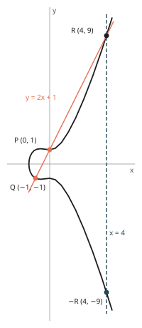

# Divisors and Riemann-Roch: counting the functions with the poles you prescribe

[Syllabus](../../../SYLLABUS.md) → [Algebraic geometry](../README.md) → [Plane Curves](../README.md#s03) → Divisors and Riemann-Roch

---

## General Overview

The shelf's house curve is the nodal cubic $`y^2 = x^2(x + 1)`$. It crosses itself at (0, 0). Add 1 to the right side and the crossing disappears: $`y^2 = x^3 + x^2 + 1`$ is a smooth neighbour, a cubic curve with no bad points. This card works on that neighbour, over the complex numbers ℂ, with its rational points as landmarks.

Pick two points on it, P = (0, 1) and Q = (−1, −1). Ask: which functions on the curve may blow up at P and at Q, at most once at each, and nowhere else? A function here is a ratio of polynomials in x and y, read on the curve.

The constants qualify: they never blow up. One more function does: $`u = (y + 2x + 1)/(x(x + 1))`$. Every allowed function is a + b·u for two numbers a and b. So the allowed functions form a two-dimensional space.

The Riemann-Roch theorem predicts that 2 without any search. It needs only two numbers: the number of poles allowed, 2, and the curve's genus (its number of holes), 1. The answer is 2 + 1 − 1 = 2.

The bookkeeping that makes this work is the **divisor**: a list of points, each with a whole-number weight. The function u has weight −1 at P and at Q (simple poles), +1 at (4, −9) and +1 at the point at infinity O (simple zeros). The weights add up to 0, as they must for every function on a closed curve. Closed means projective: the point at infinity is included, so nothing escapes to the edge.

**Record a function's zeros and poles as a weighted list of points, which adds to zero on a closed smooth curve; Riemann-Roch counts the independent functions whose poles fit a prescribed list: degree plus one minus genus, plus one correction term.**

**What kind of fact this is:** definitions (divisor, linear equivalence, the space L(D)), a theorem proved here (a function's divisor has degree zero), and the Riemann-Roch theorem, stated precisely with its key steps and a source (taken further on [Serre duality](../08-Sheaf%20Cohomology%20and%20Differentials/06-serre-duality-and-riemann-roch.md)). On this cubic the card proves the count for every multiple of O and for P + Q directly.

### The picture: the line and the vertical that build u

<p align="center"></p>

Real points only, to scale: 20 drawing units per unit, origin at (70, 230).

The line y = 2x + 1 meets the curve at P, Q and R = (4, 9). The dashed vertical x = 4 meets it at R, at −R = (4, −9), and at O, at the top of every vertical line. The ratio u = (x − 4)/(y − 2x − 1) cancels R and leaves zeros at −R and O, poles at P and Q.

---

## The formula

Notation first, in words. These are introduced on this card.

- A **divisor** D is a finite formal sum $`D = \sum n_P P`$: points P of the curve, each with a whole-number weight $`n_P`$. "Formal" means the points are not added as coordinates; the sum is only a list.
- Its **degree** $`\deg D`$ is the sum of the weights. D is **effective**, written $`D \ge 0`$, when no weight is negative.
- The **divisor of a function** f is $`\mathrm{div}(f) = \sum \mathrm{ord}_P(f)\, P`$. The **order** $`\mathrm{ord}_P(f)`$ is +m at a zero of multiplicity m and −m at a pole of order m.
- Two divisors are **linearly equivalent**, $`D \sim D'`$, when $`D - D' = \mathrm{div}(f)`$ for some function f. This ~ is not "distributed as" from statistics.
- The **Riemann-Roch space** $`\mathcal{L}(D)`$ is every function f with $`\mathrm{div}(f) + D \ge 0`$, together with 0. Its dimension is $`\ell(D)`$. In words: D lists the poles allowed at each point, and also any zeros demanded.
- The **canonical divisor** K is the divisor of a **differential**: an expression such as dx/(2y), a function times dx, the small change in x along the curve. Step 5 shows K = 0 on a smooth cubic.

The theorem, for a smooth projective curve of genus g over ℂ:

```math
\ell(D) - \ell(K - D) = \deg D + 1 - g
```

**Read it aloud:** the number of independent functions with poles allowed by D, minus a correction term, equals the degree of D plus one minus the genus.

On a curve of genus 1, K = 0. If $`\deg D \ge 1`$ then $`\mathcal{L}(-D)`$ holds only 0, since a function with zeros and no poles cannot exist (Step 2). So the correction vanishes:

```math
\ell(D) = \deg D \quad \text{for every divisor } D \text{ of degree at least 1 on a genus-one curve}
```

For D = P + Q: $`\ell(P + Q) = 2 + 1 - 1 = 2`$.

| Symbol | Plain meaning | In our example | Push it up and the answer… |
| --- | --- | --- | --- |
| $`E`$ | the curve $`y^2 = x^3 + x^2 + 1`$ with its point at infinity | smooth; discriminant of the cubic −31 | — |
| $`P, Q, R, -R`$ | points of E; −R is R reflected in the x-axis | (0, 1), (−1, −1), (4, 9), (4, −9) | — |
| $`O`$ | the point at infinity (0 : 1 : 0), top of every vertical | where x and y blow up | — |
| $`D, D'`$ | divisors: weighted lists of points | P + Q; (4, −9) + O | — |
| $`n_P`$ | the weight of the point P in D | 1 at P, 1 at Q | allows one more pole at P |
| $`\deg D`$ | the sum of the weights | 2 | one more dimension each step, on genus 1 |
| $`\mathrm{ord}_P(f)`$, $`t`$ | order of f at P: + for zeros, − for poles; t is a local coordinate, a function with a simple zero at P | x at O: −2; t = x − x₀ where y ≠ 0 | — |
| $`\mathrm{div}(f)`$ | the divisor of f: its zeros and poles, weighted | div u = (4, −9) + O − P − Q | — |
| $`D \sim D'`$ | linearly equivalent: D − D′ is the divisor of a function | P + Q ~ (4, −9) + O | — |
| $`\mathcal{L}(D)`$, $`\ell(D)`$ | functions with $`\mathrm{div}(f) + D \ge 0`$; their dimension | span of 1 and u; 2 | — |
| $`u`$, $`\lambda`$ | the non-constant member of $`\mathcal{L}(P + Q)`$; the line through P, Q and R | (y + 2x + 1)/(x(x + 1)); y − 2x − 1 | — |
| $`K`$, $`\omega`$, $`g`$ | canonical divisor; the differential that gives it; genus | 0; dx/(2y); 1 | each extra hole costs one dimension |

### When it holds

- **The curve is smooth.** Take the nodal cubic $`y^2 = x^3 + x^2`$ on its smooth model, the t-line, where the node is pulled apart into the two points t = 1 and t = −1. There the function t = y/x has one simple pole, at O. So $`\ell(O) = 2`$ there, against 1 on a smooth cubic. The node lowers the genus to 0. On the nodal curve itself y/x has no value at the node: it tends to 1 along one branch and to −1 along the other.
- **The curve is projective: O is included.** Leave O out and x has two zeros and no pole. Its divisor then has degree 2, not 0.
- **Points are counted over ℂ.** The function y vanishes where $`x^3 + x^2 + 1 = 0`$. None of those x values is rational, so over ℚ alone y shows only its pole of order 3 at O, and no zeros. The dimension $`\ell(D)`$ does not change between ℚ and ℂ when D is made of rational points.
- **The correction term is kept when the degree is small.** At D = 0 the formula without $`\ell(K - D)`$ gives 0 + 1 − 1 = 0. The constants give $`\ell(0) = 1`$. On genus 1 the term matters only for degree 0 and below.
- **The genus is the right one.** A smooth plane cubic has genus (3 − 1)(3 − 2)/2 = 1, by the degree-genus formula ([Genus](06-genus-and-the-degree-genus-formula.md)). Use genus 0 and $`\ell(P + Q)`$ comes out at 3.

---

## Why it works

### Step 0: two counts drive everything

A function on a closed curve takes every value equally often. It takes the value 0 at its zeros and the value ∞ at its poles, so zeros and poles balance: every divisor of a function has degree 0.

The space $`\mathcal{L}(D)`$ is cut out by linear conditions. Each point of D allows one more pole term, so it can add at most one dimension. The genus counts how many of those allowances are wasted. Riemann-Roch is the exact count.

### Step 1: orders, from Laurent series

The order of f at a point is the lowest power in its Laurent series there: the expansion in powers of a local coordinate t that also allows negative powers ([Laurent series](../../07-Complex%20analysis/05-Laurent%20Series%2C%20Singularities%20and%20Residues/01-laurent-series.md)).

- **At a point with y ≠ 0**, t = x − x₀ is a local coordinate. The curve gives y as a power series in t: square the series and match it with $`x^3 + x^2 + 1`$, one coefficient at a time. The code does exactly this, with exact fractions. It tests the series on the tangent line x + 2y + 3 at Q, which must have a double zero there.
- **At O**, x has a pole of order 2 and y a pole of order 3. The function x takes each value at two points, (x, y) and (x, −y), so it is infinite twice, counted with multiplicity. The only point where x is infinite is O, so the pole there is double. Then $`y^2 = x^3 + \dots`$ forces 2 ord(y) = 3 ord(x), so ord(y) = −3.

So $`\mathrm{div}(x) = (0, 1) + (0, -1) - 2O`$: zeros where x = 0, a double pole at O. For a ratio of polynomials in one variable, the orders are read off its factors ([Rational functions](../../07-Complex%20analysis/05-Laurent%20Series%2C%20Singularities%20and%20Residues/03-rational-functions-and-partial-fractions.md)); the divisor is that list, written down with weights.

### Step 2: a function's divisor has degree zero

Over ℂ the curve is a closed surface, and the argument principle counts zeros minus poles inside a loop ([The argument principle](../../07-Complex%20analysis/06-Real%20Integrals%20and%20Counting%20Zeros/06-the-argument-principle.md)). On a closed surface a loop round all the zeros and poles bounds an empty region on its other side, so the count is 0.

There is also a proof with only polynomials. Write a function as $`f = (A + By)/C`$, with A, B and C polynomials in x.

1. **A polynomial C(x) of degree d.** Each root of C gives two points of the curve, (x, y) and (x, −y), counted with multiplicity: 2d zeros. Its only pole is at O, of order 2d, since x has order −2 there. Degree 0.
2. **The norm.** The reflection $`y \mapsto -y`$ sends $`f_0 = A + By`$ to $`\bar f_0 = A - By`$, with a divisor of the same degree. Their product $`A^2 - B^2(x^3 + x^2 + 1)`$ is a polynomial in x alone, of degree 0 by part 1.
3. So twice the degree of $`\mathrm{div}(f_0)`$ is 0, and $`\mathrm{div}(f) = \mathrm{div}(f_0) - \mathrm{div}(C)`$ has degree 0.

The bar here is the reflection, not closure or conjugation. Check it on u:

- the line y − 2x − 1 has divisor P + Q + R − 3O;
- the vertical x − 4 has divisor R + (−R) − 2O;
- their ratio u has $`\mathrm{div}(u) = (4, -9) + O - P - Q`$.

All three have degree 0.

A consequence used below: a nonconstant function has at least one pole. So $`\mathcal{L}(D)`$ holds only 0 when $`\deg D < 0`$, and only the constants when D = 0.

### Step 3: linear equivalence, tested two ways

Two divisors are linearly equivalent when their difference is a function's divisor. Equal degree is necessary, by Step 2. It is not enough.

- **Equivalent.** $`(P + Q) - ((4, -9) + O) = -\mathrm{div}(u)`$, so P + Q ~ (4, −9) + O. The witness is u.
- **Not equivalent.** Is P + Q ~ 2O? A witness h would have $`\mathrm{div}(h) = P + Q - 2O`$, so h lies in $`\mathcal{L}(2O)`$, which is spanned by 1 and x (Step 4). Write h = a + bx. Its zeros come in mirror pairs (x, ±y), but P and Q have different x. The conditions h(P) = 0 and h(Q) = 0 have determinant −1, so only h = 0 fits. No witness exists.

On a smooth cubic there is a faster test. Two divisors of equal degree are equivalent exactly when their points add to the same point under the chord-and-tangent law ([The group law](../04-Elliptic%20Curves/01-elliptic-curves-and-the-group-law.md)). The chord through P and Q meets the curve at R = (4, 9). So P + Q = −R = (4, −9) in the group, and P + Q ~ (4, −9) + O. Two single points P and Q are never equivalent unless equal: $`\ell(Q) = 1 + 1 - 1 = 1`$, so only constants have at most a simple pole at Q.

### Step 4: counting $`\mathcal{L}(nO)`$ by pole orders

Functions with poles only at O are the polynomials in x and y. Replace $`y^2`$ by $`x^3 + x^2 + 1`$ whenever it appears, so every such function is a sum of monomials $`x^i y^j`$ with j equal to 0 or 1. The pole order at O of $`x^i y^j`$ is 2i + 3j.

These orders are all different: even ones come from j = 0, odd ones from j = 1. So no cancellation can lower the top pole, and a sum is in $`\mathcal{L}(nO)`$ exactly when each of its monomials is. The orders reached are 0, 2, 3, 4, 5, 6, … : every whole number except 1.

| n | Monomials with 2i + 3j ≤ n | ℓ(nO) | Riemann-Roch |
| --- | --- | --- | --- |
| 0 | 1 | 1 | 0 + 1 − 1 + ℓ(K) = 1 |
| 1 | 1 | 1 | 1 |
| 2 | 1, x | 2 | 2 |
| 3 | 1, x, y | 3 | 3 |
| 4 | 1, x, y, x² | 4 | 4 |
| 5 | 1, x, y, x², xy | 5 | 5 |
| 6 | 1, x, y, x², xy, x³ | 6 | 6 |

The gap at 1 is the genus: the number of gaps is always g, and the code takes its g from this count. A curve of genus 0 has a function t with one simple pole: Riemann-Roch gives $`\ell(P) = 1 + 1 - 0 = 2`$ at any point P, because on genus 0 the canonical divisor K has negative degree, so the correction term is 0. For every number c, t − c then has one pole, so exactly one zero. So t takes every value once and maps the curve one-to-one onto the line: a genus-0 curve is rational, traced by fractions in one parameter. A smooth cubic has no such function. At n = 6 both x³ and y² have pole order 6, and the curve's own equation is the relation between them.

### Step 5: the theorem, and K = 0 on the cubic

**Riemann-Roch.** For a smooth projective curve of genus g over ℂ and any divisor D, $`\ell(D) - \ell(K - D) = \deg D + 1 - g`$. Riemann proved the inequality $`\ell(D) \ge \deg D + 1 - g`$ in 1857. Roch found the correction term in 1865. The full proof is too long for a card; the key steps are these.

1. **Each allowed pole adds at most one dimension.** Allowing one more pole order at a point adds one Laurent coefficient to control. So $`\ell(D) \le \deg D + 1`$ when D is effective.
2. **For large D, exactly g of the allowances are wasted.** This is Riemann's half. It defines the genus by counting functions, and it agrees with the number of holes.
3. **The waste is measured by differentials.** The conditions for a function with poles D to exist are linked, by residues, to differentials that vanish on D. Their number is $`\ell(K - D)`$. This is Roch's half.

On the cubic, the differential $`\omega = dx/(2y)`$ has no zeros and no poles, so K = 0 and genus-one Riemann-Roch is $`\ell(D) - \ell(-D) = \deg D`$.

<details>
<summary>Detailed proof: dx/(2y) has no zeros or poles on the smooth cubic</summary>

Differentiate the curve: $`2y\,dy = (3x^2 + 2x)\,dx`$. So

$`\displaystyle \omega = \frac{dx}{2y} = \frac{dy}{3x^2 + 2x}`$

At a point with y ≠ 0, x − x₀ is a local coordinate and the first form is finite and nonzero. At a point with y = 0, the curve is smooth, so $`3x^2 + 2x \ne 0`$ there; y is a local coordinate and the second form is finite and nonzero.

At O, take t = x/y as the local coordinate. Then x has order −2 and y order −3, so dx has order −3 and 2y has order −3. Their ratio has order 0.

No zeros and no poles: $`\mathrm{div}(\omega) = 0`$, so K = 0. On the nodal cubic the same form has trouble at the node, where both $`2y`$ and $`3x^2 + 2x`$ vanish.

</details>

### Step 6: $`\mathcal{L}(P + Q)`$ by linear algebra, against the prediction

Let $`\lambda = y - 2x - 1`$, the line through P, Q and R. Its divisor is P + Q + R − 3O.

If f is in $`\mathcal{L}(P + Q)`$, then fλ has no poles except at O, of order at most 3, and it vanishes at R. So fλ = a + bx + cy, a member of $`\mathcal{L}(3O)`$ (Step 4), with a + 4b + 9c = 0. Conversely, any such a + bx + cy divided by λ is in $`\mathcal{L}(P + Q)`$.

One linear condition on three unknowns, of rank 1, leaves dimension 3 − 1 = 2. Two solutions are x − 4 and y − 9, giving $`(x - 4)/\lambda = u`$ and $`(y - 9)/\lambda = 1 + 2u`$. So the space is spanned by 1 and u, as Riemann-Roch predicts.

The simpler form of u comes from multiplying top and bottom by the reflected line y + 2x + 1. The product $`(x - 4)\,x\,(x + 1)`$ multiplies out to $`x^3 - 3x^2 - 4x`$, and on the curve $`y^2 - (2x + 1)^2`$ is the same polynomial.

---

## Worked numbers, by hand

Find $`\ell(P + Q)`$ for P = (0, 1), Q = (−1, −1) on $`y^2 = x^3 + x^2 + 1`$.

| Step | Arithmetic | Value |
| --- | --- | --- |
| curve is smooth | discriminant of $`x^3 + x^2 + 1`$ | −31, not 0 |
| genus | (3 − 1)(3 − 2)/2 | 1 |
| P and Q on the curve | $`1^2 = 0 + 0 + 1`$; $`(-1)^2 = -1 + 1 + 1`$ | both 1 |
| line through P and Q | slope (−1 − 1)/(−1 − 0) | y = 2x + 1 |
| meet the curve | $`x^3 + x^2 + 1 - (2x + 1)^2`$ | $`x^3 - 3x^2 - 4x`$, roots −1, 0, 4 |
| third point | y = 2·4 + 1; check $`9^2 = 64 + 16 + 1`$ | R = (4, 9), 81 = 81 |
| condition on a + bx + cy | vanish at R | a + 4b + 9c = 0, rank 1 |
| dimension | 3 − 1 | 2 |
| Riemann-Roch | 2 + 1 − 1 | **ℓ(P + Q) = 2** |

Exactly two independent functions have at most simple poles at P and Q: the constant 1 and u = (y + 2x + 1)/(x(x + 1)).

### What breaks if you drop a piece

| Mistake | Comes out at | What went wrong |
| --- | --- | --- |
| Riemann-Roch at D = 0 without $`\ell(K - D)`$ | 0 | the constants give $`\ell(0) = 1`$; the correction term is 1 here |
| Genus 0 used on the smooth cubic | $`\ell(P + Q) = 3`$ | the true count is 2; the cubic has one hole |
| The nodal cubic treated as genus 1 | $`\ell(O) = 1`$ | on its smooth model, the t-line, t = y/x has one simple pole, so $`\ell(O) = 2`$: the node makes it genus 0 |
| div x without the point O | degree 2 | the double pole at O is missing |
| div y over ℚ only | degree −3 | the three zeros of y are not rational; over ℂ they are at x = −1.4655712319 and 0.232786 ± 0.792552i |

The code prints all five.

---

## Code, from first principles, and it actually runs

The code works in exact fractions: Python's Fraction, and in Rust an i128 fraction type with overflow checks. It writes each function as (A + By)/C and finds its zeros and poles by computing the Laurent series of y at each candidate point. It reaches $`\ell(P + Q) = 2`$ by two roads that must agree:

1. the Riemann-Roch formula, deg D + 1 − g, with the genus counted as the gaps in the pole orders at O (Step 4) and checked against the degree-genus formula;
2. the linear algebra of Step 6, computed in two halves. The upper bound: the basis 1, x, y of $`\mathcal{L}(3O)`$ comes from the pole-order count, with the 3 read off the line's divisor; it is evaluated at R, and elimination finds the kernel, x − 4 and y − 9. The lower bound: each kernel function, divided by the line, has its divisor computed from series, which shows it really lies in $`\mathcal{L}(P + Q)`$.

A third road counts $`\mathcal{L}(nO)`$ by pole orders for n from 0 to 6 against Riemann-Roch. The code then runs the series test, the equivalence tests and the five failures.

### Python

```python
# Divisors and Riemann-Roch on the cubic y^2 = x^3 + x^2 + 1 -- the check behind the card.
# Standard library only; Fraction is exact arithmetic on fractions, nothing more.  A function is
# (A + B y)/C with A, B, C polynomials in x, lowest power first.  Orders come from Laurent series.
from fractions import Fraction as Fr
from math import isqrt
F = [Fr(1), Fr(0), Fr(1), Fr(1)]                       # x^3 + x^2 + 1, the smooth neighbour
def ev(p, x): return sum(c * x ** i for i, c in enumerate(p))
def pmul(p, q):
    r = [Fr(0)] * (len(p) + len(q) - 1)
    for i, a in enumerate(p):
        for j, b in enumerate(q): r[i + j] += a * b
    return r
def psub(p, q): return [(p[i] if i < len(p) else 0) - (q[i] if i < len(q) else 0) for i in range(max(len(p), len(q)))]
def deg(p): return max([i for i, c in enumerate(p) if c != 0], default=-1)
def shift(p, x0):                                      # rewrite p in powers of t = x - x0
    r = [Fr(0)]
    for c in reversed(p): r = psub(pmul(r, [Fr(x0), Fr(1)]), [-c])
    return r
def lowest(s): return next(i for i, c in enumerate(s) if c != 0)
def roots(p):                                          # integer roots with multiplicity
    out = {}
    for r in range(-10, 11):
        q = p[:]
        while deg(q) > 0 and ev(q, r) == 0:
            out[r] = out.get(r, 0) + 1; b = shift(q, r)[1:]; q = shift(b, -r)
    return out
N = 8
def ordP(f, x0, y0):                                   # order at an affine point with y0 != 0
    A, B, C = (shift(p, x0) + [Fr(0)] * N for p in f); fs = shift(F, x0) + [Fr(0)] * N
    y = [Fr(y0)]                                       # Laurent (here Taylor) series of y in t
    for n in range(1, N): y.append((fs[n] - sum(y[i] * y[n - i] for i in range(1, n))) / (2 * y0))
    num = [A[n] + sum(B[i] * y[n - i] for i in range(n + 1)) for n in range(N)]
    return lowest(num) - lowest(C)
def ordO(f):                                           # x has a double pole at O, y a triple one
    A, B, C = f
    return 2 * deg(C) - max(2 * deg(A) if deg(A) >= 0 else -1, 2 * deg(B) + 3 if deg(B) >= 0 else -1)
def div(f):                                            # every zero and pole, over the rationals
    A, B, C = f; nm = psub(pmul(A, A), pmul(pmul(B, B), F)); d = {}
    for x0 in sorted(set(roots(nm)) | set(roots(C))):
        s = isqrt(max(0, int(ev(F, x0))))
        for y0 in (s, -s):
            if s * s == ev(F, x0) and ordP(f, x0, y0): d[f"({x0}, {y0})"] = ordP(f, x0, y0)
    if ordO(f): d["O"] = ordO(f)
    return d, sum(roots(nm).values()) == deg(nm), sum(roots(C).values()) == deg(C)
def show(d): return " ".join(f"{v:+d}{k}" for k, v in d.items()) + f", degree {sum(d.values())}"
def disc(a, b, c): return 18 * a * b * c - 4 * a ** 3 * c + a * a * b * b - 4 * b ** 3 - 27 * c * c  # x^3 + ax^2 + bx + c
dsc = disc(F[2], F[1], F[0])
print(f"curve y^2 = x^3 + x^2 + 1; discriminant of the cubic {dsc}, not 0: smooth; genus (3-1)(3-2)/2 = {(3 - 1) * (3 - 2) // 2}")
print(f"nodal neighbour y^2 = x^3 + x^2: discriminant {disc(1, 0, 0)}: a node at (0, 0)")
assert dsc == -4 - 27 and disc(1, 0, 0) == 0             # by hand: only the c terms survive
P, Q = (0, 1), (-1, -1)
on = lambda pt: Fr(pt[1]) ** 2 == ev(F, Fr(pt[0]))
m = Fr(Q[1] - P[1], Q[0] - P[0]); k = P[1] - m * P[0]
cub = psub(F, pmul([k, m], [k, m]))                    # x^3 + x^2 + 1 - (mx + k)^2
xR = -cub[2] - P[0] - Q[0]; R = (xR, m * xR + k)
print(f"P = {P}, Q = {Q} on the curve: {on(P) and on(Q)}; line y = {m}x + {k}; cubic on it {[int(v) for v in reversed(cub)]}, roots {sorted(roots(cub))}")
print(f"third point R = ({R[0]}, {R[1]}): {R[1] ** 2} = {ev(F, R[0])}; reflection -R = ({R[0]}, {-R[1]})")
assert on(R) and sorted(roots(cub)) == [-1, 0, 4]
ell = ([-k, -m], [Fr(1)], [Fr(1)])                     # the line y - 2x - 1 as a function
vrt = ([-R[0], Fr(1)], [], [Fr(1)])                    # the vertical line x - 4
g = ([k, m], [Fr(1)], [Fr(0), Fr(1), Fr(1)])           # u = (y + 2x + 1)/(x(x + 1))
lhs = pmul([-R[0], Fr(1)], [Fr(0), Fr(1), Fr(1)]); rhs = psub(F, pmul([k, m], [k, m]))
print(f"(x - 4) x (x + 1) = {[int(v) for v in reversed(lhs)]} and y^2 - (2x + 1)^2 = {[int(v) for v in reversed(rhs)]}: so (x - 4)/(y - 2x - 1) = (y + 2x + 1)/(x(x + 1))")
assert lhs == rhs[:len(lhs)]
for name, f in (("line y - 2x - 1", ell), ("vertical x - 4", vrt), ("u", g), ("x", ([Fr(0), Fr(1)], [], [Fr(1)]))):
    d, z, p = div(f)
    print(f"div {name}: {show(d)}; every zero and pole found: {z and p}")
    assert sum(d.values()) == 0 and z and p
dg = div(g)[0]
assert dg == {"(0, 1)": -1, "(-1, -1)": -1, "(4, -9)": 1, "O": 1}
tq = ordP(([Fr(3), Fr(1)], [Fr(2)], [Fr(1)]), *Q)      # the tangent x + 2y + 3 at Q tests the series of y past y0
print(f"tangent x + 2y + 3 at Q: order {tq} there, a double zero, read off the series of y in t = x + 1")
dy = div(([], [Fr(1)], [Fr(1)]))[0]                    # div y: its norm -F has no rational root
lo, hi = -2.0, -1.0
for _ in range(80): mid = (lo + hi) / 2; lo, hi = (mid, hi) if ev(F, mid) < 0 else (lo, mid)
re = (-1 - lo) / 2; im = (-1 / lo - re * re) ** 0.5
print(f"div y over the complex numbers: zeros at x = {lo:.10f} and {re:.6f} +/- {im:.6f}i, -3O, degree 0")
print(f"mistake, div y over the rationals only: {sum(v > 0 for v in dy.values())} zeros, pole {show(dy)}")
print(f"mistake, div x with O left out: {show({k: v for k, v in div(([Fr(0), Fr(1)], [], [Fr(1)]))[0].items() if k != 'O'})}")
Ln = {}
for n in range(7):                                     # L(nO): monomials x^i y^j, j <= 1
    Ln[n] = [(i, j) for i, j in sorted(((i, j) for i in range(4) for j in (0, 1)), key=lambda e: 2 * e[0] + 3 * e[1]) if 2 * i + 3 * j <= n]
    basis = [("1" if i == 0 else "x" if i == 1 else f"x^{i}") if j == 0 else ("y" if i == 0 else "xy" if i == 1 else f"x^{i}y") for i, j in Ln[n]]
    rr = n + 1 - 1 + (1 if n == 0 else 0)              # l(K - D) = l(-nO) is 1 at n = 0, else 0
    print(f"L({n}O): pole orders 2i + 3j <= {n}: {', '.join(basis)}; l = {len(basis)}; Riemann-Roch {n} + 1 - 1 + l(K - D) = {rr}")
    assert len(basis) == rr
gaps = [n for n in Ln if n and len(Ln[n]) == len(Ln[n - 1])]   # pole orders no function reaches: the gaps at O
print(f"mistake, Riemann-Roch at D = 0 without l(K - D): 0 + 1 - 1 = {0 + 1 - 1}, but the constants give l(0) = 1")
top = -ordO(ell); D = {"(0, 1)": 1, "(-1, -1)": 1}     # D = P + Q; f(y - 2x - 1) lies in L(3O), 3 read off div of the line
row = [R[0] ** i * R[1] ** j for i, j in Ln[top]]      # the basis of L(3O) at R: h = a + bx + cy must vanish there
pv = next(c for c, v in enumerate(row) if v != 0)      # elimination on one nonzero row: a pivot, and each other column free
ker = [[Fr(c == e) - (row[e] / row[pv] if c == pv else 0) for c in range(len(row))] for e in range(len(row)) if e != pv]
dim, rank, genus = len(ker), len(row) - len(ker), len(gaps); rr2 = sum(D.values()) + 1 - genus
inL = []
for h in ker:                                          # h/(y - 2x - 1) = h(y + 2x + 1)/(y^2 - (2x + 1)^2), as (A + By)/C
    H = [[Fr(0)] * 4, [Fr(0)] * 4]
    for v, (i, j) in zip(h, Ln[top]): H[j][i] += v
    d, _, p = div((psub(pmul(H[0], [k, m]), pmul([-1], pmul(H[1], F))), psub(H[0], pmul([-1], pmul(H[1], [k, m]))), cub))
    inL.append(p and all(v >= -D.get(key, 0) for key, v in d.items()))
print(f"L(P + Q): f x (y - 2x - 1) = a + bx + cy, zero at R: a + {row[1]}b + {row[2]}c = 0, rank {rank}, so l(P + Q) = {len(row)} - {rank} = {dim}")
print(f"kernel in 1, x, y: {[[int(v) for v in h] for h in ker]}; each over y - 2x - 1 has at most simple poles at P and Q, none elsewhere: {all(inL)}")
print(f"Riemann-Roch: l(P + Q) = deg {sum(D.values())} + 1 - genus {genus} = {rr2}, the genus counted as the gaps {gaps} in the pole orders at O")
idn = [b - c - 2 * a for a, b, c in zip(ker[0], ker[1], [-k, -m, Fr(1)])]   # (y - 9) - (y - 2x - 1) - 2(x - 4), in 1, x, y
print(f"second solution (y - 9)/(y - 2x - 1) = 1 + 2u: (y - 9) - (y - 2x - 1) - 2(x - 4) = {[int(v) for v in idn]}")
assert dim == rr2 == 2 and genus == (3 - 1) * (3 - 2) // 2 and all(inL) and tq == 2 and not any(idn) and dg["(0, 1)"] == dg["(-1, -1)"] == -1
print(f"mistake, Riemann-Roch with genus 0 on the cubic: l(P + Q) = {2 + 1 - 0}, but the count above gives {dim}")
print(f"test P + Q ~ (4, -9) + O: difference = -div u, so equivalent; the chord gives P + Q = ({R[0]}, {-R[1]}) in the group law")
M = [[Fr(1), Fr(P[0])], [Fr(1), Fr(Q[0])]]            # h = a + bx at P and at Q
det = M[0][0] * M[1][1] - M[0][1] * M[1][0]
print(f"test P + Q ~ 2O: h in L(2O) = span(1, x) with zeros P, Q needs a + 0b = 0, a - b = 0; determinant {det}: only h = 0, not equivalent")
assert det != 0
print(f"test P ~ Q: l(Q) = 1 + 1 - 1 = {1 + 1 - genus}, constants only, so no function has divisor P - Q: not equivalent")
ts = range(-3, 4)                                      # nodal cubic: x = t^2 - 1, y = t(t^2 - 1)
ok = all(Fr(t * (t * t - 1)) ** 2 == Fr(t * t - 1) ** 3 + Fr(t * t - 1) ** 2 for t in ts)
print(f"nodal y^2 = x^3 + x^2: x = t^2 - 1, y = t^3 - t fits at 7 values of t, a degree-6 identity: {ok}")
mt = roots(psub([Fr(0), Fr(0), Fr(1), Fr(1)], [Fr(0), Fr(0), Fr(4)]))   # where the line y = 2x meets it: x^3 + x^2 - (2x)^2 = 0
x2 = max(mt)
print(f"nodal, on its smooth model (the t-line): y = 2x meets it {mt[0]} times at the node (t = 1 and t = -1) and once at ({x2}, {2 * x2}), "
      f"so t = y/x is 2 only there; one simple pole at O, so l(O) = 2, not the smooth cubic's {len(Ln[1])}")
assert ok and mt == {0: 2, 3: 1} and ordO(([], [Fr(1)], [Fr(0), Fr(1)])) == -1
sv = lambda x, y: f"{70 + 20 * x:.1f},{230 - 20 * y:.1f}"
xs = [lo + (4.4 - lo) * (i / 16) ** 2 for i in range(17)]
print("figure, 20 per unit, origin (70,230), upper curve:", " ".join(sv(x, max(0.0, ev(F, x)) ** 0.5) for x in xs))
print("figure, P", sv(0, 1), "Q", sv(-1, -1), "R", sv(4, 9), "-R", sv(4, -9), "line", sv(-1.5, -2), "to", sv(4.5, 10), "vertical", sv(4, 10.5), "to", sv(4, -10.5))
print("ALL CHECKS PASS")
```

**Ran 2026-11-17 on macOS, Python 3.14.10, standard library only. All checks passed. Output, pasted from the run:**

```
curve y^2 = x^3 + x^2 + 1; discriminant of the cubic -31, not 0: smooth; genus (3-1)(3-2)/2 = 1
nodal neighbour y^2 = x^3 + x^2: discriminant 0: a node at (0, 0)
P = (0, 1), Q = (-1, -1) on the curve: True; line y = 2x + 1; cubic on it [1, -3, -4, 0], roots [-1, 0, 4]
third point R = (4, 9): 81 = 81; reflection -R = (4, -9)
(x - 4) x (x + 1) = [1, -3, -4, 0] and y^2 - (2x + 1)^2 = [1, -3, -4, 0]: so (x - 4)/(y - 2x - 1) = (y + 2x + 1)/(x(x + 1))
div line y - 2x - 1: +1(-1, -1) +1(0, 1) +1(4, 9) -3O, degree 0; every zero and pole found: True
div vertical x - 4: +1(4, 9) +1(4, -9) -2O, degree 0; every zero and pole found: True
div u: -1(-1, -1) -1(0, 1) +1(4, -9) +1O, degree 0; every zero and pole found: True
div x: +1(0, 1) +1(0, -1) -2O, degree 0; every zero and pole found: True
tangent x + 2y + 3 at Q: order 2 there, a double zero, read off the series of y in t = x + 1
div y over the complex numbers: zeros at x = -1.4655712319 and 0.232786 +/- 0.792552i, -3O, degree 0
mistake, div y over the rationals only: 0 zeros, pole -3O, degree -3
mistake, div x with O left out: +1(0, 1) +1(0, -1), degree 2
L(0O): pole orders 2i + 3j <= 0: 1; l = 1; Riemann-Roch 0 + 1 - 1 + l(K - D) = 1
L(1O): pole orders 2i + 3j <= 1: 1; l = 1; Riemann-Roch 1 + 1 - 1 + l(K - D) = 1
L(2O): pole orders 2i + 3j <= 2: 1, x; l = 2; Riemann-Roch 2 + 1 - 1 + l(K - D) = 2
L(3O): pole orders 2i + 3j <= 3: 1, x, y; l = 3; Riemann-Roch 3 + 1 - 1 + l(K - D) = 3
L(4O): pole orders 2i + 3j <= 4: 1, x, y, x^2; l = 4; Riemann-Roch 4 + 1 - 1 + l(K - D) = 4
L(5O): pole orders 2i + 3j <= 5: 1, x, y, x^2, xy; l = 5; Riemann-Roch 5 + 1 - 1 + l(K - D) = 5
L(6O): pole orders 2i + 3j <= 6: 1, x, y, x^2, xy, x^3; l = 6; Riemann-Roch 6 + 1 - 1 + l(K - D) = 6
mistake, Riemann-Roch at D = 0 without l(K - D): 0 + 1 - 1 = 0, but the constants give l(0) = 1
L(P + Q): f x (y - 2x - 1) = a + bx + cy, zero at R: a + 4b + 9c = 0, rank 1, so l(P + Q) = 3 - 1 = 2
kernel in 1, x, y: [[-4, 1, 0], [-9, 0, 1]]; each over y - 2x - 1 has at most simple poles at P and Q, none elsewhere: True
Riemann-Roch: l(P + Q) = deg 2 + 1 - genus 1 = 2, the genus counted as the gaps [1] in the pole orders at O
second solution (y - 9)/(y - 2x - 1) = 1 + 2u: (y - 9) - (y - 2x - 1) - 2(x - 4) = [0, 0, 0]
mistake, Riemann-Roch with genus 0 on the cubic: l(P + Q) = 3, but the count above gives 2
test P + Q ~ (4, -9) + O: difference = -div u, so equivalent; the chord gives P + Q = (4, -9) in the group law
test P + Q ~ 2O: h in L(2O) = span(1, x) with zeros P, Q needs a + 0b = 0, a - b = 0; determinant -1: only h = 0, not equivalent
test P ~ Q: l(Q) = 1 + 1 - 1 = 1, constants only, so no function has divisor P - Q: not equivalent
nodal y^2 = x^3 + x^2: x = t^2 - 1, y = t^3 - t fits at 7 values of t, a degree-6 identity: True
nodal, on its smooth model (the t-line): y = 2x meets it 2 times at the node (t = 1 and t = -1) and once at (3, 6), so t = y/x is 2 only there; one simple pole at O, so l(O) = 2, not the smooth cubic's 1
figure, 20 per unit, origin (70,230), upper curve: 40.7,230.0 41.1,224.4 42.5,219.2 44.8,214.7 48.0,211.2 52.1,209.2 57.2,208.6 63.1,209.2 70.0,210.0 77.8,208.0 86.5,200.0 96.1,185.5 106.7,165.1 118.1,138.9 130.5,107.0 143.8,68.9 158.0,24.5
figure, P 70.0,210.0 Q 50.0,250.0 R 150.0,50.0 -R 150.0,410.0 line 40.0,270.0 to 160.0,30.0 vertical 150.0,20.0 to 150.0,440.0
ALL CHECKS PASS
```

### Rust

Same numbers, same labels, built with `rustc --edition 2021 -O`.

```rust
// Divisors and Riemann-Roch on the cubic y^2 = x^3 + x^2 + 1 -- the same check as the Python.
// No crates; exact fractions are written here on i128 with overflow checks.  A function is
// (A + B y)/C with A, B, C polynomials in x, lowest power first.  Orders come from Laurent series.
#[derive(Clone, Copy, PartialEq, Debug)]
struct Q(i128, i128); // numerator, denominator > 0, lowest terms
fn q(n: i128, d: i128) -> Q {
    let (mut a, mut b) = (n.abs(), d.abs());
    while b != 0 { (a, b) = (b, a % b); }
    if a == 0 { return Q(0, 1); }
    Q(n / a * d.signum(), d.abs() / a)
}
fn ml(a: i128, b: i128) -> i128 { a.checked_mul(b).expect("overflow") }
fn ad(x: Q, y: Q) -> Q { q(ml(x.0, y.1).checked_add(ml(y.0, x.1)).expect("overflow"), ml(x.1, y.1)) }
fn ng(x: Q) -> Q { Q(-x.0, x.1) }
fn sb(x: Q, y: Q) -> Q { ad(x, ng(y)) }
fn mu(x: Q, y: Q) -> Q { q(ml(x.0, y.0), ml(x.1, y.1)) }
fn dv(x: Q, y: Q) -> Q { q(ml(x.0, y.1), ml(x.1, y.0)) }
fn n(v: i128) -> Q { Q(v, 1) }
fn txt(x: Q) -> String { if x.1 == 1 { format!("{}", x.0) } else { format!("{}/{}", x.0, x.1) } }
type P = Vec<Q>;
fn f_() -> P { vec![n(1), n(0), n(1), n(1)] } // x^3 + x^2 + 1, the smooth neighbour
fn ev(p: &P, x: Q) -> Q { p.iter().rev().fold(n(0), |s, &c| ad(mu(s, x), c)) }
fn evf(p: &P, x: f64) -> f64 { p.iter().rev().fold(0.0, |s, &c| s * x + c.0 as f64 / c.1 as f64) }
fn pmul(a: &P, b: &P) -> P {
    if a.is_empty() || b.is_empty() { return vec![n(0)]; }
    let mut r = vec![n(0); a.len() + b.len() - 1];
    for (i, &u) in a.iter().enumerate() { for (j, &v) in b.iter().enumerate() { r[i + j] = ad(r[i + j], mu(u, v)); } }
    r
}
fn psub(a: &P, b: &P) -> P { (0..a.len().max(b.len())).map(|i| sb(*a.get(i).unwrap_or(&n(0)), *b.get(i).unwrap_or(&n(0)))).collect() }
fn deg(p: &P) -> i64 { p.iter().rposition(|c| c.0 != 0).map_or(-1, |i| i as i64) }
fn shift(p: &P, x0: Q) -> P { p.iter().rev().fold(vec![n(0)], |r, &c| psub(&pmul(&r, &vec![x0, n(1)]), &vec![ng(c)])) } // in powers of t = x - x0
fn lowest(s: &P) -> i64 { s.iter().position(|c| c.0 != 0).unwrap() as i64 }
fn roots(p: &P) -> Vec<(i128, i64)> { // integer roots with multiplicity
    let mut out = vec![];
    for r in -10..11 {
        let (mut qq, mut k) = (p.clone(), 0);
        while deg(&qq) > 0 && ev(&qq, n(r)).0 == 0 { k += 1; let b = shift(&qq, n(r))[1..].to_vec(); qq = shift(&b, n(-r)); }
        if k > 0 { out.push((r, k)); }
    }
    out
}
const NN: usize = 8;
type Fun = (P, P, P);
fn ord_p(f: &Fun, x0: i128, y0: i128) -> i64 { // order at an affine point with y0 != 0
    let pad = |p: &P| { let mut v = shift(p, n(x0)); v.resize(v.len() + NN, n(0)); v };
    let (a, b, c, fs) = (pad(&f.0), pad(&f.1), pad(&f.2), pad(&f_()));
    let mut y = vec![n(y0)]; // Laurent (here Taylor) series of y in t
    for k in 1..NN {
        let s = (1..k).fold(n(0), |s, i| ad(s, mu(y[i], y[k - i])));
        y.push(dv(sb(fs[k], s), n(2 * y0)));
    }
    let num: P = (0..NN).map(|k| (0..=k).fold(a[k], |s, i| ad(s, mu(b[i], y[k - i])))).collect();
    lowest(&num) - lowest(&c)
}
fn ord_o(f: &Fun) -> i64 { // x has a double pole at O, y a triple one
    let pa = if deg(&f.0) >= 0 { 2 * deg(&f.0) } else { -1 };
    let pb = if deg(&f.1) >= 0 { 2 * deg(&f.1) + 3 } else { -1 };
    2 * deg(&f.2) - pa.max(pb)
}
fn isqrt(v: i128) -> i128 { let mut s = 0; while (s + 1) * (s + 1) <= v { s += 1; } s }
fn div(f: &Fun) -> (Vec<(String, i64)>, bool, bool) { // every zero and pole, over the rationals
    let nm = psub(&pmul(&f.0, &f.0), &pmul(&pmul(&f.1, &f.1), &f_()));
    let (rn, rc) = (roots(&nm), roots(&f.2));
    let mut xs: Vec<i128> = rn.iter().chain(rc.iter()).map(|e| e.0).collect();
    xs.sort(); xs.dedup();
    let mut d = vec![];
    for x0 in xs {
        let fx = ev(&f_(), n(x0)).0; let s = isqrt(fx);
        for y0 in [s, -s] { if s * s == fx { let o = ord_p(f, x0, y0); if o != 0 { d.push((format!("({}, {})", x0, y0), o)); } } }
    }
    if ord_o(f) != 0 { d.push(("O".to_string(), ord_o(f))); }
    let sm = |r: &Vec<(i128, i64)>| r.iter().map(|e| e.1).sum::<i64>();
    (d, sm(&rn) == deg(&nm), sm(&rc) == deg(&f.2))
}
fn show(d: &Vec<(String, i64)>) -> String {
    format!("{}, degree {}", d.iter().map(|(k, v)| format!("{:+}{}", v, k)).collect::<Vec<_>>().join(" "), d.iter().map(|e| e.1).sum::<i64>()) }
fn lst(p: &P) -> String { format!("[{}]", p.iter().map(|c| txt(*c)).collect::<Vec<_>>().join(", ")) }
fn tf(b: bool) -> &'static str { if b { "True" } else { "False" } }
fn main() {
    let ff = f_(); // discriminant of x^3 + ax^2 + bx + c
    let disc = |a: i128, b: i128, c: i128| 18 * a * b * c - 4 * a * a * a * c + a * a * b * b - 4 * b * b * b - 27 * c * c;
    let dsc = disc(ff[2].0, ff[1].0, ff[0].0);
    println!("curve y^2 = x^3 + x^2 + 1; discriminant of the cubic {}, not 0: smooth; genus (3-1)(3-2)/2 = {}", dsc, (3 - 1) * (3 - 2) / 2);
    println!("nodal neighbour y^2 = x^3 + x^2: discriminant {}: a node at (0, 0)", disc(1, 0, 0));
    assert!(dsc == -4 - 27 && disc(1, 0, 0) == 0); // by hand: only the c terms survive
    let (p, qq) = ((0i128, 1i128), (-1i128, -1i128));
    let on = |x: Q, y: Q| mu(y, y) == ev(&ff, x);
    let m = q(qq.1 - p.1, qq.0 - p.0); let k = sb(n(p.1), mu(m, n(p.0)));
    let cub = psub(&ff, &pmul(&vec![k, m], &vec![k, m]));
    let xr = sb(sb(ng(cub[2]), n(p.0)), n(qq.0)); let r = (xr, ad(mu(m, xr), k));
    let rts: Vec<String> = roots(&cub).iter().map(|e| e.0.to_string()).collect();
    let rev = |v: &P| { let mut w = v.clone(); w.reverse(); lst(&w) };
    println!("P = ({}, {}), Q = ({}, {}) on the curve: {}; line y = {}x + {}; cubic on it {}, roots [{}]", p.0, p.1, qq.0, qq.1, tf(on(n(p.0), n(p.1)) && on(n(qq.0), n(qq.1))), txt(m), txt(k), rev(&cub), rts.join(", "));
    println!("third point R = ({}, {}): {} = {}; reflection -R = ({}, {})", txt(r.0), txt(r.1), txt(mu(r.1, r.1)), txt(ev(&ff, r.0)), txt(r.0), txt(ng(r.1)));
    assert!(on(r.0, r.1) && rts == ["-1", "0", "4"]);
    let ell: Fun = (vec![ng(k), ng(m)], vec![n(1)], vec![n(1)]);
    let vrt: Fun = (vec![ng(r.0), n(1)], vec![], vec![n(1)]);
    let g: Fun = (vec![k, m], vec![n(1)], vec![n(0), n(1), n(1)]);
    let lhs = pmul(&vec![ng(r.0), n(1)], &vec![n(0), n(1), n(1)]); let rhs = psub(&ff, &pmul(&vec![k, m], &vec![k, m]));
    println!("(x - 4) x (x + 1) = {} and y^2 - (2x + 1)^2 = {}: so (x - 4)/(y - 2x - 1) = (y + 2x + 1)/(x(x + 1))", rev(&lhs), rev(&rhs));
    assert!(lhs[..] == rhs[..lhs.len()]);
    let xf: Fun = (vec![n(0), n(1)], vec![], vec![n(1)]);
    for (name, f) in [("line y - 2x - 1", &ell), ("vertical x - 4", &vrt), ("u", &g), ("x", &xf)] {
        let (d, z, pp) = div(f);
        println!("div {}: {}; every zero and pole found: {}", name, show(&d), tf(z && pp));
        assert!(d.iter().map(|e| e.1).sum::<i64>() == 0 && z && pp);
    }
    let dg = div(&g).0;
    let want = [("(-1, -1)", -1), ("(0, 1)", -1), ("(4, -9)", 1), ("O", 1)];
    assert!(dg.len() == 4 && dg.iter().zip(want.iter()).all(|(u, v)| u.0 == v.0 && u.1 == v.1));
    let tq = ord_p(&(vec![n(3), n(1)], vec![n(2)], vec![n(1)]), qq.0, qq.1); // the tangent x + 2y + 3 at Q tests the series of y past y0
    println!("tangent x + 2y + 3 at Q: order {} there, a double zero, read off the series of y in t = x + 1", tq);
    let dy = div(&(vec![], vec![n(1)], vec![n(1)])).0; // div y: its norm -F has no rational root
    let (mut lo, mut hi) = (-2.0f64, -1.0f64);
    for _ in 0..80 { let mid = (lo + hi) / 2.0; if evf(&ff, mid) < 0.0 { lo = mid } else { hi = mid } }
    let re = (-1.0 - lo) / 2.0; let im = (-1.0 / lo - re * re).sqrt();
    println!("div y over the complex numbers: zeros at x = {:.10} and {:.6} +/- {:.6}i, -3O, degree 0", lo, re, im);
    println!("mistake, div y over the rationals only: {} zeros, pole {}", dy.iter().filter(|e| e.1 > 0).count(), show(&dy));
    println!("mistake, div x with O left out: {}", show(&div(&xf).0.into_iter().filter(|e| e.0 != "O").collect()));
    let mut ln: Vec<Vec<(i64, i64)>> = vec![];
    for nn in 0..7i64 { // L(nO): monomials x^i y^j, j <= 1
        let mut mons: Vec<(i64, i64)> = (0..4).flat_map(|i| [(i, 0), (i, 1)]).filter(|e| 2 * e.0 + 3 * e.1 <= nn).collect();
        mons.sort_by_key(|e| 2 * e.0 + 3 * e.1);
        let basis: Vec<String> = mons.iter().map(|&(i, j)| {
            let xp = match i { 0 => String::new(), 1 => "x".into(), _ => format!("x^{}", i) };
            if j == 0 { if i == 0 { "1".into() } else { xp } } else { format!("{}y", xp) } }).collect();
        let rr = nn + 1 - 1 + if nn == 0 { 1 } else { 0 }; // l(K - D) = l(-nO) is 1 at n = 0, else 0
        println!("L({}O): pole orders 2i + 3j <= {}: {}; l = {}; Riemann-Roch {} + 1 - 1 + l(K - D) = {}", nn, nn, basis.join(", "), basis.len(), nn, rr);
        assert!(basis.len() as i64 == rr); ln.push(mons);
    }
    let gaps: Vec<usize> = (1..ln.len()).filter(|&k| ln[k].len() == ln[k - 1].len()).collect(); // pole orders no function reaches: the gaps at O
    println!("mistake, Riemann-Roch at D = 0 without l(K - D): 0 + 1 - 1 = {}, but the constants give l(0) = 1", 0 + 1 - 1);
    let top = -ord_o(&ell) as usize; let dd = ["(0, 1)", "(-1, -1)"]; // D = P + Q; f(y - 2x - 1) lies in L(3O), 3 read off div of the line
    let row: Vec<Q> = ln[top].iter().map(|&(i, j)| mu((0..i).fold(n(1), |s, _| mu(s, r.0)), (0..j).fold(n(1), |s, _| mu(s, r.1)))).collect(); // L(3O) at R
    let pv = row.iter().position(|v| v.0 != 0).unwrap(); // elimination on one nonzero row: a pivot, and each other column free
    let ker: Vec<P> = (0..row.len()).filter(|&e| e != pv).map(|e| (0..row.len()).map(|c| if c == e { n(1) } else if c == pv { ng(dv(row[e], row[pv])) } else { n(0) }).collect()).collect();
    let (dim, genus) = (ker.len() as i64, gaps.len() as i64); let (rank, rr2) = (row.len() as i64 - dim, dd.len() as i64 + 1 - genus);
    let inl = ker.iter().all(|h| { // h/(y - 2x - 1) = h(y + 2x + 1)/(y^2 - (2x + 1)^2), as (A + By)/C
        let hp = |jj: i64| -> P { (0..4).map(|i| h.iter().zip(&ln[top]).filter(|e| *e.1 == (i, jj)).fold(n(0), |s, e| ad(s, *e.0))).collect() };
        let (d, _, pp) = div(&(psub(&pmul(&hp(0), &vec![k, m]), &pmul(&vec![n(-1)], &pmul(&hp(1), &ff))), psub(&hp(0), &pmul(&vec![n(-1)], &pmul(&hp(1), &vec![k, m]))), cub.clone()));
        pp && d.iter().all(|(s, v)| *v >= -(dd.contains(&s.as_str()) as i64)) });
    println!("L(P + Q): f x (y - 2x - 1) = a + bx + cy, zero at R: a + {}b + {}c = 0, rank {}, so l(P + Q) = {} - {} = {}", txt(row[1]), txt(row[2]), rank, row.len(), rank, dim);
    println!("kernel in 1, x, y: [{}]; each over y - 2x - 1 has at most simple poles at P and Q, none elsewhere: {}", ker.iter().map(lst).collect::<Vec<_>>().join(", "), tf(inl));
    println!("Riemann-Roch: l(P + Q) = deg {} + 1 - genus {} = {}, the genus counted as the gaps {:?} in the pole orders at O", dd.len(), genus, rr2, gaps);
    let idn: P = (0..3).map(|c| sb(sb(ker[1][c], [ng(k), ng(m), n(1)][c]), mu(n(2), ker[0][c]))).collect(); // (y - 9) - (y - 2x - 1) - 2(x - 4), in 1, x, y
    println!("second solution (y - 9)/(y - 2x - 1) = 1 + 2u: (y - 9) - (y - 2x - 1) - 2(x - 4) = {}", lst(&idn));
    let dl = |s: &str| dg.iter().find(|e| e.0 == s).map(|e| e.1);
    assert!(dim == rr2 && dim == 2 && genus == (3 - 1) * (3 - 2) / 2 && inl && tq == 2 && idn.iter().all(|v| v.0 == 0) && dl("(0, 1)") == Some(-1) && dl("(-1, -1)") == Some(-1));
    println!("mistake, Riemann-Roch with genus 0 on the cubic: l(P + Q) = {}, but the count above gives {}", 2 + 1 - 0, dim);
    println!("test P + Q ~ (4, -9) + O: difference = -div u, so equivalent; the chord gives P + Q = ({}, {}) in the group law", txt(r.0), txt(ng(r.1)));
    let mm = [[n(1), n(p.0)], [n(1), n(qq.0)]]; let det = sb(mu(mm[0][0], mm[1][1]), mu(mm[0][1], mm[1][0])); // h = a + bx at P and at Q
    println!("test P + Q ~ 2O: h in L(2O) = span(1, x) with zeros P, Q needs a + 0b = 0, a - b = 0; determinant {}: only h = 0, not equivalent", txt(det));
    assert!(det.0 != 0);
    println!("test P ~ Q: l(Q) = 1 + 1 - 1 = {}, constants only, so no function has divisor P - Q: not equivalent", 1 + 1 - genus);
    let ok = (-3..4i128).all(|t| { let x = n(t * t - 1); let y = n(t * (t * t - 1)); mu(y, y) == ad(mu(x, mu(x, x)), mu(x, x)) });
    println!("nodal y^2 = x^3 + x^2: x = t^2 - 1, y = t^3 - t fits at 7 values of t, a degree-6 identity: {}", tf(ok));
    let mt = roots(&psub(&vec![n(0), n(0), n(1), n(1)], &vec![n(0), n(0), n(4)])); // where the line y = 2x meets it: x^3 + x^2 - (2x)^2 = 0
    let x2 = mt.iter().map(|e| e.0).max().unwrap();
    println!("nodal, on its smooth model (the t-line): y = 2x meets it {} times at the node (t = 1 and t = -1) and once at ({}, {}), so t = y/x is 2 only there; one simple pole at O, so l(O) = 2, not the smooth cubic's {}", mt[0].1, x2, 2 * x2, ln[1].len());
    assert!(ok && mt == [(0, 2), (3, 1)] && ord_o(&(vec![], vec![n(1)], vec![n(0), n(1)])) == -1);
    let sv = |x: f64, y: f64| format!("{:.1},{:.1}", 70.0 + 20.0 * x, 230.0 - 20.0 * y);
    let pts: Vec<String> = (0..17).map(|i| { let t = i as f64 / 16.0; let x = lo + (4.4 - lo) * (t * t); sv(x, evf(&ff, x).max(0.0).sqrt()) }).collect();
    println!("figure, 20 per unit, origin (70,230), upper curve: {}", pts.join(" "));
    println!("figure, P {} Q {} R {} -R {} line {} to {} vertical {} to {}", sv(0.0, 1.0), sv(-1.0, -1.0), sv(4.0, 9.0), sv(4.0, -9.0), sv(-1.5, -2.0), sv(4.5, 10.0), sv(4.0, 10.5), sv(4.0, -10.5));
    println!("ALL CHECKS PASS");
}
```

**Ran 2026-11-17 on macOS, rustc 1.98.1, no crates. All checks passed. Output, pasted from the run:**

```
curve y^2 = x^3 + x^2 + 1; discriminant of the cubic -31, not 0: smooth; genus (3-1)(3-2)/2 = 1
nodal neighbour y^2 = x^3 + x^2: discriminant 0: a node at (0, 0)
P = (0, 1), Q = (-1, -1) on the curve: True; line y = 2x + 1; cubic on it [1, -3, -4, 0], roots [-1, 0, 4]
third point R = (4, 9): 81 = 81; reflection -R = (4, -9)
(x - 4) x (x + 1) = [1, -3, -4, 0] and y^2 - (2x + 1)^2 = [1, -3, -4, 0]: so (x - 4)/(y - 2x - 1) = (y + 2x + 1)/(x(x + 1))
div line y - 2x - 1: +1(-1, -1) +1(0, 1) +1(4, 9) -3O, degree 0; every zero and pole found: True
div vertical x - 4: +1(4, 9) +1(4, -9) -2O, degree 0; every zero and pole found: True
div u: -1(-1, -1) -1(0, 1) +1(4, -9) +1O, degree 0; every zero and pole found: True
div x: +1(0, 1) +1(0, -1) -2O, degree 0; every zero and pole found: True
tangent x + 2y + 3 at Q: order 2 there, a double zero, read off the series of y in t = x + 1
div y over the complex numbers: zeros at x = -1.4655712319 and 0.232786 +/- 0.792552i, -3O, degree 0
mistake, div y over the rationals only: 0 zeros, pole -3O, degree -3
mistake, div x with O left out: +1(0, 1) +1(0, -1), degree 2
L(0O): pole orders 2i + 3j <= 0: 1; l = 1; Riemann-Roch 0 + 1 - 1 + l(K - D) = 1
L(1O): pole orders 2i + 3j <= 1: 1; l = 1; Riemann-Roch 1 + 1 - 1 + l(K - D) = 1
L(2O): pole orders 2i + 3j <= 2: 1, x; l = 2; Riemann-Roch 2 + 1 - 1 + l(K - D) = 2
L(3O): pole orders 2i + 3j <= 3: 1, x, y; l = 3; Riemann-Roch 3 + 1 - 1 + l(K - D) = 3
L(4O): pole orders 2i + 3j <= 4: 1, x, y, x^2; l = 4; Riemann-Roch 4 + 1 - 1 + l(K - D) = 4
L(5O): pole orders 2i + 3j <= 5: 1, x, y, x^2, xy; l = 5; Riemann-Roch 5 + 1 - 1 + l(K - D) = 5
L(6O): pole orders 2i + 3j <= 6: 1, x, y, x^2, xy, x^3; l = 6; Riemann-Roch 6 + 1 - 1 + l(K - D) = 6
mistake, Riemann-Roch at D = 0 without l(K - D): 0 + 1 - 1 = 0, but the constants give l(0) = 1
L(P + Q): f x (y - 2x - 1) = a + bx + cy, zero at R: a + 4b + 9c = 0, rank 1, so l(P + Q) = 3 - 1 = 2
kernel in 1, x, y: [[-4, 1, 0], [-9, 0, 1]]; each over y - 2x - 1 has at most simple poles at P and Q, none elsewhere: True
Riemann-Roch: l(P + Q) = deg 2 + 1 - genus 1 = 2, the genus counted as the gaps [1] in the pole orders at O
second solution (y - 9)/(y - 2x - 1) = 1 + 2u: (y - 9) - (y - 2x - 1) - 2(x - 4) = [0, 0, 0]
mistake, Riemann-Roch with genus 0 on the cubic: l(P + Q) = 3, but the count above gives 2
test P + Q ~ (4, -9) + O: difference = -div u, so equivalent; the chord gives P + Q = (4, -9) in the group law
test P + Q ~ 2O: h in L(2O) = span(1, x) with zeros P, Q needs a + 0b = 0, a - b = 0; determinant -1: only h = 0, not equivalent
test P ~ Q: l(Q) = 1 + 1 - 1 = 1, constants only, so no function has divisor P - Q: not equivalent
nodal y^2 = x^3 + x^2: x = t^2 - 1, y = t^3 - t fits at 7 values of t, a degree-6 identity: True
nodal, on its smooth model (the t-line): y = 2x meets it 2 times at the node (t = 1 and t = -1) and once at (3, 6), so t = y/x is 2 only there; one simple pole at O, so l(O) = 2, not the smooth cubic's 1
figure, 20 per unit, origin (70,230), upper curve: 40.7,230.0 41.1,224.4 42.5,219.2 44.8,214.7 48.0,211.2 52.1,209.2 57.2,208.6 63.1,209.2 70.0,210.0 77.8,208.0 86.5,200.0 96.1,185.5 106.7,165.1 118.1,138.9 130.5,107.0 143.8,68.9 158.0,24.5
figure, P 70.0,210.0 Q 50.0,250.0 R 150.0,50.0 -R 150.0,410.0 line 40.0,270.0 to 160.0,30.0 vertical 150.0,20.0 to 150.0,440.0
ALL CHECKS PASS
```

### Lean

Lean proves the count of $`\ell(nO)`$ and the single-point test on smooth cubics, and one equivalence on the card's cubic.

- Take a smooth cubic where $`y^2`$ equals a cubic in x, over any field, and n ≥ 1. Then $`\ell(nO) = n`$, as in Step 4.
- Lean reads the pole order at O as the degree in x of the norm, from Step 2.
- On the same curves, two single points are linearly equivalent only when they are equal.
- Take P, Q and (4, −9) on $`y^2 = x^3 + x^2 + 1`$. Then all three are smooth points, and P + Q ~ (4, −9) + O.
- The discriminant −31, the genus 1, the line y = 2x + 1 and the table of $`\ell(nO)`$ are checked as arithmetic.
- On the nodal cubic, x = t² − 1 and y = t³ − t satisfy the equation for t from −3 to 3.

The Laurent series and the divisors of u, x, y and the line are left to the Python and Rust checks.

```lean
-- Divisors and Riemann-Roch: on a smooth Weierstrass cubic the functions with poles only at O, of pole order at most n, form an n-dimensional space, points are linearly equivalent only when equal, and P + Q ~ (4, -9) + O on y^2 = x^3 + x^2 + 1.
import Mathlib.AlgebraicGeometry.EllipticCurve.Affine.Point
import Mathlib.LinearAlgebra.Dimension.Finrank
import Mathlib.RingTheory.Polynomial.Basic
import Mathlib.LinearAlgebra.Dimension.Free
import Mathlib.Tactic.NormNum
import Mathlib.Tactic.Ring
import Mathlib.Data.Int.Interval

open Polynomial WeierstrassCurve

/-- The `F`-linear map `(p, q) ↦ p + q Y` into the coordinate ring. -/
noncomputable def coordPairMap {F : Type*} [Field F] (W : WeierstrassCurve.Affine F) :
    (F[X] × F[X]) →ₗ[F] W.CoordinateRing where
  toFun v := v.1 • (1 : W.CoordinateRing) + v.2 • Affine.CoordinateRing.mk W (X : F[X][X])
  map_add' v w := by
    simp only [Prod.fst_add, Prod.snd_add, add_smul]
    abel
  map_smul' c v := by
    simp only [Prod.smul_fst, Prod.smul_snd, smul_assoc, RingHom.id_apply, smul_add]

#print axioms coordPairMap

lemma coordPairMap_bijective {F : Type*} [Field F] (W : WeierstrassCurve.Affine F) :
    Function.Bijective (coordPairMap W) := by
  refine ⟨?_, ?_⟩
  · rw [← LinearMap.ker_eq_bot, LinearMap.ker_eq_bot']
    intro v hv
    obtain ⟨h1, h2⟩ := Affine.CoordinateRing.smul_basis_eq_zero hv
    exact Prod.ext h1 h2
  · intro f
    obtain ⟨p, q, h⟩ := Affine.CoordinateRing.exists_smul_basis_eq f
    exact ⟨(p, q), h⟩

#print axioms coordPairMap_bijective

lemma degree_norm_le_iff {F : Type*} [Field F] (W : WeierstrassCurve.Affine F)
    (n : ℕ) (hn : 1 ≤ n) (p q : F[X]) :
    (Algebra.norm F[X] (coordPairMap W (p, q))).degree ≤ n ↔
      p.degree < ((n / 2 + 1 : ℕ) : WithBot ℕ) ∧ q.degree < (((n - 1) / 2 : ℕ) : WithBot ℕ) := by
  change (Algebra.norm F[X] (p • (1 : W.CoordinateRing) +
    q • Affine.CoordinateRing.mk W (X : F[X][X]))).degree ≤ n ↔ _
  rw [Affine.CoordinateRing.degree_norm_smul_basis, max_le_iff]
  apply and_congr
  · obtain h | ⟨d, h⟩ : p.degree = ⊥ ∨ ∃ d : ℕ, p.degree = (d : WithBot ℕ) := by
      cases p.degree <;> simp; exact ⟨_, rfl⟩
    · simp [h]
    · rw [h, nsmul_eq_mul]
      norm_cast
      omega
  · obtain h | ⟨d, h⟩ : q.degree = ⊥ ∨ ∃ d : ℕ, q.degree = (d : WithBot ℕ) := by
      cases q.degree <;> simp; exact ⟨_, rfl⟩
    · simp [h]
    · rw [h, nsmul_eq_mul]
      norm_cast
      omega

#print axioms degree_norm_le_iff

/-- Riemann-Roch on a genus-one curve for the divisor D = nO: on a smooth cubic
y^2 + a₁xy + a₃y = x^3 + a₂x^2 + a₄x + a₆ over a field, the functions with poles only at
the point at infinity O are the elements of the coordinate ring, and the pole order at O of
such a function f is the degree in x of its norm f · f̄. The space L(nO) of functions with
pole order at most n at O has dimension ℓ(nO) = n = deg(nO) + 1 - 1 for every n ≥ 1. -/
theorem finrank_functions_with_poles_only_at_infinity
    {F : Type*} [Field F] (W : WeierstrassCurve.Affine F) [W.IsElliptic] (n : ℕ) (hn : 1 ≤ n) :
    Module.finrank F
      (Submodule.span F {f : W.CoordinateRing | (Algebra.norm F[X] f).degree ≤ n}) = n := by
  set e := LinearEquiv.ofBijective (coordPairMap W) (coordPairMap_bijective W)
  set T : Submodule F (F[X] × F[X]) :=
    (degreeLT F (n / 2 + 1)).prod (degreeLT F ((n - 1) / 2))
  have hS : {f : W.CoordinateRing | (Algebra.norm F[X] f).degree ≤ n} =
      (e : (F[X] × F[X]) →ₗ[F] W.CoordinateRing) '' (T : Set (F[X] × F[X])) := by
    ext f
    obtain ⟨⟨p, q⟩, rfl⟩ := (coordPairMap_bijective W).2 f
    simp only [Set.mem_ofPred_eq, Set.mem_image, SetLike.mem_coe]
    rw [degree_norm_le_iff W n hn]
    constructor
    · rintro ⟨hp, hq⟩
      exact ⟨(p, q), ⟨mem_degreeLT.mpr hp, mem_degreeLT.mpr hq⟩, rfl⟩
    · rintro ⟨⟨p', q'⟩, ⟨hp, hq⟩, h⟩
      have h' : (p', q') = (p, q) := (coordPairMap_bijective W).1 h
      obtain ⟨rfl, rfl⟩ := Prod.ext_iff.mp h'
      exact ⟨mem_degreeLT.mp hp, mem_degreeLT.mp hq⟩
  rw [hS, Submodule.span_image, Submodule.span_eq, LinearEquiv.finrank_map_eq,
    ((Submodule.prodEquiv _ _).trans
      ((degreeLTEquiv F _).prodCongr (degreeLTEquiv F _))).finrank_eq,
    Module.finrank_prod, Module.finrank_fin_fun, Module.finrank_fin_fun]
  omega

/-- On a smooth cubic two single points are linearly equivalent only when they are equal:
the class of the divisor P - O (the ideal class of ⟨X - x, Y - y⟩ in the coordinate ring,
and 0 for O itself) determines the point P. -/
theorem point_linearly_equivalent_iff_eq
    {F : Type*} [Field F] [DecidableEq F] (W : WeierstrassCurve.Affine F) [W.IsElliptic]
    (P Q : W.Point) :
    Affine.Point.toClass P = Affine.Point.toClass Q ↔ P = Q := by
  exact Affine.Point.toClass_injective.eq_iff

/-- The card's smooth neighbour of the nodal cubic: y^2 = x^3 + x^2 + 1 over ℚ. -/
def cardCubic : WeierstrassCurve.Affine ℚ :=
  (⟨0, 1, 0, 0, 1⟩ : WeierstrassCurve ℚ).toAffine

/-- On y^2 = x^3 + x^2 + 1, P = (0, 1), Q = (-1, -1) and (4, -9) are smooth points, and
P + Q ~ (4, -9) + O: the divisor classes of P - O and Q - O add up to that of (4, -9) - O. -/
theorem P_add_Q_linearly_equivalent :
    ∃ (hP : cardCubic.Nonsingular 0 1) (hQ : cardCubic.Nonsingular (-1) (-1))
      (hR : cardCubic.Nonsingular 4 (-9)),
      Affine.Point.toClass (.some _ _ hP) + Affine.Point.toClass (.some _ _ hQ) =
        Affine.Point.toClass (.some _ _ hR) := by
  have hP : cardCubic.Nonsingular 0 1 := by
    rw [Affine.nonsingular_iff', Affine.equation_iff']; norm_num [cardCubic]
  have hQ : cardCubic.Nonsingular (-1) (-1) := by
    rw [Affine.nonsingular_iff', Affine.equation_iff']; norm_num [cardCubic]
  have hR : cardCubic.Nonsingular 4 (-9) := by
    rw [Affine.nonsingular_iff', Affine.equation_iff']; norm_num [cardCubic]
  refine ⟨hP, hQ, hR, ?_⟩
  rw [← map_add, Affine.Point.add_of_X_ne (by norm_num)]
  congr 1
  rw [Affine.Point.some.injEq]
  simp only [Affine.addX, Affine.addY, Affine.negAddY, Affine.negY,
    Affine.slope_of_X_ne (show (0 : ℚ) ≠ -1 by norm_num)]
  norm_num [cardCubic]

-- The cubic is smooth: its discriminant Δ = 16 · (-31) is not 0.
example : cardCubic.Δ = -496 := by
  simp only [cardCubic, WeierstrassCurve.Δ, WeierstrassCurve.b₂, WeierstrassCurve.b₄,
    WeierstrassCurve.b₆, WeierstrassCurve.b₈]
  norm_num

-- Discriminant of x^3 + ax^2 + bx + c at a = 1, b = 0, c = 1, as printed: -31.
example : (18 * 1 * 0 * 1 - 4 * 1 ^ 3 * 1 + 1 ^ 2 * 0 ^ 2 - 4 * 0 ^ 3 - 27 * 1 ^ 2 : ℤ) = -31 := by
  norm_num

-- Genus of a smooth plane cubic: (3 - 1)(3 - 2)/2 = 1.
example : (3 - 1) * (3 - 2) / 2 = 1 := by norm_num

-- P = (0, 1), Q = (-1, -1), R = (4, 9) and -R = (4, -9) lie on y^2 = x^3 + x^2 + 1.
example : (1 : ℤ) ^ 2 = 0 ^ 3 + 0 ^ 2 + 1 ∧ (-1 : ℤ) ^ 2 = (-1) ^ 3 + (-1) ^ 2 + 1 ∧
    (9 : ℤ) ^ 2 = 4 ^ 3 + 4 ^ 2 + 1 ∧ (-9 : ℤ) ^ 2 = 4 ^ 3 + 4 ^ 2 + 1 := by norm_num

-- The line y = 2x + 1 passes through P, Q and R.
example : (2 * 0 + 1 : ℤ) = 1 ∧ (2 * (-1) + 1 : ℤ) = -1 ∧ (2 * 4 + 1 : ℤ) = 9 := by norm_num

-- On the line: x^3 + x^2 + 1 - (2x + 1)^2 = x^3 - 3x^2 - 4x = (x - 4) x (x + 1).
example (x : ℤ) : x ^ 3 + x ^ 2 + 1 - (2 * x + 1) ^ 2 = (x - 4) * x * (x + 1) ∧
    (x - 4) * x * (x + 1) = x ^ 3 - 3 * x ^ 2 - 4 * x := by
  constructor <;> ring

-- L(P + Q): a + bx + cy vanishing at R = (4, 9) gives a + 4b + 9c = 0; kernel x - 4 and y - 9.
example : (-4 + 4 * 1 + 9 * 0 : ℤ) = 0 ∧ (-9 + 4 * 0 + 9 * 1 : ℤ) = 0 := by norm_num

-- Second solution: (y - 9) - (y - 2x - 1) - 2(x - 4) = 0, so (y - 9)/(y - 2x - 1) = 1 + 2u.
example (x y : ℤ) : (y - 9) - (y - 2 * x - 1) - 2 * (x - 4) = 0 := by ring

-- Riemann-Roch at D = P + Q: 2 + 1 - 1 = 2; with genus 0 wrongly: 3; at D = 0 without ℓ(K - D): 0.
example : (2 + 1 - 1 : ℤ) = 2 ∧ (2 + 1 - 0 : ℤ) = 3 ∧ (0 + 1 - 1 : ℤ) = 0 := by norm_num

-- The monomials x^i y^j (j ≤ 1) with pole order 2i + 3j ≤ n at O: ℓ(nO) = 1, 1, 2, 3, 4, 5, 6.
example : (List.range 7).map (fun n => ((Finset.range 4 ×ˢ Finset.range 2).filter
    (fun e : ℕ × ℕ => 2 * e.1 + 3 * e.2 ≤ n)).card) = [1, 1, 2, 3, 4, 5, 6] := by decide

-- P + Q ~ 2O fails: h = a + bx vanishing at x = 0 and x = -1 has determinant 1·(-1) - 0·1 = -1.
example : (1 * (-1) - 0 * 1 : ℤ) = -1 := by norm_num

-- Nodal cubic y^2 = x^3 + x^2: x = t^2 - 1, y = t^3 - t fits at t = -3, ..., 3.
example : ∀ t ∈ Finset.Icc (-3 : ℤ) 3,
    (t * (t ^ 2 - 1)) ^ 2 = (t ^ 2 - 1) ^ 3 + (t ^ 2 - 1) ^ 2 := by
  intro t _
  ring

#print axioms finrank_functions_with_poles_only_at_infinity
#print axioms point_linearly_equivalent_iff_eq
#print axioms P_add_Q_linearly_equivalent
```

**Checked 2026-11-17 on macOS, Lean 4.36.0-rc2, Mathlib v4.36.0-rc2. Every proof is complete and uses only Lean's standard axioms. Output, pasted from the run:**

```
'coordPairMap' depends on axioms: [propext, Classical.choice, Quot.sound]
'coordPairMap_bijective' depends on axioms: [propext, Classical.choice, Quot.sound]
'degree_norm_le_iff' depends on axioms: [propext, Classical.choice, Quot.sound]
'finrank_functions_with_poles_only_at_infinity' depends on axioms: [propext, Classical.choice, Quot.sound]
'point_linearly_equivalent_iff_eq' depends on axioms: [propext, Classical.choice, Quot.sound]
'P_add_Q_linearly_equivalent' depends on axioms: [propext, Classical.choice, Quot.sound]
```

> [!TIP]
> **Try changing**
> - Guess first: how big is $`\mathcal{L}(9O)`$? Change `range(7)` to `range(10)` and `range(4)` to `range(6)` in the monomial loop. The line `L(9O)` lists nine monomials, up to x³y: ℓ = 9, as Riemann-Roch says.
> - Guess first: what if the genus were 0? In the Python line that sets `genus`, replace `len(gaps)` by `0`. The assert fails: the formula then says 3, the linear algebra still says 2.
> - Guess first: what if Q is moved to (−1, 1)? Change Q in the line `P, Q = ...`. The line through P and Q is then y = 1, tangent at P: the cubic on it has roots −1 and 0 only, the third point is P again, and the assert on R stops the run.
> - Guess first: what if the pole orders at O are combined the wrong way? Change `ordO` to use `min` instead of `max`. The line y − 2x − 1 then gets a pole of order 2 at O, its divisor has degree 1, and the degree-zero assert fails.

---

## The usual mistake

> [!warning]
> **Adding the divisor's points as coordinates.** A divisor P + Q is a list: one weight at (0, 1) and one at (−1, −1). It is not the point (−1, 0). The group law turns a list into one point, but that sum is another operation, written with the chord rule, and it gives (4, −9) here.
>
> - **Dropping $`\ell(K - D)`$.** It is zero only when D is large enough. At D = 0 the shortened formula gives 0 instead of 1.
> - **Counting zeros without multiplicity or without O.** div x then has degree 2, not 0.
> - **Counting over ℚ.** The zeros of y are not rational, so the degree comes out at −3.
> - **Using the singular house curve.** On the nodal cubic's smooth model, the t-line, $`\ell(O) = 2`$, not 1. The genus-one formula needs the smooth neighbour.

---

## Where you meet it in real life

- **Elliptic curve cryptography.** Step 4 is why every elliptic curve can be written $`y^2 = \text{cubic in } x`$ (outside characteristic 2). The functions 1, x, y with poles only at O fill $`\mathcal{L}(3O)`$, and the curve's equation is the first relation among their powers. Pairing-based schemes compute functions with prescribed divisors, exactly like u, at each step of Miller's algorithm.
- **Error-correcting codes.** Algebraic-geometry codes, also called Goppa codes, evaluate the functions of $`\mathcal{L}(D)`$ at many points of a curve. Riemann-Roch gives the code's dimension, deg D + 1 − g. Reed-Solomon codes, used on discs and in QR codes, are the genus-0 case.
- **Computer algebra.** Systems that integrate algebraic functions or find maps between curves compute Riemann-Roch spaces as a basic step.

> **Say it back**
> A divisor is a list of points with whole-number weights; a function's divisor lists its zeros as positive weights and its poles as negative ones. On a closed smooth curve every function's divisor adds to zero. Two divisors are linearly equivalent when their difference is a function's divisor. Riemann-Roch counts the functions whose poles fit inside a divisor D: degree plus one minus genus, corrected by ℓ(K − D). On the cubic $`y^2 = x^3 + x^2 + 1`$, genus 1, the divisor P + Q gives a two-dimensional space, spanned by 1 and u.

---

## What this builds on

- [Genus](06-genus-and-the-degree-genus-formula.md): the genus 1 of a smooth plane cubic, from the degree-genus formula.
- [Laurent series](../../07-Complex%20analysis/05-Laurent%20Series%2C%20Singularities%20and%20Residues/01-laurent-series.md): the expansion whose lowest power is a function's order at a point.
- [The argument principle](../../07-Complex%20analysis/06-Real%20Integrals%20and%20Counting%20Zeros/06-the-argument-principle.md): zeros minus poles counted by a loop; on a closed curve, zero.
- [Rational functions](../../07-Complex%20analysis/05-Laurent%20Series%2C%20Singularities%20and%20Residues/03-rational-functions-and-partial-fractions.md): the zeros and poles of a ratio of polynomials, with their orders.
- [Bezout's theorem](03-bezouts-theorem.md) and [Intersection multiplicity](02-intersection-multiplicity-and-tangency.md): a line meets the cubic in three points, counted with multiplicity, which gives the divisor P + Q + R − 3O.

## Where this goes next

- [Riemann surfaces](08-riemann-surfaces-and-the-weierstrass-p-function.md): the cubic over ℂ as a torus, where ℘ is a function in $`\mathcal{L}(2O)`$ with its double pole at a lattice point.
- [Inflections and Cayley-Bacharach](09-inflections-and-the-cayley-bacharach-theorem.md): a linear-algebra count of the cubics through eight points, the same kind of count as $`\ell(D)`$, forces them through a ninth.
- [The group law](../04-Elliptic%20Curves/01-elliptic-curves-and-the-group-law.md): linear equivalence of degree-one divisors is the chord-and-tangent addition.
- [Line bundles and divisors](../05-Cohomology%20and%20the%20Hodge%20Conjecture/06-line-bundles-and-divisor-classes.md): a divisor class as a line bundle, and the group of all classes.
- [Hyperelliptic curves and the canonical map](10-hyperelliptic-curves-and-the-canonical-map.md): a curve's differentials embed it, unless it doubles over the line.
- [The Jacobian](11-jacobians-and-abel-jacobi.md): degree-zero divisor classes on a curve form a group that is itself a g-dimensional variety.
- [The Weil pairing](../04-Elliptic%20Curves/13-weil-pairing.md): a perfect pairing on the m-torsion, and how it moves a discrete log into a finite field.
- [The canonical bundle and adjunction](../08-Sheaf%20Cohomology%20and%20Differentials/02-canonical-bundle-and-adjunction.md): top-degree differentials, and the genus of a curve inside a surface.
- [Serre duality](../08-Sheaf%20Cohomology%20and%20Differentials/06-serre-duality-and-riemann-roch.md): cohomology in degree i pairs with degree n - i, and Riemann-Roch follows.

This card counts functions with given poles; it leaves open how the classes of divisors themselves form a group, and how big that group is.

---

## Sources

Verified 2026-11-17: every link below resolves to the publisher's page.

- Silverman, Joseph H. *The Arithmetic of Elliptic Curves*, 2nd ed. Springer, 2009. [DOI 10.1007/978-0-387-09494-6](https://doi.org/10.1007/978-0-387-09494-6). Chapter II: divisors, differentials and the statement of Riemann-Roch; Chapter III: the Weierstrass equation and the group law read from it.
- Kirwan, Frances. *Complex Algebraic Curves*. Cambridge University Press, 1992. [DOI 10.1017/CBO9780511623929](https://doi.org/10.1017/CBO9780511623929). Divisors on compact Riemann surfaces, the degree-genus formula and a proof of Riemann-Roch.
- Riemann, Bernhard. "Theorie der Abel'schen Functionen." *Journal für die reine und angewandte Mathematik* 54 (1857). [DOI 10.1515/crll.1857.54.115](https://doi.org/10.1515/crll.1857.54.115). The inequality: functions with prescribed poles, counted up to the genus.
- Roch, Gustav. "Ueber die Anzahl der willkürlichen Constanten in algebraischen Functionen." *Journal für die reine und angewandte Mathematik* 64 (1865). [DOI 10.1515/crll.1865.64.372](https://doi.org/10.1515/crll.1865.64.372). The correction term that makes the count exact.
