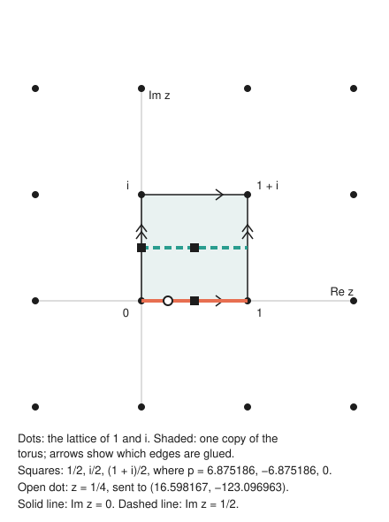

# Riemann surfaces: a complex curve is a surface, and a doughnut is a rolled-up plane

[Syllabus](../../../SYLLABUS.md) → [Algebraic geometry](../README.md) → [Plane Curves](../README.md#s03) → Riemann surfaces

---

## General Overview

Take the cubic curve $`y^2 = 4x^3 - 189.072720\,x`$ and allow x and y to be complex numbers. Its points no longer form a curve you can draw on paper. They form a surface, and that surface is a doughnut: a **torus**.

The torus can be made from the flat plane. Mark the points $`m + ni`$ for all whole numbers m and n: a square grid called a **lattice**. Declare two points of the plane the same when they differ by a lattice point. The plane rolls up into one unit square with opposite edges glued: a torus.

One function carries the plane onto the cubic. It is the **Weierstrass p-function**, written $`\wp`$ (a curly p). It repeats with every lattice step, so it is really a function on the torus. Send the point z of the plane to $`x = \wp(z)`$ and $`y = \wp'(z)`$, its derivative. For z = 1/4 that gives x = 16.598167 and y = −123.096963, and indeed $`(-123.096963)^2 = 15152.862387 = 4(16.598167)^3 - 189.072720 \times 16.598167`$.

The number 189.072720 is not chosen. It is a sum over the lattice. The square lattice also forces the curve's **j-invariant**, its shape number, to be exactly 1728.

**A lattice in the complex plane rolls the plane into a torus; the Weierstrass function and its derivative turn each point of that torus into a point of a cubic curve, and the cubic's coefficients are sums over the lattice.**

**What kind of fact this is:** theorems. That $`\wp`$ repeats and satisfies the cubic is proved on this card in Why it works. That every smooth complex cubic arises from some lattice is stated with key steps and a named source (Silverman, Theorem VI.5.1). The j-invariant is a definition.

### The picture: the square lattice, one torus, and where the real points live

<p align="center"></p>

Drawn to scale, 120 px per unit, real axis to the right. The solid line along the bottom edge and the dashed line halfway up are the two circles on the torus where x and y are both real. The solid one becomes the curve's unbounded real branch, $`x \ge 6.875186`$. The dashed one becomes the closed oval, $`-6.875186 \le x \le 0`$.

---

## The formula

New notation, in words first. A **lattice** $`\Lambda`$ (capital lambda) is the set of points $`m\omega_1 + n\omega_2`$ for whole numbers m and n, where the two **periods** $`\omega_1, \omega_2`$ point in different directions. Here $`\omega_1 = 1`$ and $`\omega_2 = \tau = i`$. A lattice point is written $`\omega`$, and $`\sum'`$ means a sum over every lattice point except 0.

```math
\wp(z) = \frac{1}{z^2} + {\sum_{\omega \in \Lambda}}' \left( \frac{1}{(z - \omega)^2} - \frac{1}{\omega^2} \right)
```

**Read it aloud:** p of z is one over z squared, plus, for every other lattice point, one over the square of z minus that lattice point, with that point's own value at zero taken away so the sum converges.

From the lattice come two numbers, the **lattice invariants**:

```math
g_2 = 60 \, {\sum_{\omega}}' \frac{1}{\omega^4}, \qquad g_3 = 140 \, {\sum_{\omega}}' \frac{1}{\omega^6}
```

and the function obeys one cubic equation:

```math
\wp'(z)^2 = 4\wp(z)^3 - g_2\,\wp(z) - g_3, \qquad j = \frac{1728\, g_2^3}{g_2^3 - 27 g_3^2}
```

**Read it aloud:** the derivative squared equals four times p cubed, minus g two times p, minus g three; and the j-invariant is 1728 times g two cubed over g two cubed minus 27 g three squared.

This j is the curve's shape number, not the j that stands for $`\sqrt{-1}`$ in the engineering wing. Python, in the code below, does write $`\sqrt{-1}`$ as j, so `2j` there means 2i.

Convention, said once: this card uses $`\wp`$'s normalisation $`y^2 = 4x^3 - g_2 x - g_3`$, with the 4. The short form $`y^2 = x^3 + ax + b`$ of [Weierstrass form](../04-Elliptic%20Curves/02-weierstrass-forms-discriminant-and-j-invariant.md) is the same curve after $`y \to 2y`$, with $`a = -g_2/4`$ and $`b = -g_3/4`$, and the same j.

For the square lattice, $`g_2 = 189.072720`$ and $`g_3 = 0`$, so $`j = 1728 g_2^3 / g_2^3 = 1728`$ exactly.

| Symbol | Plain meaning | In our example | Push it up and the answer… |
| --- | --- | --- | --- |
| $`z`$ | a point of the complex plane, read as a point of the torus | 1/4 | — |
| $`\Lambda`$, $`\omega`$ | the lattice; one of its points $`m + n\tau`$ | all $`m + ni`$; 1, i, 1 + i | — |
| $`m`$, $`n`$ | whole numbers counting lattice steps (in the code, m is also a chord's slope) | 0 to 200 in the sums | — |
| $`\tau`$, $`q`$, $`u`$, $`\sigma_k(n)`$ | the second period; $`q = e^{2\pi i\tau}`$; $`u = e^{2\pi i z}`$; the sum of the k-th powers of the divisors of n | i; 0.001867; —; $`\sigma_3(2) = 9`$ | taller lattice: q shrinks, j grows |
| $`\wp(z)`$, $`\wp'(z)`$ | the Weierstrass function and its derivative: the point's x and y | 16.598167 and −123.096963 at z = 1/4 | near a lattice point both blow up |
| $`G_4`$, $`G_6`$ | the lattice sums of $`\omega^{-4}`$ and $`\omega^{-6}`$ | 3.151212 and 0 | — |
| $`g_2`$, $`g_3`$ | the lattice invariants $`60G_4`$ and $`140G_6`$ | 189.072720 and 0 | shrink the lattice by $`\lambda`$: $`g_2`$ grows by $`\lambda^{-4}`$ |
| $`x`$, $`y`$, $`O`$ | coordinates on the cubic; its point at infinity (0 : 1 : 0), image of the lattice points ($`X`$, $`Y`$: shifted coordinates in Step 8) | (16.598167, −123.096963) | — |
| $`j`$ | the j-invariant: the torus's shape, blind to size and turning | 1728 | 287496 for the lattice of 1 and 2i |
| $`\varpi`$, $`\lambda`$ | the lemniscate constant, $`\pi`$ over the arithmetic-geometric mean of 1 and $`\sqrt 2`$ ($`\pi`$ times Gauss's constant 0.834627); a scale factor for the lattice | 2.622058; $`\lambda = \varpi`$ gives periods 2.622058 and 2.622058i | — |
| $`e_1, e_2, e_3`$ | the values of $`\wp`$ at the half periods 1/2, i/2, (1 + i)/2 | 6.875186, −6.875186, 0 | — |
| $`g`$, $`\ell(nO)`$ | genus (holes); the dimension of the functions with poles only at O, of order at most n | 1; $`\ell(6O) = 6`$ | — |

### When it holds

- **Two periods in different directions.** With only one period the "lattice" is a row of points; the plane rolls into a cylinder, not a torus, and the cubic gets a node. The house cubic $`y^2 = x^2(x + 1)`$ is exactly this case, worked below.
- **The correction terms $`-1/\omega^2`$.** Without them the sum $`\sum 1/(z - \omega)^2`$ does not converge absolutely: its value depends on the order of adding. A wide box gives 17.881179 at z = 1/4, not 16.598167.
- **Complex numbers, not real ones.** Over $`\mathbb{R}`$ the cubic is an oval and an unbounded branch; only over $`\mathbb{C}`$ is it one closed surface.
- **The 4 in the cubic.** It comes from $`(-2/z^3)^2 = 4/z^6`$; without it, $`(\wp, \wp')`$ is off the curve.
- **The cubic must be smooth for the converse.** Every cubic with $`g_2^3 - 27g_3^2 \ne 0`$ comes from a lattice; a cubic with $`g_2^3 = 27g_3^2`$ comes from none.

---

## Why it works

### Step 0: a function that repeats twice is a function on the torus

A function on the torus is the same thing as a function on the plane that repeats when z moves by 1 and when z moves by i. Such a function is called **doubly periodic**. The plan: build one by brute force, adding a copy of $`1/z^2`$ centred at every lattice point. Then ask what equation it obeys.

That the plane modulo a lattice (points that differ by a lattice point counted as one) is a torus is the gluing of [Subspace, product and quotient](../../17-Topology/02-Topological%20Spaces/04-subspace-product-and-quotient-topologies.md): glue the unit square's opposite edges. What is new here is that the gluing is by complex translations, so the torus keeps the notion of a complex derivative: it is a **Riemann surface**, a surface on which "holomorphic" (having a complex derivative) makes sense.

### Step 1: the cubic's complex points are already a torus

Before any lattice, count holes. Over $`\mathbb{C}`$, each x gives two values of y, $`\pm\sqrt{4x^3 - g_2 x - g_3}`$, except at the three roots $`e_1, e_2, e_3`$ and at infinity, where the two agree. [Branch cuts and complex powers](../../07-Complex%20analysis/02-Holomorphic%20Functions/05-branch-cuts-and-complex-powers.md) built the two-sheeted surface of a square root. Here it needs two cuts, from $`e_2`$ to $`e_3`$ and from $`e_1`$ to infinity.

Two spheres, each slit twice, glued edge to edge along the slits, give a torus. The count agrees with [Genus](06-genus-and-the-degree-genus-formula.md): a smooth plane cubic has genus $`(3 - 1)(3 - 2)/2 = 1`$, one hole. A surface with one hole is a torus, by [Closed surfaces classified](../../17-Topology/03-Surfaces%20and%20Manifolds/02-surfaces-and-the-classification-theorem.md).

### Step 2: the sum converges, and the function repeats

Far from z, the term $`1/(z - \omega)^2 - 1/\omega^2`$ is about $`2z/\omega^3`$. The number of lattice points at distance about r grows like r, so the terms add like $`\sum r \cdot r^{-3}`$, which converges. Without the correction each term is about $`1/\omega^2`$ and $`\sum r \cdot r^{-2}`$ diverges: that is why the correction is there.

The derivative is cleaner: $`\wp'(z) = -2\sum_{\omega} 1/(z - \omega)^3`$, over all lattice points. Shifting z by 1 only relabels the terms, so $`\wp'`$ repeats. Then $`\wp(z + 1) - \wp(z)`$ has zero derivative, so it is a constant c. $`\wp`$ is even ($`\wp(-z) = \wp(z)`$: replace each $`\omega`$ by $`-\omega`$). At $`z = -1/2`$: $`c = \wp(1/2) - \wp(-1/2) = 0`$. The same argument works for i.

### Step 3: the first few terms near 0 force the cubic

Near z = 0, expand each term in powers of z. The odd sums cancel in pairs $`\pm\omega`$, leaving a **Laurent series** (a power series allowed negative powers: [Laurent series](../../07-Complex%20analysis/05-Laurent%20Series%2C%20Singularities%20and%20Residues/01-laurent-series.md)):

```math
\wp(z) = \frac{1}{z^2} + 3G_4\, z^2 + 5G_6\, z^4 + \cdots = \frac{1}{z^2} + \frac{g_2}{20} z^2 + \frac{g_3}{28} z^4 + \cdots
```

**Read it aloud:** near zero, p is one over z squared plus g two over twenty times z squared plus g three over twenty-eight times z to the fourth, and so on.

Check on the square lattice: $`(\wp(0.01) - 1/0.01^2)/0.01^2 = 9.453636 = g_2/20`$.

Now cube $`\wp`$ and square $`\wp'`$, keeping terms down to $`z^0`$. The combination

```math
f(z) = \wp'(z)^2 - 4\wp(z)^3 + g_2\,\wp(z) + g_3
```

has every negative power cancel, and its constant term is $`-140G_6 + g_3 = 0`$. So f is doubly periodic, has no pole (a point where it blows up to infinity) anywhere, and is 0 at z = 0.

A doubly periodic function without poles is bounded: its values all occur on the closed unit square, where it is continuous. A bounded function holomorphic on the whole plane is constant, by [Liouville's theorem](../../07-Complex%20analysis/03-Contour%20Integrals%20and%20Cauchy%27s%20Theorem/07-liouville-and-the-fundamental-theorem-of-algebra.md). So f is the constant 0, which is the cubic.

<details>
<summary>Detailed algebra: the poles cancel</summary>

Write $`a = 3G_4`$ and $`b = 5G_6`$, so $`\wp = z^{-2} + a z^2 + b z^4 + O(z^6)`$, where $`O(z^6)`$ means terms of power 6 and up.

$`\displaystyle \wp' = -2z^{-3} + 2a z + 4b z^3 + O(z^5), \qquad \wp'^2 = 4z^{-6} - 8a z^{-2} - 16b + O(z^2).`$

$`\displaystyle \wp^3 = z^{-6} + 3a z^{-2} + 3b + O(z^2), \qquad 4\wp^3 = 4z^{-6} + 12a z^{-2} + 12b + O(z^2).`$

$`\displaystyle \wp'^2 - 4\wp^3 = -20a z^{-2} - 28b + O(z^2) = -60G_4\, \wp - 140G_6 + O(z^2).`$

The last step uses $`\wp = z^{-2} + O(z^2)`$. With $`g_2 = 60G_4`$ and $`g_3 = 140G_6`$, this is $`\wp'^2 - 4\wp^3 + g_2\wp + g_3 = O(z^2)`$.

</details>

### Step 4: the same cubic, counted by Riemann-Roch

[Divisors and Riemann-Roch](07-divisors-and-riemann-roch.md) gives a second reason. On a genus-1 surface, the functions whose only pole is at O, of order at most n, form a space of dimension $`\ell(nO) = n`$ for n ≥ 1.

- $`\ell(2O) = 2`$: the constants and $`x = \wp`$.
- $`\ell(3O) = 3`$: add $`y = \wp'`$.
- $`\ell(6O) = 6`$, yet seven functions lie in it: 1, x, y, $`x^2`$, xy, $`x^3`$, $`y^2`$.

Seven functions in a six-dimensional space satisfy a linear relation. Only $`x^3`$ and $`y^2`$ have a pole of order 6, so both appear: the relation is a cubic in x with $`y^2`$ on the other side. Step 3 computed its coefficients.

### Step 5: the map from the torus to the cubic is one-to-one and onto

Send z to $`(\wp(z), \wp'(z))`$, and the lattice points to O. For any number c, $`\wp - c`$ has one double pole on the torus, so exactly two zeros, counted with multiplicity: a function has as many zeros as poles. The zeros are z and −z, since $`\wp`$ is even, and their y-values are opposite, since $`\wp'`$ is odd. So each curve point comes from exactly one torus point.

At the half periods z and −z are the same point of the torus. There $`\wp' = 0`$: the curve crosses the x-axis at the three roots. The code finds $`\wp(1/2) = 6.875186 = \sqrt{g_2}/2`$, $`\wp(i/2) = -6.875186`$, $`\wp((1 + i)/2) = 0`$, the three roots of $`4x^3 - g_2 x`$.

The converse, that every smooth complex cubic comes from a lattice, needs j to take every complex value. That is the **uniformisation theorem for cubics**, proved in Silverman, Theorem VI.5.1, using the theory of modular functions.

### Step 6: adding on the torus is the group law on the cubic

Three points of the torus with $`z_1 + z_2 + z_3 = 0`$ go to three points on one straight line. The function $`y - (\text{line})`$ has a triple pole at O, so three zeros. By Abel's theorem, the zeros of a function on the torus minus its poles add up to a lattice point. Silverman, Chapter VI, proves it with a contour integral (an integral along a closed path) taken round the edge of a slightly shifted unit square, so that no zero or pole sits on the path. The poles sit at z = 0, so the three z-values add to a lattice point. The code tests $`z_1 = 0.1 + 0.2i`$ and $`z_2 = 0.3 - 0.05i`$. The chord through their images meets the curve again at $`x = 5.320945 - 2.321376i`$, which is $`\wp(z_3)`$, and the third point's height above the chord is 0.000000.

So plain addition in the plane becomes [The group law](../04-Elliptic%20Curves/01-elliptic-curves-and-the-group-law.md) on the cubic. That is why the group law is associative: addition of complex numbers is.

### Step 7: j measures the lattice's shape

Scale the lattice by a factor $`\lambda`$: every $`\omega`$ becomes $`\lambda\omega`$. Each $`\omega^{-4}`$ changes by $`\lambda^{-4}`$, each $`\omega^{-6}`$ by $`\lambda^{-6}`$, so $`g_2^3`$ and $`g_3^2`$ both scale by $`\lambda^{-12}`$, and j does not change. Scaling by the lemniscate constant $`\lambda = \varpi = 2.622058`$ gives the lattice of 2.622058 and 2.622058i, with $`g_2 = 189.072720/\varpi^4 = 4.000000`$: the curve becomes $`y^2 = 4x^3 - 4x`$, which is $`y^2 = x^3 - x`$ after $`y \to 2y`$, the j = 1728 curve of [Weierstrass form](../04-Elliptic%20Curves/02-weierstrass-forms-discriminant-and-j-invariant.md).

Why exactly 1728: turning the square lattice by a right angle gives the same lattice. Each $`\omega^{-6}`$ meets $`(i\omega)^{-6} = -\omega^{-6}`$, so $`G_6 = 0`$ and $`g_3 = 0`$. Then j is $`1728 g_2^3/g_2^3`$. The hexagonal lattice of 1 and $`(-1 + i\sqrt 3)/2`$ has a turn by a sixth of a circle instead, which kills $`G_4`$: $`g_2 = 0`$ and j = 0.

### Step 8: the house nodal cubic is a lattice that lost a period

Stretch the lattice of 1 and $`\tau`$ so that $`\tau`$ goes up the imaginary axis without end. Then $`q = e^{2\pi i \tau} \to 0`$ and the torus becomes an infinitely long cylinder, the plane modulo 1 alone. The q-series below give, at q = 0, $`g_2 = (4/3)\pi^4`$ and $`g_3 = (8/27)\pi^6`$, so $`g_2^3 - 27g_3^2 = 0`$.

Scale by $`\lambda = i\pi`$: $`g_2 = 4/3`$ and $`g_3 = -8/27`$. That is $`Y^2 = 4X^3 - \tfrac{4}{3}X + \tfrac{8}{27}`$, and with $`x = X - 1/3`$, $`y = Y/2`$ it is the house cubic $`y^2 = x^3 + x^2`$ exactly. Its node is where the cylinder's two far ends meet: [Nodes and cusps](04-singularities-nodes-and-cusps.md). On the cylinder, before scaling, $`\wp`$ becomes $`\pi^2/\sin^2(\pi z) - \pi^2/3`$, a trigonometric function, and j has no value.

---

## Worked numbers, by hand

The lattice sums converge slowly, so the code also uses the **q-series**, a fast rewriting of the same sums (Koblitz, Chapter III): $`g_2 = \tfrac{4\pi^4}{3}(1 + 240\sum \sigma_3(n) q^n)`$ and $`g_3 = \tfrac{8\pi^6}{27}(1 - 504\sum \sigma_5(n) q^n)`$, where $`\sigma_k(n)`$ adds the k-th powers of the divisors of n.

| Step | Arithmetic | Value |
| --- | --- | --- |
| q for the square lattice | $`e^{-2\pi}`$ | 0.001867 |
| $`g_2`$, lattice sum out to 200 steps each way | $`60 \times 4 \times`$ (the sum over one quarter of the lattice) | 189.072223 |
| $`g_2`$, 100 and 200 steps combined | $`(4 \times 189.072223 - 189.070740)/3`$ | 189.072717 |
| $`g_2`$, q-series | $`\tfrac{4\pi^4}{3}(1 + 240 \times (0.001867 + 9 \times 0.001867^2 + \dots))`$ | 189.072720 |
| $`g_2`$, lemniscate constant | $`4 \times 2.622058^4`$ | 189.072720 |
| $`g_3`$ | turning by i cancels the $`\omega^{-6}`$ in fours | 0 |
| j | $`1728 g_2^3 / (g_2^3 - 0)`$ | **1728** |
| $`\wp(1/4)`$, $`\wp'(1/4)`$ | q-series, checked by the lattice sum | 16.598167, −123.096963 |
| on the cubic? | $`123.096963^2`$ against $`4 \times 16.598167^3 - 189.072720 \times 16.598167`$ | 15152.862387 both |

The square lattice, through one sum, gives the curve $`y^2 = 4x^3 - 189.072720\,x`$, and z = 1/4 lands on it.

### What breaks if you drop a piece

| Mistake | Comes out at | What went wrong |
| --- | --- | --- |
| Drop the $`-1/\omega^2`$ terms, add over a box 401 wide and 201 tall | 17.881179, not 16.598167 | Without the correction the sum depends on the order of adding; a square box hides this (16.598161), because $`\omega^{-2}`$ cancels in fours there |
| Write the cubic as $`y^2 = x^3 - g_2 x`$ | 1434.520181 against $`\wp'^2 = 15152.862387`$ | The 4 comes from $`(-2/z^3)^2`$ |
| Use $`G_4 = 3.151212`$ as $`g_2`$ | $`4\wp^3 - G_4\wp = 18238.818599`$ | $`g_2`$ is $`60G_4`$; the 60 makes the poles cancel |
| One period only: the house cubic $`y^2 = x^3 + x^2`$ | $`g_2^3 - 27g_3^2 = 0`$, j undefined | Not a lattice: the torus pinches to a node, and no lattice gives this curve |

The code prints all four.

---

## Code, from first principles, and it actually runs

The code uses complex arithmetic only, with no elliptic-function library; Rust defines its own complex type. It reaches $`g_2`$ by **three independent roads**: the lattice sum (out to 100 and 200 steps, combined to cancel the error of stopping), the q-series, and the lemniscate constant from the arithmetic-geometric mean. It reaches $`\wp`$ and $`\wp'`$ by **two roads**: the q-series in $`u = e^{2\pi i z}`$ and the defining lattice sum. That lattice sum runs over a square box, where the $`-1/\omega^2`$ terms cancel in fours, so it does not test them; What breaks tests them on a wide box instead. Then it tests the cubic, the half periods, the Laurent coefficient, three points on a line, j for three lattices, the house cubic in exact fractions, and every mistake above.

### Python

```python
# Riemann surfaces and the Weierstrass p-function -- the check behind the card.
# Standard library only. The lattice is 1 and i. Three roads to g2 (lattice sum,
# q-series, lemniscate constant by the AGM), two roads to p(z) (q-series, lattice
# sum), then the cubic, j, three points on a line, the nodal cubic, the mistakes.
from cmath import exp
from math import pi, sqrt
from fractions import Fraction as Fr

def f6(x):                       # print a real number, never as -0.000000
    return f"{0.0 if abs(x) < 5e-7 else x:.6f}"

def fc(z):                       # print a complex number as a + bi
    re, im = (0.0 if abs(t) < 5e-7 else t for t in (z.real, z.imag))
    return f"{re:.6f}" if im == 0 else f"{re:.6f} {'-' if im < 0 else '+'} {abs(im):.6f}i"

def sigma(n, k):                 # sum of the k-th powers of the divisors of n
    return sum(d ** k for d in range(1, n + 1) if n % d == 0)

def g2g3_q(tau, terms=30):       # road 2: Eisenstein q-series, lattice 1 and tau
    q = exp(2j * pi * tau)
    s3 = sum(sigma(n, 3) * q ** n for n in range(1, terms))
    s5 = sum(sigma(n, 5) * q ** n for n in range(1, terms))
    return 60 * pi ** 4 / 45 * (1 + 240 * s3), 140 * 2 * pi ** 6 / 945 * (1 - 504 * s5), s5

def g2_lattice(N):               # road 1: 60 x sum of w^-4 over the box max(m, n) <= N
    s = 0.0                      # one quarter of the lattice; w^-4 is unchanged by w -> iw
    for m in range(1, N + 1):
        for n in range(0, N + 1):
            w = complex(m, n)
            s += (1 / (w * w * w * w)).real
    return 60 * 4 * s

Q = exp(-2 * pi).real            # q for tau = i
def p_q(z, terms=12):            # p(z) and p'(z) by the q-series in u = e^(2 pi i z)
    u = exp(2j * pi * z)
    s, d = 1 / 12 + u / (1 - u) ** 2, u * (1 + u) / (1 - u) ** 3
    for n in range(1, terms):
        a, b = Q ** n * u, Q ** n / u
        s += a / (1 - a) ** 2 + b / (1 - b) ** 2 - 2 * Q ** n / (1 - Q ** n) ** 2
        d += a * (1 + a) / (1 - a) ** 3 - b * (1 + b) / (1 - b) ** 3
    return -4 * pi * pi * s, -4 * pi * pi * 2j * pi * d

def p_lattice(z, N):             # p(z), p'(z) by the defining sum over the box |m|, |n| <= N
    s, d = 1 / z ** 2, -2 / z ** 3
    for m in range(-N, N + 1):
        for n in range(-N, N + 1):
            if m or n:
                w = complex(m, n)
                s += 1 / (z - w) ** 2 - 1 / w ** 2
                d += -2 / (z - w) ** 3
    return s, d

def richardson(f, z):            # the box error falls like 1/N^2: combine N = 30 and 60
    (s1, d1), (s2, d2) = f(z, 30), f(z, 60)
    return (4 * s2 - s1) / 3, (4 * d2 - d1) / 3

print(f"lattice 1 and i: tau = i, q = e^(-2 pi) = {f6(Q)}")
a100, a200 = g2_lattice(100), g2_lattice(200)
road1 = (4 * a200 - a100) / 3
print(f"road 1, lattice sum 60 G4: N = 100 {f6(a100)}, N = 200 {f6(a200)}, extrapolated {f6(road1)}")
g2, g3, s5 = g2g3_q(1j)
g2, g3 = g2.real, g3.real
print(f"road 2, q-series: g2 = {f6(g2)}, g3 = {f6(g3)} (504 x sum sigma5 q^n = {504 * s5.real:.9f}); sigma3(2) = {sigma(2, 3)}")
x, y = 1.0, sqrt(2)
for _ in range(8):
    x, y = (x + y) / 2, sqrt(x * y)
varpi = pi / x
print(f"road 3, lemniscate constant varpi = pi/AGM(1, sqrt 2) = {f6(varpi)}, pi times Gauss's constant {f6(1 / x)}: 4 x varpi^4 = {f6(4 * varpi ** 4)}")
assert abs(road1 - g2) < 1e-4 and abs(4 * varpi ** 4 - g2) < 1e-9 and abs(g3) < 1e-9
j = 1728 * g2 ** 3 / (g2 ** 3 - 27 * g3 ** 2)
print(f"j = 1728 g2^3/(g2^3 - 27 g3^2) = {f6(j)}; lattice scaled by varpi: g2 = {f6(g2 / varpi ** 4)}")
assert abs(j - 1728) < 1e-9 and abs(g2 / varpi ** 4 - 4) < 1e-12
h2, h3, _ = g2g3_q(2j)
j2 = (1728 * h2 ** 3 / (h2 ** 3 - 27 * h3 ** 2)).real
print(f"lattice 1 and 2i: j = {j2:.3f}; 66^3 = {66 ** 3}")
assert abs(j2 - 66 ** 3) < 1e-3
k2, k3, _ = g2g3_q(complex(-0.5, sqrt(3) / 2))
j3 = (1728 * k2 ** 3 / (k2 ** 3 - 27 * k3 ** 2)).real
print(f"lattice 1 and (-1 + i sqrt 3)/2: g2 = {fc(k2)}, g3 = {fc(k3)}, j = {f6(j3)}")
assert abs(k2) < 1e-9 and abs(k3) > 100 and abs(j3) < 1e-9
for name, z, root in [("1/2", 0.5, sqrt(g2) / 2), ("i/2", 0.5j, -sqrt(g2) / 2), ("(1+i)/2", 0.5 + 0.5j, 0.0)]:
    pz, dz = p_q(z)
    print(f"p({name}) = {fc(pz)}, p'({name}) = {fc(dz)}; root of 4x^3 - g2 x: {f6(root)}")
    assert abs(pz - root) < 1e-9 and abs(dz) < 1e-9
for z in (0.25, 0.25 + 0.5j, 0.3 + 0.2j):
    (pz, dz), (pl, dl) = p_q(z), richardson(p_lattice, z)
    print(f"z = {fc(z)}: p = {fc(pz)}, p' = {fc(dz)}")
    print(f"  lattice sum: p = {fc(pl)}, p' = {fc(dl)}")
    rhs = 4 * pz ** 3 - g2 * pz
    print(f"  p'^2 = {fc(dz * dz)}, 4p^3 - g2 p = {fc(rhs)}")
    assert abs(pz - pl) < 1e-5 and abs(dz - dl) < 1e-3 and abs(dz * dz - rhs) < 1e-9 * abs(rhs)
z = 0.01
lau = ((p_q(z)[0] - 1 / z ** 2) / z ** 2).real
print(f"Laurent: (p(0.01) - 1/0.01^2)/0.01^2 = {f6(lau)}; g2/20 = {f6(g2 / 20)}")
assert abs(lau - g2 / 20) < 1e-5
z1, z2 = 0.1 + 0.2j, 0.3 - 0.05j
z3 = -(z1 + z2)
(x1, y1), (x2, y2), (x3, y3) = p_q(z1), p_q(z2), p_q(z3)
m = (y2 - y1) / (x2 - x1)
print(f"z1 + z2 + z3 = 0: P1 = ({fc(x1)}, {fc(y1)}), P2 = ({fc(x2)}, {fc(y2)})")
print(f"  chord slope m = {fc(m)}; third x = m^2/4 - x1 - x2 = {fc(m * m / 4 - x1 - x2)}")
print(f"  p(z3) = {fc(x3)}; height of P3 above the chord = {fc(y3 - (y1 + m * (x3 - x1)))}")
assert abs(m * m / 4 - x1 - x2 - x3) < 1e-9 and abs(y3 - (y1 + m * (x3 - x1))) < 1e-8
G2, G3 = Fr(60, 45), Fr(140 * 2, 945)          # q = 0: the constant terms over pi^4, pi^6
s = Fr(-1, 3)                                  # y^2 = x^3 + x^2 with x = X + s, y = Y/2
c2, c3 = -4 * (3 * s * s + 2 * s), -4 * (s ** 3 + s ** 2)
print(f"q = 0: g2/pi^4 = {G2}, g3/pi^6 = {G3}; g2^3 - 27 g3^2 = {G2 ** 3 - 27 * G3 ** 2}")
print(f"house y^2 = x^3 + x^2 as Y^2 = 4X^3 - g2 X - g3: g2 = {c2}, g3 = {c3}, g2^3 - 27 g3^2 = {c2 ** 3 - 27 * c3 ** 2}")
assert (c2, c3) == (G2, -G3) and c2 ** 3 == 27 * c3 ** 2
print("mistakes, at z = 1/4:")
sq = sum(1 / (0.25 - complex(m, n)) ** 2 for m in range(-100, 101) for n in range(-100, 101)).real
wide = sum(1 / (0.25 - complex(m, n)) ** 2 for m in range(-200, 201) for n in range(-100, 101)).real
pz, dz = (t.real for t in p_q(0.25))
print(f"  no -1/w^2 terms: square box {f6(sq)}, wide box {f6(wide)}; true p = {f6(pz)}")
print(f"  y^2 = x^3 - g2 x without the 4: {f6(pz ** 3 - g2 * pz)}, but p'^2 = {f6(dz * dz)}")
print(f"  G4 = {f6(g2 / 60)} used as g2: 4p^3 - G4 p = {f6(4 * pz ** 3 - g2 / 60 * pz)}")
assert abs(wide - pz) > 1 and abs(pz ** 3 - g2 * pz - dz * dz) > 1000
px = lambda z: f"({160 + round(120 * z.real)}, {340 - round(120 * z.imag)})"
print("figure, 120 px per unit: 0, 1, 1+i, i at", *(px(z) for z in (0, 1, 1 + 1j, 1j)))
print("figure, 1/2, i/2, (1+i)/2, 1/4 at", *(px(z) for z in (0.5, 0.5j, 0.5 + 0.5j, 0.25)))
print("ALL CHECKS PASS")
```

**Ran 2026-11-17 on macOS, Python 3.14.10, standard library only. All checks passed. Output, pasted from the run:**

```
lattice 1 and i: tau = i, q = e^(-2 pi) = 0.001867
road 1, lattice sum 60 G4: N = 100 189.070740, N = 200 189.072223, extrapolated 189.072717
road 2, q-series: g2 = 189.072720, g3 = 0.000000 (504 x sum sigma5 q^n = 1.000000000); sigma3(2) = 9
road 3, lemniscate constant varpi = pi/AGM(1, sqrt 2) = 2.622058, pi times Gauss's constant 0.834627: 4 x varpi^4 = 189.072720
j = 1728 g2^3/(g2^3 - 27 g3^2) = 1728.000000; lattice scaled by varpi: g2 = 4.000000
lattice 1 and 2i: j = 287496.000; 66^3 = 287496
lattice 1 and (-1 + i sqrt 3)/2: g2 = 0.000000, g3 = 820.824437, j = 0.000000
p(1/2) = 6.875186, p'(1/2) = 0.000000; root of 4x^3 - g2 x: 6.875186
p(i/2) = -6.875186, p'(i/2) = 0.000000; root of 4x^3 - g2 x: -6.875186
p((1+i)/2) = 0.000000, p'((1+i)/2) = 0.000000; root of 4x^3 - g2 x: 0.000000
z = 0.250000: p = 16.598167, p' = -123.096963
  lattice sum: p = 16.598166, p' = -123.096966
  p'^2 = 15152.862387, 4p^3 - g2 p = 15152.862387
z = 0.250000 + 0.500000i: p = -2.847795, p' = 21.120100
  lattice sum: p = -2.847794 - 0.000001i, p' = 21.120097 - 0.000006i
  p'^2 = 446.058621, 4p^3 - g2 p = 446.058621
z = 0.300000 + 0.200000i: p = 3.372104 - 5.991419i, p' = 12.822790 + 45.838888i
  lattice sum: p = 3.372103 - 5.991419i, p' = 12.822787 + 45.838886i
  p'^2 = -1936.779714 + 1175.564915i, 4p^3 - g2 p = -1936.779714 + 1175.564915i
Laurent: (p(0.01) - 1/0.01^2)/0.01^2 = 9.453636; g2/20 = 9.453636
z1 + z2 + z3 = 0: P1 = (-12.280123 - 15.620557i, 177.963491 - 28.286776i), P2 = (11.066529 + 3.202582i, -56.554911 - 35.095603i)
  chord slope m = -6.230296 + 4.731509i; third x = m^2/4 - x1 - x2 = 5.320945 - 2.321376i
  p(z3) = 5.320945 - 2.321376i; height of P3 above the chord = 0.000000
q = 0: g2/pi^4 = 4/3, g3/pi^6 = 8/27; g2^3 - 27 g3^2 = 0
house y^2 = x^3 + x^2 as Y^2 = 4X^3 - g2 X - g3: g2 = 4/3, g3 = -8/27, g2^3 - 27 g3^2 = 0
mistakes, at z = 1/4:
  no -1/w^2 terms: square box 16.598161, wide box 17.881179; true p = 16.598167
  y^2 = x^3 - g2 x without the 4: 1434.520181, but p'^2 = 15152.862387
  G4 = 3.151212 used as g2: 4p^3 - G4 p = 18238.818599
figure, 120 px per unit: 0, 1, 1+i, i at (160, 340) (280, 340) (280, 220) (160, 220)
figure, 1/2, i/2, (1+i)/2, 1/4 at (220, 340) (160, 280) (220, 280) (190, 340)
ALL CHECKS PASS
```

### Rust

```rust
// Riemann surfaces and the Weierstrass p-function -- the check behind the card.
// std only. The lattice is 1 and i. Three roads to g2 (lattice sum, q-series,
// lemniscate constant by the AGM), two roads to p(z) (q-series, lattice sum), then
// the cubic, j, three points on a line, the nodal cubic, the mistakes.
use std::f64::consts::PI;
use std::ops::{Add, Div, Mul, Neg, Sub};

#[derive(Clone, Copy, PartialEq)]
struct C { re: f64, im: f64 }
fn c(re: f64, im: f64) -> C { C { re, im } }
impl Add for C { type Output = C; fn add(self, o: C) -> C { c(self.re + o.re, self.im + o.im) } }
impl Sub for C { type Output = C; fn sub(self, o: C) -> C { c(self.re - o.re, self.im - o.im) } }
impl Neg for C { type Output = C; fn neg(self) -> C { c(-self.re, -self.im) } }
impl Mul for C { type Output = C; fn mul(self, o: C) -> C { c(self.re * o.re - self.im * o.im, self.re * o.im + self.im * o.re) } }
impl Div for C { type Output = C;
    fn div(self, o: C) -> C { let d = o.re * o.re + o.im * o.im;
        c((self.re * o.re + self.im * o.im) / d, (self.im * o.re - self.re * o.im) / d) } }
impl C {
    fn r(x: f64) -> C { c(x, 0.0) }
    fn abs(self) -> f64 { self.re.hypot(self.im) }
    fn exp(self) -> C { let e = self.re.exp(); c(e * self.im.cos(), e * self.im.sin()) }
    fn sc(self, k: f64) -> C { c(self.re * k, self.im * k) }
    fn pw(self, n: u32) -> C { (0..n).fold(C::r(1.0), |a, _| a * self) }
}
fn f6(x: f64) -> String { format!("{:.6}", if x.abs() < 5e-7 { 0.0 } else { x }) }
fn fc(z: C) -> String {
    let re = if z.re.abs() < 5e-7 { 0.0 } else { z.re };
    let im = if z.im.abs() < 5e-7 { 0.0 } else { z.im };
    if im == 0.0 { format!("{:.6}", re) }
    else { format!("{:.6} {} {:.6}i", re, if im < 0.0 { "-" } else { "+" }, im.abs()) }
}
fn sigma(n: u64, k: u32) -> f64 { (1..=n).filter(|d| n % d == 0).map(|d| (d as f64).powi(k as i32)).sum() }
fn g2g3_q(tau: C) -> (C, C, C) {      // road 2: Eisenstein q-series, lattice 1 and tau
    let q = (c(0.0, 2.0 * PI) * tau).exp();
    let (mut s3, mut s5) = (C::r(0.0), C::r(0.0));
    for n in 1..30u64 { s3 = s3 + q.pw(n as u32).sc(sigma(n, 3)); s5 = s5 + q.pw(n as u32).sc(sigma(n, 5)); }
    ((C::r(1.0) + s3.sc(240.0)).sc(60.0 * PI.powi(4) / 45.0),
     (C::r(1.0) - s5.sc(504.0)).sc(140.0 * 2.0 * PI.powi(6) / 945.0), s5)
}
fn g2_lattice(n_max: i64) -> f64 {    // road 1: 60 x sum of w^-4, one quarter of the box
    let mut s = 0.0;
    for m in 1..=n_max { for n in 0..=n_max { let w = c(m as f64, n as f64); s += (C::r(1.0) / (w * w * w * w)).re; } }
    60.0 * 4.0 * s
}
fn p_q(z: C, q: f64) -> (C, C) {      // p(z), p'(z) by the q-series in u = e^(2 pi i z)
    let one = C::r(1.0);
    let u = (c(0.0, 2.0 * PI) * z).exp();
    let mut s = C::r(1.0 / 12.0) + u / (one - u).pw(2);
    let mut d = u * (one + u) / (one - u).pw(3);
    for n in 1..12 {
        let qn = q.powi(n);
        let (a, b) = (u.sc(qn), C::r(qn) / u);
        s = s + a / (one - a).pw(2) + b / (one - b).pw(2) - C::r(2.0 * qn / (1.0 - qn).powi(2));
        d = d + a * (one + a) / (one - a).pw(3) - b * (one + b) / (one - b).pw(3);
    }
    (s.sc(-4.0 * PI * PI), d.sc(-4.0 * PI * PI) * c(0.0, 2.0 * PI))
}
fn p_lattice(z: C, nb: i64) -> (C, C) { // p(z), p'(z) by the defining sum, box |m|, |n| <= N
    let one = C::r(1.0);
    let (mut s, mut d) = (one / z.pw(2), C::r(-2.0) / z.pw(3));
    for m in -nb..=nb { for n in -nb..=nb { if m != 0 || n != 0 {
        let w = c(m as f64, n as f64);
        s = s + one / (z - w).pw(2) - one / w.pw(2);
        d = d + C::r(-2.0) / (z - w).pw(3);
    } } }
    (s, d)
}
fn richardson(z: C) -> (C, C) {
    let ((s1, d1), (s2, d2)) = (p_lattice(z, 30), p_lattice(z, 60));
    ((s2.sc(4.0) - s1).sc(1.0 / 3.0), (d2.sc(4.0) - d1).sc(1.0 / 3.0))
}
#[derive(Clone, Copy, PartialEq, Debug)]
struct Fr { n: i128, d: i128 }
fn gcd(a: i128, b: i128) -> i128 { if b == 0 { a.abs() } else { gcd(b, a % b) } }
fn fr(n: i128, d: i128) -> Fr { let g = gcd(n, d) * d.signum(); Fr { n: n / g, d: d / g } }
impl Add for Fr { type Output = Fr; fn add(self, o: Fr) -> Fr {
    fr(self.n.checked_mul(o.d).unwrap() + o.n.checked_mul(self.d).unwrap(), self.d.checked_mul(o.d).unwrap()) } }
impl Sub for Fr { type Output = Fr; fn sub(self, o: Fr) -> Fr { self + fr(-o.n, o.d) } }
impl Mul for Fr { type Output = Fr; fn mul(self, o: Fr) -> Fr { fr(self.n.checked_mul(o.n).unwrap(), self.d.checked_mul(o.d).unwrap()) } }
impl std::fmt::Display for Fr { fn fmt(&self, f: &mut std::fmt::Formatter) -> std::fmt::Result {
    if self.d == 1 { write!(f, "{}", self.n) } else { write!(f, "{}/{}", self.n, self.d) } } }

fn main() {
    let q = (-2.0 * PI).exp();
    println!("lattice 1 and i: tau = i, q = e^(-2 pi) = {}", f6(q));
    let (a100, a200) = (g2_lattice(100), g2_lattice(200));
    let road1 = (4.0 * a200 - a100) / 3.0;
    println!("road 1, lattice sum 60 G4: N = 100 {}, N = 200 {}, extrapolated {}", f6(a100), f6(a200), f6(road1));
    let (g2c, g3c, s5) = g2g3_q(c(0.0, 1.0));
    let (g2, g3) = (g2c.re, g3c.re);
    println!("road 2, q-series: g2 = {}, g3 = {} (504 x sum sigma5 q^n = {:.9}); sigma3(2) = {}", f6(g2), f6(g3), 504.0 * s5.re, sigma(2, 3));
    let (mut x, mut y) = (1.0f64, 2.0f64.sqrt());
    for _ in 0..8 { let (a, b) = ((x + y) / 2.0, (x * y).sqrt()); x = a; y = b; }
    let varpi = PI / x;
    println!("road 3, lemniscate constant varpi = pi/AGM(1, sqrt 2) = {}, pi times Gauss's constant {}: 4 x varpi^4 = {}", f6(varpi), f6(1.0 / x), f6(4.0 * varpi.powi(4)));
    assert!((road1 - g2).abs() < 1e-4 && (4.0 * varpi.powi(4) - g2).abs() < 1e-9 && g3.abs() < 1e-9);
    let j = 1728.0 * g2.powi(3) / (g2.powi(3) - 27.0 * g3 * g3);
    println!("j = 1728 g2^3/(g2^3 - 27 g3^2) = {}; lattice scaled by varpi: g2 = {}", f6(j), f6(g2 / varpi.powi(4)));
    assert!((j - 1728.0).abs() < 1e-9 && (g2 / varpi.powi(4) - 4.0).abs() < 1e-12);
    let (h2, h3, _) = g2g3_q(c(0.0, 2.0));
    let j2 = (C::r(1728.0) * h2.pw(3) / (h2.pw(3) - h3.pw(2).sc(27.0))).re;
    println!("lattice 1 and 2i: j = {:.3}; 66^3 = {}", j2, 66i64.pow(3));
    assert!((j2 - 287496.0).abs() < 1e-3);
    let (k2, k3, _) = g2g3_q(c(-0.5, 3.0f64.sqrt() / 2.0));
    let j3 = (C::r(1728.0) * k2.pw(3) / (k2.pw(3) - k3.pw(2).sc(27.0))).re;
    println!("lattice 1 and (-1 + i sqrt 3)/2: g2 = {}, g3 = {}, j = {}", fc(k2), fc(k3), f6(j3));
    assert!(k2.abs() < 1e-9 && k3.abs() > 100.0 && j3.abs() < 1e-9);
    for (name, z, root) in [("1/2", c(0.5, 0.0), g2.sqrt() / 2.0), ("i/2", c(0.0, 0.5), -g2.sqrt() / 2.0), ("(1+i)/2", c(0.5, 0.5), 0.0)] {
        let (pz, dz) = p_q(z, q);
        println!("p({}) = {}, p'({}) = {}; root of 4x^3 - g2 x: {}", name, fc(pz), name, fc(dz), f6(root));
        assert!((pz - C::r(root)).abs() < 1e-9 && dz.abs() < 1e-9);
    }
    for z in [c(0.25, 0.0), c(0.25, 0.5), c(0.3, 0.2)] {
        let ((pz, dz), (pl, dl)) = (p_q(z, q), richardson(z));
        println!("z = {}: p = {}, p' = {}", fc(z), fc(pz), fc(dz));
        println!("  lattice sum: p = {}, p' = {}", fc(pl), fc(dl));
        let rhs = pz.pw(3).sc(4.0) - pz.sc(g2);
        println!("  p'^2 = {}, 4p^3 - g2 p = {}", fc(dz * dz), fc(rhs));
        assert!((pz - pl).abs() < 1e-5 && (dz - dl).abs() < 1e-3 && (dz * dz - rhs).abs() < 1e-9 * rhs.abs());
    }
    let z = 0.01;
    let lau = ((p_q(C::r(z), q).0 - C::r(1.0 / (z * z))) / C::r(z * z)).re;
    println!("Laurent: (p(0.01) - 1/0.01^2)/0.01^2 = {}; g2/20 = {}", f6(lau), f6(g2 / 20.0));
    assert!((lau - g2 / 20.0).abs() < 1e-5);
    let (z1, z2) = (c(0.1, 0.2), c(0.3, -0.05));
    let z3 = -(z1 + z2);
    let ((x1, y1), (x2, y2), (x3, y3)) = (p_q(z1, q), p_q(z2, q), p_q(z3, q));
    let m = (y2 - y1) / (x2 - x1);
    println!("z1 + z2 + z3 = 0: P1 = ({}, {}), P2 = ({}, {})", fc(x1), fc(y1), fc(x2), fc(y2));
    println!("  chord slope m = {}; third x = m^2/4 - x1 - x2 = {}", fc(m), fc(m * m / C::r(4.0) - x1 - x2));
    println!("  p(z3) = {}; height of P3 above the chord = {}", fc(x3), fc(y3 - (y1 + m * (x3 - x1))));
    assert!((m * m / C::r(4.0) - x1 - x2 - x3).abs() < 1e-9 && (y3 - (y1 + m * (x3 - x1))).abs() < 1e-8);
    let (gg2, gg3) = (fr(60, 45), fr(140 * 2, 945));
    let s = fr(-1, 3);
    let (c2, c3) = (fr(-4, 1) * (fr(3, 1) * s * s + fr(2, 1) * s), fr(-4, 1) * (s * s * s + s * s));
    let cube = |a: Fr| a * a * a;
    println!("q = 0: g2/pi^4 = {}, g3/pi^6 = {}; g2^3 - 27 g3^2 = {}", gg2, gg3, cube(gg2) - fr(27, 1) * gg3 * gg3);
    println!("house y^2 = x^3 + x^2 as Y^2 = 4X^3 - g2 X - g3: g2 = {}, g3 = {}, g2^3 - 27 g3^2 = {}", c2, c3, cube(c2) - fr(27, 1) * c3 * c3);
    assert!(c2 == gg2 && c3 == fr(-gg3.n, gg3.d) && cube(c2) == fr(27, 1) * c3 * c3);
    println!("mistakes, at z = 1/4:");
    let zq = C::r(0.25);
    let box_sum = |mw: i64| { let mut t = C::r(0.0);
        for m in -mw..=mw { for n in -100..=100i64 { t = t + C::r(1.0) / (zq - c(m as f64, n as f64)).pw(2); } } t.re };
    let (sq, wide) = (box_sum(100), box_sum(200));
    let (pz, dz) = { let (a, b) = p_q(zq, q); (a.re, b.re) };
    println!("  no -1/w^2 terms: square box {}, wide box {}; true p = {}", f6(sq), f6(wide), f6(pz));
    println!("  y^2 = x^3 - g2 x without the 4: {}, but p'^2 = {}", f6(pz.powi(3) - g2 * pz), f6(dz * dz));
    println!("  G4 = {} used as g2: 4p^3 - G4 p = {}", f6(g2 / 60.0), f6(4.0 * pz.powi(3) - g2 / 60.0 * pz));
    assert!((wide - pz).abs() > 1.0 && (pz.powi(3) - g2 * pz - dz * dz).abs() > 1000.0);
    let px = |z: C| format!("({}, {})", 160 + (120.0 * z.re).round() as i64, 340 - (120.0 * z.im).round() as i64);
    let pts = |zs: &[C]| zs.iter().map(|&z| px(z)).collect::<Vec<_>>().join(" ");
    println!("figure, 120 px per unit: 0, 1, 1+i, i at {}", pts(&[c(0.0, 0.0), c(1.0, 0.0), c(1.0, 1.0), c(0.0, 1.0)]));
    println!("figure, 1/2, i/2, (1+i)/2, 1/4 at {}", pts(&[c(0.5, 0.0), c(0.0, 0.5), c(0.5, 0.5), c(0.25, 0.0)]));
    println!("ALL CHECKS PASS");
}
```

**Ran 2026-11-17 on macOS, rustc 1.98.1, no crates. All checks passed. Output, pasted from the run:**

```
lattice 1 and i: tau = i, q = e^(-2 pi) = 0.001867
road 1, lattice sum 60 G4: N = 100 189.070740, N = 200 189.072223, extrapolated 189.072717
road 2, q-series: g2 = 189.072720, g3 = 0.000000 (504 x sum sigma5 q^n = 1.000000000); sigma3(2) = 9
road 3, lemniscate constant varpi = pi/AGM(1, sqrt 2) = 2.622058, pi times Gauss's constant 0.834627: 4 x varpi^4 = 189.072720
j = 1728 g2^3/(g2^3 - 27 g3^2) = 1728.000000; lattice scaled by varpi: g2 = 4.000000
lattice 1 and 2i: j = 287496.000; 66^3 = 287496
lattice 1 and (-1 + i sqrt 3)/2: g2 = 0.000000, g3 = 820.824437, j = 0.000000
p(1/2) = 6.875186, p'(1/2) = 0.000000; root of 4x^3 - g2 x: 6.875186
p(i/2) = -6.875186, p'(i/2) = 0.000000; root of 4x^3 - g2 x: -6.875186
p((1+i)/2) = 0.000000, p'((1+i)/2) = 0.000000; root of 4x^3 - g2 x: 0.000000
z = 0.250000: p = 16.598167, p' = -123.096963
  lattice sum: p = 16.598166, p' = -123.096966
  p'^2 = 15152.862387, 4p^3 - g2 p = 15152.862387
z = 0.250000 + 0.500000i: p = -2.847795, p' = 21.120100
  lattice sum: p = -2.847794 - 0.000001i, p' = 21.120097 - 0.000006i
  p'^2 = 446.058621, 4p^3 - g2 p = 446.058621
z = 0.300000 + 0.200000i: p = 3.372104 - 5.991419i, p' = 12.822790 + 45.838888i
  lattice sum: p = 3.372103 - 5.991419i, p' = 12.822787 + 45.838886i
  p'^2 = -1936.779714 + 1175.564915i, 4p^3 - g2 p = -1936.779714 + 1175.564915i
Laurent: (p(0.01) - 1/0.01^2)/0.01^2 = 9.453636; g2/20 = 9.453636
z1 + z2 + z3 = 0: P1 = (-12.280123 - 15.620557i, 177.963491 - 28.286776i), P2 = (11.066529 + 3.202582i, -56.554911 - 35.095603i)
  chord slope m = -6.230296 + 4.731509i; third x = m^2/4 - x1 - x2 = 5.320945 - 2.321376i
  p(z3) = 5.320945 - 2.321376i; height of P3 above the chord = 0.000000
q = 0: g2/pi^4 = 4/3, g3/pi^6 = 8/27; g2^3 - 27 g3^2 = 0
house y^2 = x^3 + x^2 as Y^2 = 4X^3 - g2 X - g3: g2 = 4/3, g3 = -8/27, g2^3 - 27 g3^2 = 0
mistakes, at z = 1/4:
  no -1/w^2 terms: square box 16.598161, wide box 17.881179; true p = 16.598167
  y^2 = x^3 - g2 x without the 4: 1434.520181, but p'^2 = 15152.862387
  G4 = 3.151212 used as g2: 4p^3 - G4 p = 18238.818599
figure, 120 px per unit: 0, 1, 1+i, i at (160, 340) (280, 340) (280, 220) (160, 220)
figure, 1/2, i/2, (1+i)/2, 1/4 at (220, 340) (160, 280) (220, 280) (190, 340)
ALL CHECKS PASS
```

### Lean

Lean proves the cubic for every lattice, and j = 1728 for the square lattice of 1 and i.

- Take any lattice with two periods in different directions. Then $`\wp`$ and $`\wp'`$ repeat when z moves by any lattice point.
- Take any point z off the lattice. Then $`\wp'(z)`$ is the derivative of $`\wp`$ at z.
- Take the same z. Then $`\wp'(z)^2 = 4\wp(z)^3 - g_2\wp(z) - g_3`$, with both coefficients summed over the lattice.
- Take a half period: z off the lattice, with 2z on it. Then $`\wp'(z) = 0`$, and $`\wp(z)`$ is a root of $`4x^3 - g_2 x - g_3`$.
- Take the square lattice of 1 and i. Then $`g_3 = 0`$ and j = 1728 exactly.
- Take $`g_2 = 4/3`$ and $`g_3 = -8/27`$, the one-period case. Then $`g_2^3 - 27g_3^2 = 0`$, so j has no value.
- Take x = X − 1/3 and y = Y/2. Then $`Y^2 = 4X^3 - \tfrac{4}{3}X + \tfrac{8}{27}`$ becomes the house cubic $`y^2 = x^3 + x^2`$.
- Lean also checks plain arithmetic: $`\sigma_3(2) = 9`$, $`66^3 = 287496`$ and the genus $`(3 - 1)(3 - 2)/2 = 1`$.

Decimal values, the chord test and j for periods 1 and 2i are left to the Python and Rust checks.

```lean
-- Riemann surfaces: for any lattice the Weierstrass p-function and its derivative repeat over the lattice and land on the cubic y^2 = 4x^3 - g2 x - g3, the half periods give its three roots, and the lattice of 1 and i gives j = 1728.
import Mathlib.Analysis.SpecialFunctions.Elliptic.Weierstrass
import Mathlib.NumberTheory.ArithmeticFunction.Misc
import Mathlib.NumberTheory.ModularForms.EisensteinSeries.QExpansion

open PeriodPair

lemma square_lattice_G_eq (L : PeriodPair) (h1 : L.ω₁ = 1) (hi : L.ω₂ = Complex.I) (n : ℕ) :
    L.G n = ∑' p : ℤ × ℤ, (((p.1 : ℂ) + p.2 * Complex.I) ^ n)⁻¹ := by
  rw [PeriodPair.G, ← L.latticeEquivProd.symm.toEquiv.tsum_eq]
  simp [latticeEquiv_symm_apply, h1, hi]

/-- Turning the square lattice a quarter turn. -/
def square_lattice_rot : ℤ × ℤ ≃ ℤ × ℤ where
  toFun p := (-p.2, p.1)
  invFun p := (p.2, -p.1)
  left_inv p := by simp
  right_inv p := by simp

lemma square_lattice_G_six (L : PeriodPair) (h1 : L.ω₁ = 1) (hi : L.ω₂ = Complex.I) :
    L.G 6 = 0 := by
  rw [square_lattice_G_eq L h1 hi]
  set f : ℤ × ℤ → ℂ := fun p => (((p.1 : ℂ) + p.2 * Complex.I) ^ 6)⁻¹ with hf
  have key : ∀ p, f (square_lattice_rot p) = - f p := by
    intro p
    simp only [hf, square_lattice_rot, Equiv.coe_fn_mk]
    have : ((((-p.2 : ℤ) : ℂ) + ((p.1 : ℤ) : ℂ) * Complex.I) ^ 6)
        = -(((p.1 : ℂ) + p.2 * Complex.I) ^ 6) := by
      have hI : Complex.I ^ 6 = -1 := by
        rw [show (6:ℕ) = 2 * 3 by rfl, pow_mul, Complex.I_sq]; norm_num
      have : (((-p.2 : ℤ) : ℂ) + ((p.1 : ℤ) : ℂ) * Complex.I)
          = Complex.I * ((p.1 : ℂ) + p.2 * Complex.I) := by
        push_cast; ring_nf; rw [Complex.I_sq]; ring
      rw [this, mul_pow, hI]; ring
    rw [this, inv_neg]
  have h := square_lattice_rot.tsum_eq f
  simp only [key, tsum_neg] at h
  exact CharZero.eq_neg_self_iff.mp h.symm |> fun h' => by simpa using h'

lemma square_lattice_G_four_ne_zero (L : PeriodPair) (h1 : L.ω₁ = 1) (hi : L.ω₂ = Complex.I) :
    L.G 4 ≠ 0 := by
  have H := tsum_eisSummand_eq_tsum_sigma_mul_cexp_pow (k := 4) (by norm_num) (by decide)
    UpperHalfPlane.I
  have hL : L.G 4 = ∑' v : Fin 2 → ℤ,
      EisensteinSeries.eisSummand ((4 : ℕ) : ℤ) v UpperHalfPlane.I := by
    rw [square_lattice_G_eq L h1 hi, ← (finTwoArrowEquiv ℤ).symm.tsum_eq,
      ← (Equiv.prodComm ℤ ℤ).tsum_eq]
    refine tsum_congr fun p => ?_
    simp [EisensteinSeries.eisSummand, UpperHalfPlane.coe_I]
    ring_nf
  rw [hL, H]
  set S : ℝ := ∑' n : ℕ+, ((ArithmeticFunction.sigma 3 n : ℕ) : ℝ) * Real.exp (-2 * Real.pi) ^ (n : ℕ)
    with hS
  have hS0 : 0 ≤ S := tsum_nonneg fun n => by positivity
  have hq : Complex.exp (2 * ↑Real.pi * Complex.I * ↑UpperHalfPlane.I)
      = ((Real.exp (-2 * Real.pi) : ℝ) : ℂ) := by
    rw [UpperHalfPlane.coe_I, Complex.ofReal_exp]
    congr 1
    push_cast
    ring_nf
    rw [Complex.I_sq]; ring
  have hT : ∑' (n : ℕ+), ((ArithmeticFunction.sigma (4 - 1) n : ℕ) : ℂ)
      * Complex.exp (2 * ↑Real.pi * Complex.I * ↑UpperHalfPlane.I) ^ (n : ℕ) = (S : ℂ) := by
    rw [hq, hS, Complex.ofReal_tsum]
    push_cast
    rfl
  rw [hT]
  have hz : riemannZeta ((4 : ℕ) : ℂ) = ((Real.pi ^ 4 / 90 : ℝ) : ℂ) := by
    push_cast; exact riemannZeta_four
  have hp : (-2 * (Real.pi : ℂ) * Complex.I) ^ 4 = ((16 * Real.pi ^ 4 : ℝ) : ℂ) := by
    push_cast
    ring_nf
    rw [Complex.I_pow_four]; ring
  rw [hz, hp]
  have : (2 * ((Real.pi ^ 4 / 90 : ℝ) : ℂ) + 2 * (((16 * Real.pi ^ 4 : ℝ) : ℂ) /
      ((4 - 1).factorial : ℕ)) * (S : ℂ)) =
      ((2 * (Real.pi ^ 4 / 90) + 2 * (16 * Real.pi ^ 4 / 6) * S : ℝ) : ℂ) := by
    push_cast
    norm_num [Nat.factorial]
  rw [this, Complex.ofReal_ne_zero]
  have := Real.pi_pos
  positivity

#print axioms square_lattice_G_eq
#print axioms square_lattice_rot
#print axioms square_lattice_G_six
#print axioms square_lattice_G_four_ne_zero

/-- For a lattice spanned by two periods in different directions, the Weierstrass function
`℘` and its derivative `℘'` repeat when `z` moves by any lattice point, so they are functions
on the torus; `℘'` really is the derivative of `℘` away from the lattice; and every point `z`
off the lattice goes to a point `(℘ z, ℘' z)` of the cubic `y^2 = 4x^3 - g₂ x - g₃`, whose
coefficients are the lattice sums `g₂ = 60 ∑' ω⁻⁴` and `g₃ = 140 ∑' ω⁻⁶`. -/
theorem weierstrassP_maps_torus_to_cubic (L : PeriodPair) :
    (∀ (l : L.lattice) (z : ℂ), ℘[L] (z + l) = ℘[L] z ∧ ℘'[L] (z + l) = ℘'[L] z) ∧
    (∀ z : ℂ, z ∉ L.lattice → HasDerivAt ℘[L] (℘'[L] z) z) ∧
    (∀ z : ℂ, z ∉ L.lattice →
      ℘'[L] z ^ 2 = 4 * ℘[L] z ^ 3
        - (60 * ∑' l : L.lattice, ((l : ℂ) ^ 4)⁻¹) * ℘[L] z
        - 140 * ∑' l : L.lattice, ((l : ℂ) ^ 6)⁻¹) := by
  refine ⟨fun l z => ⟨L.weierstrassP_add_coe z l, L.derivWeierstrassP_add_coe z l⟩, fun z hz => ?_,
    fun z hz => L.derivWeierstrassP_sq z hz⟩
  have hd : DifferentiableAt ℂ ℘[L] z :=
    (L.analyticOnNhd_weierstrassP z hz).differentiableAt
  simpa using hd.hasDerivAt

/-- At a half period (a point `z` off the lattice with `2z` on it) the derivative `℘'` is 0,
so the curve crosses the x-axis there: `℘ z` is a root of `4x^3 - g₂ x - g₃`. -/
theorem half_period_gives_root_of_cubic (L : PeriodPair) (z : ℂ)
    (h2 : 2 * z ∈ L.lattice) (hz : z ∉ L.lattice) :
    ℘'[L] z = 0 ∧ 4 * ℘[L] z ^ 3 - L.g₂ * ℘[L] z - L.g₃ = 0 := by
  have h0 : ℘'[L] z = 0 := by
    have e1 := L.derivWeierstrassP_neg z
    have e2 := L.derivWeierstrassP_sub_coe z ⟨2 * z, h2⟩
    have : z - 2 * z = -z := by ring
    simp only [this] at e2
    linear_combination (e2.symm.trans e1) / 2
  refine ⟨h0, ?_⟩
  have := L.derivWeierstrassP_sq z hz
  rw [h0] at this
  linear_combination -this

/-- The square lattice of `1` and `i` has `g₃ = 0`, and its j-invariant
`j = 1728 g₂^3 / (g₂^3 - 27 g₃^2)` is exactly 1728 (so in particular `g₂ ≠ 0`). -/
theorem square_lattice_j_eq_1728 (L : PeriodPair) (h1 : L.ω₁ = 1) (hi : L.ω₂ = Complex.I) :
    L.g₃ = 0 ∧ 1728 * L.g₂ ^ 3 / (L.g₂ ^ 3 - 27 * L.g₃ ^ 2) = 1728 := by
  have h3 : L.g₃ = 0 := by rw [PeriodPair.g₃, square_lattice_G_six L h1 hi, mul_zero]
  have h2 : L.g₂ ≠ 0 :=
    mul_ne_zero (by norm_num) (square_lattice_G_four_ne_zero L h1 hi)
  refine ⟨h3, ?_⟩
  rw [h3]
  field_simp
  ring

-- sigma_3(2) = 1^3 + 2^3 = 9, the second coefficient of the q-series for g₂.
example : ArithmeticFunction.sigma 3 2 = 9 := by decide

-- The lattice of 1 and 2i has j = 287496 = 66^3.
example : (66 : ℕ) ^ 3 = 287496 := by norm_num

-- A smooth plane cubic has genus (3 - 1)(3 - 2)/2 = 1.
example : (3 - 1) * (3 - 2) / 2 = 1 := by norm_num

-- One period only: g₂ = 4/3, g₃ = -8/27 give g₂^3 - 27 g₃^2 = 0, so j has no value.
example : (4 / 3 : ℚ) ^ 3 - 27 * (-8 / 27) ^ 2 = 0 := by norm_num

-- With x = X - 1/3 and y = Y/2, the cubic Y^2 = 4X^3 - (4/3)X + 8/27 is the house cubic y^2 = x^3 + x^2.
example (X : ℚ) : 4 * ((X - 1 / 3) ^ 3 + (X - 1 / 3) ^ 2) = 4 * X ^ 3 - 4 / 3 * X + 8 / 27 := by ring

#print axioms weierstrassP_maps_torus_to_cubic
#print axioms half_period_gives_root_of_cubic
#print axioms square_lattice_j_eq_1728
```

**Checked 2026-11-17 on macOS, Lean 4.36.0-rc2, Mathlib v4.36.0-rc2. Every proof is complete and uses only Lean's standard axioms. Output, pasted from the run:**

```
'square_lattice_G_eq' depends on axioms: [propext, Classical.choice, Quot.sound]
'square_lattice_rot' depends on axioms: [propext]
'square_lattice_G_six' depends on axioms: [propext, Classical.choice, Quot.sound]
'square_lattice_G_four_ne_zero' depends on axioms: [propext, Classical.choice, Quot.sound]
'weierstrassP_maps_torus_to_cubic' depends on axioms: [propext, Classical.choice, Quot.sound]
'half_period_gives_root_of_cubic' depends on axioms: [propext, Classical.choice, Quot.sound]
'square_lattice_j_eq_1728' depends on axioms: [propext, Classical.choice, Quot.sound]
```

> [!TIP]
> **Try changing**
> - Guess first: make the lattice twice as tall, periods 1 and 2i. Does j go up or down from 1728? Set `g2g3_q(2j)`. It goes up, to 287496, which is $`66^3`$: a taller torus has a much larger j.
> - Guess first: what is j for the hexagonal lattice of 1 and $`(-1 + i\sqrt 3)/2`$? Its sixth-turn symmetry kills $`g_2`$, so j = 0, while $`g_3 = 820.824437`$.
> - Guess first: where does z = 1/4 + i/2 land? On the closed oval of real points: (−2.847795, 21.120100), with x between −6.875186 and 0.
> - Guess first: stretch the lattice by the lemniscate constant 2.622058, to periods 2.622058 and 2.622058i. Then $`g_2 = 4.000000`$, the curve is $`y^2 = 4x^3 - 4x`$, and j stays 1728.

---

## The usual mistake

> [!warning]
> **Treating the real picture as the whole curve.** Over $`\mathbb{R}`$, $`y^2 = 4x^3 - 189.072720\,x`$ is an oval plus an unbounded branch, with no hole in sight. Over $`\mathbb{C}`$ it is one torus, and the two real pieces are two circles on it, Im z = 1/2 and Im z = 0. Genus, the group law and Riemann-Roch speak about the complex torus.
>
> - **Dropping the $`-1/\omega^2`$ corrections:** a 401 by 201 box then gives 17.881179 instead of 16.598167.
> - **Mixing normalisations:** without the 4, the cubic misses by 1434.520181 against 15152.862387 at z = 1/4.
> - **Forgetting the 60:** the raw sum $`G_4 = 3.151212`$ is not $`g_2`$.
> - **Expecting j to see size:** the lattices of 1 and i and of 2.622058 and 2.622058i have $`g_2`$ = 189.072720 and 4.000000, but both have j = 1728.

---

## Where you meet it in real life

- **The lemniscate.** The lemniscate constant 2.622058 is half the length of the figure-eight curve $`r^2 = \cos 2\theta`$. The square lattice is its period lattice.
- **A pendulum swinging high.** Its period is an elliptic integral, and its angle over time is an elliptic function, a cousin of $`\wp`$ for a rectangular lattice.
- **Waves in shallow water.** The periodic cnoidal waves of the Korteweg-de Vries equation have a height profile written with $`\wp`$ or its cousins.
- **Complex multiplication.** Multiplying by i fixes the square lattice; on the curve this is the extra symmetry $`(x, y) \mapsto (-x, iy)`$. Such symmetry forces j to a special value; for the simplest lattices it is a whole number, like 1728, 0 and 287496.

> **Say it back**
> A lattice in the complex plane, such as all $`m + ni`$, rolls the plane into a torus. The Weierstrass function $`\wp`$ adds a copy of $`1/z^2`$ at every lattice point, corrected so the sum converges, and repeats with the lattice. Its Laurent series forces $`\wp'^2 = 4\wp^3 - g_2\wp - g_3`$, with $`g_2`$ and $`g_3`$ sums over the lattice, so $`z \mapsto (\wp, \wp')`$ maps the torus onto a cubic. For the square lattice $`g_2 = 189.072720`$, $`g_3 = 0`$ and j = 1728. A lattice that loses a period gives the nodal cubic $`y^2 = x^3 + x^2`$.

---

## What this builds on

- [Divisors and Riemann-Roch](07-divisors-and-riemann-roch.md): $`\ell(nO) = n`$ on a genus-1 curve, which says a cubic relation between $`\wp`$ and $`\wp'`$ must exist, and that a function has as many zeros as poles.
- [Branch cuts and complex powers](../../07-Complex%20analysis/02-Holomorphic%20Functions/05-branch-cuts-and-complex-powers.md): the two-sheeted surface on which a square root is single-valued; the cubic's y is such a square root.
- [Subspace, product and quotient](../../17-Topology/02-Topological%20Spaces/04-subspace-product-and-quotient-topologies.md): gluing a square's opposite edges into a torus.
- [Genus](06-genus-and-the-degree-genus-formula.md): a smooth plane cubic has genus 1, so its surface has one hole.
- [Liouville's theorem](../../07-Complex%20analysis/03-Contour%20Integrals%20and%20Cauchy%27s%20Theorem/07-liouville-and-the-fundamental-theorem-of-algebra.md): a bounded entire function is constant, the step that proves the cubic.

## Where this goes next

- [Inflections and Cayley-Bacharach](09-inflections-and-the-cayley-bacharach-theorem.md): the cubic's nine inflection points are the torus points with $`3z`$ in the lattice; Step 6's three-on-a-line rule at work.
- [The group law](../04-Elliptic%20Curves/01-elliptic-curves-and-the-group-law.md): three points on a line add to zero, which on the torus is plain addition of complex numbers.
- [Weierstrass form](../04-Elliptic%20Curves/02-weierstrass-forms-discriminant-and-j-invariant.md): the short form $`y^2 = x^3 + ax + b`$, its discriminant, and j in terms of a and b.
- [Hyperelliptic curves and the canonical map](10-hyperelliptic-curves-and-the-canonical-map.md): a curve's differentials embed it, unless it doubles over the line.
- [The Jacobian](11-jacobians-and-abel-jacobi.md): degree-zero divisor classes on a curve form a group that is itself a g-dimensional variety.
- [Complex multiplication](../04-Elliptic%20Curves/12-complex-multiplication.md): curves with extra symmetries, and point counts read from p = a^2 + b^2.

The question this card leaves open: the torus is built over $`\mathbb{C}`$, so what remains of it when the curve has rational or finite-field coefficients, where no lattice exists? [The Jacobian](11-jacobians-and-abel-jacobi.md) takes this question up.

---

## Sources

Verified 2026-11-17: every link below resolves to the publisher's page.

- Olver, F. W. J., et al., eds. *NIST Digital Library of Mathematical Functions*, §23.5. [DLMF §23.5](https://dlmf.nist.gov/23.5). The lemniscatic (square) lattice: $`g_3 = 0`$ and $`g_2`$ through $`\Gamma(1/4)`$, which matches 189.072720.
- Olver, F. W. J., et al., eds. *NIST Digital Library of Mathematical Functions*, §23.8. [DLMF §23.8](https://dlmf.nist.gov/23.8). The trigonometric and q-series for $`\wp`$ used as the second road in the code.
- Silverman, Joseph H. *The Arithmetic of Elliptic Curves*, 2nd ed. Springer, 2009. [doi:10.1007/978-0-387-09494-6](https://doi.org/10.1007/978-0-387-09494-6). Chapter VI, elliptic curves over $`\mathbb{C}`$: the Laurent series, the cubic, and the uniformisation theorem VI.5.1.
- Koblitz, Neal. *Introduction to Elliptic Curves and Modular Forms*, 2nd ed. Springer, 1993. [doi:10.1007/978-1-4612-0909-6](https://doi.org/10.1007/978-1-4612-0909-6). Lattices, Eisenstein series and their q-expansions (the $`g_2`$ and $`g_3`$ q-series of Worked numbers), and j as a function of the lattice's shape.
- Reid, Miles. *Undergraduate Algebraic Geometry*. Cambridge University Press, 1988. [doi:10.1017/CBO9781139163699](https://doi.org/10.1017/CBO9781139163699). Plane cubics and why a complex cubic is a torus, from the algebraic side.
