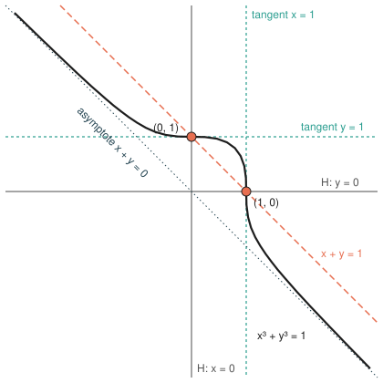

# Inflections and Cayley-Bacharach: nine points on a cubic, and the ninth for free

[Syllabus](../../../SYLLABUS.md) → [Algebraic geometry](../README.md) → [Plane Curves](../README.md#s03) → Inflections and Cayley-Bacharach

---

## General Overview

Take the curve $`x^3 + y^3 = 1`$, the Fermat cubic. It passes through (1, 0) and (0, 1). At each of these two points the curve crosses its own tangent line: it bends one way before the point and the other way after it. A smooth point where the tangent line meets the curve three times, not just twice, is an **inflection point**, or **flex** for short.

Count with care and there are exactly nine flexes. "With care" means three things: complex coordinates as well as real ones, the points at infinity (where parallel lines meet), and the curve smooth (no crossing or sharp point). Two flexes show in the real picture. A third sits at infinity. The other six have complex coordinates.

Trying every line through every point would find them slowly. One determinant finds them at once. The **Hessian** of the cubic, the determinant of its second partial derivatives, is here $`-216\,xyz`$. It vanishes on three lines, and those lines cross the cubic at exactly the nine flexes.

The nine flexes carry a second surprise. They are all the meeting points of two cubics: the curve itself and $`xyz = 0`$. Pick any eight of them. Every cubic curve through those eight passes through the ninth as well. That is the **Cayley-Bacharach theorem**, and it is the tool that proves the elliptic-curve group law is associative.

**A smooth cubic has exactly nine inflection points, and they are the points where it meets its Hessian curve; and whenever two cubics meet in nine separate points, every cubic through eight of them passes through the ninth.**

**What kind of fact this is:** two theorems proved on this card in Why it works (the Hessian test for a flex, and Cayley-Bacharach), and one stated with its key steps and a source (every smooth cubic has exactly nine flexes); all three are checked exactly on this curve.

### The picture: the real points of the Fermat cubic and its flexes

<p align="center"></p>

Real points only, to scale: 60 drawing units per unit, origin at (210, 210). The curve crosses its tangent x = 1 at (1, 0) and its tangent y = 1 at (0, 1). The Hessian lines x = 0 and y = 0 are the axes. The dashed line x + y = 1 runs through both flexes and, at infinity, through the third real flex (1 : −1 : 0), the direction of the asymptote x + y = 0.

---

## The formula

Notation first, in words. Points are written in homogeneous coordinates (x : y : z), as in the projective plane from wing 05: (x : y : 1) is the ordinary point (x, y), and z = 0 is the line at infinity. The cubic becomes the homogeneous polynomial $`F = x^3 + y^3 - z^3`$. The field is ℂ, the complex numbers, unless a line says otherwise.

The [Hessian](../../06-Calculus%20and%20analysis/07-Several%20Variables/05-hessian-and-second-order-approximation.md) card builds the matrix of second partial derivatives. Here, for a curve, the Hessian is the determinant of the 3 × 3 table of second partial derivatives of F:

```math
H(x, y, z) = \det \begin{pmatrix} F_{xx} & F_{xy} & F_{xz} \\ F_{yx} & F_{yy} & F_{yz} \\ F_{zx} & F_{zy} & F_{zz} \end{pmatrix}
```

**Read it aloud:** H is the determinant of the matrix of second partial derivatives of F, a new polynomial of degree 3 when F is a cubic.

The flex test, for a smooth point P of the curve:

```math
P \text{ is a flex} \iff F(P) = 0 \text{ and } H(P) = 0
```

**Read it aloud:** a smooth point of the curve is an inflection point exactly when the Hessian is zero there too.

On the Fermat cubic the matrix is diagonal:

```math
H = \det \begin{pmatrix} 6x & 0 & 0 \\ 0 & 6y & 0 \\ 0 & 0 & -6z \end{pmatrix} = -216\,xyz
```

The Cayley-Bacharach theorem, for two cubics F and G that meet in nine distinct points $`P_1, \dots, P_9`$:

```math
C \text{ a cubic with } C(P_1) = \dots = C(P_8) = 0 \implies C = aF + bG \implies C(P_9) = 0
```

**Read it aloud:** a cubic through eight of the nine meeting points is a combination of the two original cubics, so it vanishes at the ninth point too.

| Symbol | Plain meaning | In our example | Push it up and the answer… |
| --- | --- | --- | --- |
| $`(x : y : z)`$ | homogeneous coordinates: a point, up to a common nonzero factor | (1 : 0 : 1) is (1, 0) | — |
| $`F`$, $`f`$, $`d`$ | the cubic, as a homogeneous polynomial; the same with z = 1, the affine equation, with partials $`f_x`$, $`f_{xy}`$ and so on; its degree | $`x^3 + y^3 - z^3`$; $`x^3 + y^3 - 1`$; 3 | more flexes: 3d(d − 2) in all |
| $`F_x`$, $`\nabla F(P)`$ | a first partial derivative; the row $`(F_x, F_y, F_z)`$ at P, which fixes the tangent line | tangent x = z at (1 : 0 : 1) | — |
| $`F_{xy}`$ and the like, $`M`$ | a second partial derivative; their 3 × 3 matrix at P | 6x, 6y, −6z on the diagonal, 0 elsewhere | — |
| $`H`$ | the Hessian: determinant of the second partials | $`-216\,xyz`$ | degree 3(d − 2) |
| $`\omega`$, $`\mathbb{F}_7`$ | a complex cube root of 1 other than 1, $`(-1 + i\sqrt{3})/2`$, with $`\omega^2 + \omega + 1 = 0`$; the whole numbers mod 7 | six flexes use ω; mod 7, ω becomes 2, since $`2^3 = 8`$ | — |
| $`P, Q, R, t`$, $`O`$ | a point of the curve; a second point on its tangent; a third point off it; the step along the line P + tQ; a flex chosen as the zero of the group law | P = (1 : 0 : 1), tangent x = z | — |
| $`(F \cdot H)_P`$ | intersection multiplicity: how many times the two curves meet at P | 1 at each flex | — |
| $`G`$, $`k`$ | a second cubic meeting F in nine points; the number fixing one Hessian curve $`x^3 + y^3 + z^3 = 3k\,xyz`$ | $`xyz`$ | — |
| $`P_1, \dots, P_9`$ | the nine meeting points of F and G | the nine flexes | — |
| $`C`$, $`a`$, $`b`$, $`A`$, $`B`$ | a cubic through eight of them; the two numbers that build it from F and G; in Max Noether's theorem, polynomials in their place | $`C = aF + b\,xyz`$ | — |
| $`N, c, q, s, r, L`$ | in the folds: the matrix with columns P, Q, R; the numbers that fill $`N^{\mathsf{T}} M N`$; a line | — | — |

### When it holds

- **The point is smooth.** At a singular point H is zero too. On the house curve $`y^2 = x^2(x + 1)`$ the node absorbs 6 of the 9 meetings with H, leaving 3 flexes.
- **The plane is projective.** Drop z and the test changes shape. Write f for the equation with z = 1. The affine test is the **bordered Hessian** $`f_{xx} f_y^2 - 2 f_{xy} f_x f_y + f_{yy} f_x^2`$; on the curve, Euler's rule makes H equal to −4 times it. On $`x^3 + y^3 = 1`$ it finds 6 flexes and loses the 3 on the line at infinity. The plain 2 × 2 Hessian $`f_{xx} f_{yy} - f_{xy}^2`$ is not a flex test. It finds the same 6 here only by luck; on $`y^2 = x^3 + x^2 + 1`$ it is −12x − 4, zero at x = −1/3, where no flex lies.
- **The field is ℂ, or holds the cube roots of 1.** Over the real numbers only 3 of the 9 flexes show. Mod 7 all 9 appear, because 2 is a cube root of 1 there. In characteristic 2 or 3 (arithmetic mod 2 or mod 3) the test breaks: mod 3, H = −216xyz is zero everywhere, because 3 divides 216, and F itself is $`(x + y - z)^3`$, three times one line.
- **The nine points are a complete intersection:** the whole meeting of two cubics with no common piece. With 8 points, 4 of them on one line, every cubic through them contains that line, and no single ninth point is forced.
- **The degree is right.** For two curves of degrees d and e, the general theorem speaks about curves of degree d + e − 3: for two cubics, cubics again. Two conics give lines, not conics. The conic $`(x - 1)(1 - y)`$ passes through three corners of the square $`x^2 = 1`$, $`y^2 = 1`$ and misses the fourth, where it is −4.

---

## Why it works

### Step 0: one line, one cubic, three meetings

Put a line through a point P of the curve and read F along it. The line is P + tQ, with Q a second point and t the step. Then F(P + tQ) is a cubic polynomial in t, and its roots are the meetings of line and curve.

At an ordinary point the tangent line meets the curve twice at P: a double root at t = 0. At a flex it meets three times: a triple root. So a flex is a point where one more coefficient of that cubic in t vanishes. The Hessian turns this condition, which mentions the tangent line, into one that mentions only the point.

Cayley-Bacharach rests on a count. A cubic has 10 coefficients, and passing through a point is one linear condition on them. Eight independent conditions leave 10 − 8 = 2 free coefficients, and F and G already fill them. The proof is the independence.

### Step 1: the tangent line, expanded

Write M for the matrix of second partials at P and ∇F(P) for the row of first partials $`(F_x, F_y, F_z)`$ there. The expansion is exact, because F is a cubic:

```math
F(P + tQ) = F(P) + t\, \nabla F(P) \cdot Q + \tfrac{1}{2} t^2\, Q^{\mathsf{T}} M Q + t^3 F(Q)
```

- P is on the curve, so F(P) = 0.
- Q is on the tangent line, which is $`\nabla F(P) \cdot Q = 0`$, so the t term vanishes.
- So the tangent meets the curve three times at P exactly when $`Q^{\mathsf{T}} M Q = 0`$.

On (1 : 0 : 1) the tangent is x = z. Its points are (1 : t : 1), and F there is $`1 + t^3 - 1 = t^3`$: a triple root, so (1 : 0 : 1) is a flex.

### Step 2: the condition on the tangent is the determinant of M

Euler's rule for a homogeneous polynomial of degree d says $`x F_x + y F_y + z F_z = d\,F`$. Apply it to F and to each first partial (degree 2):

- $`M P = 2\, \nabla F(P)`$, and
- $`P^{\mathsf{T}} M P = 6\, F(P) = 0`$.

Now use P, Q and a third point R off the tangent as a frame. In that frame M has a 0 in the corner, and its determinant comes out as a nonzero number times $`Q^{\mathsf{T}} M Q`$. So H(P) = 0 exactly when $`Q^{\mathsf{T}} M Q = 0`$, which Step 1 showed is the flex condition.

<details>
<summary>Detailed proof: det M is a nonzero multiple of Q<sup>T</sup>MQ</summary>

Let N be the matrix with columns P, Q, R. Choose Q on the tangent, not a multiple of P, and R with $`c = \nabla F(P) \cdot R \ne 0`$; such an R exists because P is smooth, so ∇F(P) is not zero. The tangent line is spanned by P and Q, so P, Q, R are independent and det N ≠ 0.

From Euler's rule: $`P^{\mathsf{T}} M P = 0`$, $`P^{\mathsf{T}} M Q = 2\,\nabla F(P) \cdot Q = 0`$, and $`P^{\mathsf{T}} M R = 2c`$. Write $`q = Q^{\mathsf{T}} M Q`$, $`s = Q^{\mathsf{T}} M R`$ and $`r = R^{\mathsf{T}} M R`$. Then

$`\displaystyle N^{\mathsf{T}} M N = \begin{pmatrix} 0 & 0 & 2c \\ 0 & q & s \\ 2c & s & r \end{pmatrix}, \qquad \det(N^{\mathsf{T}} M N) = -4c^2 q`$

Since $`\det(N^{\mathsf{T}} M N) = (\det N)^2 \det M`$, we get $`\displaystyle H(P) = \det M = \frac{-4c^2\, q}{(\det N)^2}`$.

The factor in front of q is never zero. So H(P) = 0 exactly when q = 0. Euler's rule brings in the factors 2 and 6, which is why characteristic 2 and 3 are excluded.

</details>

### Step 3: why there are exactly nine

H has degree 3(d − 2), which is 3 for a cubic. By [Bezout's theorem](03-bezouts-theorem.md), two plane curves of degrees 3 and 3 with no common piece meet in 3 × 3 = 9 points over ℂ, projectively, counted with multiplicity $`(F \cdot H)_P`$ ([Intersection multiplicity](02-intersection-multiplicity-and-tangency.md)).

For every smooth cubic two more facts hold. H shares no piece with F, and each flex is a simple meeting, $`(F \cdot H)_P = 1`$. So a smooth cubic has exactly nine distinct flexes. The full proof is in Kirwan's book (Sources).

On the Fermat cubic no general fact is needed. The nine points below are distinct (all 36 pairs differ), and Bezout allows only 9 meetings in total. So each meeting is simple.

### Step 4: the nine flexes of the Fermat cubic

H = 0 means xyz = 0: one of the coordinates is zero. Put each into F.

| Hessian line | F becomes | Flexes |
| --- | --- | --- |
| x = 0 | $`y^3 = z^3`$ | (0 : 1 : 1), (0 : ω : 1), (0 : ω² : 1) |
| y = 0 | $`x^3 = z^3`$ | (1 : 0 : 1), (ω : 0 : 1), (ω² : 0 : 1) |
| z = 0 | $`x^3 = -y^3`$ | (1 : −1 : 0), (1 : −ω : 0), (1 : −ω² : 0) |

Three are real: (0 : 1 : 1), (1 : 0 : 1) and (1 : −1 : 0). All three lie on the line x + y = z. That is no accident. The nine flexes fall into 12 lines of three, and every pair of flexes lies on exactly one of them.

The reason is the group law. Choose one flex as the zero point O. Then three points of the curve are collinear exactly when they add to O, and the flexes are the points with 3P = O ([The group law](../04-Elliptic%20Curves/01-elliptic-curves-and-the-group-law.md)). Those form a group of nine. The line through two flexes P and Q meets the curve a third time at −(P + Q), and that point is again a flex, so each pair lies on one line of three. [Riemann surfaces](08-riemann-surfaces-and-the-weierstrass-p-function.md) sees the same nine as the torus points z with 3z in the lattice.

The three real flex tangents and the real flex line rebuild the curve. The tangents are x = z, y = z and x + y = 0, and

```math
x^3 + y^3 - z^3 = (x + y - z)^3 - 3(x - z)(y - z)(x + y)
```

### Step 5: Cayley-Bacharach, proved

Let F and G be cubics that meet in exactly nine distinct points. Fix eight of them. The claim is that their eight conditions on the 10 coefficients of a cubic are independent. Then the cubics through the eight form a family with exactly 2 free coefficients, and aF + bG already fills it.

The proof has two parts.

1. **No 4 of the nine lie on a line, and no 7 on a conic.** A line through 4 of them meets F four times. A cubic restricted to a line has at most 3 roots unless it vanishes on the whole line, so F contains the line. So does G, and then F and G share a whole line, against "exactly nine points". A conic (a degree-two curve, see [Conics](01-conics-and-rational-parametrisation.md)) through 7 works the same way: a cubic meets an unbroken conic at most 6 times unless it contains it, and a conic that is two lines puts 4 of the 7 on one line.
2. **Eight such points always give independent conditions.** If they did not, two extra points could still be imposed, and a cubic would exist through ten points. Then it meets some line or conic too often, contains it, and the rest of the cubic must pass through too many points. The fold works through the three cases.

So every cubic C through eight of the nine is aF + bG. At the ninth point F and G are both zero, so C is zero there too.

On the Fermat cubic, G = xyz. The code drops each flex in turn and solves the linear conditions: rank 8 of 10 every time, with the two free coefficients spanned by F and xyz. The three lines $`(x + y - z)(x + \omega y - \omega^2 z)(x + \omega^2 y - \omega z)`$ form one member of the family. Their product is F + 3xyz, and each flex lies on exactly one of the three lines.

<details>
<summary>Detailed proof: eight points with no 4 on a line and no 7 on a conic impose independent conditions on cubics</summary>

A fact used twice: through five points with no 4 on a line there is exactly one conic. One exists, since a conic has 6 coefficients and five conditions leave one free. Two different conics through them would meet 5 times, more than 4, so they would share a line, and at most one of the points could lie off that line. Then 4 lie on it, which is excluded.

Suppose the cubics through the eight points $`P_1, \dots, P_8`$ had 3 or more free coefficients. Each extra point removes at most one.

**Case A: three of them on a line L, say $`P_1, P_2, P_3`$.** Add a fourth point $`P_9`$ on L. At least 2 free coefficients remain. Each such cubic meets L four times, so it contains L and equals L times a conic through $`P_4, \dots, P_8`$. None of those five is on L, and no 4 of them are on a line, so that conic is unique. Then only 1 free coefficient remains, not 2.

**Case B: no three on a line, but six on a conic, say $`P_1, \dots, P_6`$.** The conic is not a pair of lines, since one of the lines would hold three points. Add $`P_9`$ on the conic. At least 2 free coefficients remain. Each cubic meets the conic seven times, so it contains it and equals the conic times the line through $`P_7`$ and $`P_8`$, neither of which is on the conic. That line is unique. Again only 1, not 2.

**Case C: no three on a line, no six on a conic.** Add two points on the line L through $`P_1`$ and $`P_2`$. A cubic through all ten exists. It meets L four times, so it is L times a conic, and that conic passes through $`P_3, \dots, P_8`$, none of which is on L. Six points on a conic: excluded.

Every case is impossible, so the eight conditions are independent.

</details>

Cayley-Bacharach is one case of a larger theorem. Max Noether's fundamental theorem says that a curve through every meeting point of F and G, each to the right multiplicity, is $`AF + BG`$, where A and B are now polynomials, not numbers.

### Step 6: the same test over a finite field

Mod 7 the code tries every line through every smooth point of three curves and compares the result with the Hessian. The two roads agree on every curve. At every point of each curve it also checks $`z^2 H = -4`$ times the bordered Hessian of When it holds, the link Euler's rule gives.

| Curve, mod 7 | Points | Smooth | Flexes, every line | Flexes, Hessian |
| --- | --- | --- | --- | --- |
| $`x^3 + y^3 = z^3`$ | 9 | 9 | 9 | 9 |
| $`y^2 = x^3 + x^2 + 1`$ | 11 | 11 | 1 | 1 |
| $`y^2 = x^2(x + 1)`$ | 7 | 6 | 3 | 3 |

Mod 7 the Fermat cubic has 9 points, and all 9 are flexes. The smooth neighbour keeps only 1 of its 9 flexes there, the point at infinity.

---

## Worked numbers, by hand

Find the flexes of $`x^3 + y^3 = z^3`$, then test Cayley-Bacharach on them.

| Step | Arithmetic | Value |
| --- | --- | --- |
| second partials | $`F_{xx} = 6x`$, $`F_{yy} = 6y`$, $`F_{zz} = -6z`$, mixed ones 0 | diagonal matrix |
| Hessian | 6x · 6y · (−6z) | $`-216\,xyz`$ |
| Hessian lines | xyz = 0 | x = 0, y = 0, z = 0 |
| on each line | $`y^3 = z^3`$, $`x^3 = z^3`$, $`x^3 = -y^3`$: three roots each | 3 + 3 + 3 = 9 points |
| Bezout | 3 × 3 | 9 meetings, all simple |
| tangent at (1 : 0 : 1) | the line x = z; F(1 : t : 1) = 1 + t³ − 1 | $`t^3`$, a triple root |
| real flexes | the three with real coordinates | 3, on the line x + y = z |
| cubics through 8 flexes | 10 coefficients, rank 8 | 2 free: aF + b·xyz |
| at the ninth flex | F = 0 and xyz = 0 there | **9 flexes; every cubic through 8 of them passes through the ninth** |

The curve has nine flexes, three of them real, and they are fixed so tightly by F and xyz that any eight of them pull the ninth along.

### What breaks if you drop a piece

| Mistake | Comes out at | What went wrong |
| --- | --- | --- |
| Bordered Hessian of $`x^3 + y^3 = 1`$, in the affine plane | 6 flexes | the 3 flexes on the line at infinity z = 0 are lost |
| Plain 2 × 2 Hessian of $`y^2 = x^3 + x^2 + 1`$ | −12x − 4: a "flex" at x = −1/3 | no flex there: at every point (−1 : y : 3) of that line H is −24, never 0; the 2 × 2 Hessian is not a flex test |
| Hessian on the nodal house curve | $`H = 8(t - 1)^3(t + 1)^3(3t^2 + 1)`$: 3 flexes | the node (t = 1 and t = −1) takes 3 + 3 = 6 of the 9 meetings |
| Cayley-Bacharach on 8 points mod 7 with 4 on the line y = 0 | rank 8, but 12 common points, not 9 (over $`\mathbb{F}_7`$: the line's 8 points plus 4; over ℂ, the whole line plus 4) | not a complete intersection: every cubic through them contains the line |
| Cayley-Bacharach with conics | 3 free coefficients through 3 corners; $`(x - 1)(1 - y) = -4`$ at the fourth | for two conics the theorem speaks about lines, not conics |

On the house curve, x = t² − 1 and y = t³ − t; t = 1 and t = −1 both land on the node. Its 3 flexes are (0 : 1 : 0) and the two complex points at 3t² + 1 = 0.

---

## Code, from first principles, and it actually runs

The code works exactly, with complex numbers of the form a + bω ($`\omega^2 = -1 - \omega`$) and finite checks mod 7. It takes three independent roads. First, the Hessian's zeros against the tangent-line test, exactly. Second, the Hessian against trying every line mod 7, on three curves. Third, for Cayley-Bacharach, the linear conditions solved for each of the nine ways to drop a flex, with a member of the family checked as a product of three lines. It then prints each failure in What breaks and the figure's coordinates.

### Python

```python
# Inflections and Cayley-Bacharach on the Fermat cubic x^3 + y^3 = z^3 -- the check behind the card.
# Standard library only.  Exact arithmetic in Z[w], where w is a cube root of 1 (w^2 = -1 - w);
# finite counts mod 7, where 2 is a cube root of 1.  Points are (x : y : z).
class W:                                     # the number a + b w, with whole numbers a and b
    def __init__(s, a, b=0): s.a, s.b = a, b
    def __add__(s, o): o = wr(o); return W(s.a + o.a, s.b + o.b)
    def __sub__(s, o): o = wr(o); return W(s.a - o.a, s.b - o.b)
    def __mul__(s, o): o = wr(o); return W(s.a * o.a - s.b * o.b, s.a * o.b + s.b * o.a - s.b * o.b)
    __radd__, __rmul__, __rsub__ = __add__, __mul__, lambda s, o: wr(o) - s
    def __eq__(s, o): o = wr(o); return s.a == o.a and s.b == o.b
def wr(v): return v if isinstance(v, W) else W(v)
NAME = {(0, 0): "0", (1, 0): "1", (-1, 0): "-1", (0, 1): "ω", (0, -1): "-ω", (-1, -1): "ω²", (1, 1): "-ω²"}
def show(P): return "(" + " : ".join(NAME[(wr(c).a, wr(c).b)] for c in P) + ")"
def pw(v, n): return v * pw(v, n - 1) if n else 1
FERMAT = [(1, 3, 0, 0), (1, 0, 3, 0), (-1, 0, 0, 3)]                  # x^3 + y^3 - z^3, as (coef, i, j, k)
NODAL = [(1, 0, 2, 1), (-1, 3, 0, 0), (-1, 2, 0, 1)]                  # y^2 z - x^3 - x^2 z: the house curve
NEIGH = NODAL + [(-1, 0, 0, 3)]                                       # y^2 z - x^3 - x^2 z - z^3: a smooth neighbour
def ev(f, P, d=()):                          # value of f at P, or of its partial derivatives in the directions d
    tot = 0
    for c, *e in f:
        for a in d: c, e[a] = c * e[a], e[a] - 1
        if min(e) >= 0: tot = c * pw(P[0], e[0]) * pw(P[1], e[1]) * pw(P[2], e[2]) + tot
    return tot
def det3(M): return (M[0][0] * (M[1][1] * M[2][2] - M[1][2] * M[2][1]) - M[0][1] * (M[1][0] * M[2][2] - M[1][2] * M[2][0])
                     + M[0][2] * (M[1][0] * M[2][1] - M[1][1] * M[2][0]))
def hess(f, P): return det3([[ev(f, P, (a, b)) for b in range(3)] for a in range(3)])
def bord(f, P):                              # the affine flex test at z = 1: f_xx f_y^2 - 2 f_xy f_x f_y + f_yy f_x^2
    fx, fy = ev(f, P, (0,)), ev(f, P, (1,)); return ev(f, P, (0, 0)) * fy * fy - 2 * ev(f, P, (0, 1)) * fx * fy + ev(f, P, (1, 1)) * fx * fx
def cross(P, Q): return [P[1] * Q[2] - P[2] * Q[1], P[2] * Q[0] - P[0] * Q[2], P[0] * Q[1] - P[1] * Q[0]]
yn = lambda t: "yes" if t else "no"; G = range(-2, 3)
print("curve x^3 + y^3 = z^3 over the complex numbers; second partials 6x, 6y, -6z, mixed ones 0")
hv = [(hess(FERMAT, (a, b, c)), -216 * a * b * c) for a in G for b in G for c in G]; hok = all(h == e for h, e in hv)
print(f"Hessian determinant equals -216xyz at all {5 ** 3} points of a 5 x 5 x 5 grid: {yn(hok)}; so H = 0 is xyz = 0; mod 3 it is 0 at all of them: {yn(all(h % 3 == 0 for h, _ in hv))}")
R3 = [W(1), W(0, 1), W(-1, -1)]                                       # 1, w, w^2
flex = [(W(0), r, W(1)) for r in R3] + [(r, W(0), W(1)) for r in R3] + [(W(1), W(0) - r, W(0)) for r in R3]
for n, side in enumerate(("x = 0: y^3 = z^3", "y = 0: x^3 = z^3", "z = 0: x^3 = -y^3")):
    print(f"on {side:18s} " + ", ".join(show(P) for P in flex[3 * n:3 * n + 3]))
on = all(ev(FERMAT, P) == 0 and hess(FERMAT, P) == 0 for P in flex)
dist = sum(cross(P, Q) != [0, 0, 0] for i, P in enumerate(flex) for Q in flex[i + 1:])
print(f"all nine on the curve and on H: {yn(on)}; distinct pairs {dist} of 36; Bezout 3 x 3 = 9, so each meeting is simple"); tri = 0
for P in flex:                               # road two: the tangent line meets the curve three times at P
    g = [ev(FERMAT, P, (a,)) for a in range(3)]
    Q = cross(g, (1, 2, 3)); assert cross(P, Q) != [0, 0, 0]
    v = [ev(FERMAT, [P[i] + t * Q[i] for i in range(3)]) for t in range(4)]
    tri += v[0] == 0 and not v[1] == 0 and all(v[t] == t ** 3 * v[1] for t in (2, 3))
print(f"tangent test, F(P + tQ) = c t^3 along the tangent: {tri} of 9 points meet it three times")
assert hok and on and dist == 36 and tri == 9
real = [P for P in flex if all(wr(c).b == 0 for c in P)]
lines = [(i, j, k) for i in range(9) for j in range(i + 1, 9) for k in range(j + 1, 9) if det3([flex[i], flex[j], flex[k]]) == 0]
print(f"real flexes {', '.join(show(P) for P in real)}; on the line x + y = z: {yn(all(ev([(1, 1, 0, 0), (1, 0, 1, 0), (-1, 0, 0, 1)], P) == 0 for P in real))}")
pairs = sorted(sum(1 for L in lines if i in L and j in L) for i in range(9) for j in range(i + 1, 9))
print(f"collinear triples among the nine flexes: {len(lines)} of 84; every pair of flexes on exactly one: {yn(pairs == [1] * 36)}")
assert len(real) == 3 and len(lines) == 12 and pairs == [1] * 36
L = [lambda P, r=r: P[0] + r * P[1] - r * r * P[2] for r in R3]       # x + y - z, x + wy - w^2 z, x + w^2 y - wz
G4 = [(a, b, c) for a in range(-1, 3) for b in range(-1, 3) for c in range(-1, 3)]
t1 = all(L[0](P) * L[1](P) * L[2](P) == ev(FERMAT, P) + 3 * P[0] * P[1] * P[2] for P in G4)
t2 = all(L[1](P) * L[2](P) == ev([(1, 2, 0, 0), (-1, 1, 1, 0), (1, 0, 2, 0), (1, 1, 0, 1), (1, 0, 1, 1), (1, 0, 0, 2)], P) for P in G4)
one = all(sum(Li(P) == 0 for Li in L) == 1 for P in flex)
print(f"(x + y - z)(x^2 - xy + y^2 + xz + yz + z^2) = x^3 + y^3 - z^3 + 3xyz at all 64 grid points: {yn(t1 and t2)}")
print(f"the conic is (x + ωy - ω²z)(x + ω²y - ωz); each flex lies on exactly one of the three lines: {yn(one)}")
t3 = all((P[0] + P[1] - P[2]) ** 3 - 3 * (P[0] - P[2]) * (P[1] - P[2]) * (P[0] + P[1]) == ev(FERMAT, P) for P in G4)
print(f"real flex tangents x = z, y = z, x + y = 0 and flex line x + y = z: (x + y - z)^3 - 3(x - z)(y - z)(x + y) = x^3 + y^3 - z^3 at all 64 grid points: {yn(t3)}")
assert t1 and t2 and one and t3
p = 7                                        # road three: everything again over the field of 7 elements
def m7(v): v = wr(v); return (v.a + 2 * v.b) % p
def norm(P): k = max(i for i in range(3) if P[i] % p); inv = pow(P[k], p - 2, p); return tuple(c * inv % p for c in P)
PTS = [(x, y, 1) for x in range(p) for y in range(p)] + [(x, 1, 0) for x in range(p)] + [(1, 0, 0)]
f7 = [norm([m7(c) for c in P]) for P in flex]
print(f"mod 7, with ω = 2: the flexes become {', '.join(str(P).replace(',', '') for P in f7)}")
def contact3(f, P, Q):
    v = [ev(f, [P[i] + t * Q[i] for i in range(3)]) % p for t in range(4)]
    return v[0] == 0 and all((v[t] - t ** 3 * v[1]) % p == 0 for t in (2, 3))
for name, f in (("x^3 + y^3 = z^3", FERMAT), ("y^2 = x^3 + x^2 + 1", NEIGH), ("y^2 = x^2(x + 1)", NODAL)):
    cur = [P for P in PTS if ev(f, P) % p == 0]
    smooth = [P for P in cur if any(ev(f, P, (a,)) % p for a in range(3))]
    brute = [P for P in smooth if any(contact3(f, P, Q) for Q in PTS if Q != P)]
    hz = [P for P in smooth if hess(f, P) % p == 0]; eu = all((P[2] ** 2 * hess(f, P) + 4 * bord(f, P)) % p == 0 for P in cur)
    print(f"mod 7, {name:19s}: {len(cur):2d} points, {len(smooth):2d} smooth; flexes by trying every line {len(brute)}, "
          f"by the Hessian {len(hz)}; same points: {yn(brute == hz)}; z^2 H = -4 x bordered Hessian at all of them: {yn(eu)}")
    assert brute == hz and eu
    if f is FERMAT: assert sorted(brute) == sorted(f7) and len(brute) == 9
MON3 = [(i, j, 3 - i - j) for i in range(3, -1, -1) for j in range(3 - i, -1, -1)]
MON2 = [(i, j, 2 - i - j) for i in range(2, -1, -1) for j in range(2 - i, -1, -1)]
def mono(P, m): return pw(P[0], m[0]) * pw(P[1], m[1]) * pw(P[2], m[2]) % p
def kernel(pts, mons):                       # rank of the conditions, and a basis of the curves through pts
    rows, piv, r = [[mono(P, m) for m in mons] for P in pts], [], 0
    for c in range(len(mons)):
        k = next((i for i in range(r, len(rows)) if rows[i][c]), None)
        if k is None: continue
        rows[r], rows[k] = rows[k], rows[r]; inv = pow(rows[r][c], p - 2, p); rows[r] = [v * inv % p for v in rows[r]]
        for i in range(len(rows)):
            if i != r and rows[i][c]: rows[i] = [(a - rows[i][c] * b) % p for a, b in zip(rows[i], rows[r])]
        piv.append(c); r += 1
    basis = []
    for c in [c for c in range(len(mons)) if c not in piv]:
        v = [0] * len(mons); v[c] = 1
        for i, pc in enumerate(piv): v[pc] = -rows[i][c] % p
        basis.append(v)
    return r, basis
def common(basis, mons): return [Q for Q in PTS if all(sum(b[n] * mono(Q, m) for n, m in enumerate(mons)) % p == 0 for b in basis)]
Fv, Xv, good = [[1, 0, 0, 0, 0, 0, 1, 0, 0, p - 1][n] for n in range(10)], [int(m == (1, 1, 1)) for m in MON3], 0
for k in range(9):                           # Cayley-Bacharach: leave out each flex in turn
    r, B = kernel(f7[:k] + f7[k + 1:], MON3)
    inF = all(sum(v[n] * mono(P, m) for n, m in enumerate(MON3)) % p == 0 for v in (Fv, Xv) for P in f7[:k] + f7[k + 1:])
    good += r == 8 and len(B) == 2 and inF and sorted(common(B, MON3)) == sorted(f7)
print(f"cubics through 8 of the 9 flexes, each of the 9 ways: rank 8 of 10, 2 free coefficients, spanned by "
      f"x^3 + y^3 - z^3 and xyz; common points of all of them: the 9 flexes, in {good} of 9 cases")
assert good == 9
print("rank 8 mod 7 forces rank 8 over Z[ω]; so over C too every cubic through 8 flexes is a·(x^3 + y^3 - z^3) + b·xyz")
def m2(f, P): return ev(f, P, (0, 0)) * ev(f, P, (1, 1)) - ev(f, P, (0, 1)) * ev(f, P, (0, 1))   # the plain 2 x 2 Hessian
aff, aff2 = (sum(1 for P in flex if not P[2] == 0 and t(FERMAT, P) == 0) for t in (bord, m2))   # what breaks
print(f"mistake, affine plane: the bordered Hessian of x^3 + y^3 = 1 is 0 at {aff} flexes (the plain 2 x 2 Hessian, by luck, at {aff2}); the 3 on the line at infinity z = 0 are lost")
lin = all(m2(NEIGH, (x, y, 1)) == -12 * x - 4 for x in G for y in G); off = [(m2(NEIGH, (-1, y, 3)), hess(NEIGH, (-1, y, 3))) for y in range(4)]
print(f"mistake, plain 2 x 2 Hessian of y^2 = x^3 + x^2 + 1: equals -12x - 4 on the 5 x 5 grid: {yn(lin)}; on the line x = -1/3, at (-1 : y : 3) for y = 0..3, "
      f"(2 x 2, H) = {off}: the 2 x 2 test says flex, H is never 0, so no flex lies there")
nod = all(hess(NODAL, (t * t - 1, t ** 3 - t, 1)) == 8 * (t * t - 1) ** 3 * (3 * t * t + 1) for t in range(10))
print(f"mistake, a node: on y^2 = x^2(x + 1), put x = t^2 - 1, y = t^3 - t; H = 8(t - 1)^3(t + 1)^3(3t^2 + 1) at t = 0..9: {yn(nod)}")
print(f"  the node (t = 1 and t = -1) takes 3 + 3 = 6 of the 9 meetings; flexes: (0 : 1 : 0), on H: "
      f"{yn(ev(NODAL, (0, 1, 0)) == 0 and hess(NODAL, (0, 1, 0)) == 0)}, and two complex ones at 3t^2 + 1 = 0: 3 in all")
rc, Bc = kernel([(1, 1, 1), (1, p - 1, 1), (p - 1, 1, 1)], MON2)            # conics through 3 corners of the square
cv = [(x - 1) * (1 - y) for x, y in ((1, 1), (1, -1), (-1, 1), (-1, -1))]
print(f"mistake, conics: x^2 = 1 and y^2 = 1 meet at 4 corners; conics through 3 corners have {len(Bc)} free coefficients, "
      f"not 2; (x - 1)(1 - y) at the corners: {cv}")
line4 = [(0, 0, 1), (1, 0, 1), (2, 0, 1), (3, 0, 1), (0, 1, 1), (1, 3, 1), (3, 2, 1), (5, 6, 1)]
r4, B4 = kernel(line4, MON3); c4 = common(B4, MON3); on4 = sum(1 for Q in c4 if Q[1] == 0)
print(f"mistake, 8 points with 4 on the line y = 0 (mod 7): rank {r4}, but every cubic through them contains the line; "
      f"common points {len(c4)}: {on4} on the line y = 0, {len(c4) - on4} off it; not 9")
assert aff == aff2 == 6 and lin and all(a == 0 and h != 0 for a, h in off) and nod and rc == 3 and (p - 1, p - 1, 1) not in common(Bc, MON2)
assert r4 == 8 and on4 == p + 1 and len(c4) == 12
# figure: the real curve x^3 + y^3 = 1; put x = (w + s)/2, y = (w - s)/2, then w^3 + 3 s^2 w = 4 has one real root
def wroot(s):
    w = 1.5
    for _ in range(60): w -= (w * w * w + 3 * s * s * w - 4) / (3 * w * w + 3 * s * s)
    return w
sv = lambda x, y: f"{210 + 60 * x:.1f},{210 - 60 * y:.1f}"
pts = [(-6.5 + 0.25 * i, wroot(-6.5 + 0.25 * i)) for i in range(53)]
print("figure, 1 unit = 60, origin (210,210), curve:", " ".join(sv((w + s) / 2, (w - s) / 2) for s, w in pts))
print("figure, flexes", sv(1, 0), sv(0, 1), "line x + y = 1", sv(-2.4, 3.4), "to", sv(3.4, -2.4), "asymptote", sv(-3.4, 3.4), "to", sv(3.4, -3.4),
      "tangents", sv(1, 3.4), "to", sv(1, -3.4), "and", sv(-3.4, 1), "to", sv(3.4, 1))
print("ALL CHECKS PASS")
```

**Ran 2026-11-17 on macOS, Python 3.14.10, standard library only. All checks passed. Output, pasted from the run:**

```
curve x^3 + y^3 = z^3 over the complex numbers; second partials 6x, 6y, -6z, mixed ones 0
Hessian determinant equals -216xyz at all 125 points of a 5 x 5 x 5 grid: yes; so H = 0 is xyz = 0; mod 3 it is 0 at all of them: yes
on x = 0: y^3 = z^3   (0 : 1 : 1), (0 : ω : 1), (0 : ω² : 1)
on y = 0: x^3 = z^3   (1 : 0 : 1), (ω : 0 : 1), (ω² : 0 : 1)
on z = 0: x^3 = -y^3  (1 : -1 : 0), (1 : -ω : 0), (1 : -ω² : 0)
all nine on the curve and on H: yes; distinct pairs 36 of 36; Bezout 3 x 3 = 9, so each meeting is simple
tangent test, F(P + tQ) = c t^3 along the tangent: 9 of 9 points meet it three times
real flexes (0 : 1 : 1), (1 : 0 : 1), (1 : -1 : 0); on the line x + y = z: yes
collinear triples among the nine flexes: 12 of 84; every pair of flexes on exactly one: yes
(x + y - z)(x^2 - xy + y^2 + xz + yz + z^2) = x^3 + y^3 - z^3 + 3xyz at all 64 grid points: yes
the conic is (x + ωy - ω²z)(x + ω²y - ωz); each flex lies on exactly one of the three lines: yes
real flex tangents x = z, y = z, x + y = 0 and flex line x + y = z: (x + y - z)^3 - 3(x - z)(y - z)(x + y) = x^3 + y^3 - z^3 at all 64 grid points: yes
mod 7, with ω = 2: the flexes become (0 1 1), (0 2 1), (0 4 1), (1 0 1), (2 0 1), (4 0 1), (6 1 0), (3 1 0), (5 1 0)
mod 7, x^3 + y^3 = z^3    :  9 points,  9 smooth; flexes by trying every line 9, by the Hessian 9; same points: yes; z^2 H = -4 x bordered Hessian at all of them: yes
mod 7, y^2 = x^3 + x^2 + 1: 11 points, 11 smooth; flexes by trying every line 1, by the Hessian 1; same points: yes; z^2 H = -4 x bordered Hessian at all of them: yes
mod 7, y^2 = x^2(x + 1)   :  7 points,  6 smooth; flexes by trying every line 3, by the Hessian 3; same points: yes; z^2 H = -4 x bordered Hessian at all of them: yes
cubics through 8 of the 9 flexes, each of the 9 ways: rank 8 of 10, 2 free coefficients, spanned by x^3 + y^3 - z^3 and xyz; common points of all of them: the 9 flexes, in 9 of 9 cases
rank 8 mod 7 forces rank 8 over Z[ω]; so over C too every cubic through 8 flexes is a·(x^3 + y^3 - z^3) + b·xyz
mistake, affine plane: the bordered Hessian of x^3 + y^3 = 1 is 0 at 6 flexes (the plain 2 x 2 Hessian, by luck, at 6); the 3 on the line at infinity z = 0 are lost
mistake, plain 2 x 2 Hessian of y^2 = x^3 + x^2 + 1: equals -12x - 4 on the 5 x 5 grid: yes; on the line x = -1/3, at (-1 : y : 3) for y = 0..3, (2 x 2, H) = [(0, -24), (0, -24), (0, -24), (0, -24)]: the 2 x 2 test says flex, H is never 0, so no flex lies there
mistake, a node: on y^2 = x^2(x + 1), put x = t^2 - 1, y = t^3 - t; H = 8(t - 1)^3(t + 1)^3(3t^2 + 1) at t = 0..9: yes
  the node (t = 1 and t = -1) takes 3 + 3 = 6 of the 9 meetings; flexes: (0 : 1 : 0), on H: yes, and two complex ones at 3t^2 + 1 = 0: 3 in all
mistake, conics: x^2 = 1 and y^2 = 1 meet at 4 corners; conics through 3 corners have 3 free coefficients, not 2; (x - 1)(1 - y) at the corners: [0, 0, 0, -4]
mistake, 8 points with 4 on the line y = 0 (mod 7): rank 8, but every cubic through them contains the line; common points 12: 8 on the line y = 0, 4 off it; not 9
figure, 1 unit = 60, origin (210,210), curve: 15.9,14.1 23.5,21.5 31.1,28.9 38.7,36.3 46.3,43.7 54.0,51.0 61.6,58.4 69.3,65.7 77.0,73.0 84.7,80.3 92.5,87.5 100.3,94.7 108.3,101.7 116.3,108.7 124.4,115.6 132.8,122.2 141.4,128.6 150.4,134.6 159.9,140.1 170.3,144.7 182.0,148.0 195.3,149.7 210.0,150.0 224.7,150.3 237.9,152.1 248.9,156.1 257.6,162.4 263.9,171.1 267.9,182.1 269.7,195.3 270.0,210.0 270.3,224.7 272.0,238.0 275.3,249.7 279.9,260.1 285.4,269.6 291.4,278.6 297.8,287.2 304.4,295.6 311.3,303.7 318.3,311.7 325.3,319.7 332.5,327.5 339.7,335.3 347.0,343.0 354.3,350.7 361.6,358.4 369.0,366.0 376.3,373.7 383.7,381.3 391.1,388.9 398.5,396.5 405.9,404.1
figure, flexes 270.0,210.0 210.0,150.0 line x + y = 1 66.0,6.0 to 414.0,354.0 asymptote 6.0,6.0 to 414.0,414.0 tangents 270.0,6.0 to 270.0,414.0 and 6.0,150.0 to 414.0,150.0
ALL CHECKS PASS
```

### Rust

Same numbers, same labels, built with `rustc --edition 2021 -O`.

```rust
// Inflections and Cayley-Bacharach on the Fermat cubic x^3 + y^3 = z^3 -- the check behind the card.
// Standard library only.  Exact arithmetic in Z[w], where w is a cube root of 1 (w^2 = -1 - w);
// finite counts mod 7, where 2 is a cube root of 1.  Points are (x : y : z).
use std::ops::{Add, Mul, Sub};
#[derive(Clone, Copy, PartialEq)]
struct W { a: i64, b: i64 } // the number a + b w, with whole numbers a and b
impl Add for W { type Output = W; fn add(self, o: W) -> W { W { a: self.a + o.a, b: self.b + o.b } } }
impl Sub for W { type Output = W; fn sub(self, o: W) -> W { W { a: self.a - o.a, b: self.b - o.b } } }
impl Mul for W { type Output = W; fn mul(self, o: W) -> W { W { a: self.a * o.a - self.b * o.b, b: self.a * o.b + self.b * o.a - self.b * o.b } } }
fn w(a: i64) -> W { W { a, b: 0 } }
const Z: W = W { a: 0, b: 0 }; const P: i64 = 7;
type P3 = [W; 3];
type Poly = &'static [(i64, usize, usize, usize)];
const FERMAT: Poly = &[(1, 3, 0, 0), (1, 0, 3, 0), (-1, 0, 0, 3)]; // x^3 + y^3 - z^3, as (coef, i, j, k)
const NODAL: Poly = &[(1, 0, 2, 1), (-1, 3, 0, 0), (-1, 2, 0, 1)]; // y^2 z - x^3 - x^2 z: the house curve
const NEIGH: Poly = &[(1, 0, 2, 1), (-1, 3, 0, 0), (-1, 2, 0, 1), (-1, 0, 0, 3)]; // a smooth neighbour
fn name(c: W) -> &'static str { match (c.a, c.b) { (0, 0) => "0", (1, 0) => "1", (-1, 0) => "-1", (0, 1) => "ω", (0, -1) => "-ω", (-1, -1) => "ω²", _ => "-ω²" } }
fn show(p: &P3) -> String { format!("({} : {} : {})", name(p[0]), name(p[1]), name(p[2])) }
fn yn(t: bool) -> &'static str { if t { "yes" } else { "no" } }
fn pw(v: W, n: i64) -> W { (0..n).fold(w(1), |r, _| v * r) }
fn ev(f: Poly, p: &P3, d: &[usize]) -> W { // value of f at p, or of its partial derivatives in the directions d
    let mut tot = Z;
    for &(c0, i, j, k) in f {
        let (mut c, mut e) = (c0, [i as i64, j as i64, k as i64]);
        for &a in d { c *= e[a]; e[a] -= 1; }
        if e.iter().all(|&x| x >= 0) { tot = w(c) * pw(p[0], e[0]) * pw(p[1], e[1]) * pw(p[2], e[2]) + tot; }
    }
    tot
}
fn det3(m: &[P3; 3]) -> W {
    m[0][0] * (m[1][1] * m[2][2] - m[1][2] * m[2][1]) - m[0][1] * (m[1][0] * m[2][2] - m[1][2] * m[2][0])
        + m[0][2] * (m[1][0] * m[2][1] - m[1][1] * m[2][0])
}
fn hess(f: Poly, p: &P3) -> W { det3(&[0, 1, 2].map(|a| [0, 1, 2].map(|b| ev(f, p, &[a, b])))) }
fn bord(f: Poly, p: &P3) -> W { let (fx, fy) = (ev(f, p, &[0]), ev(f, p, &[1])); ev(f, p, &[0, 0]) * fy * fy - w(2) * ev(f, p, &[0, 1]) * fx * fy + ev(f, p, &[1, 1]) * fx * fx } // affine flex test
fn m2(f: Poly, p: &P3) -> W { ev(f, p, &[0, 0]) * ev(f, p, &[1, 1]) - ev(f, p, &[0, 1]) * ev(f, p, &[0, 1]) } // the plain 2 x 2 Hessian
fn cross(p: &P3, q: &P3) -> P3 { [p[1] * q[2] - p[2] * q[1], p[2] * q[0] - p[0] * q[2], p[0] * q[1] - p[1] * q[0]] }
fn wp(q: &[i64; 3]) -> P3 { [w(q[0]), w(q[1]), w(q[2])] }
fn md(v: W) -> i64 { v.a.rem_euclid(P) }
fn powm(b: i64, e: i64) -> i64 { (0..e).fold(1, |r, _| r * b % P) }
fn norm(q: [i64; 3]) -> [i64; 3] { let k = (0..3).filter(|&i| q[i] % P != 0).max().unwrap(); q.map(|c| c * powm(q[k], P - 2) % P) }
fn contact3(f: Poly, p: &[i64; 3], q: &[i64; 3]) -> bool {
    let v: Vec<i64> = (0..4).map(|t| md(ev(f, &wp(&[p[0] + t * q[0], p[1] + t * q[1], p[2] + t * q[2]]), &[]))).collect();
    v[0] == 0 && (2..4).all(|t| (v[t as usize] - t * t * t * v[1]).rem_euclid(P) == 0)
}
fn mono(q: &[i64; 3], m: &[i64; 3]) -> i64 { (0..3).fold(1, |r, i| r * powm(q[i], m[i]) % P) }
fn kernel(pts: &[[i64; 3]], mons: &[[i64; 3]]) -> (usize, Vec<Vec<i64>>) { // rank, and a basis of the curves through pts
    let n = mons.len();
    let mut rows: Vec<Vec<i64>> = pts.iter().map(|q| mons.iter().map(|m| mono(q, m)).collect()).collect();
    let (mut piv, mut r) = (vec![], 0);
    for c in 0..n {
        let k = match (r..rows.len()).find(|&i| rows[i][c] != 0) { Some(k) => k, None => continue };
        rows.swap(r, k);
        let inv = powm(rows[r][c], P - 2);
        rows[r] = rows[r].iter().map(|v| v * inv % P).collect();
        for i in 0..rows.len() {
            let f = rows[i][c]; if i == r || f == 0 { continue; }
            rows[i] = (0..n).map(|j| (rows[i][j] - f * rows[r][j]).rem_euclid(P)).collect();
        }
        piv.push(c); r += 1;
    }
    let mut basis = vec![];
    for c in (0..n).filter(|c| !piv.contains(c)) {
        let mut v = vec![0; n]; v[c] = 1;
        for (i, &pc) in piv.iter().enumerate() { v[pc] = (-rows[i][c]).rem_euclid(P); }
        basis.push(v);
    }
    (r, basis)
}
fn vanish(v: &[i64], q: &[i64; 3], mons: &[[i64; 3]]) -> bool { mons.iter().enumerate().map(|(n, m)| v[n] * mono(q, m)).sum::<i64>() % P == 0 }
fn common(pts: &[[i64; 3]], basis: &[Vec<i64>], mons: &[[i64; 3]]) -> Vec<[i64; 3]> {
    pts.iter().filter(|q| basis.iter().all(|b| vanish(b, q, mons))).cloned().collect()
}
fn wroot(s: f64) -> f64 { (0..60).fold(1.5, |w, _| w - (w * w * w + 3.0 * s * s * w - 4.0) / (3.0 * w * w + 3.0 * s * s)) }
fn sv(x: f64, y: f64) -> String { format!("{:.1},{:.1}", 210.0 + 60.0 * x, 210.0 - 60.0 * y) }
fn main() {
    println!("curve x^3 + y^3 = z^3 over the complex numbers; second partials 6x, 6y, -6z, mixed ones 0");
    let (mut hok, mut h3) = (true, true);
    for a in -2..3 { for b in -2..3 { for c in -2..3 { let h = hess(FERMAT, &[w(a), w(b), w(c)]); hok &= h == w(-216 * a * b * c); h3 &= h.a % 3 == 0 && h.b % 3 == 0; } } }
    println!("Hessian determinant equals -216xyz at all 125 points of a 5 x 5 x 5 grid: {}; so H = 0 is xyz = 0; mod 3 it is 0 at all of them: {}", yn(hok), yn(h3));
    let r3 = [w(1), W { a: 0, b: 1 }, W { a: -1, b: -1 }]; // 1, w, w^2
    let flex: Vec<P3> = (0..9).map(|n| { let r = r3[n % 3]; [[Z, r, w(1)], [r, Z, w(1)], [w(1), Z - r, Z]][n / 3] }).collect();
    for (n, side) in ["x = 0: y^3 = z^3", "y = 0: x^3 = z^3", "z = 0: x^3 = -y^3"].iter().enumerate() {
        println!("on {:18} {}", side, flex[3 * n..3 * n + 3].iter().map(show).collect::<Vec<_>>().join(", "));
    }
    let on = flex.iter().all(|p| ev(FERMAT, p, &[]) == Z && hess(FERMAT, p) == Z);
    let dist = (0..81).filter(|n| n / 9 < n % 9 && cross(&flex[n / 9], &flex[n % 9]) != [Z; 3]).count();
    println!("all nine on the curve and on H: {}; distinct pairs {} of 36; Bezout 3 x 3 = 9, so each meeting is simple", yn(on), dist);
    let mut tri = 0;
    for p in &flex { // road two: the tangent line meets the curve three times at p
        let g = [ev(FERMAT, p, &[0]), ev(FERMAT, p, &[1]), ev(FERMAT, p, &[2])];
        let q = cross(&g, &[w(1), w(2), w(3)]);
        assert!(cross(p, &q) != [Z; 3]);
        let v: Vec<W> = (0..4).map(|t| ev(FERMAT, &[p[0] + w(t) * q[0], p[1] + w(t) * q[1], p[2] + w(t) * q[2]], &[])).collect();
        if v[0] == Z && v[1] != Z && (2..4).all(|t| v[t as usize] == w(t * t * t) * v[1]) { tri += 1; }
    }
    println!("tangent test, F(P + tQ) = c t^3 along the tangent: {} of 9 points meet it three times", tri);
    assert!(hok && on && dist == 36 && tri == 9);
    let real: Vec<&P3> = flex.iter().filter(|p| p.iter().all(|c| c.b == 0)).collect();
    let mut lines = vec![];
    for i in 0..9 { for j in i + 1..9 { for k in j + 1..9 { if det3(&[flex[i], flex[j], flex[k]]) == Z { lines.push([i, j, k]); } } } }
    let lxy: Poly = &[(1, 1, 0, 0), (1, 0, 1, 0), (-1, 0, 0, 1)];
    println!("real flexes {}; on the line x + y = z: {}", real.iter().map(|p| show(p)).collect::<Vec<_>>().join(", "),
        yn(real.iter().all(|p| ev(lxy, p, &[]) == Z)));
    let pok = (0..81).filter(|n| n / 9 < n % 9).all(|n| lines.iter().filter(|l| l.contains(&(n / 9)) && l.contains(&(n % 9))).count() == 1);
    println!("collinear triples among the nine flexes: {} of 84; every pair of flexes on exactly one: {}", lines.len(), yn(pok));
    assert!(real.len() == 3 && lines.len() == 12 && pok);
    let lf = |r: W, p: &P3| p[0] + r * p[1] - r * r * p[2]; // x + y - z, x + wy - w^2 z, x + w^2 y - wz
    let conic: Poly = &[(1, 2, 0, 0), (-1, 1, 1, 0), (1, 0, 2, 0), (1, 1, 0, 1), (1, 0, 1, 1), (1, 0, 0, 2)];
    let (mut t1, mut t2, mut t3) = (true, true, true);
    for a in -1..3 { for b in -1..3 { for c in -1..3 {
        let p = [w(a), w(b), w(c)];
        t1 &= lf(r3[0], &p) * lf(r3[1], &p) * lf(r3[2], &p) == ev(FERMAT, &p, &[]) + w(3 * a * b * c);
        t2 &= lf(r3[1], &p) * lf(r3[2], &p) == ev(conic, &p, &[]);
        t3 &= w((a + b - c).pow(3) - 3 * (a - c) * (b - c) * (a + b)) == ev(FERMAT, &p, &[]);
    } } }
    let one = flex.iter().all(|p| r3.iter().filter(|&&r| lf(r, p) == Z).count() == 1);
    println!("(x + y - z)(x^2 - xy + y^2 + xz + yz + z^2) = x^3 + y^3 - z^3 + 3xyz at all 64 grid points: {}", yn(t1 && t2));
    println!("the conic is (x + ωy - ω²z)(x + ω²y - ωz); each flex lies on exactly one of the three lines: {}", yn(one));
    println!("real flex tangents x = z, y = z, x + y = 0 and flex line x + y = z: (x + y - z)^3 - 3(x - z)(y - z)(x + y) = x^3 + y^3 - z^3 at all 64 grid points: {}", yn(t3));
    assert!(t1 && t2 && one && t3);
    let pts: Vec<[i64; 3]> = (0..P * P).map(|n| [n / P, n % P, 1]).chain((0..P).map(|x| [x, 1, 0])).chain([[1, 0, 0]]).collect(); // road three: mod 7
    let f7: Vec<[i64; 3]> = flex.iter().map(|q| norm([0, 1, 2].map(|i| (q[i].a + 2 * q[i].b).rem_euclid(P)))).collect();
    println!("mod 7, with ω = 2: the flexes become {}", f7.iter().map(|q| format!("({} {} {})", q[0], q[1], q[2])).collect::<Vec<_>>().join(", "));
    for (nm, f) in [("x^3 + y^3 = z^3", FERMAT), ("y^2 = x^3 + x^2 + 1", NEIGH), ("y^2 = x^2(x + 1)", NODAL)] {
        let cur: Vec<[i64; 3]> = pts.iter().filter(|q| md(ev(f, &wp(q), &[])) == 0).cloned().collect();
        let smooth: Vec<[i64; 3]> = cur.iter().filter(|q| (0..3).any(|a| md(ev(f, &wp(q), &[a])) != 0)).cloned().collect();
        let brute: Vec<[i64; 3]> = smooth.iter().filter(|q| pts.iter().any(|r| r != *q && contact3(f, q, r))).cloned().collect();
        let hz: Vec<[i64; 3]> = smooth.iter().filter(|q| md(hess(f, &wp(q))) == 0).cloned().collect();
        let eu = cur.iter().all(|q| md(w(q[2] * q[2]) * hess(f, &wp(q)) + w(4) * bord(f, &wp(q))) == 0);
        println!("mod 7, {:19}: {:2} points, {:2} smooth; flexes by trying every line {}, by the Hessian {}; same points: {}; z^2 H = -4 x bordered Hessian at all of them: {}",
            nm, cur.len(), smooth.len(), brute.len(), hz.len(), yn(brute == hz), yn(eu));
        assert!(brute == hz && eu);
        if f == FERMAT { let (mut a, mut b) = (brute.clone(), f7.clone()); a.sort(); b.sort(); assert!(a == b && a.len() == 9); }
    }
    let mons = |d: i64| (0..=d).rev().flat_map(|i| (0..=d - i).rev().map(move |j| [i, j, d - i - j])).collect::<Vec<_>>();
    let (mon3, mon2) = (mons(3), mons(2));
    let (fv, xv): (Vec<i64>, Vec<i64>) = (vec![1, 0, 0, 0, 0, 0, 1, 0, 0, P - 1], mon3.iter().map(|m| (*m == [1, 1, 1]) as i64).collect());
    let (mut good, mut sf7) = (0, f7.clone()); sf7.sort();
    for k in 0..9 { // Cayley-Bacharach: leave out each flex in turn
        let eight: Vec<[i64; 3]> = f7.iter().enumerate().filter(|&(i, _)| i != k).map(|(_, q)| *q).collect();
        let (r, b) = kernel(&eight, &mon3);
        let inf = [&fv, &xv].iter().all(|v| eight.iter().all(|q| vanish(v, q, &mon3)));
        let mut cm = common(&pts, &b, &mon3); cm.sort();
        if r == 8 && b.len() == 2 && inf && cm == sf7 { good += 1; }
    }
    println!("cubics through 8 of the 9 flexes, each of the 9 ways: rank 8 of 10, 2 free coefficients, spanned by x^3 + y^3 - z^3 and xyz; common points of all of them: the 9 flexes, in {} of 9 cases", good);
    assert!(good == 9);
    println!("rank 8 mod 7 forces rank 8 over Z[ω]; so over C too every cubic through 8 flexes is a·(x^3 + y^3 - z^3) + b·xyz");
    let (aff, aff2) = (flex.iter().filter(|q| q[2] != Z && bord(FERMAT, q) == Z).count(), flex.iter().filter(|q| q[2] != Z && m2(FERMAT, q) == Z).count()); // what breaks
    println!("mistake, affine plane: the bordered Hessian of x^3 + y^3 = 1 is 0 at {} flexes (the plain 2 x 2 Hessian, by luck, at {}); the 3 on the line at infinity z = 0 are lost", aff, aff2);
    let lin = (-2..3).all(|x| (-2..3).all(|y| m2(NEIGH, &[w(x), w(y), w(1)]) == w(-12 * x - 4)));
    let off: Vec<(i64, i64)> = (0..4).map(|y| (m2(NEIGH, &[w(-1), w(y), w(3)]).a, hess(NEIGH, &[w(-1), w(y), w(3)]).a)).collect();
    println!("mistake, plain 2 x 2 Hessian of y^2 = x^3 + x^2 + 1: equals -12x - 4 on the 5 x 5 grid: {}; on the line x = -1/3, at (-1 : y : 3) for y = 0..3, (2 x 2, H) = {:?}: the 2 x 2 test says flex, H is never 0, so no flex lies there", yn(lin), off);
    let nod = (0..10).all(|t: i64| hess(NODAL, &[w(t * t - 1), w(t * t * t - t), w(1)]) == w(8 * (t * t - 1).pow(3) * (3 * t * t + 1)));
    println!("mistake, a node: on y^2 = x^2(x + 1), put x = t^2 - 1, y = t^3 - t; H = 8(t - 1)^3(t + 1)^3(3t^2 + 1) at t = 0..9: {}", yn(nod));
    let o = [Z, w(1), Z]; println!("  the node (t = 1 and t = -1) takes 3 + 3 = 6 of the 9 meetings; flexes: (0 : 1 : 0), on H: {}, and two complex ones at 3t^2 + 1 = 0: 3 in all", yn(ev(NODAL, &o, &[]) == Z && hess(NODAL, &o) == Z));
    let (rc, bc) = kernel(&[[1, 1, 1], [1, P - 1, 1], [P - 1, 1, 1]], &mon2);
    let cv: Vec<i64> = [(1, 1), (1, -1), (-1, 1), (-1, -1)].iter().map(|&(x, y): &(i64, i64)| (x - 1) * (1 - y)).collect();
    println!("mistake, conics: x^2 = 1 and y^2 = 1 meet at 4 corners; conics through 3 corners have {} free coefficients, not 2; (x - 1)(1 - y) at the corners: {:?}", bc.len(), cv);
    let line4 = [[0, 0, 1], [1, 0, 1], [2, 0, 1], [3, 0, 1], [0, 1, 1], [1, 3, 1], [3, 2, 1], [5, 6, 1]];
    let (r4, b4) = kernel(&line4, &mon3); let c4 = common(&pts, &b4, &mon3); let on4 = c4.iter().filter(|q| q[1] == 0).count();
    println!("mistake, 8 points with 4 on the line y = 0 (mod 7): rank {}, but every cubic through them contains the line; common points {}: {} on the line y = 0, {} off it; not 9", r4, c4.len(), on4, c4.len() - on4);
    assert!(aff == 6 && aff2 == 6 && lin && off.iter().all(|&(a, h)| a == 0 && h != 0) && nod && rc == 3 && !common(&pts, &bc, &mon2).contains(&[P - 1, P - 1, 1]));
    assert!(r4 == 8 && on4 as i64 == P + 1 && c4.len() == 12);
    let curve: Vec<String> = (0..53).map(|i| { let s = -6.5 + 0.25 * i as f64; let wv = wroot(s); sv((wv + s) / 2.0, (wv - s) / 2.0) }).collect();
    println!("figure, 1 unit = 60, origin (210,210), curve: {}", curve.join(" "));
    println!("figure, flexes {} {} line x + y = 1 {} to {} asymptote {} to {} tangents {} to {} and {} to {}", sv(1.0, 0.0), sv(0.0, 1.0), sv(-2.4, 3.4), sv(3.4, -2.4), sv(-3.4, 3.4), sv(3.4, -3.4), sv(1.0, 3.4), sv(1.0, -3.4), sv(-3.4, 1.0), sv(3.4, 1.0));
    println!("ALL CHECKS PASS");
}
```

**Ran 2026-11-17 on macOS, rustc 1.98.1, no crates. All checks passed. Output, pasted from the run:**

```
curve x^3 + y^3 = z^3 over the complex numbers; second partials 6x, 6y, -6z, mixed ones 0
Hessian determinant equals -216xyz at all 125 points of a 5 x 5 x 5 grid: yes; so H = 0 is xyz = 0; mod 3 it is 0 at all of them: yes
on x = 0: y^3 = z^3   (0 : 1 : 1), (0 : ω : 1), (0 : ω² : 1)
on y = 0: x^3 = z^3   (1 : 0 : 1), (ω : 0 : 1), (ω² : 0 : 1)
on z = 0: x^3 = -y^3  (1 : -1 : 0), (1 : -ω : 0), (1 : -ω² : 0)
all nine on the curve and on H: yes; distinct pairs 36 of 36; Bezout 3 x 3 = 9, so each meeting is simple
tangent test, F(P + tQ) = c t^3 along the tangent: 9 of 9 points meet it three times
real flexes (0 : 1 : 1), (1 : 0 : 1), (1 : -1 : 0); on the line x + y = z: yes
collinear triples among the nine flexes: 12 of 84; every pair of flexes on exactly one: yes
(x + y - z)(x^2 - xy + y^2 + xz + yz + z^2) = x^3 + y^3 - z^3 + 3xyz at all 64 grid points: yes
the conic is (x + ωy - ω²z)(x + ω²y - ωz); each flex lies on exactly one of the three lines: yes
real flex tangents x = z, y = z, x + y = 0 and flex line x + y = z: (x + y - z)^3 - 3(x - z)(y - z)(x + y) = x^3 + y^3 - z^3 at all 64 grid points: yes
mod 7, with ω = 2: the flexes become (0 1 1), (0 2 1), (0 4 1), (1 0 1), (2 0 1), (4 0 1), (6 1 0), (3 1 0), (5 1 0)
mod 7, x^3 + y^3 = z^3    :  9 points,  9 smooth; flexes by trying every line 9, by the Hessian 9; same points: yes; z^2 H = -4 x bordered Hessian at all of them: yes
mod 7, y^2 = x^3 + x^2 + 1: 11 points, 11 smooth; flexes by trying every line 1, by the Hessian 1; same points: yes; z^2 H = -4 x bordered Hessian at all of them: yes
mod 7, y^2 = x^2(x + 1)   :  7 points,  6 smooth; flexes by trying every line 3, by the Hessian 3; same points: yes; z^2 H = -4 x bordered Hessian at all of them: yes
cubics through 8 of the 9 flexes, each of the 9 ways: rank 8 of 10, 2 free coefficients, spanned by x^3 + y^3 - z^3 and xyz; common points of all of them: the 9 flexes, in 9 of 9 cases
rank 8 mod 7 forces rank 8 over Z[ω]; so over C too every cubic through 8 flexes is a·(x^3 + y^3 - z^3) + b·xyz
mistake, affine plane: the bordered Hessian of x^3 + y^3 = 1 is 0 at 6 flexes (the plain 2 x 2 Hessian, by luck, at 6); the 3 on the line at infinity z = 0 are lost
mistake, plain 2 x 2 Hessian of y^2 = x^3 + x^2 + 1: equals -12x - 4 on the 5 x 5 grid: yes; on the line x = -1/3, at (-1 : y : 3) for y = 0..3, (2 x 2, H) = [(0, -24), (0, -24), (0, -24), (0, -24)]: the 2 x 2 test says flex, H is never 0, so no flex lies there
mistake, a node: on y^2 = x^2(x + 1), put x = t^2 - 1, y = t^3 - t; H = 8(t - 1)^3(t + 1)^3(3t^2 + 1) at t = 0..9: yes
  the node (t = 1 and t = -1) takes 3 + 3 = 6 of the 9 meetings; flexes: (0 : 1 : 0), on H: yes, and two complex ones at 3t^2 + 1 = 0: 3 in all
mistake, conics: x^2 = 1 and y^2 = 1 meet at 4 corners; conics through 3 corners have 3 free coefficients, not 2; (x - 1)(1 - y) at the corners: [0, 0, 0, -4]
mistake, 8 points with 4 on the line y = 0 (mod 7): rank 8, but every cubic through them contains the line; common points 12: 8 on the line y = 0, 4 off it; not 9
figure, 1 unit = 60, origin (210,210), curve: 15.9,14.1 23.5,21.5 31.1,28.9 38.7,36.3 46.3,43.7 54.0,51.0 61.6,58.4 69.3,65.7 77.0,73.0 84.7,80.3 92.5,87.5 100.3,94.7 108.3,101.7 116.3,108.7 124.4,115.6 132.8,122.2 141.4,128.6 150.4,134.6 159.9,140.1 170.3,144.7 182.0,148.0 195.3,149.7 210.0,150.0 224.7,150.3 237.9,152.1 248.9,156.1 257.6,162.4 263.9,171.1 267.9,182.1 269.7,195.3 270.0,210.0 270.3,224.7 272.0,238.0 275.3,249.7 279.9,260.1 285.4,269.6 291.4,278.6 297.8,287.2 304.4,295.6 311.3,303.7 318.3,311.7 325.3,319.7 332.5,327.5 339.7,335.3 347.0,343.0 354.3,350.7 361.6,358.4 369.0,366.0 376.3,373.7 383.7,381.3 391.1,388.9 398.5,396.5 405.9,404.1
figure, flexes 270.0,210.0 210.0,150.0 line x + y = 1 66.0,6.0 to 414.0,354.0 asymptote 6.0,6.0 to 414.0,414.0 tangents 270.0,6.0 to 270.0,414.0 and 6.0,150.0 to 414.0,150.0
ALL CHECKS PASS
```

### Lean

Lean proves the Hessian test and Cayley-Bacharach for all cubics over ℂ, but the nine-flex count only for the Fermat cubic.

- Take cubics F and G over ℂ that meet in exactly nine distinct points, and a cubic C through eight of them. Then $`C = aF + bG`$ for some numbers a and b, and C passes through the ninth.
- Take a cubic F over ℂ and a smooth point P of the curve F = 0. Then P is a flex exactly when H(P) = 0.
- Take the Fermat cubic $`F = x^3 + y^3 - z^3`$. Then $`H = -216\,xyz`$, and the curve has exactly nine flexes in the complex projective plane.
- Take the tangent x = z at (1 : 0 : 1). Then F(1 : t : 1) = $`t^3`$, a triple root.
- Take the real flexes (0 : 1 : 1), (1 : 0 : 1) and (1 : −1 : 0). Then each lies on the curve and on the line x + y = z.
- Take the three real flex tangents and the flex line x + y = z. Then they rebuild $`x^3 + y^3 - z^3`$, as in Step 4.
- Take the line x + y = z times the conic $`x^2 - xy + y^2 + xz + yz + z^2`$. Then the product is F + 3xyz.
- Bezout gives 3 × 3 = 9 meetings, and H has degree 3(d − 2) = 3. A cubic has 10 coefficients, and 8 conditions leave 2 free.
- Mod 7, 2 is a cube root of 1. The Fermat cubic then has 9 points: 6 with z = 1 and 3 at infinity.
- Take the house curve along x = t² − 1, y = t³ − t. Then $`H = 8(t - 1)^3(t + 1)^3(3t^2 + 1)`$.
- Take $`y^2 = x^3 + x^2 + 1`$. Then the plain 2 × 2 Hessian is −12x − 4, but H is −24 at every point (−1 : y : 3).
- Take the conic (x − 1)(1 − y). Then it is 0 at three corners of the square $`x^2 = 1`$, $`y^2 = 1`$, and −4 at the fourth.

The other mod 7 counts, the 8 points with 4 on a line, and the figure are left to the Python and Rust checks.

```lean
-- Inflections and Cayley-Bacharach: over ℂ, a cubic through eight of the nine meeting points of two cubics is a combination of them and passes through the ninth, a smooth point of a cubic is a flex exactly when the Hessian vanishes there, and the Fermat cubic has Hessian −216xyz and exactly nine flexes.
import Mathlib.Algebra.MvPolynomial.PDeriv
import Mathlib.RingTheory.MvPolynomial.Homogeneous
import Mathlib.LinearAlgebra.Projectivization.Basic
import Mathlib.LinearAlgebra.Matrix.Determinant.Basic
import Mathlib.LinearAlgebra.LinearIndependent.Defs
import Mathlib.Data.Complex.Basic
import Mathlib.Data.Set.Card
import Mathlib.Data.ZMod.Basic
import Mathlib.Tactic.Ring
import Mathlib.Tactic.NormNum
import Mathlib.Tactic.FinCases
import Mathlib.LinearAlgebra.CrossProduct
import Mathlib.LinearAlgebra.Matrix.ToLinearEquiv
import Mathlib.LinearAlgebra.LinearIndependent.Lemmas
import Mathlib.LinearAlgebra.FiniteDimensional.Lemmas
import Mathlib.Tactic.LinearCombination
import Mathlib.Tactic.Linarith
import Mathlib.Tactic.ComputeDegree
import Mathlib.Analysis.Complex.Basic
import Mathlib.Analysis.Complex.Polynomial.Basic
import Mathlib.Analysis.Real.Sqrt
import Mathlib.Algebra.Polynomial.Roots

open MvPolynomial
open scoped LinearAlgebra.Projectivization

/-! Variables: `X 0`, `X 1`, `X 2` are `x`, `y`, `z`, so a plane curve is a homogeneous
`F : MvPolynomial (Fin 3) ℂ`. A point `(x : y : z)` of the projective plane is
`p : ℙ ℂ (Fin 3 → ℂ)`, and `p.rep` is one nonzero vector of coordinates for it; for a
homogeneous polynomial, whether it is zero there does not depend on that choice. -/

/-- The Hessian of `F`: the determinant of the 3 × 3 matrix of second partial derivatives,
a polynomial again (of degree 3 when `F` is a cubic). -/
noncomputable def hessian (F : MvPolynomial (Fin 3) ℂ) : MvPolynomial (Fin 3) ℂ :=
  (Matrix.of fun i j => pderiv i (pderiv j F)).det

/-- `v` gives a smooth point of the curve `F = 0`: `F(v) = 0` and the row of first partials
`(F_x, F_y, F_z)` at `v` is not all zero. -/
def IsSmoothPoint (F : MvPolynomial (Fin 3) ℂ) (v : Fin 3 → ℂ) : Prop :=
  eval v F = 0 ∧ ∃ i, eval v (pderiv i F) ≠ 0

/-- `v` gives an inflection point (flex) of the cubic `F = 0`: `F(v) = 0`, and some line
through it, `v + t w` with `w` not a multiple of `v`, meets the curve three times at `v`:
`F(v + t w) = t^3 F(w)` for every `t`, a triple root at `t = 0`. -/
def IsFlex (F : MvPolynomial (Fin 3) ℂ) (v : Fin 3 → ℂ) : Prop :=
  eval v F = 0 ∧ ∃ w : Fin 3 → ℂ, LinearIndependent ℂ ![v, w] ∧
    ∀ t : ℂ, eval (v + t • w) F = t ^ 3 * eval w F

/-- The Fermat cubic `x^3 + y^3 - z^3`. -/
noncomputable def fermat : MvPolynomial (Fin 3) ℂ := X 0 ^ 3 + X 1 ^ 3 - X 2 ^ 3

/-! Helper lemmas for the Hessian test. -/

noncomputable def cub (c : Fin 10 → ℂ) : MvPolynomial (Fin 3) ℂ :=
  C (c 0) * X 0 ^ 3 + C (c 1) * X 1 ^ 3 + C (c 2) * X 2 ^ 3 + C (c 3) * X 0 ^ 2 * X 1 +
  C (c 4) * X 0 ^ 2 * X 2 + C (c 5) * X 1 ^ 2 * X 0 + C (c 6) * X 1 ^ 2 * X 2 +
  C (c 7) * X 2 ^ 2 * X 0 + C (c 8) * X 2 ^ 2 * X 1 + C (c 9) * X 0 * X 1 * X 2

lemma cub_add (c d : Fin 10 → ℂ) : cub c + cub d = cub (c + d) := by
  simp only [cub, Pi.add_apply, map_add]; ring

lemma monomial_eq3 (d : Fin 3 →₀ ℕ) (r : ℂ) :
    monomial d r = C r * X 0 ^ d 0 * X 1 ^ d 1 * X 2 ^ d 2 := by
  rw [monomial_eq, Finsupp.prod_fintype _ _ (by simp), Fin.prod_univ_three]; ring

set_option linter.unusedTactic false in
lemma exists_cub {F : MvPolynomial (Fin 3) ℂ} (hF : F.IsHomogeneous 3) :
    ∃ c, F = cub c := by
  rw [F.as_sum]
  apply Finset.sum_induction _ (fun G => ∃ c, G = cub c)
  · rintro a b ⟨c, rfl⟩ ⟨d, rfl⟩; exact ⟨c + d, cub_add c d⟩
  · exact ⟨0, by simp [cub]⟩
  · intro d hd
    have h := hF (mem_support_iff.mp hd)
    have h3 : d 0 + d 1 + d 2 = 3 := by
      simpa [Finsupp.weight_eq_sum, Fin.sum_univ_three] using h
    rw [monomial_eq3]
    generalize F.coeff d = r
    generalize d 0 = a at h3 ⊢
    generalize d 1 = b at h3 ⊢
    generalize d 2 = e at h3 ⊢
    obtain rfl : e = 3 - a - b := by omega
    have ha : a ≤ 3 := by omega
    have hb : b ≤ 3 := by omega
    interval_cases a <;> interval_cases b <;> (try (exfalso; omega)) <;>
      simp only [pow_zero, pow_one, mul_one, Nat.reduceSub] <;>
      first
      | (refine ⟨fun i => if i = 0 then r else 0, ?_⟩; simp [cub]; (try ring1); done)
      | (refine ⟨fun i => if i = 1 then r else 0, ?_⟩; simp [cub]; (try ring1); done)
      | (refine ⟨fun i => if i = 2 then r else 0, ?_⟩; simp [cub]; (try ring1); done)
      | (refine ⟨fun i => if i = 3 then r else 0, ?_⟩; simp [cub]; (try ring1); done)
      | (refine ⟨fun i => if i = 4 then r else 0, ?_⟩; simp [cub]; (try ring1); done)
      | (refine ⟨fun i => if i = 5 then r else 0, ?_⟩; simp [cub]; (try ring1); done)
      | (refine ⟨fun i => if i = 6 then r else 0, ?_⟩; simp [cub]; (try ring1); done)
      | (refine ⟨fun i => if i = 7 then r else 0, ?_⟩; simp [cub]; (try ring1); done)
      | (refine ⟨fun i => if i = 8 then r else 0, ?_⟩; simp [cub]; (try ring1); done)
      | (refine ⟨fun i => if i = 9 then r else 0, ?_⟩; simp [cub]; (try ring1); done)

@[simp] lemma pderiv_ofNat (i : Fin 3) (n : ℕ) [n.AtLeastTwo] :
    pderiv i (no_index (OfNat.ofNat n) : MvPolynomial (Fin 3) ℂ) = 0 := by
  rw [← map_ofNat C n, pderiv_C]

@[simp] lemma pderiv_natCast' (i : Fin 3) (n : ℕ) :
    pderiv i (n : MvPolynomial (Fin 3) ℂ) = 0 := (pderiv i).map_natCast n

lemma taylor3 {F : MvPolynomial (Fin 3) ℂ} (hF : F.IsHomogeneous 3) (v w : Fin 3 → ℂ) (t : ℂ) :
    eval (v + t • w) F = eval v F + t * ∑ i, w i * eval v (pderiv i F) +
      t ^ 2 / 2 * ∑ i, ∑ j, w i * w j * eval v (pderiv i (pderiv j F)) + t ^ 3 * eval w F := by
  obtain ⟨c, rfl⟩ := exists_cub hF
  simp [cub, Fin.sum_univ_three, pderiv_X, Pi.single_apply]
  ring

lemma bil_vv {F : MvPolynomial (Fin 3) ℂ} (hF : F.IsHomogeneous 3) (v : Fin 3 → ℂ) :
    ∑ i, ∑ j, v i * v j * eval v (pderiv i (pderiv j F)) = 6 * eval v F := by
  obtain ⟨c, rfl⟩ := exists_cub hF
  simp [cub, Fin.sum_univ_three, pderiv_X, Pi.single_apply]
  ring

lemma bil_vw {F : MvPolynomial (Fin 3) ℂ} (hF : F.IsHomogeneous 3) (v w : Fin 3 → ℂ) :
    ∑ i, ∑ j, v i * w j * eval v (pderiv i (pderiv j F)) = 2 * ∑ j, w j * eval v (pderiv j F) := by
  obtain ⟨c, rfl⟩ := exists_cub hF
  simp [cub, Fin.sum_univ_three, pderiv_X, Pi.single_apply]
  ring

lemma euler1 {F : MvPolynomial (Fin 3) ℂ} (hF : F.IsHomogeneous 3) (v : Fin 3 → ℂ) :
    ∑ i, v i * eval v (pderiv i F) = 3 * eval v F := by
  obtain ⟨c, rfl⟩ := exists_cub hF
  simp [cub, Fin.sum_univ_three, pderiv_X, Pi.single_apply]
  ring

lemma eval_hessian (F : MvPolynomial (Fin 3) ℂ) (v : Fin 3 → ℂ) :
    eval v (hessian F) = (Matrix.of fun i j => eval v (pderiv i (pderiv j F))).det := by
  rw [hessian, RingHom.map_det]; rfl
/-- The bilinear form of a 3 × 3 matrix. -/
def bform (M : Matrix (Fin 3) (Fin 3) ℂ) (x y : Fin 3 → ℂ) : ℂ := ∑ i, ∑ j, x i * y j * M i j

lemma bform_symm (M : Matrix (Fin 3) (Fin 3) ℂ) (hM : ∀ i j, M i j = M j i) (x y : Fin 3 → ℂ) :
    bform M x y = bform M y x := by
  simp only [bform, Fin.sum_univ_three, hM 1 0, hM 2 0, hM 2 1]; ring

lemma det_congr_form (M : Matrix (Fin 3) (Fin 3) ℂ) (hM : ∀ i j, M i j = M j i)
    (v w u : Fin 3 → ℂ) (h11 : bform M v v = 0) (h12 : bform M v w = 0) :
    (Matrix.det ![v, w, u]) ^ 2 * M.det = -(bform M v u) ^ 2 * bform M w w := by
  set P : Matrix (Fin 3) (Fin 3) ℂ := ![v, w, u] with hP
  have hdet : (P * M * P.transpose).det = P.det ^ 2 * M.det := by
    rw [Matrix.det_mul, Matrix.det_mul, Matrix.det_transpose]; ring
  have hent : ∀ i j, (P * M * P.transpose) i j = bform M (P i) (P j) := by
    intro i j
    simp only [Matrix.mul_apply, Matrix.transpose_apply, bform, Fin.sum_univ_three]; ring
  rw [← hdet, Matrix.det_fin_three]
  simp only [hent]
  have e0 : P 0 = v := rfl
  have e1 : P 1 = w := rfl
  have e2 : P 2 = u := rfl
  rw [e0, e1, e2, bform_symm M hM w v, bform_symm M hM u v, bform_symm M hM u w, h11, h12]
  ring

lemma dot_star_ne_zero {x : Fin 3 → ℂ} (hx : x ≠ 0) : x ⬝ᵥ star x ≠ 0 := by
  intro h
  apply hx
  have h' : ((Complex.normSq (x 0) + Complex.normSq (x 1) + Complex.normSq (x 2) : ℝ) : ℂ) = 0 := by
    rw [← h]; simp [dotProduct, Fin.sum_univ_three, Complex.mul_conj]
  have h'' : Complex.normSq (x 0) + Complex.normSq (x 1) + Complex.normSq (x 2) = 0 := by
    exact_mod_cast h'
  have a0 := Complex.normSq_nonneg (x 0)
  have a1 := Complex.normSq_nonneg (x 1)
  have a2 := Complex.normSq_nonneg (x 2)
  have z0 : x 0 = 0 := Complex.normSq_eq_zero.mp (by linarith)
  have z1 : x 1 = 0 := Complex.normSq_eq_zero.mp (by linarith)
  have z2 : x 2 = 0 := Complex.normSq_eq_zero.mp (by linarith)
  funext i
  fin_cases i
  · exact z0
  · exact z1
  · exact z2

lemma hessian_test
    (F : MvPolynomial (Fin 3) ℂ) (hF : F.IsHomogeneous 3)
    (v : Fin 3 → ℂ) (hv : v ≠ 0) (hs : IsSmoothPoint F v) :
    IsFlex F v ↔ eval v (hessian F) = 0 := by
  obtain ⟨hFv, i0, hi0⟩ := hs
  set g : Fin 3 → ℂ := fun i => eval v (pderiv i F) with hg
  set M : Matrix (Fin 3) (Fin 3) ℂ := Matrix.of fun i j => eval v (pderiv i (pderiv j F)) with hMdef
  have hMs : ∀ i j, M i j = M j i := by intro i j; simp [M, pderiv_comm]
  have hg0 : g ≠ 0 := fun h => hi0 (congrFun h i0)
  have hgu : g ⬝ᵥ star g ≠ 0 := dot_star_ne_zero hg0
  have hgv : g ⬝ᵥ v = 0 := by
    have := euler1 hF v
    rw [hFv, mul_zero] at this
    rw [← this, dotProduct]; exact Finset.sum_congr rfl fun i _ => mul_comm _ _
  have hS1 : ∀ w, ∑ i, w i * eval v (pderiv i F) = g ⬝ᵥ w := fun w => by
    rw [dotProduct]; exact Finset.sum_congr rfl fun i _ => mul_comm _ _
  have hS2 : ∀ w, ∑ i, ∑ j, w i * w j * eval v (pderiv i (pderiv j F)) = bform M w w :=
    fun w => rfl
  have hB11 : bform M v v = 0 := by
    have := bil_vv hF v; rw [hFv, mul_zero] at this; exact this
  have hB12 : ∀ w, bform M v w = 2 * (g ⬝ᵥ w) := fun w => by
    rw [← hS1]; exact bil_vw hF v w
  have key : ∀ w, g ⬝ᵥ w = 0 → LinearIndependent ℂ ![v, w] → Matrix.det ![v, w, star g] ≠ 0 := by
    intro w hgw hlin hdet
    obtain ⟨x, hx0, hx⟩ := Matrix.exists_vecMul_eq_zero_iff.mpr hdet
    have hrow : x 0 • v + x 1 • w + x 2 • star g = 0 := by
      funext j
      have := congrFun hx j
      simp only [Matrix.vecMul, dotProduct, Fin.sum_univ_three] at this
      simpa using this
    have hx2 : x 2 = 0 := by
      have := congrArg (fun y => g ⬝ᵥ y) hrow
      simp only [dotProduct_add, dotProduct_smul, hgv, hgw, smul_eq_mul, dotProduct_zero] at this
      simpa [hgu] using this
    rw [hx2, zero_smul, add_zero] at hrow
    obtain ⟨h0, h1⟩ := LinearIndependent.pair_iff.mp hlin _ _ hrow
    apply hx0
    funext i; fin_cases i <;> simp [h0, h1, hx2]
  rw [eval_hessian]
  constructor
  · rintro ⟨_, w, hlin, ht⟩
    have e1 := taylor3 hF v w 1
    have e2 := taylor3 hF v w (-1)
    rw [ht, hS1, hS2, hFv] at e1 e2
    have hgw : g ⬝ᵥ w = 0 := by linear_combination (e2 - e1) / 2
    have hww : bform M w w = 0 := by linear_combination -(e1 + e2)
    have hd := det_congr_form M hMs v w (star g) hB11 (by rw [hB12, hgw, mul_zero])
    rw [hww, mul_zero] at hd
    exact (mul_eq_zero.mp hd).resolve_left (pow_ne_zero 2 (key w hgw hlin))
  · intro hdet
    set w := crossProduct g (star v) with hw
    have hgw : g ⬝ᵥ w = 0 := dot_self_cross g (star v)
    have hvv : v ⬝ᵥ star v ≠ 0 := dot_star_ne_zero hv
    have hw0 : w ≠ 0 := by
      intro h
      have := cross_dot_cross g (star v) (star g) v
      rw [← hw, h, zero_dotProduct, hgv, zero_mul, sub_zero] at this
      exact mul_ne_zero hgu (by rw [dotProduct_comm]; exact hvv) this.symm
    have hlin : LinearIndependent ℂ ![v, w] := by
      rw [LinearIndependent.pair_iff]
      intro s t hst
      have := congrArg (fun y => y ⬝ᵥ star v) hst
      have hwv : w ⬝ᵥ star v = 0 := by
        rw [dotProduct_comm]; exact dot_cross_self g (star v)
      simp only [add_dotProduct, smul_dotProduct, hwv, smul_eq_mul, mul_zero, add_zero,
        zero_dotProduct] at this
      have hs : s = 0 := (mul_eq_zero.mp this).resolve_right hvv
      refine ⟨hs, ?_⟩
      rw [hs, zero_smul, zero_add] at hst
      exact (smul_eq_zero.mp hst).resolve_right hw0
    have hd := det_congr_form M hMs v w (star g) hB11 (by rw [hB12, hgw, mul_zero])
    rw [hdet, mul_zero, hB12] at hd
    have hww : bform M w w = 0 := by
      have h2 : (2 * (g ⬝ᵥ star g)) ^ 2 ≠ 0 := pow_ne_zero 2 (mul_ne_zero two_ne_zero hgu)
      have : (2 * (g ⬝ᵥ star g)) ^ 2 * bform M w w = 0 := by linear_combination hd
      exact (mul_eq_zero.mp this).resolve_left h2
    refine ⟨hFv, w, hlin, fun t => ?_⟩
    rw [taylor3 hF, hS1, hS2, hFv, hgw, hww]; ring

/-! Helper lemmas for the Fermat cubic. -/

lemma fermat_hessian : hessian fermat = -216 * X 0 * X 1 * X 2 := by
  rw [hessian, Matrix.det_fin_three]
  simp [fermat, pderiv_X, Pi.single_apply]
  ring

lemma fermat_hom : fermat.IsHomogeneous 3 :=
  ((isHomogeneous_X_pow _ _).add (isHomogeneous_X_pow _ _)).sub (isHomogeneous_X_pow _ _)

lemma eval_fermat (v : Fin 3 → ℂ) : eval v fermat = v 0 ^ 3 + v 1 ^ 3 - v 2 ^ 3 := by
  simp [fermat]

lemma vec_eq_zero {v : Fin 3 → ℂ} (h0 : v 0 = 0) (h1 : v 1 = 0) (h2 : v 2 = 0) : v = 0 := by
  funext i; fin_cases i
  · exact h0
  · exact h1
  · exact h2

lemma fermat_flex_iff (v : Fin 3 → ℂ) (hv : v ≠ 0) :
    IsFlex fermat v ↔ v 0 ^ 3 + v 1 ^ 3 - v 2 ^ 3 = 0 ∧ v 0 * v 1 * v 2 = 0 := by
  by_cases hon : v 0 ^ 3 + v 1 ^ 3 - v 2 ^ 3 = 0
  · have hs : IsSmoothPoint fermat v := by
      refine ⟨by rw [eval_fermat]; exact hon, ?_⟩
      by_contra hc
      push Not at hc
      have e0 := hc 0
      have e1 := hc 1
      have e2 := hc 2
      simp [fermat, pderiv_X] at e0 e1 e2
      exact hv (vec_eq_zero e0 e1 e2)
    rw [hessian_test fermat fermat_hom v hv hs, fermat_hessian]
    simp only [hon, true_and]
    simp only [map_mul, map_neg, eval_X, map_ofNat]
    constructor
    · intro h
      have : (-216 : ℂ) ≠ 0 := by norm_num
      have h' : (-216 : ℂ) * (v 0 * v 1 * v 2) = 0 := by linear_combination h
      exact (mul_eq_zero.mp h').resolve_left this
    · intro h; linear_combination (-216 : ℂ) * h
  · constructor
    · rintro ⟨h, _⟩; rw [eval_fermat] at h; exact absurd h hon
    · rintro ⟨h, _⟩; exact absurd h hon

noncomputable def ω : ℂ := (-1 + Complex.I * (Real.sqrt 3 : ℂ)) / 2

lemma hω : ω ^ 2 + ω + 1 = 0 := by
  have h3 : ((Real.sqrt 3 : ℝ) : ℂ) ^ 2 = 3 := by
    rw [← Complex.ofReal_pow, Real.sq_sqrt (by norm_num)]; norm_num
  have hI := Complex.I_sq
  unfold ω
  linear_combination (((Real.sqrt 3 : ℝ) : ℂ) ^ 2 * hI - h3) / 4

lemma hω3 : ω ^ 3 = 1 := by linear_combination (ω - 1) * hω
lemma hω6 : ω ^ 6 = 1 := by
  rw [show ω ^ 6 = (ω ^ 3) ^ 2 by ring, hω3]; norm_num
lemma hω1 : ω ≠ 1 := by intro h; have := hω; rw [h] at this; norm_num at this
lemma hω0 : ω ≠ 0 := by intro h; have := hω; rw [h] at this; norm_num at this
lemma hω2 : ω ^ 2 ≠ 1 := by
  intro h
  have h' : ω = -2 := by linear_combination hω - h
  have := hω; rw [h'] at this; norm_num at this
lemma hω21 : ω ^ 2 ≠ ω := by
  intro h
  have : ω * (ω - 1) = 0 := by linear_combination h
  rcases mul_eq_zero.mp this with h0 | h1
  · exact hω0 h0
  · exact hω1 (by linear_combination h1)

lemma hωn1 : ω ≠ -1 := by intro h; have := hω; rw [h] at this; norm_num at this
lemma hω2n1 : ω ^ 2 ≠ -1 := by
  intro h; apply hω0; linear_combination hω - h
lemma hω20 : ω ^ 2 ≠ 0 := pow_ne_zero 2 hω0
lemma hωω : ω * ω = ω ^ 2 := by ring
lemma hωω2 : ω * ω ^ 2 = 1 := by linear_combination hω3
lemma hω2ω : ω ^ 2 * ω = 1 := by linear_combination hω3
lemma hω2ω2 : ω ^ 2 * ω ^ 2 = ω := by linear_combination ω * hω3

lemma cube_root {z : ℂ} (h : z ^ 3 = 1) : z = 1 ∨ z = ω ∨ z = ω ^ 2 := by
  have : (z - 1) * (z - ω) * (z - ω ^ 2) = 0 := by
    linear_combination h + (-z ^ 2 + ω * z - ω + 1) * hω
  rcases mul_eq_zero.mp this with h12 | h3
  · rcases mul_eq_zero.mp h12 with h1 | h2
    · left; linear_combination h1
    · right; left; linear_combination h2
  · right; right; linear_combination h3

/-- The nine flexes of the Fermat cubic, as coordinate vectors. -/
noncomputable def fvec : Fin 9 → Fin 3 → ℂ :=
  ![![0, 1, 1], ![0, 1, ω], ![0, 1, ω ^ 2], ![1, 0, 1], ![1, 0, ω], ![1, 0, ω ^ 2],
    ![1, -1, 0], ![1, -ω, 0], ![1, -ω ^ 2, 0]]

lemma fvec_ne (k : Fin 9) : fvec k ≠ 0 := by
  intro h
  fin_cases k
  · have := congrFun h 1; simp [fvec] at this
  · have := congrFun h 1; simp [fvec] at this
  · have := congrFun h 1; simp [fvec] at this
  all_goals (have := congrFun h 0; simp [fvec] at this)

noncomputable def fpt (k : Fin 9) : ℙ ℂ (Fin 3 → ℂ) := Projectivization.mk ℂ (fvec k) (fvec_ne k)

lemma fvec_flex (k : Fin 9) :
    fvec k 0 ^ 3 + fvec k 1 ^ 3 - fvec k 2 ^ 3 = 0 ∧ fvec k 0 * fvec k 1 * fvec k 2 = 0 := by
  fin_cases k <;> simp [fvec] <;> ring_nf <;> simp [hω3, hω6]

lemma fpt_injective : Function.Injective fpt := by
  intro i j h
  rw [fpt, fpt, Projectivization.mk_eq_mk_iff'] at h
  obtain ⟨a, ha⟩ := h
  have h0 := congrFun ha 0
  have h1 := congrFun ha 1
  have h2 := congrFun ha 2
  fin_cases i <;> fin_cases j <;> simp [fvec] at h0 h1 h2 ⊢ <;> subst_vars <;>
    simp_all [hω1, hω21, hω1.symm, hω2.symm, hω21.symm, hω0, hω0.symm, hωn1, hω20.symm]

lemma fpt_hit (p : ℙ ℂ (Fin 3 → ℂ)) (k : Fin 9) (a : ℂ) (h : a • fvec k = p.rep) : fpt k = p := by
  conv_rhs => rw [← Projectivization.mk_rep p]
  rw [fpt, Projectivization.mk_eq_mk_iff']
  refine ⟨a⁻¹, ?_⟩
  have ha : a ≠ 0 := by
    rintro rfl; rw [zero_smul] at h; exact p.rep_ne_zero h.symm
  rw [← h, smul_smul, inv_mul_cancel₀ ha, one_smul]

/-! Cayley-Bacharach infrastructure. -/

/-- A cubic form as a function of its 10 coefficients. -/
def E3 (c : Fin 10 → ℂ) (v : Fin 3 → ℂ) : ℂ :=
  c 0 * v 0 ^ 3 + c 1 * v 1 ^ 3 + c 2 * v 2 ^ 3 + c 3 * v 0 ^ 2 * v 1 +
  c 4 * v 0 ^ 2 * v 2 + c 5 * v 1 ^ 2 * v 0 + c 6 * v 1 ^ 2 * v 2 +
  c 7 * v 2 ^ 2 * v 0 + c 8 * v 2 ^ 2 * v 1 + c 9 * v 0 * v 1 * v 2

/-- The mixed term of a cubic form along `a` in direction `b`. -/
def A3 (c : Fin 10 → ℂ) (a b : Fin 3 → ℂ) : ℂ :=
  b 0 * (3 * c 0 * a 0 ^ 2 + 2 * c 3 * a 0 * a 1 + 2 * c 4 * a 0 * a 2 + c 5 * a 1 ^ 2 +
      c 7 * a 2 ^ 2 + c 9 * a 1 * a 2) +
  b 1 * (3 * c 1 * a 1 ^ 2 + c 3 * a 0 ^ 2 + 2 * c 5 * a 1 * a 0 + 2 * c 6 * a 1 * a 2 +
      c 8 * a 2 ^ 2 + c 9 * a 0 * a 2) +
  b 2 * (3 * c 2 * a 2 ^ 2 + c 4 * a 0 ^ 2 + c 6 * a 1 ^ 2 + 2 * c 7 * a 2 * a 0 +
      2 * c 8 * a 2 * a 1 + c 9 * a 0 * a 1)

/-- A conic (quadratic form) as a function of its 6 coefficients. -/
def E2 (q : Fin 6 → ℂ) (v : Fin 3 → ℂ) : ℂ :=
  q 0 * v 0 ^ 2 + q 1 * v 1 ^ 2 + q 2 * v 2 ^ 2 + q 3 * v 0 * v 1 + q 4 * v 0 * v 2 +
  q 5 * v 1 * v 2

/-- The polar bilinear form of a conic. -/
noncomputable def B2 (q : Fin 6 → ℂ) (u v : Fin 3 → ℂ) : ℂ :=
  q 0 * u 0 * v 0 + q 1 * u 1 * v 1 + q 2 * u 2 * v 2 + q 3 * (u 0 * v 1 + u 1 * v 0) / 2 +
  q 4 * (u 0 * v 2 + u 2 * v 0) / 2 + q 5 * (u 1 * v 2 + u 2 * v 1) / 2

lemma eval_cub (c : Fin 10 → ℂ) (v : Fin 3 → ℂ) : eval v (cub c) = E3 c v := by
  simp [cub, E3]

lemma E3_smul (c : Fin 10 → ℂ) (s : ℂ) (v : Fin 3 → ℂ) : E3 c (s • v) = s ^ 3 * E3 c v := by
  simp [E3]; ring

lemma E3_bin (c : Fin 10 → ℂ) (s t : ℂ) (a b : Fin 3 → ℂ) :
    E3 c (s • a + t • b) = s ^ 3 * E3 c a + s ^ 2 * t * A3 c a b + s * t ^ 2 * A3 c b a +
      t ^ 3 * E3 c b := by
  simp [E3, A3]; ring

lemma E3_add_smul (c : Fin 10 → ℂ) (s t : ℂ) (a b : Fin 3 → ℂ) :
    E3 c (s • a + t • b) = s ^ 3 * E3 c a + s ^ 2 * t * A3 c a b + s * t ^ 2 * A3 c b a +
      t ^ 3 * E3 c b := E3_bin c s t a b

lemma E2_lin3 (q : Fin 6 → ℂ) (x y z : ℂ) (a b c : Fin 3 → ℂ) :
    E2 q (x • a + y • b + z • c) = x ^ 2 * E2 q a + y ^ 2 * E2 q b + z ^ 2 * E2 q c +
      2 * x * y * B2 q a b + 2 * x * z * B2 q a c + 2 * y * z * B2 q b c := by
  simp [E2, B2]; ring

lemma B2_self (q : Fin 6 → ℂ) (v : Fin 3 → ℂ) : B2 q v v = E2 q v := by
  simp [E2, B2]; ring

lemma B2_symm (q : Fin 6 → ℂ) (u v : Fin 3 → ℂ) : B2 q u v = B2 q v u := by
  simp [B2]; ring

lemma B2_lin3 (q : Fin 6 → ℂ) (u : Fin 3 → ℂ) (x y z : ℂ) (a b c : Fin 3 → ℂ) :
    B2 q u (x • a + y • b + z • c) = x * B2 q u a + y * B2 q u b + z * B2 q u c := by
  simp [B2]; ring

lemma E2_smul (q : Fin 6 → ℂ) (s : ℂ) (v : Fin 3 → ℂ) : E2 q (s • v) = s ^ 2 * E2 q v := by
  simp [E2]; ring

lemma cramer (a b c v : Fin 3 → ℂ) :
    (a ⬝ᵥ crossProduct b c) • v = (v ⬝ᵥ crossProduct b c) • a + (v ⬝ᵥ crossProduct c a) • b +
      (v ⬝ᵥ crossProduct a b) • c := by
  funext i
  fin_cases i <;> simp [cross_apply, dotProduct, Fin.sum_univ_three] <;> ring

lemma dual_cramer (a b c n : Fin 3 → ℂ) :
    (a ⬝ᵥ crossProduct b c) • n = (n ⬝ᵥ a) • crossProduct b c + (n ⬝ᵥ b) • crossProduct c a +
      (n ⬝ᵥ c) • crossProduct a b := by
  funext i
  fin_cases i <;> simp [cross_apply, dotProduct, Fin.sum_univ_three] <;> ring

/-- The conic `(n ⬝ v) (m ⬝ v)`, a pair of lines. -/
def lp (n m : Fin 3 → ℂ) : Fin 6 → ℂ :=
  ![n 0 * m 0, n 1 * m 1, n 2 * m 2, n 0 * m 1 + n 1 * m 0, n 0 * m 2 + n 2 * m 0,
    n 1 * m 2 + n 2 * m 1]

lemma E2_lp (n m v : Fin 3 → ℂ) : E2 (lp n m) v = (n ⬝ᵥ v) * (m ⬝ᵥ v) := by
  simp [E2, lp, dotProduct, Fin.sum_univ_three]; ring

/-- The cubic `(n ⬝ v) Q(v)`, a line times a conic. -/
def lc (n : Fin 3 → ℂ) (q : Fin 6 → ℂ) : Fin 10 → ℂ :=
  ![n 0 * q 0, n 1 * q 1, n 2 * q 2, n 0 * q 3 + n 1 * q 0, n 0 * q 4 + n 2 * q 0,
    n 1 * q 3 + n 0 * q 1, n 1 * q 5 + n 2 * q 1, n 2 * q 4 + n 0 * q 2, n 2 * q 5 + n 1 * q 2,
    n 0 * q 5 + n 1 * q 4 + n 2 * q 3]

lemma E3_lc (n : Fin 3 → ℂ) (q : Fin 6 → ℂ) (v : Fin 3 → ℂ) :
    E3 (lc n q) v = (n ⬝ᵥ v) * E2 q v := by
  simp [E3, E2, lc, dotProduct, Fin.sum_univ_three]; ring

lemma E2_eq_zero_of_forall {q : Fin 6 → ℂ} (h : ∀ v, E2 q v = 0) : q = 0 := by
  have h0 := h ![1, 0, 0]
  have h1 := h ![0, 1, 0]
  have h2 := h ![0, 0, 1]
  have h3 := h ![1, 1, 0]
  have h4 := h ![1, 0, 1]
  have h5 := h ![0, 1, 1]
  simp [E2] at h0 h1 h2 h3 h4 h5
  funext i
  fin_cases i
  · exact h0
  · exact h1
  · exact h2
  · show q 3 = 0; linear_combination h3 - h0 - h1
  · show q 4 = 0; linear_combination h4 - h0 - h2
  · show q 5 = 0; linear_combination h5 - h1 - h2

/-- The evaluation of cubics at a family of points, as a linear map. -/
def evC {ι : Type*} (pts : ι → Fin 3 → ℂ) : (Fin 10 → ℂ) →ₗ[ℂ] (ι → ℂ) where
  toFun c i := E3 c (pts i)
  map_add' c d := by funext i; simp [E3]; ring
  map_smul' s c := by funext i; simp [E3]; ring

/-- The evaluation of conics at a family of points, as a linear map. -/
def evQ {ι : Type*} (pts : ι → Fin 3 → ℂ) : (Fin 6 → ℂ) →ₗ[ℂ] (ι → ℂ) where
  toFun c i := E2 c (pts i)
  map_add' c d := by funext i; simp [E2]; ring
  map_smul' s c := by funext i; simp [E2]; ring

/-- The data of the Cayley-Bacharach theorem: nine distinct points, two cubics through them,
and no tenth common zero. -/
structure Cfg (p : Fin 9 → Fin 3 → ℂ) (f g : Fin 10 → ℂ) : Prop where
  ne : ∀ i, p i ≠ 0
  np : ∀ i j, i ≠ j → ∀ c : ℂ, p i ≠ c • p j
  zf : ∀ i, E3 f (p i) = 0
  zg : ∀ i, E3 g (p i) = 0
  ten : ∀ v : Fin 10 → Fin 3 → ℂ, (∀ m, v m ≠ 0) → (∀ m m', m ≠ m' → ∀ c : ℂ, v m ≠ c • v m') →
    (∀ m, E3 f (v m) = 0) → (∀ m, E3 g (v m) = 0) → False

lemma Cfg.cross_ne {p f g} (h : Cfg p f g) {i j : Fin 9} (hij : i ≠ j) :
    crossProduct (p i) (p j) ≠ 0 := by
  rw [crossProduct_ne_zero_iff_linearIndependent, LinearIndependent.pair_iff' (h.ne i)]
  intro a ha
  exact h.np j i (Ne.symm hij) a ha.symm

lemma span_of_perp (a b v : Fin 3 → ℂ) (hab : crossProduct a b ≠ 0)
    (hv : crossProduct a b ⬝ᵥ v = 0) : ∃ s t : ℂ, v = s • a + t • b := by
  set c := star (crossProduct a b) with hc
  have hD : a ⬝ᵥ crossProduct b c ≠ 0 := by
    rw [triple_product_permutation, triple_product_permutation, dotProduct_comm]
    exact dot_star_ne_zero hab
  have e := cramer a b c v
  have hv' : v ⬝ᵥ crossProduct a b = 0 := by rw [dotProduct_comm]; exact hv
  rw [hv', zero_smul, add_zero] at e
  refine ⟨(v ⬝ᵥ crossProduct b c) / (a ⬝ᵥ crossProduct b c),
    (v ⬝ᵥ crossProduct c a) / (a ⬝ᵥ crossProduct b c), ?_⟩
  funext i
  have ei := congrFun e i
  simp only [Pi.add_apply, Pi.smul_apply, smul_eq_mul] at ei ⊢
  field_simp
  linear_combination ei

lemma det_zero_of_perp (n a b c : Fin 3 → ℂ) (hn : n ≠ 0) (ha : n ⬝ᵥ a = 0)
    (hb : n ⬝ᵥ b = 0) (hc : n ⬝ᵥ c = 0) : a ⬝ᵥ crossProduct b c = 0 := by
  have e := dual_cramer a b c n
  rw [ha, hb, hc] at e
  simp only [zero_smul, add_zero] at e
  exact (smul_eq_zero.mp e).resolve_right hn

lemma line_vanish (c : Fin 10 → ℂ) (a b : Fin 3 → ℂ) (s1 t1 s2 t2 : ℂ) (hs1 : s1 ≠ 0)
    (ht1 : t1 ≠ 0) (hs2 : s2 ≠ 0) (ht2 : t2 ≠ 0) (hdet : s1 * t2 - s2 * t1 ≠ 0)
    (ha : E3 c a = 0) (hb : E3 c b = 0) (h1 : E3 c (s1 • a + t1 • b) = 0)
    (h2 : E3 c (s2 • a + t2 • b) = 0) (s t : ℂ) : E3 c (s • a + t • b) = 0 := by
  rw [E3_bin, ha, hb] at h1 h2 ⊢
  have e1 : s1 * A3 c a b + t1 * A3 c b a = 0 := by
    have : s1 * t1 * (s1 * A3 c a b + t1 * A3 c b a) = 0 := by linear_combination h1
    exact (mul_eq_zero.mp this).resolve_left (mul_ne_zero hs1 ht1)
  have e2 : s2 * A3 c a b + t2 * A3 c b a = 0 := by
    have : s2 * t2 * (s2 * A3 c a b + t2 * A3 c b a) = 0 := by linear_combination h2
    exact (mul_eq_zero.mp this).resolve_left (mul_ne_zero hs2 ht2)
  have hA : A3 c a b = 0 := by
    have : (s1 * t2 - s2 * t1) * A3 c a b = 0 := by linear_combination t2 * e1 - t1 * e2
    exact (mul_eq_zero.mp this).resolve_left hdet
  have hB : A3 c b a = 0 := by
    have : (s1 * t2 - s2 * t1) * A3 c b a = 0 := by linear_combination s1 * e2 - s2 * e1
    exact (mul_eq_zero.mp this).resolve_left hdet
  rw [hA, hB]; ring

lemma Cfg.ten_line {p f g} (h : Cfg p f g) (a b : Fin 3 → ℂ) (hab : LinearIndependent ℂ ![a, b])
    (hf : ∀ t : ℂ, E3 f (a + t • b) = 0) (hg : ∀ t : ℂ, E3 g (a + t • b) = 0) : False := by
  refine h.ten (fun m => a + ((m : ℕ) : ℂ) • b) ?_ ?_ (fun m => hf _) (fun m => hg _)
  · intro m hm
    have := LinearIndependent.pair_iff.mp hab 1 ((m : ℕ) : ℂ) (by rw [one_smul]; exact hm)
    exact one_ne_zero this.1
  · intro m m' hmm' c hc
    have := LinearIndependent.pair_iff.mp hab (1 - c) (((m : ℕ) : ℂ) - c * ((m' : ℕ) : ℂ)) (by
      rw [sub_smul, sub_smul, one_smul, mul_smul]
      have : a + ((m : ℕ) : ℂ) • b - c • (a + ((m' : ℕ) : ℂ) • b) = 0 := by rw [hc]; simp
      rw [← this, smul_add]; abel)
    have hc1 : c = 1 := by linear_combination -this.1
    have := this.2
    rw [hc1, one_mul, sub_eq_zero, Nat.cast_inj] at this
    exact hmm' (Fin.ext this)

lemma Cfg.no_four {p f g} (h : Cfg p f g) {n : Fin 3 → ℂ} (hn : n ≠ 0) {i j k l : Fin 9}
    (hij : i ≠ j) (hik : i ≠ k) (hil : i ≠ l) (hjk : j ≠ k) (hjl : j ≠ l) (hkl : k ≠ l)
    (hi : n ⬝ᵥ p i = 0) (hj : n ⬝ᵥ p j = 0) (hk : n ⬝ᵥ p k = 0) (hl : n ⬝ᵥ p l = 0) : False := by
  have hc := h.cross_ne hij
  have hk' : crossProduct (p i) (p j) ⬝ᵥ p k = 0 := by
    rw [dotProduct_comm]; exact det_zero_of_perp n _ _ _ hn hk hi hj
  have hl' : crossProduct (p i) (p j) ⬝ᵥ p l = 0 := by
    rw [dotProduct_comm]; exact det_zero_of_perp n _ _ _ hn hl hi hj
  obtain ⟨s1, t1, e1⟩ := span_of_perp _ _ _ hc hk'
  obtain ⟨s2, t2, e2⟩ := span_of_perp _ _ _ hc hl'
  have hs1 : s1 ≠ 0 := by
    intro hs; apply h.np k j (Ne.symm hjk) t1; rw [e1, hs]; simp
  have ht1 : t1 ≠ 0 := by
    intro ht; apply h.np k i (Ne.symm hik) s1; rw [e1, ht]; simp
  have hs2 : s2 ≠ 0 := by
    intro hs; apply h.np l j (Ne.symm hjl) t2; rw [e2, hs]; simp
  have ht2 : t2 ≠ 0 := by
    intro ht; apply h.np l i (Ne.symm hil) s2; rw [e2, ht]; simp
  have hdet : s1 * t2 - s2 * t1 ≠ 0 := by
    intro hd
    apply h.np k l hkl (s1 / s2)
    rw [e1, e2]
    funext x
    simp only [Pi.add_apply, Pi.smul_apply, smul_eq_mul]
    field_simp
    linear_combination (-(p j x)) * hd
  have hli := (crossProduct_ne_zero_iff_linearIndependent).mp hc
  have key : ∀ c : Fin 10 → ℂ, (∀ m, E3 c (p m) = 0) → ∀ t : ℂ, E3 c (p i + t • p j) = 0 := by
    intro c hc0 t
    have := line_vanish c (p i) (p j) s1 t1 s2 t2 hs1 ht1 hs2 ht2 hdet (hc0 i) (hc0 j)
      (by rw [← e1]; exact hc0 k) (by rw [← e2]; exact hc0 l) 1 t
    rwa [one_smul] at this
  exact h.ten_line _ _ hli (key f h.zf) (key g h.zg)

lemma Cfg.card_line {p f g} (h : Cfg p f g) {n : Fin 3 → ℂ} (hn : n ≠ 0) :
    (Finset.univ.filter (fun i => n ⬝ᵥ p i = 0)).card ≤ 3 := by
  by_contra hc
  rw [not_le] at hc
  set s := Finset.univ.filter (fun i => n ⬝ᵥ p i = 0) with hs
  obtain ⟨i, hi⟩ : s.Nonempty := Finset.card_pos.mp (by omega)
  have : 2 < (s.erase i).card := by rw [Finset.card_erase_of_mem hi]; omega
  obtain ⟨j, k, l, hj, hk, hl, hjk, hjl, hkl⟩ := Finset.two_lt_card_iff.mp this
  simp only [hs, Finset.mem_erase, Finset.mem_filter, Finset.mem_univ, true_and] at hi hj hk hl
  exact h.no_four hn (Ne.symm hj.1) (Ne.symm hk.1) (Ne.symm hl.1) hjk hjl hkl hi hj.2 hk.2 hl.2

lemma Cfg.no_four_col {p f g} (h : Cfg p f g) {a b c d : Fin 9} (hab : a ≠ b) (hac : a ≠ c)
    (had : a ≠ d) (hbc : b ≠ c) (hbd : b ≠ d) (hcd : c ≠ d)
    (h1 : crossProduct (p a) (p b) ⬝ᵥ p c = 0) (h2 : crossProduct (p a) (p b) ⬝ᵥ p d = 0) :
    False := by
  refine h.no_four (h.cross_ne hab) hab hac had hbc hbd hcd ?_ ?_ h1 h2
  · rw [dotProduct_comm]; exact dot_self_cross _ _
  · rw [dotProduct_comm]; exact dot_cross_self _ _

/-- A linear map from `ℂ^N` that can single out each coordinate is onto. -/
lemma finrank_ker_of_sep {N : ℕ} {ι : Type*} [Fintype ι] [DecidableEq ι]
    (L : (Fin N → ℂ) →ₗ[ℂ] (ι → ℂ))
    (hsep : ∀ i, ∃ c, L c i ≠ 0 ∧ ∀ j, j ≠ i → L c j = 0) :
    Module.finrank ℂ (LinearMap.ker L) + Fintype.card ι = N := by
  choose c hc0 hc1 using hsep
  have hr : LinearMap.range L = ⊤ := by
    rw [eq_top_iff]
    intro y _
    refine ⟨∑ i, (y i / L (c i) i) • c i, ?_⟩
    funext j
    simp only [map_sum, map_smul, Finset.sum_apply, Pi.smul_apply, smul_eq_mul]
    rw [Finset.sum_eq_single j]
    · field_simp [hc0 j]
    · intro b _ hb; rw [hc1 b j (Ne.symm hb), mul_zero]
    · simp
  have := L.finrank_range_add_finrank_ker
  rw [hr, finrank_top, Module.finrank_fintype_fun_eq_card, Module.finrank_fin_fun] at this
  omega

lemma conic_exists (p : Fin 9 → Fin 3 → ℂ) (T : Finset (Fin 9)) (hT : T.card ≤ 5) :
    ∃ q : Fin 6 → ℂ, q ≠ 0 ∧ ∀ s ∈ T, E2 q (p s) = 0 := by
  have hker : LinearMap.ker (evQ (fun s : T => p s)) ≠ ⊥ := by
    apply LinearMap.ker_ne_bot_of_finrank_lt
    rw [Module.finrank_fintype_fun_eq_card, Module.finrank_fin_fun, Fintype.card_coe]
    omega
  obtain ⟨q, hq, hq0⟩ := Submodule.exists_mem_ne_zero_of_ne_bot hker
  refine ⟨q, hq0, fun s hs => ?_⟩
  have := congrFun (LinearMap.mem_ker.mp hq) ⟨s, hs⟩
  exact this

lemma cross_dot_left (a b : Fin 3 → ℂ) : crossProduct a b ⬝ᵥ a = 0 := by
  rw [dotProduct_comm]; exact dot_self_cross _ _

lemma cross_dot_right (a b : Fin 3 → ℂ) : crossProduct a b ⬝ᵥ b = 0 := by
  rw [dotProduct_comm]; exact dot_cross_self _ _

lemma on_perm {a b c : Fin 3 → ℂ} (h : crossProduct a b ⬝ᵥ c = 0) :
    crossProduct b c ⬝ᵥ a = 0 ∧ crossProduct c a ⬝ᵥ b = 0 ∧ crossProduct b a ⬝ᵥ c = 0 ∧
      crossProduct a c ⬝ᵥ b = 0 ∧ crossProduct c b ⬝ᵥ a = 0 := by
  simp only [cross_apply, dotProduct, Fin.sum_univ_three, Matrix.cons_val_zero,
    Matrix.cons_val_one, Matrix.cons_val_two, Matrix.head_cons, Matrix.tail_cons] at h ⊢
  refine ⟨?_, ?_, ?_, ?_, ?_⟩ <;> first | linear_combination h | linear_combination -h

lemma Cfg.sep_conic {p f g} (h : Cfg p f g) (T : Finset (Fin 9)) (hT : T.card = 5) (t : Fin 9)
    (ht : t ∈ T) : ∃ q, E2 q (p t) ≠ 0 ∧ ∀ s ∈ T, s ≠ t → E2 q (p s) = 0 := by
  have h4 : (T.erase t).card = 4 := by rw [Finset.card_erase_of_mem ht, hT]
  obtain ⟨w, hw⟩ : (T.erase t).Nonempty := Finset.card_pos.mp (by omega)
  have h3 : ((T.erase t).erase w).card = 3 := by rw [Finset.card_erase_of_mem hw, h4]
  obtain ⟨x, y, z, hxy, hxz, hyz, hU⟩ := Finset.card_eq_three.mp h3
  have hx : x ∈ (T.erase t).erase w := by rw [hU]; simp
  have hy : y ∈ (T.erase t).erase w := by rw [hU]; simp
  have hz : z ∈ (T.erase t).erase w := by rw [hU]; simp
  simp only [Finset.mem_erase] at hw hx hy hz
  have hcover : ∀ s ∈ T, s ≠ t → s = w ∨ s = x ∨ s = y ∨ s = z := by
    intro s hs hst
    by_cases hsw : s = w
    · exact Or.inl hsw
    have : s ∈ (T.erase t).erase w := by simp [hs, hst, hsw]
    rw [hU] at this
    simp only [Finset.mem_insert, Finset.mem_singleton] at this
    tauto
  by_cases A : crossProduct (p w) (p x) ⬝ᵥ p t ≠ 0 ∧ crossProduct (p y) (p z) ⬝ᵥ p t ≠ 0
  · refine ⟨lp (crossProduct (p w) (p x)) (crossProduct (p y) (p z)), ?_, ?_⟩
    · rw [E2_lp]; exact mul_ne_zero A.1 A.2
    · intro s hs hst
      rw [E2_lp]
      rcases hcover s hs hst with rfl | rfl | rfl | rfl <;>
        simp [cross_dot_left, cross_dot_right]
  by_cases B : crossProduct (p w) (p y) ⬝ᵥ p t ≠ 0 ∧ crossProduct (p x) (p z) ⬝ᵥ p t ≠ 0
  · refine ⟨lp (crossProduct (p w) (p y)) (crossProduct (p x) (p z)), ?_, ?_⟩
    · rw [E2_lp]; exact mul_ne_zero B.1 B.2
    · intro s hs hst
      rw [E2_lp]
      rcases hcover s hs hst with rfl | rfl | rfl | rfl <;>
        simp [cross_dot_left, cross_dot_right]
  exfalso
  rw [not_and_or, not_not, not_not] at A B
  rcases A with A | A <;> rcases B with B | B
  · exact h.no_four_col (Ne.symm hw.1) (Ne.symm hx.2.1) (Ne.symm hy.2.1) (Ne.symm hx.1)
      (Ne.symm hy.1) hxy (on_perm A).2.1 (on_perm B).2.1
  · exact h.no_four_col (Ne.symm hx.2.1) (Ne.symm hw.1) (Ne.symm hz.2.1) hx.1 hxz
      (Ne.symm hz.1) (on_perm A).2.2.2.2 (on_perm B).2.1
  · exact h.no_four_col (Ne.symm hy.2.1) (Ne.symm hz.2.1) (Ne.symm hw.1) hyz hy.1
      hz.1 (on_perm A).2.1 (on_perm B).2.2.2.2
  · exact h.no_four_col (Ne.symm hz.2.1) (Ne.symm hy.2.1) (Ne.symm hx.2.1) (Ne.symm hyz)
      (Ne.symm hxz) (Ne.symm hxy) (on_perm A).2.2.2.2 (on_perm B).2.2.2.2

lemma Cfg.conic_unique {p f g} (h : Cfg p f g) (T : Finset (Fin 9)) (hT : T.card = 5)
    (q1 q2 : Fin 6 → ℂ) (hq1 : q1 ≠ 0) (h1 : ∀ s ∈ T, E2 q1 (p s) = 0)
    (h2 : ∀ s ∈ T, E2 q2 (p s) = 0) : ∃ c : ℂ, q2 = c • q1 := by
  classical
  have hk := finrank_ker_of_sep (evQ (fun s : T => p s)) (by
    rintro ⟨t, ht⟩
    obtain ⟨q, hq, hq'⟩ := h.sep_conic T hT t ht
    refine ⟨q, hq, ?_⟩
    rintro ⟨s, hs⟩ hst
    exact hq' s hs (fun e => hst (Subtype.ext e)))
  rw [Fintype.card_coe, hT] at hk
  have hk1 : Module.finrank ℂ (LinearMap.ker (evQ (fun s : T => p s))) = 1 := by omega
  have m1 : q1 ∈ LinearMap.ker (evQ (fun s : T => p s)) :=
    LinearMap.mem_ker.mpr (funext fun s => h1 s s.2)
  have m2 : q2 ∈ LinearMap.ker (evQ (fun s : T => p s)) :=
    LinearMap.mem_ker.mpr (funext fun s => h2 s s.2)
  obtain ⟨c, hc⟩ := (finrank_eq_one_iff_of_ne_zero' (⟨q1, m1⟩ : LinearMap.ker _)
    (by simpa using hq1)).mp hk1 ⟨q2, m2⟩
  exact ⟨c, (congrArg Subtype.val hc).symm⟩

lemma E3_lin (s t : ℂ) (f g : Fin 10 → ℂ) (v : Fin 3 → ℂ) :
    E3 (s • f + t • g) v = s * E3 f v + t * E3 g v := by
  simp [E3]; ring

lemma ten_zeros (c : Fin 10 → ℂ) : ∃ v : Fin 10 → Fin 3 → ℂ, (∀ m, v m ≠ 0) ∧
    (∀ m m', m ≠ m' → ∀ s : ℂ, v m ≠ s • v m') ∧ ∀ m, E3 c (v m) = 0 := by
  by_cases hall : ∀ d, E3 c d = 0
  · refine ⟨fun m => ![1, ((m : ℕ) : ℂ), 0], ?_, ?_, fun m => hall _⟩
    · intro m hm
      have := congrFun hm 0
      simp at this
    · intro m m' hmm' s hs
      have h0 := congrFun hs 0
      have h1 := congrFun hs 1
      simp at h0 h1
      rw [← h0, one_mul, Nat.cast_inj] at h1
      exact hmm' (Fin.ext h1)
  push Not at hall
  obtain ⟨d, hd⟩ := hall
  have hd0 : d ≠ 0 := by rintro rfl; simp [E3] at hd
  obtain ⟨a, ha⟩ : ∃ a : Fin 3 → ℂ, crossProduct d a ≠ 0 := by
    by_contra hcon
    push Not at hcon
    have e0 := hcon ![1, 0, 0]
    have e1 := hcon ![0, 1, 0]
    apply hd0
    have c01 := congrFun e0 1
    have c02 := congrFun e0 2
    have c12 := congrFun e1 2
    simp [cross_apply] at c01 c02 c12
    funext i
    fin_cases i
    · simpa using c12
    · simpa using c02
    · simpa using c01
  set b := star (crossProduct d a) with hb
  set D := crossProduct d a ⬝ᵥ b with hD
  have hD0 : D ≠ 0 := dot_star_ne_zero ha
  have hroot : ∀ u : Fin 3 → ℂ, ∃ z : ℂ, E3 c (u + z • d) = 0 := by
    intro u
    obtain ⟨z, hz⟩ := Complex.exists_root (f := Polynomial.C (E3 c d) * Polynomial.X ^ 3 +
      Polynomial.C (A3 c d u) * Polynomial.X ^ 2 + Polynomial.C (A3 c u d) * Polynomial.X +
      Polynomial.C (E3 c u)) (by rw [Polynomial.degree_cubic hd]; norm_num)
    refine ⟨z, ?_⟩
    have e := E3_bin c 1 z u d
    rw [one_smul] at e
    rw [e]
    simp [Polynomial.IsRoot] at hz
    linear_combination hz
  choose z hz using fun m : Fin 10 => hroot (a + ((m : ℕ) : ℂ) • b)
  have h1 : ∀ m : Fin 10, crossProduct b d ⬝ᵥ (a + ((m : ℕ) : ℂ) • b + z m • d) = D := by
    intro m
    simp only [dotProduct_add, dotProduct_smul, cross_dot_left, cross_dot_right, smul_eq_mul,
      mul_zero, add_zero]
    rw [hD]
    simp only [cross_apply, dotProduct, Fin.sum_univ_three, Matrix.cons_val_zero,
      Matrix.cons_val_one, Matrix.cons_val_two, Matrix.head_cons, Matrix.tail_cons]
    ring
  have h2 : ∀ m : Fin 10, crossProduct d a ⬝ᵥ (a + ((m : ℕ) : ℂ) • b + z m • d) =
      ((m : ℕ) : ℂ) * D := by
    intro m
    simp only [dotProduct_add, dotProduct_smul, cross_dot_left, cross_dot_right, smul_eq_mul,
      mul_zero, add_zero, zero_add]
    rw [hD]
  refine ⟨fun m => a + ((m : ℕ) : ℂ) • b + z m • d, ?_, ?_, hz⟩
  · intro m hm
    have := h1 m
    simp only at hm
    rw [hm, dotProduct_zero] at this
    exact hD0 this.symm
  · intro m m' hmm' s hs
    simp only at hs
    have e1 := h1 m
    have e2 := h2 m
    rw [hs, dotProduct_smul, h1 m', smul_eq_mul] at e1
    rw [hs, dotProduct_smul, h2 m', smul_eq_mul] at e2
    have hs1 : s = 1 := by
      have : (s - 1) * D = 0 := by linear_combination e1
      exact sub_eq_zero.mp ((mul_eq_zero.mp this).resolve_right hD0)
    rw [hs1] at e2
    have : (((m' : ℕ) : ℂ) - ((m : ℕ) : ℂ)) * D = 0 := by linear_combination e2
    have := sub_eq_zero.mp ((mul_eq_zero.mp this).resolve_right hD0)
    rw [Nat.cast_inj] at this
    exact hmm' (Fin.ext this.symm)

lemma Cfg.indep {p f g} (h : Cfg p f g) : LinearIndependent ℂ ![f, g] := by
  rw [LinearIndependent.pair_iff]
  intro s t hst
  have hz : ∀ v, s * E3 f v + t * E3 g v = 0 := by
    intro v; rw [← E3_lin, hst]; simp [E3]
  by_contra hne
  by_cases ht : t = 0
  · have hs : s ≠ 0 := by rintro rfl; exact hne ⟨rfl, ht⟩
    have hf : ∀ v, E3 f v = 0 := by
      intro v; have := hz v; rw [ht, zero_mul, add_zero] at this
      exact (mul_eq_zero.mp this).resolve_left hs
    obtain ⟨v, hv0, hvn, hvz⟩ := ten_zeros g
    exact h.ten v hv0 hvn (fun m => hf _) hvz
  · obtain ⟨v, hv0, hvn, hvz⟩ := ten_zeros f
    refine h.ten v hv0 hvn hvz (fun m => ?_)
    have := hz (v m)
    rw [hvz m, mul_zero, zero_add] at this
    exact (mul_eq_zero.mp this).resolve_left ht

/-- One coordinate of the parabola `A + u B + u^2 C`, as a polynomial in `u`. -/
noncomputable def gP (A B C : Fin 3 → ℂ) (i : Fin 3) : Polynomial ℂ :=
  Polynomial.C (A i) + Polynomial.C (B i) * Polynomial.X + Polynomial.C (C i) * Polynomial.X ^ 2

/-- A cubic along the parabola `A + u B + u^2 C`, as a polynomial in `u`. -/
noncomputable def gpoly (c : Fin 10 → ℂ) (A B C : Fin 3 → ℂ) : Polynomial ℂ :=
  Polynomial.C (c 0) * gP A B C 0 * gP A B C 0 * gP A B C 0 +
  Polynomial.C (c 1) * gP A B C 1 * gP A B C 1 * gP A B C 1 +
  Polynomial.C (c 2) * gP A B C 2 * gP A B C 2 * gP A B C 2 +
  Polynomial.C (c 3) * gP A B C 0 * gP A B C 0 * gP A B C 1 +
  Polynomial.C (c 4) * gP A B C 0 * gP A B C 0 * gP A B C 2 +
  Polynomial.C (c 5) * gP A B C 1 * gP A B C 1 * gP A B C 0 +
  Polynomial.C (c 6) * gP A B C 1 * gP A B C 1 * gP A B C 2 +
  Polynomial.C (c 7) * gP A B C 2 * gP A B C 2 * gP A B C 0 +
  Polynomial.C (c 8) * gP A B C 2 * gP A B C 2 * gP A B C 1 +
  Polynomial.C (c 9) * gP A B C 0 * gP A B C 1 * gP A B C 2

lemma gpoly_eval (c : Fin 10 → ℂ) (A B C : Fin 3 → ℂ) (u : ℂ) :
    (gpoly c A B C).eval u = E3 c (A + u • B + u ^ 2 • C) := by
  simp [gpoly, gP, E3]
  ring

lemma gP_deg (A B C : Fin 3 → ℂ) (i : Fin 3) : (gP A B C i).natDegree ≤ 2 := by
  unfold gP; compute_degree

lemma gpoly_deg (c : Fin 10 → ℂ) (A B C : Fin 3 → ℂ) : (gpoly c A B C).natDegree ≤ 6 := by
  have h3 : ∀ (a : ℂ) (i j k : Fin 3),
      (Polynomial.C a * gP A B C i * gP A B C j * gP A B C k).natDegree ≤ 6 := by
    intro a i j k
    refine (Polynomial.natDegree_mul_le_of_le (Polynomial.natDegree_mul_le_of_le
      (Polynomial.natDegree_mul_le_of_le (Polynomial.natDegree_C a).le (gP_deg A B C i))
        (gP_deg A B C j)) (gP_deg A B C k)).trans ?_
    omega
  rw [gpoly]
  iterate 9 refine Polynomial.natDegree_add_le_of_degree_le ?_ (h3 _ _ _ _)
  exact h3 _ _ _ _

/-- The polar form of a conic at `u`, as a vector. -/
noncomputable def Bvec (q : Fin 6 → ℂ) (u : Fin 3 → ℂ) : Fin 3 → ℂ :=
  ![q 0 * u 0 + q 3 * u 1 / 2 + q 4 * u 2 / 2, q 1 * u 1 + q 3 * u 0 / 2 + q 5 * u 2 / 2,
    q 2 * u 2 + q 4 * u 0 / 2 + q 5 * u 1 / 2]

lemma B2_eq_dot (q : Fin 6 → ℂ) (u v : Fin 3 → ℂ) : B2 q u v = Bvec q u ⬝ᵥ v := by
  simp [B2, Bvec, dotProduct, Fin.sum_univ_three]; ring

lemma triple_cross (a e t b : Fin 3 → ℂ) :
    a ⬝ᵥ crossProduct e (crossProduct t b) = (a ⬝ᵥ t) * (e ⬝ᵥ b) - (a ⬝ᵥ b) * (e ⬝ᵥ t) := by
  simp [cross_apply, dotProduct, Fin.sum_univ_three]; ring

lemma tp_eq (a b c : Fin 3 → ℂ) : a ⬝ᵥ crossProduct b c = crossProduct a b ⬝ᵥ c := by
  simp [cross_apply, dotProduct, Fin.sum_univ_three]; ring

lemma Cfg.conic_card {p f g} (h : Cfg p f g) (q : Fin 6 → ℂ) (hq : q ≠ 0) :
    (Finset.univ.filter (fun i => E2 q (p i) = 0)).card ≤ 7 := by
  by_contra hc
  rw [not_le] at hc
  set Qs := Finset.univ.filter (fun i => E2 q (p i) = 0) with hQs
  have memQ : ∀ i, i ∈ Qs ↔ E2 q (p i) = 0 := by intro i; simp [hQs]
  -- a base point where the polar form is not identically zero
  obtain ⟨i0, hi0, w0, hw0⟩ : ∃ i0 ∈ Qs, ∃ w, B2 q (p i0) w ≠ 0 := by
    by_contra hall
    push Not at hall
    obtain ⟨i0, hi0⟩ : Qs.Nonempty := Finset.card_pos.mp (by omega)
    obtain ⟨i1, hi1⟩ : (Qs.erase i0).Nonempty :=
      Finset.card_pos.mp (by rw [Finset.card_erase_of_mem hi0]; omega)
    rw [Finset.mem_erase] at hi1
    have hn := h.cross_ne (Ne.symm hi1.1)
    have hl := h.card_line hn
    obtain ⟨i2, hi2, hi2n⟩ := Finset.exists_mem_notMem_of_card_lt_card (by omega :
      (Finset.univ.filter (fun i => crossProduct (p i0) (p i1) ⬝ᵥ p i = 0)).card < Qs.card)
    simp only [Finset.mem_filter, Finset.mem_univ, true_and] at hi2n
    have hD : p i0 ⬝ᵥ crossProduct (p i1) (p i2) ≠ 0 := by rw [tp_eq]; exact hi2n
    apply hq
    apply E2_eq_zero_of_forall
    intro v
    have e := congrArg (E2 q) (cramer (p i0) (p i1) (p i2) v)
    rw [E2_smul, E2_lin3, (memQ _).1 hi0, (memQ _).1 hi1.2, (memQ _).1 hi2, hall i0 hi0,
      hall i0 hi0, hall i1 hi1.2] at e
    have : (p i0 ⬝ᵥ crossProduct (p i1) (p i2)) ^ 2 * E2 q v = 0 := by linear_combination e
    exact (mul_eq_zero.mp this).resolve_left (pow_ne_zero 2 hD)
  set p0 := p i0 with hp0
  set t := Bvec q p0 with ht
  have htdot : ∀ v, B2 q p0 v = t ⬝ᵥ v := fun v => B2_eq_dot q p0 v
  have ht0 : t ≠ 0 := by
    intro h0; apply hw0; rw [htdot, h0, zero_dotProduct]
  have Ep : E2 q p0 = 0 := (memQ i0).1 hi0
  have htp0 : t ⬝ᵥ p0 = 0 := by rw [← htdot, B2_self]; exact Ep
  obtain ⟨e, hte⟩ : ∃ e : Fin 3 → ℂ, t ⬝ᵥ e = 1 :=
    ⟨(t ⬝ᵥ star t)⁻¹ • star t, by
      rw [dotProduct_smul, smul_eq_mul, inv_mul_cancel₀ (dot_star_ne_zero ht0)]⟩
  obtain ⟨fv, htf, hD0⟩ : ∃ fv : Fin 3 → ℂ, t ⬝ᵥ fv = 0 ∧ p0 ⬝ᵥ crossProduct e fv ≠ 0 := by
    refine ⟨crossProduct t (star p0), dot_self_cross _ _, ?_⟩
    rw [triple_cross, dotProduct_comm p0 t, htp0, dotProduct_comm e t, hte, zero_mul, zero_sub,
      mul_one, neg_ne_zero]
    exact dot_star_ne_zero (h.ne i0)
  set D := p0 ⬝ᵥ crossProduct e fv with hDdef
  have coord : ∀ v, D • v = (v ⬝ᵥ crossProduct e fv) • p0 + (v ⬝ᵥ crossProduct fv p0) • e +
      (v ⬝ᵥ crossProduct p0 e) • fv := fun v => cramer p0 e fv v
  have Bpe : B2 q p0 e = 1 := by rw [htdot, hte]
  have Bpf : B2 q p0 fv = 0 := by rw [htdot, htf]
  have expand : ∀ x y z : ℂ, E2 q (x • p0 + y • e + z • fv) =
      y ^ 2 * E2 q e + z ^ 2 * E2 q fv + 2 * x * y + 2 * y * z * B2 q e fv := by
    intro x y z; rw [E2_lin3, Ep, Bpe, Bpf]; ring
  by_cases hQf : E2 q fv = 0
  · -- the conic is a pair of lines
    obtain ⟨m, hm⟩ : ∃ m : Fin 3 → ℂ, ∀ u, m ⬝ᵥ u = 2 * B2 q e u - E2 q e * (t ⬝ᵥ u) :=
      ⟨(2 : ℂ) • Bvec q e - E2 q e • t, fun u => by
        simp [sub_dotProduct, smul_dotProduct, B2_eq_dot]⟩
    have hm0 : m ≠ 0 := by
      intro h0
      have := hm p0
      rw [h0, zero_dotProduct, B2_symm, Bpe, htp0] at this
      norm_num at this
    have key : ∀ v, E2 q v = (t ⬝ᵥ v) * (m ⬝ᵥ v) := by
      intro v
      have h1 : E2 q (D • v) = (t ⬝ᵥ (D • v)) * (m ⬝ᵥ (D • v)) := by
        rw [coord v, expand, hm, B2_lin3, dotProduct_add, dotProduct_add, dotProduct_smul,
          dotProduct_smul, dotProduct_smul, htp0, hte, htf, B2_symm q e p0, Bpe, B2_self, hQf]
        simp only [smul_eq_mul]
        ring
      rw [E2_smul, dotProduct_smul, dotProduct_smul, smul_eq_mul, smul_eq_mul] at h1
      have : D ^ 2 * (E2 q v - (t ⬝ᵥ v) * (m ⬝ᵥ v)) = 0 := by linear_combination h1
      exact sub_eq_zero.mp ((mul_eq_zero.mp this).resolve_left (pow_ne_zero 2 hD0))
    have hsub : Qs ⊆ (Finset.univ.filter fun i => t ⬝ᵥ p i = 0) ∪
        (Finset.univ.filter fun i => m ⬝ᵥ p i = 0) := by
      intro i hi
      rw [memQ, key] at hi
      simp only [Finset.mem_union, Finset.mem_filter, Finset.mem_univ, true_and]
      exact mul_eq_zero.mp hi
    have h1 := (Finset.card_le_card hsub).trans (Finset.card_union_le _ _)
    have h2 := h.card_line ht0
    have h3 := h.card_line hm0
    omega
  · -- a parametrized conic
    set A0 := e - (E2 q e / 2) • p0 with hA0
    set B0 := fv - B2 q e fv • p0 with hB0
    set C0 := (-(E2 q fv / 2)) • p0 with hC0
    have hY : ∀ i ∈ Qs, i ≠ i0 → p i ⬝ᵥ crossProduct fv p0 ≠ 0 := by
      intro i hi hne hY0
      have E := expand (p i ⬝ᵥ crossProduct e fv) (p i ⬝ᵥ crossProduct fv p0)
        (p i ⬝ᵥ crossProduct p0 e)
      rw [← coord, E2_smul, (memQ i).1 hi, hY0] at E
      have hZ : p i ⬝ᵥ crossProduct p0 e = 0 := by
        have : (p i ⬝ᵥ crossProduct p0 e) ^ 2 * E2 q fv = 0 := by linear_combination -E
        exact pow_eq_zero_iff (n := 2) (by norm_num) |>.mp ((mul_eq_zero.mp this).resolve_right hQf)
      have c := coord (p i)
      rw [hY0, hZ, zero_smul, zero_smul, add_zero, add_zero] at c
      apply h.np i i0 hne ((p i ⬝ᵥ crossProduct e fv) / D)
      funext k
      have ck := congrFun c k
      simp only [Pi.smul_apply, smul_eq_mul] at ck ⊢
      rw [← hp0]
      field_simp
      linear_combination ck
    have hrep : ∀ i ∈ Qs, i ≠ i0 → D • p i = (p i ⬝ᵥ crossProduct fv p0) •
        (A0 + ((p i ⬝ᵥ crossProduct p0 e) / (p i ⬝ᵥ crossProduct fv p0)) • B0 +
          ((p i ⬝ᵥ crossProduct p0 e) / (p i ⬝ᵥ crossProduct fv p0)) ^ 2 • C0) := by
      intro i hi hne
      have hYi := hY i hi hne
      have E := expand (p i ⬝ᵥ crossProduct e fv) (p i ⬝ᵥ crossProduct fv p0)
        (p i ⬝ᵥ crossProduct p0 e)
      rw [← coord, E2_smul, (memQ i).1 hi, mul_zero] at E
      rw [coord]
      funext k
      simp only [hA0, hB0, hC0, Pi.add_apply, Pi.smul_apply, Pi.sub_apply, smul_eq_mul]
      field_simp
      linear_combination (-(p0 k)) * E
    have hzero : ∀ c : Fin 10 → ℂ, (∀ i, E3 c (p i) = 0) →
        ∀ u : ℂ, E3 c (A0 + u • B0 + u ^ 2 • C0) = 0 := by
      intro c hc
      have hpoly : gpoly c A0 B0 C0 = 0 := by
        apply Polynomial.eq_zero_of_natDegree_lt_card_of_eval_eq_zero
          (f := fun i : (Qs.erase i0) =>
            (p i ⬝ᵥ crossProduct p0 e) / (p i ⬝ᵥ crossProduct fv p0))
        · rintro ⟨i, hi⟩ ⟨j, hj⟩ hij
          simp only at hij
          rw [Finset.mem_erase] at hi hj
          apply Subtype.ext
          simp only
          by_contra hne
          apply h.np i j hne ((p i ⬝ᵥ crossProduct fv p0) / (p j ⬝ᵥ crossProduct fv p0))
          have hi' := hrep i hi.2 hi.1
          have hj' := hrep j hj.2 hj.1
          rw [hij] at hi'
          have key : D • p i = D • (((p i ⬝ᵥ crossProduct fv p0) /
              (p j ⬝ᵥ crossProduct fv p0)) • p j) := by
            rw [smul_comm D, hj', smul_smul, div_mul_cancel₀ _ (hY j hj.2 hj.1), hi']
          exact smul_right_injective _ hD0 key
        · rintro ⟨i, hi⟩
          rw [Finset.mem_erase] at hi
          rw [gpoly_eval]
          have e1 := congrArg (E3 c) (hrep i hi.2 hi.1)
          rw [E3_smul, E3_smul, hc i, mul_zero] at e1
          exact (mul_eq_zero.mp e1.symm).resolve_left (pow_ne_zero 3 (hY i hi.2 hi.1))
        · rw [Fintype.card_coe, Finset.card_erase_of_mem hi0]
          have := gpoly_deg c A0 B0 C0
          omega
      intro u
      have := congrArg (Polynomial.eval u) hpoly
      rw [gpoly_eval] at this
      simpa using this
    have tγ : ∀ u : ℂ, t ⬝ᵥ (A0 + u • B0 + u ^ 2 • C0) = 1 := by
      intro u
      simp only [hA0, hB0, hC0, dotProduct_add, dotProduct_sub, dotProduct_smul, hte, htp0, htf,
        smul_eq_mul]
      ring
    have φγ : ∀ u : ℂ, crossProduct p0 e ⬝ᵥ (A0 + u • B0 + u ^ 2 • C0) = u * D := by
      intro u
      simp only [hA0, hB0, hC0, dotProduct_add, dotProduct_sub, dotProduct_smul, cross_dot_left,
        cross_dot_right, smul_eq_mul]
      rw [← tp_eq, ← hDdef]
      ring
    refine h.ten (fun m => A0 + ((m : ℕ) : ℂ) • B0 + ((m : ℕ) : ℂ) ^ 2 • C0) ?_ ?_
      (fun m => hzero f h.zf _) (fun m => hzero g h.zg _)
    · intro m hm
      have := tγ ((m : ℕ) : ℂ)
      rw [hm, dotProduct_zero] at this
      exact zero_ne_one this
    · intro m m' hmm' s hs
      have e1 := tγ ((m : ℕ) : ℂ)
      have e2 := φγ ((m : ℕ) : ℂ)
      rw [hs, dotProduct_smul, tγ, smul_eq_mul, mul_one] at e1
      rw [hs, dotProduct_smul, φγ, smul_eq_mul, e1, one_mul] at e2
      have : (((m' : ℕ) : ℂ) - ((m : ℕ) : ℂ)) * D = 0 := by linear_combination e2
      have := sub_eq_zero.mp ((mul_eq_zero.mp this).resolve_right hD0)
      rw [Nat.cast_inj] at this
      exact hmm' (Fin.ext this.symm)

lemma E2_smul_coef (c : ℂ) (q : Fin 6 → ℂ) (v : Fin 3 → ℂ) : E2 (c • q) v = c * E2 q v := by
  simp [E2]; ring

/-- One attempt at a cubic through seven of the eight points `i ≠ k` that misses `j`: it either
succeeds, or finds a conic through the seven points other than `a`. -/
lemma Cfg.attempt {p f g} (h : Cfg p f g) (k j a : Fin 9) (hjk : j ≠ k) (hak : a ≠ k)
    (haj : a ≠ j) :
    (∃ c : Fin 10 → ℂ, E3 c (p j) ≠ 0 ∧ ∀ i, i ≠ k → i ≠ j → E3 c (p i) = 0) ∨
    (∃ q : Fin 6 → ℂ, q ≠ 0 ∧ ∀ i, i ≠ k → i ≠ a → E2 q (p i) = 0) := by
  set R := ((Finset.univ.erase k).erase j).erase a with hR
  have hRc : R.card = 6 := by
    rw [hR, Finset.card_erase_of_mem (by simp [hak, haj]),
      Finset.card_erase_of_mem (by simp [hjk]), Finset.card_erase_of_mem (Finset.mem_univ _)]
    rfl
  have memR : ∀ i, i ∈ R ↔ i ≠ a ∧ i ≠ j ∧ i ≠ k := by intro i; simp [hR]
  set L := Finset.univ.filter (fun i => crossProduct (p j) (p a) ⬝ᵥ p i = 0) with hL
  have hLc : L.card ≤ 3 := h.card_line (h.cross_ne (Ne.symm haj))
  have hjL : j ∈ L := by simp [hL, cross_dot_left]
  have haL : a ∈ L := by simp [hL, cross_dot_right]
  have hcap : (R ∩ L).card ≤ 1 := by
    have : R ∩ L ⊆ (L.erase j).erase a := by
      intro i hi
      rw [Finset.mem_inter, memR] at hi
      simp [hi.1.1, hi.1.2.1, hi.2]
    refine (Finset.card_le_card this).trans ?_
    rw [Finset.card_erase_of_mem (by simp [haj, haL]), Finset.card_erase_of_mem hjL]
    omega
  have hC : 1 < (R \ L).card := by
    have := Finset.card_sdiff_add_card_inter R L
    omega
  obtain ⟨b, hb, c, hc, hbc⟩ := Finset.one_lt_card.mp hC
  rw [Finset.mem_sdiff, memR] at hb hc
  simp only [hL, Finset.mem_filter, Finset.mem_univ, true_and] at hb hc
  -- the conics through the five other points
  have conic : ∀ x, x ∈ R → ∃ q : Fin 6 → ℂ, q ≠ 0 ∧ ∀ i ∈ R.erase x, E2 q (p i) = 0 := by
    intro x hx
    exact conic_exists p (R.erase x) (by rw [Finset.card_erase_of_mem hx, hRc])
  obtain ⟨qb, hqb0, hqb⟩ := conic b ((memR b).2 hb.1)
  obtain ⟨qc, hqc0, hqc⟩ := conic c ((memR c).2 hc.1)
  -- a line times a conic
  have good : ∀ x, x ∉ L → x ∈ R → ∀ q : Fin 6 → ℂ, (∀ i ∈ R.erase x, E2 q (p i) = 0) →
      E2 q (p j) ≠ 0 →
      ∃ c : Fin 10 → ℂ, E3 c (p j) ≠ 0 ∧ ∀ i, i ≠ k → i ≠ j → E3 c (p i) = 0 := by
    intro x hxL hxR q hq hqj
    refine ⟨lc (crossProduct (p a) (p x)) q, ?_, ?_⟩
    · rw [E3_lc]
      refine mul_ne_zero ?_ hqj
      intro h0
      apply hxL
      simp only [hL, Finset.mem_filter, Finset.mem_univ, true_and]
      exact (on_perm h0).2.1
    · intro i hik hij
      rw [E3_lc]
      by_cases hia : i = a
      · rw [hia, cross_dot_left, zero_mul]
      by_cases hix : i = x
      · rw [hix, cross_dot_right, zero_mul]
      rw [hq i (by simp [Finset.mem_erase, hix, memR, hia, hij, hik]), mul_zero]
  by_cases hb' : E2 qb (p j) ≠ 0
  · exact Or.inl (good b (by simpa [hL] using hb.2) ((memR b).2 hb.1) qb hqb hb')
  by_cases hc' : E2 qc (p j) ≠ 0
  · exact Or.inl (good c (by simpa [hL] using hc.2) ((memR c).2 hc.1) qc hqc hc')
  rw [not_not] at hb' hc'
  right
  set T := insert j ((R.erase b).erase c) with hT
  have hTc : T.card = 5 := by
    rw [hT, Finset.card_insert_of_notMem (by simp [memR]),
      Finset.card_erase_of_mem (by simp [hbc.symm, memR, hc.1]),
      Finset.card_erase_of_mem ((memR b).2 hb.1), hRc]
  have memT : ∀ i ∈ T, i = j ∨ (i ∈ R.erase b ∧ i ∈ R.erase c) := by
    intro i hi
    rw [hT, Finset.mem_insert, Finset.mem_erase, Finset.mem_erase] at hi
    rcases hi with hi | ⟨hic, hib, hiR⟩
    · exact Or.inl hi
    · exact Or.inr ⟨Finset.mem_erase.mpr ⟨hib, hiR⟩, Finset.mem_erase.mpr ⟨hic, hiR⟩⟩
  obtain ⟨l, hl⟩ := h.conic_unique T hTc qb qc hqb0
    (fun i hi => by rcases memT i hi with rfl | hi; exact hb'; exact hqb i hi.1)
    (fun i hi => by rcases memT i hi with rfl | hi; exact hc'; exact hqc i hi.2)
  have hl0 : l ≠ 0 := by rintro rfl; apply hqc0; rw [hl, zero_smul]
  refine ⟨qb, hqb0, fun i hik hia => ?_⟩
  by_cases hij : i = j
  · rw [hij]; exact hb'
  by_cases hib : i = b
  · have := hqc i (by rw [hib]; simp [hbc, memR, hb.1])
    rw [hl, E2_smul_coef] at this
    exact (mul_eq_zero.mp this).resolve_left hl0
  exact hqb i (by simp [Finset.mem_erase, hib, memR, hia, hij, hik])

lemma Cfg.sep_cubic {p f g} (h : Cfg p f g) (k j : Fin 9) (hjk : j ≠ k) :
    ∃ c : Fin 10 → ℂ, E3 c (p j) ≠ 0 ∧ ∀ i, i ≠ k → i ≠ j → E3 c (p i) = 0 := by
  have hc : 1 < ((Finset.univ.erase k).erase j).card := by
    rw [Finset.card_erase_of_mem (by simp [hjk]), Finset.card_erase_of_mem (Finset.mem_univ _)]
    decide
  obtain ⟨a1, h1, a2, h2, h12⟩ := Finset.one_lt_card.mp hc
  simp only [Finset.mem_erase, Finset.mem_univ, and_true] at h1 h2
  rcases h.attempt k j a1 hjk h1.2 h1.1 with r1 | ⟨q1, hq1, hv1⟩
  · exact r1
  rcases h.attempt k j a2 hjk h2.2 h2.1 with r2 | ⟨q2, hq2, hv2⟩
  · exact r2
  exfalso
  obtain ⟨T, hTs, hTc⟩ := Finset.exists_subset_card_eq (s := (Finset.univ.erase k).erase a1 |>.erase a2)
    (n := 5) (by
      rw [Finset.card_erase_of_mem (by simp [Ne.symm h12, h2.2]),
        Finset.card_erase_of_mem (by simp [h1.2]), Finset.card_erase_of_mem (Finset.mem_univ _)]
      decide)
  have memT : ∀ i ∈ T, i ≠ k ∧ i ≠ a1 ∧ i ≠ a2 := by
    intro i hi
    have := hTs hi
    simp only [Finset.mem_erase, Finset.mem_univ, and_true] at this
    exact ⟨this.2.2, this.2.1, this.1⟩
  obtain ⟨l, hl⟩ := h.conic_unique T hTc q1 q2 hq1
    (fun i hi => hv1 i (memT i hi).1 (memT i hi).2.1)
    (fun i hi => hv2 i (memT i hi).1 (memT i hi).2.2)
  have hl0 : l ≠ 0 := by rintro rfl; apply hq2; rw [hl, zero_smul]
  have hall : ∀ i, i ≠ k → E2 q1 (p i) = 0 := by
    intro i hik
    by_cases hia : i = a1
    · have := hv2 i hik (by rw [hia]; exact h12)
      rw [hl, E2_smul_coef] at this
      exact (mul_eq_zero.mp this).resolve_left hl0
    exact hv1 i hik hia
  have hcard := h.conic_card q1 hq1
  have hsub : Finset.univ.erase k ⊆ Finset.univ.filter (fun i => E2 q1 (p i) = 0) := by
    intro i hi
    simp only [Finset.mem_erase, Finset.mem_univ, and_true] at hi
    simp [hall i hi]
  have := Finset.card_le_card hsub
  rw [Finset.card_erase_of_mem (Finset.mem_univ _)] at this
  simp at this
  omega

lemma Cfg.main {p f g} (h : Cfg p f g) (k : Fin 9) (c : Fin 10 → ℂ)
    (hc : ∀ i, i ≠ k → E3 c (p i) = 0) : ∃ a b : ℂ, c = a • f + b • g := by
  classical
  set L := evC (fun i : {i : Fin 9 // i ≠ k} => p i.1) with hLdef
  have hk := finrank_ker_of_sep L (by
    rintro ⟨j, hj⟩
    obtain ⟨c, hc0, hc1⟩ := h.sep_cubic k j hj
    refine ⟨c, hc0, ?_⟩
    rintro ⟨i, hi⟩ hij
    exact hc1 i hi (fun e => hij (Subtype.ext e)))
  have hcard : Fintype.card {i : Fin 9 // i ≠ k} = 8 := by
    rw [Fintype.card_subtype_compl, Fintype.card_fin, Fintype.card_unique]
  rw [hcard] at hk
  have hli := h.indep
  have hspan : Submodule.span ℂ (Set.range ![f, g]) = LinearMap.ker L := by
    apply Submodule.eq_of_le_of_finrank_eq
    · rw [Submodule.span_le]
      rintro _ ⟨i, rfl⟩
      rw [SetLike.mem_coe, LinearMap.mem_ker]
      funext j
      fin_cases i
      · exact h.zf j.1
      · exact h.zg j.1
    · rw [finrank_span_eq_card hli]
      simp only [Fintype.card_fin]
      omega
  have hmem : c ∈ LinearMap.ker L := LinearMap.mem_ker.mpr (funext fun i => hc i.1 i.2)
  rw [← hspan, Submodule.mem_span_range_iff_exists_fun] at hmem
  obtain ⟨w, hw⟩ := hmem
  refine ⟨w 0, w 1, ?_⟩
  rw [← hw, Fin.sum_univ_two]
  rfl

lemma cub_lin (a b : ℂ) (f g : Fin 10 → ℂ) : cub (a • f + b • g) = a • cub f + b • cub g := by
  simp only [cub, Pi.add_apply, Pi.smul_apply, smul_eq_mul, map_add, map_mul,
    MvPolynomial.smul_eq_C_mul]
  ring

/-- **Cayley-Bacharach.** Let `F` and `G` be cubics over `ℂ` that meet in exactly nine
distinct points `P_1, …, P_9` of the projective plane (so they share no curve). If a cubic
`C` passes through eight of them, then `C = aF + bG` for some numbers `a` and `b`, and so
`C` passes through the ninth as well. -/
theorem cubic_through_eight_of_nine_passes_through_ninth
    (F G C : MvPolynomial (Fin 3) ℂ)
    (hF : F.IsHomogeneous 3) (hG : G.IsHomogeneous 3) (hC : C.IsHomogeneous 3)
    (P : Fin 9 → ℙ ℂ (Fin 3 → ℂ)) (hP : Function.Injective P)
    (hFG : {p : ℙ ℂ (Fin 3 → ℂ) | eval p.rep F = 0 ∧ eval p.rep G = 0} = Set.range P)
    (k : Fin 9) (hC8 : ∀ i, i ≠ k → eval (P i).rep C = 0) :
    (∃ a b : ℂ, C = a • F + b • G) ∧ eval (P k).rep C = 0 := by
  obtain ⟨f, rfl⟩ := exists_cub hF
  obtain ⟨g, rfl⟩ := exists_cub hG
  obtain ⟨c, rfl⟩ := exists_cub hC
  have memset : ∀ i, eval (P i).rep (cub f) = 0 ∧ eval (P i).rep (cub g) = 0 := by
    intro i
    have : P i ∈ {p : ℙ ℂ (Fin 3 → ℂ) | eval p.rep (cub f) = 0 ∧ eval p.rep (cub g) = 0} := by
      rw [hFG]; exact ⟨i, rfl⟩
    exact this
  have hcfg : Cfg (fun i => (P i).rep) f g := by
    refine ⟨fun i => (P i).rep_ne_zero, ?_, fun i => by rw [← eval_cub]; exact (memset i).1,
      fun i => by rw [← eval_cub]; exact (memset i).2, ?_⟩
    · intro i j hij a ha
      apply hij
      apply hP
      rw [← Projectivization.mk_rep (P i), ← Projectivization.mk_rep (P j),
        Projectivization.mk_eq_mk_iff']
      exact ⟨a, ha.symm⟩
    · intro v hv0 hvn hvf hvg
      have hin : ∀ m, ∃ i, P i = Projectivization.mk ℂ (v m) (hv0 m) := by
        intro m
        have : Projectivization.mk ℂ (v m) (hv0 m) ∈ Set.range P := by
          rw [← hFG]
          obtain ⟨a, ha⟩ := Projectivization.exists_smul_eq_mk_rep ℂ (v m) (hv0 m)
          show eval (Projectivization.mk ℂ (v m) (hv0 m)).rep (cub f) = 0 ∧
            eval (Projectivization.mk ℂ (v m) (hv0 m)).rep (cub g) = 0
          rw [← ha, eval_cub, eval_cub, Units.smul_def, E3_smul, E3_smul, hvf m, hvg m]
          simp
        exact this
      choose σ hσ using hin
      have hinj : Function.Injective σ := by
        intro m m' hmm
        by_contra hne
        have e := hσ m
        rw [hmm, hσ m', Projectivization.mk_eq_mk_iff'] at e
        obtain ⟨a, ha⟩ := e
        exact hvn m' m (Ne.symm hne) a ha.symm
      have := Fintype.card_le_of_injective σ hinj
      simp at this
  obtain ⟨a, b, hab⟩ := hcfg.main k c (fun i hi => by rw [← eval_cub]; exact hC8 i hi)
  refine ⟨⟨a, b, by rw [hab, cub_lin]⟩, ?_⟩
  rw [eval_cub, hab, E3_lin, ← eval_cub, ← eval_cub, (memset k).1, (memset k).2]
  ring

/-- **The Hessian test for a flex.** Let `F` be a cubic over `ℂ` and `v` a smooth point of
the curve `F = 0` in the projective plane. Then `v` is an inflection point (its tangent line
meets the curve three times there) exactly when the Hessian is zero at `v`. -/
theorem smooth_point_is_flex_iff_hessian_eq_zero
    (F : MvPolynomial (Fin 3) ℂ) (hF : F.IsHomogeneous 3)
    (v : Fin 3 → ℂ) (hv : v ≠ 0) (hs : IsSmoothPoint F v) :
    IsFlex F v ↔ eval v (hessian F) = 0 := by
  exact hessian_test F hF v hv hs

/-- **The nine flexes of the Fermat cubic.** The Hessian of `x^3 + y^3 - z^3` is `-216 xyz`,
and the curve has exactly nine inflection points in the complex projective plane. -/
theorem fermat_cubic_hessian_and_nine_flexes :
    hessian fermat = -216 * X 0 * X 1 * X 2 ∧
      {p : ℙ ℂ (Fin 3 → ℂ) | IsFlex fermat p.rep}.ncard = 9 := by
  refine ⟨fermat_hessian, ?_⟩
  have hS : {p : ℙ ℂ (Fin 3 → ℂ) | IsFlex fermat p.rep} = Set.range fpt := by
    ext p
    simp only [Set.mem_ofPred_eq, Set.mem_range]
    rw [fermat_flex_iff _ p.rep_ne_zero]
    constructor
    · rintro ⟨hc, hprod⟩
      set v := p.rep with hvdef
      have hv : v ≠ 0 := p.rep_ne_zero
      rcases mul_eq_zero.mp hprod with h01 | h2
      · rcases mul_eq_zero.mp h01 with h0 | h1
        · -- x = 0
          have h1 : v 1 ≠ 0 := by
            intro h1
            have : v 2 ^ 3 = 0 := by rw [h0, h1] at hc; linear_combination -hc
            exact hv (vec_eq_zero h0 h1 (pow_eq_zero_iff (by norm_num) |>.mp this))
          have hz : (v 2 / v 1) ^ 3 = 1 := by
            rw [div_pow, div_eq_one_iff_eq (pow_ne_zero 3 h1)]
            rw [h0] at hc; linear_combination -hc
          have e : ∀ k, fvec k 0 = 0 → fvec k 1 = 1 → fvec k 2 = v 2 / v 1 → fpt k = p := by
            intro k a0 a1 a2
            refine fpt_hit p k (v 1) ?_
            rw [← hvdef]
            funext i; fin_cases i
            · simp [a0, h0]
            · simp [a1]
            · simp [a2]; field_simp
          rcases cube_root hz with hz | hz | hz
          · exact ⟨0, e 0 (by simp [fvec]) (by simp [fvec]) (by simp [fvec, hz])⟩
          · exact ⟨1, e 1 (by simp [fvec]) (by simp [fvec]) (by simp [fvec, hz])⟩
          · exact ⟨2, e 2 (by simp [fvec]) (by simp [fvec]) (by simp [fvec, hz])⟩
        · -- y = 0
          have h0 : v 0 ≠ 0 := by
            intro h0
            have : v 2 ^ 3 = 0 := by rw [h0, h1] at hc; linear_combination -hc
            exact hv (vec_eq_zero h0 h1 (pow_eq_zero_iff (by norm_num) |>.mp this))
          have hz : (v 2 / v 0) ^ 3 = 1 := by
            rw [div_pow, div_eq_one_iff_eq (pow_ne_zero 3 h0)]
            rw [h1] at hc; linear_combination -hc
          have e : ∀ k, fvec k 0 = 1 → fvec k 1 = 0 → fvec k 2 = v 2 / v 0 → fpt k = p := by
            intro k a0 a1 a2
            refine fpt_hit p k (v 0) ?_
            rw [← hvdef]
            funext i; fin_cases i
            · simp [a0]
            · simp [a1, h1]
            · simp [a2]; field_simp
          rcases cube_root hz with hz | hz | hz
          · exact ⟨3, e 3 (by simp [fvec]) (by simp [fvec]) (by simp [fvec, hz])⟩
          · exact ⟨4, e 4 (by simp [fvec]) (by simp [fvec]) (by simp [fvec, hz])⟩
          · exact ⟨5, e 5 (by simp [fvec]) (by simp [fvec]) (by simp [fvec, hz])⟩
      · -- z = 0
        have h0 : v 0 ≠ 0 := by
          intro h0
          have : v 1 ^ 3 = 0 := by rw [h0, h2] at hc; linear_combination hc
          exact hv (vec_eq_zero h0 (pow_eq_zero_iff (by norm_num) |>.mp this) h2)
        have hz : (-(v 1 / v 0)) ^ 3 = 1 := by
          rw [neg_pow, div_pow]
          field_simp
          rw [h2] at hc; linear_combination -hc
        have e : ∀ k, fvec k 0 = 1 → fvec k 1 = v 1 / v 0 → fvec k 2 = 0 → fpt k = p := by
          intro k a0 a1 a2
          refine fpt_hit p k (v 0) ?_
          rw [← hvdef]
          funext i; fin_cases i
          · simp [a0]
          · simp [a1]; field_simp
          · simp [a2, h2]
        rcases cube_root hz with hz | hz | hz
        · exact ⟨6, e 6 (by simp [fvec]) (by simp [fvec]; linear_combination hz) (by simp [fvec])⟩
        · exact ⟨7, e 7 (by simp [fvec]) (by simp [fvec]; linear_combination hz) (by simp [fvec])⟩
        · exact ⟨8, e 8 (by simp [fvec]) (by simp [fvec]; linear_combination hz) (by simp [fvec])⟩
    · rintro ⟨k, rfl⟩
      obtain ⟨a, ha⟩ := Projectivization.exists_smul_eq_mk_rep ℂ (fvec k) (fvec_ne k)
      rw [fpt, ← ha]
      obtain ⟨c1, c2⟩ := fvec_flex k
      simp only [Units.smul_def, Pi.smul_apply, smul_eq_mul]
      constructor
      · linear_combination (a : ℂ) ^ 3 * c1
      · linear_combination (a : ℂ) ^ 3 * c2
  rw [hS, Set.ncard_range_of_injective fpt_injective, Nat.card_eq_fintype_card, Fintype.card_fin]

/-! The card's worked numbers. -/

-- the Fermat Hessian matrix is diagonal, 6x, 6y, −6z, with determinant −216xyz
example (x y z : ℤ) :
    !![6 * x, 0, 0; 0, 6 * y, 0; 0, 0, -6 * z].det = -216 * x * y * z := by
  simp [Matrix.det_fin_three] <;> ring

-- 6 · 6 · (−6) = −216
example : (6 : ℤ) * 6 * (-6) = -216 := by norm_num

-- the tangent x = z at (1 : 0 : 1): F(1 : t : 1) = 1 + t^3 − 1 = t^3, a triple root
example (t : ℤ) : (1 : ℤ) ^ 3 + t ^ 3 - 1 ^ 3 = t ^ 3 := by ring

-- the nine flexes: the three real ones (0 : 1 : 1), (1 : 0 : 1), (1 : −1 : 0) lie on the curve,
-- on xyz = 0, and on the line x + y = z
example : (0 : ℤ) ^ 3 + 1 ^ 3 - 1 ^ 3 = 0 ∧ (1 : ℤ) ^ 3 + 0 ^ 3 - 1 ^ 3 = 0 ∧
    (1 : ℤ) ^ 3 + (-1) ^ 3 - 0 ^ 3 = 0 := by norm_num
example : (0 : ℤ) + 1 = 1 ∧ (1 : ℤ) + 0 = 1 ∧ (1 : ℤ) + (-1) = 0 := by norm_num

-- Bezout: 3 × 3 = 9 meetings; degree of H is 3(d − 2) = 3; flexes 3d(d − 2) = 9 for d = 3
example : 3 * 3 = 9 ∧ 3 * (3 - 2) = 3 ∧ 3 * 3 * (3 - 2) = 9 := by norm_num

-- cubics have 10 coefficients; 8 conditions leave 10 − 8 = 2 free, filled by F and G
example : Nat.choose (3 + 2) 2 = 10 ∧ 10 - 8 = 2 := by decide

-- the real flex tangents x = z, y = z, x + y = 0 and the flex line x + y = z rebuild the curve
example (x y z : ℤ) :
    x ^ 3 + y ^ 3 - z ^ 3 = (x + y - z) ^ 3 - 3 * (x - z) * (y - z) * (x + y) := by ring

-- the line x + y = z times the conic is F + 3xyz, a member of the family aF + b·xyz
example (x y z : ℤ) :
    (x + y - z) * (x ^ 2 - x * y + y ^ 2 + x * z + y * z + z ^ 2) =
      x ^ 3 + y ^ 3 - z ^ 3 + 3 * x * y * z := by ring

-- mod 7, ω becomes 2: 2^3 = 8 = 1 and 2^2 + 2 + 1 = 0
example : (2 : ZMod 7) ^ 3 = 1 ∧ (2 : ZMod 7) ^ 2 + 2 + 1 = 0 := by decide

-- mod 7 the Fermat cubic has 9 points: 6 with z = 1, and 3 at infinity (x : 1 : 0) with x^3 = −1
example : (Finset.univ.filter fun p : ZMod 7 × ZMod 7 => p.1 ^ 3 + p.2 ^ 3 = 1).card = 6 ∧
    (Finset.univ.filter fun x : ZMod 7 => x ^ 3 + 1 = 0).card = 3 := by decide

-- the house curve y^2 = x^2(x + 1), F = y^2 z − x^3 − x^2 z, along x = t^2 − 1, y = t^3 − t, z = 1:
-- H = 8(t − 1)^3 (t + 1)^3 (3t^2 + 1)
example (t : ℤ) :
    !![-6 * (t ^ 2 - 1) - 2, 0, -2 * (t ^ 2 - 1);
       0, 2, 2 * (t ^ 3 - t);
       -2 * (t ^ 2 - 1), 2 * (t ^ 3 - t), 0].det =
      8 * (t - 1) ^ 3 * (t + 1) ^ 3 * (3 * t ^ 2 + 1) := by
  simp [Matrix.det_fin_three] <;> ring

-- the plain 2 × 2 Hessian of y^2 = x^3 + x^2 + 1 is −12x − 4, zero at x = −1/3 ...
example (x : ℚ) : (-6 * x - 2) * 2 - 0 ^ 2 = -12 * x - 4 := by ring
example : -12 * (-1 / 3 : ℚ) - 4 = 0 := by norm_num

-- ... but the true Hessian of F = y^2 z − x^3 − x^2 z − z^3 at (−1 : y : 3) is −24, never 0
example (y : ℤ) :
    !![-6 * (-1) - 2 * 3, 0, -2 * (-1);
       0, 2 * 3, 2 * y;
       -2 * (-1), 2 * y, -6 * 3].det = -24 := by
  simp [Matrix.det_fin_three] <;> ring

-- two conics give lines, not conics: (x − 1)(1 − y) is 0 at three corners of the square, −4 at the fourth
example : ((1 : ℤ) - 1) * (1 - 1) = 0 ∧ ((1 : ℤ) - 1) * (1 - (-1)) = 0 ∧
    ((-1 : ℤ) - 1) * (1 - 1) = 0 ∧ ((-1 : ℤ) - 1) * (1 - (-1)) = -4 := by norm_num

#print axioms cubic_through_eight_of_nine_passes_through_ninth
#print axioms smooth_point_is_flex_iff_hessian_eq_zero
#print axioms fermat_cubic_hessian_and_nine_flexes
#print axioms cub_add
#print axioms monomial_eq3
#print axioms exists_cub
#print axioms pderiv_ofNat
#print axioms pderiv_natCast'
#print axioms taylor3
#print axioms bil_vv
#print axioms bil_vw
#print axioms euler1
#print axioms eval_hessian
#print axioms bform_symm
#print axioms det_congr_form
#print axioms dot_star_ne_zero
#print axioms hessian_test
#print axioms fermat_hessian
#print axioms fermat_hom
#print axioms eval_fermat
#print axioms vec_eq_zero
#print axioms fermat_flex_iff
#print axioms hω
#print axioms hω3
#print axioms hω6
#print axioms hω1
#print axioms hω0
#print axioms hω2
#print axioms hω21
#print axioms hωn1
#print axioms hω2n1
#print axioms hω20
#print axioms hωω
#print axioms hωω2
#print axioms hω2ω
#print axioms hω2ω2
#print axioms cube_root
#print axioms fvec_ne
#print axioms fvec_flex
#print axioms fpt_injective
#print axioms fpt_hit
#print axioms eval_cub
#print axioms E3_smul
#print axioms E3_bin
#print axioms E3_add_smul
#print axioms E2_lin3
#print axioms B2_self
#print axioms B2_symm
#print axioms B2_lin3
#print axioms E2_smul
#print axioms cramer
#print axioms dual_cramer
#print axioms E2_lp
#print axioms E3_lc
#print axioms E2_eq_zero_of_forall
#print axioms Cfg.cross_ne
#print axioms span_of_perp
#print axioms det_zero_of_perp
#print axioms line_vanish
#print axioms Cfg.ten_line
#print axioms Cfg.no_four
#print axioms Cfg.card_line
#print axioms Cfg.no_four_col
#print axioms finrank_ker_of_sep
#print axioms conic_exists
#print axioms cross_dot_left
#print axioms cross_dot_right
#print axioms on_perm
#print axioms Cfg.sep_conic
#print axioms Cfg.conic_unique
#print axioms E3_lin
#print axioms ten_zeros
#print axioms Cfg.indep
#print axioms gpoly_eval
#print axioms gP_deg
#print axioms gpoly_deg
#print axioms B2_eq_dot
#print axioms triple_cross
#print axioms tp_eq
#print axioms Cfg.conic_card
#print axioms E2_smul_coef
#print axioms Cfg.attempt
#print axioms Cfg.sep_cubic
#print axioms Cfg.main
#print axioms cub_lin
```

**Checked 2026-11-17 on macOS, Lean 4.36.0-rc2, Mathlib v4.36.0-rc2. Every proof is complete and uses only Lean's standard axioms. Output, pasted from the run:**

```
'cubic_through_eight_of_nine_passes_through_ninth' depends on axioms: [propext, Classical.choice, Quot.sound]
'smooth_point_is_flex_iff_hessian_eq_zero' depends on axioms: [propext, Classical.choice, Quot.sound]
'fermat_cubic_hessian_and_nine_flexes' depends on axioms: [propext, Classical.choice, Quot.sound]
'cub_add' depends on axioms: [propext, Classical.choice, Quot.sound]
'monomial_eq3' depends on axioms: [propext, Classical.choice, Quot.sound]
'exists_cub' depends on axioms: [propext, Classical.choice, Quot.sound]
'pderiv_ofNat' depends on axioms: [propext, Classical.choice, Quot.sound]
'pderiv_natCast'' depends on axioms: [propext, Classical.choice, Quot.sound]
'taylor3' depends on axioms: [propext, Classical.choice, Quot.sound]
'bil_vv' depends on axioms: [propext, Classical.choice, Quot.sound]
'bil_vw' depends on axioms: [propext, Classical.choice, Quot.sound]
'euler1' depends on axioms: [propext, Classical.choice, Quot.sound]
'eval_hessian' depends on axioms: [propext, Classical.choice, Quot.sound]
'bform_symm' depends on axioms: [propext, Classical.choice, Quot.sound]
'det_congr_form' depends on axioms: [propext, Classical.choice, Quot.sound]
'dot_star_ne_zero' depends on axioms: [propext, Classical.choice, Quot.sound]
'hessian_test' depends on axioms: [propext, Classical.choice, Quot.sound]
'fermat_hessian' depends on axioms: [propext, Classical.choice, Quot.sound]
'fermat_hom' depends on axioms: [propext, Classical.choice, Quot.sound]
'eval_fermat' depends on axioms: [propext, Classical.choice, Quot.sound]
'vec_eq_zero' depends on axioms: [propext, Classical.choice, Quot.sound]
'fermat_flex_iff' depends on axioms: [propext, Classical.choice, Quot.sound]
'hω' depends on axioms: [propext, Classical.choice, Quot.sound]
'hω3' depends on axioms: [propext, Classical.choice, Quot.sound]
'hω6' depends on axioms: [propext, Classical.choice, Quot.sound]
'hω1' depends on axioms: [propext, Classical.choice, Quot.sound]
'hω0' depends on axioms: [propext, Classical.choice, Quot.sound]
'hω2' depends on axioms: [propext, Classical.choice, Quot.sound]
'hω21' depends on axioms: [propext, Classical.choice, Quot.sound]
'hωn1' depends on axioms: [propext, Classical.choice, Quot.sound]
'hω2n1' depends on axioms: [propext, Classical.choice, Quot.sound]
'hω20' depends on axioms: [propext, Classical.choice, Quot.sound]
'hωω' depends on axioms: [propext, Classical.choice, Quot.sound]
'hωω2' depends on axioms: [propext, Classical.choice, Quot.sound]
'hω2ω' depends on axioms: [propext, Classical.choice, Quot.sound]
'hω2ω2' depends on axioms: [propext, Classical.choice, Quot.sound]
'cube_root' depends on axioms: [propext, Classical.choice, Quot.sound]
'fvec_ne' depends on axioms: [propext, Classical.choice, Quot.sound]
'fvec_flex' depends on axioms: [propext, Classical.choice, Quot.sound]
'fpt_injective' depends on axioms: [propext, Classical.choice, Quot.sound]
'fpt_hit' depends on axioms: [propext, Classical.choice, Quot.sound]
'eval_cub' depends on axioms: [propext, Classical.choice, Quot.sound]
'E3_smul' depends on axioms: [propext, Classical.choice, Quot.sound]
'E3_bin' depends on axioms: [propext, Classical.choice, Quot.sound]
'E3_add_smul' depends on axioms: [propext, Classical.choice, Quot.sound]
'E2_lin3' depends on axioms: [propext, Classical.choice, Quot.sound]
'B2_self' depends on axioms: [propext, Classical.choice, Quot.sound]
'B2_symm' depends on axioms: [propext, Classical.choice, Quot.sound]
'B2_lin3' depends on axioms: [propext, Classical.choice, Quot.sound]
'E2_smul' depends on axioms: [propext, Classical.choice, Quot.sound]
'cramer' depends on axioms: [propext, Classical.choice, Quot.sound]
'dual_cramer' depends on axioms: [propext, Classical.choice, Quot.sound]
'E2_lp' depends on axioms: [propext, Classical.choice, Quot.sound]
'E3_lc' depends on axioms: [propext, Classical.choice, Quot.sound]
'E2_eq_zero_of_forall' depends on axioms: [propext, Classical.choice, Quot.sound]
'Cfg.cross_ne' depends on axioms: [propext, Classical.choice, Quot.sound]
'span_of_perp' depends on axioms: [propext, Classical.choice, Quot.sound]
'det_zero_of_perp' depends on axioms: [propext, Classical.choice, Quot.sound]
'line_vanish' depends on axioms: [propext, Classical.choice, Quot.sound]
'Cfg.ten_line' depends on axioms: [propext, Classical.choice, Quot.sound]
'Cfg.no_four' depends on axioms: [propext, Classical.choice, Quot.sound]
'Cfg.card_line' depends on axioms: [propext, Classical.choice, Quot.sound]
'Cfg.no_four_col' depends on axioms: [propext, Classical.choice, Quot.sound]
'finrank_ker_of_sep' depends on axioms: [propext, Classical.choice, Quot.sound]
'conic_exists' depends on axioms: [propext, Classical.choice, Quot.sound]
'cross_dot_left' depends on axioms: [propext, Classical.choice, Quot.sound]
'cross_dot_right' depends on axioms: [propext, Classical.choice, Quot.sound]
'on_perm' depends on axioms: [propext, Classical.choice, Quot.sound]
'Cfg.sep_conic' depends on axioms: [propext, Classical.choice, Quot.sound]
'Cfg.conic_unique' depends on axioms: [propext, Classical.choice, Quot.sound]
'E3_lin' depends on axioms: [propext, Classical.choice, Quot.sound]
'ten_zeros' depends on axioms: [propext, Classical.choice, Quot.sound]
'Cfg.indep' depends on axioms: [propext, Classical.choice, Quot.sound]
'gpoly_eval' depends on axioms: [propext, Classical.choice, Quot.sound]
'gP_deg' depends on axioms: [propext, Classical.choice, Quot.sound]
'gpoly_deg' depends on axioms: [propext, Classical.choice, Quot.sound]
'B2_eq_dot' depends on axioms: [propext, Classical.choice, Quot.sound]
'triple_cross' depends on axioms: [propext, Classical.choice, Quot.sound]
'tp_eq' depends on axioms: [propext, Classical.choice, Quot.sound]
'Cfg.conic_card' depends on axioms: [propext, Classical.choice, Quot.sound]
'E2_smul_coef' depends on axioms: [propext, Classical.choice, Quot.sound]
'Cfg.attempt' depends on axioms: [propext, Classical.choice, Quot.sound]
'Cfg.sep_cubic' depends on axioms: [propext, Classical.choice, Quot.sound]
'Cfg.main' depends on axioms: [propext, Classical.choice, Quot.sound]
'cub_lin' depends on axioms: [propext, Classical.choice, Quot.sound]
```

> [!TIP]
> **Try changing**
> - Guess first: do the flex counts change mod 13? Set `p = 13` and use ω = 3 in `m7`. Answer: the Fermat cubic still has 9 points, all flexes; the neighbour 16 points and 1 flex; the house curve 13 points and 3 flexes. The last assert then stops the run: the bad 8-point set has 18 common points.
> - Guess first: change the neighbour to $`y^2 = x^3 + x^2 + 2`$ (coefficient −2 on $`z^3`$ in `NEIGH`). Answer: 8 points mod 7, still 1 flex, found by both roads.
> - Guess first: move (3, 0, 1) in `line4` to (3, 1, 1), leaving 3 points on y = 0. Answer: the common points drop from 12 to 9, a forced ninth point, and the assert that expected 12 stops the run.

---

## The usual mistake

> [!warning]
> **Looking for nine flexes in the real picture.** The drawing shows two flexes, and a third hides at infinity. The other six have complex coordinates, built from ω. "Nine" counts over ℂ, in the projective plane, on a smooth curve. Drop any of the three and the count goes wrong.
>
> - **The affine plane.** Even the right affine test, the bordered Hessian, finds only 6 flexes on $`x^3 + y^3 = 1`$ and loses the 3 at infinity. The plain 2 × 2 Hessian is not a flex test: on the neighbour it points to x = −1/3, where no flex lies.
> - **A singular curve.** On the house curve the node takes 6 of the 9 meetings with H; 3 flexes remain.
> - **Any eight points.** With 4 of 8 points on a line, every cubic through them contains the line: 12 common points mod 7 (the line's 8 plus 4), not 9.
> - **Conics.** A conic through 3 of the 4 corners need not pass the fourth: $`(x - 1)(1 - y)`$ is −4 there.

---

## Where you meet it in real life

- **Fermat's last theorem, exponent 3.** Euler showed that $`x^3 + y^3 = z^3`$ has no solution in nonzero whole numbers. Its only rational points are (1 : 0 : 1), (0 : 1 : 1) and (1 : −1 : 0): exactly the three real flexes on this card.
- **The elliptic-curve group law.** Adding points by chords and tangents is associative, and the proof is Cayley-Bacharach on two triples of lines ([Elliptic curves](../../05-Geometry%20and%20trig/06-Beyond%20Euclid/05-elliptic-curves-and-point-addition.md)). With a flex as zero, the nine flexes are the points P with 3P = O.
- **Hessian curves in cryptography.** The cubics $`x^3 + y^3 + z^3 = 3k\,xyz`$, for a number k, are the family aF + b·xyz with z turned into −z, all through the same nine flexes. Joye and Quisquater use one formula for both adding and doubling on them, so a chip's power trace does not reveal which step it ran.
- **Drawing fonts on a graphics card.** Loop and Blinn render cubic Bézier curves, the curves in many outline fonts, by testing the sign of an implicit cubic. They sort each curve by its inflection points first.
- **Pascal's theorem.** For six points on a conic, the three crossing points of opposite sides of the hexagon are collinear. The proof is Cayley-Bacharach: the conic plus a line is a cubic through eight of nine points.

> **Say it back**
>
> An inflection point is a smooth point where the tangent meets a cubic three times instead of twice. Expanding the cubic along its tangent and applying Euler's rule show that this happens exactly where the Hessian, the determinant of second partials, is zero. The Hessian of a cubic is again a cubic, so by Bezout it meets the curve nine times, and on a smooth cubic those are nine distinct flexes. The nine flexes of the Fermat cubic are all the meeting points of F and xyz. By Cayley-Bacharach, any cubic through eight of them is aF + b·xyz and so passes through the ninth.

---

## What this builds on

- [Bezout's theorem](03-bezouts-theorem.md): two cubics meet in exactly 9 points, projectively and with multiplicity, over ℂ. That fixes the number of flexes and the size of the Cayley-Bacharach configuration.
- [Divisors and Riemann-Roch](07-divisors-and-riemann-roch.md): counting functions with prescribed poles is the same linear algebra as counting cubics through prescribed points; on a cubic, divisors turn three collinear points into a sum that is zero.
- [Hessian](../../06-Calculus%20and%20analysis/07-Several%20Variables/05-hessian-and-second-order-approximation.md): the matrix of second partial derivatives and the quadratic term it gives; this card takes its determinant.
- [Elliptic curves](../../05-Geometry%20and%20trig/06-Beyond%20Euclid/05-elliptic-curves-and-point-addition.md): chord-and-tangent addition, and Cayley-Bacharach stated and used for associativity; this card proves it.

---

## Where this goes next

- [The group law](../04-Elliptic%20Curves/01-elliptic-curves-and-the-group-law.md): a flex as the zero point O = (0 : 1 : 0), three points on a line adding to zero, and associativity from Cayley-Bacharach.

The question this card leaves open: the nine flexes form a group of nine points, but how do the other points of finite order sit on the curve, and how many of them have rational coordinates?

---

## Sources

Verified 2026-11-17: every link below resolves to the publisher's page.

- Kirwan, Frances. *Complex Algebraic Curves*. Cambridge University Press, 1992. [doi:10.1017/CBO9780511623929](https://doi.org/10.1017/CBO9780511623929). The Hessian curve, points of inflection, and the nine flexes of a nonsingular cubic.
- Eisenbud, David, Mark Green and Joe Harris. "Cayley-Bacharach theorems and conjectures." *Bulletin of the American Mathematical Society* 33 (1996). [doi:10.1090/S0273-0979-96-00666-0](https://doi.org/10.1090/S0273-0979-96-00666-0). The theorem's history, the degree d + e − 3 form, and its link to Max Noether's AF + BG theorem.
- Artebani, Michela, and Igor Dolgachev. "The Hesse pencil of plane cubic curves." *L'Enseignement Mathématique* 55 (2009). [doi:10.4171/LEM/55-3-3](https://doi.org/10.4171/LEM/55-3-3). The nine flexes, the 12 lines of three, and the family of cubics through them.
- Joye, Marc, and Jean-Jacques Quisquater. "Hessian elliptic curves and side-channel attacks." *Cryptographic Hardware and Embedded Systems, CHES 2001*, Springer. [doi:10.1007/3-540-44709-1_33](https://doi.org/10.1007/3-540-44709-1_33). The Hessian form $`x^3 + y^3 + z^3 = 3k\,xyz`$ in cryptography.
- Loop, Charles, and Jim Blinn. "Resolution independent curve rendering using programmable graphics hardware." *ACM Transactions on Graphics* 24 (2005). [doi:10.1145/1073204.1073303](https://doi.org/10.1145/1073204.1073303). Cubic Bézier curves drawn by an implicit cubic, sorted by their inflection points.
