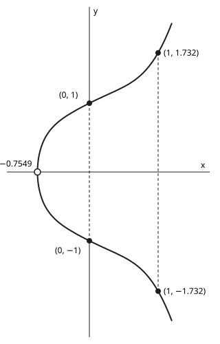

# Hyperelliptic curves and the canonical map: a curve's differentials embed it, unless it doubles over the line

[Syllabus](../../../SYLLABUS.md) → [Algebraic geometry](../README.md) → [Plane Curves](../README.md#s03) → Hyperelliptic curves and the canonical map

---

## General Overview

Take the curve $`y^2 = x^5 + x + 1`$ over the complex numbers ℂ. Above x = 0 sit two points, (0, 1) and (0, −1). Above x = 1 sit (1, 1.732) and (1, −1.732). Almost every x carries two points, one the mirror image of the other. This curve has genus 2: its complex points form a closed surface with two handles ([Genus](06-genus-and-the-degree-genus-formula.md)). It belongs to the same family as the shelf's house curve $`y^2 = x^2(x + 1)`$: a square equals a polynomial in x.

A curve carries its own built-in coordinates: its **holomorphic differentials**. A differential is a function times dx, the small change in x along the curve ([Divisors and Riemann-Roch](07-divisors-and-riemann-roch.md)). Holomorphic means it has no poles anywhere, at infinity included. This curve has exactly two independent ones: dx/y and x dx/y.

At each point, list the values of these differentials, read up to scale. That list is a point of a projective space, and the rule is the **canonical map**. Here the ratio of the two values is x, so the map sends (x, y) to the point x of the line. It forgets y. The surface folds two-to-one onto the line, and the mirror points (0, 1) and (0, −1) land on the same place.

Now take the Fermat quartic $`x^4 + y^4 = z^4`$, a smooth curve of degree 4 in the projective plane. Its genus is (4 − 1)(4 − 2)/2 = 3, and its three differentials have values in the ratio x : y : z. So its canonical map is the plane curve itself. Nothing folds: different points stay different.

The canonical map uses nothing but the curve, so folding is a property of the curve, not of its equation. Every genus-2 curve folds. A genus-3 curve either folds or is a smooth plane quartic.

**The holomorphic differentials of a curve of genus g ≥ 2 send it into a space of dimension g − 1; the result is a faithful copy of the curve unless the curve is a two-sheeted cover of the line, a hyperelliptic curve, and every curve of genus 2 is one.**

**What kind of fact this is:** definitions (holomorphic differential, canonical map, hyperelliptic curve) and theorems. The list of differentials on $`y^2 = f(x)`$, and the fact that every genus-2 curve is hyperelliptic, are proved on this card in Why it works from Riemann-Roch, which is stated on [Divisors and Riemann-Roch](07-divisors-and-riemann-roch.md). That the canonical map is an embedding for every other curve is given with its key steps and a named source (Hartshorne, Proposition IV.5.2).

### The picture: two points over each x

<p align="center"></p>

Real points only, drawn to scale at 100 units per unit, for x from −0.7549 to 1.2. The dashed lines join mirror pairs: the canonical map sends both ends of each dashed line to one point of the line. The open dot is a **branch point**: there y = 0, so only one point lies over that x. Over ℂ the curve has six branch points: the five roots of $`x^5 + x + 1`$ and the point at infinity. Only one of the five finite branch points is real.

---

## The formula

Notation already in use: a divisor, its degree, the space $`\mathcal{L}(D)`$ of functions with poles allowed by D and its dimension $`\ell(D)`$, and the canonical divisor K, the divisor of a differential ([Divisors and Riemann-Roch](07-divisors-and-riemann-roch.md)). Maps to projective space $`\mathbb{P}^m`$ are lists of functions read up to scale ([Maps between varieties](../02-Affine%20and%20Projective%20Varieties/05-regular-and-rational-maps.md)).

New on this card, one sentence each.

- A **hyperelliptic equation** is $`y^2 = f(x)`$ with f **squarefree**: no repeated root. C is its smooth model, the closed curve with its points at infinity added: one point if f has odd degree n, two if n is even.
- A **holomorphic differential** is a differential ω = h dx whose order (the power of a local coordinate it starts with; negative means a pole) is 0 or more at every point of C. They form a vector space $`\Omega(C)`$.
- The **canonical map** $`\varphi_K`$ sends a point P to $`(\omega_1(P) : \dots : \omega_g(P))`$, where $`\omega_1, \dots, \omega_g`$ is a basis of $`\Omega(C)`$. Only ratios count, and a ratio of two differentials is a function, so this is a map to $`\mathbb{P}^{g-1}`$.
- A curve of genus at least 2 is **hyperelliptic** when it has a function with exactly two poles, counted with multiplicity. Such a function is a two-to-one map to the line.

The differentials of the hyperelliptic curve, in one line:

```math
\Omega(C) = \left\{ (a_0 + a_1 x + \dots + a_{g-1} x^{g-1}) \, \frac{dx}{y} \right\}, \qquad g = \left\lfloor \frac{n - 1}{2} \right\rfloor
```

**Read it aloud:** the holomorphic differentials are the polynomials in x of degree below g, times dx over y, and the genus g is n minus one, halved and rounded down.

So the canonical map of a hyperelliptic curve is

```math
\varphi_K(x, y) = (1 : x : x^2 : \dots : x^{g-1})
```

**Read it aloud:** send each point to the list of the first g powers of its x-coordinate; y never appears.

For any curve of genus g ≥ 2, the canonical map tells two points P and Q apart exactly when no function has poles only at P and Q (Step 6). So it folds exactly when the curve is hyperelliptic.

On $`y^2 = x^5 + x + 1`$: n = 5, so g = 2, the differentials are dx/y and x dx/y, and $`\varphi_K = (1 : x)`$. On the Fermat quartic, the differentials are $`(a x + b y + c)\,dx/y^3`$ in the chart z = 1, and $`\varphi_K = (x : y : 1)`$.

| Symbol | Plain meaning | In our example | Push it up and the answer… |
| --- | --- | --- | --- |
| $`f`$, $`n`$ | the squarefree polynomial and its degree | $`x^5 + x + 1`$, n = 5 | g goes up by one for every 2 added to n |
| $`C`$ | the smooth closed curve $`y^2 = f(x)`$, points at infinity included | genus-2 surface | — |
| $`g`$ | genus: handles, and also the number of independent differentials | 2; 3 for the quartic | one more coordinate for the canonical map |
| $`\infty`$ | the point at infinity of C when n is odd | x has a double pole, y a pole of order 5 | — |
| $`dx`$, $`\omega`$ | the change in x along C; a differential | dx/y, x dx/y | — |
| $`\Omega(C)`$ | the holomorphic differentials, a vector space of dimension g | span of dx/y and x dx/y | — |
| $`K`$ | canonical divisor: the zeros and poles of one differential, degree 2g − 2 | div(dx/y) = 2∞ | deg K = 2g − 2 grows with g |
| $`\varphi_K`$, $`u_i`$ | canonical map, into $`\mathbb{P}^{g-1}`$; $`u_0, \dots, u_{g-1}`$ are the coordinates there | (1 : x), two-to-one | — |
| $`P`$, $`P'`$ | a point (x, y) and its mirror (x, −y) | (0, 1), (0, −1) | — |
| $`F`$, $`d`$ | a plane curve's polynomial and its degree | $`x^4 + y^4 - z^4`$, d = 4 | genus (d − 1)(d − 2)/2 |
| $`p`$, $`N_1`$, $`N_2`$ | a prime; points over the fields with p and $`p^2`$ elements | 13; 15; 177 | — |
| $`\alpha`$, $`L(T)`$ | a Frobenius root: the point counts are $`p^k + 1 - \sum \alpha^k`$; $`L(T) = \prod (1 - \alpha T)`$, whose value L(1) is the number of divisor classes of degree 0 ([The Jacobian](11-jacobians-and-abel-jacobi.md)) | four of them, each of size $`\sqrt{13}`$; L(1) = 188 | — |

The floor brackets $`\lfloor \cdot \rfloor`$ round down to a whole number.

### When it holds

- **f has no repeated root.** The house curve $`y^2 = x^2(x + 1)`$ has the double root 0. It has a node there and genus 0, not 1, and dx/y has two poles on its smooth model.
- **The points at infinity are taken on the smooth model C.** The plane closure of $`y^2 = x^5 + x + 1`$ is singular at (0 : 1 : 0), a point of multiplicity 3. The plane formula (5 − 1)(5 − 2)/2 then gives 6, not 2.
- **The field is ℂ, or another field where every polynomial has its roots.** Over the field with 13 elements, $`y^2 = x^5 + x + 1`$ shows only 15 of its points. The folding still shows there: 6 mirror pairs share their images.
- **The genus is at least 2.** At genus 1 the only differential is dx/y, with no zeros, so the canonical map sends the whole curve to one point. At genus 0 there are no holomorphic differentials at all.
- **The characteristic is not 2.** Over a field where 2 = 0, −y equals y, so no x carries a mirror pair, and $`y^2 = f(x)`$ never gives a smooth curve of genus 1 or more. Hyperelliptic curves there need the form $`y^2 + h(x)\,y = f(x)`$.

---

## Why it works

### Step 0: differentials are counted by their poles at infinity

A differential h dx can only go wrong in two places on $`y^2 = f(x)`$. One is where y = 0, since dx/y divides by y. The other is at infinity, where x and y blow up.

The first danger is not real. Where y = 0, dx is also zero, and the two cancel. So dx/y has no zeros or poles at any finite point. Only the order at infinity decides which differentials survive.

### Step 1: dx/y is finite and nonzero at every finite point

Differentiate the curve: $`2y\,dy = f'(x)\,dx`$. So dx/y = 2 dy/f′(x).

- **Where y ≠ 0**, x − x₀ is a local coordinate (a function with a simple zero at the point), and dx/y is finite and nonzero.
- **Where y = 0**, x₀ is a root of f. Since f has no repeated root, $`f'(x_0) \neq 0`$. Then y is a local coordinate, and 2 dy/f′(x) is finite and nonzero.

So $`\mathrm{div}(dx/y)`$ lives entirely at infinity. This is the argument [Divisors and Riemann-Roch](07-divisors-and-riemann-roch.md) gave for the cubic, with degree 5 in place of 3.

### Step 2: orders at infinity give the list

Take n = 5, so one point ∞ lies at infinity. The function x takes each value twice, at (x, y) and (x, −y), so its only pole, at ∞, is double: $`\mathrm{ord}_\infty(x) = -2`$. Then $`y^2 = x^5 + \dots`$ forces $`\mathrm{ord}_\infty(y) = -5`$. In a local coordinate t at ∞ with $`x = t^{-2}`$, $`dx = -2t^{-3}\,dt`$, so $`\mathrm{ord}_\infty(dx) = -3`$.

So the order of $`x^i\,dx/y`$ at ∞ is −2i − 3 + 5 = 2 − 2i.

| Differential | Order at ∞ | Holomorphic? |
| --- | --- | --- |
| dx/y | 2 | yes |
| x dx/y | 0 | yes |
| x² dx/y | −2 | no: a double pole |

Could some other function h make h dx/y holomorphic? Since dx/y has no zeros at finite points, h may have no poles there, so h is a polynomial A(x) + B(x) y. A term B(x) y dx/y = B(x) dx has order at most −3 at ∞, an odd number. The terms A(x) dx/y have even orders. Odd and even orders cannot cancel, so no y-term ever helps. The list is complete: $`\Omega(C)`$ is spanned by dx/y and x dx/y.

For general n the same count gives $`x^i\,dx/y`$ for i = 0, …, g − 1 (for even n, two points at infinity, each with $`\mathrm{ord}(x) = -1`$). The code runs n = 3 to 8.

### Step 3: the count agrees with the genus, two ways

**Riemann-Hurwitz.** The map x: C → line is two-to-one, with one point over each of the 6 branch points. The Euler characteristic $`2 - 2g`$ of a closed surface obeys $`2 - 2g = 2(2 - 0) - 6`$ for a double cover of the sphere (genus 0) with 6 branch points ([Genus](06-genus-and-the-degree-genus-formula.md)). So g = 2. In general there are n + (n mod 2) branch points, which gives $`g = \lfloor (n-1)/2 \rfloor`$.

**Riemann-Roch.** At D = 0 it reads $`\ell(0) - \ell(K) = 1 - g`$, so $`\ell(K) = g`$: there are g holomorphic differentials, because $`\mathcal{L}(K)`$ is the set of functions h with h·ω holomorphic. At D = K it gives deg K = 2g − 2. On our curve, div(dx/y) = 2∞ and div(x dx/y) = (0, 1) + (0, −1), both of degree 2 = 2g − 2.

### Step 4: the canonical map of a hyperelliptic curve folds

With the basis dx/y, x dx/y, …, $`x^{g-1}\,dx/y`$, divide every entry by dx/y. That leaves $`\varphi_K = (1 : x : \dots : x^{g-1})`$, a function of x alone. The points (x, y) and (x, −y) always land together.

The image is the curve traced by $`(1 : t : \dots : t^{g-1})`$, of degree g − 1. Traced twice it has degree 2(g − 1) = 2g − 2 = deg K, as it must. For g = 3, with coordinates $`u_0, u_1, u_2`$ on the plane $`\mathbb{P}^2`$, the image is the conic $`u_0 u_2 = u_1^2`$.

### Step 5: every genus-2 curve is hyperelliptic

Let C be any smooth closed curve of genus 2, given by any equation. Then $`\ell(K) = 2`$ and deg K = 2, so $`\varphi_K`$ goes to the line $`\mathbb{P}^1`$.

1. **No point is missed.** By Riemann-Roch, $`\ell(K - P) = \ell(P) + g - 2`$. A curve of genus at least 1 has no function with one simple pole (such a function would map it one-to-one onto the line, giving genus 0). So $`\ell(P) = 1`$ and $`\ell(K - P) = g - 1 = 1`$: some differential is nonzero at P. So $`\varphi_K`$ is defined everywhere.
2. **It has degree 2.** The points over one value of $`\varphi_K`$ are the zeros of one differential, and a differential has deg K = 2 zeros.
3. **So C is hyperelliptic.** The ratio of the two differentials is a function with exactly two poles. Riemann-Hurwitz then gives 6 branch points, and C is $`y^2 = `$ (a squarefree sextic). Moving one branch point to infinity makes it a quintic, as in our example.

<details>
<summary>Detailed proof: from a degree-2 function to the equation y² = f(x)</summary>

Let x be the function with two poles. Its field of functions contains k(x), the fractions in x, and the extension has degree 2, the number of points over each value. Pick any function w outside k(x). It satisfies $`w^2 + b(x)\,w + c(x) = 0`$ with b and c rational in x.

Completing the square, y₀ = w + b/2 satisfies $`y_0^2 = r(x)`$ with r rational in x. Multiply y₀ by the denominator of r and remove squared factors from r. The result is $`y^2 = f(x)`$ with f a squarefree polynomial.

Riemann-Hurwitz with genus 2 demands 6 branch points, so f has degree 5 or 6.

</details>

### Step 6: the separation test, and the genus-3 split

Riemann-Roch for D = P + Q gives $`\ell(P + Q) - \ell(K - P - Q) = 3 - g`$. Rearranged:

```math
\ell(K - P - Q) = \ell(P + Q) + g - 3
```

**Read it aloud:** the differentials vanishing at P and Q have dimension g − 3 plus the dimension of the space of functions with poles at most at P and Q.

$`\varphi_K`$ separates P and Q when requiring a differential to vanish at both costs two conditions, not one. That is $`\ell(K - P - Q) = g - 2`$, which by the line above is $`\ell(P + Q) = 1`$.

- **If C is hyperelliptic**, take P and its mirror P′. The function 1/(x − a), where a is the x-coordinate of P, has its poles exactly at P and P′ (one double pole when P = P′), so it lies in $`\mathcal{L}(P + P')`$; so $`\ell(P + P') = 2`$ and $`\varphi_K`$ joins them.
- **If C is not hyperelliptic**, no function has just two poles, so $`\ell(P + Q) = 1`$ for every P and Q. With P = Q the same count shows the map does not flatten a tangent direction. So $`\varphi_K`$ is an embedding: one-to-one, with nowhere flattened, so C is isomorphic to its image.

For genus 3 that image lies in the plane $`\mathbb{P}^2`$. A line in that plane is a differential's zero set, so it meets the image in deg K = 4 points: the image is a plane quartic. It is smooth, because it is a faithful copy of the smooth curve C. So a non-hyperelliptic genus-3 curve is a smooth plane quartic.

<details>
<summary>The converse on the Fermat quartic: its differentials are x, y and z</summary>

In the chart z = 1 the curve is $`x^4 + y^4 = 1`$. Differentiate: $`4x^3\,dx + 4y^3\,dy = 0`$. So

$`\displaystyle \omega_0 = \frac{dx}{y^3} = -\frac{dy}{x^3}`$

At a finite point, y ≠ 0 or x ≠ 0, so one of the two forms is finite and nonzero there.

At infinity, z = 0, there are four points $`(1 : \zeta : 0)`$ with $`\zeta^4 = -1`$. At each, x and y have simple poles and dx has a double pole. So $`x^i y^j\,dx/y^3`$ has order −i − j − 2 + 3 = 1 − i − j. It is holomorphic exactly when i + j ≤ 1: the three differentials dx/y³, x dx/y³, y dx/y³. That is g = 3, matching (4 − 1)(4 − 2)/2.

Their ratios are (1 : x : y): the curve's own point (x : y : 1), with the coordinates listed in another order. The canonical map is the plane curve, an embedding, so the Fermat quartic is not hyperelliptic. For a smooth plane curve of degree d, the same count gives the differentials $`G\,dx/F_y`$ with G of degree at most d − 3.

</details>

---

## Worked numbers, by hand

The genus-2 curve $`y^2 = x^5 + x + 1`$, then the Fermat quartic.

| Step | Arithmetic | Value |
| --- | --- | --- |
| factor f | $`(x^2 + x + 1)(x^3 - x^2 + 1)`$ | $`x^5 + x + 1`$ |
| no repeated root | discriminant, by formula and by determinant | 3381, not 0 |
| branch points | 5 roots + ∞ | 6 |
| genus | 2 − 2g = 2·2 − 6 | g = 2 |
| order at ∞ of dx/y, x dx/y, x² dx/y | 2 − 2i for i = 0, 1, 2 | 2, 0, −2 |
| differentials | the first two | dx/y, x dx/y |
| degree of K | div(x dx/y) = (0, 1) + (0, −1) | 2 = 2g − 2 |
| canonical map | (dx/y : x dx/y) | **(1 : x), two-to-one** |
| over x = 0 | both mirror points | (0, 1) and (0, −1) → 0 |
| Fermat genus | (4 − 1)(4 − 2)/2 | 3 |
| Fermat differentials | i + j ≤ 1 in $`x^i y^j\,dx/y^3`$ | 3 |
| Fermat canonical map | (x : y : 1) | **the curve itself** |

The genus-2 curve folds onto the line, so its canonical image, a line, does not show the curve. The quartic's image is the quartic itself.

A finite check of the same facts, over the field with 13 elements:

- $`y^2 = x^5 + x + 1`$ has 15 points: one at infinity, one over each root x = 3 and x = 9 of f, and two over each of 6 more values of x. Its canonical image is 9 points of the line. The pairs that are not separated are exactly the 6 mirror pairs.
- $`x^4 + y^4 = z^4`$ has 8 points. Its canonical map, computed from its three differentials, sends them to 8 different points, so all 28 pairs are separated.

### What breaks if you drop a piece

| Mistake | Comes out at | What went wrong |
| --- | --- | --- |
| Plane genus formula on $`y^2 = x^5 + x + 1`$ | genus 6 | the plane closure is singular at (0 : 1 : 0), multiplicity 3; the true genus is 2 |
| Counting x² dx/y as holomorphic | 3 differentials | its order at ∞ is −2, a pole; 3 is more than the genus |
| Treating the house curve $`y^2 = x^2(x + 1)`$ as genus 1 | 1 differential claimed | double root: 2 branch points, genus 0; on the smooth model x = t² − 1, y = t(t² − 1), dx/y = 2 dt/(t² − 1) has poles at t = 1 and −1 |
| Assuming every genus-3 curve is a plane quartic | $`y^2 = x^7 + x + 1`$: 21 points mod 13, image 11 | it is hyperelliptic: the image is the conic $`u_0 u_2 = u_1^2`$, and 10 mirror pairs have $`\ell(K - P - P') = 2`$ |
| Reading the point counts as genus 1 | 195 points mod 13² | the curve has 177, which rules out genus 1; four Frobenius roots of size √13, as genus 2 needs, fit both counts |

The code prints all five.

---

## Code, from first principles, and it actually runs

The scripts take two independent roads to the genus. Road 1 counts differentials by their orders at infinity. Road 2 counts branch points, once the discriminant (zero exactly when f has a repeated root) is found nonzero, both by formula and as a determinant. A finite-field check comes on top: the counts over the fields with 13 and 169 elements give four Frobenius roots of size $`\sqrt{13}`$. That fits genus 2 and rules out genus 1, but two counts alone cannot fix the genus. The count of 177 is tested through L(1), which is computed from it: a direct search finds 188 divisor classes of degree 0, each written as a pair of polynomials (u, v) as on [The Jacobian](11-jacobians-and-abel-jacobi.md), and L(1) = 188 matches. Mod 13 the scripts also run the separation test on every pair of points of the two hyperelliptic curves, and map the Fermat quartic's points by its three differentials. The last line prints the figure's coordinates.

### Python

```python
# Hyperelliptic curves and the canonical map -- the check behind the card.  Standard library only.
# Polynomials are integer lists, lowest power first.  Roads to the genus: pole orders of differentials
# and branch points from an exact discriminant.  Point counts mod 13 and 13^2 are a consistency check.
from math import sqrt
def disc_formula(n):                 # discriminant of x^n + x + 1, the trinomial formula
    return (-1) ** (n * (n - 1) // 2) * (n ** n + (-1) ** (n - 1) * (n - 1) ** (n - 1))
def det(M):                          # Bareiss elimination: exact integer determinant
    M = [r[:] for r in M]; n = len(M); sign, prev = 1, 1
    for k in range(n - 1):
        if M[k][k] == 0:
            s = next((i for i in range(k + 1, n) if M[i][k] != 0), None)
            if s is None: return 0
            M[k], M[s] = M[s], M[k]; sign = -sign
        for i in range(k + 1, n):
            for j in range(k + 1, n): M[i][j] = (M[i][j] * M[k][k] - M[i][k] * M[k][j]) // prev
        prev = M[k][k]
    return sign * M[n - 1][n - 1]
def disc_sylvester(f):               # (-1)^(n(n-1)/2) Res(f, f') for monic f, by the Sylvester matrix
    n = len(f) - 1; d = [i * f[i] for i in range(1, n + 1)]; S = []
    for r in range(n - 1): S.append([0] * r + f[::-1] + [0] * (n - 2 - r))
    for r in range(n): S.append([0] * r + d[::-1] + [0] * (n - 1 - r))
    return (-1) ** (n * (n - 1) // 2) * det(S)
def orders_at_infinity(n):           # (points at infinity, ord x, ord y, ord dx) on y^2 = f, deg f = n
    return (1, -2, -n, -3) if n % 2 else (2, -1, -n // 2, -2)
def holomorphic(n):                  # the i with x^i dx/y finite at infinity (it is finite elsewhere)
    pts, ox, oy, odx = orders_at_infinity(n)
    return [i for i in range(n) if i * ox + odx - oy >= 0]
print("y^2 = x^n + x + 1: discriminant two ways, branch points, genus two ways")
for n in range(3, 9):
    f = [1, 1] + [0] * (n - 2) + [1]
    D1, D2 = disc_formula(n), disc_sylvester(f)
    assert D1 == D2 and D1 != 0                      # squarefree, so the affine curve is smooth
    branch = n + n % 2                               # n roots, plus infinity when n is odd
    g_rh = (branch - 2) // 2                         # Riemann-Hurwitz for a 2-to-1 map to the line
    hol = holomorphic(n); pts, ox, oy, odx = orders_at_infinity(n)
    degK = pts * (odx - oy)                          # zeros of dx/y, all at infinity
    assert len(hol) == g_rh and degK == 2 * g_rh - 2
    print(f"n = {n}: disc {D1}, branch points {branch}, genus {g_rh}, differentials x^i dx/y for i in {hol}, deg K {degK}")
print("genus-2 curve y^2 = x^5 + x + 1 = (x^2 + x + 1)(x^3 - x^2 + 1)")
mul = lambda a, b: [sum(a[i] * b[k - i] for i in range(len(a)) if 0 <= k - i < len(b)) for k in range(len(a) + len(b) - 1)]
assert mul([1, 1, 1], [1, 0, -1, 1]) == [1, 1, 0, 0, 0, 1]
pts, ox, oy, odx = orders_at_infinity(5)
for i in range(3): print(f"  order at infinity of x^{i} dx/y: {i * ox + odx - oy}")
print(f"  div(dx/y) = 2*inf, div(x dx/y) = (0, 1) + (0, -1): degrees 2 and 2 = 2g - 2")
def chi(a, p):                       # Euler's criterion: +1 square, -1 non-square, 0 zero
    a %= p
    return 0 if a == 0 else (1 if pow(a, (p - 1) // 2, p) == 1 else -1)
p = 13
ev = lambda f, x: sum(c * x ** i for i, c in enumerate(f))
def hyper_points(f):                 # affine points of y^2 = f over F_p, plus one point at infinity
    P = [(x, y) for x in range(p) for y in range(p) if (y * y - ev(f, x)) % p == 0]
    assert len(P) == sum(1 + chi(ev(f, x), p) for x in range(p))   # enumeration against Euler
    return P
def canonical_image(P, g):           # (1 : x : ... : x^(g-1)), infinity goes to (0 : ... : 0 : 1)
    return {tuple(x ** k % p for k in range(g)) for x, y in P} | {tuple([0] * (g - 1) + [1])}
def mirror_rank(P, g):               # rank of the conditions "a_0 + a_1 x + ... vanishes at P and P'"
    ranks = []
    for (x1, y1) in P:
        for (x2, y2) in P:
            if (x1, y1) < (x2, y2):
                rows = [[x1 ** k % p for k in range(g)], [x2 ** k % p for k in range(g)]]
                full = any((rows[0][a] * rows[1][b] - rows[0][b] * rows[1][a]) % p for a in range(g) for b in range(a + 1, g))
                ranks.append(((x1, y1), (x2, y2), 2 if full else 1))
    return ranks
f2 = [1, 1, 0, 0, 0, 1]
P2 = hyper_points(f2); N1 = len(P2) + 1; img2 = canonical_image(P2, 2)
roots2 = [x for x in range(p) if ev(f2, x) % p == 0]
bad2 = [r for r in mirror_rank(P2, 2) if r[2] == 1]
assert len(bad2) == (N1 - 1 - len(roots2)) // 2 and all(a[0] == b[0] for a, b, _ in bad2)
assert 2 * len(img2) - len(roots2) - 1 == N1      # two-to-one except at the branch points
print(f"mod {p}: {N1} points, roots of f at x = {roots2}, canonical image {len(img2)} of {p + 1} points of the line")
print(f"  pairs not separated: {len(bad2)}, every one a mirror pair (x, y), (x, -y); l(K - P - P') = 1 = g - 1")
nr = next(a for a in range(2, p) if chi(a, p) == -1)   # F_169 = F_13 with a square root r of nr
m2 = lambda a, b: ((a[0] * b[0] + nr * a[1] * b[1]) % p, (a[0] * b[1] + a[1] * b[0]) % p)
def pw(a, e):
    r = (1, 0)
    while e:
        if e & 1: r = m2(r, a)
        a, e = m2(a, a), e >> 1
    return r
N2 = 1
for a in range(p):
    for b in range(p):
        v = pw((a, b), 5); v = ((v[0] + a + 1) % p, (v[1] + b) % p)
        N2 += 1 if v == (0, 0) else (2 if pw(v, (p * p - 1) // 2) == (1, 0) else 0)
s1, s2 = p + 1 - N1, p * p + 1 - N2; e2 = (s1 * s1 - s2) // 2
assert (s1 * s1 - s2) % 2 == 0
D = s1 * s1 - 4 * (e2 - 2 * p); b1, b2 = (s1 + sqrt(D)) / 2, (s1 - sqrt(D)) / 2
assert D > 0 and max(abs(b1), abs(b2)) <= 2 * sqrt(p)  # four Frobenius roots of size sqrt(13): fits genus 2
g1_N2 = p * p + 1 - (s1 * s1 - 2 * p)
assert g1_N2 != N2
print(f"mod {p}^2: {N2} points; L(T) = 1 + {-s1}T + {e2}T^2 + {-p * s1}T^3 + {p * p}T^4")
print(f"  alpha + {p}/alpha = {b1:.6f} and {b2:.6f}, both within 2 sqrt({p}) = {2 * sqrt(p):.6f}")
print(f"  a genus-1 curve with {N1} points mod {p} would have {g1_N2} points mod {p}^2")
def rem(a, u):                       # remainder of a on division by the monic u, mod p
    while len(a) >= len(u): s = len(a) - len(u); a = [(c - a[-1] * u[i - s]) % p if i >= s else c for i, c in enumerate(a[:-1])]
    return a
pairs = sum(not any(rem([(c - w) % p for c, w in zip(f2, mul(v, v) + [0] * 6)], u)) for d in range(3)
            for u in ([k // p ** i % p for i in range(d)] + [1] for k in range(p ** d)) for v in ([m // p ** i % p for i in range(d)] for m in range(p ** d)))
L1 = 1 - s1 + e2 - p * s1 + p * p
assert pairs == L1                   # Mumford pairs (u, v): u monic, deg v < deg u <= 2, u divides f - v^2
print(f"  divisor classes of degree 0 mod {p} (the Jacobian group): L(1) = {L1}; reduced pairs (u, v) by search: {pairs}")
print("Fermat curves x^d + y^d = z^d: genus formula against differentials x^i y^j dx/y^(d-1)")
H = {d: [(i, j) for i in range(d) for j in range(d) if -i - j - 2 + (d - 1) >= 0] for d in range(3, 7)}   # ord at the d points at infinity
for d, hol in H.items():
    assert len(hol) == (d - 1) * (d - 2) // 2
    print(f"  d = {d}: genus {(d - 1) * (d - 2) // 2}, differentials {len(hol)}, deg K {d * (-2 + (d - 1))}")
Q = [(x, y, 1) for x in range(p) for y in range(p) if (x ** 4 + y ** 4 - 1) % p == 0]
Q += [(1, y, 0) for y in range(p) if (1 + y ** 4) % p == 0]
nz = lambda u: tuple(c * pow(next(a for a in u if a), p - 2, p) % p for c in u)   # first nonzero entry scaled to 1
img4 = {nz([x ** i * y ** j * z ** (1 - i - j) % p for i, j in H[4]]) for x, y, z in Q}   # x^i y^j dx/y^3, homogenised
assert len(img4) == len(Q)                           # one image per point: nothing folds
print(f"x^4 + y^4 = z^4 mod {p}: {len(Q)} points {sorted(Q)}")
print(f"  canonical map from the differentials x^i y^j dx/y^3, (i, j) in {H[4]}: {len(img4)} images, all {len(Q) * (len(Q) - 1) // 2} pairs separated")
f7 = [1, 1, 0, 0, 0, 0, 0, 1]
assert disc_sylvester(f7) % p != 0
P7 = hyper_points(f7); img7 = canonical_image(P7, 3); bad7 = [r for r in mirror_rank(P7, 3) if r[2] == 1]
assert all((u[0] * u[2] - u[1] * u[1]) % p == 0 for u in img7)   # the image lies on the conic u0 u2 = u1^2
print(f"y^2 = x^7 + x + 1 mod {p}: {len(P7) + 1} points, canonical image {len(img7)} points on the conic u0 u2 = u1^2")
print(f"  mirror pairs not separated: {len(bad7)}, l(K - P - P') = 2 = g - 1: hyperelliptic, not a plane quartic")
print("what breaks")
proj = [(1, 0, 2, 3)] + [(-c, i, 0, 5 - i) for i, c in enumerate(f2) if c]   # y^2 z^3 - x^5 - x z^4 - z^5 as (c, a, b, e)
mult = min(a + e for c, a, b, e in proj)              # set y = 1: lowest degree in x and z at (0 : 1 : 0)
print(f"  plane genus formula on degree 5: {(5 - 1) * (5 - 2) // 2}; y^2 z^3 = x^5 + x z^4 + z^5 at (0 : 1 : 0) has multiplicity {mult}")
print(f"  counting x^2 dx/y too: {len(holomorphic(5)) + 1} differentials, order at infinity {2 * ox + odx - oy}")
nodal = [0, 0, 1, 1]                                 # y^2 = x^2 (x + 1): x = 0 is a double root
assert disc_sylvester(nodal) == 0
odd = [r for r in range(-3, 4) if ev(nodal, r) == 0 and ev([0, 2, 3], r) != 0]   # simple roots only
assert all((t * (t * t - 1)) ** 2 == ev(nodal, t * t - 1) for t in range(-5, 6))   # smooth model x = t^2 - 1, y = t(t^2 - 1)
print(f"  nodal cubic: disc 0, branch points {len(odd) + 1}, genus {(len(odd) + 1 - 2) // 2}; dx/y = 2 dt/(t^2 - 1), poles at t = 1 and -1")
lo, hi = -1.0, 0.0                                   # real branch point: root of x^3 - x^2 + 1, by bisection
for _ in range(60):
    mid = (lo + hi) / 2
    lo, hi = (mid, hi) if mid * mid * mid - mid * mid + 1 < 0 else (lo, mid)
assert abs(lo * lo * lo * lo * lo + lo + 1) < 1e-12
y1, y12 = sqrt(3.0), sqrt(1.2 * 1.2 * 1.2 * 1.2 * 1.2 + 2.2)
print(f"figure,branch,{lo:.6f},0,mirror,0,1,0,-1,x=1,{y1:.6f},x=1.2,{y12:.6f}")
print("ALL CHECKS PASS")
```

**Ran 2026-11-24 on macOS, Python 3.14.10, standard library only. All checks passed. Output, pasted from the run:**

```
y^2 = x^n + x + 1: discriminant two ways, branch points, genus two ways
n = 3: disc -31, branch points 4, genus 1, differentials x^i dx/y for i in [0], deg K 0
n = 4: disc 229, branch points 4, genus 1, differentials x^i dx/y for i in [0], deg K 0
n = 5: disc 3381, branch points 6, genus 2, differentials x^i dx/y for i in [0, 1], deg K 2
n = 6: disc -43531, branch points 6, genus 2, differentials x^i dx/y for i in [0, 1], deg K 2
n = 7: disc -870199, branch points 8, genus 3, differentials x^i dx/y for i in [0, 1, 2], deg K 4
n = 8: disc 15953673, branch points 8, genus 3, differentials x^i dx/y for i in [0, 1, 2], deg K 4
genus-2 curve y^2 = x^5 + x + 1 = (x^2 + x + 1)(x^3 - x^2 + 1)
  order at infinity of x^0 dx/y: 2
  order at infinity of x^1 dx/y: 0
  order at infinity of x^2 dx/y: -2
  div(dx/y) = 2*inf, div(x dx/y) = (0, 1) + (0, -1): degrees 2 and 2 = 2g - 2
mod 13: 15 points, roots of f at x = [3, 9], canonical image 9 of 14 points of the line
  pairs not separated: 6, every one a mirror pair (x, y), (x, -y); l(K - P - P') = 1 = g - 1
mod 13^2: 177 points; L(T) = 1 + 1T + 4T^2 + 13T^3 + 169T^4
  alpha + 13/alpha = 4.216991 and -5.216991, both within 2 sqrt(13) = 7.211103
  a genus-1 curve with 15 points mod 13 would have 195 points mod 13^2
  divisor classes of degree 0 mod 13 (the Jacobian group): L(1) = 188; reduced pairs (u, v) by search: 188
Fermat curves x^d + y^d = z^d: genus formula against differentials x^i y^j dx/y^(d-1)
  d = 3: genus 1, differentials 1, deg K 0
  d = 4: genus 3, differentials 3, deg K 4
  d = 5: genus 6, differentials 6, deg K 10
  d = 6: genus 10, differentials 10, deg K 18
x^4 + y^4 = z^4 mod 13: 8 points [(0, 1, 1), (0, 5, 1), (0, 8, 1), (0, 12, 1), (1, 0, 1), (5, 0, 1), (8, 0, 1), (12, 0, 1)]
  canonical map from the differentials x^i y^j dx/y^3, (i, j) in [(0, 0), (0, 1), (1, 0)]: 8 images, all 28 pairs separated
y^2 = x^7 + x + 1 mod 13: 21 points, canonical image 11 points on the conic u0 u2 = u1^2
  mirror pairs not separated: 10, l(K - P - P') = 2 = g - 1: hyperelliptic, not a plane quartic
what breaks
  plane genus formula on degree 5: 6; y^2 z^3 = x^5 + x z^4 + z^5 at (0 : 1 : 0) has multiplicity 3
  counting x^2 dx/y too: 3 differentials, order at infinity -2
  nodal cubic: disc 0, branch points 2, genus 0; dx/y = 2 dt/(t^2 - 1), poles at t = 1 and -1
figure,branch,-0.754878,0,mirror,0,1,0,-1,x=1,1.732051,x=1.2,2.165253
ALL CHECKS PASS
```

### Rust

```rust
// Hyperelliptic curves and the canonical map -- the check behind the card.  std only, no crates.
// Polynomials are integer vectors, lowest power first.  Roads to the genus: pole orders of differentials
// and branch points from an exact discriminant.  Point counts mod 13 and 13^2 are a consistency check.
use std::collections::BTreeSet;
const P: i128 = 13;
fn ipow(b: i128, e: u32) -> i128 { b.checked_pow(e).expect("overflow") }
fn disc_formula(n: i128) -> i128 { // discriminant of x^n + x + 1, the trinomial formula
    let s = if (n * (n - 1) / 2) % 2 == 0 { 1 } else { -1 };
    let t = if (n - 1) % 2 == 0 { 1 } else { -1 };
    s * (ipow(n, n as u32) + t * ipow(n - 1, (n - 1) as u32))
}
fn det(mut m: Vec<Vec<i128>>) -> i128 { // Bareiss elimination: exact integer determinant
    let n = m.len(); let (mut sign, mut prev) = (1i128, 1i128);
    for k in 0..n - 1 {
        if m[k][k] == 0 {
            match (k + 1..n).find(|&i| m[i][k] != 0) { None => return 0, Some(s) => { m.swap(k, s); sign = -sign; } }
        }
        for i in k + 1..n {
            for j in k + 1..n {
                m[i][j] = (m[i][j].checked_mul(m[k][k]).unwrap() - m[i][k].checked_mul(m[k][j]).unwrap()) / prev;
            }
        }
        prev = m[k][k];
    }
    sign * m[n - 1][n - 1]
}
fn disc_sylvester(f: &[i128]) -> i128 { // (-1)^(n(n-1)/2) Res(f, f') for monic f, by the Sylvester matrix
    let n = f.len() - 1; let d: Vec<i128> = (1..=n).map(|i| i as i128 * f[i]).collect();
    let (fr, dr): (Vec<i128>, Vec<i128>) = (f.iter().rev().cloned().collect(), d.iter().rev().cloned().collect());
    let mut s = vec![];
    for r in 0..n - 1 { let mut row = vec![0; r]; row.extend(&fr); row.extend(vec![0; n - 2 - r]); s.push(row); }
    for r in 0..n { let mut row = vec![0; r]; row.extend(&dr); row.extend(vec![0; n - 1 - r]); s.push(row); }
    (if (n * (n - 1) / 2) % 2 == 0 { 1 } else { -1 }) * det(s)
}
fn orders_at_infinity(n: i128) -> (i128, i128, i128, i128) { // (points, ord x, ord y, ord dx) on y^2 = f
    if n % 2 == 1 { (1, -2, -n, -3) } else { (2, -1, -n / 2, -2) }
}
fn holomorphic(n: i128) -> Vec<i128> { // the i with x^i dx/y finite at infinity (it is finite elsewhere)
    let (_, ox, oy, odx) = orders_at_infinity(n);
    (0..n).filter(|&i| i * ox + odx - oy >= 0).collect()
}
fn show(v: &[i128]) -> String { format!("[{}]", v.iter().map(|x| x.to_string()).collect::<Vec<_>>().join(", ")) }
fn ev(f: &[i128], x: i128) -> i128 { f.iter().enumerate().map(|(i, c)| c * ipow(x, i as u32)).sum() }
fn powm(mut b: i128, mut e: i128) -> i128 { let mut r = 1; b = b.rem_euclid(P); while e > 0 { if e & 1 == 1 { r = r * b % P; } b = b * b % P; e >>= 1; } r }
fn chi(a: i128) -> i128 { // Euler's criterion: +1 square, -1 non-square, 0 zero
    let a = a.rem_euclid(P); if a == 0 { 0 } else if powm(a, (P - 1) / 2) == 1 { 1 } else { -1 }
}
fn hyper_points(f: &[i128]) -> Vec<(i128, i128)> { // affine points of y^2 = f over F_p
    let mut v = vec![];
    for x in 0..P { for y in 0..P { if (y * y - ev(f, x)).rem_euclid(P) == 0 { v.push((x, y)); } } }
    assert_eq!(v.len() as i128, (0..P).map(|x| 1 + chi(ev(f, x))).sum::<i128>()); // enumeration against Euler
    v
}
fn canonical_image(pts: &[(i128, i128)], g: u32) -> BTreeSet<Vec<i128>> { // (1 : x : ... : x^(g-1)), infinity to (0 : ... : 1)
    let mut s: BTreeSet<Vec<i128>> = pts.iter().map(|&(x, _)| (0..g).map(|k| ipow(x, k) % P).collect()).collect();
    let mut inf = vec![0; g as usize]; inf[g as usize - 1] = 1; s.insert(inf); s
}
fn mirror_rank(pts: &[(i128, i128)], g: u32) -> Vec<((i128, i128), (i128, i128), i128)> {
    let mut out = vec![];
    for &a in pts { for &b in pts { if a < b {
        let r0: Vec<i128> = (0..g).map(|k| ipow(a.0, k) % P).collect();
        let r1: Vec<i128> = (0..g).map(|k| ipow(b.0, k) % P).collect();
        let g = g as usize;
        let full = (0..g).any(|i| (i + 1..g).any(|j| (r0[i] * r1[j] - r0[j] * r1[i]).rem_euclid(P) != 0));
        out.push((a, b, if full { 2 } else { 1 }));
    } } }
    out
}
fn m2(a: (i128, i128), b: (i128, i128), nr: i128) -> (i128, i128) { ((a.0 * b.0 + nr * a.1 * b.1) % P, (a.0 * b.1 + a.1 * b.0) % P) }
fn pw(mut a: (i128, i128), mut e: i128, nr: i128) -> (i128, i128) { let mut r = (1, 0); while e > 0 { if e & 1 == 1 { r = m2(r, a, nr); } a = m2(a, a, nr); e >>= 1; } r }
fn rem(mut a: Vec<i128>, u: &[i128]) -> Vec<i128> { // remainder of a on division by the monic u, mod p
    while a.len() >= u.len() { let (c, s) = (a.pop().unwrap(), a.len() + 1 - u.len()); for i in s..a.len() { a[i] = (a[i] - c * u[i - s]).rem_euclid(P); } }
    a
}
fn main() {
    println!("y^2 = x^n + x + 1: discriminant two ways, branch points, genus two ways");
    for n in 3..9i128 {
        let mut f = vec![1, 1]; f.extend(vec![0; n as usize - 2]); f.push(1);
        let (d1, d2) = (disc_formula(n), disc_sylvester(&f));
        assert!(d1 == d2 && d1 != 0); // squarefree, so the affine curve is smooth
        let branch = n + n % 2; // n roots, plus infinity when n is odd
        let g_rh = (branch - 2) / 2; // Riemann-Hurwitz for a 2-to-1 map to the line
        let hol = holomorphic(n); let (pts, _, oy, odx) = orders_at_infinity(n);
        let deg_k = pts * (odx - oy); // zeros of dx/y, all at infinity
        assert!(hol.len() as i128 == g_rh && deg_k == 2 * g_rh - 2);
        println!("n = {}: disc {}, branch points {}, genus {}, differentials x^i dx/y for i in {}, deg K {}", n, d1, branch, g_rh, show(&hol), deg_k);
    }
    println!("genus-2 curve y^2 = x^5 + x + 1 = (x^2 + x + 1)(x^3 - x^2 + 1)");
    let (a, b) = ([1i128, 1, 1], [1i128, 0, -1, 1]); let mut prod = vec![0i128; 6];
    for i in 0..3 { for j in 0..4 { prod[i + j] += a[i] * b[j]; } }
    assert_eq!(prod, vec![1, 1, 0, 0, 0, 1]);
    let (_, ox, oy, odx) = orders_at_infinity(5);
    for i in 0..3 { println!("  order at infinity of x^{} dx/y: {}", i, i * ox + odx - oy); }
    println!("  div(dx/y) = 2*inf, div(x dx/y) = (0, 1) + (0, -1): degrees 2 and 2 = 2g - 2");
    let f2 = [1i128, 1, 0, 0, 0, 1];
    let p2 = hyper_points(&f2); let n1 = p2.len() as i128 + 1; let img2 = canonical_image(&p2, 2);
    let roots2: Vec<i128> = (0..P).filter(|&x| ev(&f2, x) % P == 0).collect();
    let bad2: Vec<_> = mirror_rank(&p2, 2).into_iter().filter(|r| r.2 == 1).collect();
    assert!(bad2.len() as i128 == (n1 - 1 - roots2.len() as i128) / 2 && bad2.iter().all(|r| r.0 .0 == r.1 .0));
    assert_eq!(2 * img2.len() as i128 - roots2.len() as i128 - 1, n1); // two-to-one except at branch points
    println!("mod {}: {} points, roots of f at x = {}, canonical image {} of {} points of the line", P, n1, show(&roots2), img2.len(), P + 1);
    println!("  pairs not separated: {}, every one a mirror pair (x, y), (x, -y); l(K - P - P') = 1 = g - 1", bad2.len());
    let nr = (2..P).find(|&a| chi(a) == -1).unwrap(); // F_169 = F_13 with a square root of nr
    let mut n2 = 1i128;
    for a in 0..P { for b in 0..P {
        let v = pw((a, b), 5, nr); let v = ((v.0 + a + 1) % P, (v.1 + b) % P);
        n2 += if v == (0, 0) { 1 } else if pw(v, (P * P - 1) / 2, nr) == (1, 0) { 2 } else { 0 };
    } }
    let (s1, s2) = (P + 1 - n1, P * P + 1 - n2); let e2 = (s1 * s1 - s2) / 2;
    assert_eq!((s1 * s1 - s2) % 2, 0);
    let d = s1 * s1 - 4 * (e2 - 2 * P); let sd = (d as f64).sqrt();
    let (b1, b2) = ((s1 as f64 + sd) / 2.0, (s1 as f64 - sd) / 2.0);
    assert!(d > 0 && b1.abs().max(b2.abs()) <= 2.0 * (P as f64).sqrt()); // four Frobenius roots of size sqrt(13): fits genus 2
    let g1_n2 = P * P + 1 - (s1 * s1 - 2 * P);
    assert!(g1_n2 != n2);
    println!("mod {}^2: {} points; L(T) = 1 + {}T + {}T^2 + {}T^3 + {}T^4", P, n2, -s1, e2, -P * s1, P * P);
    println!("  alpha + {}/alpha = {:.6} and {:.6}, both within 2 sqrt({}) = {:.6}", P, b1, b2, P, 2.0 * (P as f64).sqrt());
    println!("  a genus-1 curve with {} points mod {} would have {} points mod {}^2", n1, P, g1_n2, P);
    let mut pairs = 0i128; // Mumford pairs (u, v): u monic, deg v < deg u <= 2, u divides f - v^2
    for d in 0..3u32 { for k in 0..ipow(P, d) { for m in 0..ipow(P, d) {
        let (u, v): (Vec<i128>, Vec<i128>) = ((0..d).map(|i| k / ipow(P, i) % P).chain([1]).collect(), (0..d).map(|i| m / ipow(P, i) % P).collect());
        let mut w = f2.to_vec(); for i in 0..v.len() { for j in 0..v.len() { w[i + j] = (w[i + j] - v[i] * v[j]).rem_euclid(P); } }
        if rem(w, &u).iter().all(|&c| c == 0) { pairs += 1; }
    } } }
    let l1 = 1 - s1 + e2 - P * s1 + P * P;
    assert_eq!(pairs, l1);
    println!("  divisor classes of degree 0 mod {} (the Jacobian group): L(1) = {}; reduced pairs (u, v) by search: {}", P, l1, pairs);
    println!("Fermat curves x^d + y^d = z^d: genus formula against differentials x^i y^j dx/y^(d-1)");
    let mut h4: Vec<(i128, i128)> = vec![];
    for d in 3..7i128 {
        let hol: Vec<(i128, i128)> = (0..d).flat_map(|i| (0..d).map(move |j| (i, j))).filter(|&(i, j)| -i - j - 2 + (d - 1) >= 0).collect();
        assert_eq!(hol.len() as i128, (d - 1) * (d - 2) / 2);
        println!("  d = {}: genus {}, differentials {}, deg K {}", d, (d - 1) * (d - 2) / 2, hol.len(), d * (-2 + (d - 1))); if d == 4 { h4 = hol; }
    }
    let mut q: Vec<[i128; 3]> = vec![];
    for x in 0..P { for y in 0..P { if (ipow(x, 4) + ipow(y, 4) - 1) % P == 0 { q.push([x, y, 1]); } } }
    for y in 0..P { if (1 + ipow(y, 4)) % P == 0 { q.push([1, y, 0]); } }
    q.sort();
    let img4: BTreeSet<Vec<i128>> = q.iter().map(|u| { // x^i y^j dx/y^3, homogenised, first nonzero entry scaled to 1
        let w: Vec<i128> = h4.iter().map(|&(i, j)| ipow(u[0], i as u32) * ipow(u[1], j as u32) * ipow(u[2], (1 - i - j) as u32) % P).collect();
        let c = powm(*w.iter().find(|&&a| a != 0).unwrap(), P - 2); w.iter().map(|a| a * c % P).collect() }).collect();
    assert_eq!(img4.len(), q.len()); // one image per point: nothing folds
    let list: Vec<String> = q.iter().map(|u| format!("({}, {}, {})", u[0], u[1], u[2])).collect();
    println!("x^4 + y^4 = z^4 mod {}: {} points [{}]", P, q.len(), list.join(", "));
    println!("  canonical map from the differentials x^i y^j dx/y^3, (i, j) in {:?}: {} images, all {} pairs separated", h4, img4.len(), q.len() * (q.len() - 1) / 2);
    let f7 = [1i128, 1, 0, 0, 0, 0, 0, 1];
    assert!(disc_sylvester(&f7) % P != 0);
    let p7 = hyper_points(&f7); let img7 = canonical_image(&p7, 3);
    let bad7 = mirror_rank(&p7, 3).into_iter().filter(|r| r.2 == 1).count();
    assert!(img7.iter().all(|u| (u[0] * u[2] - u[1] * u[1]).rem_euclid(P) == 0)); // the conic u0 u2 = u1^2
    println!("y^2 = x^7 + x + 1 mod {}: {} points, canonical image {} points on the conic u0 u2 = u1^2", P, p7.len() + 1, img7.len());
    println!("  mirror pairs not separated: {}, l(K - P - P') = 2 = g - 1: hyperelliptic, not a plane quartic", bad7);
    println!("what breaks");
    let mut proj = vec![(1, 0, 2, 3)]; // y^2 z^3 - x^5 - x z^4 - z^5 as (c, a, b, e)
    for (i, &c) in f2.iter().enumerate() { if c != 0 { proj.push((-c, i as i128, 0, 5 - i as i128)); } }
    let mult = proj.iter().map(|&(_, a, _, e)| a + e).min().unwrap(); // set y = 1: lowest degree at (0 : 1 : 0)
    println!("  plane genus formula on degree 5: {}; y^2 z^3 = x^5 + x z^4 + z^5 at (0 : 1 : 0) has multiplicity {}", (5 - 1) * (5 - 2) / 2, mult);
    println!("  counting x^2 dx/y too: {} differentials, order at infinity {}", holomorphic(5).len() + 1, 2 * ox + odx - oy);
    let nodal = [0i128, 0, 1, 1]; // y^2 = x^2 (x + 1): x = 0 is a double root
    assert_eq!(disc_sylvester(&nodal), 0);
    let odd = (-3..4).filter(|&r| ev(&nodal, r) == 0 && ev(&[0, 2, 3], r) != 0).count() as i128; // simple roots
    assert!((-5..6i128).all(|t| ipow(t * (t * t - 1), 2) == ev(&nodal, t * t - 1))); // smooth model x = t^2 - 1
    println!("  nodal cubic: disc 0, branch points {}, genus {}; dx/y = 2 dt/(t^2 - 1), poles at t = 1 and -1", odd + 1, (odd + 1 - 2) / 2);
    let (mut lo, mut hi) = (-1.0f64, 0.0f64); // real branch point: root of x^3 - x^2 + 1, by bisection
    for _ in 0..60 { let mid = (lo + hi) / 2.0; if mid * mid * mid - mid * mid + 1.0 < 0.0 { lo = mid; } else { hi = mid; } }
    assert!((lo * lo * lo * lo * lo + lo + 1.0).abs() < 1e-12);
    let (y1, y12) = (3.0f64.sqrt(), (1.2f64 * 1.2 * 1.2 * 1.2 * 1.2 + 2.2).sqrt());
    println!("figure,branch,{:.6},0,mirror,0,1,0,-1,x=1,{:.6},x=1.2,{:.6}", lo, y1, y12);
    println!("ALL CHECKS PASS");
}
```

**Ran 2026-11-24 on macOS, rustc 1.98.1, no crates. All checks passed. Output, pasted from the run:**

```
y^2 = x^n + x + 1: discriminant two ways, branch points, genus two ways
n = 3: disc -31, branch points 4, genus 1, differentials x^i dx/y for i in [0], deg K 0
n = 4: disc 229, branch points 4, genus 1, differentials x^i dx/y for i in [0], deg K 0
n = 5: disc 3381, branch points 6, genus 2, differentials x^i dx/y for i in [0, 1], deg K 2
n = 6: disc -43531, branch points 6, genus 2, differentials x^i dx/y for i in [0, 1], deg K 2
n = 7: disc -870199, branch points 8, genus 3, differentials x^i dx/y for i in [0, 1, 2], deg K 4
n = 8: disc 15953673, branch points 8, genus 3, differentials x^i dx/y for i in [0, 1, 2], deg K 4
genus-2 curve y^2 = x^5 + x + 1 = (x^2 + x + 1)(x^3 - x^2 + 1)
  order at infinity of x^0 dx/y: 2
  order at infinity of x^1 dx/y: 0
  order at infinity of x^2 dx/y: -2
  div(dx/y) = 2*inf, div(x dx/y) = (0, 1) + (0, -1): degrees 2 and 2 = 2g - 2
mod 13: 15 points, roots of f at x = [3, 9], canonical image 9 of 14 points of the line
  pairs not separated: 6, every one a mirror pair (x, y), (x, -y); l(K - P - P') = 1 = g - 1
mod 13^2: 177 points; L(T) = 1 + 1T + 4T^2 + 13T^3 + 169T^4
  alpha + 13/alpha = 4.216991 and -5.216991, both within 2 sqrt(13) = 7.211103
  a genus-1 curve with 15 points mod 13 would have 195 points mod 13^2
  divisor classes of degree 0 mod 13 (the Jacobian group): L(1) = 188; reduced pairs (u, v) by search: 188
Fermat curves x^d + y^d = z^d: genus formula against differentials x^i y^j dx/y^(d-1)
  d = 3: genus 1, differentials 1, deg K 0
  d = 4: genus 3, differentials 3, deg K 4
  d = 5: genus 6, differentials 6, deg K 10
  d = 6: genus 10, differentials 10, deg K 18
x^4 + y^4 = z^4 mod 13: 8 points [(0, 1, 1), (0, 5, 1), (0, 8, 1), (0, 12, 1), (1, 0, 1), (5, 0, 1), (8, 0, 1), (12, 0, 1)]
  canonical map from the differentials x^i y^j dx/y^3, (i, j) in [(0, 0), (0, 1), (1, 0)]: 8 images, all 28 pairs separated
y^2 = x^7 + x + 1 mod 13: 21 points, canonical image 11 points on the conic u0 u2 = u1^2
  mirror pairs not separated: 10, l(K - P - P') = 2 = g - 1: hyperelliptic, not a plane quartic
what breaks
  plane genus formula on degree 5: 6; y^2 z^3 = x^5 + x z^4 + z^5 at (0 : 1 : 0) has multiplicity 3
  counting x^2 dx/y too: 3 differentials, order at infinity -2
  nodal cubic: disc 0, branch points 2, genus 0; dx/y = 2 dt/(t^2 - 1), poles at t = 1 and -1
figure,branch,-0.754878,0,mirror,0,1,0,-1,x=1,1.732051,x=1.2,2.165253
ALL CHECKS PASS
```

### Lean

Lean proves the differential counts for every degree, and the folding of Step 4 when 2 ≠ 0.

- Lean takes the orders at infinity of x, y and dx as given, from Step 2 and the Fermat quartic proof. It does not build the curves or their differentials.
- Take $`y^2 = f(x)`$ with f of degree n ≥ 1. Then $`x^i\,dx/y`$ has order 0 or more at infinity exactly when i < g = ⌊(n − 1)/2⌋.
- Take the n + (n mod 2) branch points. Then Riemann-Hurwitz gives the same g.
- Take K = div(dx/y), which lives at infinity. Then deg K = 2g − 2.
- Take a smooth plane curve of degree d ≥ 1. Then its differentials $`x^i y^j\,dx/y^{d-1}`$ number (d − 1)(d − 2)/2.
- Take the same plane curve. Then each such differential has i + j ≤ d − 3, and deg K = d(d − 3).
- Take a field where 2 ≠ 0, and a point (x, y) of $`y^2 = f(x)`$ with y ≠ 0. Then its mirror (x, −y) is a different point of the same curve.
- Take the same point. Then the canonical map $`(1 : x : \dots : x^{g-1})`$ sends it and its mirror to one place.
- Take i + j = k + l. Then every image point has $`u_i u_j = u_k u_l`$, as on the conic $`u_0 u_2 = u_1^2`$.
- Mod 13, Lean counts the 15 points, the roots 3 and 9, and the 9 image points of $`y^2 = x^5 + x + 1`$.
- It also counts the Fermat quartic's 8 points, and the 21 points and 11 image points of $`y^2 = x^7 + x + 1`$.
- The factors of $`x^5 + x + 1`$ and the discriminants for n = 3 to 8 are checked as arithmetic.
- So are L(T) from the counts 15 and 177, the Fermat table for d = 3 to 6, and the house curve's smooth model.

The separation test, the point count mod 13², and the search for 188 divisor classes are left to the Python and Rust checks.

```lean
-- Hyperelliptic curves and the canonical map: on y² = f(x) with deg f = n the differentials x^i dx/y that stay finite at infinity are exactly those with i < ⌊(n − 1)/2⌋, the Riemann-Hurwitz genus, with deg K = 2g − 2; on a smooth plane curve of degree d they number (d − 1)(d − 2)/2; and the canonical map (1 : x : … : x^(g−1)) joins each point to its mirror and lands on the curve u_i u_j = u_k u_l.
import Mathlib.Algebra.Polynomial.Eval.Defs
import Mathlib.Data.ZMod.Defs
import Mathlib.Data.Fintype.Prod
import Mathlib.Data.Finset.Card
import Mathlib.Data.Finset.NatAntidiagonal
import Mathlib.Tactic.LinearCombination
import Mathlib.Tactic.Ring
import Mathlib.Tactic.NormNum

namespace HyperellipticCanonical

/-! **Orders at infinity on `y² = f(x)`, `deg f = n`** (the card's Step 2). For odd `n` the smooth
model has one point at infinity, where `ord x = −2`, `ord y = −n` and `ord dx = −3`. For even `n`
it has two, and at each `ord x = −1`, `ord y = −n/2` and `ord dx = −2`. The differential
`x^i dx/y` is finite and nonzero at every finite point (Step 1), so it is holomorphic exactly when
its order `i·ord x + ord dx − ord y` at infinity is `0` or more. -/

/-- Number of points at infinity on the smooth model of `y² = f(x)`, `deg f = n`. -/
def pointsAtInfinity (n : ℕ) : ℤ := if n % 2 = 1 then 1 else 2

/-- Order of `x^i dx/y` at (each) point at infinity of `y² = f(x)`, `deg f = n`. -/
def ordInfty (n i : ℕ) : ℤ :=
  if n % 2 = 1 then (i : ℤ) * (-2) + (-3) - (-(n : ℤ))
  else (i : ℤ) * (-1) + (-2) - (-((n : ℤ) / 2))

/-- The powers `i < n` for which `x^i dx/y` is holomorphic (order at infinity `0` or more). -/
def holomorphicPowers (n : ℕ) : Finset ℕ := (Finset.range n).filter (fun i => 0 ≤ ordInfty n i)

/-- Branch points of the two-to-one map `x`: the `n` roots of `f`, plus infinity when `n` is odd. -/
def branchPoints (n : ℕ) : ℕ := n + n % 2

/-- Degree of the canonical divisor `K = div(dx/y)`: all its zeros sit at infinity. -/
def degK (n : ℕ) : ℤ := pointsAtInfinity n * ordInfty n 0

/-- Helper: pairs `(i, j)` in `range k × range k` with `i + j < k`, counted twice: `k (k + 1)`. -/
theorem card_pairs_sum_lt_mul_two (k : ℕ) :
    ((Finset.range k ×ˢ Finset.range k).filter (fun p : ℕ × ℕ => p.1 + p.2 < k)).card * 2 =
      k * (k + 1) := by
  induction k with
  | zero => simp
  | succ k ih =>
    have hsplit : ((Finset.range (k + 1) ×ˢ Finset.range (k + 1)).filter
        (fun p : ℕ × ℕ => p.1 + p.2 < k + 1)) =
        ((Finset.range k ×ˢ Finset.range k).filter (fun p : ℕ × ℕ => p.1 + p.2 < k)) ∪
          Finset.antidiagonal k := by
      ext ⟨i, j⟩
      simp only [Finset.mem_filter, Finset.mem_product, Finset.mem_range, Finset.mem_union,
        Finset.mem_antidiagonal]
      omega
    have hdisj : Disjoint
        ((Finset.range k ×ˢ Finset.range k).filter (fun p : ℕ × ℕ => p.1 + p.2 < k))
        (Finset.antidiagonal k) := by
      rw [Finset.disjoint_left]
      rintro ⟨i, j⟩ h1 h2
      simp only [Finset.mem_filter, Finset.mem_product, Finset.mem_range,
        Finset.mem_antidiagonal] at h1 h2
      omega
    rw [hsplit, Finset.card_union_of_disjoint hdisj, Finset.Nat.card_antidiagonal, add_mul, ih]
    ring

#print axioms card_pairs_sum_lt_mul_two

/-- **The holomorphic differentials of `y² = f(x)`.** For a squarefree `f` of degree `n ≥ 1`,
the differentials `x^i dx/y` with no pole at infinity are exactly those with
`i = 0, 1, …, g − 1`, where `g = ⌊(n − 1)/2⌋`. This `g` is also the genus that Riemann-Hurwitz
gives for a double cover of the line with `n + (n mod 2)` branch points
(`2 − 2g = 2·2 − branch points`), and the canonical divisor `div(dx/y)` has degree `2g − 2`. -/
theorem holomorphic_differentials_eq_range_genus (n : ℕ) (hn : 1 ≤ n) :
    holomorphicPowers n = Finset.range ((n - 1) / 2) ∧
    (2 : ℤ) - 2 * (((n - 1) / 2 : ℕ) : ℤ) = 2 * 2 - (branchPoints n : ℤ) ∧
    degK n = 2 * (((n - 1) / 2 : ℕ) : ℤ) - 2 := by
  rcases Nat.even_or_odd' n with ⟨m, rfl | rfl⟩
  · -- even degree `n = 2m`, `m ≥ 1`
    have h2 : ¬ (2 * m) % 2 = 1 := by omega
    have h0 : (2 * m) % 2 = 0 := by omega
    refine ⟨?_, ?_, ?_⟩
    · ext i
      simp only [holomorphicPowers, ordInfty, h2, ↓reduceIte, Finset.mem_filter, Finset.mem_range]
      push_cast
      omega
    · simp only [branchPoints, h0]
      push_cast
      omega
    · simp only [degK, pointsAtInfinity, ordInfty, h2, ↓reduceIte]
      push_cast
      omega
  · -- odd degree `n = 2m + 1`
    have h2 : (2 * m + 1) % 2 = 1 := by omega
    refine ⟨?_, ?_, ?_⟩
    · ext i
      simp only [holomorphicPowers, ordInfty, h2, ↓reduceIte, Finset.mem_filter, Finset.mem_range]
      push_cast
      omega
    · simp only [branchPoints, h2]
      push_cast
      omega
    · simp only [degK, pointsAtInfinity, ordInfty, h2, ↓reduceIte]
      push_cast
      omega

/-! **Smooth plane curves of degree `d`** (the card's Fermat-quartic proof). On
`x^d + y^d = z^d`, in the chart `z = 1`, the curve has `d` points at infinity; at each, `x` and
`y` have simple poles and `dx` a double pole, so `x^i y^j dx/y^(d−1)` has order
`−i − j − 2 + (d − 1)` there. -/

/-- Order of `x^i y^j dx/y^(d−1)` at each of the `d` points at infinity of a smooth plane curve
of degree `d`. -/
def planeOrd (d i j : ℕ) : ℤ := -(i : ℤ) - j - 2 + ((d : ℤ) - 1)

/-- The exponent pairs `(i, j)` with `x^i y^j dx/y^(d−1)` holomorphic. -/
def planeDifferentials (d : ℕ) : Finset (ℕ × ℕ) :=
  (Finset.range d ×ˢ Finset.range d).filter (fun p => 0 ≤ planeOrd d p.1 p.2)

/-- **Differentials of a smooth plane curve.** On a smooth plane curve of degree `d ≥ 1` the
holomorphic differentials `x^i y^j dx/y^(d−1)` are those with `i + j ≤ d − 3`; there are
`(d − 1)(d − 2)/2` of them, the degree-genus formula, and `deg K = d·(d − 3) = 2g − 2`. -/
theorem plane_curve_differentials_card (d : ℕ) (hd : 1 ≤ d) :
    (∀ p ∈ planeDifferentials d, (p.1 : ℤ) + p.2 ≤ (d : ℤ) - 3) ∧
    ((planeDifferentials d).card : ℤ) = ((d : ℤ) - 1) * ((d : ℤ) - 2) / 2 ∧
    (d : ℤ) * planeOrd d 0 0 = 2 * (((d : ℤ) - 1) * ((d : ℤ) - 2) / 2) - 2 := by
  have hmem : ∀ p : ℕ × ℕ, p ∈ planeDifferentials d ↔
      p ∈ Finset.range d ×ˢ Finset.range d ∧ (p.1 : ℤ) + p.2 ≤ (d : ℤ) - 3 := by
    intro p
    unfold planeDifferentials
    rw [Finset.mem_filter]
    unfold planeOrd
    constructor
    · rintro ⟨h1, h2⟩
      exact ⟨h1, by omega⟩
    · rintro ⟨h1, h2⟩
      exact ⟨h1, by omega⟩
  refine ⟨fun p hp => ((hmem p).1 hp).2, ?_⟩
  obtain ⟨k, rfl⟩ | ⟨k, rfl⟩ : d = 1 ∨ ∃ k, d = k + 2 := by
    rcases d with _ | _ | k
    · omega
    · exact Or.inl rfl
    · exact Or.inr ⟨k, rfl⟩
  · have : planeDifferentials 1 = ∅ := by
      ext ⟨i, j⟩
      rw [hmem]
      simp only [Finset.mem_product, Finset.mem_range, Finset.notMem_empty, iff_false]
      push_cast
      omega
    rw [this]
    simp [planeOrd]
  · have heq : planeDifferentials (k + 2) =
        (Finset.range k ×ˢ Finset.range k).filter (fun p : ℕ × ℕ => p.1 + p.2 < k) := by
      ext ⟨i, j⟩
      rw [hmem]
      simp only [Finset.mem_filter, Finset.mem_product, Finset.mem_range]
      push_cast
      omega
    have hc := card_pairs_sum_lt_mul_two k
    rw [← heq] at hc
    have hcz : ((planeDifferentials (k + 2)).card : ℤ) * 2 = (k : ℤ) * ((k : ℤ) + 1) := by
      exact_mod_cast hc
    have hprod : (((k + 2 : ℕ) : ℤ) - 1) * (((k + 2 : ℕ) : ℤ) - 2) =
        ((planeDifferentials (k + 2)).card : ℤ) * 2 := by
      rw [hcz]; push_cast; ring
    rw [hprod, Int.mul_ediv_cancel _ (by norm_num)]
    refine ⟨rfl, ?_⟩
    simp only [planeOrd]
    push_cast
    linear_combination (-1 : ℤ) * hcz

/-- The canonical map of a hyperelliptic curve of genus `g`, in the chart `u₀ = 1`:
`(x, y) ↦ (1 : x : x² : … : x^(g−1))`, the ratios of `dx/y, x dx/y, …, x^(g−1) dx/y`. -/
def canonicalMap {K : Type*} [Field K] (g : ℕ) (P : K × K) : Fin g → K :=
  fun k => P.1 ^ (k : ℕ)

/-- **The canonical map of a hyperelliptic curve folds.** Over a field where `2 ≠ 0`, let
`(x, y)` be a point of `y² = f(x)` with `y ≠ 0`. Its mirror `(x, −y)` is a different point of the
same curve, and the canonical map `(1 : x : … : x^(g−1))` sends both to the same place. Every
image point lies on the curve traced by `(1 : t : … : t^(g−1))`: `u_i u_j = u_k u_l` whenever
`i + j = k + l` (for `g = 3`, the conic `u₀ u₂ = u₁²`). -/
theorem canonical_map_joins_mirror_points {K : Type*} [Field K] (h2 : (2 : K) ≠ 0)
    (f : Polynomial K) (g : ℕ) (x y : K) (hP : y ^ 2 = f.eval x) (hy : y ≠ 0) :
    (-y) ^ 2 = f.eval x ∧ (x, -y) ≠ (x, y) ∧
    canonicalMap g (x, -y) = canonicalMap g (x, y) ∧
    ∀ i j k l : Fin g, (i : ℕ) + j = k + l →
      canonicalMap g (x, y) i * canonicalMap g (x, y) j =
        canonicalMap g (x, y) k * canonicalMap g (x, y) l := by
  refine ⟨by rw [neg_sq]; exact hP, ?_, rfl, ?_⟩
  · intro h
    have hyy : -y = y := (Prod.mk.inj h).2
    apply hy
    have h2y : (2 : K) * y = 0 := by linear_combination -hyy
    exact (mul_eq_zero.1 h2y).resolve_left h2
  · intro i j k l hijkl
    simp only [canonicalMap, ← pow_add, hijkl]

/-! The card's whole-number worked examples. -/

-- x⁵ + x + 1 = (x² + x + 1)(x³ − x² + 1).
example : ((Polynomial.X ^ 2 + Polynomial.X + 1) * (Polynomial.X ^ 3 - Polynomial.X ^ 2 + 1) :
    Polynomial ℤ) = Polynomial.X ^ 5 + Polynomial.X + 1 := by ring
-- Discriminant of x^n + x + 1 by the trinomial formula, n = 3 to 8: −31, 229, 3381, −43531,
-- −870199, 15953673, none zero.
example : [3, 4, 5, 6, 7, 8].map (fun n : ℕ =>
    (-1 : ℤ) ^ (n * (n - 1) / 2) * ((n : ℤ) ^ n + (-1) ^ (n - 1) * ((n : ℤ) - 1) ^ (n - 1))) =
    [-31, 229, 3381, -43531, -870199, 15953673] := by decide
-- n = 3 to 8: branch points 4, 4, 6, 6, 8, 8; differentials 1, 1, 2, 2, 3, 3; deg K 0, 0, 2, 2, 4, 4.
example : [3, 4, 5, 6, 7, 8].map branchPoints = [4, 4, 6, 6, 8, 8] := by decide
example : [3, 4, 5, 6, 7, 8].map (fun n => (holomorphicPowers n).card) = [1, 1, 2, 2, 3, 3] := by
  decide
example : [3, 4, 5, 6, 7, 8].map degK = [0, 0, 2, 2, 4, 4] := by decide
-- On y² = x⁵ + x + 1: x^i dx/y has order 2, 0, −2 at infinity for i = 0, 1, 2.
example : [0, 1, 2].map (ordInfty 5) = [2, 0, -2] := by decide
-- Mod 13: 14 affine points plus one at infinity make 15; f has roots x = 3 and x = 9.
example : (Finset.univ.filter (fun p : ZMod 13 × ZMod 13 =>
    p.2 ^ 2 = p.1 ^ 5 + p.1 + 1)).card + 1 = 15 := by decide
example : Finset.univ.filter (fun x : ZMod 13 => x ^ 5 + x + 1 = 0) = {3, 9} := by decide
-- Canonical image (1 : x) mod 13: 8 values of x plus the image of infinity, 9 points; the
-- 15 − 1 − 2 = 12 points off the branch points form 6 mirror pairs.
example : ((Finset.univ.filter (fun p : ZMod 13 × ZMod 13 =>
    p.2 ^ 2 = p.1 ^ 5 + p.1 + 1)).image Prod.fst).card + 1 = 9 := by decide
example : (15 - 1 - 2) / 2 = 6 := by norm_num
-- Fermat quartic x⁴ + y⁴ = z⁴ mod 13: 8 points with z = 1 and none at infinity.
example : (Finset.univ.filter (fun p : ZMod 13 × ZMod 13 => p.1 ^ 4 + p.2 ^ 4 = 1)).card = 8 := by
  decide
example : (Finset.univ.filter (fun y : ZMod 13 => 1 + y ^ 4 = 0)).card = 0 := by decide
example : 8 * (8 - 1) / 2 = 28 := by norm_num
-- y² = x⁷ + x + 1 mod 13: 21 points, canonical image 11 points, 10 mirror pairs.
example : (Finset.univ.filter (fun p : ZMod 13 × ZMod 13 =>
    p.2 ^ 2 = p.1 ^ 7 + p.1 + 1)).card + 1 = 21 := by decide
example : ((Finset.univ.filter (fun p : ZMod 13 × ZMod 13 =>
    p.2 ^ 2 = p.1 ^ 7 + p.1 + 1)).image Prod.fst).card + 1 = 11 := by decide
-- Fermat curves d = 3 to 6: 1, 3, 6, 10 differentials; deg K 0, 4, 10, 18.
example : [3, 4, 5, 6].map (fun d => (planeDifferentials d).card) = [1, 3, 6, 10] := by decide
example : [3, 4, 5, 6].map (fun d : ℕ => (d : ℤ) * planeOrd d 0 0) = [0, 4, 10, 18] := by decide
-- Mod 13²: s₁ = 13 + 1 − 15 = −1, s₂ = 169 + 1 − 177 = −7, e₂ = (s₁² − s₂)/2 = 4,
-- L(T) = 1 + T + 4T² + 13T³ + 169T⁴, L(1) = 188; genus 1 would give 169 + 1 − (s₁² − 26) = 195.
example : (13 : ℤ) + 1 - 15 = -1 ∧ (169 : ℤ) + 1 - 177 = -7 ∧ ((-1 : ℤ) ^ 2 - (-7)) / 2 = 4 ∧
    (1 : ℤ) + 1 + 4 + 13 + 169 = 188 ∧ (169 : ℤ) + 1 - ((-1) ^ 2 - 2 * 13) = 195 := by norm_num
-- What breaks: the plane genus formula on degree 5 gives (5 − 1)(5 − 2)/2 = 6, not 2.
example : (5 - 1) * (5 - 2) / 2 = 6 := by norm_num
-- The house curve y² = x²(x + 1) on its smooth model x = t² − 1, y = t(t² − 1).
example (t : ℚ) : (t * (t ^ 2 - 1)) ^ 2 = (t ^ 2 - 1) ^ 2 * ((t ^ 2 - 1) + 1) := by ring

#print axioms holomorphic_differentials_eq_range_genus
#print axioms plane_curve_differentials_card
#print axioms canonical_map_joins_mirror_points

end HyperellipticCanonical
```

**Checked 2026-11-24 on macOS, Lean 4.36.0-rc2, Mathlib v4.36.0-rc2. Every proof is complete and uses only Lean's standard axioms. Output, pasted from the run:**

```
'HyperellipticCanonical.card_pairs_sum_lt_mul_two' depends on axioms: [propext, Classical.choice, Quot.sound]
'HyperellipticCanonical.holomorphic_differentials_eq_range_genus' depends on axioms: [propext, Classical.choice, Quot.sound]
'HyperellipticCanonical.plane_curve_differentials_card' depends on axioms: [propext, Classical.choice, Quot.sound]
'HyperellipticCanonical.canonical_map_joins_mirror_points' depends on axioms: [propext, Classical.choice, Quot.sound]
```

> [!TIP]
> **Try changing**
> - Guess first: what is the genus of $`y^2 = x^6 + x + 1`$, and which differentials does it have? Answer, in the n = 6 row: genus 2, the same two, dx/y and x dx/y, now with two points at infinity.
> - Guess first: how many differentials does the Fermat quintic $`x^5 + y^5 = z^5`$ have? Answer: 6, the monomials of degree at most 2, and deg K = 10.
> - Guess first: is $`y^2 = x^7 + x + 1`$ a plane quartic? Answer: no. Mod 13 its 21 points map onto only 11 points of a conic.
> - Guess first: how big is the group of divisor classes of degree 0 of $`y^2 = x^5 + x + 1`$ over the field with 13 elements? Answer: L(1) = 1 + 1 + 4 + 13 + 169 = 188, and the direct search finds 188 pairs (u, v).

---

## The usual mistake

> [!warning]
> **Assuming the canonical map always embeds the curve.** It embeds only curves that are not hyperelliptic. On $`y^2 = x^5 + x + 1`$ it is (1 : x), which sends (0, 1) and (0, −1) to the same point; mod 13, 15 points land on 9. Every genus-2 curve behaves this way.
>
> - **Thinking dx/y blows up where y = 0.** dx vanishes there too; dx/y = 2 dy/f′(x) is finite. The only differential that fails is one with too high a power of x, such as x² dx/y, of order −2 at ∞.
> - **Using the plane degree-genus formula on $`y^2 = f(x)`$.** It gives 6 for degree 5, because the plane closure has a triple point at infinity. The genus is 2.
> - **Forgetting the squarefree condition.** The house curve $`y^2 = x^2(x + 1)`$ has genus 0, not 1, and dx/y gets two poles.
> - **Calling every genus-3 curve a plane quartic.** $`y^2 = x^7 + x + 1`$ has genus 3 and folds onto a conic: 21 points onto 11, mod 13.

---

## Where you meet it in real life

- **Integrals of square roots.** Abel and Jacobi studied integrals such as $`\int dx/\sqrt{x^5 + x + 1}`$. The holomorphic differentials are the integrands that stay finite everywhere on the curve.
- **Hyperelliptic curve cryptography.** Genus-2 curves over finite fields give groups of divisor classes for key exchange. The group's size is L(1), read off point counts like the ones on this card: 188 for $`y^2 = x^5 + x + 1`$ mod 13. Proposed systems use primes near $`2^{128}`$; a mod-13 group is a toy and gives no security.
- **Sorting curves.** Genus-3 curves form a family with 6 = 3g − 3 parameters. The folding ones form a smaller family with 5 = 2g − 1; the rest are plane quartics.
- **Fermat's equation for fourth powers.** Fermat showed by descent (any solution would give a smaller one) that $`x^4 + y^4 = z^4`$ has no solution in positive whole numbers. The curve is a smooth plane quartic of genus 3, its own canonical image.

> **Say it back**
> The holomorphic differentials of a curve are the differentials with no poles; there are g of them, where g is the genus. Listing their values at a point, up to scale, gives the canonical map into a space of dimension g − 1. On a hyperelliptic curve $`y^2 = f(x)`$ they are dx/y times powers of x, so the map forgets y and folds the curve two-to-one: on $`y^2 = x^5 + x + 1`$ it is (1 : x). Riemann-Roch shows the map separates two points unless a function has poles only there, so it embeds every curve that is not hyperelliptic. Every genus-2 curve folds, and a genus-3 curve that does not fold is a smooth plane quartic, like $`x^4 + y^4 = z^4`$.

---

## What this builds on

- [Divisors and Riemann-Roch](07-divisors-and-riemann-roch.md): divisors, $`\ell(D)`$, the canonical divisor K, and the theorem that gives $`\ell(K) = g`$ and the separation test.
- [Genus](06-genus-and-the-degree-genus-formula.md): the degree-genus formula, Riemann-Hurwitz, and the smooth model of a singular curve.
- [Riemann surfaces](08-riemann-surfaces-and-the-weierstrass-p-function.md): a complex curve as a closed surface; genus 1 is a torus with one differential, dz.
- [Maps between varieties](../02-Affine%20and%20Projective%20Varieties/05-regular-and-rational-maps.md): maps to projective space given by lists of functions up to scale, and where they are defined.
- [Bezout's theorem](03-bezouts-theorem.md): a line meets a plane curve of degree d in d points, so meeting the canonical image in deg K = 4 points makes it a quartic.

## Where this goes next

- [The Jacobian](11-jacobians-and-abel-jacobi.md): the next card integrates the g differentials along paths, which sends the curve into a g-dimensional torus.
- [Hodge decomposition](../05-Cohomology%20and%20the%20Hodge%20Conjecture/05-hodge-decomposition.md): for a curve, $`h^{1,0}`$, the number of holomorphic 1-forms, is the genus g counted here.
- [Line bundles and divisors](../05-Cohomology%20and%20the%20Hodge%20Conjecture/06-line-bundles-and-divisor-classes.md): K as a line bundle, the canonical bundle, whose sections are the differentials.
- [Moduli spaces](../06-Schemes%20and%20Modern%20Language/07-moduli-spaces-in-outline.md): the space of all curves of genus g, and where the hyperelliptic ones sit inside it.
- [The canonical bundle and adjunction](../08-Sheaf%20Cohomology%20and%20Differentials/02-canonical-bundle-and-adjunction.md): extends K to varieties of any dimension.
- [Serre duality](../08-Sheaf%20Cohomology%20and%20Differentials/06-serre-duality-and-riemann-roch.md): proves the Riemann-Roch theorem this card uses.

This card shows the canonical map of a non-hyperelliptic curve is an embedding; it leaves open which equations cut out the image once the genus is 4 or more, where the canonical curve no longer lies in a plane.

---

## Sources

Verified 2026-11-24: every link below resolves to the publisher's page.

- Hartshorne, Robin. *Algebraic Geometry*. Springer, Graduate Texts in Mathematics 52, 1977. [DOI 10.1007/978-1-4757-3849-0](https://doi.org/10.1007/978-1-4757-3849-0). Chapter IV: the separation test (Proposition 3.1); Section 5: the canonical embedding (Proposition 5.2) and the canonical map of a hyperelliptic curve.
- Miranda, Rick. *Algebraic Curves and Riemann Surfaces*. American Mathematical Society, Graduate Studies in Mathematics 5, 1995. [DOI 10.1090/gsm/005](https://doi.org/10.1090/gsm/005). Chapter IV: holomorphic differentials on hyperelliptic and smooth plane curves; Chapter VI: the Riemann-Roch theorem; Chapter VII: its applications, including the canonical map and hyperelliptic curves.
- Griffiths, Phillip, and Joseph Harris. *Principles of Algebraic Geometry*. Wiley Classics Library, 1994 (first published 1978). [DOI 10.1002/9781118032527](https://doi.org/10.1002/9781118032527). Chapter 2: canonical curves and hyperelliptic curves.
- Weil, André. "Numbers of solutions of equations in finite fields." *Bulletin of the American Mathematical Society* 55 (1949). [DOI 10.1090/S0002-9904-1949-09219-4](https://doi.org/10.1090/S0002-9904-1949-09219-4). Point counts on Fermat-type equations such as $`x^4 + y^4 = z^4`$, and the conjectures on such counts; their curve case, Frobenius roots of size $`\sqrt{p}`$, is Weil's theorem of 1948.
