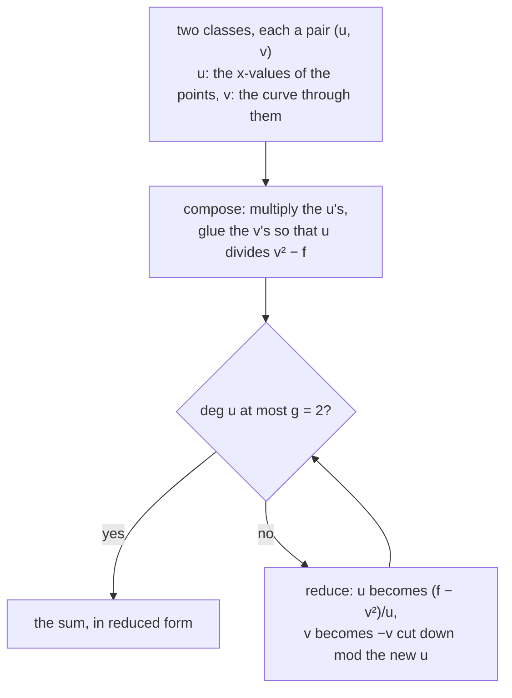

# The Jacobian: degree-zero divisor classes on a curve form a group that is itself a g-dimensional variety

[Syllabus](../../../SYLLABUS.md) → [Algebraic geometry](../README.md) → [Plane Curves](../README.md#s03) → The Jacobian

---

## General Overview

Take the curve $`y^2 = x^5 + x + 1`$ over $`\mathbb{F}_5`$, the field of the five remainders 0 to 4 with arithmetic mod 5 ([Finite fields](../../03-Algebra/09-Rings%20and%20Fields/05-finite-fields.md)). It has five points with x and y in that field: (0, 1), (0, 4), (2, 0), (4, 2), (4, 3). Add its one point at infinity, written ∞, and the count is **6**. The curve has genus 2: two holes, as [Hyperelliptic curves and the canonical map](10-hyperelliptic-curves-and-the-canonical-map.md) counts for a quintic under a square root.

On a cubic curve, points can be added: the line through two points meets the curve once more ([The group law](../04-Elliptic%20Curves/01-elliptic-curves-and-the-group-law.md)). On this quintic a line meets the curve in five points, so the trick fails. Points alone do not form a group here.

The repair is to add **divisor classes** instead of points. A divisor is a list of points with whole-number weights, and two lists count as one class when they differ by the zeros and poles of a function ([Divisors and Riemann-Roch](07-divisors-and-riemann-roch.md)). The classes of total weight zero always form a group. That group is the **Jacobian** of the curve. On this curve over $`\mathbb{F}_5`$ it has exactly **36** members, and two point counts predict that number: 6 points over $`\mathbb{F}_5`$ and 46 over the 25-element field give $`(6^2 + 46)/2 - 5 = 36`$.

Over the complex numbers ℂ the Jacobian of the same equation is a doughnut of two complex dimensions, $`\mathbb{C}^2`$ rolled up by a lattice. For a genus-1 curve it is the curve itself: this answers the question left open by [Riemann surfaces](08-riemann-surfaces-and-the-weierstrass-p-function.md), of what survives of the torus where no lattice exists.

**The divisor classes of degree zero on a smooth curve of genus g form a group, the Jacobian; over ℂ it is ℂ^g rolled up by the curve's periods, over a finite field it is a finite group whose size the point counts fix, and Cantor's algorithm adds its members as pairs of polynomials.**

**What kind of fact this is:** a definition (the Jacobian as Pic⁰), theorems proved on this card in Why it works (every class has one reduced form; Cantor's algorithm adds them; the genus-2 count formula), Abel's theorem with Jacobi inversion, stated with key steps and a named source, and Weil's formula for the count through the L-polynomial, stated with a named source. "Jacobian" here always means the Jacobian variety, never the Jacobian matrix of partial derivatives.

### The picture: Cantor's algorithm



While deg u is above g, each reduction lowers it, since $`f - v^2`$ has degree at most $`\max(2g + 1, 2\deg u - 2)`$. So the loop always ends.

---

## The formula

Notation first, in words. This card introduces these.

- $`\mathrm{Div}^0(C)`$: the divisors of degree zero on the curve C, weights adding to 0.
- $`\mathrm{Pic}^0(C)`$: those divisors with two of them counted as one when they are linearly equivalent, $`D \sim D'`$ (their difference is the divisor of a function). Read it "Pic zero". As a variety it is written $`\mathrm{Jac}(C)`$.
- $`\#\mathrm{Jac}(\mathbb{F}_q)`$: the number of classes defined over the field with q elements: classes fixed by Frobenius, the map that raises every coordinate to the q-th power.
- A **Mumford pair** (u, v): two polynomials in x that name one class. The roots of u are the x-values of the class's points and v(x) gives their y-values.

The Jacobian as a group:

```math
\mathrm{Jac}(C) = \mathrm{Pic}^0(C) = \mathrm{Div}^0(C) \,/\, \{\mathrm{div}(h) : h \text{ a nonzero function on } C\}
```

**Read it aloud:** the Jacobian is the degree-zero divisors, with any two treated as equal when they differ by the divisor of a function.

The count over a finite field, for genus 2, from the point counts $`N_1`$ over $`\mathbb{F}_q`$ and $`N_2`$ over $`\mathbb{F}_{q^2}`$:

```math
\#\mathrm{Jac}(\mathbb{F}_q) = \frac{N_1^2 + N_2}{2} - q = L(1), \qquad L(T) = 1 + a_1 T + a_2 T^2 + q a_1 T^3 + q^2 T^4
```

**Read it aloud:** the number of classes is N one squared plus N two, halved, minus q, and it equals the L-polynomial at T = 1.

The coefficients come from the counts: $`a_1 = N_1 - q - 1`$ and $`a_2 = (N_2 - q^2 - 1 + a_1^2)/2`$. Here $`a_1 = 6 - 6 = 0`$, $`a_2 = (46 - 26)/2 = 10`$, so $`L(T) = 1 + 10T^2 + 25T^4`$ and $`L(1) = 36`$.

Over ℂ, the **Abel-Jacobi map** sends a degree-zero divisor $`D = \sum (P_i - Q_i)`$ to a point of $`\mathbb{C}^g`$ modulo the period lattice Λ:

```math
\mathrm{AJ}(D) = \sum_i \left( \int_{Q_i}^{P_i} \omega_1, \; \dots, \; \int_{Q_i}^{P_i} \omega_g \right) \bmod \Lambda, \qquad D \sim 0 \iff \mathrm{AJ}(D) = 0
```

**Read it aloud:** integrate each of the g basic differentials from each Q to its P, add up, and forget whole periods; a divisor is the divisor of a function exactly when the result is zero.

| Symbol | Plain meaning | In our example | Push it up and the answer… |
| --- | --- | --- | --- |
| $`C`$, $`f`$, $`\iota`$ | the curve $`y^2 = f(x)`$, f of odd degree 2g + 1; ι the reflection $`(x, y) \mapsto (x, -y)`$, so ιP is the mirror point that the previous card writes P′ | $`f = x^5 + x + 1`$; (0, 1) ↦ (0, 4) | higher degree, higher genus |
| $`g`$ | genus: the number of holes over ℂ, and the Jacobian's dimension | 2 | one more dimension per hole |
| $`\infty`$, $`O`$ | the one point at infinity of C; on a genus-1 curve called O | the pair u = 1, v = 0 is the zero class | — |
| $`q`$, $`\mathbb{F}_q`$ | the size of the finite field; the field | 5, and 25 for $`\mathbb{F}_{25}`$ | about $`q^g`$ classes |
| $`D`$, $`E`$, $`\mathrm{Div}^0(C)`$, $`\sim`$ | a divisor; an effective one (no negative weights); all divisors of degree 0; linear equivalence | $`D_1 = (0, 1) - \infty`$ | — |
| $`\mathrm{Jac}(C)`$, $`\mathrm{Pic}^0(C)`$ | the degree-zero classes | 36 over $`\mathbb{F}_5`$, 1296 over $`\mathbb{F}_{25}`$ | — |
| $`(u, v)`$ | Mumford pair: u monic, deg v < deg u ≤ g, u divides $`v^2 - f`$ | $`D_1 = (x, 1)`$ | — |
| $`N_1`$, $`N_2`$, $`N_n`$ | points over $`\mathbb{F}_q`$, $`\mathbb{F}_{q^2}`$ and $`\mathbb{F}_{q^n}`$, with ∞ | 6 and 46 | more points, more classes |
| $`L(T)`$, $`a_1`$, $`a_2`$, $`\alpha_i`$ | the L-polynomial, its coefficients and its reciprocal roots | $`1 + 10T^2 + 25T^4`$; 0, 10; $`\pm i\sqrt 5`$ | — |
| $`K`$, $`\ell(D)`$ | the canonical class; the dimension of the functions whose poles D allows | $`K \sim 2\infty`$; $`\ell(K) = 2`$ | — |
| $`\omega_1, \omega_2`$, $`\Lambda`$ | the basic differentials dx/y and x dx/y; their periods, a lattice in $`\mathbb{C}^2`$ | 4 independent periods | — |
| $`\mathrm{AJ}`$ | the Abel-Jacobi map from divisors to $`\mathbb{C}^g/\Lambda`$ | on genus 1: P ↦ P − O | — |

### When it holds

- **The curve is smooth.** The house nodal cubic $`y^2 = x^3 + x^2`$ over $`\mathbb{F}_5`$ has 5 points, counting the node and O. Its smooth points close up into a group of only 4, the multiplicative group of $`\mathbb{F}_5`$. The rule "Jacobian = curve" for genus 1 gives the wrong 5.
- **The curve is projective: ∞ is counted.** Drop ∞ from both counts and the formula gives $`(25 + 45)/2 - 5 = 30`$, not 36.
- **Degree zero.** Classes of every degree form a bigger group, Pic(C), with a copy of the whole numbers on top. Each degree d gives a copy of Pic⁰ shifted by a degree-d class; only the degree-zero copy contains 0 and is itself a group.
- **Reduced forms.** A Mumford pair names a class uniquely only when deg u ≤ g. Allow deg u ≤ 3 and the same 36 classes appear as 186 pairs.
- **Odd characteristic and an odd-degree f.** The form $`y^2 = f(x)`$ needs 2 to be invertible; over $`\mathbb{F}_2`$ the curve needs $`y^2 + h(x)y = f(x)`$. An odd-degree f gives one point at infinity, which Cantor's algorithm uses as its zero.

---

## Why it works

### Step 0: trade points for classes, and let Riemann-Roch shrink every class to g points

A divisor of degree zero can be long: ten points minus ten others. Riemann-Roch says that, up to linear equivalence, g points always suffice. Every class of degree zero is $`E - g\infty`$ for some effective E (no negative weights) of degree g, and most classes have exactly one such E.

So a class is "g points, in any order". That is why the Jacobian has dimension g. It is also why addition is possible: add two classes as lists of 2g points, then shrink the list back to g.

### Step 1: genus 1, where the Jacobian is the curve

On a genus-1 curve E with zero point O, take a class D of degree 0. Here $`\ell(D)`$ is the dimension of the space of functions whose poles D allows. Riemann-Roch on genus 1 gives $`\ell(D + O) = 1`$ ([Divisors and Riemann-Roch](07-divisors-and-riemann-roch.md)). So exactly one effective divisor of degree 1, one point P, is equivalent to D + O, and $`D \sim P - O`$.

So the Abel-Jacobi map $`P \mapsto P - O`$ matches points one for one with classes. The group law moves across. A line through P, Q and R is a function with divisor $`P + Q + R - 3O`$. A vertical line x = a has divisor $`R + \iota R - 2O`$. Together, $`(P - O) + (Q - O) \sim \iota R - O`$: the chord-and-tangent rule.

Check it on the smooth neighbour $`y^2 = x^3 + x^2 + 1`$ of the house cubic, now over $`\mathbb{F}_5`$. It has 4 affine points plus O, so 5 points and 5 classes. The points (0, 1) and (−1, −1) of [Divisors and Riemann-Roch](07-divisors-and-riemann-roch.md) become (0, 1) and (4, 4) mod 5, and their sum is (4, 1). That is the (4, −9) found there, since −9 ≡ 1 mod 5. The code adds all 25 pairs both ways, by chords and by Cantor's algorithm, and they agree.

### Step 2: genus 2, one reduced form per class

On the genus-2 curve $`y^2 = f(x)`$ with f of degree 5, the function x has a double pole at ∞ and y a pole of order 5. Two facts follow.

1. **A pair over one x is the zero class.** The function x − a has divisor $`P + \iota P - 2\infty`$, where P = (a, b). So $`P + \iota P \sim 2\infty`$.
2. **Every class has a short form.** For a class D of degree 0, Riemann-Roch gives $`\ell(D + 2\infty) \ge 2 + 1 - 2 = 1`$. So some effective E of degree 2 satisfies $`E \sim D + 2\infty`$. Strike out any pair $`P + \iota P`$ and any copies of ∞, using fact 1.

What is left is a **reduced divisor**: $`E - r\infty`$ with r ≤ 2 points, and no point together with its reflection. Each class has exactly one.

<details>
<summary>Detailed proof: two reduced divisors in one class are equal</summary>

Suppose $`E_1 - r_1\infty \sim E_2 - r_2\infty`$, both reduced. Add $`\iota E_2 - r_2\infty`$ to both sides. By fact 1, $`E_2 + \iota E_2 \sim 2r_2\infty`$, so

$`\displaystyle E_1 + \iota E_2 \sim (r_1 + r_2)\,\infty .`$

So a function h has divisor $`E_1 + \iota E_2 - (r_1 + r_2)\infty`$. Its only pole is at ∞, of order at most 4. Functions with poles only at ∞ are polynomials in x and y, and y alone has pole order 5. So h is a polynomial in x of degree at most 2.

The zeros of a polynomial in x come in reflection pairs $`P + \iota P`$. Neither $`E_1`$ nor $`\iota E_2`$ holds a pair by itself, so every point of $`E_1`$ pairs with a point of $`\iota E_2`$, its reflection. That point's reflection is in $`E_2`$, and it is the original point. So $`E_1 = E_2`$.

</details>

### Step 3: a reduced divisor is a pair of polynomials

Write the reduced divisor's points as $`(x_1, y_1)`$ and $`(x_2, y_2)`$. Mumford's pair is:

- $`u = (x - x_1)(x - x_2)`$, monic, of degree r;
- v, of degree below r, with $`v(x_i) = y_i`$: the line in x through the points, tangent to the curve if the point is doubled.

Then $`v^2 - f`$ vanishes at each $`x_i`$, so u divides $`v^2 - f`$. Conversely, any monic u of degree at most 2 and v of lower degree with u dividing $`v^2 - f`$ name one reduced divisor. The coefficients of u and v lie in $`\mathbb{F}_5`$ exactly when the class is defined over $`\mathbb{F}_5`$, even when the points need $`\mathbb{F}_{25}`$.

So counting the Jacobian is a finite search. Over $`\mathbb{F}_5`$ there are 1 + 5 + 25 choices of u. The code tries every v for each and finds 1 + 5 + 30 = **36** pairs.

### Step 4: Cantor's algorithm adds pairs

David Cantor's 1987 algorithm adds two classes in two moves.

1. **Compose.** Multiply the u's and find one v that agrees with both old v's. A point meeting its own reflection cancels by fact 1. The greatest common divisor d of $`u_1`$, $`u_2`$ and $`v_1 + v_2`$ finds those pairs, and $`u = u_1u_2/d^2`$ drops them.
2. **Reduce.** If deg u > 2, the function $`y - v(x)`$ vanishes on the points listed by u, and on some others. Their x-values are the roots of $`(f - v^2)/u`$. The divisor of $`y - v(x)`$ is the old points plus the others, minus copies of ∞. So the old points are equivalent to minus the others, which by fact 1 is the reflections of the others. Those reflections give the new pair: $`u' = (f - v^2)/u`$ and $`v' = -v \bmod u'`$.

Take $`D_1 = (0, 1) - \infty`$, the pair (x, 1). Doubling needs the tangent: $`v = 1 + cx`$ with $`v^2 \equiv f \pmod{x^2}`$. That is $`1 + 2cx \equiv 1 + x`$, so $`c = 3`$ mod 5 and $`2D_1 = (x^2, 3x + 1)`$.

Adding $`D_1`$ again gives $`u = x^3`$ and $`v = 3x^2 + 3x + 1`$: three points, one too many. Reduce. Mod 5, $`f - v^2 = x^5 + x^4 + 2x^3`$, so $`u' = x^2 + x + 2`$ and $`v' = 0`$.

So $`3D_1 = (x^2 + x + 2, 0)`$. Its two points have y = 0 and x in $`\mathbb{F}_{25}`$: a pair of conjugate roots of f. A class whose points all have y = 0 is its own reflection, so it has order 2, and $`D_1`$ has order 6.

### Step 5: the count, by counting divisors of degree 2

Count the effective divisors E of degree 2 defined over $`\mathbb{F}_5`$ in two ways.

- **By points.** Pairs of the 6 rational points, repeats allowed: $`6 \cdot 7/2 = 21`$. Pairs swapped by Frobenius, from the 46 − 6 = 40 points of $`\mathbb{F}_{25}`$ not in $`\mathbb{F}_5`$: 20. Total $`(N_1^2 + N_2)/2 = 41`$.
- **By classes.** Send E to the class of $`E - 2\infty`$. The divisors over one class form a projective space of dimension $`\ell(E) - 1`$. Riemann-Roch on genus 2 gives $`\ell(E) = 1 + \ell(K - E)`$, where $`K \sim 2\infty`$ is the canonical class, the class of the divisor of a differential such as dx/y ([Hyperelliptic curves and the canonical map](10-hyperelliptic-curves-and-the-canonical-map.md)). So $`\ell(E) = 1`$, one divisor per class, except on the class of K, where it is a line with q + 1 = 6 rational members.

Those six are $`2\infty`$ and the pairs $`P + \iota P`$ over x = 0, 1, 2, 3, 4. So $`41 = \#\mathrm{Jac} + q`$ and $`\#\mathrm{Jac}(\mathbb{F}_5) = 36`$. The code sees the split as 30 classes with two points, 5 with one point and 6 on the canonical line.

### Step 6: Frobenius and the L-polynomial

Weil showed that the counts over all the fields $`\mathbb{F}_{q^n}`$ come from one polynomial L(T) of degree 2g. Its reciprocal roots $`\alpha_1, \dots, \alpha_4`$ all have absolute value $`\sqrt q`$. In terms of them:

- $`N_n = q^n + 1 - \sum \alpha_i^n`$;
- $`\#\mathrm{Jac}(\mathbb{F}_{q^n}) = \prod (1 - \alpha_i^n)`$, which is $`L(1)`$ for n = 1 and $`L(1)\,L(-1)`$ for n = 2.

The proof is long. Weil proved the curve case in 1948, and his 1949 paper sets out the zeta function and the conjectures beyond curves. The bound is the genus-g version of Hasse's bound in [The curve mod p](../04-Elliptic%20Curves/05-reduction-mod-p-and-hasse.md). Here $`L(T) = (1 + 5T^2)^2`$, so the $`\alpha_i`$ are $`\pm i\sqrt 5`$. Over $`\mathbb{F}_{25}`$ this predicts $`36 \times 36 = 1296`$ classes. The code tries all 651 monic u over $`\mathbb{F}_{25}`$ and finds 1296.

The bound $`\lvert\alpha_i\rvert = \sqrt q`$ puts $`\#\mathrm{Jac}(\mathbb{F}_q)`$ between $`(\sqrt q - 1)^{2g}`$ and $`(\sqrt q + 1)^{2g}`$: from 2.33 to 109.67 here, and 36 is inside.

The group itself is $`(\mathbb{Z}/6)^2`$. The code finds the orders: one member of order 1, three of order 2, eight of order 3 and 24 of order 6. The three of order 2 are the three factors of $`f = (x - 2)(x^2 + x + 2)(x^2 + x + 1)`$, each taken as u with v = 0.

### Step 7: over ℂ, the Abel-Jacobi map

Over ℂ the curve is a surface with g holes. It carries g independent **holomorphic differentials** (expressions h(x, y) dx with no poles): dx/y and x dx/y in genus 2, and dx/y alone in genus 1. Integrating them around the 2g basic loops gives 2g vectors in $`\mathbb{C}^g`$, the **period lattice** Λ.

An integral from Q to P depends on the path only up to a period, so AJ is well defined modulo Λ. Two theorems finish the picture.

- **Abel's theorem.** D is the divisor of a function exactly when AJ(D) lies in Λ.
- **Jacobi inversion.** Every point of $`\mathbb{C}^g/\Lambda`$ is AJ of some $`E - g\infty`$ with E effective of degree g.

Together they make AJ a one-to-one match between $`\mathrm{Pic}^0(C)`$ and the complex torus $`\mathbb{C}^g/\Lambda`$, and addition matches addition. In genus 1, $`\mathrm{AJ}(P - O) = \int_O^P dx/y`$ undoes the map $`z \mapsto (\wp(z), \wp'(z))`$ of [Riemann surfaces](08-riemann-surfaces-and-the-weierstrass-p-function.md), whose Step 6 checked Abel's theorem numerically.

<details>
<summary>Proof outline: why the divisor of a function goes to zero</summary>

Let h be a nonconstant function. For each value t, the divisor $`\mathrm{div}(h - t)`$ lists where h = t minus the poles of h. Send t to $`\mathrm{AJ}(\mathrm{div}(h - t))`$.

This is a holomorphic map from the Riemann sphere to the torus $`\mathbb{C}^g/\Lambda`$. The sphere has no loops that cannot be shrunk, so the map lifts to $`\mathbb{C}^g`$. Each coordinate is then a holomorphic function on a closed surface, so it is constant.

At t = ∞ the zeros of h − t merge with its poles and the divisor is 0. So $`\mathrm{AJ}(\mathrm{div}(h)) = \mathrm{AJ}(0) = 0`$ modulo Λ. The converse builds h from theta functions or from Riemann's bilinear relations; Miranda's chapter on Abel's theorem gives both directions.

</details>

Over a finite field there are no integrals and no lattice. Pic⁰ survives, and Weil built it as a variety of dimension g, defined over the same field, whose points over each $`\mathbb{F}_{q^n}`$ are the classes counted above. That is the answer to the question [Riemann surfaces](08-riemann-surfaces-and-the-weierstrass-p-function.md) left open.

---

## Worked numbers, by hand

The curve $`y^2 = x^5 + x + 1`$ over $`\mathbb{F}_5`$.

| Step | Arithmetic | Value |
| --- | --- | --- |
| smooth? | $`f' = 5x^4 + 1 = 1`$ mod 5, never 0 | gcd(f, f′) = 1 |
| points over $`\mathbb{F}_5`$ | f(x) = 1, 3, 0, 2, 4 at x = 0 to 4; squares mod 5 are 0, 1, 4 | 5 affine + ∞ = 6 |
| points over $`\mathbb{F}_{25}`$ | count in the code | 46 |
| $`a_1`$, $`a_2`$ | 6 − 5 − 1; (46 − 25 − 1 + 0)/2 | 0, 10 |
| degree-2 divisors | 21 + 20 | 41 |
| the count | 41 − 5 | **36** |
| L(1) | 1 + 0 + 10 + 0 + 25 | 36 |
| $`D_1 + D_2`$, with $`D_2 = (4, 2) - \infty`$ | u = x(x − 4) = $`x^2 + x`$; slope (2 − 1)/4 = 4 | $`(x^2 + x, 4x + 1)`$ |
| $`2D_1`$ | tangent: 2c = 1, c = 3 | $`(x^2, 3x + 1)`$ |
| $`3D_1`$ before reduction | v ≡ y mod $`x^3`$ | $`(x^3, 3x^2 + 3x + 1)`$ |
| $`3D_1`$ reduced | $`(x^5 + x^4 + 2x^3)/x^3`$; −v mod u′ = 0 | $`(x^2 + x + 2, 0)`$, order 2 |
| order of $`D_1`$ | 2 × 3 | 6 |

The curve has 6 points but its Jacobian has 36 classes: about $`q^g = 25`$, as dimension 2 predicts, and inside the window 2.33 to 109.67.

### What breaks if you drop a piece

| Mistake | Comes out at | What went wrong |
| --- | --- | --- |
| Drop the − q | 41 | the canonical class holds q + 1 = 6 divisors, not 1 |
| Drop ∞ from both counts | (25 + 45)/2 − 5 = 30 | the formula needs the projective curve |
| Stop before reducing: allow deg u ≤ 3 | 186 pairs | each class then has many names |
| The house nodal cubic $`y^2 = x^3 + x^2`$ taken as a genus-1 Jacobian | 5 points, group of 4 | not smooth: the node is no member, and the classes form $`\mathbb{F}_5^\times`$ |

The code prints all four.

---

## Code, from first principles, and it actually runs

The script builds $`\mathbb{F}_{25}`$ from $`\mathbb{F}_5`$ by adding t with $`t^2 = 2`$, then polynomial division, Euclid's algorithm and Cantor's algorithm by hand. It reaches the size of the Jacobian by two independent roads:

1. listing every Mumford pair, over $`\mathbb{F}_5`$ and over $`\mathbb{F}_{25}`$;
2. counting points and divisors of degree 2, then subtracting q.

L(1) is Weil's reading of the same number as road 2: $`(N_1^2 + N_2)/2 - q = L(1)`$ holds by algebra for any counts $`N_1`$ and $`N_2`$, so it is not a third road. The independent test of Weil's theorem is over $`\mathbb{F}_{25}`$, where the 1296 pairs found by listing match L(1) L(−1).

It then adds every pair of the 36 classes by Cantor and checks each sum is again one of the 36. On the genus-1 curve it adds all 25 pairs of points both by chords and by Cantor.

### Python

```python
# The Jacobian of the genus-2 curve y^2 = x^5 + x + 1 over F_5 -- the check behind the card.
# Nothing imported.  F_25 is F_5 with a new element t, t^2 = 2; the number a + 5b stands for
# a + b t, so 0..4 are F_5 itself.  A polynomial is a list of coefficients, lowest power first.
def add25(a, b): return (a + b) % 5 + 5 * ((a // 5 + b // 5) % 5)
def mul25(a, b): return (a % 5 * (b % 5) + 2 * (a // 5) * (b // 5)) % 5 + 5 * ((a % 5 * (b // 5) + a // 5 * (b % 5)) % 5)
ADD = [[add25(a, b) for b in range(25)] for a in range(25)]
MUL = [[mul25(a, b) for b in range(25)] for a in range(25)]
NEG = [ADD[a].index(0) for a in range(25)]
INV = {a: MUL[a].index(1) for a in range(1, 25)}

def trim(a):
    while a and a[-1] == 0: a = a[:-1]
    return a
def padd(a, b):
    n = max(len(a), len(b))
    return trim([ADD[x][y] for x, y in zip(a + [0] * (n - len(a)), b + [0] * (n - len(b)))])
def pneg(a): return [NEG[x] for x in a]
def scale(c, a): return trim([MUL[c][x] for x in a])
def pmul(a, b):
    r = [0] * max(len(a) + len(b) - 1, 0)
    for i, x in enumerate(a):
        for j, y in enumerate(b): r[i + j] = ADD[r[i + j]][MUL[x][y]]
    return trim(r)
def pdivmod(a, b):                        # long division by a nonzero b
    a, qt = trim(a[:]), [0] * max(len(a) - len(b) + 1, 0)
    while len(a) >= len(b):
        c, s = MUL[a[-1]][INV[b[-1]]], len(a) - len(b)
        qt[s] = c
        a = padd(a, pneg([0] * s + scale(c, b)))
    return trim(qt), a
def xgcd(a, b):                           # Euclid, keeping d = s a + t b, d monic
    r0, r1, s0, s1, t0, t1 = a, b, [1], [], [], [1]
    while r1:
        qt, r = pdivmod(r0, r1)
        r0, r1, s0, s1, t0, t1 = r1, r, s1, padd(s0, pneg(pmul(qt, s1))), t1, padd(t0, pneg(pmul(qt, t1)))
    c = INV[r0[-1]]
    return scale(c, r0), scale(c, s0), scale(c, t0)
def ev(a, x):
    out = 0
    for c in reversed(a): out = ADD[MUL[out][x]][c]
    return out

def cantor(D1, D2, f, g, keep=None):      # add two classes (u, v); reduce until deg u <= g
    (u1, v1), (u2, v2) = D1, D2
    d1, e1, e2 = xgcd(u1, u2)
    d, c1, c2 = xgcd(d1, padd(v1, v2))
    u = pdivmod(pmul(u1, u2), pmul(d, d))[0]
    w = padd(padd(pmul(pmul(c1, e1), pmul(u1, v2)), pmul(pmul(c1, e2), pmul(u2, v1))), pmul(c2, padd(pmul(v1, v2), f)))
    v = pdivmod(pdivmod(w, d)[0], u)[1]
    if keep is not None: keep.append((u, v))
    while len(u) - 1 > g:
        u = pdivmod(padd(f, pneg(pmul(v, v))), u)[0]
        v = pdivmod(pneg(v), u)[1]
    return scale(INV[u[-1]], u), v

def pairs(f, q, top):                     # every (u, v): u monic, deg v < deg u <= top, u | v^2 - f
    out = []
    for d in range(top + 1):
        for k in range(q ** d):
            u = [k // q ** i % q for i in range(d)] + [1]
            for m in range(q ** d):
                v = trim([m // q ** i % q for i in range(d)])
                if not pdivmod(padd(f, pneg(pmul(v, v))), u)[1]: out.append((u, v))
    return out
def npoints(f, q): return 1 + sum(1 for x in range(q) for y in range(q) if MUL[y][y] == ev(f, x))
def px(a): return " + ".join((str(c) if c != 1 or i == 0 else "") + ("", "x", f"x^{i}")[min(i, 2)]
                            for i, c in reversed(list(enumerate(a))) if c) or "0"
def yn(b): return "yes" if b else "no"
def show(D): return "(" + ", ".join(px(a) for a in D) + ")"

f, q, g = [1, 1, 0, 0, 0, 1], 5, 2
deriv = trim([i * c % 5 for i, c in enumerate(f)][1:])
print(f"curve y^2 = x^5 + x + 1 over F_5; gcd(f, f') = {px(xgcd(f, deriv)[0])}, so smooth; genus {g}")
pts = [(x, y) for x in range(q) for y in range(q) if MUL[y][y] == ev(f, x)]
N1, N2 = npoints(f, 5), npoints(f, 25)
print(f"affine points over F_5: {pts}; with the point at infinity N1 = {N1}")
print(f"f(x) at x = 0..4: {[ev(f, x) for x in range(5)]}; monic u of degree <= 2: {1 + 5 + 25} over F_5, {1 + 25 + 625} over F_25")
print(f"points over F_25: N2 = {N2}")
a1 = N1 - q - 1
a2 = (N2 - q * q - 1 + a1 * a1) // 2
L1, Lm1 = 1 + a1 + a2 + q * a1 + q * q, 1 - a1 + a2 - q * a1 + q * q
print(f"L-polynomial: 1 + {a1}T + {a2}T^2 + {q * a1}T^3 + {q * q}T^4; L(1) = {L1}, L(-1) = {Lm1}")
sym2 = (N1 * N1 + N2) // 2
print(f"effective degree-2 divisors: {N1 * (N1 + 1) // 2} rational pairs + {(N2 - N1) // 2} conjugate pairs = {sym2}")
print(f"formula (N1^2 + N2)/2 - q = {sym2} - {q} = {sym2 - q}")
J = pairs(f, q, g)
by_deg = [sum(1 for u, v in J if len(u) - 1 == d) for d in range(3)]
print(f"reduced pairs (u, v) by deg u = 0, 1, 2: {by_deg}; total #Jac(F_5) = {len(J)}")
print(f"the {sym2} split as {by_deg[2]} + {by_deg[1]} + {q + 1}: one class each, and q + 1 = 6 on the canonical class")
J25 = len(pairs(f, 25, g))
print(f"#Jac(F_25) by enumeration = {J25}; L(1) L(-1) = {L1 * Lm1}")
lo, hi = (5 ** 0.5 - 1) ** 4, (5 ** 0.5 + 1) ** 4
print(f"Weil window for #Jac(F_5): {lo:.2f} to {hi:.2f}; q^g = {q ** g}")
D1, D2, D3 = ([0, 1], [1]), ([1, 1], [2]), ([3, 1], [])
print(f"D1 = (0, 1) - oo is {show(D1)}; D2 = (4, 2) - oo is {show(D2)}; D3 = (2, 0) - oo is {show(D3)}")
print(f"D1 + D2 = {show(cantor(D1, D2, f, g))}")
two = cantor(D1, D1, f, g)
raw = []
three = cantor(two, D1, f, g, raw)
print(f"2 D1 = {show(two)}; 3 D1 before reduction {show(raw[0])}, after {show(three)}")
print(f"u = x^2 + x + 2 has no root in F_5: {yn(all(ev(three[0], x) for x in range(5)))}; f = (x - 2)(x^2 + x + 2)(x^2 + x + 1): {yn(pmul(pmul([3, 1], [2, 1, 1]), [1, 1, 1]) == f)}")
key = {show(D) for D in J}
closed = all(show(cantor(A, B, f, g)) in key for A in J for B in J)
orders = []
for A in J:
    k, B = 1, A
    while B != ([1], []): k, B = k + 1, cantor(B, A, f, g)
    orders.append(k)
print(f"every sum of two of the 36 is one of the 36: {yn(closed)}")
print(f"orders: " + ", ".join(f"{k}: {orders.count(k)}" for k in sorted(set(orders))) + f"; exponent {max(orders)}, so (Z/6)^2; D1 has order {orders[J.index(D1)]}")
semi = len(pairs(f, q, 3))
print(f"mistake 1, drop the - q: {sym2}; mistake 2, drop infinity: ({(N1 - 1) ** 2} + {N2 - 1})/2 - 5 = {((N1 - 1) ** 2 + N2 - 1) // 2 - 5}")
print(f"mistake 3, stop before reducing: pairs with deg u <= 3 number {semi}, not {len(J)}")
fE = [1, 0, 1, 1]
JE = pairs(fE, q, 1)
def chord(P, Q):                          # the chord-and-tangent law on y^2 = x^3 + x^2 + 1
    if P is None or Q is None: return Q if P is None else P
    if P[0] == Q[0] and ADD[P[1]][Q[1]] == 0: return None
    m = MUL[ADD[P[1]][NEG[Q[1]]]][INV[ADD[P[0]][NEG[Q[0]]]]] if P != Q else MUL[ADD[MUL[3][MUL[P[0]][P[0]]]][MUL[2][P[0]]]][INV[MUL[2][P[1]]]]
    x = ADD[ADD[MUL[m][m]][NEG[1]]][NEG[ADD[P[0]][Q[0]]]]
    return x, NEG[ADD[P[1]][MUL[m][ADD[x][NEG[P[0]]]]]]
def aj(P): return ([1], []) if P is None else ([NEG[P[0]], 1], trim([P[1]]))   # P -> class of P - O
ptsE = [None] + [(x, y) for x in range(q) for y in range(q) if MUL[y][y] == ev(fE, x)]
agree = all(cantor(aj(P), aj(Q), fE, 1) == aj(chord(P, Q)) for P in ptsE for Q in ptsE)
print(f"genus 1, y^2 = x^3 + x^2 + 1: {len(ptsE)} points, {len(JE)} classes; Cantor = chord-and-tangent on all 25 pairs: {yn(agree)}")
print(f"(0, 1) + (4, 4) = {chord((0, 1), (4, 4))}; Cantor gives {show(cantor(aj((0, 1)), aj((4, 4)), fE, 1))}")
fH = [0, 0, 1, 1]
smooth = [([1], [])] + [aj((x, y)) for x in range(1, q) for y in range(q) if MUL[y][y] == ev(fH, x)]
sk = {show(D) for D in smooth}
okH = all(show(cantor(A, B, fH, 1)) in sk for A in smooth for B in smooth)
print(f"mistake 4, nodal y^2 = x^3 + x^2: {npoints(fH, 5)} points, but the smooth ones give a group of {len(smooth)} (closed: {yn(okH)})")
assert len(J) == sym2 - q == 36                 # enumeration = divisor count
assert J25 == L1 * Lm1 == 1296                  # over F_25, enumeration = L(1) L(-1)
assert by_deg[2] + by_deg[1] + q + 1 == sym2    # the fibres of Sym^2 over the Jacobian
assert closed and max(orders) == 6 and three == ([2, 1, 1], [])
assert agree and len(JE) == len(ptsE) == 5      # genus 1: Jacobian = curve
assert okH and len(smooth) == 4 != npoints(fH, 5)
print("ALL CHECKS PASS")
```

**Ran 2026-11-24 on macOS, Python 3.14.10, standard library only. All checks passed. Output, pasted from the run:**

```
curve y^2 = x^5 + x + 1 over F_5; gcd(f, f') = 1, so smooth; genus 2
affine points over F_5: [(0, 1), (0, 4), (2, 0), (4, 2), (4, 3)]; with the point at infinity N1 = 6
f(x) at x = 0..4: [1, 3, 0, 2, 4]; monic u of degree <= 2: 31 over F_5, 651 over F_25
points over F_25: N2 = 46
L-polynomial: 1 + 0T + 10T^2 + 0T^3 + 25T^4; L(1) = 36, L(-1) = 36
effective degree-2 divisors: 21 rational pairs + 20 conjugate pairs = 41
formula (N1^2 + N2)/2 - q = 41 - 5 = 36
reduced pairs (u, v) by deg u = 0, 1, 2: [1, 5, 30]; total #Jac(F_5) = 36
the 41 split as 30 + 5 + 6: one class each, and q + 1 = 6 on the canonical class
#Jac(F_25) by enumeration = 1296; L(1) L(-1) = 1296
Weil window for #Jac(F_5): 2.33 to 109.67; q^g = 25
D1 = (0, 1) - oo is (x, 1); D2 = (4, 2) - oo is (x + 1, 2); D3 = (2, 0) - oo is (x + 3, 0)
D1 + D2 = (x^2 + x, 4x + 1)
2 D1 = (x^2, 3x + 1); 3 D1 before reduction (x^3, 3x^2 + 3x + 1), after (x^2 + x + 2, 0)
u = x^2 + x + 2 has no root in F_5: yes; f = (x - 2)(x^2 + x + 2)(x^2 + x + 1): yes
every sum of two of the 36 is one of the 36: yes
orders: 1: 1, 2: 3, 3: 8, 6: 24; exponent 6, so (Z/6)^2; D1 has order 6
mistake 1, drop the - q: 41; mistake 2, drop infinity: (25 + 45)/2 - 5 = 30
mistake 3, stop before reducing: pairs with deg u <= 3 number 186, not 36
genus 1, y^2 = x^3 + x^2 + 1: 5 points, 5 classes; Cantor = chord-and-tangent on all 25 pairs: yes
(0, 1) + (4, 4) = (4, 1); Cantor gives (x + 1, 1)
mistake 4, nodal y^2 = x^3 + x^2: 5 points, but the smooth ones give a group of 4 (closed: yes)
ALL CHECKS PASS
```

### Rust

Same numbers, same labels, built with `rustc --edition 2021 -O`.

```rust
// The Jacobian of the genus-2 curve y^2 = x^5 + x + 1 over F_5 -- the same check as the Python.
// No crates.  F_25 is F_5 with a new element t, t^2 = 2; the number a + 5b stands for
// a + b t, so 0..4 are F_5 itself.  A polynomial is a list of coefficients, lowest power first.
type P = Vec<usize>;
type D = (P, P);
type Pt = Option<(usize, usize)>;
fn add(a: usize, b: usize) -> usize { (a + b) % 5 + 5 * ((a / 5 + b / 5) % 5) }
fn mul(a: usize, b: usize) -> usize {
    (a % 5 * (b % 5) + 2 * (a / 5) * (b / 5)) % 5 + 5 * ((a % 5 * (b / 5) + a / 5 * (b % 5)) % 5)
}
fn neg(a: usize) -> usize { (0..25).find(|&b| add(a, b) == 0).unwrap() }
fn inv(a: usize) -> usize { (1..25).find(|&b| mul(a, b) == 1).unwrap() }

fn trim(mut a: P) -> P { while a.last() == Some(&0) { a.pop(); } a }
fn padd(a: &P, b: &P) -> P {
    let n = a.len().max(b.len());
    trim((0..n).map(|i| add(*a.get(i).unwrap_or(&0), *b.get(i).unwrap_or(&0))).collect())
}
fn pneg(a: &P) -> P { a.iter().map(|&x| neg(x)).collect() }
fn scale(c: usize, a: &P) -> P { trim(a.iter().map(|&x| mul(c, x)).collect()) }
fn pmul(a: &P, b: &P) -> P {
    if a.is_empty() || b.is_empty() { return vec![]; }
    let mut r = vec![0; a.len() + b.len() - 1];
    for (i, &x) in a.iter().enumerate() { for (j, &y) in b.iter().enumerate() { r[i + j] = add(r[i + j], mul(x, y)); } }
    trim(r)
}
fn pdivmod(a: &P, b: &P) -> (P, P) {                 // long division by a nonzero b
    let mut a = trim(a.clone());
    let mut qt = vec![0; (a.len() + 1).saturating_sub(b.len())];
    while a.len() >= b.len() {
        let (c, s) = (mul(a[a.len() - 1], inv(b[b.len() - 1])), a.len() - b.len());
        qt[s] = c;
        let mut sh = vec![0; s];
        sh.extend(scale(c, b));
        a = padd(&a, &pneg(&sh));
    }
    (trim(qt), a)
}
fn xgcd(a: &P, b: &P) -> (P, P, P) {                 // Euclid, keeping d = s a + t b, d monic
    let (mut r0, mut r1, mut s0, mut s1, mut t0, mut t1) = (a.clone(), b.clone(), vec![1], vec![], vec![], vec![1]);
    while !r1.is_empty() {
        let (qt, r) = pdivmod(&r0, &r1);
        let (s2, t2) = (padd(&s0, &pneg(&pmul(&qt, &s1))), padd(&t0, &pneg(&pmul(&qt, &t1))));
        r0 = std::mem::replace(&mut r1, r);
        s0 = std::mem::replace(&mut s1, s2);
        t0 = std::mem::replace(&mut t1, t2);
    }
    let c = inv(r0[r0.len() - 1]);
    (scale(c, &r0), scale(c, &s0), scale(c, &t0))
}
fn ev(a: &P, x: usize) -> usize { a.iter().rev().fold(0, |o, &c| add(mul(o, x), c)) }
fn cantor(d1: &D, d2: &D, f: &P, g: usize, keep: &mut Vec<D>) -> D {   // add; reduce until deg u <= g
    let ((u1, v1), (u2, v2)) = (d1, d2);
    let (dd1, e1, e2) = xgcd(u1, u2);
    let (d, c1, c2) = xgcd(&dd1, &padd(v1, v2));
    let mut u = pdivmod(&pmul(u1, u2), &pmul(&d, &d)).0;
    let w = padd(&padd(&pmul(&pmul(&c1, &e1), &pmul(u1, v2)), &pmul(&pmul(&c1, &e2), &pmul(u2, v1))),
                 &pmul(&c2, &padd(&pmul(v1, v2), f)));
    let mut v = pdivmod(&pdivmod(&w, &d).0, &u).1;
    keep.push((u.clone(), v.clone()));
    while u.len() - 1 > g {
        u = pdivmod(&padd(f, &pneg(&pmul(&v, &v))), &u).0;
        v = pdivmod(&pneg(&v), &u).1;
    }
    (scale(inv(u[u.len() - 1]), &u), v)
}
fn sum(a: &D, b: &D, f: &P, g: usize) -> D { cantor(a, b, f, g, &mut vec![]) }
fn pairs(f: &P, q: usize, top: usize) -> Vec<D> {   // every (u, v): u monic, deg v < deg u <= top, u | v^2 - f
    let mut out = vec![];
    for d in 0..=top as u32 {
        for k in 0..q.pow(d) {
            let mut u: P = (0..d).map(|i| k / q.pow(i) % q).collect();
            u.push(1);
            for m in 0..q.pow(d) {
                let v = trim((0..d).map(|i| m / q.pow(i) % q).collect());
                if pdivmod(&padd(f, &pneg(&pmul(&v, &v))), &u).1.is_empty() { out.push((u.clone(), v)); }
            }
        }
    }
    out
}
fn npoints(f: &P, q: usize) -> usize { 1 + (0..q).map(|x| (0..q).filter(|&y| mul(y, y) == ev(f, x)).count()).sum::<usize>() }
fn px(a: &P) -> String {
    let t: Vec<String> = (0..a.len()).rev().filter(|&i| a[i] != 0).map(|i| format!("{}{}",
        if a[i] != 1 || i == 0 { a[i].to_string() } else { String::new() },
        match i { 0 => String::new(), 1 => "x".to_string(), _ => format!("x^{}", i) })).collect();
    if t.is_empty() { "0".to_string() } else { t.join(" + ") }
}
fn show(d: &D) -> String { format!("({}, {})", px(&d.0), px(&d.1)) }
fn yn(b: bool) -> &'static str { if b { "yes" } else { "no" } }
fn chord(p: Pt, q: Pt) -> Pt {                       // the chord-and-tangent law on y^2 = x^3 + x^2 + 1
    let (Some((x1, y1)), Some((x2, y2))) = (p, q) else { return if p.is_none() { q } else { p } };
    if x1 == x2 && add(y1, y2) == 0 { return None; }
    let m = if p != q { mul(add(y1, neg(y2)), inv(add(x1, neg(x2)))) }
            else { mul(add(mul(3, mul(x1, x1)), mul(2, x1)), inv(mul(2, y1))) };
    let x = add(add(mul(m, m), neg(1)), neg(add(x1, x2)));
    Some((x, neg(add(y1, mul(m, add(x, neg(x1)))))))
}
fn aj(p: Pt) -> D { match p { None => (vec![1], vec![]), Some((x, y)) => (vec![neg(x), 1], trim(vec![y])) } }  // P -> class of P - O
fn main() {
    let (f, q, g): (P, usize, usize) = (vec![1, 1, 0, 0, 0, 1], 5, 2);
    let deriv = trim(f.iter().enumerate().map(|(i, &c)| i * c % 5).skip(1).collect());
    println!("curve y^2 = x^5 + x + 1 over F_5; gcd(f, f') = {}, so smooth; genus {}", px(&xgcd(&f, &deriv).0), g);
    let pts: Vec<(usize, usize)> = (0..q).flat_map(|x| (0..q).map(move |y| (x, y))).filter(|&(x, y)| mul(y, y) == ev(&f, x)).collect();
    let (n1, n2) = (npoints(&f, 5) as i64, npoints(&f, 25) as i64);
    println!("affine points over F_5: {:?}; with the point at infinity N1 = {}", pts, n1);
    println!("f(x) at x = 0..4: {:?}; monic u of degree <= 2: {} over F_5, {} over F_25", (0..5).map(|x| ev(&f, x)).collect::<Vec<usize>>(), 1 + 5 + 25, 1 + 25 + 625);
    println!("points over F_25: N2 = {}", n2);
    let qi = q as i64;
    let a1 = n1 - qi - 1;
    let a2 = (n2 - qi * qi - 1 + a1 * a1) / 2;
    let (l1, lm1) = (1 + a1 + a2 + qi * a1 + qi * qi, 1 - a1 + a2 - qi * a1 + qi * qi);
    println!("L-polynomial: 1 + {}T + {}T^2 + {}T^3 + {}T^4; L(1) = {}, L(-1) = {}", a1, a2, qi * a1, qi * qi, l1, lm1);
    let sym2 = (n1 * n1 + n2) / 2;
    println!("effective degree-2 divisors: {} rational pairs + {} conjugate pairs = {}", n1 * (n1 + 1) / 2, (n2 - n1) / 2, sym2);
    println!("formula (N1^2 + N2)/2 - q = {} - {} = {}", sym2, q, sym2 - qi);
    let jac = pairs(&f, q, g);
    let by_deg: Vec<usize> = (0..3).map(|d| jac.iter().filter(|(u, _)| u.len() - 1 == d).count()).collect();
    println!("reduced pairs (u, v) by deg u = 0, 1, 2: {:?}; total #Jac(F_5) = {}", by_deg, jac.len());
    println!("the {} split as {} + {} + {}: one class each, and q + 1 = 6 on the canonical class", sym2, by_deg[2], by_deg[1], q + 1);
    let j25 = pairs(&f, 25, g).len() as i64;
    println!("#Jac(F_25) by enumeration = {}; L(1) L(-1) = {}", j25, l1 * lm1);
    let (lo, hi) = ((5f64.sqrt() - 1.0).powi(4), (5f64.sqrt() + 1.0).powi(4));
    println!("Weil window for #Jac(F_5): {:.2} to {:.2}; q^g = {}", lo, hi, q.pow(g as u32));
    let (d1, d2, d3): (D, D, D) = ((vec![0, 1], vec![1]), (vec![1, 1], vec![2]), (vec![3, 1], vec![]));
    println!("D1 = (0, 1) - oo is {}; D2 = (4, 2) - oo is {}; D3 = (2, 0) - oo is {}", show(&d1), show(&d2), show(&d3));
    println!("D1 + D2 = {}", show(&sum(&d1, &d2, &f, g)));
    let two = sum(&d1, &d1, &f, g);
    let mut raw = vec![];
    let three = cantor(&two, &d1, &f, g, &mut raw);
    println!("2 D1 = {}; 3 D1 before reduction {}, after {}", show(&two), show(&raw[0]), show(&three));
    println!("u = x^2 + x + 2 has no root in F_5: {}; f = (x - 2)(x^2 + x + 2)(x^2 + x + 1): {}",
             yn((0..5).all(|x| ev(&three.0, x) != 0)), yn(pmul(&pmul(&vec![3, 1], &vec![2, 1, 1]), &vec![1, 1, 1]) == f));
    let closed = jac.iter().all(|a| jac.iter().all(|b| jac.contains(&sum(a, b, &f, g))));
    let orders: Vec<usize> = jac.iter().map(|a| {
        let (mut k, mut b) = (1, a.clone());
        while b != (vec![1], vec![]) { k += 1; b = sum(&b, a, &f, g); }
        k
    }).collect();
    println!("every sum of two of the 36 is one of the 36: {}", yn(closed));
    let mut ks: Vec<usize> = orders.clone();
    ks.sort();
    ks.dedup();
    let parts: Vec<String> = ks.iter().map(|k| format!("{}: {}", k, orders.iter().filter(|&o| o == k).count())).collect();
    let exponent = *orders.iter().max().unwrap();
    println!("orders: {}; exponent {}, so (Z/6)^2; D1 has order {}", parts.join(", "), exponent, orders[jac.iter().position(|d| *d == d1).unwrap()]);
    let semi = pairs(&f, q, 3).len();
    println!("mistake 1, drop the - q: {}; mistake 2, drop infinity: ({} + {})/2 - 5 = {}", sym2, (n1 - 1) * (n1 - 1), n2 - 1, ((n1 - 1) * (n1 - 1) + n2 - 1) / 2 - 5);
    println!("mistake 3, stop before reducing: pairs with deg u <= 3 number {}, not {}", semi, jac.len());
    let fe: P = vec![1, 0, 1, 1];
    let je = pairs(&fe, q, 1);
    let mut pts_e: Vec<Pt> = vec![None];
    for x in 0..q { for y in 0..q { if mul(y, y) == ev(&fe, x) { pts_e.push(Some((x, y))); } } }
    let agree = pts_e.iter().all(|&p| pts_e.iter().all(|&r| sum(&aj(p), &aj(r), &fe, 1) == aj(chord(p, r))));
    println!("genus 1, y^2 = x^3 + x^2 + 1: {} points, {} classes; Cantor = chord-and-tangent on all 25 pairs: {}", pts_e.len(), je.len(), yn(agree));
    let (cx, cy) = chord(Some((0, 1)), Some((4, 4))).unwrap();
    println!("(0, 1) + (4, 4) = ({}, {}); Cantor gives {}", cx, cy, show(&sum(&aj(Some((0, 1))), &aj(Some((4, 4))), &fe, 1)));
    let fh: P = vec![0, 0, 1, 1];
    let mut smooth: Vec<D> = vec![(vec![1], vec![])];
    for x in 1..q { for y in 0..q { if mul(y, y) == ev(&fh, x) { smooth.push(aj(Some((x, y)))); } } }
    let ok_h = smooth.iter().all(|a| smooth.iter().all(|b| smooth.contains(&sum(a, b, &fh, 1))));
    println!("mistake 4, nodal y^2 = x^3 + x^2: {} points, but the smooth ones give a group of {} (closed: {})", npoints(&fh, 5), smooth.len(), yn(ok_h));
    assert!(jac.len() as i64 == sym2 - qi && sym2 - qi == 36);               // enumeration = divisor count
    assert!(j25 == l1 * lm1 && j25 == 1296);                                  // over F_25, enumeration = L(1) L(-1)
    assert!((by_deg[2] + by_deg[1] + q + 1) as i64 == sym2);                  // the fibres of Sym^2 over the Jacobian
    assert!(closed && exponent == 6 && three == (vec![2, 1, 1], vec![]));
    assert!(agree && je.len() == pts_e.len() && je.len() == 5);               // genus 1: Jacobian = curve
    assert!(ok_h && smooth.len() == 4 && npoints(&fh, 5) != 4);
    println!("ALL CHECKS PASS");
}
```

**Ran 2026-11-24 on macOS, rustc 1.98.1, no crates. All checks passed. Output, pasted from the run:**

```
curve y^2 = x^5 + x + 1 over F_5; gcd(f, f') = 1, so smooth; genus 2
affine points over F_5: [(0, 1), (0, 4), (2, 0), (4, 2), (4, 3)]; with the point at infinity N1 = 6
f(x) at x = 0..4: [1, 3, 0, 2, 4]; monic u of degree <= 2: 31 over F_5, 651 over F_25
points over F_25: N2 = 46
L-polynomial: 1 + 0T + 10T^2 + 0T^3 + 25T^4; L(1) = 36, L(-1) = 36
effective degree-2 divisors: 21 rational pairs + 20 conjugate pairs = 41
formula (N1^2 + N2)/2 - q = 41 - 5 = 36
reduced pairs (u, v) by deg u = 0, 1, 2: [1, 5, 30]; total #Jac(F_5) = 36
the 41 split as 30 + 5 + 6: one class each, and q + 1 = 6 on the canonical class
#Jac(F_25) by enumeration = 1296; L(1) L(-1) = 1296
Weil window for #Jac(F_5): 2.33 to 109.67; q^g = 25
D1 = (0, 1) - oo is (x, 1); D2 = (4, 2) - oo is (x + 1, 2); D3 = (2, 0) - oo is (x + 3, 0)
D1 + D2 = (x^2 + x, 4x + 1)
2 D1 = (x^2, 3x + 1); 3 D1 before reduction (x^3, 3x^2 + 3x + 1), after (x^2 + x + 2, 0)
u = x^2 + x + 2 has no root in F_5: yes; f = (x - 2)(x^2 + x + 2)(x^2 + x + 1): yes
every sum of two of the 36 is one of the 36: yes
orders: 1: 1, 2: 3, 3: 8, 6: 24; exponent 6, so (Z/6)^2; D1 has order 6
mistake 1, drop the - q: 41; mistake 2, drop infinity: (25 + 45)/2 - 5 = 30
mistake 3, stop before reducing: pairs with deg u <= 3 number 186, not 36
genus 1, y^2 = x^3 + x^2 + 1: 5 points, 5 classes; Cantor = chord-and-tangent on all 25 pairs: yes
(0, 1) + (4, 4) = (4, 1); Cantor gives (x + 1, 1)
mistake 4, nodal y^2 = x^3 + x^2: 5 points, but the smooth ones give a group of 4 (closed: yes)
ALL CHECKS PASS
```

The two outputs match line for line.

### Lean

Lean proves the count formula for any counts, Weil's window for any genus, and the genus-1 map on smooth cubics over any field.

- Take any counts $`N_1`$, $`N_2`$ and q, with $`a_1`$ and $`a_2`$ defined from them as in The formula. Then $`L(1) = (N_1^2 + N_2)/2 - q`$ exactly.
- Take any genus g and complex numbers $`\alpha_i`$, 2g of them, each of absolute value $`\sqrt q`$. Then $`\lvert\prod (1 - \alpha_i)\rvert`$ lies between $`(\sqrt q - 1)^{2g}`$ and $`(\sqrt q + 1)^{2g}`$.
- Take a smooth cubic $`y^2 + \dots = x^3 + \dots`$ over any field, with O its point at infinity. Then the map $`P \mapsto P - O`$ carries the chord-and-tangent sum to the sum of classes.
- On the same curves, two different points never give the same class.
- Lean names the class of P − O by the ideal of polynomials that vanish at P.
- Take the genus-2 curve over $`\mathbb{F}_5`$. Then a search of all 25 pairs (x, y) finds 5 affine points.
- Take $`y^2 = x^3 + x^2 + 1`$ over $`\mathbb{F}_5`$. Then the same search finds 4 affine points.
- Take the nodal cubic $`y^2 = x^3 + x^2`$ over $`\mathbb{F}_5`$. Then it has 4 affine points, and 3 besides the node.
- The arithmetic is checked too: $`a_1 = 0`$, $`a_2 = 10`$, the count 36 and 36 × 36 = 1296.
- So are the mistaken counts 41 and 30, and the tangent slope c = 3.

Listing the pairs, Cantor's algorithm, $`N_2 = 46`$ and the 5 genus-1 classes are left to the Python and Rust checks.

```lean
-- The Jacobian: the genus-2 class count (N1^2 + N2)/2 - q equals L(1), the count lies in Weil's window, and in genus 1 the map P to P - O carries the chord-and-tangent sum to the sum of classes and never merges two points.
import Mathlib.AlgebraicGeometry.EllipticCurve.Affine.Point
import Mathlib.Algebra.Polynomial.Eval.Defs
import Mathlib.Analysis.Complex.Basic
import Mathlib.Analysis.Real.Sqrt
import Mathlib.Data.ZMod.Basic

open Polynomial

/-- The genus-2 count formula: from the point counts `N₁` over `𝔽_q` and `N₂` over `𝔽_{q²}`,
set `a₁ = N₁ - q - 1` and `a₂ = (N₂ - q² - 1 + a₁²)/2`. Then the L-polynomial
`L(T) = 1 + a₁T + a₂T² + q a₁T³ + q²T⁴` takes the value `(N₁² + N₂)/2 - q` at `T = 1`;
this number is `#Jac(𝔽_q)`. -/
theorem jac_card_genus_two_eq_L_one (q N₁ N₂ : ℕ) (a₁ a₂ : ℚ)
    (ha₁ : a₁ = N₁ - q - 1) (ha₂ : a₂ = (N₂ - (q : ℚ) ^ 2 - 1 + a₁ ^ 2) / 2) :
    (C 1 + C a₁ * X + C a₂ * X ^ 2 + C ((q : ℚ) * a₁) * X ^ 3 + C ((q : ℚ) ^ 2) * X ^ 4 :
        ℚ[X]).eval 1 = ((N₁ : ℚ) ^ 2 + N₂) / 2 - q := by
  subst ha₂ ha₁
  simp only [eval_add, eval_mul, eval_C, eval_pow, eval_X, one_pow, mul_one]
  ring

/-- Weil's window: if the `2g` reciprocal roots `αᵢ` of the L-polynomial all have absolute value
`√q`, then `#Jac(𝔽_q) = |∏ (1 - αᵢ)|` lies between `(√q - 1)^(2g)` and `(√q + 1)^(2g)`. -/
theorem jac_card_in_weil_window (g q : ℕ) (α : Fin (2 * g) → ℂ)
    (hα : ∀ i, ‖α i‖ = Real.sqrt q) :
    (Real.sqrt q - 1) ^ (2 * g) ≤ ‖∏ i, (1 - α i)‖ ∧
      ‖∏ i, (1 - α i)‖ ≤ (Real.sqrt q + 1) ^ (2 * g) := by
  rw [norm_prod]
  have hcard : (Finset.univ : Finset (Fin (2 * g))).card = 2 * g := by simp
  constructor
  · have h1 : (Real.sqrt q - 1) ^ (2 * g) = ∏ _i : Fin (2 * g), |Real.sqrt q - 1| := by
      rw [Finset.prod_const, hcard, (even_two_mul g).pow_abs]
    rw [h1]
    refine Finset.prod_le_prod₀ (fun _ _ => abs_nonneg _) (fun i _ => ?_)
    have := abs_norm_sub_norm_le (α i) (1 : ℂ)
    rw [hα i, norm_one, norm_sub_rev] at this
    exact this
  · have h1 : (Real.sqrt q + 1) ^ (2 * g) = ∏ _i : Fin (2 * g), (Real.sqrt q + 1) := by
      rw [Finset.prod_const, hcard]
    rw [h1]
    refine Finset.prod_le_prod₀ (fun _ _ => norm_nonneg _) (fun i _ => ?_)
    calc ‖1 - α i‖ ≤ ‖(1 : ℂ)‖ + ‖α i‖ := norm_sub_le _ _
      _ = Real.sqrt q + 1 := by rw [norm_one, hα i]; ring

/-- Genus 1, Abel-Jacobi: on a smooth Weierstrass cubic over a field, the map sending a point `P`
to the class of `P - O` (Mathlib: `P` to the class of the ideal `⟨X - x, Y - y⟩` of the coordinate
ring) carries the chord-and-tangent sum to the sum of classes, and two different points never give
the same class. -/
theorem abel_jacobi_genus_one_add_and_injective {F : Type*} [Field F] [DecidableEq F]
    (W : WeierstrassCurve.Affine F) [W.IsElliptic] :
    (∀ P Q : W.Point, WeierstrassCurve.Affine.Point.toClass (P + Q) =
        WeierstrassCurve.Affine.Point.toClass P + WeierstrassCurve.Affine.Point.toClass Q) ∧
      Function.Injective (WeierstrassCurve.Affine.Point.toClass (W := W)) := by
  exact ⟨fun P Q => map_add _ P Q, WeierstrassCurve.Affine.Point.toClass_injective⟩

/-! Worked numbers on the card: `y² = x⁵ + x + 1` over `𝔽_5`. -/

-- 5 affine points over 𝔽_5; with ∞, N₁ = 6.
example : (Finset.univ.filter
    (fun p : ZMod 5 × ZMod 5 => p.2 ^ 2 = p.1 ^ 5 + p.1 + 1)).card = 5 := by decide

-- a₁ = 6 - 5 - 1 = 0 and a₂ = (46 - 25 - 1 + 0)/2 = 10.
example : (6 : ℤ) - 5 - 1 = 0 ∧ ((46 : ℤ) - 25 - 1 + 0 ^ 2) / 2 = 10 := by norm_num

-- the count: (6² + 46)/2 - 5 = 36 = L(1) = 1 + 0 + 10 + 0 + 25.
example : ((6 : ℤ) ^ 2 + 46) / 2 - 5 = 36 ∧ (1 + 0 + 10 + 0 + 25 : ℤ) = 36 := by norm_num

-- over 𝔽_25: L(1) L(-1) = 36 · 36 = 1296.
example : (36 : ℤ) * 36 = 1296 := by norm_num

-- the mistakes: dropping the - q gives 41; dropping ∞ gives (25 + 45)/2 - 5 = 30.
example : ((6 : ℤ) ^ 2 + 46) / 2 = 41 ∧ ((25 : ℤ) + 45) / 2 - 5 = 30 := by norm_num

-- the tangent at (0, 1): 2c = 1 in 𝔽_5 gives c = 3.
example : (2 * 3 : ZMod 5) = 1 := by decide

-- genus 1, y² = x³ + x² + 1 over 𝔽_5: 4 affine points, 5 with O.
example : (Finset.univ.filter
    (fun p : ZMod 5 × ZMod 5 => p.2 ^ 2 = p.1 ^ 3 + p.1 ^ 2 + 1)).card = 4 := by decide

-- the nodal cubic y² = x³ + x² over 𝔽_5: 4 affine points with the node (0, 0), so 5 with O,
-- but only 3 smooth affine points, a group of 4 with O.
example : (Finset.univ.filter
    (fun p : ZMod 5 × ZMod 5 => p.2 ^ 2 = p.1 ^ 3 + p.1 ^ 2)).card = 4 ∧
    (Finset.univ.filter
    (fun p : ZMod 5 × ZMod 5 => p.2 ^ 2 = p.1 ^ 3 + p.1 ^ 2 ∧ p ≠ (0, 0))).card = 3 := by decide

#print axioms jac_card_genus_two_eq_L_one
#print axioms jac_card_in_weil_window
#print axioms abel_jacobi_genus_one_add_and_injective
```

**Checked 2026-11-24 on macOS, Lean 4.36.0-rc2, Mathlib v4.36.0-rc2. Every proof is complete and uses only Lean's standard axioms. Output, pasted from the run:**

```
'jac_card_genus_two_eq_L_one' depends on axioms: [propext, Classical.choice, Quot.sound]
'jac_card_in_weil_window' depends on axioms: [propext, Classical.choice, Quot.sound]
'abel_jacobi_genus_one_add_and_injective' depends on axioms: [propext, Classical.choice, Quot.sound]
```

> [!TIP]
> **Try changing**
> Guess first, then run it. The asserts are pinned to this curve, so expect one to stop the program.
> - **Another curve, same N1.** Set `f` to `[1, 2, 0, 0, 0, 1]`, the curve $`y^2 = x^5 + 2x + 1`$. It also has 6 points over $`\mathbb{F}_5`$. Does its Jacobian also have 36? No: N2 = 26, L(T) = 1 + 25T⁴ and both roads give 26, with 676 over $`\mathbb{F}_{25}`$. In genus 2 one count is not enough.
> - **Start on a point with y = 0.** Set `D1` to `([3, 1], [])`, the point (2, 0). Guess 2 D1. It prints (1, 0), the pair u = 1, v = 0: the zero class, since the point is its own reflection. The label still says (0, 1); the fourth assert stops the run.
> - **Another genus-1 curve.** Set `fE` to `[1, 1, 0, 1]`, the curve $`y^2 = x^3 + x + 1`$. Points and classes both come out at 9. The chord rule in the code is written for the $`x^2`$ coefficient 1, so the agreement line reads no and the fifth assert stops the run.

---

## The usual mistake

> [!warning]
> **Taking the curve's points for the group.** On a genus-2 curve no rule adds two points to give a third: a line meets the curve in five points. The group is the Jacobian, with 36 members over $`\mathbb{F}_5`$, not 6. A point P enters it as the class of P − ∞, and most classes need two points.
>
> - **Dropping the − q.** The count comes out at 41, because the six divisors on the canonical class are one class.
> - **Leaving out ∞.** Counts of 5 and 45 give 30.
> - **Skipping the reduction.** Pairs with deg u up to 3 number 186; the same class appears under many names.
> - **Using a singular curve.** The nodal cubic has 5 points, but its smooth points form a group of 4.
> - **Mixing up the two Jacobians.** The Jacobian matrix of partial derivatives tests smoothness. The Jacobian variety is the group of classes. They share a name, after Jacobi, and nothing else.

---

## Where you meet it in real life

- **Hyperelliptic-curve cryptography.** Keys can live in the Jacobian of a genus-2 curve over a large prime field. Its size is about $`p^2`$, so a field half as long gives the same group size as an elliptic curve. Cantor's algorithm, or faster formulas derived from it, does the adding, and the L-polynomial gives the group size. A toy curve like this one is never secure: 36 classes can be searched by hand.
- **Integrals of algebraic functions.** Abel's theorem began as a fact about sums of integrals such as $`\int dx/\sqrt{f(x)}`$: a sum of several such integrals reduces to g of them. Elliptic integrals in mechanics, such as the period of a large pendulum swing, are its genus-1 case; genus 2 appears in, for example, Kovalevskaya's spinning top.

> **Say it back**
> On a curve of genus 2 or more, points cannot be added, but divisor classes of degree zero can: they form the Jacobian. Riemann-Roch shrinks every class to g points, which Mumford writes as a pair of polynomials (u, v), and Cantor's algorithm adds pairs by composing and reducing. For $`y^2 = x^5 + x + 1`$ over $`\mathbb{F}_5`$, 6 and 46 points give $`(36 + 46)/2 - 5 = 36`$ classes, which is L(1) for $`L(T) = 1 + 10T^2 + 25T^4`$. Over ℂ the Abel-Jacobi map, by integrals of dx/y and x dx/y, makes the same group the torus $`\mathbb{C}^2/\Lambda`$. In genus 1 the map is P ↦ P − O, and the Jacobian is the curve with its chord-and-tangent law.

---

## What this builds on

- [Hyperelliptic curves and the canonical map](10-hyperelliptic-curves-and-the-canonical-map.md): the curve $`y^2 = f(x)`$, its genus, its reflection and its canonical class $`K \sim 2\infty`$.
- [Divisors and Riemann-Roch](07-divisors-and-riemann-roch.md): divisors, linear equivalence, $`\ell(D)`$ and the theorem that shrinks every class to g points.
- [Riemann surfaces](08-riemann-surfaces-and-the-weierstrass-p-function.md): the genus-1 case over ℂ, where the lattice and the torus are built and Abel's theorem is checked.
- [Finite fields](../../03-Algebra/09-Rings%20and%20Fields/05-finite-fields.md): building $`\mathbb{F}_{25}`$ from $`\mathbb{F}_5`$ with a polynomial that has no root.
- [Genus](06-genus-and-the-degree-genus-formula.md): why genus counts holes, and why a smooth cubic has genus 1.
- [Nodes and cusps](04-singularities-nodes-and-cusps.md): the node of the house cubic, which shrinks its group of classes.

## Where this goes next

- [The group law](../04-Elliptic%20Curves/01-elliptic-curves-and-the-group-law.md): the genus-1 Jacobian as chords and tangents, worked in full.
- [The curve mod p](../04-Elliptic%20Curves/05-reduction-mod-p-and-hasse.md): Hasse's bound, the genus-1 case of the Weil window.
- [The L-function](../04-Elliptic%20Curves/07-l-functions-of-elliptic-curves.md): the coefficients $`a_p`$ of every prime packed into one series.
- [Curves for keys](../04-Elliptic%20Curves/09-elliptic-curve-cryptography-and-schoof.md): counting points when p is too large to search.
- [The Weil pairing](../04-Elliptic%20Curves/13-weil-pairing.md): a pairing on the Jacobian's torsion, built from functions with given divisors.
- [Line bundles and divisors](../05-Cohomology%20and%20the%20Hodge%20Conjecture/06-line-bundles-and-divisor-classes.md): Pic(X) on any variety, with Pic⁰ as one piece.

This card counts and adds classes on one curve; it leaves open which g-dimensional complex tori are Jacobians at all, and how to count $`\#\mathrm{Jac}(\mathbb{F}_p)`$ when p has 80 digits and no search can reach it.

---

## Sources

Verified 2026-11-24: every link below resolves to the publisher's page.

- Miranda, Rick. *Algebraic Curves and Riemann Surfaces*. Graduate Studies in Mathematics 5, American Mathematical Society, 1995. [DOI 10.1090/gsm/005](https://doi.org/10.1090/gsm/005). The Jacobian as $`\mathbb{C}^g/\Lambda`$, the Abel-Jacobi map, Abel's theorem and Jacobi inversion.
- Cantor, David G. "Computing in the Jacobian of a hyperelliptic curve." *Mathematics of Computation* 48 (1987), 95–101. [DOI 10.1090/S0025-5718-1987-0866101-0](https://doi.org/10.1090/S0025-5718-1987-0866101-0). The compose-and-reduce algorithm used in the code.
- Mumford, David. *Tata Lectures on Theta II*. Birkhäuser, reprinted 2007. [DOI 10.1007/978-0-8176-4578-6](https://doi.org/10.1007/978-0-8176-4578-6). The pair (u, v) for a hyperelliptic Jacobian, and theta functions on it.
- Weil, André. "Numbers of solutions of equations in finite fields." *Bulletin of the American Mathematical Society* 55 (1949). [DOI 10.1090/S0002-9904-1949-09219-4](https://doi.org/10.1090/S0002-9904-1949-09219-4). The zeta function over a finite field and the conjectures on its roots; their curve case, the bound used here, is Weil's theorem of 1948.
