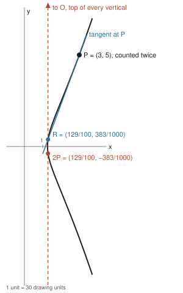

# The group law: three points on a line add up to zero

[Syllabus](../../../SYLLABUS.md) → [Algebraic geometry](../README.md) → [Elliptic Curves](../README.md#s04) → The group law

---

## General Overview

The number 27 is a cube, and 25 is a square. They differ by 2. So the point (3, 5) sits on the curve $`y^2 = x^3 - 2`$: five squared is 25, and three cubed minus 2 is 25. Are there other fractions x and y with the same property?

A line finds one. Draw the tangent to the curve at (3, 5), the line that touches it there. It meets the curve once more, at (129/100, 383/1000). Check it: 383/1000 squared and 129/100 cubed minus 2 both come to 146689/1000000. A known point and one line produced a new rational point, a point whose coordinates are fractions.

The rule that turns this into arithmetic is short. Three points of the curve on one line add up to zero. The tangent at (3, 5) meets the curve at that point twice and at R = (129/100, 383/1000), so twice (3, 5) plus R is zero. Twice (3, 5) is therefore minus R. That is the reflection of R in the x-axis: 2P = (129/100, −383/1000).

For "zero" to mean anything, the curve needs one extra point. It lies at infinity, at the top of every vertical line, and the projective plane gives it the address (0 : 1 : 0), in coordinates explained under The formula. This card places that point, proves the rule makes a group, and finishes the one law the [Elliptic curves](../../05-Geometry%20and%20trig/06-Beyond%20Euclid/05-elliptic-curves-and-point-addition.md) card left open: associativity when points coincide.

**On a smooth cubic curve (no sharp point, no self-crossing) with a flex chosen as zero (a point where the tangent meets the curve three times), declaring that three points on a line add up to zero defines an addition that obeys every group law, including when a line is a tangent or passes through the point at infinity.**

**What kind of fact this is:** a theorem. The rule is a definition. That it gives a group is proved in Why it works. The coincident cases of associativity rest on the Cayley–Bacharach theorem counted with multiplicity, stated here with a source; the code backs it with an exact certificate and every triple of points mod 11.

### The picture: doubling (3, 5)

<p align="center"></p>

Real points only, drawn to scale at 1 unit = 30 drawing units. The curve has one piece, starting where x is the cube root of 2. The tangent at P counts P twice and crosses again at R. The dashed vertical through R holds three points of the curve: R, 2P and O at its top. So R + 2P + O = O, and 2P = −R.

---

## The formula

**The setting.** The field is $`\mathbb{Q}`$, the rational numbers: every coordinate is a fraction. The curve is $`E`$: the points of $`y^2 = x^3 - 2`$ together with one point $`O`$ at infinity. The letter O is the curve's zero; it is not the curly $`\mathcal{O}`$ of a sheaf or the cost notation $`O(\cdot)`$.

Homogeneous coordinates (wing 05) write a point as $`(X : Y : Z)`$, meaning $`x = X/Z`$ and $`y = Y/Z`$. Multiplying all three by the same nonzero number names the same point. In them the curve is $`Y^2 Z = X^3 - 2Z^3`$, and

```math
O = (0 : 1 : 0)
```

**Read it aloud:** the zero of the curve is the one point where Z is zero, the point where every vertical line ends.

The group law is one sentence:

```math
P + Q + R = O \quad \text{whenever } P, Q, R \text{ lie on one line, counted with multiplicity}
```

**Read it aloud:** take any line; its three meeting points with the curve add up to zero, and a point the line touches counts twice.

Two working formulas follow. A vertical line through $`(x, y)`$ also holds $`(x, -y)`$ and $`O`$, so $`-(x, y) = (x, -y)`$: minus a point is its reflection. And the line through $`P`$ and $`Q`$ meets the curve a third time at $`R`$, so $`P + Q = -R`$. For doubling $`P = (x_1, y_1)`$, the line is the tangent, with slope $`m`$:

```math
m = \frac{3x_1^2}{2y_1}, \qquad x_{2P} = m^2 - 2x_1, \qquad y_{2P} = m\,(x_1 - x_{2P}) - y_1
```

**Read it aloud:** the tangent's slope is three x squared over two y; the new x is the slope squared minus twice the old x; follow the line to that x and flip the sign of the height.

On our curve, $`m = 27/10`$ and $`2P = (129/100, -383/1000)`$.

| Symbol | Plain meaning | In our example | Push it up and the answer… |
| --- | --- | --- | --- |
| $`E`$ | the curve $`y^2 = x^3 + ax + b`$, here $`a = 0`$ and $`b = -2`$, with $`O`$ added | holds (3, 5) | — |
| $`(X : Y : Z)`$ | homogeneous coordinates: $`x = X/Z`$, $`y = Y/Z`$ | P is (3 : 5 : 1) | scaling all three names the same point |
| $`O`$ | the point at infinity (0 : 1 : 0), the zero | top of every vertical line | — |
| $`P = (x_1, y_1)`$, $`Q`$, $`W`$; $`2P = (x_{2P}, y_{2P})`$ | points being added; the double of P | P = (3, 5); Q = P; W = 2P = (129/100, −383/1000) | — |
| $`R`$, $`P * Q`$ | the line's third meeting point, before reflecting | R = P * P = (129/100, 383/1000) | — |
| $`-P`$ | the reflection $`(x, -y)`$ | (3, −5) | — |
| $`m`$, $`k`$ | slope and height at x = 0 of the line $`y = mx + k`$ | 27/10 and −31/10 | larger $`m^2`$ moves the third point right |
| $`t`$ | the step from P to a nearby point, for chords | 0.1, 0.01, 0.001 | smaller $`t`$: the chord's sum nears 2P |
| $`S`$, $`T`$ | the partial sums $`P + Q`$ and $`Q + W`$ | 2P and 3P | — |
| $`F`$ | the curve's polynomial $`y^2 - x^3 + 2`$ | 0 at every point of E | — |
| $`C_1`$, $`C_2`$; $`A_1, \dots, A_9`$ | cubics made of three lines: one grouping's two slanted lines and the other grouping's vertical; the nine points where one meets E | see Step 5 | — |
| $`\lambda`$, $`\mu`$ | numbers with $`C_2 = \lambda C_1 + \mu F`$ | 1 and 12660211/2924100 | — |

### When it holds

- **The curve is smooth.** No point of the curve may have both rates of change of its equation, in x and in y, equal to zero. The number $`4a^3 + 27b^2`$ is zero exactly when such a point exists; here it is 108. On $`y^2 = x^3`$, which has a cusp at (0, 0), every line through the cusp meets it there twice, and cancelling fails (What breaks).
- **The zero is a flex.** A flex is a point where the tangent meets the curve three times. With any other point as zero the rule still gives a group, but three points on a line then add to a fixed point that is not zero.
- **Points are counted in the projective plane, with multiplicity.** Drop $`O`$ and a vertical line meets the curve only twice. Drop multiplicity and a tangent meets it only twice.
- **The field allows division by 2 and 3.** The formulas divide by $`2y_1`$. Over $`\mathbb{Q}`$ and mod 11 this works; mod 2 and mod 3 need the longer equation on [Weierstrass form](02-weierstrass-forms-discriminant-and-j-invariant.md).
- **Three meeting points need the right field.** Over the complex numbers every line meets E three times. Over $`\mathbb{Q}`$ a line may meet it once or not at all. But a line through two rational points of $`E`$ always meets a third rational one: a cubic with rational coefficients and two rational roots has a rational third root.

---

## Why it works

### Step 0: close the curve, then let lines do the arithmetic

A line put into a cubic equation gives a cubic in one variable, with three roots. In the projective plane, counted with multiplicity, every line meets the curve exactly three times. So "three on a line" is a relation that every line supplies. Choosing a zero that is a flex turns that relation into "the three add up to zero", and the group laws become facts about lines and cubics.

### Step 1: the point at infinity is (0 : 1 : 0), and it is a flex

Put $`x = X/Z`$ and $`y = Y/Z`$ into the curve and multiply by $`Z^3`$: $`Y^2 Z = X^3 - 2Z^3`$. The line at infinity is $`Z = 0`$. There the equation leaves $`-X^3 = 0`$, so $`X = 0`$, and the only point is $`(0 : 1 : 0)`$.

- **It is a triple meeting.** $`X^3 = 0`$ has the root 0 three times. The line at infinity meets the curve three times at $`O`$, so it is the tangent there and $`O`$ is a flex.
- **It is smooth.** The rates of change of $`Y^2 Z - X^3 + 2Z^3`$ in X, Y and Z at (0 : 1 : 0) are (0, 0, 1). They are not all zero, so the curve has a single tangent at $`O`$.
- **Every vertical line passes through it.** The line x = 3 is $`X = 3Z`$, and (0 : 1 : 0) satisfies it. Parallel lines meet at infinity; all vertical lines meet at $`O`$.

### Step 2: the rule gives a zero, minus signs and a group

Write $`P * Q`$ for the third meeting point of the line through $`P`$ and $`Q`$, and define $`P + Q = (P * Q) * O`$: take the third point, then the third point on its line with $`O`$.

1. **Zero.** $`P * O`$ is on the vertical through $`P`$: the reflection of $`P`$. Its third point with $`O`$ is $`P`$ again. So $`P + O = P`$.
2. **Minus.** The tangent at $`O`$ meets only $`O`$, because $`O`$ is a flex, so $`O * O = O`$. The vertical through $`P`$ and its reflection meets $`O`$ third, so their sum is $`O * O = O`$. Minus $`P`$ is the reflection.
3. **Three on a line.** If $`P, Q, R`$ are collinear, then $`P * Q = R`$, so $`P + Q = R * O = -R`$, and $`P + Q + R = O`$.
4. **Order does not matter.** The line through $`P`$ and $`Q`$ is the line through $`Q`$ and $`P`$.

On our curve: $`P + P + R = O`$ on the tangent at P; $`2P + (-2P) + O = O`$ on the vertical; $`O + O + O = O`$ on the line at infinity.

If the zero were a point that is not a flex, the same steps give: P + Q + R equals the third point of the tangent at that zero. That is a fixed point, but not the zero. A flex is exactly where the two are the same point.

### Step 3: the tangent counts P twice

Doubling has no second point, so the tangent supplies it. Put the tangent $`y = mx + k`$ at (3, 5) into the curve. The cubic $`x^3 - (mx + k)^2 - 2`$ must have $`x = 3`$ as a double root, since the line touches there.

With $`m = 27/10`$ and $`k = -31/10`$, dividing by $`(x - 3)^2`$ leaves remainder 0 and quotient $`x - 129/100`$. The third root is 129/100 by long division. The sum of the roots gives it again: $`3 + 3 + x_R = m^2 = 729/100`$.

The tangent is also the limit of chords. Take a nearby point at $`x = 3 + t`$ and add it to P with the chord rule:

| t | Chord slope | Chord sum |
| --- | --- | --- |
| 0.1 | 2.717170 | (1.283012, −0.334652) |
| 0.01 | 2.701711 | (1.289241, −0.378024) |
| 0.001 | 2.700171 | (1.289923, −0.382501) |

The sums close in on 2P = (129/100, −383/1000) as $`t`$ shrinks. Doubling is the chord rule at its limit, not a separate rule.

### Step 4: associativity for points in general position

Associativity says $`(P + Q) + W = P + (Q + W)`$. For nine distinct points, the [Elliptic curves](../../05-Geometry%20and%20trig/06-Beyond%20Euclid/05-elliptic-curves-and-point-addition.md) card proves it in one line: the two groupings draw six lines; once they trade their vertical lines, each grouping's three lines form a cubic through the same eight points, and Cayley–Bacharach forces the ninth points to agree. Cayley–Bacharach says: if two cubics meet in exactly nine points, any cubic through eight of them passes through the ninth.

That proof needs the nine points distinct. It says nothing when Q = P, when a line is a tangent, or when a line runs through O. Those are the cases where the sums are most often computed.

### Step 5: finishing the coincident cases

Cayley–Bacharach also holds counted with multiplicity, provided the eight shared points are smooth points of one of the cubics. Here that cubic is $`E`$ itself, smooth everywhere (Step 1 and When it holds). The statement: if a cubic meets $`E`$ in nine points counted with multiplicity, any cubic through eight of them, with the same multiplicities, passes through the ninth.

Take the hardest kind of case: Q = P and W = 2P. Then S = P + P = 2P and T = P + 2P = 3P. The left grouping, (P + P) + 2P, draws the tangent at P, the vertical at 2P and the tangent at 2P. The right grouping, P + (P + 2P), draws the chord through P and 2P, the vertical at 3P and the chord through P and 3P. Each cubic takes the two slanted lines of one grouping and the vertical line of the other:

- **$`C_1`$:** the tangent at P (P, P, −2P) and the tangent at 2P (2P, 2P, −4P), from the left grouping, times the vertical at 3P (3P, −3P, O), from the right grouping.
- **$`C_2`$:** the chord through P and 2P (P, 2P, −3P) and the chord through P and 3P (P, 3P, −4P), from the right grouping, times the vertical at 2P (2P, −2P, O), from the left grouping.

Swapping the verticals is what makes the proof work: it puts S, −S, T, −T and O on both cubics. Both lists hold P twice, 2P twice, −2P, 3P, −3P and O: the same eight. Cayley–Bacharach forces the ninth points to agree, and the ninth points are $`-((P + P) + 2P)`$ and $`-(P + (P + 2P))`$. Reflect, and the two groupings agree.

The code proves this instance by a certificate: an exact identity between polynomials. In it, $`F = y^2 - x^3 + 2`$ is the curve's own polynomial.

```math
C_2 = \lambda\, C_1 + \mu\, F, \qquad \lambda = 1, \quad \mu = \frac{12660211}{2924100}
```

**Read it aloud:** the cubic $`C_2`$ equals $`C_1`$ plus a multiple of the curve's own polynomial.

Two coefficients fix $`\lambda`$ and $`\mu`$; all 9 nonzero coefficients then match, so the rest are a real test, not a fit. On $`E`$, $`F`$ is zero, so $`C_2`$ and $`C_1`$ take the same value at every point of the curve. They therefore meet $`E`$ in the same nine points with the same multiplicities, and the ninth points agree. Both sides come to $`4P = (2340922881/58675600,\ 113259286337279/449455096000)`$.

<details>
<summary>Detailed proof: why the multiplicity version holds on a smooth cubic</summary>

Let $`C_1`$ meet $`E`$ in the nine points $`A_1, \dots, A_9`$, counted with multiplicity, and let $`C_2`$ pass through $`A_1, \dots, A_8`$ with the same multiplicities.

The ratio $`C_2 / C_1`$ is a function on $`E`$. Its zeros and poles cancel at $`A_1, \dots, A_8`$. What is left is at most one zero, at the ninth point of $`C_2`$, and one pole, at $`A_9`$. On a smooth cubic, a function with a single simple pole does not exist: it would make $`E`$ a copy of the projective line, which has genus 0, while a smooth cubic has genus 1.

So $`C_2 / C_1`$ has no pole and is a constant $`\lambda`$. Then $`C_2 - \lambda C_1`$ vanishes on all of $`E`$, and since $`F`$ cannot be factored, it is a multiple of $`F`$:

$`\displaystyle C_2 = \lambda\, C_1 + \mu\, F`$

That is exactly the shape of the certificate, and it forces the ninth points to agree. Genus here is the number of holes in the curve's complex points, seen as a surface. The genus fact comes from the Riemann–Roch theorem; Chapter III of the Silverman source below gives the full argument.

</details>

### Step 6: two more roads to the coincident cases

**Continuity, over the real or complex numbers.** Step 3 shows a chord sum tends to the tangent sum as two points merge. In the same way, a sum tends to $`O`$ as $`Q`$ tends to $`-P`$. So addition is continuous everywhere on the curve. Both groupings are continuous functions of $`(P, Q, W)`$ that agree at points in general position. Every triple is a limit of such points, so the groupings agree everywhere. Rational points are real points, so this covers $`E`$ over $`\mathbb{Q}`$.

**Every triple, mod 11.** Over a finite field there are no limits, but there are finitely many points. With every number a remainder mod 11, the curve has 12 points, $`O`$ included. That gives 1728 ordered triples. Only 112 of them have nine distinct points P, Q, W, S, −S, T, −T, O and −(S + W), as Step 4 needs; the other 1616 are coincident cases. The code tries all of them and finds 0 failures. For this one curve mod 11, that is a proof.

---

## Worked numbers, by hand

Doubling P = (3, 5) on $`y^2 = x^3 - 2`$.

| Step | Arithmetic | Value |
| --- | --- | --- |
| P on the curve | $`5^2`$ and $`3^3 - 2`$ | 25 both |
| curve is smooth | $`4 \cdot 0^3 + 27 \cdot (-2)^2`$ | 108, not zero |
| tangent slope | $`3 \cdot 3^2 / (2 \cdot 5)`$ | 27/10 |
| height at x = 0 | $`5 - (27/10) \cdot 3`$ | −31/10 |
| sum of the three roots | $`m^2`$ | 729/100 |
| third root, R's x | $`729/100 - 3 - 3`$ | 129/100 |
| R's y, on the tangent | $`(27/10)(129/100) - 31/10`$ | 383/1000 |
| reflect | change the sign of y | **2P = (129/100, −383/1000)** |
| 2P on the curve | $`(-383/1000)^2`$ and $`(129/100)^3 - 2`$ | 146689/1000000 both |

The tangent at (3, 5) holds three points of the curve, P twice and R, so 2P is minus R: a new rational solution of $`y^2 + 2 = x^3`$, made from the old one by one line.

### What breaks if you drop a piece

| Mistake | Comes out at | What went wrong |
| --- | --- | --- |
| R taken as the sum, no reflection | P "+" O = (3, −5), not P | the third point is minus the sum; without reflecting, O is no zero |
| Chord formula used with Q = P | slope 0/0 | a chord needs two points; the tangent supplies the second |
| A cusp: $`y^2 = x^3`$ | (0, 0) + (1, 1) and (0, 0) + (4, 8) both (0, 0) | the curve is not smooth; lines through the cusp meet it twice there, and cancelling fails |
| O read as the origin (0, 0) | $`0^2 = 0`$ but $`0^3 - 2 = -2`$: not on the curve | O is (0 : 1 : 0), not a point of the plane |

The code prints all four.

---

## Code, from first principles, and it actually runs

Exact fractions throughout (Python's Fraction; in Rust, written from scratch on i128 with overflow checks). The code places O and shows it is a smooth flex. It doubles (3, 5) three ways: the tangent formula, long division of the line's cubic by $`(x - 3)^2`$, and chords to nearby points. Then it tests associativity in the coincident case $`(P + P) + 2P`$ by two independent roads, the formulas and the Cayley–Bacharach certificate, and a third road tries every triple mod 11.

### Python

```python
# The group law on y^2 = x^3 - 2 -- the check behind the card.  Standard library only; Fraction
# is exact arithmetic on fractions, nothing more.  The point at infinity O, doubling (3, 5) three
# ways, associativity where points coincide (formulas, a Cayley-Bacharach certificate, mod 11).
from fractions import Fraction as Fr
B, O = -2, None                                  # the curve y^2 = x^3 + B; None stands for O

def neg(p): return O if p is O else (p[0], -p[1])
def add(p, q):                                   # road one: chord or tangent, then reflect
    if p is O or q is O: return q if p is O else p
    if p[0] == q[0] and p[1] == -q[1]: return O      # a vertical line: its third point is O
    m = Fr(3 * p[0] ** 2, 2 * p[1]) if p == q else (q[1] - p[1]) / (q[0] - p[0])
    x = m * m - p[0] - q[0]
    return (x, m * (p[0] - x) - p[1])
def show(p): return "O" if p is O else f"({p[0]}, {p[1]})"
def line(p, q):                                  # the line through p and q (tangent if equal),
    if p[0] == q[0] and p != q: return {(1, 0): Fr(1), (0, 0): -p[0]}   # as {(i, j): coefficient
    m = Fr(3 * p[0] ** 2, 2 * p[1]) if p == q else (q[1] - p[1]) / (q[0] - p[0])  # of x^i y^j}
    return {(0, 1): Fr(1), (1, 0): -m, (0, 0): m * p[0] - p[1]}
def mul(f, g):
    h = {}
    for (a, b), u in f.items():
        for (c, d), v in g.items(): h[(a + c, b + d)] = h.get((a + c, b + d), 0) + u * v
    return h
def cubic(*ls): return mul(mul(ls[0], ls[1]), ls[2])

P = (Fr(3), Fr(5))
print(f"curve y^2 = x^3 - 2 over the rationals; P = {show(P)}: 5^2 = {5 ** 2} = 3^3 - 2 = {3 ** 3 + B}")
print(f"4a^3 + 27b^2 = {27 * B * B}, {'not zero: no cusp, no self-crossing' if 27 * B * B else 'zero: a cusp or a self-crossing'}")
# O in projective coordinates (X : Y : Z), curve Y^2 Z = X^3 - 2 Z^3, so x = X/Z and y = Y/Z
Fh = lambda X, Y, Z: Y * Y * Z - X ** 3 - B * Z ** 3
roots = [X for X in range(-9, 10) if Fh(X, 1, 0) == 0]
yn = lambda t: "yes" if t else "no"
vert = lambda X, Y, Z: X - 3 * Z                                     # the line x = 3, made projective
print(f"on the line at infinity Z = 0 the equation is -X^3 = 0: X = {roots}, so the one point there is (0 : 1 : 0)")
grad = lambda X, Y, Z: (-3 * X * X, 2 * Y * Z, Y * Y - 3 * B * Z * Z)  # rates of change in X, Y, Z
print(f"slopes of the equation at (0 : 1 : 0): {grad(0, 1, 0)}; not all zero, so O is a smooth point; tangent line Z = 0")
print(f"Z = 0 meets the curve where X^3 = 0: a triple root, so O is a flex; vertical x = 3 is X = 3Z, "
      f"through O: {yn(Fh(0, 1, 0) == 0 and vert(0, 1, 0) == 0)}")
# doubling P: road one is the formula; road two divides the line's cubic by (x - 3)^2
m = Fr(3 * 9, 2 * 5); k = 5 - m * 3; R = (m * m - 6, m * (m * m - 6) + k); D = add(P, P)
print(f"tangent at P: slope {m}, line y = {m} x - {-k}; x of third point = m^2 - 3 - 3 = {m * m} - 6 = {R[0]}")
cub = [Fr(1), -m * m, -2 * m * k, B - k * k]           # x^3 - (mx + k)^2 - 2, leading first
quo, r = [], cub[:]                                     # long division by x^2 - 6x + 9
for i in range(2):
    quo.append(r[i])
    for j, d in enumerate((1, -6, 9)): r[i + j] -= quo[i] * d
print(f"x^3 - (mx + k)^2 - 2 divided by (x - 3)^2: quotient x - {-quo[1]}, remainder {r[2]}x + {r[3]}")
print(f"third point R = {show(R)}, on curve: {yn(R[1] ** 2 == R[0] ** 3 + B)}; 2P = {show(D)}, "
      f"y^2 = {D[1] ** 2} = x^3 - 2 = {D[0] ** 3 + B}")
assert -quo[1] == R[0] == D[0] and r[2] == r[3] == 0 and D[1] ** 2 == D[0] ** 3 + B
print(f"three on a line: P + P + R = {show(add(add(P, P), R))}; 2P + (-2P) + O = {show(add(add(D, neg(D)), O))}; O + O + O = {show(add(O, add(O, O)))}")
for t in (0.1, 0.01, 0.001):                    # road three: chords to nearby points tend to 2P
    x2 = 3 + t; y2 = (x2 * x2 * x2 + B) ** 0.5; s = (y2 - 5) / t; x3 = s * s - 3 - x2
    print(f"chord to ({x2:.3f}, {y2:.6f}): slope {s:.6f}, sum ({x3:.6f}, {s * (3 - x3) - 5:.6f})")
assert abs(x3 - 1.29) < 0.01 and abs(s * (3 - x3) - 5 + 0.383) < 0.01
T3, T4 = add(D, P), add(D, D)
print(f"3P = {show(T3)}\n4P = {show(T4)}")
# associativity with Q = P and W = 2P: (P + P) + 2P against P + (P + 2P)
left, right = add(add(P, P), D), add(P, add(P, D))
print(f"(P + P) + 2P = 2P + 2P, a tangent; P + (P + 2P) = P + 3P, a chord; equal: {yn(left == right)}")
C1 = cubic(line(P, P), line(D, D), line(T3, neg(T3)))       # left grouping's two tangents, right's vertical
C2 = cubic(line(P, D), line(D, neg(D)), line(P, T3))        # right grouping's two chords, left's vertical
Fc = {(0, 2): Fr(1), (3, 0): Fr(-1), (0, 0): Fr(-B)}        # the curve itself: y^2 - x^3 + 2
lam = C2[(2, 1)] / C1[(2, 1)]
mu = (C2.get((3, 0), 0) - lam * C1.get((3, 0), 0)) / Fc[(3, 0)]
gap = [C2.get(e, 0) - lam * C1.get(e, 0) - mu * Fc.get(e, 0) for e in set(C1) | set(C2) | set(Fc)
       if C1.get(e, 0) or C2.get(e, 0) or Fc.get(e, 0)]
print(f"Cayley-Bacharach certificate: C2 = {lam} x C1 + {mu} x curve; "
      f"{len(gap)} coefficients compared, {sum(g != 0 for g in gap)} differ")
assert left == right == T4 and all(g == 0 for g in gap)
on = lambda pt: any(sum(c * pt[0] ** i * pt[1] ** j for (i, j), c in l.items()) == 0
                   for l in (line(P, D), line(D, neg(D)), line(P, T3)))   # a cubic of lines is 0
print(f"C2 passes through -((P + P) + 2P): {yn(on(neg(left)))}; "            # where one line is
      f"through (P + P) + 2P unreflected: {yn(on(left))}")
assert on(neg(left)) and not on(left)
# every triple mod 11, coincidences included
p = 11
def addp(a, b):
    if a is O or b is O: return b if a is O else a
    if a[0] == b[0] and (a[1] + b[1]) % p == 0: return O
    num, den = (3 * a[0] ** 2, 2 * a[1]) if a == b else (b[1] - a[1], b[0] - a[0])
    mm = num * pow(den, p - 2, p) % p; x = (mm * mm - a[0] - b[0]) % p
    return (x, (mm * (a[0] - x) - a[1]) % p)
pts = [O] + [(x, y) for x in range(p) for y in range(p) if (y * y - x ** 3 - B) % p == 0]
ngp, fail, coin = lambda u: O if u is O else (u[0], -u[1] % p), 0, 0
for a in pts:
    for b in pts:
        for c in pts:
            s, t = addp(a, b), addp(b, c); fail += addp(s, c) != addp(a, t)
            nine = (a, b, c, s, ngp(s), t, ngp(t), O, ngp(addp(s, c)))   # Step 4's nine points
            coin += len(set(nine)) < 9
print(f"mod {p}: {len(pts)} points, {len(pts) ** 3} triples, {len(pts) ** 3 - coin} with nine distinct points, "
      f"{coin} without; associativity failures {fail}")
assert len(pts) == 12 and fail == 0
# what breaks
print(f"mistake, R taken as the sum: third point of P and O is {show(neg(P))}, so O is not a zero")
print(f"mistake, chord formula at P = Q: slope ({P[1]} - {P[1]})/({P[0]} - {P[0]}) = {P[1] - P[1]}/{P[0] - P[0]}")
thirds = [Fr(y, x) ** 2 - x for x, y in ((1, 1), (4, 8))]      # sum of roots: m^2 - 0 - x
print(f"mistake, cusp y^2 = x^3: lines from (0, 0) to (1, 1) and (4, 8) meet again at x = {thirds[0]} and {thirds[1]}, "
      f"so (0, 0) + (1, 1) and (0, 0) + (4, 8) both give (0, 0): no cancelling")
print(f"mistake, O read as the origin: (0, 0) on the curve? 0^2 = 0, 0^3 - 2 = {B}: no")
# figure: 1 unit = 30, origin (40, 240); upper half of the curve, mirrored for the lower half
c = 2 ** (1 / 3); xs = [c + (51 ** (1 / 3) - c) * (i / 12) * (i / 12) for i in range(13)]
sv = lambda x, y: f"{40 + 30 * x:.1f},{240 - 30 * y:.1f}"
print("figure, 1 unit = 30, origin (40,240), curve:", " ".join(sv(x, max(0.0, x * x * x + B) ** 0.5) for x in xs))
print("figure, P", sv(3, 5), "R", sv(*map(float, R)), "2P", sv(*map(float, D)), "tangent", sv(1, float(m + k)), "to",
      sv(3.4, float(m * Fr(17, 5) + k)), "vertical", sv(float(R[0]), 7.6), "to", sv(float(R[0]), -7.6), "axes", sv(-1, 0), "to", sv(4.5, 0), "and", sv(0, 7.6), "to", sv(0, -7.6))
print("ALL CHECKS PASS")
```

**Ran 2026-11-17 on macOS, Python 3.14.10, standard library only. All checks passed. Output, pasted from the run:**

```
curve y^2 = x^3 - 2 over the rationals; P = (3, 5): 5^2 = 25 = 3^3 - 2 = 25
4a^3 + 27b^2 = 108, not zero: no cusp, no self-crossing
on the line at infinity Z = 0 the equation is -X^3 = 0: X = [0], so the one point there is (0 : 1 : 0)
slopes of the equation at (0 : 1 : 0): (0, 0, 1); not all zero, so O is a smooth point; tangent line Z = 0
Z = 0 meets the curve where X^3 = 0: a triple root, so O is a flex; vertical x = 3 is X = 3Z, through O: yes
tangent at P: slope 27/10, line y = 27/10 x - 31/10; x of third point = m^2 - 3 - 3 = 729/100 - 6 = 129/100
x^3 - (mx + k)^2 - 2 divided by (x - 3)^2: quotient x - 129/100, remainder 0x + 0
third point R = (129/100, 383/1000), on curve: yes; 2P = (129/100, -383/1000), y^2 = 146689/1000000 = x^3 - 2 = 146689/1000000
three on a line: P + P + R = O; 2P + (-2P) + O = O; O + O + O = O
chord to (3.100, 5.271717): slope 2.717170, sum (1.283012, -0.334652)
chord to (3.010, 5.027017): slope 2.701711, sum (1.289241, -0.378024)
chord to (3.001, 5.002700): slope 2.700171, sum (1.289923, -0.382501)
3P = (164323/29241, -66234835/5000211)
4P = (2340922881/58675600, 113259286337279/449455096000)
(P + P) + 2P = 2P + 2P, a tangent; P + (P + 2P) = P + 3P, a chord; equal: yes
Cayley-Bacharach certificate: C2 = 1 x C1 + 12660211/2924100 x curve; 9 coefficients compared, 0 differ
C2 passes through -((P + P) + 2P): yes; through (P + P) + 2P unreflected: no
mod 11: 12 points, 1728 triples, 112 with nine distinct points, 1616 without; associativity failures 0
mistake, R taken as the sum: third point of P and O is (3, -5), so O is not a zero
mistake, chord formula at P = Q: slope (5 - 5)/(3 - 3) = 0/0
mistake, cusp y^2 = x^3: lines from (0, 0) to (1, 1) and (4, 8) meet again at x = 0 and 0, so (0, 0) + (1, 1) and (0, 0) + (4, 8) both give (0, 0): no cancelling
mistake, O read as the origin: (0, 0) on the curve? 0^2 = 0, 0^3 - 2 = -2: no
figure, 1 unit = 30, origin (40,240), curve: 77.8,240.0 78.3,231.4 79.8,222.5 82.4,212.8 86.0,202.1 90.6,189.9 96.2,175.9 102.8,159.7 110.4,140.7 119.1,118.7 128.8,93.2 139.5,63.8 151.3,30.0
figure, P 130.0,90.0 R 78.7,228.5 2P 78.7,251.5 tangent 70.0,252.0 to 142.0,57.6 vertical 78.7,12.0 to 78.7,468.0 axes 10.0,240.0 to 175.0,240.0 and 40.0,12.0 to 40.0,468.0
ALL CHECKS PASS
```

### Rust

Same numbers, same labels, built with `rustc --edition 2021 -O`.

```rust
// The group law on y^2 = x^3 - 2 -- the same check as the Python, in Rust.  No crates; exact
// fractions are written here, on i128 with overflow checks.  The point at infinity O, doubling
// (3, 5) three ways, associativity where points coincide (formulas, a certificate, mod 11).
#[derive(Clone, Copy, PartialEq, Debug)]
struct Q(i128, i128); // numerator, denominator > 0, in lowest terms
fn q(n: i128, d: i128) -> Q { // reduce by the greatest common divisor, found by Euclid
    let (mut a, mut b) = (n.abs(), d.abs());
    while b != 0 { (a, b) = (b, a % b); }
    if a == 0 { return Q(0, 1); }
    Q(n / a * d.signum(), d.abs() / a)
}
fn ml(a: i128, b: i128) -> i128 { a.checked_mul(b).expect("overflow") }
fn ad(x: Q, y: Q) -> Q { q(ml(x.0, y.1).checked_add(ml(y.0, x.1)).expect("overflow"), ml(x.1, y.1)) }
fn sb(x: Q, y: Q) -> Q { ad(x, Q(-y.0, y.1)) }
fn mu(x: Q, y: Q) -> Q { q(ml(x.0, y.0), ml(x.1, y.1)) }
fn dv(x: Q, y: Q) -> Q { q(ml(x.0, y.1), ml(x.1, y.0)) }
fn n(v: i128) -> Q { Q(v, 1) }
fn fl(x: Q) -> f64 { x.0 as f64 / x.1 as f64 }
fn txt(x: Q) -> String { if x.1 == 1 { format!("{}", x.0) } else { format!("{}/{}", x.0, x.1) } }
const B: i128 = -2; // the curve y^2 = x^3 + B; None stands for O
type Pt = Option<(Q, Q)>;
fn neg(p: Pt) -> Pt { p.map(|(x, y)| (x, Q(-y.0, y.1))) }
fn slope(u: (Q, Q), v: (Q, Q)) -> Q { // tangent if the points agree, else chord
    if u == v { dv(mu(n(3), mu(u.0, u.0)), mu(n(2), u.1)) } else { dv(sb(v.1, u.1), sb(v.0, u.0)) }
}
fn add(p: Pt, r: Pt) -> Pt { // road one: chord or tangent, then reflect
    let (Some(u), Some(v)) = (p, r) else { return if p.is_none() { r } else { p } };
    if u.0 == v.0 && u.1 == Q(-v.1 .0, v.1 .1) { return None; } // a vertical line: third point O
    let m = slope(u, v);
    let x = sb(sb(mu(m, m), u.0), v.0);
    Some((x, sb(mu(m, sb(u.0, x)), u.1)))
}
fn show(p: Pt) -> String { p.map_or("O".into(), |(x, y)| format!("({}, {})", txt(x), txt(y))) }
fn yn(t: bool) -> &'static str { if t { "yes" } else { "no" } }
type Poly = [[Q; 4]; 4]; // entry [i][j] is the coefficient of x^i y^j
fn line(u: (Q, Q), v: (Q, Q)) -> Poly { // the line through u and v (tangent if equal)
    let mut f = [[n(0); 4]; 4];
    if u.0 == v.0 && u != v { f[1][0] = n(1); f[0][0] = Q(-u.0 .0, u.0 .1); return f; }
    let m = slope(u, v);
    f[0][1] = n(1); f[1][0] = Q(-m.0, m.1); f[0][0] = sb(mu(m, u.0), u.1);
    f
}
fn pmul(f: &Poly, g: &Poly) -> Poly {
    let mut h = [[n(0); 4]; 4];
    for a in 0..4 { for b in 0..4 { for c in 0..4 - a { for d in 0..4 - b {
        if f[a][b] != n(0) && g[c][d] != n(0) { h[a + c][b + d] = ad(h[a + c][b + d], mu(f[a][b], g[c][d])); }
    } } } }
    h
}
fn on_line(f: &Poly, p: (Q, Q)) -> bool { // value of a line ax + by + c at the point
    ad(ad(mu(f[1][0], p.0), mu(f[0][1], p.1)), f[0][0]) == n(0)
}
const PM: i64 = 11;
type P11 = Option<(i64, i64)>;
fn addp(a: P11, b: P11) -> P11 { // the same rule, every number a remainder mod 11
    let (Some((x1, y1)), Some((x2, y2))) = (a, b) else { return if a.is_none() { b } else { a } };
    if x1 == x2 && (y1 + y2) % PM == 0 { return None; }
    let (num, den) = if a == b { (3 * x1 * x1, 2 * y1) } else { (y2 - y1, x2 - x1) };
    let mut inv = 1; // den^(p - 2) is den's partner mod p
    for _ in 0..PM - 2 { inv = inv * den.rem_euclid(PM) % PM; }
    let mm = (num * inv).rem_euclid(PM);
    let x = (mm * mm - x1 - x2).rem_euclid(PM);
    Some((x, (mm * (x1 - x) - y1).rem_euclid(PM)))
}
fn sv(x: f64, y: f64) -> String { format!("{:.1},{:.1}", 40.0 + 30.0 * x, 240.0 - 30.0 * y) }

fn main() {
    let (p, pp): ((Q, Q), Pt) = ((n(3), n(5)), Some((n(3), n(5))));
    println!("curve y^2 = x^3 - 2 over the rationals; P = {}: 5^2 = {} = 3^3 - 2 = {}", show(pp), 5 * 5, 27 + B);
    println!("4a^3 + 27b^2 = {}, {}", 27 * B * B, if 27 * B * B != 0 { "not zero: no cusp, no self-crossing" } else { "zero: a cusp or a self-crossing" });
    let fh = |x: i128, y: i128, z: i128| y * y * z - x * x * x - B * z * z * z;
    let roots: Vec<i128> = (-9..10).filter(|&x| fh(x, 1, 0) == 0).collect();
    let vert = |x: i128, _y: i128, z: i128| x - 3 * z; // the line x = 3, made projective
    println!("on the line at infinity Z = 0 the equation is -X^3 = 0: X = {:?}, so the one point there is (0 : 1 : 0)", roots);
    let grad = |x: i128, y: i128, z: i128| (-3 * x * x, 2 * y * z, y * y - 3 * B * z * z); // rates of change
    println!("slopes of the equation at (0 : 1 : 0): {:?}; not all zero, so O is a smooth point; tangent line Z = 0", grad(0, 1, 0));
    println!("Z = 0 meets the curve where X^3 = 0: a triple root, so O is a flex; vertical x = 3 is X = 3Z, through O: {}",
             yn(fh(0, 1, 0) == 0 && vert(0, 1, 0) == 0));
    // doubling P: road one is the formula; road two divides the line's cubic by (x - 3)^2
    let (m, k) = (q(27, 10), sb(n(5), mu(q(27, 10), n(3))));
    let rx = sb(mu(m, m), n(6));
    let rr = (rx, ad(mu(m, rx), k));
    let d = add(pp, pp);
    println!("tangent at P: slope {}, line y = {} x - {}; x of third point = m^2 - 3 - 3 = {} - 6 = {}",
             txt(m), txt(m), txt(Q(-k.0, k.1)), txt(mu(m, m)), txt(rx));
    let mut r = [n(1), Q(-mu(m, m).0, mu(m, m).1), mu(n(-2), mu(m, k)), sb(n(B), mu(k, k))];
    let mut quo = vec![];
    for i in 0..2 {
        quo.push(r[i]);
        for (j, dd) in [1, -6, 9].iter().enumerate() { r[i + j] = sb(r[i + j], mu(quo[i], n(*dd))); }
    }
    println!("x^3 - (mx + k)^2 - 2 divided by (x - 3)^2: quotient x - {}, remainder {}x + {}",
             txt(Q(-quo[1].0, quo[1].1)), txt(r[2]), txt(r[3]));
    let (dx, dy) = d.unwrap();
    println!("third point R = {}, on curve: {}; 2P = {}, y^2 = {} = x^3 - 2 = {}", show(Some(rr)),
             yn(mu(rr.1, rr.1) == ad(mu(mu(rx, rx), rx), n(B))), show(d), txt(mu(dy, dy)), txt(ad(mu(mu(dx, dx), dx), n(B))));
    assert!(Q(-quo[1].0, quo[1].1) == rx && rx == dx && r[2] == n(0) && r[3] == n(0)
            && mu(dy, dy) == ad(mu(mu(dx, dx), dx), n(B)));
    println!("three on a line: P + P + R = {}; 2P + (-2P) + O = {}; O + O + O = {}",
             show(add(add(pp, pp), Some(rr))), show(add(add(d, neg(d)), None)), show(add(None, add(None, None))));
    let (mut s, mut x3) = (0.0, 0.0);
    for t in [0.1, 0.01, 0.001] { // road three: chords to nearby points tend to 2P
        let x2 = 3.0 + t;
        let y2 = (x2 * x2 * x2 + B as f64).powf(0.5);
        s = (y2 - 5.0) / t;
        x3 = s * s - 3.0 - x2;
        println!("chord to ({:.3}, {:.6}): slope {:.6}, sum ({:.6}, {:.6})", x2, y2, s, x3, s * (3.0 - x3) - 5.0);
    }
    assert!((x3 - 1.29).abs() < 0.01 && (s * (3.0 - x3) - 5.0 + 0.383).abs() < 0.01);
    let (t3, t4) = (add(d, pp), add(d, d));
    println!("3P = {}\n4P = {}", show(t3), show(t4));
    // associativity with Q = P and W = 2P: (P + P) + 2P against P + (P + 2P)
    let (left, right) = (add(add(pp, pp), d), add(pp, add(pp, d)));
    println!("(P + P) + 2P = 2P + 2P, a tangent; P + (P + 2P) = P + 3P, a chord; equal: {}", yn(left == right));
    let (dd, tt) = (d.unwrap(), t3.unwrap());
    let c1 = pmul(&pmul(&line(p, p), &line(dd, dd)), &line(tt, neg(t3).unwrap())); // left tangents, right vertical
    let rl = [line(p, dd), line(dd, neg(d).unwrap()), line(p, tt)];                   // right chords, left vertical
    let c2 = pmul(&pmul(&rl[0], &rl[1]), &rl[2]);
    let mut fc = [[n(0); 4]; 4]; // the curve itself: y^2 - x^3 + 2
    fc[0][2] = n(1); fc[3][0] = n(-1); fc[0][0] = n(-B);
    let lam = dv(c2[2][1], c1[2][1]);
    let mu_ = dv(sb(c2[3][0], mu(lam, c1[3][0])), fc[3][0]);
    let (mut cmp, mut diff) = (0, 0);
    for i in 0..4 { for j in 0..4 {
        if c1[i][j] == n(0) && c2[i][j] == n(0) && fc[i][j] == n(0) { continue; }
        cmp += 1;
        if sb(sb(c2[i][j], mu(lam, c1[i][j])), mu(mu_, fc[i][j])) != n(0) { diff += 1; }
    } }
    println!("Cayley-Bacharach certificate: C2 = {} x C1 + {} x curve; {} coefficients compared, {} differ",
             txt(lam), txt(mu_), cmp, diff);
    assert!(left == right && right == t4 && diff == 0);
    let on = |pt: Pt| rl.iter().any(|l| on_line(l, pt.unwrap())); // a cubic of lines is 0 where one line is
    println!("C2 passes through -((P + P) + 2P): {}; through (P + P) + 2P unreflected: {}",
             yn(on(neg(left))), yn(on(left)));
    assert!(on(neg(left)) && !on(left));
    // every triple mod 11, coincidences included
    let mut pts: Vec<P11> = vec![None];
    for x in 0..PM { for y in 0..PM { if (y * y - x * x * x - B as i64).rem_euclid(PM) == 0 { pts.push(Some((x, y))); } } }
    let (mut fail, mut coin) = (0, 0);
    let ngp = |u: P11| u.map(|(x, y)| (x, (-y).rem_euclid(PM)));
    for &a in &pts { for &b in &pts { for &c in &pts {
        let (s1, t1) = (addp(a, b), addp(b, c));
        if addp(s1, c) != addp(a, t1) { fail += 1; }
        let nine = [a, b, c, s1, ngp(s1), t1, ngp(t1), None, ngp(addp(s1, c))]; // Step 4's nine points
        if (0..9).any(|i| (0..i).any(|j| nine[i] == nine[j])) { coin += 1; }
    } } }
    println!("mod {}: {} points, {} triples, {} with nine distinct points, {} without; associativity failures {}",
             PM, pts.len(), pts.len().pow(3), pts.len().pow(3) - coin, coin, fail);
    assert!(pts.len() == 12 && fail == 0);
    // what breaks
    println!("mistake, R taken as the sum: third point of P and O is {}, so O is not a zero", show(neg(pp)));
    println!("mistake, chord formula at P = Q: slope ({} - {})/({} - {}) = {}/{}", txt(p.1), txt(p.1), txt(p.0), txt(p.0), txt(sb(p.1, p.1)), txt(sb(p.0, p.0)));
    let thirds: Vec<Q> = [(1, 1), (4, 8)].iter().map(|&(x, y)| sb(mu(q(y, x), q(y, x)), n(x))).collect();
    println!("mistake, cusp y^2 = x^3: lines from (0, 0) to (1, 1) and (4, 8) meet again at x = {} and {}, so (0, 0) + (1, 1) and (0, 0) + (4, 8) both give (0, 0): no cancelling",
             txt(thirds[0]), txt(thirds[1]));
    println!("mistake, O read as the origin: (0, 0) on the curve? 0^2 = 0, 0^3 - 2 = {}: no", B);
    // figure: 1 unit = 30, origin (40, 240); upper half of the curve, mirrored for the lower half
    let (c, top) = (2f64.powf(1.0 / 3.0), 51f64.powf(1.0 / 3.0));
    let curve: Vec<String> = (0..13).map(|i| {
        let x = c + (top - c) * (i as f64 / 12.0) * (i as f64 / 12.0);
        sv(x, (x * x * x + B as f64).max(0.0).powf(0.5))
    }).collect();
    println!("figure, 1 unit = 30, origin (40,240), curve: {}", curve.join(" "));
    println!("figure, P {} R {} 2P {} tangent {} to {} vertical {} to {} axes {} to {} and {} to {}",
             sv(3.0, 5.0), sv(fl(rr.0), fl(rr.1)), sv(fl(dx), fl(dy)), sv(1.0, fl(ad(m, k))),
             sv(3.4, fl(ad(mu(m, q(17, 5)), k))), sv(fl(rx), 7.6), sv(fl(rx), -7.6),
             sv(-1.0, 0.0), sv(4.5, 0.0), sv(0.0, 7.6), sv(0.0, -7.6));
    println!("ALL CHECKS PASS");
}
```

**Ran 2026-11-17 on macOS, rustc 1.98.1, no crates. All checks passed. Output, pasted from the run:**

```
curve y^2 = x^3 - 2 over the rationals; P = (3, 5): 5^2 = 25 = 3^3 - 2 = 25
4a^3 + 27b^2 = 108, not zero: no cusp, no self-crossing
on the line at infinity Z = 0 the equation is -X^3 = 0: X = [0], so the one point there is (0 : 1 : 0)
slopes of the equation at (0 : 1 : 0): (0, 0, 1); not all zero, so O is a smooth point; tangent line Z = 0
Z = 0 meets the curve where X^3 = 0: a triple root, so O is a flex; vertical x = 3 is X = 3Z, through O: yes
tangent at P: slope 27/10, line y = 27/10 x - 31/10; x of third point = m^2 - 3 - 3 = 729/100 - 6 = 129/100
x^3 - (mx + k)^2 - 2 divided by (x - 3)^2: quotient x - 129/100, remainder 0x + 0
third point R = (129/100, 383/1000), on curve: yes; 2P = (129/100, -383/1000), y^2 = 146689/1000000 = x^3 - 2 = 146689/1000000
three on a line: P + P + R = O; 2P + (-2P) + O = O; O + O + O = O
chord to (3.100, 5.271717): slope 2.717170, sum (1.283012, -0.334652)
chord to (3.010, 5.027017): slope 2.701711, sum (1.289241, -0.378024)
chord to (3.001, 5.002700): slope 2.700171, sum (1.289923, -0.382501)
3P = (164323/29241, -66234835/5000211)
4P = (2340922881/58675600, 113259286337279/449455096000)
(P + P) + 2P = 2P + 2P, a tangent; P + (P + 2P) = P + 3P, a chord; equal: yes
Cayley-Bacharach certificate: C2 = 1 x C1 + 12660211/2924100 x curve; 9 coefficients compared, 0 differ
C2 passes through -((P + P) + 2P): yes; through (P + P) + 2P unreflected: no
mod 11: 12 points, 1728 triples, 112 with nine distinct points, 1616 without; associativity failures 0
mistake, R taken as the sum: third point of P and O is (3, -5), so O is not a zero
mistake, chord formula at P = Q: slope (5 - 5)/(3 - 3) = 0/0
mistake, cusp y^2 = x^3: lines from (0, 0) to (1, 1) and (4, 8) meet again at x = 0 and 0, so (0, 0) + (1, 1) and (0, 0) + (4, 8) both give (0, 0): no cancelling
mistake, O read as the origin: (0, 0) on the curve? 0^2 = 0, 0^3 - 2 = -2: no
figure, 1 unit = 30, origin (40,240), curve: 77.8,240.0 78.3,231.4 79.8,222.5 82.4,212.8 86.0,202.1 90.6,189.9 96.2,175.9 102.8,159.7 110.4,140.7 119.1,118.7 128.8,93.2 139.5,63.8 151.3,30.0
figure, P 130.0,90.0 R 78.7,228.5 2P 78.7,251.5 tangent 70.0,252.0 to 142.0,57.6 vertical 78.7,12.0 to 78.7,468.0 axes 10.0,240.0 to 175.0,240.0 and 40.0,12.0 to 40.0,468.0
ALL CHECKS PASS
```

The two outputs match line for line.

### Lean

Lean proves the group law on every smooth curve $`y^2 = x^3 + ax + b`$, and doubles (3, 5) exactly.

- Suppose the field allows division by 2 and 3, and a line $`y = mx + k`$ meets the curve three times, counted with multiplicity. Then those three points add up to O, and a tangent counts its point twice.
- A vertical line holds $`(x, y)`$, $`(x, -y)`$ and O, and these three add up to O.
- Associativity holds for every three points, coincident ones included. The order of adding does not matter, and $`P + O = P`$.
- O = (0 : 1 : 0) is the only point of the curve on the line at infinity, Z = 0.
- The line at infinity meets the curve three times at O, so O is a flex. And O is a smooth point.
- Take the curve $`y^2 = x^3 - 2`$ over $`\mathbb{Q}`$. Then twice (3, 5) is (129/100, −383/1000), and both points lie on the curve.
- The file also checks the worked numbers by hand, 3P and 4P on the curve, and 11 points mod 11 besides O.

The Cayley–Bacharach certificate, the chords near P and the mod 11 triples are left to the Python and Rust checks.

```lean
-- The group law: on a smooth curve y² = x³ + ax + b, with the point at infinity O = (0 : 1 : 0) as zero, three points on one line (counted with multiplicity) add up to zero, the addition obeys every group law, and doubling (3, 5) on y² = x³ − 2 gives (129/100, −383/1000).
import Mathlib.AlgebraicGeometry.EllipticCurve.Affine.Point
import Mathlib.AlgebraicGeometry.EllipticCurve.Projective.Basic
import Mathlib.Algebra.Polynomial.Eval.Defs
import Mathlib.Data.ZMod.Basic
import Mathlib.Tactic.NormNum
import Mathlib.Tactic.Ring

/-! The curve E is `y² = x³ + ax + b` over a field F. Mathlib's `Point` type is E with the
point at infinity added: `0` is O, and `.some x y h` is the ordinary point (x, y), where `h`
says it lies on the curve with a single tangent there. Mathlib adds points by the chord and
tangent formulas. In homogeneous coordinates (X : Y : Z) the curve is Y²Z = X³ + aXZ² + bZ³. -/

open Polynomial

namespace GroupLawCard

variable {F : Type*} [Field F]

/-- The card's curve y² = x³ + ax + b as a Weierstrass curve in Mathlib
(a₁ = a₂ = a₃ = 0, a₄ = a, a₆ = b). -/
def curve (a b : F) : WeierstrassCurve F :=
  { a₁ := 0, a₂ := 0, a₃ := 0, a₄ := a, a₆ := b }

open WeierstrassCurve WeierstrassCurve.Affine in
lemma curve_Δ (a b : F) : (curve a b).Δ = -16 * (4 * a ^ 3 + 27 * b ^ 2) := by
  simp only [WeierstrassCurve.Δ, WeierstrassCurve.b₂, WeierstrassCurve.b₄, WeierstrassCurve.b₆,
    WeierstrassCurve.b₈, curve]
  ring

open WeierstrassCurve WeierstrassCurve.Affine in
lemma curve_nonsingular {a b : F} (h2 : (2 : F) ≠ 0) (hdisc : 4 * a ^ 3 + 27 * b ^ 2 ≠ 0)
    {x y : F} (h : y ^ 2 = x ^ 3 + a * x + b) : (curve a b).toAffine.Nonsingular x y := by
  have hΔ : (curve a b).Δ ≠ 0 := by
    rw [curve_Δ]
    refine mul_ne_zero ?_ hdisc
    have : (16 : F) = 2 ^ 4 := by norm_num
    rw [neg_ne_zero, this]
    exact pow_ne_zero _ h2
  refine (equation_iff_nonsingular_of_Δ_ne_zero hΔ).mp ?_
  rw [Affine.equation_iff]
  simp only [curve]
  linear_combination h

lemma some_congr {W : WeierstrassCurve.Affine F} {x y x' y' : F} {h : W.Nonsingular x y}
    {h' : W.Nonsingular x' y'} (hx : x = x') (hy : y = y') :
    WeierstrassCurve.Affine.Point.some x y h = .some x' y' h' := by
  subst hx hy
  rfl

/-- Three points on a line add up to zero, and this gives a group. Take a field in which 2 and 3
can be divided by, and a curve y² = x³ + ax + b with 4a³ + 27b² not zero (smooth: no cusp, no
self-crossing). Then:
* any line y = mx + k that meets the curve at x₁, x₂, x₃, counted with multiplicity (putting
  the line into the curve gives the cubic (x − x₁)(x − x₂)(x − x₃)), meets it in three points of
  E, and these three points add up to O; a tangent counts its point twice;
* a vertical line holds (x, y), (x, −y) and O, and these add up to O as well;
* the addition is associative for every triple of points, coincident ones included, is
  commutative, and has O as its zero. -/
theorem three_on_a_line_add_to_zero [DecidableEq F] (h2 : (2 : F) ≠ 0) (h3 : (3 : F) ≠ 0)
    (a b : F) (hdisc : 4 * a ^ 3 + 27 * b ^ 2 ≠ 0) :
    (∀ m k x₁ x₂ x₃ : F,
      X ^ 3 + C a * X + C b - (C m * X + C k) ^ 2 =
        (X - C x₁) * (X - C x₂) * (X - C x₃) →
      ∃ (h₁ : (curve a b).toAffine.Nonsingular x₁ (m * x₁ + k))
        (h₂ : (curve a b).toAffine.Nonsingular x₂ (m * x₂ + k))
        (h₃ : (curve a b).toAffine.Nonsingular x₃ (m * x₃ + k)),
        WeierstrassCurve.Affine.Point.some _ _ h₁ + .some _ _ h₂ + .some _ _ h₃ = 0) ∧
    (∀ (x y : F) (h : (curve a b).toAffine.Nonsingular x y),
      ∃ h' : (curve a b).toAffine.Nonsingular x (-y),
        WeierstrassCurve.Affine.Point.some _ _ h + .some _ _ h' + 0 = 0) ∧
    (∀ P Q W : (curve a b).toAffine.Point, (P + Q) + W = P + (Q + W)) ∧
    (∀ P Q : (curve a b).toAffine.Point, P + Q = Q + P) ∧
    (∀ P : (curve a b).toAffine.Point, P + 0 = P) := by
  classical
  have ns : ∀ x y : F, y ^ 2 = x ^ 3 + a * x + b → (curve a b).toAffine.Nonsingular x y :=
    fun x y h => curve_nonsingular h2 hdisc h
  refine ⟨?_, ?_, add_assoc, add_comm, add_zero⟩
  · intro m k x₁ x₂ x₃ hpoly
    have hpt : ∀ t : F, t ^ 3 + a * t + b - (m * t + k) ^ 2 = (t - x₁) * (t - x₂) * (t - x₃) := by
      intro t
      simpa using congrArg (Polynomial.eval t) hpoly
    have c0 := hpt 0
    have c1 := hpt 1
    have cm := hpt (-1)
    have e1 : x₁ + x₂ + x₃ = m ^ 2 := by
      have : (2 : F) * (x₁ + x₂ + x₃ - m ^ 2) = 0 := by linear_combination c1 + cm - 2 * c0
      rcases mul_eq_zero.mp this with h | h
      · exact absurd h h2
      · linear_combination h
    have e2 : x₁ * x₂ + x₁ * x₃ + x₂ * x₃ = a - 2 * m * k := by
      have : (2 : F) * (x₁ * x₂ + x₁ * x₃ + x₂ * x₃ - (a - 2 * m * k)) = 0 := by
        linear_combination -(c1 - cm)
      rcases mul_eq_zero.mp this with h | h
      · exact absurd h h2
      · linear_combination h
    have on : ∀ t : F, (t - x₁) * (t - x₂) * (t - x₃) = 0 →
        (curve a b).toAffine.Nonsingular t (m * t + k) := fun t ht =>
      ns _ _ (by linear_combination -(hpt t) - ht)
    refine ⟨on x₁ (by ring), on x₂ (by ring), on x₃ (by ring), ?_⟩
    rw [show WeierstrassCurve.Affine.Point.some _ _ (on x₁ (by ring)) +
        WeierstrassCurve.Affine.Point.some _ _ (on x₂ (by ring)) =
        -WeierstrassCurve.Affine.Point.some _ _ (on x₃ (by ring)) from ?_, neg_add_cancel]
    by_cases hx : x₁ = x₂
    · subst hx
      by_cases hy : m * x₁ + k = (curve a b).toAffine.negY x₁ (m * x₁ + k)
      · exfalso
        have hy0 : m * x₁ + k = 0 := by
          have : (2 : F) * (m * x₁ + k) = 0 := by
            simp only [WeierstrassCurve.Affine.negY, curve] at hy
            linear_combination hy
          rcases mul_eq_zero.mp this with h | h
          · exact absurd h h2
          · exact h
        have htan : 3 * x₁ ^ 2 + a = 0 := by
          linear_combination -e2 + 2 * x₁ * e1 + 2 * m * hy0
        rcases ((WeierstrassCurve.Affine.nonsingular_iff _ _).mp (on x₁ (by ring))).2 with h | h
        · simp only [curve] at h
          exact h (by linear_combination -htan)
        · exact h hy
      · have hsl : (curve a b).toAffine.slope x₁ x₁ (m * x₁ + k) (m * x₁ + k) = m := by
          rw [WeierstrassCurve.Affine.slope_of_Y_ne rfl hy, div_eq_iff (sub_ne_zero.mpr hy)]
          simp only [WeierstrassCurve.Affine.negY, curve]
          linear_combination -e2 + 2 * x₁ * e1
        rw [WeierstrassCurve.Affine.Point.add_of_Y_ne hy, WeierstrassCurve.Affine.Point.neg_some]
        apply some_congr
        · rw [hsl]; simp only [WeierstrassCurve.Affine.addX, curve]; linear_combination -e1
        · rw [hsl]
          simp only [WeierstrassCurve.Affine.addY, WeierstrassCurve.Affine.negAddY,
            WeierstrassCurve.Affine.addX, WeierstrassCurve.Affine.negY, curve]
          linear_combination m * e1
    · have hsl : (curve a b).toAffine.slope x₁ x₂ (m * x₁ + k) (m * x₂ + k) = m := by
        rw [WeierstrassCurve.Affine.slope_of_X_ne hx, div_eq_iff (sub_ne_zero.mpr hx)]
        ring
      rw [WeierstrassCurve.Affine.Point.add_of_X_ne hx, WeierstrassCurve.Affine.Point.neg_some]
      apply some_congr
      · rw [hsl]; simp only [WeierstrassCurve.Affine.addX, curve]; linear_combination -e1
      · rw [hsl]
        simp only [WeierstrassCurve.Affine.addY, WeierstrassCurve.Affine.negAddY,
          WeierstrassCurve.Affine.addX, WeierstrassCurve.Affine.negY, curve]
        linear_combination m * e1
  · intro x y h
    have hn : (curve a b).toAffine.negY x y = -y := by
      simp [WeierstrassCurve.Affine.negY, curve]
    refine ⟨hn ▸ (WeierstrassCurve.Affine.nonsingular_neg x y).mpr h, ?_⟩
    rw [add_zero]
    exact WeierstrassCurve.Affine.Point.add_of_Y_eq rfl (by simp [curve])

/-- The point at infinity is (0 : 1 : 0), and it is a smooth flex. In homogeneous coordinates the
curve is Y²Z = X³ + aXZ² + bZ³. On the line at infinity Z = 0 this leaves X³ = 0, so the only
point there is (0 : 1 : 0): every point of the curve with Z = 0 is a nonzero multiple of
(0, 1, 0). Along that line the equation is −X³, a triple root at O, so the line at infinity
meets the curve three times at O (O is a flex). And O is a smooth point of the curve. -/
theorem point_at_infinity_is_a_smooth_flex (a b : F) :
    (∀ P : Fin 3 → F, P ≠ 0 → P 2 = 0 → (curve a b).toProjective.Equation P →
      ∃ u : F, u ≠ 0 ∧ P = u • ![0, 1, 0]) ∧
    (curve a b).toProjective.Equation ![0, 1, 0] ∧
    (∀ X : F, MvPolynomial.eval ![X, 1, 0] (curve a b).toProjective.polynomial = -X ^ 3) ∧
    (curve a b).toProjective.Nonsingular ![0, 1, 0] := by
  refine ⟨?_, WeierstrassCurve.Projective.equation_zero, ?_,
    WeierstrassCurve.Projective.nonsingular_zero⟩
  · intro P hP hz hE
    have h0 : P 0 = 0 :=
      WeierstrassCurve.Projective.X_eq_zero_of_Z_eq_zero hE hz
    have h1 : P 1 ≠ 0 := by
      intro h1
      apply hP
      funext i
      fin_cases i <;> simp [h0, h1, hz]
    refine ⟨P 1, h1, ?_⟩
    funext i
    fin_cases i <;> simp [h0, hz]
  · intro X
    rw [WeierstrassCurve.Projective.eval_polynomial]
    simp [curve]

/-- Doubling (3, 5) on y² = x³ − 2 over the rationals. Both (3, 5) and (129/100, −383/1000)
are points of the curve, and twice (3, 5) in the group is (129/100, −383/1000). -/
theorem double_three_five :
    ∃ (hP : (curve (0 : ℚ) (-2)).toAffine.Nonsingular 3 5)
      (hD : (curve (0 : ℚ) (-2)).toAffine.Nonsingular (129 / 100) (-383 / 1000)),
      2 • WeierstrassCurve.Affine.Point.some _ _ hP = .some _ _ hD := by
  have hP : (curve (0 : ℚ) (-2)).toAffine.Nonsingular 3 5 :=
    curve_nonsingular (by norm_num) (by norm_num) (by norm_num)
  have hD : (curve (0 : ℚ) (-2)).toAffine.Nonsingular (129 / 100) (-383 / 1000) :=
    curve_nonsingular (by norm_num) (by norm_num) (by norm_num)
  refine ⟨hP, hD, ?_⟩
  have hy : (5 : ℚ) ≠ (curve (0 : ℚ) (-2)).toAffine.negY 3 5 := by
    simp [curve]; norm_num
  rw [two_nsmul, WeierstrassCurve.Affine.Point.add_self_of_Y_ne hy]
  have hsl : (curve (0 : ℚ) (-2)).toAffine.slope 3 3 5 5 = 27 / 10 := by
    rw [WeierstrassCurve.Affine.slope_of_Y_ne rfl hy]
    simp [curve]; norm_num
  apply some_congr
  · rw [hsl]; simp [curve]; norm_num
  · rw [hsl]
    simp [WeierstrassCurve.Affine.addY, curve]; norm_num

end GroupLawCard

-- P = (3, 5) is on y² = x³ − 2: both sides are 25.
example : (5 : ℤ) ^ 2 = 3 ^ 3 - 2 := by norm_num
-- 4a³ + 27b² = 108 for a = 0, b = −2: not zero, so the curve is smooth.
example : 4 * (0 : ℤ) ^ 3 + 27 * (-2) ^ 2 = 108 := by norm_num
-- The tangent at P: slope 3·3²/(2·5) = 27/10, height at x = 0 is 5 − (27/10)·3 = −31/10.
example : (3 * 3 ^ 2 : ℚ) / (2 * 5) = 27 / 10 := by norm_num
example : (5 : ℚ) - 27 / 10 * 3 = -31 / 10 := by norm_num
-- The sum of the three roots is m² = 729/100, so the third root is 729/100 − 3 − 3 = 129/100.
example : (27 / 10 : ℚ) ^ 2 = 729 / 100 := by norm_num
example : (729 / 100 : ℚ) - 3 - 3 = 129 / 100 := by norm_num
-- R's height on the tangent: (27/10)(129/100) − 31/10 = 383/1000.
example : (27 / 10 : ℚ) * (129 / 100) - 31 / 10 = 383 / 1000 := by norm_num
-- Long division: x³ − (27/10 x − 31/10)² − 2 = (x − 3)² (x − 129/100), remainder 0.
example (x : ℚ) : x ^ 3 - (27 / 10 * x - 31 / 10) ^ 2 - 2 = (x - 3) ^ 2 * (x - 129 / 100) := by
  ring
-- 2P = (129/100, −383/1000) is on the curve: both sides are 146689/1000000.
example : (-383 / 1000 : ℚ) ^ 2 = 146689 / 1000000 := by norm_num
example : (129 / 100 : ℚ) ^ 3 - 2 = 146689 / 1000000 := by norm_num
-- 3P and 4P are on the curve.
example : (-66234835 / 5000211 : ℚ) ^ 2 = (164323 / 29241) ^ 3 - 2 := by norm_num
example : (113259286337279 / 449455096000 : ℚ) ^ 2 = (2340922881 / 58675600) ^ 3 - 2 := by
  norm_num
-- Mod 11 the curve has 11 ordinary points, 12 with O.
example : (Finset.univ.filter
    (fun p : ZMod 11 × ZMod 11 => p.2 ^ 2 = p.1 ^ 3 - 2)).card = 11 := by decide
-- What breaks: the cusp y² = x³ has 4a³ + 27b² = 0; and O is not the origin, since
-- (0, 0) is not on y² = x³ − 2.
example : 4 * (0 : ℤ) ^ 3 + 27 * 0 ^ 2 = 0 := by norm_num
example : (0 : ℤ) ^ 2 ≠ 0 ^ 3 - 2 := by norm_num

open GroupLawCard

#print axioms curve_Δ
#print axioms curve_nonsingular
#print axioms some_congr
#print axioms three_on_a_line_add_to_zero
#print axioms point_at_infinity_is_a_smooth_flex
#print axioms double_three_five
```

**Checked 2026-11-17 on macOS, Lean 4.36.0-rc2, Mathlib v4.36.0-rc2. Every proof is complete and uses only Lean's standard axioms. Output, pasted from the run:**

```
'GroupLawCard.curve_Δ' depends on axioms: [propext, Quot.sound]
'GroupLawCard.curve_nonsingular' depends on axioms: [propext, Classical.choice, Quot.sound]
'GroupLawCard.some_congr' depends on axioms: [propext, Classical.choice, Quot.sound]
'GroupLawCard.three_on_a_line_add_to_zero' depends on axioms: [propext, Classical.choice, Quot.sound]
'GroupLawCard.point_at_infinity_is_a_smooth_flex' depends on axioms: [propext, Classical.choice, Quot.sound]
'GroupLawCard.double_three_five' depends on axioms: [propext, Classical.choice, Quot.sound]
```

> [!TIP]
> **Try changing**
> - Guess first: if W is −2P instead of 2P, what do both groupings give? Change `D` to `neg(D)` twice in the line that sets `left, right`. The line prints `equal: yes`, both sides O, and the next assert stops the run because it still expects 4P.
> - Guess first: what happens to the associativity count mod 7? Set `p = 7` and drop the 12 from the assert. Still 0 failures, now over 7 points and 343 triples; how many points the curve has mod each prime is what [The curve mod p](05-reduction-mod-p-and-hasse.md) counts.
> - Guess first: what if the curve is $`y^2 = x^3`$? Set `B = 0`. The smoothness line prints 0, and the first assert stops the run: (3, 5) is not on $`y^2 = x^3`$.
> - Guess first: which check fails if `add` returns R instead of its reflection? Not the doubling check, since R is on the curve too. Associativity fails: the two groupings print `equal: no`, and the certificate no longer matches.

---

## The usual mistake

> [!warning]
> **The biggest trap is taking the third point R as the sum.** The line through P and Q gives the point R with P + Q + R = O, so P + Q is minus R, the reflection. With R as the "sum", P + O would be (3, −5) instead of P: nothing would act as zero.
>
> - **Using the chord formula to double.** With Q = P the slope is 0/0. The tangent slope 27/10 is the right one.
> - **Placing O at the origin.** (0, 0) is not on the curve: $`0^2 = 0`$ but $`0^3 - 2 = -2`$. O is (0 : 1 : 0), off the plane entirely.
> - **Trusting the general-position proof everywhere.** It needs nine distinct points. Mod 11, only 112 of the 1728 triples have them; the other 1616 need Step 5.

---

## Where you meet it in real life

- **Bitcoin and Ethereum signatures.** Both use the curve secp256k1 from the SEC 2 standard: $`y^2 = x^3 + 7`$ over a prime field of 256 bits, the same shape as this card's curve. A public key is a private number of copies of one point, added by chord and tangent.
- **Key exchange on the web.** Elliptic-curve Diffie–Hellman (ECDH) lets two machines agree a secret by each multiplying the other's point. The math is this addition, worked mod a large prime; [Curves for keys](09-elliptic-curve-cryptography-and-schoof.md) has the details.
- **Whole-number and fraction equations.** Asking when a square plus 2 is a cube is asking for points on this curve. The tangent at (3, 5) gave (129/100, −383/1000); further sums give an endless supply of fraction solutions.
- **Factoring large numbers.** The elliptic-curve factoring method adds points mod the number to be factored. When a division fails partway, the failure reveals a factor.

> **Say it back**
> An elliptic curve gets one extra point, O = (0 : 1 : 0), where all vertical lines meet.
> Every line meets the closed curve three times, counting a tangent's touch twice, and the rule says those three points add to zero.
> So a sum is the reflection of the line's third point, and doubling uses the tangent: twice (3, 5) is (129/100, −383/1000).
> Associativity holds for distinct points by Cayley–Bacharach, and for coincident points by the same theorem counted with multiplicity.

---

## What this builds on

- [Inflections and Cayley-Bacharach](../03-Plane%20Curves/09-inflections-and-the-cayley-bacharach-theorem.md): what a flex is, and the Cayley–Bacharach theorem with multiplicities that Step 5 uses.
- [Elliptic curves](../../05-Geometry%20and%20trig/06-Beyond%20Euclid/05-elliptic-curves-and-point-addition.md): the chord-and-tangent rule, O as the zero, and associativity for points in general position.
- [Groups](../../03-Algebra/08-Groups/01-groups.md): the four laws the rule must pass: closure, associativity, a zero and an undo.

---

## Where this goes next

- [Weierstrass form](02-weierstrass-forms-discriminant-and-j-invariant.md): the next card rewrites the long Weierstrass form, with its $`xy`$, $`y`$ and $`x^2`$ terms, as $`y^2 = x^3 + ax + b`$, and measures the curve by its discriminant and j-invariant.
- [Adding points by formula](03-point-arithmetic-and-double-and-add.md): coordinates that divide only once in a whole run, and a large multiple of (3, 5), worked modulo a prime, by doubling and adding.
- [The curve mod p](05-reduction-mod-p-and-hasse.md): the same law on remainders, and how many points the curve has mod each prime.
- [Mordell-Weil](06-mordell-weil-and-rank.md): why finitely many rational points generate all of them.

This card leaves open which rational points the curve has: is every one of them a multiple of (3, 5)?

---

## Sources

Verified 2026-11-17: every link below resolves to the publisher's page.

- Silverman and Tate, [Rational Points on Elliptic Curves](https://doi.org/10.1007/978-3-319-18588-0), 2nd ed., Springer, 2015. Chapter 1 builds the group law from lines on a cubic and proves associativity for points in general position from a Cayley–Bacharach argument.
- Silverman, [The Arithmetic of Elliptic Curves](https://doi.org/10.1007/978-0-387-09494-6), 2nd ed., Springer, 2009. Chapter III gives the composition law, its formulas, and a proof of associativity in every case through divisor classes.
- Eisenbud, Green and Harris, [Cayley–Bacharach theorems and conjectures](https://doi.org/10.1090/S0273-0979-96-00666-0), Bulletin of the American Mathematical Society 33 (1996). The theorem in its general forms, including points counted with multiplicity, and its history.
- Standards for Efficient Cryptography Group, [SEC 2: Recommended Elliptic Curve Domain Parameters](https://www.secg.org/sec2-v2.pdf), version 2.0, 2010. Defines secp256k1, the curve $`y^2 = x^3 + 7`$.
