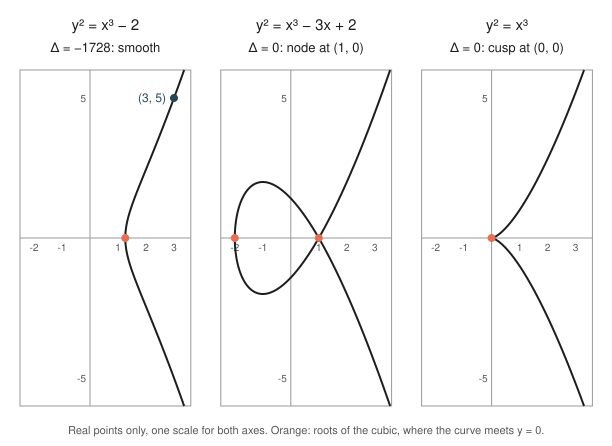

# Weierstrass form: the standard cubic, its discriminant and its j-invariant

[Syllabus](../../../SYLLABUS.md) → [Algebraic geometry](../README.md) → [Elliptic Curves](../README.md#s04) → Weierstrass form

---

## General Overview

Is there a perfect square that sits exactly 2 below a perfect cube? Yes: 25 is 27 minus 2. So the point (3, 5) lies on the curve $`y^2 = x^3 - 2`$, the curve this shelf follows throughout. A rational point on it is a pair of fractions $`(x, y)`$ that satisfies the equation.

The same curve can arrive in disguise. The equation $`y^2 + 2xy + 2y = x^3 + 2x^2 + x - 2`$ looks different, yet a change of coordinates turns it into $`y^2 = x^3 - 2`$, and its point (2, 2) becomes (3, 5). Before any arithmetic, three questions need answers:

1. **Which curve is it?** Rewrite the equation in one standard shape, $`y^2 = x^3 + ax + b`$, the **short Weierstrass form** (named after Karl Weierstrass). Here $`a = 0`$ and $`b = -2`$.
2. **Is it smooth?** A smooth curve has one tangent line at every point, which the chord-and-tangent addition of [The group law](01-elliptic-curves-and-the-group-law.md) needs; a point without one is **singular**. One number decides this, the **discriminant** $`\Delta`$ (capital delta). Here $`\Delta = -1728`$, not zero, so the curve is smooth.
3. **Is it secretly another curve?** A second number, the **j-invariant** $`j`$, stays the same under every rescaling of coordinates. Here $`j = 0`$. Over the complex numbers, two curves are the same curve exactly when their $`j`$ values agree.

**Wherever 2 and 3 are not zero, every elliptic curve can be moved into the shape $`y^2 = x^3 + ax + b`$; there the discriminant $`-16(4a^3 + 27b^2)`$ is zero exactly when the curve has a singular point, and the j-invariant $`1728 \cdot 4a^3/(4a^3 + 27b^2)`$ names the curve up to rescaling over the complex numbers.**

**What kind of fact this is:** two definitions ($`\Delta`$ and $`j`$) and two theorems proved in Why it works: smooth exactly when $`\Delta \ne 0`$, and, over the complex numbers, equal $`j`$ exactly when one curve rescales to the other. That every coordinate change between short forms is a rescaling is stated with a source.

### The picture: smooth, node, cusp

<p align="center"></p>

Real points only, one scale on both axes; orange dots mark roots of the cubic. Left: the roots of $`x^3 - 2`$ are all different (one is real, 1.259921), and the curve is smooth. Middle: $`x^3 - 3x + 2 = (x - 1)^2(x + 2)`$ has a double root at 1, and the curve crosses itself there (a **node**). Right: $`x^3`$ has a triple root at 0, and the curve has a sharp point (a **cusp**).

---

## The formula

Notation first, in words. $`E`$ is the curve, and $`O`$ is its extra point at infinity that serves as zero for addition, both from [The group law](01-elliptic-curves-and-the-group-law.md). We work over the rational numbers $`\mathbb{Q}`$ unless a line says otherwise, and in any field where $`2 \ne 0`$ and $`3 \ne 0`$. This card introduces $`\Delta`$ and $`j`$ in terms of $`a`$ and $`b`$:

```math
E:\ y^2 = x^3 + ax + b, \qquad \Delta = -16\,(4a^3 + 27b^2), \qquad j = 1728 \cdot \frac{4a^3}{4a^3 + 27b^2}
```

**Read it aloud:** the curve is "y squared equals x cubed plus a times x plus b"; the discriminant is minus sixteen times four a cubed plus twenty-seven b squared; the j-invariant is 1728 times the share that four a cubed takes of that same sum.

For the house curve, $`a = 0`$ and $`b = -2`$: $`4a^3 + 27b^2 = 108`$, so $`\Delta = -16 \times 108 = -1728`$ and $`j = 1728 \times 0/108 = 0`$.

| Symbol | Plain meaning | In our example | Push it up and the answer… |
| --- | --- | --- | --- |
| $`E`$, $`O`$ | the curve, and its extra point at infinity that acts as zero | $`y^2 = x^3 - 2`$ | — |
| $`a`$, $`b`$ | the coefficient of $`x`$ and the constant, in short form | 0 and −2 | at $`b = -2`$, moving $`a`$ off 0 moves $`j`$ off 0; at $`a = 0`$, a larger $`\lvert b\rvert`$ makes $`\lvert\Delta\rvert`$ grow |
| $`\Delta`$ | the discriminant: zero exactly when the curve has a singular point | −1728 | — |
| $`j`$ | the j-invariant: unchanged by rescaling | 0 | — |
| $`a_1, a_2, a_3, a_4, a_6`$ | coefficients of the long form $`y^2 + a_1xy + a_3y = x^3 + a_2x^2 + a_4x + a_6`$ | 2, 2, 2, 1, −2 | — |
| $`b_2, b_4, b_6, b_8`$, $`c_4`$, $`c_6`$ | Tate's combinations of the long-form coefficients (fold in Step 2) | 12, 6, −4, −21; 0, 1728 | — |
| $`X`$, $`Y`$, $`u`$; $`a'`$, $`b'`$ | new coordinates, the rescaling factor in $`x = u^2X`$, $`y = u^3Y`$, and the new coefficients | $`u = 1/2`$ in Step 5 | $`a`$ shrinks by $`u^4`$, $`b`$ by $`u^6`$ |
| $`f(x)`$, $`f'(x)`$, $`r_1, r_2, r_3`$ | the cubic $`x^3 + ax + b`$, its slope (derivative) and its three roots | $`x^3 - 2`$; one real root, 1.259921 | — |
| $`F`$, $`F_x`$, $`F_y`$ | $`F = y^2 - f(x)`$, and its slopes in the $`x`$ and $`y`$ directions (partial derivatives) | at (3, 5): 0, −27, 10 | — |
| $`g_2`$, $`g_3`$ | coefficients of the analytic form $`y^2 = 4x^3 - g_2x - g_3`$ | 0 and 8 | — |
| $`\mathbb{Q}`$, $`\mathbb{F}_p`$, $`p`$ | the rational numbers; the remainders after dividing by a prime $`p`$ ("mod p") | $`p`$ = 2, 3, 7 | — |
| $`(x : y : z)`$, $`G`$ | homogeneous coordinates, and the curve's equation in them (fold in Step 3) | $`O = (0 : 1 : 0)`$ | — |

The factor 1728 is $`12^3`$, a convention; with it, $`y^2 = x^3 - x`$ has $`j = 1728`$.

### When it holds

- **The field has $`2 \ne 0`$ and $`3 \ne 0`$.** The reduction divides by 2 and by 3. Over $`\mathbb{F}_2`$ (remainders mod 2) every short form is singular, so curves there need the long form.
- **$`\Delta \ne 0`$ for $`j`$.** The fraction for $`j`$ has $`4a^3 + 27b^2`$ underneath. A singular curve, like the node $`y^2 = x^3 - 3x + 2`$, has no $`j`$.
- **"Same $`j`$, same curve" holds over the complex numbers.** Over $`\mathbb{Q}`$ the needed rescaling factor may not be rational. $`y^2 = x^3 - 2`$ and $`y^2 = x^3 + 1`$ both have $`j = 0`$, yet mod 7 one has 7 points and the other 12.
- **The smoothness test reads the short form, or the full long-form $`\Delta`$.** The right side alone of a long form can mislead: $`y^2 + y = x^3`$ has a triple root on the right, yet it is smooth.

---

## Why it works

### Step 0: change coordinates without changing the curve

Two equations describe the same curve when a change of coordinates carries the points of one onto the points of the other. The allowed changes send lines to lines and keep $`O`$ in place, so chords, tangents and addition come along unchanged. Steps 1 and 2 clean the equation, Steps 3 and 4 read smoothness off it, and Steps 5 and 6 find the number every change leaves alone.

### Step 1: complete the square to clear the left side

In the long form, the left side $`y^2 + a_1xy + a_3y`$ is the start of a square. Put $`Y = y + (a_1x + a_3)/2`$. Then $`Y^2 = y^2 + a_1xy + a_3y + (a_1x + a_3)^2/4`$, so the curve becomes

```math
Y^2 = x^3 + \Big(a_2 + \tfrac{a_1^2}{4}\Big)x^2 + \Big(a_4 + \tfrac{a_1a_3}{2}\Big)x + \Big(a_6 + \tfrac{a_3^2}{4}\Big)
```

For the disguised house curve, $`Y = y + x + 1`$ and the right side is $`x^3 + 3x^2 + 3x - 1`$. This step divides by 2.

### Step 2: shift x to clear the square term

A cubic $`x^3 + cx^2 + \dots`$ loses its $`x^2`$ term when $`x = X - c/3`$, because $`(X - c/3)^3`$ contributes $`-cX^2`$ and $`c(X - c/3)^2`$ contributes $`+cX^2`$. Here $`c = 3`$, so $`x = X - 1`$:

```math
(X - 1)^3 + 3(X - 1)^2 + 3(X - 1) - 1 = X^3 - 2
```

So $`Y^2 = X^3 - 2`$: $`a = 0`$, $`b = -2`$. The point (2, 2) goes to $`X = 2 + 1 = 3`$, $`Y = 2 + 2 + 1 = 5`$. This step divides by 3.

<details>
<summary>The second road: Tate's formulas give a and b without the substitution</summary>

From the long form, build $`b_2 = a_1^2 + 4a_2`$, $`b_4 = 2a_4 + a_1a_3`$, $`b_6 = a_3^2 + 4a_6`$ and $`b_8 = a_1^2a_6 + 4a_2a_6 - a_1a_3a_4 + a_2a_3^2 - a_4^2`$. Then

$`\displaystyle c_4 = b_2^2 - 24b_4, \quad c_6 = -b_2^3 + 36b_2b_4 - 216b_6, \quad \Delta = -b_2^2b_8 - 8b_4^3 - 27b_6^2 + 9b_2b_4b_6`$

and the short form has $`a = -c_4/48`$ and $`b = -c_6/864`$. For $`(a_1, a_2, a_3, a_4, a_6) = (2, 2, 2, 1, -2)`$: $`c_4 = 0`$, $`c_6 = 1728`$, $`\Delta = -1728`$, so $`a = 0`$ and $`b = -2`$, as the substitution found. The code runs both roads.

These formulas are integer polynomials in the $`a_i`$, with no division. That is why $`\Delta`$ carries the factor 16: it is the version of the discriminant that needs no fractions, and it still makes sense when 2 or 3 is zero.

</details>

### Step 3: a singular point is a repeated root

Write the curve as $`F(x, y) = 0`$ with $`F = y^2 - f(x)`$ and $`f(x) = x^3 + ax + b`$. A point is **singular** when both slopes of $`F`$ vanish there: no single tangent line is defined. So a singular point needs three equations:

1. $`F = 0`$: the point is on the curve, $`y^2 = f(x)`$.
2. $`F_y = 2y = 0`$: so $`y = 0`$, since $`2 \ne 0`$.
3. $`F_x = -f'(x) = 0`$: the cubic is flat there.

With $`y = 0`$, the first says $`f(x) = 0`$. So a singular point is an $`x`$ where both $`f`$ and its slope $`f'`$ vanish. That is exactly a repeated root of $`f`$: by [Roots and factors](../../03-Algebra/02-Polynomials/05-roots-and-the-factor-theorem.md), $`f = (x - r)g`$ and $`f' = g + (x - r)g'`$, so $`f'(r) = 0`$ means $`g(r) = 0`$, a second factor $`x - r`$. The argument runs both ways: a repeated root $`r`$ gives the singular point $`(r, 0)`$.

The node checks out: at (1, 0) on $`y^2 = x^3 - 3x + 2`$, all of $`F`$, $`F_x`$, $`F_y`$ are 0. Near that point $`y^2 \approx 3(x - 1)^2`$, two lines of slope $`\pm\sqrt3`$, the two branches of the crossing. At a triple root the two slopes merge into one, which is the cusp.

<details>
<summary>The point at infinity is never singular</summary>

In homogeneous coordinates $`(x : y : z)`$ the curve is $`G = y^2z - x^3 - axz^2 - bz^3 = 0`$, and $`O = (0 : 1 : 0)`$. The slope of $`G`$ in the $`z`$ direction is $`y^2 - 2axz - 3bz^2`$, which is 1 at $`O`$. One nonzero slope is enough, so $`O`$ is always a smooth point, and only the finite points need checking.

</details>

### Step 4: one number detects a repeated root

The discriminant of a cubic is the product of the squared differences of its three roots $`r_1, r_2, r_3`$. It is zero exactly when two roots agree. [Computing a Galois group](../../21-Algebraic%20and%20analytic%20number%20theory/05-Fields%20and%20Galois%20Theory/06-computing-a-galois-group.md) computes it and reads repeated roots from it. For $`x^3 + ax + b`$ it equals $`-4a^3 - 27b^2`$, and the curve's $`\Delta`$ is 16 times that:

```math
\Delta = 16\,(r_1 - r_2)^2(r_1 - r_3)^2(r_2 - r_3)^2 = -16\,(4a^3 + 27b^2)
```

For $`x^3 - 2`$ the discriminant is $`-108`$, so $`\Delta = -1728`$. [Elliptic curves](../../05-Geometry%20and%20trig/06-Beyond%20Euclid/05-elliptic-curves-and-point-addition.md) already asked that $`4a^3 + 27b^2 \ne 0`$; $`\Delta`$ is that same number times −16. Step 3 explains why the condition is the right one.

The code reaches $`-108`$ a second way: minus the Sylvester determinant (the resultant) of $`f`$ and $`f'`$, zero exactly when they share a root.

Step 3 works in any field where $`2 \ne 0`$, so the test applies mod a prime $`p`$ too: the equation $`y^2 = x^3 - 2`$ has a singular point mod $`p`$ exactly when $`p`$ divides $`\Delta = -1728 = -2^6 \cdot 3^3`$. A search of every point mod every prime below 50 finds singular points only mod 2, at (0, 0), and mod 3, at (2, 0). Mod 3, $`x^3 - 2`$ becomes $`(x - 2)^3`$, a triple root, so a cusp. Mod 2 the search finds the bad point directly.

### Step 5: rescaling changes a and b but not j

The only coordinate changes that keep the short shape are rescalings, $`x = u^2X`$ and $`y = u^3Y`$ for a nonzero $`u`$ (Silverman, Chapter III). Substitute and divide by $`u^6`$:

```math
Y^2 = X^3 + \frac{a}{u^4}X + \frac{b}{u^6}
```

So $`a' = a/u^4`$ and $`b' = b/u^6`$. Then $`a'^3 = a^3/u^{12}`$ and $`b'^2 = b^2/u^{12}`$: both terms in $`j`$ shrink by the same $`u^{12}`$, which cancels top and bottom. So $`j`$ does not change, while $`\Delta`$ becomes $`\Delta/u^{12}`$.

With $`u = 1/2`$, the curve $`y^2 = x^3 - x + 1`$ becomes $`y^2 = x^3 - 16x + 64`$. Its point (1, 1) goes to (4, 8), and $`8^2 = 64 = 4^3 - 64 + 64`$. Both curves have $`j = -6912/23`$. Their discriminants are $`-368`$ and $`-1507328 = -368 \times 2^{12}`$.

### Step 6: equal j means a rescaling exists, over the complex numbers

Take two curves with $`a, b`$ and $`a', b'`$, and equal $`j`$. Equal $`j`$ means equal $`a^3/b^2`$ when $`b, b' \ne 0`$, so $`a^3b'^2 = a'^3b^2`$. When $`a, a', b, b'`$ are all nonzero, choose

```math
u^2 = \frac{b\,a'}{a\,b'}
```

Then $`u^4 = a/a'`$, using $`a^3b'^2 = a'^3b^2`$, and $`u^6 = u^4u^2 = b/b'`$. That is exactly the rescaling of Step 5. For the pair above, $`u^2 = 1/4`$, $`u^4 = 1/16 = a/a'`$ and $`u^6 = 1/64 = b/b'`$.

At $`j = 0`$ both $`a`$ are 0 and $`u`$ needs only $`u^6 = b/b'`$; at $`j = 1728`$ both $`b`$ are 0 and $`u`$ needs only $`u^4 = a/a'`$.

Over the complex numbers these roots always exist. Over $`\mathbb{Q}`$ they may not. For $`y^2 = x^3 - 2`$ against $`y^2 = x^3 + 1`$, the rescaling needs $`u^6 = -2`$, and no real number has a negative sixth power. The two curves are the same over the complex numbers and different over $`\mathbb{Q}`$: one is a **twist** of the other. Mod 7, $`x^3 - 2`$ gives 7 points and $`x^3 + 1`$ gives 12. A true rescaling, $`y^2 = x^3 - 128`$ with $`u = 1/2`$, matches $`x^3 - 2`$ at every prime from 5 to 47.

### Step 7: the same j from the analytic form

The [Riemann surfaces](../03-Plane%20Curves/08-riemann-surfaces-and-the-weierstrass-p-function.md) card built the curve from a lattice in the form $`y^2 = 4x^3 - g_2x - g_3`$ and gave $`j = 1728\,g_2^3/(g_2^3 - 27g_3^2)`$. Put $`y = 2y'`$: then $`4y'^2 = 4x^3 - g_2x - g_3`$, so $`y'^2 = x^3 + ax + b`$ with $`a = -g_2/4`$ and $`b = -g_3/4`$. Then $`4a^3 = -g_2^3/16`$ and $`27b^2 = 27g_3^2/16`$, and the factors $`1/16`$ cancel in $`j`$:

```math
1728 \cdot \frac{4a^3}{4a^3 + 27b^2} = 1728 \cdot \frac{-g_2^3}{-g_2^3 + 27g_3^2} = \frac{1728\,g_2^3}{g_2^3 - 27g_3^2}
```

For $`y^2 = x^3 - x + 1`$, $`g_2 = 4`$ and $`g_3 = -4`$, and both forms give $`-6912/23`$. The house curve has $`g_2 = 0`$ and $`g_3 = 8`$, so $`j = 0`$ again.

---

## Worked numbers, by hand

The house curve in disguise, $`y^2 + 2xy + 2y = x^3 + 2x^2 + x - 2`$, with its point (2, 2).

| Step | Arithmetic | Value |
| --- | --- | --- |
| point on the long form | $`4 + 8 + 4`$ against $`8 + 8 + 2 - 2`$ | 16 = 16 |
| complete the square | $`Y = y + x + 1`$ | $`Y^2 = x^3 + 3x^2 + 3x - 1`$ |
| shift x | $`x = X - 1`$ | $`Y^2 = X^3 - 2`$ |
| the point moves | $`X = 2 + 1`$, $`Y = 2 + 2 + 1`$ | (3, 5): 25 = 25 |
| the sum | $`4 \cdot 0^3 + 27 \cdot (-2)^2`$ | 108 |
| discriminant | $`-16 \times 108`$ | **−1728** |
| primes that divide it | $`1728 = 2^6 \cdot 3^3`$ | 2 and 3 |
| j-invariant | $`1728 \times 0 / 108`$ | **0** |

So the disguised equation is the house curve, smooth over $`\mathbb{Q}`$, singular only mod 2 and mod 3, with $`j = 0`$: the same family as every $`y^2 = x^3 + b`$.

### What breaks if you drop a piece

| Mistake | Comes out at | What went wrong |
| --- | --- | --- |
| Read $`a`$, $`b`$ off $`x^3 + 3x^2 + 3x - 1`$, skipping the shift | $`\Delta = -2160`$, $`j = 6912/5`$ (right: −1728 and 0) | The formulas assume no $`x^2`$ term |
| Judge $`y^2 + y = x^3`$ by its right side | triple root, "cusp" | Tate's $`\Delta`$ is −27, not zero. The only candidate, (0, −1/2), gives $`F = -1/4`$, not 0 |
| Use short form over $`\mathbb{F}_2`$ | all four curves singular | $`F_y = 2y`$ is always 0 when $`2 = 0`$ |
| Take equal $`j`$ to mean the same curve over $`\mathbb{Q}`$ | mod 7: 7 points against 12 | The rescaling needs $`u^6 = -2`$, not rational |

The code prints all four.

---

## Code, from first principles, and it actually runs

Both programs work in exact fractions (Rust's are 128-bit and stop on overflow), and nothing imported knows about curves. Independent roads: the short form by substitution and by Tate's $`c_4`$, $`c_6`$; $`\Delta`$ by the $`a, b`$ formula, the long-form formula, a Sylvester determinant, and a search for singular points mod every prime below 50; $`j`$ from $`a, b`$, from $`g_2, g_3`$ and through a rescaling. Point counts mod $`p`$ are plain enumeration.

### Python

```python
# Weierstrass form, discriminant and j-invariant -- the check behind the card.
# Standard library only.  Exact fractions throughout; floats only place the
# figure.  Roads: reduce a long equation step by step, against Tate's c4, c6
# formulas; the discriminant by formula, by a Sylvester determinant, and by
# hunting singular points mod p; j by a and b, by g2 and g3, and by rescaling.
from fractions import Fraction as Fr

def disc_ab(a, b):                      # Delta of y^2 = x^3 + a x + b
    return -16 * (4 * a**3 + 27 * b**2)

def j_ab(a, b):                         # j of y^2 = x^3 + a x + b, Delta not 0
    return Fr(1728 * 4 * a**3) / (4 * a**3 + 27 * b**2)

def reduce_long(a1, a2, a3, a4, a6):    # road one: square, then shift
    c = [Fr(1), a2 + Fr(a1 * a1, 4), a4 + Fr(a1 * a3, 2), a6 + Fr(a3 * a3, 4)]
    s = -c[1] / 3                       # x = X + s kills the x^2 term
    a = 3 * s * s + 2 * c[1] * s + c[2]
    b = s**3 + c[1] * s * s + c[2] * s + c[3]
    return c, s, a, b

def tate(a1, a2, a3, a4, a6):           # road two: Tate's b, c formulas
    b2, b4, b6 = a1 * a1 + 4 * a2, 2 * a4 + a1 * a3, a3 * a3 + 4 * a6
    b8 = a1 * a1 * a6 + 4 * a2 * a6 - a1 * a3 * a4 + a2 * a3 * a3 - a4 * a4
    c4, c6 = b2 * b2 - 24 * b4, -b2**3 + 36 * b2 * b4 - 216 * b6
    return (b2, b4, b6, b8), c4, c6, -b2 * b2 * b8 - 8 * b4**3 - 27 * b6 * b6 + 9 * b2 * b4 * b6

def det(m):                             # Gaussian elimination on fractions
    m, d = [[Fr(v) for v in row] for row in m], Fr(1)
    for i in range(len(m)):
        p = next((r for r in range(i, len(m)) if m[r][i] != 0), None)
        if p is None:
            return Fr(0)
        if p != i:
            m[i], m[p], d = m[p], m[i], -d
        d *= m[i][i]
        for r in range(i + 1, len(m)):
            f = m[r][i] / m[i][i]
            m[r] = [x - f * y for x, y in zip(m[r], m[i])]
    return d

def disc_sylvester(a, b):               # disc f = -Res(f, f') for a monic cubic
    f, g = [1, 0, a, b], [3, 0, a]
    return -det([f + [0], [0] + f, g + [0, 0], [0] + g + [0], [0, 0] + g])

def singular_mod(p, a, b):              # points where F and both slopes vanish
    return [(x, y) for x in range(p) for y in range(p)
            if (y * y - x**3 - a * x - b) % p == 0 and 2 * y % p == 0
            and (3 * x * x + a) % p == 0]

def count_mod(p, a, b):                 # points on y^2 = x^3 + a x + b mod p, with O
    return 1 + sum(1 for x in range(p) for y in range(p)
                   if (y * y - x**3 - a * x - b) % p == 0)

A, B = 0, -2                            # the house curve y^2 = x^3 - 2
LONG = (2, 2, 2, 1, -2)                 # y^2 + 2xy + 2y = x^3 + 2x^2 + x - 2
c, s, ra, rb = reduce_long(*LONG)
bs, c4, c6, D_long = tate(*LONG)
print(f"long form y^2 + 2xy + 2y = x^3 + 2x^2 + x - 2; point (2, 2): "
      f"{2*2 + 2*2*2 + 2*2} = {2**3 + 2*2**2 + 2 - 2}")
print(f"step 1, Y = y + x + 1: Y^2 = x^3 + ({c[1]})x^2 + ({c[2]})x + ({c[3]})")
print(f"step 2, x = X + ({s}): Y^2 = X^3 + ({ra})X + ({rb})")
print(f"Tate road: b2, b4, b6, b8 = {bs}")
print(f"Tate road: c4 = {c4}, c6 = {c6}, Delta = {D_long}; a = -c4/48 = {Fr(-c4, 48)}, "
      f"b = -c6/864 = {Fr(-c6, 864)}")
X, Y = 2 - s, 2 + 2 + 1
print(f"point (2, 2) moves to ({X}, {Y}): {Y*Y} = {X**3 + B}")
D = disc_ab(A, B)
print(f"house: 4a^3 + 27b^2 = {4*A**3 + 27*B**2}; Delta = -16 x {4*A**3 + 27*B**2} = {D}")
print(f"at (3, 5): F, F_x, F_y = {25 - 27 - A*3 - B}, {-(3*9 + A)}, {2*5}; "
      f"g2, g3 = -4a, -4b = {-4*A}, {-4*B}; 1728 = 2^6 x 3^3 = {2**6 * 3**3}")
print(f"Sylvester road: disc(x^3 - 2) = {disc_sylvester(A, B)}; 16 x disc = {16*disc_sylvester(A, B)}")
primes = [p for p in range(2, 50) if all(p % q for q in range(2, p))]
bad = [p for p in primes if singular_mod(p, A, B)]
print(f"primes below 50 where y^2 = x^3 - 2 has a singular point: {bad}, "
      f"at {[singular_mod(p, A, B)[0] for p in bad]}")
print(f"primes below 50 dividing 1728: {[p for p in primes if 1728 % p == 0]}")
for name, a, b, P in [("node", -3, 2, (1, 0)), ("cusp", 0, 0, (0, 0))]:
    x, y = P
    print(f"{name} y^2 = x^3 + ({a})x + ({b}): Delta = {disc_ab(a, b)}; at {P} "
          f"F, F_x, F_y = {y*y - x**3 - a*x - b}, {-(3*x*x + a)}, {2*y}")
print(f"node: y^2 = (x - 1)^2 (x + 2) near (1, 0) is y^2 ~ {1 + 2}(x - 1)^2, two slopes")
j0, ja, jb = j_ab(A, B), j_ab(-1, 1), j_ab(-16, 64)
g2, g3 = 4, -4                          # y^2 = 4x^3 - g2 x - g3 with a = -g2/4, b = -g3/4
jg = Fr(1728 * g2**3, g2**3 - 27 * g3**2)
print(f"j(x^3 - 2) = {j0}; j(x^3 - x + 1) = {ja}; j(x^3 - 16x + 64) = {jb}")
print(f"Delta(x^3 - x + 1) = {disc_ab(-1, 1)}; Delta(x^3 - 16x + 64) = {disc_ab(-16, 64)} "
      f"= {disc_ab(-1, 1)} x 2^12 = {disc_ab(-1, 1) * 2**12}")
print(f"j(x^3 - x) = {j_ab(-1, 0)} = 12^3 = {12**3}; secp256k1 y^2 = x^3 + 7 (SEC 2): "
      f"j = {j_ab(0, 7)}, Delta = {disc_ab(0, 7)}")
print(f"same curve as y^2 = 4x^3 - {g2}x + {-g3}: 1728 g2^3/(g2^3 - 27 g3^2) = {jg}")
u2 = Fr(1 * -16, -1 * 64)               # u^2 = b a'/(a b')
print(f"u^2 = {u2}; u^4 = {u2**2} = a/a' = {Fr(-1, -16)}; u^6 = {u2**3} = b/b' = {Fr(1, 64)}; "
      f"(1, 1) -> (4, 8): {8*8} = {4**3 - 16*4 + 64}")
ps = [p for p in primes if p > 3]
cE, cS, cT = ([count_mod(p, 0, b) for p in ps] for b in (-2, -128, 1))
print(f"primes {ps}")
print(f"points mod p, y^2 = x^3 - 2:   {cE}")
print(f"points mod p, y^2 = x^3 - 128: {cS}")
print(f"points mod p, y^2 = x^3 + 1:   {cT}")
print(f"(3, 5) -> (12, 40) on x^3 - 128: {40*40} = {12**3 - 128}; 2(3, 5) has x = {Fr(27, 10)**2 - 6}")
print(f"mistake 1, a, b read with the x^2 term left in: Delta = {disc_ab(c[2], c[3])}, "
      f"j = {j_ab(c[2], c[3])}")
*_, D_cub = tate(0, 0, 1, 0, 0)
print(f"mistake 2, y^2 + y = x^3: right side x^3 has disc {disc_sylvester(0, 0)}; "
      f"Tate Delta = {D_cub}; F at (0, -1/2) = {Fr(1, 4) - Fr(1, 2)}")
f2 = [(a, b, singular_mod(2, a, b)) for a in (0, 1) for b in (0, 1)]
print("mistake 3, over F_2 every short form is singular: "
      + "; ".join(f"a={a} b={b} at {pt[0]}" for a, b, pt in f2))
print(f"mistake 4, equal j over Q: mod 7, x^3 - 2 has {count_mod(7, 0, -2)} points, "
      f"x^3 + 1 has {count_mod(7, 0, 1)}")
print(f"figure, smooth root {2**(1/3):.6f}; P (3, 5); node (1, 0) and root -2; cusp (0, 0)")
assert (ra, rb) == (Fr(-c4, 48), Fr(-c6, 864)) == (A, B)          # two roads to a, b
assert D_long == D == 16 * disc_sylvester(A, B) == -1728          # three roads to Delta
assert bad == [p for p in primes if D % p == 0]                    # singular mod p iff p | Delta
assert ja == jb == jg                                             # j three ways
assert disc_ab(-16, 64) == disc_ab(-1, 1) * 4096                  # Delta / u^12
assert cE == cS and cE != cT and D_cub != 0 and all(f2[i][2] for i in range(4))
print("ALL CHECKS PASS")
```

**Ran 2026-11-17 on macOS, Python 3.14.10, standard library only. All checks passed. Output, pasted from the run:**

```
long form y^2 + 2xy + 2y = x^3 + 2x^2 + x - 2; point (2, 2): 16 = 16
step 1, Y = y + x + 1: Y^2 = x^3 + (3)x^2 + (3)x + (-1)
step 2, x = X + (-1): Y^2 = X^3 + (0)X + (-2)
Tate road: b2, b4, b6, b8 = (12, 6, -4, -21)
Tate road: c4 = 0, c6 = 1728, Delta = -1728; a = -c4/48 = 0, b = -c6/864 = -2
point (2, 2) moves to (3, 5): 25 = 25
house: 4a^3 + 27b^2 = 108; Delta = -16 x 108 = -1728
at (3, 5): F, F_x, F_y = 0, -27, 10; g2, g3 = -4a, -4b = 0, 8; 1728 = 2^6 x 3^3 = 1728
Sylvester road: disc(x^3 - 2) = -108; 16 x disc = -1728
primes below 50 where y^2 = x^3 - 2 has a singular point: [2, 3], at [(0, 0), (2, 0)]
primes below 50 dividing 1728: [2, 3]
node y^2 = x^3 + (-3)x + (2): Delta = 0; at (1, 0) F, F_x, F_y = 0, 0, 0
cusp y^2 = x^3 + (0)x + (0): Delta = 0; at (0, 0) F, F_x, F_y = 0, 0, 0
node: y^2 = (x - 1)^2 (x + 2) near (1, 0) is y^2 ~ 3(x - 1)^2, two slopes
j(x^3 - 2) = 0; j(x^3 - x + 1) = -6912/23; j(x^3 - 16x + 64) = -6912/23
Delta(x^3 - x + 1) = -368; Delta(x^3 - 16x + 64) = -1507328 = -368 x 2^12 = -1507328
j(x^3 - x) = 1728 = 12^3 = 1728; secp256k1 y^2 = x^3 + 7 (SEC 2): j = 0, Delta = -21168
same curve as y^2 = 4x^3 - 4x + 4: 1728 g2^3/(g2^3 - 27 g3^2) = -6912/23
u^2 = 1/4; u^4 = 1/16 = a/a' = 1/16; u^6 = 1/64 = b/b' = 1/64; (1, 1) -> (4, 8): 64 = 64
primes [5, 7, 11, 13, 17, 19, 23, 29, 31, 37, 41, 43, 47]
points mod p, y^2 = x^3 - 2:   [6, 7, 12, 19, 18, 27, 24, 30, 28, 49, 42, 36, 48]
points mod p, y^2 = x^3 - 128: [6, 7, 12, 19, 18, 27, 24, 30, 28, 49, 42, 36, 48]
points mod p, y^2 = x^3 + 1:   [6, 12, 12, 12, 18, 12, 24, 30, 36, 48, 42, 36, 48]
(3, 5) -> (12, 40) on x^3 - 128: 1600 = 1600; 2(3, 5) has x = 129/100
mistake 1, a, b read with the x^2 term left in: Delta = -2160, j = 6912/5
mistake 2, y^2 + y = x^3: right side x^3 has disc 0; Tate Delta = -27; F at (0, -1/2) = -1/4
mistake 3, over F_2 every short form is singular: a=0 b=0 at (0, 0); a=0 b=1 at (0, 1); a=1 b=0 at (1, 0); a=1 b=1 at (1, 1)
mistake 4, equal j over Q: mod 7, x^3 - 2 has 7 points, x^3 + 1 has 12
figure, smooth root 1.259921; P (3, 5); node (1, 0) and root -2; cusp (0, 0)
ALL CHECKS PASS
```

### Rust

```rust
// Weierstrass form, discriminant and j-invariant -- the check behind the card.
// Rust std only.  Exact fractions in i128 with checked_mul, so overflow stops
// the run; floats only place the figure.  Roads: reduce a long equation step
// by step, against Tate's c4, c6 formulas; the discriminant by formula, by a
// Sylvester determinant, and by hunting singular points mod p; j by a and b,
// by g2 and g3, and by rescaling.
use std::fmt;
#[derive(Clone, Copy, PartialEq, Debug)]
struct Q { n: i128, d: i128 }
fn gcd(a: i128, b: i128) -> i128 { if b == 0 { a.abs() } else { gcd(b, a % b) } }
fn q(n: i128, d: i128) -> Q {
    let g = gcd(n, d).max(1); let s = if d < 0 { -1 } else { 1 };
    Q { n: s * n / g, d: s * d / g }
}
fn z(n: i128) -> Q { q(n, 1) }
fn mul(a: Q, b: Q) -> Q { q(a.n.checked_mul(b.n).unwrap(), a.d.checked_mul(b.d).unwrap()) }
fn add(a: Q, b: Q) -> Q {
    q(a.n.checked_mul(b.d).unwrap() + b.n.checked_mul(a.d).unwrap(), a.d.checked_mul(b.d).unwrap())
}
fn neg(a: Q) -> Q { Q { n: -a.n, d: a.d } }
fn sub(a: Q, b: Q) -> Q { add(a, neg(b)) }
fn div(a: Q, b: Q) -> Q { assert!(b.n != 0); mul(a, q(b.d, b.n)) }
impl fmt::Display for Q {
    fn fmt(&self, f: &mut fmt::Formatter) -> fmt::Result {
        if self.d == 1 { write!(f, "{}", self.n) } else { write!(f, "{}/{}", self.n, self.d) }
    }
}
fn disc_ab(a: i128, b: i128) -> i128 { -16 * (4 * a * a * a + 27 * b * b) }
fn j_ab(a: Q, b: Q) -> Q {
    let a3 = mul(z(4), mul(a, mul(a, a)));
    div(mul(z(1728), a3), add(a3, mul(z(27), mul(b, b))))
}
fn reduce_long(l: [i128; 5]) -> ([Q; 4], Q, Q, Q) {
    let (a1, a2, a3, a4, a6) = (l[0], l[1], l[2], l[3], l[4]);
    let c = [z(1), add(z(a2), q(a1 * a1, 4)), add(z(a4), q(a1 * a3, 2)), add(z(a6), q(a3 * a3, 4))];
    let s = div(neg(c[1]), z(3));
    let a = add(add(mul(z(3), mul(s, s)), mul(z(2), mul(c[1], s))), c[2]);
    let b = add(add(add(mul(s, mul(s, s)), mul(c[1], mul(s, s))), mul(c[2], s)), c[3]);
    (c, s, a, b)
}
fn tate(l: [i128; 5]) -> ([i128; 4], i128, i128, i128) {
    let (a1, a2, a3, a4, a6) = (l[0], l[1], l[2], l[3], l[4]);
    let (b2, b4, b6) = (a1 * a1 + 4 * a2, 2 * a4 + a1 * a3, a3 * a3 + 4 * a6);
    let b8 = a1 * a1 * a6 + 4 * a2 * a6 - a1 * a3 * a4 + a2 * a3 * a3 - a4 * a4;
    let (c4, c6) = (b2 * b2 - 24 * b4, -b2 * b2 * b2 + 36 * b2 * b4 - 216 * b6);
    ([b2, b4, b6, b8], c4, c6, -b2 * b2 * b8 - 8 * b4 * b4 * b4 - 27 * b6 * b6 + 9 * b2 * b4 * b6)
}
fn det(rows: Vec<Vec<i128>>) -> Q {
    let mut m: Vec<Vec<Q>> = rows.iter().map(|r| r.iter().map(|&v| z(v)).collect()).collect();
    let n = m.len(); let mut d = z(1);
    for i in 0..n {
        let p = match (i..n).find(|&r| m[r][i].n != 0) { Some(p) => p, None => return z(0) };
        if p != i { m.swap(i, p); d = neg(d); }
        d = mul(d, m[i][i]);
        for r in i + 1..n {
            let f = div(m[r][i], m[i][i]);
            for k in 0..n { let t = mul(f, m[i][k]); m[r][k] = sub(m[r][k], t); }
        }
    }
    d
}
fn disc_sylvester(a: i128, b: i128) -> Q {
    neg(det(vec![vec![1, 0, a, b, 0], vec![0, 1, 0, a, b], vec![3, 0, a, 0, 0],
                 vec![0, 3, 0, a, 0], vec![0, 0, 3, 0, a]]))
}
fn md(v: i128, p: i128) -> i128 { v.rem_euclid(p) }
fn singular_mod(p: i128, a: i128, b: i128) -> Vec<(i128, i128)> {
    let mut v = vec![];
    for x in 0..p { for y in 0..p {
        if md(y * y - x * x * x - a * x - b, p) == 0 && md(2 * y, p) == 0 && md(3 * x * x + a, p) == 0 { v.push((x, y)); }
    } }
    v
}
fn count_mod(p: i128, a: i128, b: i128) -> i128 {
    let mut n = 1;
    for x in 0..p { for y in 0..p { if md(y * y - x * x * x - a * x - b, p) == 0 { n += 1; } } }
    n
}
fn pts(v: &[(i128, i128)]) -> String {
    v.iter().map(|(x, y)| format!("({}, {})", x, y)).collect::<Vec<_>>().join(", ")
}
fn list(v: &[i128]) -> String { v.iter().map(|x| x.to_string()).collect::<Vec<_>>().join(", ") }
fn main() {
    let (a, b) = (0i128, -2i128);
    let long = [2, 2, 2, 1, -2];
    let (c, s, ra, rb) = reduce_long(long);
    let (bs, c4, c6, d_long) = tate(long);
    println!("long form y^2 + 2xy + 2y = x^3 + 2x^2 + x - 2; point (2, 2): {} = {}", 2 * 2 + 2 * 2 * 2 + 2 * 2, 8 + 2 * 4 + 2 - 2);
    println!("step 1, Y = y + x + 1: Y^2 = x^3 + ({})x^2 + ({})x + ({})", c[1], c[2], c[3]);
    println!("step 2, x = X + ({}): Y^2 = X^3 + ({})X + ({})", s, ra, rb);
    println!("Tate road: b2, b4, b6, b8 = ({}, {}, {}, {})", bs[0], bs[1], bs[2], bs[3]);
    println!("Tate road: c4 = {}, c6 = {}, Delta = {}; a = -c4/48 = {}, b = -c6/864 = {}", c4, c6, d_long, q(-c4, 48), q(-c6, 864));
    let (px, py) = (sub(z(2), s), z(2 + 2 + 1));
    println!("point (2, 2) moves to ({}, {}): {} = {}", px, py, mul(py, py), add(mul(px, mul(px, px)), z(b)));
    let d = disc_ab(a, b); let e = 4 * a * a * a + 27 * b * b; let ds = disc_sylvester(a, b);
    println!("house: 4a^3 + 27b^2 = {}; Delta = -16 x {} = {}", e, e, d);
    println!("at (3, 5): F, F_x, F_y = {}, {}, {}; g2, g3 = -4a, -4b = {}, {}; 1728 = 2^6 x 3^3 = {}",
             25 - 27 - a * 3 - b, -(3 * 9 + a), 2 * 5, -4 * a, -4 * b, 64 * 27);
    println!("Sylvester road: disc(x^3 - 2) = {}; 16 x disc = {}", ds, mul(z(16), ds));
    let primes: Vec<i128> = (2..50).filter(|&p| (2..p).all(|k| p % k != 0)).collect();
    let bad: Vec<i128> = primes.iter().cloned().filter(|&p| !singular_mod(p, a, b).is_empty()).collect();
    let firsts: Vec<(i128, i128)> = bad.iter().map(|&p| singular_mod(p, a, b)[0]).collect();
    println!("primes below 50 where y^2 = x^3 - 2 has a singular point: [{}], at [{}]", list(&bad), pts(&firsts));
    let div1728: Vec<i128> = primes.iter().cloned().filter(|&p| 1728 % p == 0).collect();
    println!("primes below 50 dividing 1728: [{}]", list(&div1728));
    for (name, a, b, (x, y)) in [("node", -3i128, 2i128, (1i128, 0i128)), ("cusp", 0, 0, (0, 0))] {
        println!("{} y^2 = x^3 + ({})x + ({}): Delta = {}; at ({}, {}) F, F_x, F_y = {}, {}, {}", name, a, b,
                 disc_ab(a, b), x, y, y * y - x * x * x - a * x - b, -(3 * x * x + a), 2 * y);
    }
    println!("node: y^2 = (x - 1)^2 (x + 2) near (1, 0) is y^2 ~ {}(x - 1)^2, two slopes", 1 + 2);
    let (j0, ja, jb) = (j_ab(z(a), z(b)), j_ab(z(-1), z(1)), j_ab(z(-16), z(64)));
    let (g2, g3) = (4i128, -4i128);
    let jg = q(1728 * g2 * g2 * g2, g2 * g2 * g2 - 27 * g3 * g3);
    println!("j(x^3 - 2) = {}; j(x^3 - x + 1) = {}; j(x^3 - 16x + 64) = {}", j0, ja, jb);
    println!("Delta(x^3 - x + 1) = {}; Delta(x^3 - 16x + 64) = {} = {} x 2^12 = {}", disc_ab(-1, 1), disc_ab(-16, 64),
             disc_ab(-1, 1), disc_ab(-1, 1) * 4096);
    println!("j(x^3 - x) = {} = 12^3 = {}; secp256k1 y^2 = x^3 + 7 (SEC 2): j = {}, Delta = {}", j_ab(z(-1), z(0)),
             12 * 12 * 12, j_ab(z(0), z(7)), disc_ab(0, 7));
    println!("same curve as y^2 = 4x^3 - {}x + {}: 1728 g2^3/(g2^3 - 27 g3^2) = {}", g2, -g3, jg);
    let u2 = q(1 * -16, -1 * 64);
    println!("u^2 = {}; u^4 = {} = a/a' = {}; u^6 = {} = b/b' = {}; (1, 1) -> (4, 8): {} = {}", u2, mul(u2, u2),
             q(-1, -16), mul(u2, mul(u2, u2)), q(1, 64), 8 * 8, 64 - 16 * 4 + 64);
    let ps: Vec<i128> = primes.iter().cloned().filter(|&p| p > 3).collect();
    let cnt = |bb: i128| -> Vec<i128> { ps.iter().map(|&p| count_mod(p, 0, bb)).collect() };
    let (ce, cs, ct) = (cnt(-2), cnt(-128), cnt(1));
    println!("primes [{}]", list(&ps));
    println!("points mod p, y^2 = x^3 - 2:   [{}]", list(&ce));
    println!("points mod p, y^2 = x^3 - 128: [{}]", list(&cs));
    println!("points mod p, y^2 = x^3 + 1:   [{}]", list(&ct));
    println!("(3, 5) -> (12, 40) on x^3 - 128: {} = {}; 2(3, 5) has x = {}", 40 * 40, 12 * 12 * 12 - 128,
             sub(mul(q(27, 10), q(27, 10)), z(6)));
    println!("mistake 1, a, b read with the x^2 term left in: Delta = {}, j = {}",
             disc_ab(c[2].n, c[3].n), j_ab(c[2], c[3]));
    let (_, _, _, d_cub) = tate([0, 0, 1, 0, 0]);
    println!("mistake 2, y^2 + y = x^3: right side x^3 has disc {}; Tate Delta = {}; F at (0, -1/2) = {}",
             disc_sylvester(0, 0), d_cub, sub(q(1, 4), q(1, 2)));
    let mut f2 = vec![];
    for a in 0..2 { for b in 0..2 { f2.push((a, b, singular_mod(2, a, b))); } }
    let parts: Vec<String> = f2.iter().map(|(a, b, v)| format!("a={} b={} at {}", a, b, pts(&v[..1]))).collect();
    println!("mistake 3, over F_2 every short form is singular: {}", parts.join("; "));
    println!("mistake 4, equal j over Q: mod 7, x^3 - 2 has {} points, x^3 + 1 has {}", count_mod(7, 0, -2), count_mod(7, 0, 1));
    println!("figure, smooth root {:.6}; P (3, 5); node (1, 0) and root -2; cusp (0, 0)", 2f64.powf(1.0 / 3.0));
    assert!(ra == q(-c4, 48) && rb == q(-c6, 864) && ra == z(a) && rb == z(b)); // two roads to a, b
    assert!(z(d_long) == z(d) && mul(z(16), ds) == z(d) && d == -1728);        // three roads to Delta
    assert!(bad == primes.iter().cloned().filter(|&p| d % p == 0).collect::<Vec<_>>()); // singular iff p | Delta
    assert!(ja == jb && jb == jg);                                          // j three ways
    assert!(disc_ab(-16, 64) == disc_ab(-1, 1) * 4096);                        // Delta / u^12
    assert!(ce == cs && ce != ct && d_cub != 0 && f2.iter().all(|t| !t.2.is_empty()));
    println!("ALL CHECKS PASS");
}
```

**Ran 2026-11-17 on macOS, rustc 1.98.1, no crates. All checks passed. Output, pasted from the run:**

```
long form y^2 + 2xy + 2y = x^3 + 2x^2 + x - 2; point (2, 2): 16 = 16
step 1, Y = y + x + 1: Y^2 = x^3 + (3)x^2 + (3)x + (-1)
step 2, x = X + (-1): Y^2 = X^3 + (0)X + (-2)
Tate road: b2, b4, b6, b8 = (12, 6, -4, -21)
Tate road: c4 = 0, c6 = 1728, Delta = -1728; a = -c4/48 = 0, b = -c6/864 = -2
point (2, 2) moves to (3, 5): 25 = 25
house: 4a^3 + 27b^2 = 108; Delta = -16 x 108 = -1728
at (3, 5): F, F_x, F_y = 0, -27, 10; g2, g3 = -4a, -4b = 0, 8; 1728 = 2^6 x 3^3 = 1728
Sylvester road: disc(x^3 - 2) = -108; 16 x disc = -1728
primes below 50 where y^2 = x^3 - 2 has a singular point: [2, 3], at [(0, 0), (2, 0)]
primes below 50 dividing 1728: [2, 3]
node y^2 = x^3 + (-3)x + (2): Delta = 0; at (1, 0) F, F_x, F_y = 0, 0, 0
cusp y^2 = x^3 + (0)x + (0): Delta = 0; at (0, 0) F, F_x, F_y = 0, 0, 0
node: y^2 = (x - 1)^2 (x + 2) near (1, 0) is y^2 ~ 3(x - 1)^2, two slopes
j(x^3 - 2) = 0; j(x^3 - x + 1) = -6912/23; j(x^3 - 16x + 64) = -6912/23
Delta(x^3 - x + 1) = -368; Delta(x^3 - 16x + 64) = -1507328 = -368 x 2^12 = -1507328
j(x^3 - x) = 1728 = 12^3 = 1728; secp256k1 y^2 = x^3 + 7 (SEC 2): j = 0, Delta = -21168
same curve as y^2 = 4x^3 - 4x + 4: 1728 g2^3/(g2^3 - 27 g3^2) = -6912/23
u^2 = 1/4; u^4 = 1/16 = a/a' = 1/16; u^6 = 1/64 = b/b' = 1/64; (1, 1) -> (4, 8): 64 = 64
primes [5, 7, 11, 13, 17, 19, 23, 29, 31, 37, 41, 43, 47]
points mod p, y^2 = x^3 - 2:   [6, 7, 12, 19, 18, 27, 24, 30, 28, 49, 42, 36, 48]
points mod p, y^2 = x^3 - 128: [6, 7, 12, 19, 18, 27, 24, 30, 28, 49, 42, 36, 48]
points mod p, y^2 = x^3 + 1:   [6, 12, 12, 12, 18, 12, 24, 30, 36, 48, 42, 36, 48]
(3, 5) -> (12, 40) on x^3 - 128: 1600 = 1600; 2(3, 5) has x = 129/100
mistake 1, a, b read with the x^2 term left in: Delta = -2160, j = 6912/5
mistake 2, y^2 + y = x^3: right side x^3 has disc 0; Tate Delta = -27; F at (0, -1/2) = -1/4
mistake 3, over F_2 every short form is singular: a=0 b=0 at (0, 0); a=0 b=1 at (0, 1); a=1 b=0 at (1, 0); a=1 b=1 at (1, 1)
mistake 4, equal j over Q: mod 7, x^3 - 2 has 7 points, x^3 + 1 has 12
figure, smooth root 1.259921; P (3, 5); node (1, 0) and root -2; cusp (0, 0)
ALL CHECKS PASS
```

### Lean

Lean proves the reduction and the smoothness test wherever 2 and 3 are not zero, and the j theorem over the complex numbers.

- Take a field where $`2 \ne 0`$ and $`3 \ne 0`$. Then a change of coordinates turns every long form into a short form $`y^2 = x^3 + ax + b`$.
- Take such a field and a short form. Then $`\Delta = -16(4a^3 + 27b^2)`$, and the curve has a singular point exactly when $`\Delta = 0`$.
- Take a short form over the complex numbers with $`\Delta \ne 0`$. Then $`j = 1728 \cdot 4a^3/(4a^3 + 27b^2)`$.
- Take two such curves, with $`a, b`$ and $`a', b'`$. Then they have equal $`j`$ exactly when some nonzero $`u`$ gives $`a' = a/u^4`$ and $`b' = b/u^6`$.
- Take the house curve $`y^2 = x^3 - 2`$. Then (3, 5) lies on it, $`\Delta = -1728`$ and $`j = 0`$.
- Take the disguised house curve. Then (2, 2) lies on it, Tate's formulas give $`\Delta = -1728`$, and Steps 1 and 2 reach $`Y^2 = X^3 - 2`$.
- Take the node $`y^2 = x^3 - 3x + 2`$ and the cusp $`y^2 = x^3`$. Then both have $`\Delta = 0`$, and (1, 0) is a singular point of the node.
- Take $`y^2 = x^3 - x + 1`$ and its rescaling $`y^2 = x^3 - 16x + 64`$. Then their $`\Delta`$ are −368 and −1507328, and both have $`j = -6912/23`$.
- Take $`g_2 = 4`$ and $`g_3 = -4`$ in the analytic form. Then $`1728\,g_2^3/(g_2^3 - 27g_3^2) = -6912/23`$.
- Take $`y^2 = x^3 - x`$ and $`y^2 = x^3 + 7`$. Then the first has $`j = 1728`$, and the second has $`\Delta = -21168`$.
- Take $`y^2 + y = x^3`$. Then Tate's $`\Delta`$ is −27, not zero.
- Take $`a = 3`$ and $`b = -1`$, read before the shift. Then $`\Delta = -2160`$ and $`j = 6912/5`$.
- Take $`\mathbb{F}_2`$. Then every short form has a singular point.
- Take $`\mathbb{F}_3`$. Then the house curve has the singular point (2, 0).
- Take the remainders mod 7, counting $`O`$. Then $`y^2 = x^3 - 2`$ has 7 points, $`y^2 = x^3 + 1`$ has 12, and $`y^2 = x^3 - 128`$ has 7.

The Sylvester determinant, the singular-point search below 50 and the counts at other primes are left to the Python and Rust checks.

```lean
-- Weierstrass form: away from 2 and 3 every curve reduces to y^2 = x^3 + ax + b, which has a singular point exactly when -16(4a^3 + 27b^2) = 0, and over the complex numbers equal j means one curve rescales to the other.
import Mathlib.AlgebraicGeometry.EllipticCurve.NormalForms
import Mathlib.AlgebraicGeometry.EllipticCurve.Affine.Basic
import Mathlib.Analysis.Complex.Polynomial.Basic
import Mathlib.Data.ZMod.Basic

open WeierstrassCurve

/-- The short Weierstrass curve `y^2 = x^3 + a x + b`, as a Mathlib `WeierstrassCurve`
with `a₁ = a₂ = a₃ = 0`, `a₄ = a` and `a₆ = b`. -/
abbrev shortWeierstrass {K : Type*} [CommRing K] (a b : K) : WeierstrassCurve K :=
  { a₁ := 0, a₂ := 0, a₃ := 0, a₄ := a, a₆ := b }

/-- In a field where `2 ≠ 0` and `3 ≠ 0`, the curve `y^2 = x^3 + a x + b` has discriminant
`Δ = -16 (4a^3 + 27b^2)`, and it has a singular point (a point on the curve where both slopes
vanish) exactly when `Δ = 0`. -/
theorem short_weierstrass_singular_iff_discriminant_eq_zero {K : Type*} [Field K]
    (h2 : (2 : K) ≠ 0) (h3 : (3 : K) ≠ 0) (a b : K) :
    (shortWeierstrass a b).Δ = -16 * (4 * a ^ 3 + 27 * b ^ 2) ∧
      ((∃ x y : K, (shortWeierstrass a b).toAffine.Equation x y ∧
          ¬ (shortWeierstrass a b).toAffine.Nonsingular x y) ↔
        (shortWeierstrass a b).Δ = 0) := by
  have hΔ : (shortWeierstrass a b).Δ = -16 * (4 * a ^ 3 + 27 * b ^ 2) := by
    simp only [Δ, b₂, b₄, b₆, b₈]; ring
  refine ⟨hΔ, ⟨?_, ?_⟩⟩
  · rintro ⟨x, y, he, hns⟩
    by_contra h
    exact hns ((Affine.equation_iff_nonsingular_of_Δ_ne_zero
      (W := (shortWeierstrass a b).toAffine) h).mp he)
  · intro h0
    rw [hΔ] at h0
    have h16 : (16 : K) ≠ 0 := by
      have : (16 : K) = 2 ^ 4 := by norm_num
      rw [this]; exact pow_ne_zero _ h2
    have h27 : (27 : K) ≠ 0 := by
      have : (27 : K) = 3 ^ 3 := by norm_num
      rw [this]; exact pow_ne_zero _ h3
    have h4 : 4 * a ^ 3 + 27 * b ^ 2 = 0 := by
      rcases mul_eq_zero.mp h0 with h | h
      · exact absurd (neg_eq_zero.mp h) h16
      · exact h
    by_cases ha : a = 0
    · have hb : b = 0 := by
        subst ha
        have : 27 * b ^ 2 = 0 := by simpa using h4
        exact pow_eq_zero_iff (n := 2) (by norm_num) |>.mp
          ((mul_eq_zero.mp this).resolve_left h27)
      refine ⟨0, 0, ?_, ?_⟩
      · rw [Affine.equation_iff']; simp [ha, hb]
      · rw [Affine.nonsingular_iff', Affine.equation_iff']; simp [ha, hb]
    · refine ⟨-3 * b / (2 * a), 0, ?_, ?_⟩
      · rw [Affine.equation_iff']
        field_simp
        linear_combination b * h4
      · rw [Affine.nonsingular_iff', Affine.equation_iff']
        simp only [not_and, not_or, not_not]
        intro _
        refine ⟨?_, by ring⟩
        field_simp
        linear_combination (-1) * h4

/-- Over the complex numbers, for two smooth short curves the j-invariant is
`1728 · 4a^3 / (4a^3 + 27b^2)`, and two curves have the same j exactly when one rescales to the
other: `x = u^2 X`, `y = u^3 Y` with `u ≠ 0`, which sends `a, b` to `a / u^4, b / u^6`. -/
theorem j_eq_iff_exists_rescaling (a b a' b' : ℂ)
    [(shortWeierstrass a b).IsElliptic] [(shortWeierstrass a' b').IsElliptic] :
    (shortWeierstrass a b).j = 1728 * (4 * a ^ 3) / (4 * a ^ 3 + 27 * b ^ 2) ∧
      ((shortWeierstrass a b).j = (shortWeierstrass a' b').j ↔
        ∃ u : ℂ, u ≠ 0 ∧ a' = a / u ^ 4 ∧ b' = b / u ^ 6) := by
  have : (shortWeierstrass a b).IsShortNF := ⟨rfl, rfl, rfl⟩
  have : (shortWeierstrass a' b').IsShortNF := ⟨rfl, rfl, rfl⟩
  have hj := j_of_isShortNF (shortWeierstrass a b)
  have hj' := j_of_isShortNF (shortWeierstrass a' b')
  have hD : 4 * a ^ 3 + 27 * b ^ 2 ≠ 0 := by
    have h := (shortWeierstrass a b).Δ'.ne_zero
    rw [coe_Δ', Δ_of_isShortNF] at h
    exact right_ne_zero_of_mul h
  have hD' : 4 * a' ^ 3 + 27 * b' ^ 2 ≠ 0 := by
    have h := (shortWeierstrass a' b').Δ'.ne_zero
    rw [coe_Δ', Δ_of_isShortNF] at h
    exact right_ne_zero_of_mul h
  simp only at hj hj'
  refine ⟨by rw [hj]; ring, ?_⟩
  rw [hj, hj']
  constructor
  · intro h
    rw [div_eq_div_iff hD hD'] at h
    have key : a ^ 3 * b' ^ 2 = a' ^ 3 * b ^ 2 := by linear_combination h / (6912 * 27)
    by_cases ha : a = 0
    · subst ha
      have hb : b ≠ 0 := by rintro rfl; simp at hD
      have ha' : a' = 0 := by
        have : a' ^ 3 * b ^ 2 = 0 := by rw [← key]; ring
        simpa [hb] using this
      subst ha'
      have hb' : b' ≠ 0 := by rintro rfl; simp at hD'
      obtain ⟨u, hu⟩ := IsAlgClosed.exists_pow_nat_eq (b / b') (by norm_num : 0 < 6)
      have hu0 : u ≠ 0 := by
        rintro rfl; exact div_ne_zero hb hb' (by simpa using hu.symm)
      refine ⟨u, hu0, by simp, ?_⟩
      rw [hu]; field_simp
    by_cases hb : b = 0
    · subst hb
      have hb' : b' = 0 := by
        have : a ^ 3 * b' ^ 2 = 0 := by rw [key]; ring
        simpa [ha] using this
      subst hb'
      have ha' : a' ≠ 0 := by rintro rfl; simp at hD'
      obtain ⟨u, hu⟩ := IsAlgClosed.exists_pow_nat_eq (a / a') (by norm_num : 0 < 4)
      have hu0 : u ≠ 0 := by
        rintro rfl; exact div_ne_zero ha ha' (by simpa using hu.symm)
      refine ⟨u, hu0, ?_, by simp⟩
      rw [hu]; field_simp
    have ha' : a' ≠ 0 := by
      rintro rfl
      have hb' : b' = 0 := by
        have : a ^ 3 * b' ^ 2 = 0 := by rw [key]; ring
        simpa [ha] using this
      subst hb'; simp at hD'
    have hb' : b' ≠ 0 := by
      rintro rfl
      have : a' ^ 3 * b ^ 2 = 0 := by rw [← key]; ring
      simp [ha', hb] at this
    obtain ⟨u, hu⟩ := IsAlgClosed.exists_pow_nat_eq (b * a' / (b' * a)) (by norm_num : 0 < 2)
    have hu0 : u ≠ 0 := by
      rintro rfl
      exact div_ne_zero (mul_ne_zero hb ha') (mul_ne_zero hb' ha) (by simpa using hu.symm)
    have hu4 : u ^ 4 = (b * a' / (b' * a)) ^ 2 := by rw [← hu]; ring
    have hu6 : u ^ 6 = (b * a' / (b' * a)) ^ 3 := by rw [← hu]; ring
    refine ⟨u, hu0, ?_, ?_⟩
    · rw [hu4, eq_div_iff (by positivity)]
      field_simp
      linear_combination -key
    · rw [hu6, eq_div_iff (by positivity)]
      field_simp
      linear_combination (-1) * key
  · rintro ⟨u, hu, rfl, rfl⟩
    rw [div_eq_div_iff hD hD']
    field_simp

/-- In a field where `2 ≠ 0` and `3 ≠ 0`, every Weierstrass curve
`y^2 + a₁xy + a₃y = x^3 + a₂x^2 + a₄x + a₆` can be moved by a change of coordinates into
short form `y^2 = x^3 + a x + b` (`a₁ = a₂ = a₃ = 0`). -/
theorem exists_change_to_short_weierstrass {K : Type*} [Field K]
    (h2 : (2 : K) ≠ 0) (h3 : (3 : K) ≠ 0) (W : WeierstrassCurve K) :
    ∃ C : VariableChange K, (C • W).IsShortNF := by
  let := invertibleOfNonzero h2
  let := invertibleOfNonzero h3
  exact W.exists_variableChange_isShortNF

/-! ### The card's worked examples, checked exactly -/

/-- The house curve `y^2 = x^3 - 2` passes through `(3, 5)`: `25 = 27 - 2`. -/
example : (shortWeierstrass (0 : ℚ) (-2)).toAffine.Equation 3 5 := by
  rw [Affine.equation_iff]; norm_num

/-- The house curve has `Δ = -16 × 108 = -1728`, and `1728 = 2^6 · 3^3`. -/
example : (shortWeierstrass (0 : ℚ) (-2)).Δ = -1728 := by
  norm_num [Δ, b₂, b₄, b₆, b₈]

example : (1728 : ℕ) = 2 ^ 6 * 3 ^ 3 := by norm_num

/-- Its j-invariant is `1728 × 0 / 108 = 0`. -/
example : (1728 * (4 * (0 : ℚ) ^ 3) / (4 * 0 ^ 3 + 27 * (-2) ^ 2) : ℚ) = 0 := by norm_num

/-- The disguised house curve `y^2 + 2xy + 2y = x^3 + 2x^2 + x - 2` passes through `(2, 2)`,
and Tate's formulas give `b₂, b₄, b₆, b₈ = 12, 6, -4, -21`, `c₄ = 0`, `c₆ = 1728`, `Δ = -1728`. -/
example : ({ a₁ := 2, a₂ := 2, a₃ := 2, a₄ := 1, a₆ := -2 } : WeierstrassCurve ℚ).toAffine.Equation
    2 2 := by
  rw [Affine.equation_iff]; norm_num

example : let W : WeierstrassCurve ℚ := { a₁ := 2, a₂ := 2, a₃ := 2, a₄ := 1, a₆ := -2 }
    W.b₂ = 12 ∧ W.b₄ = 6 ∧ W.b₆ = -4 ∧ W.b₈ = -21 ∧ W.c₄ = 0 ∧ W.c₆ = 1728 ∧ W.Δ = -1728 := by
  norm_num [Δ, b₂, b₄, b₆, b₈, c₄, c₆]

/-- Steps 1 and 2: `Y = y + x + 1`, then `x = X - 1`, turn the long form into `Y^2 = X^3 - 2`. -/
example (x y : ℚ) : y ^ 2 + 2 * x * y + 2 * y - (x ^ 3 + 2 * x ^ 2 + x - 2) =
    (y + x + 1) ^ 2 - ((x + 1) ^ 3 - 2) := by ring

/-- The node `y^2 = x^3 - 3x + 2` and the cusp `y^2 = x^3` have `Δ = 0`; `(1, 0)` is a singular
point of the node. -/
example : (shortWeierstrass (-3 : ℚ) 2).Δ = 0 ∧ (shortWeierstrass (0 : ℚ) 0).Δ = 0 := by
  norm_num [Δ, b₂, b₄, b₆, b₈]

example : (shortWeierstrass (-3 : ℚ) 2).toAffine.Equation 1 0 ∧
    ¬ (shortWeierstrass (-3 : ℚ) 2).toAffine.Nonsingular 1 0 := by
  rw [Affine.nonsingular_iff', Affine.equation_iff']; norm_num

/-- `y^2 + y = x^3` is smooth: Tate's `Δ` is `-27`. -/
example : ({ a₁ := 0, a₂ := 0, a₃ := 1, a₄ := 0, a₆ := 0 } : WeierstrassCurve ℚ).Δ = -27 := by
  norm_num [Δ, b₂, b₄, b₆, b₈]

/-- Rescaling with `u = 1/2`: `y^2 = x^3 - x + 1` and `y^2 = x^3 - 16x + 64` have
`Δ = -368` and `-1507328 = -368 × 2^12`, both `j = -6912/23`, and `(1, 1) ↦ (4, 8)`. -/
example : (shortWeierstrass (-1 : ℚ) 1).Δ = -368 ∧ (shortWeierstrass (-16 : ℚ) 64).Δ = -1507328 ∧
    (-1507328 : ℚ) = -368 * 2 ^ 12 := by
  norm_num [Δ, b₂, b₄, b₆, b₈]

example : (1728 * (4 * (-1) ^ 3) / (4 * (-1) ^ 3 + 27 * 1 ^ 2) : ℚ) = -6912 / 23 ∧
    (1728 * (4 * (-16) ^ 3) / (4 * (-16) ^ 3 + 27 * 64 ^ 2) : ℚ) = -6912 / 23 := by norm_num

example : (8 : ℤ) ^ 2 = 4 ^ 3 - 16 * 4 + 64 := by norm_num

/-- Step 7: from `y^2 = 4x^3 - g₂x - g₃` with `g₂ = 4`, `g₃ = -4`, `j = 1728 g₂^3/(g₂^3 - 27g₃^2)`. -/
example : (1728 * 4 ^ 3 / (4 ^ 3 - 27 * (-4) ^ 2) : ℚ) = -6912 / 23 := by norm_num

/-- `y^2 = x^3 - x` has `j = 1728`; secp256k1, `y^2 = x^3 + 7`, has `Δ = -21168`. -/
example : (1728 * (4 * (-1) ^ 3) / (4 * (-1) ^ 3 + 27 * 0 ^ 2) : ℚ) = 1728 := by norm_num

example : (shortWeierstrass (0 : ℚ) 7).Δ = -21168 := by
  norm_num [Δ, b₂, b₄, b₆, b₈]

/-- Mistake 1: reading `a = 3`, `b = -1` before the shift gives `Δ = -2160` and `j = 6912/5`. -/
example : (shortWeierstrass (3 : ℚ) (-1)).Δ = -2160 ∧
    (1728 * (4 * 3 ^ 3) / (4 * 3 ^ 3 + 27 * (-1) ^ 2) : ℚ) = 6912 / 5 := by
  norm_num [Δ, b₂, b₄, b₆, b₈]

/-- Mod 3 the house curve has the singular point `(2, 0)`. -/
example : (0 : ZMod 3) ^ 2 = 2 ^ 3 - 2 ∧ 3 * (2 : ZMod 3) ^ 2 = 0 ∧ 2 * (0 : ZMod 3) = 0 := by
  decide

/-- Mistake 3: over `𝔽₂` every short form `y^2 = x^3 + a x + b` has a singular point. -/
example : ∀ a b : ZMod 2, ∃ x y : ZMod 2,
    y ^ 2 = x ^ 3 + a * x + b ∧ 3 * x ^ 2 + a = 0 ∧ 2 * y = 0 := by
  decide

/-- Mistake 4: both have `j = 0`, yet mod 7 `y^2 = x^3 - 2` has 7 points (with `O`) and
`y^2 = x^3 + 1` has 12; the true rescaling `y^2 = x^3 - 128` also has 7. -/
example : (Finset.univ.filter (fun p : ZMod 7 × ZMod 7 => p.2 ^ 2 = p.1 ^ 3 - 2)).card + 1 = 7 ∧
    (Finset.univ.filter (fun p : ZMod 7 × ZMod 7 => p.2 ^ 2 = p.1 ^ 3 + 1)).card + 1 = 12 ∧
    (Finset.univ.filter (fun p : ZMod 7 × ZMod 7 => p.2 ^ 2 = p.1 ^ 3 - 128)).card + 1 = 7 := by
  decide

example : (40 : ℤ) ^ 2 = 12 ^ 3 - 128 := by norm_num

#print axioms short_weierstrass_singular_iff_discriminant_eq_zero
#print axioms j_eq_iff_exists_rescaling
#print axioms exists_change_to_short_weierstrass
```

**Checked 2026-11-17 on macOS, Lean 4.36.0-rc2, Mathlib v4.36.0-rc2. Every proof is complete and uses only Lean's standard axioms. Output, pasted from the run:**

```
'short_weierstrass_singular_iff_discriminant_eq_zero' depends on axioms: [propext, Classical.choice, Quot.sound]
'j_eq_iff_exists_rescaling' depends on axioms: [propext, Classical.choice, Quot.sound]
'exists_change_to_short_weierstrass' depends on axioms: [propext, Classical.choice, Quot.sound]
```

> [!TIP]
> **Try changing**
> Guess first, then run it.
> - **More primes.** Change `range(2, 50)` to `range(2, 200)`. Guess first: does any new prime make the curve singular? No: the list stays `[2, 3]`, because only primes dividing 1728 can.
> - **Another true rescaling.** In the point counts, replace `-128` by `-1458`, which is $`-2 \cdot 3^6`$, so $`u = 1/3`$. Guess first: do the counts still match? Yes: the middle row equals the first at every prime from 5 to 47.
> - **Another twist.** Replace the `1` in `(-2, -128, 1)` by `2`. Guess first: same counts as $`x^3 - 2`$? No: mod 7 the third row now reads 9, not 7. The curve $`y^2 = x^3 + 2`$ also has $`j = 0`$ and is another twist.
> - **The other special curve.** Set `A, B = -1, 0`. Guess first: what are $`\Delta`$ and $`j`$? $`\Delta = 64`$, singular only mod 2, at (1, 0), and $`j = 1728`$. Then the first assert stops the run, because the long form still reduces to $`x^3 - 2`$.

---

## The usual mistake

> [!warning]
> **Equal j-invariants do not make two curves the same over $`\mathbb{Q}`$.** The j-invariant decides sameness over the complex numbers. Over $`\mathbb{Q}`$, $`y^2 = x^3 - 2`$ and $`y^2 = x^3 + 1`$ both have $`j = 0`$, but rescaling one into the other needs $`u^6 = -2`$. They differ in real ways: mod 7 one has 7 points and the other 12. The house curve also has infinitely many rational points: 2(3, 5) has $`x = 129/100`$, not a whole number, so (3, 5) never returns to zero (see [Torsion points](04-torsion-and-nagell-lutz.md)).
>
> - **Reading $`a`$ and $`b`$ before the $`x^2`$ term is gone.** Using $`x^3 + 3x^2 + 3x - 1`$ as if $`a = 3`$, $`b = -1`$ gives $`\Delta = -2160`$ and $`j = 6912/5`$ instead of −1728 and 0.
> - **Mixing the two scales of the discriminant.** The cubic's discriminant is −108, the older test number $`4a^3 + 27b^2`$ is 108, and the curve's $`\Delta`$ is −1728. All three vanish together, but the bad primes and the $`j`$ formula use $`\Delta`$.
> - **Testing smoothness on the right side of a long form.** $`y^2 + y = x^3`$ has a triple root on the right, yet its $`\Delta`$ is −27 and it is smooth.
> - **Using short form mod 2.** Every one of the four curves $`y^2 = x^3 + ax + b`$ over $`\mathbb{F}_2`$ has a singular point.

---

## Where you meet it in real life

- **Cryptography standards.** The SEC 2 standard lists each curve by its short form over a prime field $`\mathbb{F}_p`$. Its curve secp256k1 is $`y^2 = x^3 + 7`$: $`a = 0`$, so $`j = 0`$, and $`\Delta = -21168`$, nonzero mod its prime. Toy versions of such curves appear in [Curves for keys](09-elliptic-curve-cryptography-and-schoof.md).
- **Curve databases.** The L-functions and Modular Forms Database (LMFDB) files the house curve under label 1728.o3 with discriminant −1728 and $`j = 0`$. Its label begins with 1728 because its conductor, a measure of its bad primes 2 and 3, is 1728.
- **Lattices.** Through Step 7, $`j`$ names the shape of the lattice behind the curve over the complex numbers; $`j = 0`$, the house value, is the hexagonal lattice.

> **Say it back**
> Any elliptic curve can be rewritten, by completing a square and shifting $`x`$, as $`y^2 = x^3 + ax + b`$; that needs $`2 \ne 0`$ and $`3 \ne 0`$. A point is singular exactly when $`y = 0`$ and $`x`$ is a repeated root of the cubic. The discriminant $`\Delta = -16(4a^3 + 27b^2)`$ is zero exactly then; for $`y^2 = x^3 - 2`$ it is −1728, so the curve is smooth, and it breaks only mod 2 and mod 3. Rescaling $`x`$ by $`u^2`$ and $`y`$ by $`u^3`$ leaves $`j = 1728 \cdot 4a^3/(4a^3 + 27b^2)`$ unchanged, and equal $`j`$ means a rescaling exists over the complex numbers, though perhaps not over $`\mathbb{Q}`$.

---

## What this builds on

- [The group law](01-elliptic-curves-and-the-group-law.md): the curve $`E`$, the point $`O`$, and the addition that needs a smooth curve.
- [Roots and factors](../../03-Algebra/02-Polynomials/05-roots-and-the-factor-theorem.md): a root $`r`$ means a factor $`x - r`$, which turns "flat at a root" into "repeated root".
- [Computing a Galois group](../../21-Algebraic%20and%20analytic%20number%20theory/05-Fields%20and%20Galois%20Theory/06-computing-a-galois-group.md): the discriminant of a cubic and its reading of repeated roots.
- [Elliptic curves](../../05-Geometry%20and%20trig/06-Beyond%20Euclid/05-elliptic-curves-and-point-addition.md): the condition $`4a^3 + 27b^2 \ne 0`$ and the cusp $`y^2 = x^3`$.
- [Riemann surfaces](../03-Plane%20Curves/08-riemann-surfaces-and-the-weierstrass-p-function.md): the form $`y^2 = 4x^3 - g_2x - g_3`$ and its $`j`$.

---

## Where this goes next

- [Adding points by formula](03-point-arithmetic-and-double-and-add.md): the next card turns the short form into explicit slope formulas and computes large multiples fast.
- [Moduli spaces](../06-Schemes%20and%20Modern%20Language/07-moduli-spaces-in-outline.md): the j-line, where each value of $`j`$ is one curve over the complex numbers.
- [Torsion points](04-torsion-and-nagell-lutz.md): bounds the points of finite order, using $`\Delta`$ to limit their coordinates.
- [The curve mod p](05-reduction-mod-p-and-hasse.md): counts points at the primes that do not divide $`\Delta`$.

The j-invariant finds all curves that agree over the complex numbers; how to list every twist of one curve over $`\mathbb{Q}`$, and tell them apart, is left open here.

---

## Sources

Verified 2026-11-17: every link below resolves to the publisher's page.

- Silverman, Joseph H., and John T. Tate. *Rational Points on Elliptic Curves*, 2nd ed. Springer, 2015. [doi:10.1007/978-3-319-18588-0](https://doi.org/10.1007/978-3-319-18588-0). Reduction to normal form, smoothness and the Nagell–Lutz test, at this card's level.
- Silverman, Joseph H. *The Arithmetic of Elliptic Curves*, 2nd ed. Springer, 2009. [doi:10.1007/978-0-387-09494-6](https://doi.org/10.1007/978-0-387-09494-6). Chapter III: Weierstrass equations, the $`b_i`$ and $`c_i`$, $`\Delta`$, $`j`$, and why only rescalings preserve short form.
- Tate, John T. "The arithmetic of elliptic curves." *Inventiones Mathematicae* 23 (1974). [doi:10.1007/BF01389745](https://doi.org/10.1007/BF01389745). The long-form formulas for $`\Delta`$ and $`j`$ with no division.
- Certicom Research. *SEC 2: Recommended Elliptic Curve Domain Parameters*, version 2.0, 2010. [PDF](https://www.secg.org/sec2-v2.pdf). Defines secp256k1 as $`y^2 = x^3 + 7`$.
- LMFDB Collaboration. "Elliptic curve 1728.o3." *The L-functions and Modular Forms Database*. [Curve page](https://www.lmfdb.org/EllipticCurve/Q/1728/o/3). Lists $`y^2 = x^3 - 2`$ with $`\Delta = -1728`$, $`j = 0`$, conductor 1728, and (3, 5) as generator.
