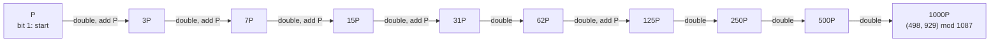
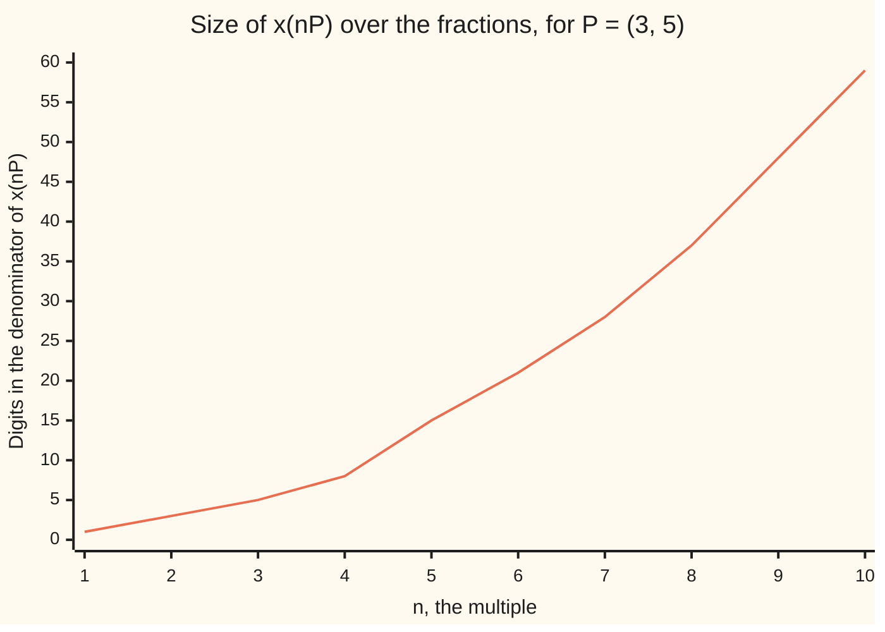

# Adding points by formula: slopes, the doubling case, and big multiples fast

[Syllabus](../../../SYLLABUS.md) → [Algebraic geometry](../README.md) → [Elliptic Curves](../README.md#s04) → Adding points by formula

---

## General Overview

The curve $`y^2 = x^3 - 2`$ holds the point P = (3, 5), because 5² = 25 = 3³ − 2. Work first over the rational numbers, ℚ: the fractions. The curve's points add by the chord-and-tangent rule of [Elliptic curves](../../05-Geometry%20and%20trig/06-Beyond%20Euclid/05-elliptic-curves-and-point-addition.md): draw a line through two points, find the third crossing, reflect it. Doubling P with the tangent line gives 2P = (129/100, −383/1000).

Now ask for 1000P, the point P added to itself 1000 times. Two things stand in the way:

- **The fractions explode.** The denominator of the x-coordinate has 3 digits at 2P, 59 digits at 10P, and grows with the square of the multiple. At 1000P it would have about 580,000 digits. That figure is an estimate, extrapolated from the first ten multiples.
- **One addition at a time is slow.** It takes 999 additions.

Cryptography meets both the same way. It works with remainders modulo a prime, here p = 1087, so every number stays below 1087. It also reads 1000 in binary, 1111101000, and reaches 1000P by doubling and adding: 9 doublings and 5 additions, **14 curve operations** instead of 999. The answer is 1000P = (498, 929).

One cost remains. Every chord or tangent slope is a division, and dividing modulo a prime costs many multiplications: 15 here, about 500 at the size real keys use. So this card stores each point with a third number, Z, that carries the denominator along. It divides once, at the very end.

**Point addition is a pair of slope formulas, one for two different points and one for doubling; double-and-add reaches a large multiple nP in about two operations per binary digit of n; and Jacobian coordinates keep the denominator as a third number, so the whole run needs only one division.**

**What kind of fact this is:** a method, proved correct on this card in Why it works. The Jacobian formulas are algebraic identities, and double-and-add keeps a loop invariant. The operation counts are counts of this run. The 580,000-digit figure is an estimate.

### The picture: 1000P in nine bit-steps



Each arrow reads one more binary digit of 1000 = 1111101000. A 1 costs a doubling and an addition; a 0 costs a doubling only. The first 1 is the starting point P, so it costs nothing.

---

## The formula

Notation first, in words. P is a point on the curve, and nP is P added to itself n times. O is the zero point: P + O = P. The curve here is the short form $`y^2 = x^3 + ax + b`$ with a = 0 and b = −2. Plain coordinates (x, y) are called **affine** coordinates.

This card introduces **Jacobian coordinates**: three numbers (X : Y : Z) that stand for the affine point x = X/Z², y = Y/Z³. Scaling them as (t²X : t³Y : tZ), for any nonzero t, names the same point. Points with Z = 0 are all one point, O.

**The slopes.** These come from [Elliptic curves](../../05-Geometry%20and%20trig/06-Beyond%20Euclid/05-elliptic-curves-and-point-addition.md). With $`a = 0`$ on this curve, the tangent slope loses its $`a`$:

```math
m = \frac{y_2 - y_1}{x_2 - x_1} \ \ (\text{two different points}), \qquad m = \frac{3x_1^2}{2y_1} \ \ (\text{doubling}), \qquad x_3 = m^2 - x_1 - x_2, \quad y_3 = m(x_1 - x_3) - y_1
```

**Read it aloud:** the slope is rise over run between two points, or three x squared over two y at a single point; square the slope and take away both x-coordinates; follow the line to that x and flip the sign.

**Doubling in Jacobian coordinates** (for $`a = 0`$):

```math
S = 4XY^2, \quad T = 3X^2, \quad X_3 = T^2 - 2S, \quad Y_3 = T(S - X_3) - 8Y^4, \quad Z_3 = 2YZ
```

**Read it aloud:** the tangent slope's top is T, its bottom becomes the new Z, and the new X and Y are the affine formulas with every denominator cleared.

**Adding** (X : Y : Z) to a point (x₂, y₂) kept in affine form, a **mixed addition**:

```math
H = x_2Z^2 - X, \quad R = y_2Z^3 - Y, \quad X_3 = R^2 - H^3 - 2XH^2, \quad Y_3 = R(XH^2 - X_3) - YH^3, \quad Z_3 = ZH
```

**Read it aloud:** H is the run and R the rise, both scaled to clear Z; the chord rule then runs with no division, and Z grows by the factor H.

**Double-and-add.** Read the binary digits of n from the top. Start at P. For each later digit, double; if the digit is 1, then add P. The count of curve operations is

```math
\text{operations} = (\text{number of binary digits of } n) - 1 + (\text{number of 1s in } n) - 1
```

**Read it aloud:** one doubling for every digit after the first, and one addition for every 1 after the first. For 1000 that is (10 − 1) + (6 − 1) = 14.

| Symbol | Plain meaning | In our example | Push it up and the answer… |
| --- | --- | --- | --- |
| $`P`$, $`nP`$, $`O`$ | the starting point; P added to itself n times; the zero point | (3, 5); 1000P = (498, 929) mod 1087 | — |
| $`n`$ | the multiple | 1000 = 1111101000 | each extra binary digit adds one doubling |
| $`a`$, $`b`$ | the curve's coefficients in $`y^2 = x^3 + ax + b`$ | 0 and −2 | a different curve; a ≠ 0 adds cost to doubling |
| $`x`$, $`y`$ | affine coordinates; subscripts 1, 2, 3 for the two inputs and the sum | (3, 5) | — |
| $`m`$ | slope of the chord or tangent | 27/10 at P, over the fractions | — |
| $`p`$ | the prime: all numbers are remainders mod p | 1087 | one division costs more multiplications |
| $`X`$, $`Y`$, $`Z`$, $`t`$ | Jacobian coordinates: $`x = X/Z^2`$, $`y = Y/Z^3`$; any nonzero $`t`$ rescales them to $`(t^2X : t^3Y : tZ)`$, the same point | 2P = (129 : −383 : 10) | — |
| $`S`$, $`T`$ | doubling's helpers: $`T`$ is the slope's top, $`S/Z_3^2`$ is the old x | 300 and 27 at P | — |
| $`H`$, $`R`$ | mixed addition's run and rise, scaled to clear Z | 171 and 5383 for 2P + P | $`H = 0`$ means a vertical line or a doubling |
| $`I`$, $`u`$ | the cost of one division mod p, in multiplications; u is the number being inverted | 15 at p = 1087; 503 at the secp256k1 prime (Bitcoin's 256-bit prime) | Jacobian coordinates pay it once |

### When it holds

- **The two points of a mixed addition differ.** If they are equal, H = 0 and R = 0, and the formula returns (0 : 0 : 0), which names no point. Use the doubling formula instead.
- **The modulus is a prime other than 2 and 3.** Every division needs an inverse, and modulo a composite number some nonzero remainders have none. Modulo 2 the short form is always singular, and so is $`y^2 = x^3 + b`$ modulo 3.
- **The doubling formula above needs a = 0.** For $`y^2 = x^3 + ax + b`$, the slope's top is $`T = 3X^2 + aZ^4`$, which costs extra multiplications.
- **The multiple is public.** Double-and-add does an addition only on 1-bits, so its running time shows the bits of n. A secret key needs a method with identical steps, such as the ladder in [Elliptic curves](../../14-Applied%20and%20computational/04-Cryptography/06-elliptic-curve-cryptography.md).
- **The numbers are reduced.** Over the fractions the same formulas run, but the sizes grow with the square of n.

---

## Why it works

### Step 0: postpone the division

Dividing is the slow operation. Fractions can be added and multiplied without dividing, if each is kept as a top and a bottom. Jacobian coordinates do this for a curve point. The bottom is Z, and the powers Z² and Z³ are chosen so the curve's formulas stay short.

### Step 1: why the arithmetic is modulo a prime

Over ℚ the chord-and-tangent rule never divides by zero for P, but the sizes run away:



The one line is the digit count. Python checks each count exactly against the fraction itself; Rust computes the counts from the denominators' integer recursion. The base-10 logarithm of the denominator, divided by n², is 0.5812 at n = 10. The growth like n² comes from the height, a size measure that grows with the square of n ([Mordell-Weil](06-mordell-weil-and-rank.md)). At n = 1000 the same ratio gives about 580,000 digits, an estimate.

Modulo p = 1087 no number exceeds 1086. Division becomes multiplication by an **inverse**: the remainder whose product with the divisor leaves 1. Fermat's little theorem gives it as $`u^{p-2}`$, computed by square-and-multiply ([Powers on the clock](../../02-Number%20theory/04-Powers%20on%20the%20Clock/01-modular-exponentiation.md)). Here p − 2 = 1085 = 10000111101 in binary: 10 squarings and 5 multiplications, so I = 15.

Reducing does not change the answer, only its form. The exact 2P = (129/100, −383/1000), reduced mod 1087, is (360, 879). Doubling P directly mod 1087 also gives (360, 879).

Modulo 1087 the curve has 1033 points, counting O. The check counts them one x at a time. That count sits inside Hasse's window, the range $`p + 1 \pm 2\sqrt{p}`$ = 1088 ± 65.94 that every count mod p falls in, which [The curve mod p](05-reduction-mod-p-and-hasse.md) explains.

### Step 2: the slopes, in one line

The chord's slope is rise over run. The tangent's slope comes from the curve's equation without calculus; [Elliptic curves](../../05-Geometry%20and%20trig/06-Beyond%20Euclid/05-elliptic-curves-and-point-addition.md) derives both, with the vertical case that gives O. On this curve a = 0, so the tangent slope is $`3x^2/(2y)`$. At P that is 27/10.

### Step 3: doubling with the denominator kept

Put $`x = X/Z^2`$ and $`y = Y/Z^3`$ into the tangent slope:

```math
m = \frac{3X^2/Z^4}{2Y/Z^3} = \frac{3X^2}{2YZ} = \frac{T}{Z_3}, \qquad T = 3X^2,\ \ Z_3 = 2YZ
```

So the new Z is the slope's bottom. Now write the old x over the new denominator. Since $`Z_3^2 = 4Y^2Z^2`$, the old x is $`X/Z^2 = 4XY^2/Z_3^2 = S/Z_3^2`$. Then

```math
x_3 = m^2 - 2x = \frac{T^2 - 2S}{Z_3^2}, \qquad \text{so } X_3 = T^2 - 2S
```

For y, use $`Z_3^3 = 8Y^3Z^3`$, so the old y is $`Y/Z^3 = 8Y^4/Z_3^3`$. Then

```math
y_3 = m(x - x_3) - y = \frac{T(S - X_3) - 8Y^4}{Z_3^3}, \qquad \text{so } Y_3 = T(S - X_3) - 8Y^4
```

No step divided. At P = (3 : 5 : 1) this gives (129 : −383 : 10), which reads x = 129/10² and y = −383/10³: exactly 2P.

### Step 4: adding with the denominator kept

The same move works for the chord. Write the affine point's coordinates over Z² and Z³: $`x_2 = x_2Z^2/Z^2`$ and $`y_2 = y_2Z^3/Z^3`$. Then the run is H/Z² and the rise is R/Z³, and the slope is R/(ZH). So the new Z is ZH, and clearing denominators in $`x_3`$ and $`y_3`$ gives the formulas above.

<details>
<summary>Detailed derivation: the mixed addition formulas</summary>

Let the first point be $`x_1 = X/Z^2`$, $`y_1 = Y/Z^3`$, and put $`H = x_2Z^2 - X`$, $`R = y_2Z^3 - Y`$, $`Z_3 = ZH`$. The slope is

$`\displaystyle m = \frac{y_2 - y_1}{x_2 - x_1} = \frac{R/Z^3}{H/Z^2} = \frac{R}{ZH} = \frac{R}{Z_3}.`$

The two x-coordinates sum to $`(2X + H)/Z^2`$, which over $`Z_3^2 = Z^2H^2`$ is $`(2XH^2 + H^3)/Z_3^2`$. So

$`\displaystyle x_3 = m^2 - x_1 - x_2 = \frac{R^2 - H^3 - 2XH^2}{Z_3^2}.`$

For y, $`x_1 = XH^2/Z_3^2`$ and $`y_1 = YH^3/Z_3^3`$, so

$`\displaystyle y_3 = m(x_1 - x_3) - y_1 = \frac{R(XH^2 - X_3) - YH^3}{Z_3^3}.`$

Read off $`X_3`$, $`Y_3`$ and $`Z_3`$. Every step multiplies or subtracts; none divides.

</details>

### Step 5: the zero point needs no special test

The curve in Jacobian coordinates is $`Y^2 = X^3 + bZ^6`$: put $`x = X/Z^2`$, $`y = Y/Z^3`$ into the curve and multiply by $`Z^6`$. Every term has weight 6, so scaling by $`(t^2, t^3, t)`$ keeps a point on it. With Z = 0 the equation reads $`Y^2 = X^3`$, whose solutions are the scalings of (1 : 1 : 0). That one point is O, the point infinitely far up the vertical lines; [The group law](01-elliptic-curves-and-the-group-law.md) writes it (0 : 1 : 0) in ordinary homogeneous coordinates, the same point in another coordinate system.

Adding a point to its mirror image means equal x, so H = 0 while R ≠ 0. Then $`Z_3 = ZH = 0`$: the formula lands on O by itself. The check meets this at 1033P, whose last step adds P to 1032P = −P and prints Z = 0.

### Step 6: double-and-add reaches nP

Read the binary digits of n from the top. Claim: after reading some leading digits, the running point is (the number those digits spell) times P.

1. At the start the digits spell 1, and the running point is P.
2. Reading one more digit doubles the number and adds the digit: 1111 then 11111 is 15 then 31 = 2 × 15 + 1.
3. Doubling the running point doubles its multiple; adding P adds 1. So the claim stays true.
4. After the last digit the number is n, and the point is nP.

For 1000 the multiples run 1, 3, 7, 15, 31, 62, 125, 250, 500, 1000, as in the picture. This is square-and-multiply from [Powers on the clock](../../02-Number%20theory/04-Powers%20on%20the%20Clock/01-modular-exponentiation.md), with the group operation written as addition.

### Step 7: what each step costs

Count multiplications mod p, squarings included. Multiplying by 2, 3, 4 or 8 is a few additions and is not counted.

| Step | Affine | Jacobian |
| --- | --- | --- |
| doubling | 4 + I | 7 |
| addition | 3 + I | 11 |
| back to (x, y) at the end | — | 4 + I |
| 1000P at p = 1087, I = 15 | 261 | 137 |
| 1000P at the secp256k1 prime, I = 503 | 7093 | 625 |
| a 256-bit key: 255 doublings, 128 additions, I = 503 | 194053 | 3700 |

At the toy prime Jacobian coordinates win by a ratio of 1.9. At a real 256-bit prime one inversion is worth 503 multiplications, and paying it once instead of at every step wins by 11.3 for 1000P and 52.4 for a full key.

The inversion here is Fermat's. Faster inversion methods exist, built on Euclid's algorithm, and they narrow the gap. An inversion still costs many multiplications, which is why practical libraries keep a denominator ([Guide to Elliptic Curve Cryptography](https://doi.org/10.1007/b97644)).

---

## Worked numbers, by hand

Over the fractions, in Jacobian coordinates, with no division until the end:

| Step | Arithmetic | Value |
| --- | --- | --- |
| start | P as (X : Y : Z) | (3 : 5 : 1) |
| doubling helpers | S = 4 × 3 × 25; T = 3 × 9; 8Y⁴ = 8 × 625 | 300; 27; 5000 |
| new X | 27² − 2 × 300 = 729 − 600 | 129 |
| new Y | 27 × (300 − 129) − 5000 = 4617 − 5000 | −383 |
| new Z | 2 × 5 × 1 | 10 |
| 2P | (129 : −383 : 10) is x = 129/10², y = −383/10³ | **(129/100, −383/1000)** |
| adding P | H = 3 × 10² − 129; R = 5 × 10³ + 383 | 171; 5383 |
| new X | 28976689 − 5000211 − 7544178 | 16432300 |
| new Z | 10 × 171 | 1710 |
| 3P | x = 16432300/1710², in lowest terms | **164323/29241** |

Modulo 1087, the full run:

| Step | Arithmetic | Value |
| --- | --- | --- |
| 1000 in binary | six 1-bits, ten digits | 1111101000 |
| curve operations | 9 doublings + 5 additions | 14 |
| Jacobian result | after 14 operations | (1003 : 151 : 244) |
| back to (x, y) | one inversion of 244 | **1000P = (498, 929)** |

So 1000 times (3, 5) on the curve mod 1087 is (498, 929), found in 14 curve operations and one division.

### What breaks if you drop a piece

| Mistake | Comes out at | What went wrong |
| --- | --- | --- |
| Chord slope used to double P | no inverse of 0 mod 1087 | through one point the run x₂ − x₁ is 0; doubling needs the tangent |
| Jacobian addition used to double P | (0 : 0 : 0), not a point | H = 0 and R = 0: the addition formula assumes different x-coordinates |
| Tangent slope without the 3 | 2P = (397, 510), off the curve | that line is not the tangent |
| Jacobian read as x = X/Z, y = Y/Z | (855, 210), off the curve | Jacobian weights are Z² and Z³, not Z and Z |
| Bits read right to left | 0001011111 = 95, so 95P = (71, 718) | the loop must start at the top digit |

The code prints all five.

---

## Code, from first principles, and it actually runs

The code adds points three ways: affine coordinates mod p, Jacobian coordinates mod p, and exact fractions. It reaches 1000P by four independent roads: affine double-and-add, Jacobian double-and-add, 999 single additions, and the group's size. For that last road it counts the curve's 1033 points one x at a time, finds 1033P = O, and so gets 1000P = −33P from 32 plain additions. Over the fractions each denominator is found twice: by the chord-and-tangent rule, and by an integer recursion for the denominators (the division polynomials of [Torsion points](04-torsion-and-nagell-lutz.md)). Every multiplication is counted as it happens, and the count for one inversion is checked against the binary digits of p − 2. Python uses `Fraction` only for exact fractions; Rust has no fractions, so it uses the integer recursion in `i128` with `checked_mul`, which stops the run on overflow.

### Python

```python
# Point arithmetic and double-and-add -- the check behind the card.  Standard library only;
# Fraction is exact fraction arithmetic, nothing more.  Curve y^2 = x^3 - 2, point P = (3, 5).
# Over Q the fractions explode, so 1000P is found modulo the prime p = 1087: in plain (affine)
# coordinates, one division per step, and in Jacobian coordinates, one division at the end.
from fractions import Fraction as Fr
from math import log10, sqrt
p, b, P, N = 1087, -2, (3, 5), 1000
cnt = {"mul": 0, "inv": 0, "invmul": 0}    # multiplications mod p (squarings too); inversions

def fm(u, v, md=p):                        # one counted multiplication; md = 0 means plain integers
    cnt["mul"] += 1
    return u * v % md if md else u * v

def inv(u):                                # Fermat: u^(p-2) mod p by square-and-multiply
    if u % p == 0: raise ZeroDivisionError("no inverse of 0 mod 1087")
    cnt["inv"] += 1; r = u
    for bit in bin(p - 2)[3:]:
        r = r * r % p; cnt["invmul"] += 1
        if bit == "1": r = r * u % p; cnt["invmul"] += 1
    return r

def aff_add(A, C, three=3):                # chord-and-tangent rule mod p; O is None
    if A is None or C is None: return C if A is None else A
    (x1, y1), (x2, y2) = A, C
    if x1 == x2 and (y1 + y2) % p == 0: return None                  # vertical line
    if A == C: m = fm(three * fm(x1, x1), inv(2 * y1))                 # tangent slope
    else: m = fm(y2 - y1, inv(x2 - x1))                               # chord slope
    x3 = (fm(m, m) - x1 - x2) % p
    return (x3, (fm(m, x1 - x3) - y1) % p)

def jac_dbl(J, md=p):                      # tangent rule with the denominator kept as Z
    X, Y, Z = J
    YY = fm(Y, Y, md); S = 4 * fm(X, YY, md); T = 3 * fm(X, X, md)
    X3 = fm(T, T, md) - 2 * S
    J3 = (X3, fm(T, S - X3, md) - 8 * fm(YY, YY, md), 2 * fm(Y, Z, md))
    return tuple(v % md for v in J3) if md else J3
def jac_add(J, A, md=p):                   # chord rule: J in Jacobian, A = (x, y) plain
    X, Y, Z = J
    ZZ = fm(Z, Z, md); H = fm(A[0], ZZ, md) - X; R = fm(A[1], fm(Z, ZZ, md), md) - Y
    HH = fm(H, H, md); HHH = fm(H, HH, md); V = fm(X, HH, md)
    X3 = fm(R, R, md) - HHH - 2 * V
    J3 = (X3, fm(R, V - X3, md) - fm(Y, HHH, md), fm(Z, H, md))
    return tuple(v % md for v in J3) if md else J3
def to_affine(J):                          # the one division: x = X/Z^2, y = Y/Z^3
    if J[2] == 0: return None
    zi = inv(J[2]); zz = fm(zi, zi)
    return (fm(J[0], zz), fm(J[1], fm(zz, zi)))
def times(n, A, dbl, add, acc):            # left-to-right double-and-add on the bits of n
    ops = [0, 0]
    for bit in bin(n)[3:]:
        acc = dbl(acc); ops[0] += 1
        if bit == "1": acc = add(acc, A); ops[1] += 1
    return acc, ops
def run(f):                                # run f with fresh counters; report what it cost
    for k in cnt: cnt[k] = 0
    out = f()
    return out, cnt["inv"], cnt["mul"]
show = lambda A: "O" if A is None else f"({A[0]}, {A[1]})"
aff_times = lambda n, A: times(n, A, lambda Q: aff_add(Q, Q), aff_add, A)
jac_times = lambda n, A: times(n, A, jac_dbl, jac_add, (A[0], A[1], 1))
# ---- over Q: exact fractions, and the denominators' own integer recursion ----
def q_add(A, C):
    m = 3 * A[0] ** 2 / (2 * A[1]) if A == C else (C[1] - A[1]) / (C[0] - A[0])
    x3 = m * m - A[0] - C[0]
    return (x3, m * (A[0] - x3) - A[1])
x, y = P
psi = [0, 1, 2 * y, 3 * x ** 4 + 12 * b * x, 4 * y * (x ** 6 + 20 * b * x ** 3 - 8 * b * b)]
for n in range(5, 11):                     # division polynomials at P; exact integer steps
    m = n // 2
    psi.append(psi[m + 2] * psi[m] ** 3 - psi[m - 1] * psi[m + 1] ** 3 if n % 2 else
               psi[m] * (psi[m + 2] * psi[m - 1] ** 2 - psi[m - 2] * psi[m + 1] ** 2) // (2 * y))
mults, digits = [(Fr(3), Fr(5))], []
for n in range(2, 11): mults.append(q_add(mults[-1], mults[0]))
for n in range(1, 11):
    d = mults[n - 1][0].denominator
    assert d == psi[n] ** 2                                     # two roads to every denominator
    digits.append(int(2 * log10(abs(psi[n]))) + 1)
    assert digits[-1] == len(str(d))
two = mults[1]; J2 = jac_dbl((3, 5, 1), 0); J3 = jac_add(J2, P, 0)
for k, Jk in ((1, J2), (2, J3)):          # chord-tangent = Jacobian, over Q, for 2P and 3P
    assert mults[k] == (Fr(Jk[0], Jk[2] ** 2), Fr(Jk[1], Jk[2] ** 3))
rate = 2 * log10(abs(psi[10])) / 100
print(f"curve y^2 = x^3 - 2, P = (3, 5): 5^2 = 25 = 3^3 - 2")
print(f"over Q, tangent slope at P: 3*3^2/(2*5) = {Fr(27, 10)}; 2P = ({two[0]}, {two[1]})")
print(f"Jacobian doubling of (3 : 5 : 1), integers only: S = {4 * x * y * y}, T = {3 * x * x}, 8Y^4 = {8 * y ** 4} -> ({J2[0]} : {J2[1]} : {J2[2]})")
H, R = x * J2[2] ** 2 - J2[0], y * J2[2] ** 3 - J2[1]          # x2 Z^2 - X and y2 Z^3 - Y
print(f"Jacobian addition 2P + P: H = {H}, R = {R}, R^2 = {R * R}, H^3 = {H ** 3}, 2XH^2 = {2 * J2[0] * H * H}")
print(f"  3P = ({J3[0]} : {J3[1]} : {J3[2]}) -> x = {mults[2][0]}, y = {mults[2][1]}")
print("digits in the denominator of x(nP), n = 1..10:", *digits)
print(f"log10(denominator) / n^2 at n = 10: {rate:.4f}; estimate for x(1000P): about {round(rate * 1e6, -4):.0f} digits")
# ---- modulo p = 1087 ----
sq = [sum(1 for v in range(p) if v * v % p == r) for r in range(p)]   # square roots of each r
order = 1 + sum(sq[(u ** 3 + b) % p] for u in range(p))      # count the points, O included
print(f"mod {p}: points on the curve, counted x by x: {order}; Hasse window {p + 1} +- {2 * sqrt(p):.2f}")
bits = bin(N)[2:]; chain = [1]
for bit in bits[1:]: chain += [2 * chain[-1]] + ([2 * chain[-1] + 1] if bit == "1" else [])
print(f"{N} in binary: {bits}; chain:", *chain)
(A1, ops), i1, m1 = run(lambda: aff_times(N, P))
(J, _), i2, m2 = run(lambda: jac_times(N, P)); A2, i3, m3 = run(lambda: to_affine(J))
I = cnt["invmul"]; e = p - 2; Ie = len(bin(e)) - 3 + bin(e).count("1") - 1
P2, J2p = aff_add(P, P), jac_dbl((3, 5, 1))
ad, aa = run(lambda: aff_add(P, P))[2], run(lambda: aff_add(P2, P))[2]
jd, ja = run(lambda: jac_dbl(J2p))[2], run(lambda: jac_add(J2p, P))[2]
print(f"{ops[0]} doublings + {ops[1]} additions = {sum(ops)} curve operations, not {len(bits) - 1 + bits.count('1')}: the top bit is the start")
print(f"multiplications per step, I = one inversion: affine doubling {ad} + I, addition {aa} + I;"
      f" Jacobian doubling {jd}, addition {ja}, back to affine {m3} + I")
print(f"affine:   {N}P = {show(A1)}; {i1} inversions, {m1} other multiplications")
print(f"Jacobian: ({J[0]} : {J[1]} : {J[2]}) -> {N}P = {show(A2)}; {i2 + i3} inversion, {m2 + m3} other multiplications")
print(f"one inversion: p - 2 = {e} = {bin(e)[2:]}: {len(bin(e)) - 3} squarings + {bin(e).count('1') - 1} multiplications = {Ie}")
print(f"total multiplications at p = {p}: affine {m1 + i1 * Ie}, Jacobian {m2 + m3 + Ie}, ratio {(m1 + i1 * Ie) / (m2 + m3 + Ie):.1f}")
A3, i4 = P, 0
for _ in range(N - 1): A3, i4 = aff_add(A3, P), i4 + 1
print(f"{N - 1} additions one at a time: {N}P = {show(A3)}; {i4} inversions")
Jo = jac_times(order, P)[0]; A33 = P
for _ in range(32): A33 = aff_add(A33, P)
print(f"{order}P by double-and-add: Z = {Jo[2]}, so {order}P = O; 33P = {show(A33)}; -33P = {show((A33[0], -A33[1] % p))}")
red = lambda q: q.numerator * inv(q.denominator) % p
print(f"2P mod {p}: by the tangent rule {show(P2)}; 129/100 and -383/1000 reduced {show((red(two[0]), red(two[1])))}")
big = 2 ** 256 - 2 ** 32 - 977 - 2; Ib = len(bin(big)) - 3 + bin(big).count("1") - 1
print(f"secp256k1 prime 2^256 - 2^32 - 977: one inversion = {Ib} multiplications")
print(f"  {N}P there: affine {m1 + i1 * Ib}, Jacobian {m2 + m3 + Ib}, ratio {(m1 + i1 * Ib) / (m2 + m3 + Ib):.1f}")
ka, kj = 255 * (ad + Ib) + 128 * (aa + Ib), 255 * jd + 128 * ja + m3 + Ib
print(f"  key with 255 doublings, 128 additions: affine {ka}, Jacobian {kj}, ratio {ka / kj:.1f}")
try: aff_add(P, (3, 5 + p))
except ZeroDivisionError as err: print(f"mistake, chord slope used to double P: x2 - x1 = 0, {err}")
Jbad = jac_add((3, 5, 1), P)
print(f"mistake, Jacobian addition used to double P: ({Jbad[0]} : {Jbad[1]} : {Jbad[2]}), not a point")
W = aff_add(P, P, 1); on = lambda A: (A[1] ** 2 - A[0] ** 3 - b) % p == 0
print(f"mistake, tangent slope without the 3: 2P = {show(W)}, on the curve: {'yes' if on(W) else 'no'}")
Wz = (fm(J[0], inv(J[2])), fm(J[1], inv(J[2])))
print(f"mistake, Jacobian read as x = X/Z, y = Y/Z: {show(Wz)}, on the curve: {'yes' if on(Wz) else 'no'}")
print(f"mistake, bits read right to left: {bits[::-1]} = {(rev := int(bits[::-1], 2))}, gives {rev}P = {show(aff_times(rev, P)[0])}")
for n in (1023, 1024): print(f"try: {n} = {bin(n)[2:]}: {aff_times(n, P)[1][0]} doublings + {aff_times(n, P)[1][1]} additions")
print(f"try: {N} times (3, -5) = {show(aff_times(N, (3, p - 5))[0])}")
assert abs(order - p - 1) <= 2 * sqrt(p) and Jo[2] == 0       # count in Hasse's window; 1033P = O
assert A1 == A2 == A3 == (A33[0], -A33[1] % p) == (498, 929)  # four roads to 1000P
assert I == Ie and sum(ops) == bits.count("1") - 1 + len(bits) - 1   # counted costs vs bit counts
assert P2 == (red(two[0]), red(two[1]))                       # mod p agrees with the exact answer
assert not on(W) and not on(Wz)                               # the two wrong points are off the curve
print("ALL CHECKS PASS")
```

**Ran 2026-11-17 on macOS, Python 3.14.10, standard library only. All checks passed. Output, pasted from the run:**

```
curve y^2 = x^3 - 2, P = (3, 5): 5^2 = 25 = 3^3 - 2
over Q, tangent slope at P: 3*3^2/(2*5) = 27/10; 2P = (129/100, -383/1000)
Jacobian doubling of (3 : 5 : 1), integers only: S = 300, T = 27, 8Y^4 = 5000 -> (129 : -383 : 10)
Jacobian addition 2P + P: H = 171, R = 5383, R^2 = 28976689, H^3 = 5000211, 2XH^2 = 7544178
  3P = (16432300 : -66234835000 : 1710) -> x = 164323/29241, y = -66234835/5000211
digits in the denominator of x(nP), n = 1..10: 1 3 5 8 15 21 28 37 48 59
log10(denominator) / n^2 at n = 10: 0.5812; estimate for x(1000P): about 580000 digits
mod 1087: points on the curve, counted x by x: 1033; Hasse window 1088 +- 65.94
1000 in binary: 1111101000; chain: 1 2 3 6 7 14 15 30 31 62 124 125 250 500 1000
9 doublings + 5 additions = 14 curve operations, not 15: the top bit is the start
multiplications per step, I = one inversion: affine doubling 4 + I, addition 3 + I; Jacobian doubling 7, addition 11, back to affine 4 + I
affine:   1000P = (498, 929); 14 inversions, 51 other multiplications
Jacobian: (1003 : 151 : 244) -> 1000P = (498, 929); 1 inversion, 122 other multiplications
one inversion: p - 2 = 1085 = 10000111101: 10 squarings + 5 multiplications = 15
total multiplications at p = 1087: affine 261, Jacobian 137, ratio 1.9
999 additions one at a time: 1000P = (498, 929); 999 inversions
1033P by double-and-add: Z = 0, so 1033P = O; 33P = (498, 158); -33P = (498, 929)
2P mod 1087: by the tangent rule (360, 879); 129/100 and -383/1000 reduced (360, 879)
secp256k1 prime 2^256 - 2^32 - 977: one inversion = 503 multiplications
  1000P there: affine 7093, Jacobian 625, ratio 11.3
  key with 255 doublings, 128 additions: affine 194053, Jacobian 3700, ratio 52.4
mistake, chord slope used to double P: x2 - x1 = 0, no inverse of 0 mod 1087
mistake, Jacobian addition used to double P: (0 : 0 : 0), not a point
mistake, tangent slope without the 3: 2P = (397, 510), on the curve: no
mistake, Jacobian read as x = X/Z, y = Y/Z: (855, 210), on the curve: no
mistake, bits read right to left: 0001011111 = 95, gives 95P = (71, 718)
try: 1023 = 1111111111: 9 doublings + 9 additions
try: 1024 = 10000000000: 10 doublings + 0 additions
try: 1000 times (3, -5) = (498, 158)
ALL CHECKS PASS
```

### Rust

Same numbers, same labels, built with `rustc --edition 2021 -O`.

```rust
// Point arithmetic and double-and-add -- the same check as the Python, in Rust.  No crates.
// Curve y^2 = x^3 - 2, point P = (3, 5).  Over Q the fractions explode, so 1000P is found
// modulo the prime p = 1087: in plain (affine) coordinates, one division per step, and in
// Jacobian coordinates, one division at the end.  Integer work over Q uses checked_mul.
const P_: i128 = 1087;
const B: i128 = -2;
type Pt = Option<(i128, i128)>;            // None is O, the zero point
type Jac = (i128, i128, i128);
struct Cnt { mul: u64, inv: u64, invmul: u64 }

fn md(v: i128, m: i128) -> i128 { if m == 0 { v } else { v.rem_euclid(m) } }
fn fm(c: &mut Cnt, u: i128, v: i128, m: i128) -> i128 {   // one counted multiplication
    c.mul += 1;
    md(u.checked_mul(v).expect("overflow"), m)
}
fn inv(c: &mut Cnt, u: i128) -> Result<i128, String> {   // Fermat: u^(p-2) by square-and-multiply
    if md(u, P_) == 0 { return Err("no inverse of 0 mod 1087".to_string()) }
    c.inv += 1;
    let (mut r, e) = (md(u, P_), P_ - 2);
    for i in (0..(127 - e.leading_zeros() as i32)).rev() {
        r = r * r % P_; c.invmul += 1;
        if (e >> i) & 1 == 1 { r = r * md(u, P_) % P_; c.invmul += 1 }
    }
    Ok(r)
}
fn aff_add(c: &mut Cnt, a: Pt, d: Pt, three: i128) -> Result<Pt, String> {   // chord-and-tangent
    let ((x1, y1), (x2, y2)) = match (a, d) { (None, _) => return Ok(d), (_, None) => return Ok(a),
                                               (Some(s), Some(t)) => (s, t) };
    if x1 == x2 && md(y1 + y2, P_) == 0 { return Ok(None) }          // vertical line
    let m = if a == d { let t = three * fm(c, x1, x1, P_); let i = inv(c, 2 * y1)?; fm(c, t, i, P_) }
            else { let i = inv(c, x2 - x1)?; fm(c, y2 - y1, i, P_) };
    let x3 = md(fm(c, m, m, P_) - x1 - x2, P_);
    Ok(Some((x3, md(fm(c, m, x1 - x3, P_) - y1, P_))))
}
fn jac_dbl(c: &mut Cnt, j: Jac, m: i128) -> Jac {   // tangent rule with the denominator kept as Z
    let (x, y, z) = j;
    let yy = fm(c, y, y, m); let s = 4 * fm(c, x, yy, m); let t = 3 * fm(c, x, x, m);
    let x3 = fm(c, t, t, m) - 2 * s;
    let y3 = fm(c, t, s - x3, m) - 8 * fm(c, yy, yy, m);
    let z3 = 2 * fm(c, y, z, m);
    (md(x3, m), md(y3, m), md(z3, m))
}
fn jac_add(c: &mut Cnt, j: Jac, a: (i128, i128), m: i128) -> Jac {   // chord rule: j Jacobian, a plain
    let (x, y, z) = j;
    let zz = fm(c, z, z, m); let h = fm(c, a.0, zz, m) - x;
    let zzz = fm(c, z, zz, m); let r = fm(c, a.1, zzz, m) - y;
    let hh = fm(c, h, h, m); let hhh = fm(c, h, hh, m); let v = fm(c, x, hh, m);
    let x3 = fm(c, r, r, m) - hhh - 2 * v;
    let y3 = fm(c, r, v - x3, m) - fm(c, y, hhh, m);
    (md(x3, m), md(y3, m), md(fm(c, z, h, m), m))
}
fn to_affine(c: &mut Cnt, j: Jac) -> Pt {     // the one division: x = X/Z^2, y = Y/Z^3
    if j.2 == 0 { return None }
    let zi = inv(c, j.2).unwrap(); let zz = fm(c, zi, zi, P_);
    let zzz = fm(c, zz, zi, P_);
    Some((fm(c, j.0, zz, P_), fm(c, j.1, zzz, P_)))
}
fn bits(n: i128) -> String { format!("{:b}", n) }
fn aff_times(c: &mut Cnt, n: i128, a: (i128, i128)) -> (Pt, [u32; 2]) {   // double-and-add
    let (mut acc, mut ops): (Pt, [u32; 2]) = (Some(a), [0, 0]);
    for bit in bits(n).chars().skip(1) {
        acc = aff_add(c, acc, acc, 3).unwrap(); ops[0] += 1;
        if bit == '1' { acc = aff_add(c, acc, Some(a), 3).unwrap(); ops[1] += 1 }
    }
    (acc, ops)
}
fn jac_times(c: &mut Cnt, n: i128, a: (i128, i128)) -> Jac {
    let mut acc = (a.0, a.1, 1);
    for bit in bits(n).chars().skip(1) {
        acc = jac_dbl(c, acc, P_);
        if bit == '1' { acc = jac_add(c, acc, a, P_) }
    }
    acc
}
fn fresh() -> Cnt { Cnt { mul: 0, inv: 0, invmul: 0 } }
fn show(a: Pt) -> String { match a { None => "O".to_string(), Some((x, y)) => format!("({}, {})", x, y) } }
fn gcd(a: i128, b: i128) -> i128 { if b == 0 { a.abs() } else { gcd(b, a % b) } }
fn frac(n: i128, d: i128) -> String { let g = gcd(n, d); format!("{}/{}", n / g, d / g) }
fn on(a: Pt) -> bool { let (x, y) = a.unwrap(); md(y * y - x * x * x - B, P_) == 0 }
fn inv_cost(hi: u128, lo: u128, nbits: u32) -> u32 { nbits - 1 + hi.count_ones() + lo.count_ones() - 1 }

fn main() {
    let (pt, n) = ((3i128, 5i128), 1000i128);
    let mut c = fresh();
    let mut psi: Vec<i128> = vec![0, 1, 10, 3 * 81 + 12 * B * 3, 20 * (729 + 20 * B * 27 - 8 * B * B)];
    for k in 5..11usize {                     // division polynomials at P; exact integer steps
        let m = k / 2;
        let cu = |v: i128| v.checked_mul(v).and_then(|w| w.checked_mul(v)).expect("overflow");
        let sqr = |v: i128| v.checked_mul(v).expect("overflow");
        let v = if k % 2 == 1 { psi[m + 2].checked_mul(cu(psi[m])).unwrap() - psi[m - 1].checked_mul(cu(psi[m + 1])).unwrap() }
                else { psi[m].checked_mul(psi[m + 2].checked_mul(sqr(psi[m - 1])).unwrap()
                       - psi[m - 2].checked_mul(sqr(psi[m + 1])).unwrap()).unwrap() / 10 };
        psi.push(v);
    }
    let digits: Vec<String> = (1..11).map(|k| ((2.0 * (psi[k].abs() as f64).log10()) as i64 + 1).to_string()).collect();
    let j2 = jac_dbl(&mut c, (3, 5, 1), 0);
    let rate = 2.0 * (psi[10].abs() as f64).log10() / 100.0;
    println!("curve y^2 = x^3 - 2, P = (3, 5): 5^2 = 25 = 3^3 - 2");
    println!("over Q, tangent slope at P: 3*3^2/(2*5) = {}; 2P = ({}, {})", frac(27, 10),
             frac(j2.0, j2.2 * j2.2), frac(j2.1, j2.2 * j2.2 * j2.2));
    let (x, y) = pt; let j3 = jac_add(&mut c, j2, pt, 0);
    println!("Jacobian doubling of (3 : 5 : 1), integers only: S = {}, T = {}, 8Y^4 = {} -> ({} : {} : {})",
             4 * x * y * y, 3 * x * x, 8 * y * y * y * y, j2.0, j2.1, j2.2);
    let (h, r) = (x * j2.2 * j2.2 - j2.0, y * j2.2 * j2.2 * j2.2 - j2.1);   // x2 Z^2 - X and y2 Z^3 - Y
    println!("Jacobian addition 2P + P: H = {}, R = {}, R^2 = {}, H^3 = {}, 2XH^2 = {}", h, r, r * r, h * h * h, 2 * j2.0 * h * h);
    println!("  3P = ({} : {} : {}) -> x = {}, y = {}", j3.0, j3.1, j3.2, frac(j3.0, j3.2 * j3.2), frac(j3.1, j3.2 * j3.2 * j3.2));
    println!("digits in the denominator of x(nP), n = 1..10: {}", digits.join(" "));
    println!("log10(denominator) / n^2 at n = 10: {:.4}; estimate for x(1000P): about {:.0} digits", rate, (rate * 1e6 / 1e4).round() * 1e4);
    let mut sq = vec![0i128; P_ as usize];
    for v in 0..P_ { sq[(v * v % P_) as usize] += 1 }
    let order: i128 = 1 + (0..P_).map(|u| sq[md(u * u * u + B, P_) as usize]).sum::<i128>();
    println!("mod {}: points on the curve, counted x by x: {}; Hasse window {} +- {:.2}", P_, order, P_ + 1, 2.0 * (P_ as f64).sqrt());
    let bs = bits(n); let mut chain = vec![1i128];
    for bit in bs.chars().skip(1) { let l = *chain.last().unwrap(); chain.push(2 * l); if bit == '1' { chain.push(2 * l + 1) } }
    println!("{} in binary: {}; chain: {}", n, bs, chain.iter().map(|v| v.to_string()).collect::<Vec<_>>().join(" "));
    c = fresh(); let (a1, ops) = aff_times(&mut c, n, pt); let (i1, m1) = (c.inv, c.mul);
    c = fresh(); let j = jac_times(&mut c, n, pt); let (i2, m2) = (c.inv, c.mul);
    c = fresh(); let a2 = to_affine(&mut c, j); let (i3, m3, ii) = (c.inv, c.mul, c.invmul as u32);
    let e = P_ - 2; let ie = (127 - e.leading_zeros()) + e.count_ones() - 1;
    let p2 = aff_add(&mut fresh(), Some(pt), Some(pt), 3).unwrap();
    let j2p = jac_dbl(&mut fresh(), (3, 5, 1), P_);
    let cost = |f: &dyn Fn(&mut Cnt)| { let mut k = fresh(); f(&mut k); k.mul };
    let ad = cost(&|k| { aff_add(k, Some(pt), Some(pt), 3).unwrap(); });
    let aa = cost(&|k| { aff_add(k, p2, Some(pt), 3).unwrap(); });
    let jd = cost(&|k| { jac_dbl(k, j2p, P_); });
    let ja = cost(&|k| { jac_add(k, j2p, pt, P_); });
    println!("{} doublings + {} additions = {} curve operations, not {}: the top bit is the start", ops[0], ops[1], ops[0] + ops[1],
             bs.len() - 1 + bs.matches('1').count());
    println!("multiplications per step, I = one inversion: affine doubling {} + I, addition {} + I; Jacobian doubling {}, addition {}, back to affine {} + I", ad, aa, jd, ja, m3);
    println!("affine:   {}P = {}; {} inversions, {} other multiplications", n, show(a1), i1, m1);
    println!("Jacobian: ({} : {} : {}) -> {}P = {}; {} inversion, {} other multiplications", j.0, j.1, j.2, n, show(a2), i2 + i3, m2 + m3);
    println!("one inversion: p - 2 = {} = {}: {} squarings + {} multiplications = {}", e, bits(e), 127 - e.leading_zeros(), e.count_ones() - 1, ie);
    let (ta, tj) = (m1 + i1 * ie as u64, m2 + m3 + ie as u64);
    println!("total multiplications at p = {}: affine {}, Jacobian {}, ratio {:.1}", P_, ta, tj, ta as f64 / tj as f64);
    let (mut a3, mut i4) = (Some(pt), 0);
    for _ in 0..n - 1 { a3 = aff_add(&mut c, a3, Some(pt), 3).unwrap(); i4 += 1 }
    println!("{} additions one at a time: {}P = {}; {} inversions", n - 1, n, show(a3), i4);
    let jo = jac_times(&mut c, order, pt); let mut a33 = Some(pt);
    for _ in 0..32 { a33 = aff_add(&mut c, a33, Some(pt), 3).unwrap() }
    let (x33, y33) = a33.unwrap(); let neg33 = Some((x33, md(-y33, P_)));
    println!("{}P by double-and-add: Z = {}, so {}P = O; 33P = {}; -33P = {}", order, jo.2, order, show(a33), show(neg33));
    let red = |c: &mut Cnt, a: i128, d: i128| md(a * inv(c, d).unwrap(), P_);
    let r2 = Some((red(&mut c, 129, 100), red(&mut c, -383, 1000)));
    println!("2P mod {}: by the tangent rule {}; 129/100 and -383/1000 reduced {}", P_, show(p2), show(r2));
    let (hi, lo) = (u128::MAX, u128::MAX - ((1u128 << 32) + 978));   // 2^256 - 2^32 - 979 = p - 2
    let ib = inv_cost(hi, lo, 256) as u64;
    println!("secp256k1 prime 2^256 - 2^32 - 977: one inversion = {} multiplications", ib);
    println!("  {}P there: affine {}, Jacobian {}, ratio {:.1}", n, m1 + i1 * ib, m2 + m3 + ib, (m1 + i1 * ib) as f64 / (m2 + m3 + ib) as f64);
    let (ka, kj) = (255 * (ad + ib) + 128 * (aa + ib), 255 * jd + 128 * ja + m3 + ib);
    println!("  key with 255 doublings, 128 additions: affine {}, Jacobian {}, ratio {:.1}", ka, kj, ka as f64 / kj as f64);
    if let Err(err) = aff_add(&mut c, Some(pt), Some((3, 5 + P_)), 3) { println!("mistake, chord slope used to double P: x2 - x1 = 0, {}", err) }
    let jb = jac_add(&mut c, (3, 5, 1), pt, P_);
    println!("mistake, Jacobian addition used to double P: ({} : {} : {}), not a point", jb.0, jb.1, jb.2);
    let w = aff_add(&mut c, Some(pt), Some(pt), 1).unwrap();
    println!("mistake, tangent slope without the 3: 2P = {}, on the curve: {}", show(w), if on(w) { "yes" } else { "no" });
    let zi = inv(&mut c, j.2).unwrap(); let wz = Some((j.0 * zi % P_, j.1 * zi % P_));
    println!("mistake, Jacobian read as x = X/Z, y = Y/Z: {}, on the curve: {}", show(wz), if on(wz) { "yes" } else { "no" });
    let rs: String = bs.chars().rev().collect(); let rev = i128::from_str_radix(&rs, 2).unwrap();
    println!("mistake, bits read right to left: {} = {}, gives {}P = {}", rs, rev, rev, show(aff_times(&mut c, rev, pt).0));
    for k in [1023i128, 1024] { let o = aff_times(&mut c, k, pt).1; println!("try: {} = {}: {} doublings + {} additions", k, bits(k), o[0], o[1]) }
    println!("try: {} times (3, -5) = {}", n, show(aff_times(&mut c, n, (3, P_ - 5)).0));
    assert!(((order - P_ - 1) as f64).abs() <= 2.0 * (P_ as f64).sqrt() && jo.2 == 0);   // Hasse; 1033P = O
    assert!(a1 == a2 && a2 == a3 && a3 == neg33 && neg33 == Some((498, 929)));           // four roads to 1000P
    assert!(ii == ie && ops[0] + ops[1] == bs.matches('1').count() as u32 - 1 + bs.len() as u32 - 1);
    assert!(p2 == r2);                                                    // mod p agrees with the exact answer
    assert!(!on(w) && !on(wz));                                           // the wrong points are off the curve
    println!("ALL CHECKS PASS");
}
```

**Ran 2026-11-17 on macOS, rustc 1.98.1, no crates. All checks passed. Output, pasted from the run:**

```
curve y^2 = x^3 - 2, P = (3, 5): 5^2 = 25 = 3^3 - 2
over Q, tangent slope at P: 3*3^2/(2*5) = 27/10; 2P = (129/100, -383/1000)
Jacobian doubling of (3 : 5 : 1), integers only: S = 300, T = 27, 8Y^4 = 5000 -> (129 : -383 : 10)
Jacobian addition 2P + P: H = 171, R = 5383, R^2 = 28976689, H^3 = 5000211, 2XH^2 = 7544178
  3P = (16432300 : -66234835000 : 1710) -> x = 164323/29241, y = -66234835/5000211
digits in the denominator of x(nP), n = 1..10: 1 3 5 8 15 21 28 37 48 59
log10(denominator) / n^2 at n = 10: 0.5812; estimate for x(1000P): about 580000 digits
mod 1087: points on the curve, counted x by x: 1033; Hasse window 1088 +- 65.94
1000 in binary: 1111101000; chain: 1 2 3 6 7 14 15 30 31 62 124 125 250 500 1000
9 doublings + 5 additions = 14 curve operations, not 15: the top bit is the start
multiplications per step, I = one inversion: affine doubling 4 + I, addition 3 + I; Jacobian doubling 7, addition 11, back to affine 4 + I
affine:   1000P = (498, 929); 14 inversions, 51 other multiplications
Jacobian: (1003 : 151 : 244) -> 1000P = (498, 929); 1 inversion, 122 other multiplications
one inversion: p - 2 = 1085 = 10000111101: 10 squarings + 5 multiplications = 15
total multiplications at p = 1087: affine 261, Jacobian 137, ratio 1.9
999 additions one at a time: 1000P = (498, 929); 999 inversions
1033P by double-and-add: Z = 0, so 1033P = O; 33P = (498, 158); -33P = (498, 929)
2P mod 1087: by the tangent rule (360, 879); 129/100 and -383/1000 reduced (360, 879)
secp256k1 prime 2^256 - 2^32 - 977: one inversion = 503 multiplications
  1000P there: affine 7093, Jacobian 625, ratio 11.3
  key with 255 doublings, 128 additions: affine 194053, Jacobian 3700, ratio 52.4
mistake, chord slope used to double P: x2 - x1 = 0, no inverse of 0 mod 1087
mistake, Jacobian addition used to double P: (0 : 0 : 0), not a point
mistake, tangent slope without the 3: 2P = (397, 510), on the curve: no
mistake, Jacobian read as x = X/Z, y = Y/Z: (855, 210), on the curve: no
mistake, bits read right to left: 0001011111 = 95, gives 95P = (71, 718)
try: 1023 = 1111111111: 9 doublings + 9 additions
try: 1024 = 10000000000: 10 doublings + 0 additions
try: 1000 times (3, -5) = (498, 158)
ALL CHECKS PASS
```

The two outputs match line for line.

### Lean

Lean proves the two Jacobian formulas whenever 2 and 3 are not zero, and double-and-add for every multiple n ≥ 1.

- Take $`y^2 = x^3 + b`$ and P = (X : Y : Z) with Z ≠ 0. Then the doubling formula gives 2P, and Z₃ = 0 means 2P = O.
- Take the same curve, P = (X : Y : Z) with Z ≠ 0, and an affine point (x₂, y₂) other than P. Then mixed addition gives their sum, and Z₃ = 0 means the sum is O.
- Take any n ≥ 1. Then double-and-add reaches nP with one doubling per binary digit after the first and one addition per 1 after the first.
- Take P = (3 : 5 : 1) over the fractions. Then doubling gives (129 : −383 : 10), which is 2P = (129/100, −383/1000).
- Take 2P + P over the fractions. Then mixed addition gives (16432300 : −66234835000 : 1710), so x(3P) = 164323/29241.
- Take 1000 = 1111101000 in binary. Then double-and-add uses 9 doublings and 5 additions, 14 curve operations.
- Take the curve mod 1087. Then the Jacobian run ends at (1003 : 151 : 244), which is 1000P = (498, 929), on the curve.
- Take the point (498, 158) mod 1087. Then it is the mirror image of (498, 929), since 158 = −929.
- Take 2P = (129/100, −383/1000) and reduce it mod 1087. Then it becomes (360, 879).
- Take the count 1033. Then it lies inside Hasse's window, because (1033 − 1088)² ≤ 4 × 1087.
- Take p − 2 = 1085 = 10000111101. Then one inversion costs 10 squarings and 5 multiplications, 15 in all.

The point count, 1033P = O, 33P, the costs, the fraction sizes and the five mistakes are left to the Python and Rust checks.

```lean
-- Adding points by formula: the Jacobian doubling and mixed-addition formulas on y^2 = x^3 + b give exactly the chord-and-tangent sum, and double-and-add reaches nP with (digits - 1) doublings and (ones - 1) additions.
import Mathlib.AlgebraicGeometry.EllipticCurve.Affine.Point
import Mathlib.Data.Nat.Digits.Defs
import Mathlib.Data.Nat.Digits.Lemmas
import Mathlib.Data.ZMod.Basic
import Mathlib.Tactic.NormNum

open WeierstrassCurve.Affine

/-- The short Weierstrass curve `y^2 = x^3 + b`, that is `y^2 = x^3 + a x + b` with `a = 0`. -/
abbrev shortCurve {F : Type*} [Field F] (b : F) : WeierstrassCurve.Affine F :=
  { a₁ := 0, a₂ := 0, a₃ := 0, a₄ := 0, a₆ := b }

/-- Doubling in Jacobian coordinates, for `a = 0`, as on the card. -/
def jacDouble {F : Type*} [CommRing F] (X Y Z : F) : F × F × F :=
  let S := 4 * X * Y ^ 2
  let T := 3 * X ^ 2
  let X₃ := T ^ 2 - 2 * S
  (X₃, T * (S - X₃) - 8 * Y ^ 4, 2 * Y * Z)

/-- Mixed addition: the Jacobian point `(X : Y : Z)` plus the affine point `(x₂, y₂)`. -/
def jacAddMixed {F : Type*} [CommRing F] (X Y Z x₂ y₂ : F) : F × F × F :=
  let H := x₂ * Z ^ 2 - X
  let R := y₂ * Z ^ 3 - Y
  let X₃ := R ^ 2 - H ^ 3 - 2 * X * H ^ 2
  (X₃, R * (X * H ^ 2 - X₃) - Y * H ^ 3, Z * H)

/-- Equal coordinates give equal points. -/
theorem point_some_eq_of_coords {F : Type*} [Field F] {W : WeierstrassCurve.Affine F}
    {x y x' y' : F} (h : W.Nonsingular x y) (hx : x = x') (hy : y = y') :
    ∃ h' : W.Nonsingular x' y', Point.some _ _ h = Point.some _ _ h' :=
  ⟨hx ▸ hy ▸ h, by subst hx hy; rfl⟩

#print axioms point_some_eq_of_coords

/-- Every positive number has a binary digit equal to 1. -/
theorem one_mem_digits_two {m : ℕ} (hm : m ≠ 0) : 1 ∈ Nat.digits 2 m := by
  have hne : Nat.digits 2 m ≠ [] := Nat.digits_ne_nil_iff_ne_zero.mpr hm
  have hmem := List.getLast_mem hne
  have hlt := Nat.digits_lt_base (by norm_num) hmem
  have h0 := Nat.getLast_digit_ne_zero 2 hm
  have : (Nat.digits 2 m).getLast hne = 1 := by omega
  rw [← this]; exact hmem

#print axioms one_mem_digits_two

/-- Doubling in Jacobian coordinates is correct. On `y^2 = x^3 + b` over a field where `2 ≠ 0` and
`3 ≠ 0`, let `P` be the point with Jacobian coordinates `(X : Y : Z)`, `Z ≠ 0`, that is
`x = X/Z^2`, `y = Y/Z^3`. Put `S = 4XY^2`, `T = 3X^2`, `X₃ = T^2 - 2S`, `Y₃ = T(S - X₃) - 8Y^4`,
`Z₃ = 2YZ`. If `Z₃ = 0` then `2P = O`; otherwise `2P` is the affine point `(X₃/Z₃^2, Y₃/Z₃^3)`. -/
theorem jacobian_doubling_eq_two_smul {F : Type*} [Field F] [DecidableEq F]
    (h2 : (2 : F) ≠ 0) (h3 : (3 : F) ≠ 0) (b X Y Z : F) (hZ : Z ≠ 0)
    (hP : (shortCurve b).Nonsingular (X / Z ^ 2) (Y / Z ^ 3)) :
    let J := jacDouble X Y Z
    (J.2.2 = 0 → Point.some _ _ hP + Point.some _ _ hP = 0) ∧
    (J.2.2 ≠ 0 → ∃ h₃ : (shortCurve b).Nonsingular (J.1 / J.2.2 ^ 2) (J.2.1 / J.2.2 ^ 3),
      Point.some _ _ hP + Point.some _ _ hP = Point.some _ _ h₃) := by
  intro J
  simp only [J, jacDouble]
  constructor
  · intro h0
    have hY : Y = 0 := by
      rcases mul_eq_zero.mp h0 with h | h
      · rcases mul_eq_zero.mp h with h | h
        · exact absurd h h2
        · exact h
      · exact absurd h hZ
    apply Point.add_self_of_Y_eq
    simp [WeierstrassCurve.Affine.negY, hY]
  · intro h0
    have hY : Y ≠ 0 := by
      intro hY; apply h0; simp [hY]
    have hy : Y / Z ^ 3 ≠ (shortCurve b).negY (X / Z ^ 2) (Y / Z ^ 3) := by
      simp only [WeierstrassCurve.Affine.negY]
      intro h
      have : 2 * (Y / Z ^ 3) = 0 := by simp at h; linear_combination h
      simp [h2, hY, hZ] at this
    rw [Point.add_self_of_Y_ne hy]
    have hl : (shortCurve b).slope (X / Z ^ 2) (X / Z ^ 2) (Y / Z ^ 3) (Y / Z ^ 3) =
        3 * X ^ 2 / (2 * Y * Z) := by
      rw [WeierstrassCurve.Affine.slope_of_Y_ne rfl hy]
      simp only [WeierstrassCurve.Affine.negY]
      rw [div_eq_div_iff]
      · field_simp; ring
      · intro h; apply hy; simp only [WeierstrassCurve.Affine.negY]; linear_combination h
      · exact h0
    apply point_some_eq_of_coords
    · rw [hl]
      simp only [WeierstrassCurve.Affine.addX]
      field_simp
      ring
    · rw [hl]
      simp only [WeierstrassCurve.Affine.addY, WeierstrassCurve.Affine.negAddY,
        WeierstrassCurve.Affine.addX, WeierstrassCurve.Affine.negY]
      field_simp
      ring

/-- Mixed addition in Jacobian coordinates is correct. On `y^2 = x^3 + b` over a field where
`2 ≠ 0` and `3 ≠ 0`, let `P` have Jacobian coordinates `(X : Y : Z)`, `Z ≠ 0`, and let `Q = (x₂, y₂)`
be affine, with `P ≠ Q`. Put `H = x₂Z^2 - X`, `R = y₂Z^3 - Y`, `X₃ = R^2 - H^3 - 2XH^2`,
`Y₃ = R(XH^2 - X₃) - YH^3`, `Z₃ = ZH`. If `Z₃ = 0` then `P + Q = O`; otherwise `P + Q` is the affine
point `(X₃/Z₃^2, Y₃/Z₃^3)`. -/
theorem jacobian_mixed_addition_eq_add {F : Type*} [Field F] [DecidableEq F]
    (h2 : (2 : F) ≠ 0) (h3 : (3 : F) ≠ 0) (b X Y Z x₂ y₂ : F) (hZ : Z ≠ 0)
    (hP : (shortCurve b).Nonsingular (X / Z ^ 2) (Y / Z ^ 3))
    (hQ : (shortCurve b).Nonsingular x₂ y₂) (hne : Point.some _ _ hP ≠ Point.some _ _ hQ) :
    let J := jacAddMixed X Y Z x₂ y₂
    (J.2.2 = 0 → Point.some _ _ hP + Point.some _ _ hQ = 0) ∧
    (J.2.2 ≠ 0 → ∃ h₃ : (shortCurve b).Nonsingular (J.1 / J.2.2 ^ 2) (J.2.1 / J.2.2 ^ 3),
      Point.some _ _ hP + Point.some _ _ hQ = Point.some _ _ h₃) := by
  intro J
  simp only [J, jacAddMixed]
  constructor
  · intro h0
    have hH : x₂ * Z ^ 2 - X = 0 := by
      rcases mul_eq_zero.mp h0 with h | h
      · exact absurd h hZ
      · exact h
    have hx : X / Z ^ 2 = x₂ := by
      field_simp; linear_combination -hH
    rcases WeierstrassCurve.Affine.Y_eq_of_X_eq hP.1 hQ.1 hx with hy | hy
    · exact absurd (by subst hx hy; rfl) hne
    · exact Point.add_of_Y_eq hx hy
  · intro h0
    have hH : x₂ * Z ^ 2 - X ≠ 0 := by
      intro h; apply h0; simp [h]
    have hx : X / Z ^ 2 ≠ x₂ := by
      intro h; apply hH; rw [← h]; field_simp; ring
    rw [Point.add_of_X_ne hx]
    have hl : (shortCurve b).slope (X / Z ^ 2) x₂ (Y / Z ^ 3) y₂ =
        (y₂ * Z ^ 3 - Y) / (Z * (x₂ * Z ^ 2 - X)) := by
      rw [WeierstrassCurve.Affine.slope_of_X_ne hx]
      rw [div_eq_div_iff (sub_ne_zero.mpr hx) h0]
      field_simp; ring
    apply point_some_eq_of_coords
    all_goals
      rw [hl]
      simp only [WeierstrassCurve.Affine.addY, WeierstrassCurve.Affine.negAddY,
        WeierstrassCurve.Affine.addX, WeierstrassCurve.Affine.negY]
      clear hl hne hP hQ h0 hx
      obtain ⟨H, hHdef⟩ : ∃ H, H = x₂ * Z ^ 2 - X := ⟨_, rfl⟩
      have hx2 : x₂ = (X + H) / Z ^ 2 := by rw [hHdef]; field_simp; ring
      rw [← hHdef] at hH
      subst hx2
      have e : (X + H) / Z ^ 2 * Z ^ 2 - X = H := by field_simp; ring
      simp only [e]
      field_simp
      ring

/-- One step of double-and-add: double the running point, and add `P` if the digit is 1.
The state also counts doublings and additions. -/
def dblAddStep {G : Type*} [AddMonoid G] (P : G) (s : G × ℕ × ℕ) (d : ℕ) : G × ℕ × ℕ :=
  if d = 1 then (s.1 + s.1 + P, s.2.1 + 1, s.2.2 + 1) else (s.1 + s.1, s.2.1 + 1, s.2.2)

/-- Double-and-add: read the binary digits of `n` from the top, start at `P` on the top digit,
and run one step for each later digit. Returns the point, the doublings and the additions. -/
def doubleAndAdd {G : Type*} [AddMonoid G] (P : G) (n : ℕ) : G × ℕ × ℕ :=
  ((Nat.digits 2 n).reverse.tail).foldl (dblAddStep P) (P, 0, 0)

/-- Double-and-add reaches `nP` for every `n ≥ 1`, using one doubling for every binary digit after
the first and one addition for every 1 after the first. -/
theorem double_and_add_eq_nsmul {G : Type*} [AddMonoid G] (P : G) (n : ℕ) (hn : 1 ≤ n) :
    doubleAndAdd P n = (n • P, (Nat.digits 2 n).length - 1, (Nat.digits 2 n).count 1 - 1) := by
  induction n using Nat.strong_induction_on with
  | _ n ih =>
    rcases Nat.lt_or_ge n 2 with hlt | hge
    · obtain rfl : n = 1 := by omega
      simp [doubleAndAdd]
    · have hm : 1 ≤ n / 2 := by omega
      have ih' := ih (n / 2) (by omega) hm
      have hd : Nat.digits 2 n = n % 2 :: Nat.digits 2 (n / 2) :=
        Nat.digits_def' (by norm_num) (by omega)
      have hne : Nat.digits 2 (n / 2) ≠ [] := Nat.digits_ne_nil_iff_ne_zero.mpr (by omega)
      have hlen : 1 ≤ (Nat.digits 2 (n / 2)).length := by
        rcases h : Nat.digits 2 (n / 2) with _ | ⟨a, l⟩
        · exact absurd h hne
        · simp
      have hcnt : 1 ≤ (Nat.digits 2 (n / 2)).count 1 :=
        List.count_pos_iff.mpr (one_mem_digits_two (by omega))
      have htail : (Nat.digits 2 n).reverse.tail =
          (Nat.digits 2 (n / 2)).reverse.tail ++ [n % 2] := by
        rw [hd, List.reverse_cons]
        rcases h : (Nat.digits 2 (n / 2)).reverse with _ | ⟨a, l⟩
        · simp at h; exact absurd h hne
        · simp
      unfold doubleAndAdd at ih' ⊢
      rw [htail, List.foldl_append, ih', hd]
      simp only [List.foldl_cons, List.foldl_nil, dblAddStep, List.length_cons, List.count_cons]
      rcases Nat.mod_two_eq_zero_or_one n with h | h
      · have hn2 : n = 2 * (n / 2) := by omega
        rw [h]
        simp only [zero_ne_one, ite_false, beq_iff_eq, add_zero]
        refine Prod.ext ?_ (Prod.ext ?_ ?_)
        · simp only
          conv_rhs => rw [hn2]
          rw [two_mul, add_nsmul]
        · simp only; omega
        · simp only
      · have hn2 : n = 2 * (n / 2) + 1 := by omega
        rw [h]
        simp only [ite_true, beq_self_eq_true]
        refine Prod.ext ?_ (Prod.ext ?_ ?_)
        · simp only
          conv_rhs => rw [hn2]
          rw [two_mul, add_nsmul, add_nsmul, one_nsmul]
        · simp only; omega
        · simp only; omega

-- P = (3, 5) is on y^2 = x^3 - 2.
example : (5 : ℤ) ^ 2 = 3 ^ 3 - 2 := by norm_num

-- Jacobian doubling of (3 : 5 : 1) over the fractions gives (129 : -383 : 10).
example : jacDouble (3 : ℚ) 5 1 = (129, -383, 10) := by norm_num [jacDouble]

-- The tangent rule over the fractions: slope 27/10 and 2P = (129/100, -383/1000).
example : (3 * 3 ^ 2 : ℚ) / (2 * 5) = 27 / 10 ∧ (27 / 10 : ℚ) ^ 2 - 2 * 3 = 129 / 100 ∧
    (27 / 10 : ℚ) * (3 - 129 / 100) - 5 = -383 / 1000 := by norm_num

-- Mixed addition 2P + P from (129 : -383 : 10): 3P = (16432300 : -66234835000 : 1710).
example : jacAddMixed (129 : ℚ) (-383) 10 3 5 = (16432300, -66234835000, 1710) := by
  norm_num [jacAddMixed]

-- 3P in lowest terms: x = 164323/29241, y = -66234835/5000211.
example : (16432300 : ℚ) / 1710 ^ 2 = 164323 / 29241 ∧
    (-66234835000 : ℚ) / 1710 ^ 3 = -66234835 / 5000211 := by norm_num

-- 1000 = 1111101000 in binary: 9 doublings + 5 additions = 14 curve operations.
example : Nat.digits 2 1000 = [0, 0, 0, 1, 0, 1, 1, 1, 1, 1] := by norm_num
example : doubleAndAdd (1 : ℕ) 1000 = (1000, 9, 5) := by decide

-- Modulo 1087, the Jacobian run ends at (1003 : 151 : 244).
example : (List.foldl (fun (J : ZMod 1087 × ZMod 1087 × ZMod 1087) (d : ℕ) =>
    let D := jacDouble J.1 J.2.1 J.2.2
    if d = 1 then jacAddMixed D.1 D.2.1 D.2.2 3 5 else D)
    (3, 5, 1) (Nat.digits 2 1000).reverse.tail) = (1003, 151, 244) := by decide

-- (1003 : 151 : 244) is the affine point (498, 929), and that point is on the curve mod 1087.
example : (498 : ZMod 1087) * 244 ^ 2 = 1003 ∧ (929 : ZMod 1087) * 244 ^ 3 = 151 := by decide
example : (929 : ZMod 1087) ^ 2 = 498 ^ 3 - 2 := by decide

-- 33P = (498, 158) is the mirror image of 1000P = (498, 929), so 1000P = -33P.
example : (158 : ZMod 1087) = -929 := by decide

-- 2P mod 1087 is (360, 879), the reduction of (129/100, -383/1000).
example : (360 : ZMod 1087) * 100 = 129 ∧ (879 : ZMod 1087) * 1000 = -383 := by decide

-- 1033 points sit inside Hasse's window: (1033 - 1088)^2 ≤ 4 * 1087.
example : ((1033 : ℤ) - 1088) ^ 2 ≤ 4 * 1087 := by norm_num

-- One inversion: p - 2 = 1085 = 10000111101, so 10 squarings + 5 multiplications = 15.
example : (Nat.digits 2 1085).length - 1 = 10 ∧ (Nat.digits 2 1085).count 1 - 1 = 5 := by
  norm_num

#print axioms jacobian_doubling_eq_two_smul
#print axioms jacobian_mixed_addition_eq_add
#print axioms double_and_add_eq_nsmul
```

**Checked 2026-11-17 on macOS, Lean 4.36.0-rc2, Mathlib v4.36.0-rc2. Every proof is complete and uses only Lean's standard axioms. Output, pasted from the run:**

```
'point_some_eq_of_coords' depends on axioms: [propext, Classical.choice, Quot.sound]
'one_mem_digits_two' depends on axioms: [propext, Classical.choice, Quot.sound]
'jacobian_doubling_eq_two_smul' depends on axioms: [propext, Classical.choice, Quot.sound]
'jacobian_mixed_addition_eq_add' depends on axioms: [propext, Classical.choice, Quot.sound]
'double_and_add_eq_nsmul' depends on axioms: [propext, Classical.choice, Quot.sound]
```

> [!TIP]
> **Try changing**
> Guess first, then run it. The asserts are pinned to 1000P = (498, 929), so expect a changed run to stop at a check or an error after printing its answer.
> - **A power of two.** Set `N = 1024`. Guess the count before reading it: 10 doublings and 0 additions, the cheapest 11-digit multiple.
> - **All ones.** Set `N = 1023`: 9 doublings and 9 additions, 18 operations, the most for 10 digits.
> - **The group's size.** Set `N = 1033`: the run ends at O, because 1033 points make 1033P = O.
> - **The mirror point.** Start from (3, −5): 1000 times it is (498, 158), the mirror image of (498, 929).

---

## The usual mistake

> [!warning]
> **Using the addition formula to double.** The chord rule needs two different x-coordinates. Fed the same point twice, the affine form divides by zero, and the Jacobian form quietly returns (0 : 0 : 0), which is no point at all. Every implementation needs a doubling branch, or a curve shape whose one formula covers both cases.
>
> - **Reading Jacobian as ordinary projective coordinates.** Taking x = X/Z and y = Y/Z turns 1000P's (1003 : 151 : 244) into (855, 210), off the curve. The weights are Z² and Z³.
> - **Counting an addition for the top bit.** 1000 has six 1-bits, but the first is the starting point: 9 + 5 = 14 operations, not 15.
> - **Reading the bits from the wrong end.** Left-to-right double-and-add fed 0001011111 computes 95P = (71, 718), not 1000P.
> - **Dropping the 3 in the tangent slope.** The slope x²/(2y) gives 2P = (397, 510), which is not on the curve.

---

## Where you meet it in real life

- **Bitcoin signatures.** The curve secp256k1 is $`y^2 = x^3 + 7`$ over the prime $`2^{256} - 2^{32} - 977`$ (SEC 2). It has a = 0, the same shape as this card's curve, so the doubling formula here applies unchanged.
- **Web connections.** The curve P-256 has a = −3. The slope's top $`3X^2 + aZ^4`$ then factors as $`3(X - Z^2)(X + Z^2)`$, which saves multiplications.
- **Mixed coordinates.** Adding a point stored in affine form to one in Jacobian form, as this card's 11-multiplication addition does, is the mixed-coordinates idea of Cohen, Miyaji and Ono.
- **Curve shapes with no special cases.** Ed25519 signatures use an Edwards curve, whose single addition formula also doubles and has no exceptions. That removes the usual mistake above by design.

> **Say it back**
> Points on an elliptic curve add by a chord slope, or by a tangent slope when the two points are equal. Over the fractions the numbers explode, so real work uses remainders modulo a prime, where each division costs many multiplications. Double-and-add reads the multiple's binary digits: a doubling for each digit after the first, and an addition for each later 1, so 1000P takes 14 operations. Jacobian coordinates store x = X/Z² and y = Y/Z³, so every step only multiplies and the run divides once. On y² = x³ − 2 mod 1087, 1000 times (3, 5) is (498, 929).

---

## What this builds on

- [Weierstrass form](02-weierstrass-forms-discriminant-and-j-invariant.md): the short form $`y^2 = x^3 + ax + b`$, here with a = 0, and why it needs care modulo 2 and 3.
- [Powers on the clock](../../02-Number%20theory/04-Powers%20on%20the%20Clock/01-modular-exponentiation.md): square-and-multiply, which becomes double-and-add, and which also computes each inverse.
- [Elliptic curves](../../14-Applied%20and%20computational/04-Cryptography/06-elliptic-curve-cryptography.md): points mod a prime, double-and-add on real keys, and the ladder for secret ones.
- [Elliptic curves](../../05-Geometry%20and%20trig/06-Beyond%20Euclid/05-elliptic-curves-and-point-addition.md): the chord and tangent slopes, the vertical case that gives O, and the group laws.

---

## Where this goes next

- [Torsion points](04-torsion-and-nagell-lutz.md): the next card. Its division polynomials are the denominator recursion the checks use here, and its test shows that P = (3, 5) never returns to O over the fractions.
- [Curves for keys](09-elliptic-curve-cryptography-and-schoof.md): curves and point counts at cryptographic size, where listing every x is impossible.

This card counted 1033 points by trying all 1087 values of x; how to count points modulo a 256-bit prime without listing them is the question it leaves open.

---

## Sources

Verified 2026-11-17: every link below resolves to the publisher's page.

- Silverman, Joseph H., and John T. Tate. *Rational Points on Elliptic Curves*, 2nd ed. Springer, 2015. [DOI 10.1007/978-3-319-18588-0](https://doi.org/10.1007/978-3-319-18588-0). The chord-and-tangent formulas over the fractions, and the growth of the heights.
- Hankerson, Darrel, Alfred Menezes and Scott Vanstone. *Guide to Elliptic Curve Cryptography*. Springer, 2004. [DOI 10.1007/b97644](https://doi.org/10.1007/b97644). Jacobian coordinates, operation counts, and double-and-add.
- Cohen, Henri, Atsuko Miyaji and Takatoshi Ono. "Efficient elliptic curve exponentiation using mixed coordinates." ASIACRYPT 1998, Springer. [DOI 10.1007/3-540-49649-1_6](https://doi.org/10.1007/3-540-49649-1_6). Mixing affine and Jacobian points in one addition.
- Bernstein, Daniel J., and Tanja Lange. "Faster addition and doubling on elliptic curves." ASIACRYPT 2007, Springer. [DOI 10.1007/978-3-540-76900-2_3](https://doi.org/10.1007/978-3-540-76900-2_3). Edwards curves and their one formula for adding and doubling.
- Standards for Efficient Cryptography Group. *SEC 2: Recommended Elliptic Curve Domain Parameters*, version 2.0. [PDF](https://www.secg.org/sec2-v2.pdf). The curve secp256k1 and its prime.
