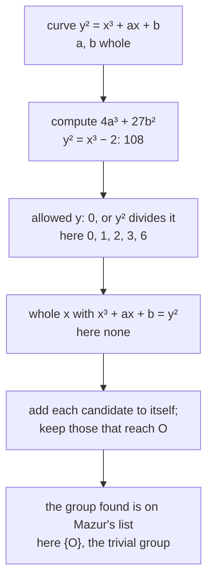

# Torsion points: the ones that return to zero, and how to list them all

[Syllabus](../../../SYLLABUS.md) → [Algebraic geometry](../README.md) → [Elliptic Curves](../README.md#s04) → Torsion points

---

## General Overview

The curve $`y^2 = x^3 - 2`$ has the rational point (3, 5): $`5^2 = 25`$ and $`3^3 - 2 = 25`$. The chord and tangent rule adds points on the curve, and the curve's zero is the extra point $`O`$ "at the top", where every vertical line ends. Adding (3, 5) to itself gives (129/100, −383/1000). Adding (3, 5) once more gives (164323/29241, −66234835/5000211), and the fractions keep growing.

Some points behave differently. On the neighbouring curve $`y^2 = x^3 + 1`$, six copies of the point (2, 3) add up to $`O`$, and then the multiples repeat. A point that returns to $`O`$ is a **torsion point**. The number of copies it takes is its **order**. [Rational points on a cubic](../../21-Algebraic%20and%20analytic%20number%20theory/07-Diophantine%20and%20Modular/05-elliptic-curves-over-q-and-mordell-weil.md) splits all rational points into a finite torsion part and a rank part; this card finds the torsion part.

This card answers one question for any curve: which rational points are torsion? Three tools settle it with finite, exact work.

1. **Nagell–Lutz** turns the question into a short list of whole-number candidates.
2. **Division polynomials** test each order directly: a point has order dividing $`n`$ exactly when its $`x`$ is a root of one fixed polynomial.
3. **Mazur's theorem** lists every torsion group that can occur over the rationals: fifteen groups, nothing else.

For $`y^2 = x^3 - 2`$ all three agree: the only torsion point is $`O`$. So (3, 5) never comes back, and its multiples are infinitely many different points.

**On a curve y² = x³ + ax + b with whole a and b, a torsion point has whole coordinates, and y is 0 or y² divides 4a³ + 27b²; so a finite check lists every torsion point, and Mazur's theorem says the result is one of fifteen groups.**

**What kind of fact this is:** three theorems. The divisibility half of Nagell–Lutz and the order-3 test are proved on this card in Why it works. The whole-coordinates half is proved there in outline, with Silverman and Tate as the full source. Mazur's theorem is stated with its source; its proof is far beyond this card. The answer for $`y^2 = x^3 - 2`$ is proved here twice.

### The picture: from a curve to its torsion group



Every arrow is a finite, exact step. The search space never grows past the divisors of one number.

---

## The formula

Notation first. $`E`$ is the curve $`y^2 = x^3 + ax + b`$ with whole $`a`$ and $`b`$. $`E(\mathbb{Q})`$ is its set of rational points with $`O`$ added; it is a group under chord and tangent ([The group law](01-elliptic-curves-and-the-group-law.md)). $`nP`$ is $`P`$ added to itself $`n`$ times. The torsion points form a subgroup, written $`E(\mathbb{Q})_{\mathrm{tors}}`$ and read "the torsion of E over Q".

The card has three formulas, one per tool. First, **Nagell–Lutz** (Trygve Nagell 1935, Élisabeth Lutz 1937):

```math
P = (x, y) \in E(\mathbb{Q})_{\mathrm{tors}},\ P \ne O \quad \Longrightarrow \quad x, y \in \mathbb{Z} \ \text{ and } \ \bigl(y = 0 \ \text{ or } \ y^2 \mid 4a^3 + 27b^2\bigr)
```

Second, the **division polynomial** $`\psi_n`$ ("psi n"), a polynomial in $`x`$ (and $`y`$ for even $`n`$) built from $`a`$ and $`b`$ by a fixed rule. For $`P \ne O`$:

```math
nP = O \iff \psi_n(x, y) = 0, \qquad \psi_2 = 2y, \qquad \psi_3 = 3x^4 + 6ax^2 + 12bx - a^2
```

Third, **Mazur's theorem** (Barry Mazur, 1977):

```math
E(\mathbb{Q})_{\mathrm{tors}} \cong \mathbb{Z}/n \ \ (1 \le n \le 10 \text{ or } n = 12) \quad \text{or} \quad \mathbb{Z}/2 \times \mathbb{Z}/2n \ \ (1 \le n \le 4)
```

**Read it aloud:** a torsion point other than O has whole coordinates, and its y is 0 or has a square dividing 4a³ + 27b². A point has order dividing n exactly when the n-th division polynomial vanishes there. The torsion group is always one of fifteen: a cycle of length 1 to 10 or 12, or a 2-cycle paired with a cycle of length 2, 4, 6 or 8.

Here $`\mathbb{Z}/n`$ is the whole numbers mod $`n`$ under addition, a cycle of $`n`$ steps. $`\cong`$ means "has the same structure as". A vertical bar $`\mid`$ means "divides".

For our curve, $`a = 0`$ and $`b = -2`$:

```math
4a^3 + 27b^2 = 108 = 2^2 \cdot 3^3, \qquad \psi_3 = 3x^4 - 24x, \qquad E(\mathbb{Q})_{\mathrm{tors}} = \{O\} \cong \mathbb{Z}/1
```

| Symbol | Plain meaning | In our example | Push it up and the answer… |
| --- | --- | --- | --- |
| $`E`$; $`a`$, $`b`$ | the curve $`y^2 = x^3 + ax + b`$ and its whole coefficients | $`a = 0`$, $`b = -2`$ | a different curve, a different group |
| $`f(x)`$ | the right side $`x^3 + ax + b`$, so $`y^2 = f(x)`$ | $`f(3) = 25`$ | — |
| $`O`$; $`P = (x, y)`$ | the zero point; a point of $`E`$ | $`P = (3, 5)`$ | — |
| $`nP`$; order | $`P`$ added $`n`$ times; the least $`n \ge 1`$ with $`nP = O`$ | $`2P = (129/100, -383/1000)`$; order infinite | — |
| $`E(\mathbb{Q})_{\mathrm{tors}}`$ | the torsion points: finite order | $`\{O\}`$ | stays one of Mazur's fifteen |
| $`4a^3 + 27b^2`$ | the Nagell–Lutz test number; $`\Delta = -16(4a^3 + 27b^2)`$ | 108; $`\Delta = -1728`$ | more divisors, more candidates |
| $`\psi_n`$ | the $`n`$-th division polynomial: zero exactly at points of order dividing $`n`$ | $`\psi_3 = 3x^4 - 24x`$ | degree $`(n^2 - 1)/2`$ for odd $`n`$ |
| $`u/v`$ | a possible rational root: $`u`$ divides the constant term, $`v`$ the leading one | 52 candidates for $`\psi_5`$ | more candidates to test |
| $`t = x/y`$; $`\nu`$ | the coordinate that measures nearness to $`O`$; the count of factors of $`p`$, with $`p^{2\nu}`$ under $`x`$ | $`2P`$: 100 under $`x`$, 1000 under $`y`$ | — |
| $`p`$; $`N_p`$ | a prime; the points of $`E`$ mod $`p`$, $`O`$ included | $`N_5 = 6`$, $`N_7 = 7`$ | the torsion count divides every good $`N_p`$ |
| $`\mathbb{Z}/n`$; $`\cong`$ | a cycle of $`n`$ steps; same structure | $`\mathbb{Z}/1`$, the trivial group | — |

$`\Delta`$ is the discriminant of [Weierstrass form](02-weierstrass-forms-discriminant-and-j-invariant.md); this card only needs the factor 108. $`N_p`$ is written $`\#E(\mathbb{F}_p)`$ on [The curve mod p](05-reduction-mod-p-and-hasse.md).

### When it holds

- **Whole coefficients.** Nagell–Lutz needs whole $`a`$ and $`b`$. On $`y^2 = x^3 + 1/64`$, the point (1/2, 3/8) has order 6 and is not whole. Clear denominators first: $`x \to x/c^2`$, $`y \to y/c^3`$ multiplies $`a`$ by $`c^4`$ and $`b`$ by $`c^6`$.
- **Necessary, not sufficient.** Passing Nagell–Lutz only makes a point a candidate. On $`y^2 = x^3 + 8`$ the points (1, 3) and (2, 4) pass, yet both have infinite order: their doubles have $`x = -7/4`$.
- **A root of $`\psi_n`$ is not yet a point.** The $`y`$ must be rational too. On our curve $`\psi_3`$ has the root $`x = 2`$, but $`y^2 = 6`$ has no rational solution.
- **The field is $`\mathbb{Q}`$.** Mazur's list is for rational points only. Over $`\mathbb{Q}(\sqrt{6})`$, the numbers $`r + s\sqrt{6}`$ with rational $`r`$ and $`s`$, our curve gains the point $`(2, \sqrt{6})`$ of order 3.
- **Good primes for counting.** The torsion count is sure to divide $`N_p`$ only for odd $`p`$ not dividing $`4a^3 + 27b^2`$. On $`y^2 = x^3 + 1`$, $`N_3 = 4`$, yet the torsion has 6 points.

---

## Why it works

### Step 0: torsion points cannot hide in small denominators

The whole card rests on one fact: a prime in a denominator never goes away. Adding a point with a denominator to itself keeps that prime in the denominator, so the point can never land on $`O`$. So torsion points have whole coordinates. Once they are whole, the doubling formula forces $`y^2`$ to divide a fixed number. A finite list remains.

[Adding points by formula](03-point-arithmetic-and-double-and-add.md) gives the slope $`m`$ and the doubling rule. For this card one consequence matters: the $`x`$ of $`2P`$.

```math
x(2P) = m^2 - 2x = \frac{(3x^2 + a)^2}{4f(x)} - 2x = \frac{x^4 - 2ax^2 - 8bx + a^2}{4y^2}
```

### Step 1: whole coordinates, in outline

Take a prime $`p`$ and a rational point whose $`x`$ has $`p`$ in its denominator. The curve forces the shape: if exactly $`p^{2\nu}`$ is in the denominator of $`x`$, then exactly $`p^{3\nu}`$ is in the denominator of $`y`$. ($`\nu`$, "nu", counts the factors of $`p`$.)

The points with at least $`p^{2\nu}`$ under $`x`$, together with $`O`$, form a subgroup. On it, the number $`t = x/y`$ almost adds: $`t(P_1 + P_2)`$ and $`t(P_1) + t(P_2)`$ differ by a multiple of $`p^{3\nu}`$. Near $`O`$, adding points is adding $`t`$'s, up to an error far smaller than $`t`$ itself.

So $`nP = O`$ would force $`n\,t(P)`$ to be divisible by $`p^{3\nu}`$ while $`t(P)`$ holds only $`p^{\nu}`$. That fails. The fold gives the two cases.

<details>
<summary>Detailed proof: why a point with p in its denominator has infinite order</summary>

Let $`P`$ have exactly $`p^{2\nu}`$ under $`x`$, with $`\nu \ge 1`$, so $`t(P) = x/y`$ has exactly $`p^{\nu}`$ on top. Suppose $`nP = O`$ with $`n \ge 1`$ least.

**Case $`p \nmid n`$.** Repeating the near-additivity $`n`$ times gives

$`\displaystyle 0 = t(nP) \equiv n\,t(P) \pmod{p^{3\nu}}.`$

Since $`p \nmid n`$, the congruence forces $`p^{3\nu} \mid t(P)`$, but $`t(P)`$ holds exactly $`p^{\nu}`$ and $`3\nu > \nu`$.

**Case $`p \mid n`$.** Put $`Q = (n/p)P`$. It has order $`p`$, and it still has $`p`$ in its denominator: it lies in the subgroup for $`\nu`$, so it has exactly $`p^{2\mu}`$ under $`x`$ for some $`\mu \ge \nu`$. Then

$`\displaystyle 0 = t(pQ) \equiv p\,t(Q) \pmod{p^{3\mu}},`$

so $`p^{3\mu - 1} \mid t(Q)`$. But $`t(Q)`$ holds exactly $`p^{\mu}`$, and $`3\mu - 1 > \mu`$. Both cases fail, so $`P`$ has infinite order. Silverman and Tate, in the Sources, prove the near-additivity with the line through $`P_1`$ and $`P_2`$ written in the coordinates $`t`$ and $`s = 1/y`$.

</details>

### Step 2: the y² divisibility, proved here

Let $`P = (x, y)`$ be torsion with $`y \ne 0`$. Then $`2P`$ is also torsion and is not $`O`$, so by Step 1 its $`x`$ is whole. Step 0's formula then says $`y^2`$ divides $`x^4 - 2ax^2 - 8bx + a^2`$. Also $`y^2 = f(x)`$, so $`y^2`$ divides $`f(x)`$.

A polynomial identity joins the two:

```math
(3x^2 + 4a)(x^4 - 2ax^2 - 8bx + a^2) - (3x^3 - 5ax - 27b)(x^3 + ax + b) = 4a^3 + 27b^2
```

$`y^2`$ divides both products on the left, so it divides the right side. That is the Nagell–Lutz bound. The code checks the identity on an 8 × 5 × 4 grid of $`x`$, $`a`$, $`b`$; the degrees are at most 6, 3 and 2, so agreement on that grid proves it for all values.

On $`y^2 = x^3 + 1`$, the torsion point (2, 3) shows it working: $`x(2P) = (16 - 16)/36 = 0`$, whole, and $`3^2 = 9`$ divides $`27`$.

### Step 3: division polynomials test each order

$`\psi_3`$ comes straight from Step 0. $`3P = O`$ means $`2P = -P`$, and $`-P = (x, -y)`$ has the same $`x`$. So $`x(2P) = x`$:

```math
x^4 - 2ax^2 - 8bx + a^2 = 4x\,(x^3 + ax + b) \iff 3x^4 + 6ax^2 + 12bx - a^2 = 0
```

For our curve this is $`3x^4 - 24x = 3x(x^3 - 8)`$, with rational roots $`x = 0`$ and $`x = 2`$. Then $`f(0) = -2`$ and $`f(2) = 6`$. Neither is a rational square, so no rational point has order 3.

The higher $`\psi_n`$ come from a recursion, given in the fold. A rational root $`u/v`$ of a whole-number polynomial has $`u`$ dividing the constant term and $`v`$ the leading coefficient (the rational root test). So each $`\psi_n`$ has a finite candidate list.

<details>
<summary>The division polynomial recursion, and the fact it rests on</summary>

Start from

$`\displaystyle \psi_0 = 0,\quad \psi_1 = 1,\quad \psi_2 = 2y,\quad \psi_3 = 3x^4 + 6ax^2 + 12bx - a^2,`$

$`\displaystyle \psi_4 = 4y\,(x^6 + 5ax^4 + 20bx^3 - 5a^2x^2 - 4abx - 8b^2 - a^3).`$

Then, for $`m \ge 2`$ and $`m \ge 3`$ respectively,

$`\displaystyle \psi_{2m+1} = \psi_{m+2}\,\psi_m^3 - \psi_{m-1}\,\psi_{m+1}^3, \qquad 2y\,\psi_{2m} = \psi_m\,(\psi_{m+2}\,\psi_{m-1}^2 - \psi_{m-2}\,\psi_{m+1}^2).`$

Replace every $`y^2`$ by $`f(x)`$. Odd $`\psi_n`$ become polynomials in $`x`$ alone; even ones are $`2y`$ times one. The fact behind them is the multiplication formula

$`\displaystyle x(nP) = x - \frac{\psi_{n-1}\,\psi_{n+1}}{\psi_n^2},`$

so $`nP = O`$, the point where $`x`$ blows up, happens exactly where $`\psi_n = 0`$. Silverman's *Arithmetic of Elliptic Curves* sets it as Exercise 3.7, for the reader to prove.

</details>

The code builds $`\psi_5`$ (degree 12) and $`\psi_7`$ (degree 24) for our curve and tests every candidate root: none is a root. To trust the recursion, it also checks that $`\psi_3`$, $`\psi_5`$ and $`\psi_7`$ vanish on known points of order 3, 5 and 7 on three other curves.

### Step 4: why orders 2, 3, 5 and 7 are enough

Suppose the torsion had a point $`Q \ne O`$, of order $`k`$. Pick a prime $`q`$ dividing $`k`$. Then $`(k/q)Q`$ has order exactly $`q`$ ([Subgroups and cyclic groups](../../03-Algebra/08-Groups/02-subgroups-and-cyclic-groups.md) gives the order formula). So any nontrivial torsion contains a point of prime order.

Mazur's list says that prime is 2, 3, 5 or 7: no group on the list has a size divisible by 11 or any larger prime. Order 2 means $`y = 0`$, a rational root of $`x^3 - 2`$; the candidates ±1, ±2 give −1, −3, 6, −10. Orders 3, 5 and 7 failed in Step 3. So the torsion is $`\{O\}`$, a second proof that uses Mazur instead of Nagell–Lutz.

### Step 5: Mazur's list, stated

Mazur proved the fifteen-group list in 1977, using modular curves: curves whose points stand for elliptic curves carrying a point of a given order. He showed those curves have no unexpected rational points for any order outside the list. Kubert (1976) had already written a family of curves for each of the fifteen groups, so every group on the list really occurs.

The code checks one curve for each group. For each, it adds the given generators until the set closes up, which gives a lower bound on the torsion. The gcd of the counts $`N_p`$ gives an upper bound. They meet every time.

The upper bound works because of reduction mod $`p`$. For an odd prime $`p`$ not dividing $`4a^3 + 27b^2`$, reducing coordinates mod $`p`$ respects adding. A torsion point $`P \ne O`$ cannot reduce to $`O`$ mod $`p`$, since that would put $`p`$ in its denominator, which Step 1 forbids. So different torsion points stay different, the torsion becomes a subgroup of the points mod $`p`$, and by [Cosets and Lagrange's theorem](../../03-Algebra/08-Groups/04-cosets-and-lagranges-theorem.md) its size divides $`N_p`$.

---

## Worked numbers, by hand

| Step | Arithmetic | Value |
| --- | --- | --- |
| test number | $`4 \cdot 0^3 + 27 \cdot (-2)^2`$ | 108 = 2² · 3³ |
| allowed $`y`$ | $`y = 0`$, or $`y^2`$ divides 108 | 0, 1, 2, 3, 6 |
| needed $`x^3 = y^2 + 2`$ | 0 + 2, 1 + 2, 4 + 2, 9 + 2, 36 + 2 | 2, 3, 6, 11, 38 |
| whole cubes nearby | $`1^3, 2^3, 3^3, 4^3`$ | 1, 8, 27, 64: no match |
| Nagell–Lutz candidates | — | none, so torsion = $`\{O\}`$ |
| order 3 check | $`\psi_3 = 3x(x^3 - 8)`$; $`f(0)`$, $`f(2)`$ | −2 and 6: not squares |
| count mod 5 | cubing is one-to-one mod 5, so 5 points plus $`O`$ | $`N_5 = 6`$ |
| count mod 7 | by the code | $`N_7 = 7`$; gcd(6, 7) = 1 |
| slope at (3, 5) | $`(3 \cdot 9 + 0)/(2 \cdot 5)`$ | 27/10 |
| $`2P`$ | $`x = 729/100 - 6`$; $`y = (27/10)(171/100) - 5`$ | (129/100, −383/1000) |
| **the answer** | | $`E(\mathbb{Q})_{\mathrm{tors}} = \{O\}`$; (3, 5) **has infinite order** |

The curve $`y^2 = x^3 - 2`$ has no rational point of finite order except $`O`$. So (3, 5) generates infinitely many different rational points, and the rank is at least 1.

Mod 5 the count is quick by hand. Cubing is one-to-one mod 5 because 3 shares no factor with 4, the size of the nonzero remainders. So $`x^3 - 2`$ takes each value 0 to 4 once, and the five values have 1, 2, 0, 0, 2 square roots: five points, plus $`O`$.

### What breaks if you drop a piece

| Mistake | Comes out at | What went wrong |
| --- | --- | --- |
| Fraction coefficients, $`y^2 = x^3 + 1/64`$ | (1/2, 3/8) has order 6 and is not whole | Nagell–Lutz needs whole $`a`$, $`b`$; this is $`y^2 = x^3 + 1`$ rescaled by 2 |
| Read the root $`x = 2`$ of $`\psi_3`$ as a point | $`y^2 = 6`$; over $`\mathbb{Q}(\sqrt{6})`$, $`x(2P) = 2`$, so $`3P = O`$ there | the $`y`$ is not rational; the field matters |
| Call every candidate torsion, $`y^2 = x^3 + 8`$ | (−2, 0) order 2; (1, ±3), (2, ±4) infinite order | Nagell–Lutz is necessary, not sufficient |
| Count at the bad prime 3, $`y^2 = x^3 + 1`$ | $`N_3 = 4`$; gcd with the true 6 is 2 | 3 divides $`4a^3 + 27b^2 = 27`$: reduction merges points |

The code prints every row.

---

## Code, from first principles, and it actually runs

Both programs work with exact fractions: Python's Fraction, and in Rust a small struct on i128 whose checked arithmetic stops the run on overflow. They take **four roads** to the house answer. Roads 1, 2 and 3 each reach "torsion = {O}" on their own.

1. **Nagell–Lutz**, plus the identity behind it.
2. **Division polynomials**: the rational root test for orders 2, 3, 5 and 7, which with Mazur covers every case.
3. **Counting**: points mod the good primes up to 37, and their gcd.
4. **The house point**: (3, 5) has a non-whole double, so by Nagell–Lutz it has infinite order.

Then the code checks one curve for each of Mazur's fifteen groups, prints every "What breaks" row, and prints the small sums worked by hand on the card. In Rust, a rational-root candidate is first evaluated mod the prime $`2^{61} - 1`$. Only a candidate that gives 0 there is evaluated exactly, since $`u^{24}`$ is too big for i128.

### Python

```python
# Torsion on y^2 = x^3 - 2: Nagell-Lutz, division polynomials and Mazur's list, the check behind the card.
# Standard library only: Fraction is exact fractions, isqrt an exact whole-number square root.
from fractions import Fraction as F
from math import gcd, isqrt

def add(p, q, a):                     # chord-tangent rule on y^2 = x^3 + a x + b; None is O
    if p is None: return q
    if q is None: return p
    if p[0] == q[0] and p[1] == -q[1]: return None
    m = (3 * p[0] ** 2 + a) / (2 * p[1]) if p == q else (q[1] - p[1]) / (q[0] - p[0])
    x = m * m - p[0] - q[0]
    return (x, m * (p[0] - x) - p[1])
def whole(p): return p is None or (p[0].denominator == 1 and p[1].denominator == 1)
def order(p, a, stop=True):           # smallest n <= 13 with nP = O; 0 once a multiple is not whole
    k, s = 1, p                       # (Nagell-Lutz: then P has infinite order, for whole a and b)
    while s is not None and k <= 13 and (whole(s) or not stop): k, s = k + 1, add(s, p, a)
    return k if s is None else 0
def show(p): return "O" if p is None else f"({p[0]}, {p[1]})"
def curve(a, b): return "y^2 = x^3" + (f" {'+-'[a < 0]} {abs(a) if abs(a) > 1 else ''}x" if a else "") + (f" {'+-'[b < 0]} {abs(b)}" if b else "")
def divisors(n): return {d for k in range(1, isqrt(n) + 1) if n % k == 0 for d in (k, n // k)}
def is_prime(n): return n > 1 and all(n % d for d in range(2, isqrt(n) + 1))
def count_mod(p, a, b):               # points of y^2 = x^3 + a x + b mod p, O included (Euler's square test)
    s = 1
    for x in range(p):
        r = (x ** 3 + a * x + b) % p
        s += 1 if r == 0 else (2 if pow(r, (p - 1) // 2, p) == 1 else 0)
    return s
def gcd_counts(a, b, top):
    D, g = 4 * a ** 3 + 27 * b ** 2, 0
    for p in range(5, top):
        if is_prime(p) and D % p: g = gcd(g, count_mod(p, a, b))
    return g

A, B = 0, -2                          # the house curve y^2 = x^3 - 2
# Road 1: Nagell-Lutz -- a torsion point other than O has whole x, y, and y = 0 or y^2 divides 4a^3 + 27b^2
D = 4 * A ** 3 + 27 * B ** 2
ys = [0] + [y for y in range(1, isqrt(D) + 1) if D % (y * y) == 0]
cands = [(x, y) for y in ys for x in range(-50, 51) if x ** 3 + A * x + B == y * y]
print(f"Nagell-Lutz on {curve(A, B)}: 4a^3 + 27b^2 = {D}; allowed y: {ys}")
print(f"  y^2 - b = {', '.join(str(y * y - B) for y in ys)}; whole x with x^3 + ax = y^2 - b: {', '.join(f'({x}, {y})' for x, y in cands) or 'none'}; candidates: {len(cands)}")
assert cands == [] and ys == [0, 1, 2, 3, 6]
ident = all((3 * x * x + 4 * a) * (x ** 4 - 2 * a * x * x - 8 * b * x + a * a) - (3 * x ** 3 - 5 * a * x - 27 * b) * (x ** 3 + a * x + b)
            == 4 * a ** 3 + 27 * b ** 2 for x in range(8) for a in range(5) for b in range(4))
print(f"identity (3x^2 + 4a)(x^4 - 2ax^2 - 8bx + a^2) - (3x^3 - 5ax - 27b)(x^3 + ax + b) = 4a^3 + 27b^2 on an 8 x 5 x 4 grid: {ident}")
assert ident

# Road 2: division polynomials. g_n = psi_n for odd n; nP = O exactly when g_n(x) = 0 (n = 2: when y = 0)
def pmul(p, q):
    r = [0] * (len(p) + len(q) - 1)
    for i, s in enumerate(p):
        for j, t in enumerate(q): r[i + j] += s * t
    return r
def psub(p, q):
    r = [s - t for s, t in zip(p + [0] * len(q), q + [0] * len(p))]
    while r[-1] == 0: r.pop()
    return r
def divpolys(a, b):                   # coefficient lists, constant term first
    f2 = pmul([4 * b, 4 * a, 0, 4], [4 * b, 4 * a, 0, 4])          # (2y)^4 = (4x^3 + 4ax + 4b)^2
    g = {1: [1], 2: [1], 3: [-a * a, 12 * b, 6 * a, 0, 3], 4: [-16 * b * b - 2 * a ** 3, -8 * a * b, -10 * a * a, 40 * b, 10 * a, 0, 2]}
    g[5] = psub(pmul(f2, pmul(g[4], pmul(g[2], pmul(g[2], g[2])))), pmul(g[1], pmul(g[3], pmul(g[3], g[3]))))
    g[7] = psub(pmul(g[5], pmul(g[3], pmul(g[3], g[3]))), pmul(f2, pmul(g[2], pmul(g[4], pmul(g[4], g[4])))))
    return g
def rat_roots(c):                     # rational root test: a root u/v has u | constant term, v | leading term
    roots = []
    while c[0] == 0: roots, c = [F(0)], c[1:]
    cs = sorted({F(s * u, v) for u in divisors(abs(c[0])) for v in divisors(abs(c[-1])) for s in (1, -1)})
    return roots + [r for r in cs if sum(ci * r ** i for i, ci in enumerate(c)) == 0], len(cs)
g = divpolys(A, B)
r2, n2 = rat_roots([B, A, 0, 1])
print(f"order 2: y = 0 needs x^3 - 2 = 0; {n2} candidates, rational roots: {[str(r) for r in r2]}")
r3, n3 = rat_roots(g[3])
print(f"order 3: psi_3 = 3x^4 - 24x; {n3} candidates, rational roots: {[str(r) for r in r3]};"
      f" x^3 - 2 there: {', '.join(str(r ** 3 - 2) for r in r3)}, not squares")
roots = {}
for n in (5, 7):
    roots[n], k = rat_roots(g[n])
    print(f"order {n}: psi_{n} has degree {len(g[n]) - 1}, leading {g[n][-1]}, constant {g[n][0]}; {k} candidates, rational roots: {len(roots[n])}")
assert r2 == [] and r3 == [0, 2] and all(isqrt(int(r ** 3 - 2)) ** 2 != r ** 3 - 2 for r in r3 if r ** 3 > 2) and roots[5] == roots[7] == []
for n, a, b, x in ((3, 0, 4, 0), (5, -432, 8208, -12), (7, -43, 166, 3)):    # psi_n vanishes on known n-torsion
    assert sum(c * x ** i for i, c in enumerate(divpolys(a, b)[n])) == 0
print("psi_3, psi_5, psi_7 vanish at (0, 2), (-12, 108), (3, 8) on y^2 = x^3 + 4, x^3 - 432x + 8208, x^3 - 43x + 166: True")

# Road 3: torsion maps one-to-one into the points mod an odd good prime, so its size divides every count
cs = [(p, count_mod(p, A, B)) for p in range(5, 40) if is_prime(p)]
print("points mod p on y^2 = x^3 - 2: " + ", ".join(f"{p}:{c}" for p, c in cs) + f"; gcd {gcd_counts(A, B, 40)}")
assert gcd_counts(A, B, 40) == 1

# Road 4: the house point P = (3, 5) has infinite order
P = (F(3), F(5))
mult = [P, add(P, P, A), add(add(P, P, A), P, A)]
print(f"P = (3, 5): 5^2 = 25 does not divide 108; 2P = {show(mult[1])}; 3P = {show(mult[2])}")
assert all(q[1] ** 2 == q[0] ** 3 - 2 for q in mult) and mult[1][0].denominator == 100 and order(P, A) == 0

# Mazur's list: one curve y^2 = x^3 + a x + b for each of the fifteen groups, with generators P (and T)
mazur = [("Z/1", 0, -2, None, None), ("Z/2", -2, 0, (0, 0), None), ("Z/3", 0, 4, (0, 2), None), ("Z/4", 4, 0, (2, 4), None),
         ("Z/5", -432, 8208, (-12, 108), None), ("Z/6", 0, 1, (2, 3), None), ("Z/7", -43, 166, (3, 8), None),
         ("Z/8", 45333, -1978074, (87, 1620), None), ("Z/9", -219, 1654, (-13, 48), None), ("Z/10", -58347, 3954150, (-213, 2592), None),
         ("Z/12", -1947, 108214, (-37, 360), None), ("Z/2 x Z/2", -1, 0, (0, 0), (1, 0)), ("Z/2 x Z/4", -12987, -263466, (-57, 540), (-102, 0)),
         ("Z/2 x Z/6", -24003, 1296702, (-69, 1620), (-177, 0)), ("Z/2 x Z/8", -1386747, 368636886, (-933, 29160), (-1293, 0))]
print("Mazur's fifteen groups, one curve each (group size = gcd of counts mod good primes below 100):")
for name, a, b, p, t in mazur:
    gens = [(F(q[0]), F(q[1])) for q in (p, t) if q is not None]
    assert all(q[1] ** 2 == q[0] ** 3 + a * q[0] + b for q in gens)
    grp, frontier = {None}, [None]
    while frontier and len(grp) <= 16:           # 16 is the largest group on the list
        s = frontier.pop()
        for q in gens:
            u = add(s, q, a)
            if u not in grp: grp.add(u); frontier.append(u)
    orders = [order(q, a) for q in gens]
    size, g = len(grp), gcd_counts(a, b, 100)
    print(f"  {name:<9}: {curve(a, b)}; " + (", ".join(f"{show(q)} order {o}" for q, o in zip(gens, orders)) or "only O") + f"; {size} point(s); gcd {g}")
    assert size == g and all(q is None or q[0].denominator == 1 for q in grp)

# What breaks
h = (F(1, 2), F(3, 8))
print(f"fraction coefficients: (1/2, 3/8) on y^2 = x^3 + 1/64 has order {order(h, 0, False)}, yet is not whole")
x0 = F(2); x2 = (x0 ** 4 - 8 * B * x0) / (4 * (x0 ** 3 + B))
print(f"root 2 of psi_3 read as a point: y^2 = {x0 ** 3 + B}, not a square; over Q(sqrt 6) x(2P) = {x2}, so 3P = O there")
c8 = sorted({(x, s * y) for y in range(42) if y == 0 or 1728 % (y * y) == 0 for x in range(-9, 9) for s in (1, -1) if x ** 3 + 8 == y * y})
print("y^2 = x^3 + 8, 4a^3 + 27b^2 = 1728, candidates: " + ", ".join(f"({x}, {y}) order {order((F(x), F(y)), 0) or 'infinite'}" for x, y in c8))
print(f"bad prime 3: y^2 = x^3 + 1 mod 3 has {count_mod(3, 0, 1)} points; gcd with the true 6 is {gcd(6, count_mod(3, 0, 1))}")
assert order(h, 0, False) == 6 and x2 == 2 and count_mod(3, 0, 1) == 4 and [order((F(x), F(y)), 0) for x, y in c8] == [2, 0, 0, 0, 0]
d1, d2, d3 = (add((F(x), F(y)), (F(x), F(y)), a)[0] for x, y, a in ((2, 3, 0), (1, 3, 0), (2, 4, 0)))
print(f"by hand: slope at (3, 5) = {F(3 * 9 + A, 2 * 5)}; x^3 - 2 at 1, -1, 2, -2: {[x ** 3 - 2 for x in (1, -1, 2, -2)]}; x^3 - 2 mod 5 at 0..4: {[(x ** 3 - 2) % 5 for x in range(5)]}")
print(f"by hand: x(2(2, 3)) on y^2 = x^3 + 1 is {d1}; x(2(1, 3)) and x(2(2, 4)) on y^2 = x^3 + 8 are {d2} and {d3}")
assert d1 == 0 and d2 == d3 == F(-7, 4) and sorted((x ** 3 - 2) % 5 for x in range(5)) == [0, 1, 2, 3, 4]
print("ALL CHECKS PASS")
```

**Ran 2026-11-17 on macOS, Python 3.14.10, standard library only. All checks passed. Output, pasted from the run:**

```
Nagell-Lutz on y^2 = x^3 - 2: 4a^3 + 27b^2 = 108; allowed y: [0, 1, 2, 3, 6]
  y^2 - b = 2, 3, 6, 11, 38; whole x with x^3 + ax = y^2 - b: none; candidates: 0
identity (3x^2 + 4a)(x^4 - 2ax^2 - 8bx + a^2) - (3x^3 - 5ax - 27b)(x^3 + ax + b) = 4a^3 + 27b^2 on an 8 x 5 x 4 grid: True
order 2: y = 0 needs x^3 - 2 = 0; 4 candidates, rational roots: []
order 3: psi_3 = 3x^4 - 24x; 24 candidates, rational roots: ['0', '2']; x^3 - 2 there: -2, 6, not squares
order 5: psi_5 has degree 12, leading 5, constant -4096; 52 candidates, rational roots: 0
order 7: psi_7 has degree 24, leading 7, constant 16777216; 100 candidates, rational roots: 0
psi_3, psi_5, psi_7 vanish at (0, 2), (-12, 108), (3, 8) on y^2 = x^3 + 4, x^3 - 432x + 8208, x^3 - 43x + 166: True
points mod p on y^2 = x^3 - 2: 5:6, 7:7, 11:12, 13:19, 17:18, 19:27, 23:24, 29:30, 31:28, 37:49; gcd 1
P = (3, 5): 5^2 = 25 does not divide 108; 2P = (129/100, -383/1000); 3P = (164323/29241, -66234835/5000211)
Mazur's fifteen groups, one curve each (group size = gcd of counts mod good primes below 100):
  Z/1      : y^2 = x^3 - 2; only O; 1 point(s); gcd 1
  Z/2      : y^2 = x^3 - 2x; (0, 0) order 2; 2 point(s); gcd 2
  Z/3      : y^2 = x^3 + 4; (0, 2) order 3; 3 point(s); gcd 3
  Z/4      : y^2 = x^3 + 4x; (2, 4) order 4; 4 point(s); gcd 4
  Z/5      : y^2 = x^3 - 432x + 8208; (-12, 108) order 5; 5 point(s); gcd 5
  Z/6      : y^2 = x^3 + 1; (2, 3) order 6; 6 point(s); gcd 6
  Z/7      : y^2 = x^3 - 43x + 166; (3, 8) order 7; 7 point(s); gcd 7
  Z/8      : y^2 = x^3 + 45333x - 1978074; (87, 1620) order 8; 8 point(s); gcd 8
  Z/9      : y^2 = x^3 - 219x + 1654; (-13, 48) order 9; 9 point(s); gcd 9
  Z/10     : y^2 = x^3 - 58347x + 3954150; (-213, 2592) order 10; 10 point(s); gcd 10
  Z/12     : y^2 = x^3 - 1947x + 108214; (-37, 360) order 12; 12 point(s); gcd 12
  Z/2 x Z/2: y^2 = x^3 - x; (0, 0) order 2, (1, 0) order 2; 4 point(s); gcd 4
  Z/2 x Z/4: y^2 = x^3 - 12987x - 263466; (-57, 540) order 4, (-102, 0) order 2; 8 point(s); gcd 8
  Z/2 x Z/6: y^2 = x^3 - 24003x + 1296702; (-69, 1620) order 6, (-177, 0) order 2; 12 point(s); gcd 12
  Z/2 x Z/8: y^2 = x^3 - 1386747x + 368636886; (-933, 29160) order 8, (-1293, 0) order 2; 16 point(s); gcd 16
fraction coefficients: (1/2, 3/8) on y^2 = x^3 + 1/64 has order 6, yet is not whole
root 2 of psi_3 read as a point: y^2 = 6, not a square; over Q(sqrt 6) x(2P) = 2, so 3P = O there
y^2 = x^3 + 8, 4a^3 + 27b^2 = 1728, candidates: (-2, 0) order 2, (1, -3) order infinite, (1, 3) order infinite, (2, -4) order infinite, (2, 4) order infinite
bad prime 3: y^2 = x^3 + 1 mod 3 has 4 points; gcd with the true 6 is 2
by hand: slope at (3, 5) = 27/10; x^3 - 2 at 1, -1, 2, -2: [-1, -3, 6, -10]; x^3 - 2 mod 5 at 0..4: [3, 4, 1, 0, 2]
by hand: x(2(2, 3)) on y^2 = x^3 + 1 is 0; x(2(1, 3)) and x(2(2, 4)) on y^2 = x^3 + 8 are -7/4 and -7/4
ALL CHECKS PASS
```

### Rust

```rust
// Torsion on y^2 = x^3 - 2: Nagell-Lutz, division polynomials and Mazur's list, the check behind the card.
// Standard library only: exact fractions on i128 with checked arithmetic, so an overflow stops the run.
#[derive(Clone, Copy, PartialEq, Debug)]
struct R { n: i128, d: i128 }                        // n/d in lowest terms, d > 0
fn gcd(a: i128, b: i128) -> i128 { if b == 0 { a.abs() } else { gcd(b, a % b) } }
fn r(n: i128, d: i128) -> R { assert!(d != 0); let g = gcd(n, d) * d.signum(); R { n: n / g, d: d / g } }  fn ri(n: i128) -> R { r(n, 1) }
fn cm(a: i128, b: i128) -> i128 { a.checked_mul(b).unwrap() }
fn mul(a: R, b: R) -> R { r(cm(a.n, b.n), cm(a.d, b.d)) }
fn div(a: R, b: R) -> R { r(cm(a.n, b.d), cm(a.d, b.n)) }
fn add_r(a: R, b: R) -> R { r(cm(a.n, b.d).checked_add(cm(b.n, a.d)).unwrap(), cm(a.d, b.d)) }
fn neg(a: R) -> R { R { n: -a.n, d: a.d } }  fn sub(a: R, b: R) -> R { add_r(a, neg(b)) }
fn fs(a: R) -> String { if a.d == 1 { format!("{}", a.n) } else { format!("{}/{}", a.n, a.d) } }
type P = Option<(R, R)>;                              // None is the point O
fn add(p: P, q: P, a: i128) -> P {                    // chord-tangent rule on y^2 = x^3 + a x + b
    let (p, q) = match (p, q) { (None, _) => return q, (_, None) => return p, (Some(p), Some(q)) => (p, q) };
    if p.0 == q.0 && p.1 == neg(q.1) { return None; }
    let m = if p == q { div(add_r(mul(ri(3), mul(p.0, p.0)), ri(a)), mul(ri(2), p.1)) } else { div(sub(q.1, p.1), sub(q.0, p.0)) };
    let x = sub(sub(mul(m, m), p.0), q.0);
    Some((x, sub(mul(m, sub(p.0, x)), p.1)))
}
fn whole(p: P) -> bool { match p { None => true, Some((x, y)) => x.d == 1 && y.d == 1 } }
fn order(p: P, a: i128, stop: bool) -> i128 {          // smallest n <= 13 with nP = O; 0 once a multiple is not whole
    let (mut k, mut s) = (1, p);
    while s.is_some() && k <= 13 && (whole(s) || !stop) { k += 1; s = add(s, p, a); }
    if s.is_none() { k } else { 0 }
}
fn show(p: P) -> String { match p { None => "O".to_string(), Some((x, y)) => format!("({}, {})", fs(x), fs(y)) } }
fn pt(x: i128, y: i128) -> P { Some((ri(x), ri(y))) }
fn curve(a: i128, b: i128) -> String {
    let mut s = "y^2 = x^3".to_string();
    let sgn = |c: i128| if c < 0 { "-" } else { "+" };
    if a != 0 { s += &format!(" {} {}x", sgn(a), if a.abs() > 1 { a.abs().to_string() } else { String::new() }); }
    if b != 0 { s += &format!(" {} {}", sgn(b), b.abs()); }
    s
}
fn isqrt(v: i128) -> i128 { let mut s = (v as f64).sqrt() as i128; while s * s > v { s -= 1; } while (s + 1) * (s + 1) <= v { s += 1; } s }
fn divisors(n: i128) -> Vec<i128> { let mut v = Vec::new(); for k in 1..=isqrt(n) { if n % k == 0 { v.push(k); v.push(n / k); } } v }
fn is_prime(n: i128) -> bool { n > 1 && (2..=isqrt(n)).all(|d| n % d != 0) }
fn pow_mod(b: i128, e: i128, m: i128) -> i128 {   // b^e mod m by repeated squaring
    if e == 0 { 1 } else { let h = pow_mod(b, e / 2, m); h * h % m * if e % 2 == 1 { b.rem_euclid(m) } else { 1 } % m }
}
fn count_mod(p: i128, a: i128, b: i128) -> i128 {     // points mod p, O included (Euler's square test)
    1 + (0..p).map(|x| { let v = (x * x % p * x + a * x + b).rem_euclid(p);
        if v == 0 { 1 } else if pow_mod(v, (p - 1) / 2, p) == 1 { 2 } else { 0 } }).sum::<i128>()
}
fn gcd_counts(a: i128, b: i128, top: i128) -> i128 {
    let dd = 4 * a * a * a + 27 * b * b;
    (5..top).filter(|&p| is_prime(p) && dd % p != 0).fold(0, |g, p| gcd(g, count_mod(p, a, b)))
}
fn pmul(p: &[i128], q: &[i128]) -> Vec<i128> {
    let mut v = vec![0i128; p.len() + q.len() - 1];
    for (i, &s) in p.iter().enumerate() { for (j, &t) in q.iter().enumerate() { v[i + j] = v[i + j].checked_add(cm(s, t)).unwrap(); } }
    v
}
fn psub(p: &[i128], q: &[i128]) -> Vec<i128> {
    let mut v: Vec<i128> = (0..p.len().max(q.len())).map(|i| p.get(i).unwrap_or(&0) - q.get(i).unwrap_or(&0)).collect();
    while *v.last().unwrap() == 0 { v.pop(); }
    v
}
fn divpolys(a: i128, b: i128) -> Vec<Vec<i128>> {   // g_n = psi_n for odd n, psi_n / (2y) for even n
    let f2 = pmul(&[4 * b, 4 * a, 0, 4], &[4 * b, 4 * a, 0, 4]);
    let mut g = vec![vec![0], vec![1], vec![1], vec![-a * a, 12 * b, 6 * a, 0, 3], vec![-16 * b * b - 2 * a * a * a, -8 * a * b, -10 * a * a, 40 * b, 10 * a, 0, 2]];
    g.push(psub(&pmul(&f2, &pmul(&g[4], &cube(&g[2]))), &pmul(&g[1], &cube(&g[3]))));
    g.push(vec![0]);
    g.push(psub(&pmul(&g[5], &cube(&g[3])), &pmul(&f2, &pmul(&g[2], &cube(&g[4])))));
    g
}
fn rat_roots(c0: &[i128]) -> (Vec<R>, usize) {     // a root u/v has u | constant term, v | leading term
    let (mut roots, mut c) = (Vec::new(), c0.to_vec());
    while c[0] == 0 { roots = vec![ri(0)]; c.remove(0); }
    let mut cs: Vec<R> = Vec::new();
    for &u in &divisors(c[0].abs()) { for &v in &divisors(c.last().unwrap().abs()) { for s in [1, -1] {
        let q = r(s * u, v); if !cs.contains(&q) { cs.push(q); } } } }
    let m: i128 = (1 << 61) - 1;                        // a prime: a root must give 0 mod m first
    for &q in &cs {
        let dg = c.len() as u32 - 1;
        let md = c.iter().enumerate().fold(0, |t, (i, &ci)| (t + ci.rem_euclid(m) * pow_mod(q.n, i as i128, m) % m * pow_mod(q.d, (dg - i as u32) as i128, m)) % m);
        if md == 0 && c.iter().enumerate().fold(0i128, |t, (i, &ci)| t + cm(ci, cm(q.n.pow(i as u32), q.d.pow(dg - i as u32)))) == 0 { roots.push(q); }
    }
    roots.sort_by(|x, y| cm(x.n, y.d).cmp(&cm(y.n, x.d)));
    (roots, cs.len())
}
fn cube(p: &[i128]) -> Vec<i128> { pmul(p, &pmul(p, p)) }  fn evalp(c: &[i128], x: i128) -> i128 { c.iter().rev().fold(0, |t, &ci| cm(t, x) + ci) }
fn main() {
    let (a0, b0) = (0i128, -2i128);                   // the house curve y^2 = x^3 - 2
    // Road 1: Nagell-Lutz
    let dd = 4 * a0 * a0 * a0 + 27 * b0 * b0;
    let ys: Vec<i128> = (0..=isqrt(dd)).filter(|&y| y == 0 || dd % (y * y) == 0).collect();
    let cands: Vec<String> = ys.iter().flat_map(|&y| (-50..51i128).filter(move |&x| x * x * x + a0 * x + b0 == y * y).map(move |x| format!("({}, {})", x, y))).collect();
    println!("Nagell-Lutz on {}: 4a^3 + 27b^2 = {}; allowed y: {:?}", curve(a0, b0), dd, ys);
    let need: Vec<String> = ys.iter().map(|y| (y * y - b0).to_string()).collect();
    println!("  y^2 - b = {}; whole x with x^3 + ax = y^2 - b: {}; candidates: {}", need.join(", "), if cands.is_empty() { "none".to_string() } else { cands.join(", ") }, cands.len());
    assert!(cands.is_empty() && ys == vec![0, 1, 2, 3, 6]);
    let mut ident = true;
    for x in 0..8i128 { for a in 0..5i128 { for b in 0..4i128 {
        ident &= (3 * x * x + 4 * a) * (x.pow(4) - 2 * a * x * x - 8 * b * x + a * a) - (3 * x.pow(3) - 5 * a * x - 27 * b) * (x.pow(3) + a * x + b) == 4 * a.pow(3) + 27 * b * b;
    } } }
    println!("identity (3x^2 + 4a)(x^4 - 2ax^2 - 8bx + a^2) - (3x^3 - 5ax - 27b)(x^3 + ax + b) = 4a^3 + 27b^2 on an 8 x 5 x 4 grid: {}", if ident { "True" } else { "False" });
    assert!(ident);

    // Road 2: division polynomials
    let g = divpolys(a0, b0);
    let lst = |v: &[R]| format!("[{}]", v.iter().map(|q| format!("'{}'", fs(*q))).collect::<Vec<_>>().join(", "));
    let (r2, n2) = rat_roots(&[b0, a0, 0, 1]);
    println!("order 2: y = 0 needs x^3 - 2 = 0; {} candidates, rational roots: {}", n2, lst(&r2));
    let (r3, n3) = rat_roots(&g[3]);
    let vals: Vec<String> = r3.iter().map(|&q| fs(sub(mul(q, mul(q, q)), ri(2)))).collect();
    println!("order 3: psi_3 = 3x^4 - 24x; {} candidates, rational roots: {}; x^3 - 2 there: {}, not squares", n3, lst(&r3), vals.join(", "));
    let mut nroots = Vec::new();
    for n in [5usize, 7] {
        let (rt, k) = rat_roots(&g[n]);
        println!("order {}: psi_{} has degree {}, leading {}, constant {}; {} candidates, rational roots: {}", n, n, g[n].len() - 1, g[n].last().unwrap(), g[n][0], k, rt.len());
        nroots.push(rt.len());
    }
    assert!(r2.is_empty() && r3 == vec![ri(0), ri(2)] && r3.iter().all(|&q| { let v = sub(mul(q, mul(q, q)), ri(2)); v.n <= 0 || isqrt(v.n) * isqrt(v.n) != v.n }) && nroots == vec![0, 0]);
    for (n, a, b, x) in [(3usize, 0i128, 4i128, 0i128), (5, -432, 8208, -12), (7, -43, 166, 3)] { assert!(evalp(&divpolys(a, b)[n], x) == 0); }
    println!("psi_3, psi_5, psi_7 vanish at (0, 2), (-12, 108), (3, 8) on y^2 = x^3 + 4, x^3 - 432x + 8208, x^3 - 43x + 166: True");

    // Road 3: counts mod good primes
    let cs: Vec<String> = (5..40).filter(|&p| is_prime(p)).map(|p| format!("{}:{}", p, count_mod(p, a0, b0))).collect();
    println!("points mod p on y^2 = x^3 - 2: {}; gcd {}", cs.join(", "), gcd_counts(a0, b0, 40));
    assert!(gcd_counts(a0, b0, 40) == 1);

    // Road 4: the house point P = (3, 5) has infinite order
    let p = pt(3, 5);
    let mult = [p, add(p, p, a0), add(add(p, p, a0), p, a0)];
    println!("P = (3, 5): 5^2 = 25 does not divide 108; 2P = {}; 3P = {}", show(mult[1]), show(mult[2]));
    assert!(mult.iter().all(|q| { let (x, y) = q.unwrap(); mul(y, y) == sub(mul(x, mul(x, x)), ri(2)) }) && mult[1].unwrap().0.d == 100 && order(p, a0, true) == 0);

    // Mazur's list
    let mazur: [(&str, i128, i128, P, P); 15] = [("Z/1", 0, -2, None, None), ("Z/2", -2, 0, pt(0, 0), None), ("Z/3", 0, 4, pt(0, 2), None), ("Z/4", 4, 0, pt(2, 4), None),
        ("Z/5", -432, 8208, pt(-12, 108), None), ("Z/6", 0, 1, pt(2, 3), None), ("Z/7", -43, 166, pt(3, 8), None),
        ("Z/8", 45333, -1978074, pt(87, 1620), None), ("Z/9", -219, 1654, pt(-13, 48), None), ("Z/10", -58347, 3954150, pt(-213, 2592), None),
        ("Z/12", -1947, 108214, pt(-37, 360), None), ("Z/2 x Z/2", -1, 0, pt(0, 0), pt(1, 0)), ("Z/2 x Z/4", -12987, -263466, pt(-57, 540), pt(-102, 0)),
        ("Z/2 x Z/6", -24003, 1296702, pt(-69, 1620), pt(-177, 0)), ("Z/2 x Z/8", -1386747, 368636886, pt(-933, 29160), pt(-1293, 0))];
    println!("Mazur's fifteen groups, one curve each (group size = gcd of counts mod good primes below 100):");
    for &(name, a, b, p, t) in &mazur {
        let gens: Vec<P> = [p, t].iter().filter(|q| q.is_some()).cloned().collect();
        assert!(gens.iter().all(|q| { let (x, y) = q.unwrap(); mul(y, y) == add_r(add_r(mul(x, mul(x, x)), mul(ri(a), x)), ri(b)) }));
        let (mut grp, mut frontier): (Vec<P>, Vec<P>) = (vec![None], vec![None]);
        while grp.len() <= 16 { let Some(s) = frontier.pop() else { break };   // 16: the largest group on the list
            for &q in &gens { let u = add(s, q, a); if !grp.contains(&u) { grp.push(u); frontier.push(u); } }
        }
        let desc: Vec<String> = gens.iter().map(|&q| format!("{} order {}", show(q), order(q, a, true))).collect();
        let (size, gg) = (grp.len() as i128, gcd_counts(a, b, 100));
        println!("  {:<9}: {}; {}; {} point(s); gcd {}", name, curve(a, b), if desc.is_empty() { "only O".to_string() } else { desc.join(", ") }, size, gg);
        assert!(size == gg && grp.iter().all(|&q| whole(q)));
    }

    // What breaks
    let h: P = Some((r(1, 2), r(3, 8)));
    println!("fraction coefficients: (1/2, 3/8) on y^2 = x^3 + 1/64 has order {}, yet is not whole", order(h, 0, false));
    let x0 = ri(2);
    let x2 = div(sub(mul(mul(x0, x0), mul(x0, x0)), mul(ri(8 * b0), x0)), mul(ri(4), add_r(mul(x0, mul(x0, x0)), ri(b0))));
    println!("root 2 of psi_3 read as a point: y^2 = {}, not a square; over Q(sqrt 6) x(2P) = {}, so 3P = O there", fs(add_r(mul(x0, mul(x0, x0)), ri(b0))), fs(x2));
    let mut c8: Vec<(i128, i128)> = Vec::new();
    for y in 0..42i128 { if y == 0 || 1728 % (y * y) == 0 { for x in -9..9i128 { for s in [1, -1] { if x * x * x + 8 == y * y && !c8.contains(&(x, s * y)) { c8.push((x, s * y)); } } } } }
    c8.sort();
    let o8: Vec<i128> = c8.iter().map(|&(x, y)| order(pt(x, y), 0, true)).collect();
    let d8: Vec<String> = c8.iter().zip(&o8).map(|(&(x, y), &o)| format!("({}, {}) order {}", x, y, if o == 0 { "infinite".to_string() } else { o.to_string() })).collect();
    println!("y^2 = x^3 + 8, 4a^3 + 27b^2 = 1728, candidates: {}", d8.join(", "));
    println!("bad prime 3: y^2 = x^3 + 1 mod 3 has {} points; gcd with the true 6 is {}", count_mod(3, 0, 1), gcd(6, count_mod(3, 0, 1)));
    assert!(order(h, 0, false) == 6 && x2 == ri(2) && count_mod(3, 0, 1) == 4 && o8 == vec![2, 0, 0, 0, 0]);
    let dbl = |x: i128, y: i128| fs(add(pt(x, y), pt(x, y), 0).unwrap().0);
    let (h1, h2): (Vec<i128>, Vec<i128>) = ([1i128, -1, 2, -2].iter().map(|x| x * x * x - 2).collect(), (0..5i128).map(|x| (x * x * x - 2).rem_euclid(5)).collect());
    println!("by hand: slope at (3, 5) = {}; x^3 - 2 at 1, -1, 2, -2: {:?}; x^3 - 2 mod 5 at 0..4: {:?}", fs(r(3 * 9 + a0, 2 * 5)), h1, h2);
    println!("by hand: x(2(2, 3)) on y^2 = x^3 + 1 is {}; x(2(1, 3)) and x(2(2, 4)) on y^2 = x^3 + 8 are {} and {}", dbl(2, 3), dbl(1, 3), dbl(2, 4));
    assert!(dbl(2, 3) == "0" && dbl(1, 3) == "-7/4" && dbl(2, 4) == "-7/4" && { let mut h3 = h2.clone(); h3.sort(); h3 } == vec![0, 1, 2, 3, 4]);
    println!("ALL CHECKS PASS");
}
```

**Ran 2026-11-17 on macOS, rustc 1.98.1, no crates. All checks passed. Output, pasted from the run:**

```
Nagell-Lutz on y^2 = x^3 - 2: 4a^3 + 27b^2 = 108; allowed y: [0, 1, 2, 3, 6]
  y^2 - b = 2, 3, 6, 11, 38; whole x with x^3 + ax = y^2 - b: none; candidates: 0
identity (3x^2 + 4a)(x^4 - 2ax^2 - 8bx + a^2) - (3x^3 - 5ax - 27b)(x^3 + ax + b) = 4a^3 + 27b^2 on an 8 x 5 x 4 grid: True
order 2: y = 0 needs x^3 - 2 = 0; 4 candidates, rational roots: []
order 3: psi_3 = 3x^4 - 24x; 24 candidates, rational roots: ['0', '2']; x^3 - 2 there: -2, 6, not squares
order 5: psi_5 has degree 12, leading 5, constant -4096; 52 candidates, rational roots: 0
order 7: psi_7 has degree 24, leading 7, constant 16777216; 100 candidates, rational roots: 0
psi_3, psi_5, psi_7 vanish at (0, 2), (-12, 108), (3, 8) on y^2 = x^3 + 4, x^3 - 432x + 8208, x^3 - 43x + 166: True
points mod p on y^2 = x^3 - 2: 5:6, 7:7, 11:12, 13:19, 17:18, 19:27, 23:24, 29:30, 31:28, 37:49; gcd 1
P = (3, 5): 5^2 = 25 does not divide 108; 2P = (129/100, -383/1000); 3P = (164323/29241, -66234835/5000211)
Mazur's fifteen groups, one curve each (group size = gcd of counts mod good primes below 100):
  Z/1      : y^2 = x^3 - 2; only O; 1 point(s); gcd 1
  Z/2      : y^2 = x^3 - 2x; (0, 0) order 2; 2 point(s); gcd 2
  Z/3      : y^2 = x^3 + 4; (0, 2) order 3; 3 point(s); gcd 3
  Z/4      : y^2 = x^3 + 4x; (2, 4) order 4; 4 point(s); gcd 4
  Z/5      : y^2 = x^3 - 432x + 8208; (-12, 108) order 5; 5 point(s); gcd 5
  Z/6      : y^2 = x^3 + 1; (2, 3) order 6; 6 point(s); gcd 6
  Z/7      : y^2 = x^3 - 43x + 166; (3, 8) order 7; 7 point(s); gcd 7
  Z/8      : y^2 = x^3 + 45333x - 1978074; (87, 1620) order 8; 8 point(s); gcd 8
  Z/9      : y^2 = x^3 - 219x + 1654; (-13, 48) order 9; 9 point(s); gcd 9
  Z/10     : y^2 = x^3 - 58347x + 3954150; (-213, 2592) order 10; 10 point(s); gcd 10
  Z/12     : y^2 = x^3 - 1947x + 108214; (-37, 360) order 12; 12 point(s); gcd 12
  Z/2 x Z/2: y^2 = x^3 - x; (0, 0) order 2, (1, 0) order 2; 4 point(s); gcd 4
  Z/2 x Z/4: y^2 = x^3 - 12987x - 263466; (-57, 540) order 4, (-102, 0) order 2; 8 point(s); gcd 8
  Z/2 x Z/6: y^2 = x^3 - 24003x + 1296702; (-69, 1620) order 6, (-177, 0) order 2; 12 point(s); gcd 12
  Z/2 x Z/8: y^2 = x^3 - 1386747x + 368636886; (-933, 29160) order 8, (-1293, 0) order 2; 16 point(s); gcd 16
fraction coefficients: (1/2, 3/8) on y^2 = x^3 + 1/64 has order 6, yet is not whole
root 2 of psi_3 read as a point: y^2 = 6, not a square; over Q(sqrt 6) x(2P) = 2, so 3P = O there
y^2 = x^3 + 8, 4a^3 + 27b^2 = 1728, candidates: (-2, 0) order 2, (1, -3) order infinite, (1, 3) order infinite, (2, -4) order infinite, (2, 4) order infinite
bad prime 3: y^2 = x^3 + 1 mod 3 has 4 points; gcd with the true 6 is 2
by hand: slope at (3, 5) = 27/10; x^3 - 2 at 1, -1, 2, -2: [-1, -3, 6, -10]; x^3 - 2 mod 5 at 0..4: [3, 4, 1, 0, 2]
by hand: x(2(2, 3)) on y^2 = x^3 + 1 is 0; x(2(1, 3)) and x(2(2, 4)) on y^2 = x^3 + 8 are -7/4 and -7/4
ALL CHECKS PASS
```

### Lean

Lean proves Nagell–Lutz in full, the order-3 test and the answer for $`y^2 = x^3 - 2`$, then checks the worked numbers.

- Take whole a and b with $`4a^3 + 27b^2 \ne 0`$, and a torsion point $`(x, y)`$ other than O. Then x and y are whole, and y is 0 or $`y^2`$ divides $`4a^3 + 27b^2`$.
- Take any rational a and b, and a point $`P = (x, y)`$ other than O on the curve. Then $`3P = O`$ exactly when $`3x^4 + 6ax^2 + 12bx - a^2 = 0`$.
- Take the curve $`y^2 = x^3 - 2`$. Then its only torsion point is O, so (3, 5) has infinite order.
- Take $`y^2 = x^3 - 2`$ again. Then the test number is $`108 = 2^2 \cdot 3^3`$, and the allowed y are 0, 1, 2, 3 and 6.
- Take y from that list and whole x from −4 to 4. Then $`x^3 - 2 \ne y^2`$.
- Take $`\psi_3 = 3x^4 - 24x`$ on our curve. Then 0 and 2 are roots, and $`x^3 - 2`$ there is −2 and 6.
- Take P = (3, 5). Then P is on the curve, the slope there is 27/10, and 2P = (129/100, −383/1000).
- The points (129/100, −383/1000) and (164323/29241, −66234835/5000211) lie on the curve too.
- Mod 5 and mod 7 the curve has 5 and 6 points besides O. So $`N_5 = 6`$ and $`N_7 = 7`$.
- Take $`y^2 = x^3 + 1`$ mod 3. Then it has 3 points besides O, so $`N_3 = 4`$.
- Take (2, 3) on $`y^2 = x^3 + 1`$. Then its double has x = 0, and $`3^2 = 9`$ divides 27.
- Take $`y^2 = x^3 + 8`$, with test number 1728. Then 9 and 16 divide 1728, yet the doubles of (1, 3) and (2, 4) both have x = −7/4.
- Take $`y^2 = x^3 + 1/64`$. Then (1/2, 3/8) lies on it.

Mazur's list, $`\psi_5`$, $`\psi_7`$, the gcd bound and the fifteen example curves are left to the Python and Rust checks.

```lean
-- Torsion points: on y² = x³ + ax + b with whole a, b, a torsion point has whole coordinates with y = 0 or y² dividing 4a³ + 27b², a point has order dividing 3 exactly when 3x⁴ + 6ax² + 12bx − a² = 0, and y² = x³ − 2 has no rational torsion point but O.
import Mathlib.AlgebraicGeometry.EllipticCurve.Affine.Point
import Mathlib.GroupTheory.OrderOfElement
import Mathlib.Data.ZMod.Basic
import Mathlib.Data.Int.Interval
import Mathlib.Tactic.NormNum
import Mathlib.NumberTheory.Padics.PadicNorm
import Mathlib.Tactic

open WeierstrassCurve

/-- The short Weierstrass curve `y² = x³ + a x + b` over the rationals. -/
def shortCurve (a b : ℚ) : WeierstrassCurve ℚ :=
  { a₁ := 0, a₂ := 0, a₃ := 0, a₄ := a, a₆ := b }

lemma core_identity (l n x1 x2 a b : ℚ)
    (ha : a = x1 * x2 + (x1 + x2) * (l ^ 2 - x1 - x2) + 2 * l * n)
    (hb : b = n ^ 2 - x1 * x2 * (l ^ 2 - x1 - x2))
    (hy1 : l * x1 + n ≠ 0) (hy2 : l * x2 + n ≠ 0)
    (hD : n ^ 3 + a * l ^ 2 * n - b * l ^ 3 ≠ 0) :
    l ^ 2 - x1 - x2 = (l * (l ^ 2 - x1 - x2) + n) *
      (-(x1 / (l * x1 + n)) - x2 / (l * x2 + n) -
        (3 * b * l ^ 2 - 2 * a * l * n) / (n ^ 3 + a * l ^ 2 * n - b * l ^ 3)) := by
  generalize hDd : n ^ 3 + a * l ^ 2 * n - b * l ^ 3 = D at hD ⊢
  generalize hy1d : l * x1 + n = y1 at hy1 ⊢
  generalize hy2d : l * x2 + n = y2 at hy2 ⊢
  field_simp
  subst ha hb hy1d hy2d hDd
  ring

section padic
variable {p : ℕ} [Fact p.Prime]

lemma pn_add_le {q r c : ℚ} (hq : padicNorm p q ≤ c) (hr : padicNorm p r ≤ c) :
    padicNorm p (q + r) ≤ c :=
  padicNorm.nonarchimedean.trans (max_le hq hr)

lemma pn_sub_le {q r c : ℚ} (hq : padicNorm p q ≤ c) (hr : padicNorm p r ≤ c) :
    padicNorm p (q - r) ≤ c :=
  padicNorm.sub.trans (max_le hq hr)

lemma pn_mul_le {q r c d : ℚ} (hq : padicNorm p q ≤ c) (hr : padicNorm p r ≤ d) :
    padicNorm p (q * r) ≤ c * d := by
  rw [padicNorm.mul]
  exact mul_le_mul hq hr (padicNorm.nonneg _) ((padicNorm.nonneg _).trans hq)

lemma pn_pow (q : ℚ) (n : ℕ) : padicNorm p (q ^ n) = padicNorm p q ^ n := by
  induction n with
  | zero => simp
  | succ n ih => rw [pow_succ, padicNorm.mul, ih, pow_succ]

lemma pn_pow_le {q c : ℚ} (hq : padicNorm p q ≤ c) (n : ℕ) : padicNorm p (q ^ n) ≤ c ^ n := by
  rw [pn_pow]; exact pow_le_pow_left₀ (padicNorm.nonneg _) hq n

lemma pn_one_sub {z : ℚ} (hz : padicNorm p z < 1) : padicNorm p (1 - z) = 1 := by
  have hne : padicNorm p 1 ≠ padicNorm p (-z) := by
    rw [padicNorm.one, padicNorm.neg]; exact hz.ne'
  rw [sub_eq_add_neg, padicNorm.add_eq_max_of_ne hne, padicNorm.one, padicNorm.neg,
    max_eq_left hz.le]

lemma pn_two : padicNorm p (2 : ℚ) ≤ 1 := by simpa using padicNorm.of_nat (p := p) 2

lemma pn_three : padicNorm p (3 : ℚ) ≤ 1 := by simpa using padicNorm.of_nat (p := p) 3

/-- On `y² = x³ + a x + b` with `|a|, |b| ≤ 1` and `|x| > 1`, `|y|² = |x|³`. -/
lemma pn_curve {a b x y : ℚ} (ha : padicNorm p a ≤ 1) (hb : padicNorm p b ≤ 1)
    (he : y ^ 2 = x ^ 3 + a * x + b) (hx : 1 < padicNorm p x) :
    padicNorm p y ^ 2 = padicNorm p x ^ 3 := by
  have h0 := padicNorm.nonneg (p := p) x
  have h1 : padicNorm p (a * x + b) ≤ padicNorm p x := by
    apply pn_add_le
    · rw [padicNorm.mul]; nlinarith [padicNorm.nonneg (p := p) a]
    · linarith
  have h3 : padicNorm p x < padicNorm p x ^ 3 := by
    have h2 : 1 < padicNorm p x ^ 2 := one_lt_pow₀ hx two_ne_zero
    calc padicNorm p x = padicNorm p x * 1 := (mul_one _).symm
      _ < padicNorm p x * padicNorm p x ^ 2 := mul_lt_mul_of_pos_left h2 (by linarith)
      _ = padicNorm p x ^ 3 := by ring
  have hne : padicNorm p (x ^ 3) ≠ padicNorm p (a * x + b) := by
    rw [pn_pow]; exact (lt_of_le_of_lt h1 h3).ne'
  rw [← pn_pow, he, add_assoc, padicNorm.add_eq_max_of_ne hne, pn_pow, max_eq_left]
  linarith

lemma pn_ts {a b x y : ℚ} (ha : padicNorm p a ≤ 1) (hb : padicNorm p b ≤ 1)
    (he : y ^ 2 = x ^ 3 + a * x + b) (hx : 1 < padicNorm p x) :
    y ≠ 0 ∧ x / y ≠ 0 ∧ padicNorm p (x / y) < 1 ∧
      padicNorm p (1 / y) = padicNorm p (x / y) ^ 3 := by
  have hc := pn_curve ha hb he hx
  have hv0 := padicNorm.nonneg (p := p) y
  have hv : 0 < padicNorm p y := by
    rcases hv0.lt_or_eq with h | h
    · exact h
    · rw [← h] at hc
      have := one_lt_pow₀ hx (by norm_num : (3 : ℕ) ≠ 0)
      simp at hc; linarith
  have hy : y ≠ 0 := fun h => by simp [h, padicNorm.zero] at hv
  have hx0 : x ≠ 0 := fun h => by simp [h, padicNorm.zero] at hx; linarith
  refine ⟨hy, div_ne_zero hx0 hy, ?_, ?_⟩
  · rw [padicNorm.div, div_lt_one hv]
    have h2 : padicNorm p x ^ 2 < padicNorm p x ^ 3 := pow_lt_pow_right₀ hx (by norm_num)
    by_contra hle
    have := pow_le_pow_left₀ hv0 (not_lt.1 hle) 2
    linarith
  · rw [padicNorm.div, padicNorm.div, padicNorm.one, div_pow]
    field_simp
    nlinarith

lemma ts_eq {a b x y : ℚ} (he : y ^ 2 = x ^ 3 + a * x + b) (hy : y ≠ 0) :
    1 / y = (x / y) ^ 3 + a * (x / y) * (1 / y) ^ 2 + b * (1 / y) ^ 3 := by
  field_simp
  linear_combination he


lemma chord_ab {a b x1 y1 x2 y2 r : ℚ} (ha : padicNorm p a ≤ 1) (hb : padicNorm p b ≤ 1)
    (he1 : y1 ^ 2 = x1 ^ 3 + a * x1 + b) (he2 : y2 ^ 2 = x2 ^ 3 + a * x2 + b)
    (hx1 : 1 < padicNorm p x1) (hx2 : 1 < padicNorm p x2) (hne : x1 ≠ x2)
    (hr1 : padicNorm p (x1 / y1) ≤ r) (hr2 : padicNorm p (x2 / y2) ≤ r) (hr : r < 1) :
    ∃ α β : ℚ, (y1 - (y1 - y2) / (x1 - x2) * x1) * β = 1 ∧
      (y1 - y2) / (x1 - x2) = -α * (y1 - (y1 - y2) / (x1 - x2) * x1) ∧
      padicNorm p α ≤ r ^ 2 ∧ padicNorm p β ≤ r ^ 3 := by
  obtain ⟨hy1, -, -, hs1⟩ := pn_ts ha hb he1 hx1
  obtain ⟨hy2, -, -, hs2⟩ := pn_ts ha hb he2 hx2
  have e1 := ts_eq he1 hy1
  have e2 := ts_eq he2 hy2
  have r0 : 0 ≤ r := (padicNorm.nonneg _).trans hr1
  have r1 : r ≤ 1 := hr.le
  have hx1e : x1 = x1 / y1 * y1 := by field_simp
  have hx2e : x2 = x2 / y2 * y2 := by field_simp
  have hs1e : 1 / y1 * y1 = 1 := by field_simp
  have hs2e : 1 / y2 * y2 = 1 := by field_simp
  generalize x1 / y1 = t1 at hr1 hs1 e1 hx1e
  generalize x2 / y2 = t2 at hr2 hs2 e2 hx2e
  generalize hs1d : 1 / y1 = s1 at hs1 e1 hs1e
  generalize hs2d : 1 / y2 = s2 at hs2 e2 hs2e
  have r3 : r ^ 3 ≤ r := by nlinarith [pow_le_one₀ r0 r1 (n := 2)]
  have hs1r : padicNorm p s1 ≤ r ^ 3 := hs1 ▸ pow_le_pow_left₀ (padicNorm.nonneg _) hr1 3
  have hs2r : padicNorm p s2 ≤ r ^ 3 := hs2 ▸ pow_le_pow_left₀ (padicNorm.nonneg _) hr2 3
  have hs1' : padicNorm p s1 ≤ r := hs1r.trans r3
  have hs2' : padicNorm p s2 ≤ r := hs2r.trans r3
  have hs1'' : padicNorm p s1 ≤ 1 := hs1'.trans r1
  have hs2'' : padicNorm p s2 ≤ 1 := hs2'.trans r1
  have hZ : padicNorm p (a * t1 * (s2 + s1) + b * (s2 ^ 2 + s1 * s2 + s1 ^ 2)) ≤ r := by
    apply pn_add_le
    · have := pn_mul_le (pn_mul_le ha hr1) (pn_add_le hs2'' hs1'')
      simpa using this
    · have r2 : r ^ 2 ≤ r := by nlinarith
      have := pn_mul_le hb (pn_add_le (pn_add_le ((pn_pow_le hs2' 2).trans r2)
        ((pn_mul_le hs1' hs2'').trans_eq (mul_one r))) ((pn_pow_le hs1' 2).trans r2))
      simpa using this
  have hU := pn_one_sub (hZ.trans_lt hr)
  have hU0 : 1 - (a * t1 * (s2 + s1) + b * (s2 ^ 2 + s1 * s2 + s1 ^ 2)) ≠ 0 := by
    intro h0; rw [h0, padicNorm.zero] at hU; exact zero_ne_one hU
  have hV : padicNorm p (t2 ^ 2 + t1 * t2 + t1 ^ 2 + a * s2 ^ 2) ≤ r ^ 2 := by
    refine pn_add_le (pn_add_le (pn_add_le (pn_pow_le hr2 2) ?_) (pn_pow_le hr1 2)) ?_
    · exact (pn_mul_le hr1 hr2).trans_eq (by ring)
    · refine (pn_mul_le ha (pn_pow_le hs2r 2)).trans ?_
      rw [one_mul, ← pow_mul]
      exact pow_le_pow_of_le_one r0 r1 (by norm_num)
  have hUV : (1 - (a * t1 * (s2 + s1) + b * (s2 ^ 2 + s1 * s2 + s1 ^ 2))) * (s2 - s1) =
      (t2 ^ 2 + t1 * t2 + t1 ^ 2 + a * s2 ^ 2) * (t2 - t1) := by
    linear_combination e2 - e1
  have ht : t1 ≠ t2 := by
    intro heq
    have h0 : (1 - (a * t1 * (s2 + s1) + b * (s2 ^ 2 + s1 * s2 + s1 ^ 2))) * (s2 - s1) = 0 := by
      rw [hUV, heq, sub_self, mul_zero]
    rcases mul_eq_zero.1 h0 with h | h
    · exact hU0 h
    · have hs : s1 = s2 := (sub_eq_zero.1 h).symm
      rw [← hs1d, ← hs2d, one_div, one_div, inv_inj] at hs
      exact hne (by rw [hx1e, hx2e, heq, hs])
  set U := 1 - (a * t1 * (s2 + s1) + b * (s2 ^ 2 + s1 * s2 + s1 ^ 2)) with hUd
  set V := t2 ^ 2 + t1 * t2 + t1 ^ 2 + a * s2 ^ 2 with hVd
  have hs2α : s2 = V / U * t2 + (s1 - V / U * t1) := by
    field_simp
    linear_combination hUV
  set α := V / U with hαd
  set β := s1 - α * t1 with hβd
  have h1x : α * x1 + β * y1 = 1 := by
    rw [hβd]; linear_combination α * hx1e + hs1e
  have h2x : α * x2 + β * y2 = 1 := by
    linear_combination α * hx2e + hs2e - y2 * hs2α
  have hx : x1 - x2 ≠ 0 := sub_ne_zero.2 hne
  have hβ0 : β ≠ 0 := by
    intro h0
    rw [h0, zero_mul, add_zero] at h1x h2x
    have : α * (x1 - x2) = 0 := by linear_combination h1x - h2x
    rcases mul_eq_zero.1 this with h | h
    · rw [h, zero_mul] at h1x; exact zero_ne_one h1x
    · exact hx h
  have hαr : padicNorm p α ≤ r ^ 2 := by rw [hαd, padicNorm.div, hU, div_one]; exact hV
  have hβr : padicNorm p β ≤ r ^ 3 :=
    pn_sub_le hs1r ((pn_mul_le (c := r ^ 2) hαr hr1).trans_eq (by ring))
  clear_value α β
  refine ⟨α, β, ?_, ?_, hαr, hβr⟩
  · field_simp
    linear_combination x1 * h2x - x2 * h1x
  · have hG : β * ((y1 - y2) + α * (y2 * x1 - y1 * x2)) = 0 := by
      linear_combination (1 - α * x2) * h1x - (1 - α * x1) * h2x
    have hG' := (mul_eq_zero.1 hG).resolve_left hβ0
    field_simp
    linear_combination hG'


lemma tangent_ab {a b x1 y1 r : ℚ} (ha : padicNorm p a ≤ 1) (hb : padicNorm p b ≤ 1)
    (he1 : y1 ^ 2 = x1 ^ 3 + a * x1 + b) (hx1 : 1 < padicNorm p x1)
    (hr1 : padicNorm p (x1 / y1) ≤ r) (hr : r < 1) :
    ∃ α β : ℚ, (y1 - (3 * x1 ^ 2 + a) / (2 * y1) * x1) * β = 1 ∧
      (3 * x1 ^ 2 + a) / (2 * y1) = -α * (y1 - (3 * x1 ^ 2 + a) / (2 * y1) * x1) ∧
      padicNorm p α ≤ r ^ 2 ∧ padicNorm p β ≤ r ^ 3 := by
  obtain ⟨hy1, -, -, hs1⟩ := pn_ts ha hb he1 hx1
  have r0 : 0 ≤ r := (padicNorm.nonneg _).trans hr1
  have r1 : r ≤ 1 := hr.le
  have r3 : r ^ 3 ≤ r := by nlinarith [pow_le_one₀ r0 r1 (n := 2)]
  have r2 : r ^ 2 ≤ r := by nlinarith
  have hs1r : padicNorm p (1 / y1) ≤ r ^ 3 := hs1 ▸ pow_le_pow_left₀ (padicNorm.nonneg _) hr1 3
  have hs1' : padicNorm p (1 / y1) ≤ r := hs1r.trans r3
  have hs1'' : padicNorm p (1 / y1) ≤ 1 := hs1'.trans r1
  -- W = 1 - (2 a t s + 3 b s²) has norm 1
  have hZ : padicNorm p (2 * a * (x1 / y1) * (1 / y1) + 3 * b * (1 / y1) ^ 2) ≤ r := by
    apply pn_add_le
    · have := pn_mul_le (pn_mul_le (pn_mul_le pn_two ha) hr1) hs1''
      simpa using this
    · have := pn_mul_le (pn_mul_le pn_three hb) ((pn_pow_le hs1' 2).trans r2)
      simpa using this
  have hW1 : padicNorm p (1 - (2 * a * (x1 / y1) * (1 / y1) + 3 * b * (1 / y1) ^ 2)) = 1 :=
    pn_one_sub (hZ.trans_lt hr)
  have hnum : padicNorm p (3 * (x1 / y1) ^ 2 + a * (1 / y1) ^ 2) ≤ r ^ 2 := by
    apply pn_add_le
    · exact (pn_mul_le pn_three (pn_pow_le hr1 2)).trans_eq (one_mul _)
    · refine (pn_mul_le ha (pn_pow_le hs1r 2)).trans ?_
      rw [one_mul, ← pow_mul]
      exact pow_le_pow_of_le_one r0 r1 (by norm_num)
  set K := y1 ^ 2 - 2 * a * x1 - 3 * b with hK
  have hWK : 1 - (2 * a * (x1 / y1) * (1 / y1) + 3 * b * (1 / y1) ^ 2) = K / y1 ^ 2 := by
    rw [hK]; field_simp; ring
  have hK0 : K ≠ 0 := by
    intro h0; rw [hWK, h0, zero_div, padicNorm.zero] at hW1; exact zero_ne_one hW1
  set α := (3 * (x1 / y1) ^ 2 + a * (1 / y1) ^ 2) /
    (1 - (2 * a * (x1 / y1) * (1 / y1) + 3 * b * (1 / y1) ^ 2)) with hαd
  set β := 1 / y1 - α * (x1 / y1) with hβd
  have hαr : padicNorm p α ≤ r ^ 2 := by rw [hαd, padicNorm.div, hW1, div_one]; exact hnum
  have hβr : padicNorm p β ≤ r ^ 3 :=
    pn_sub_le hs1r ((pn_mul_le (c := r ^ 2) hαr hr1).trans_eq (by ring))
  have hα : α = (3 * x1 ^ 2 + a) / K := by
    rw [hαd, hWK]; field_simp
  have hβ : β = -2 * y1 / K := by
    rw [hβd, hα]; field_simp; rw [hK]; linear_combination 3 * he1
  have hν : y1 - (3 * x1 ^ 2 + a) / (2 * y1) * x1 = -K / (2 * y1) := by
    field_simp; rw [hK]; linear_combination 3 * he1
  clear_value α β K
  refine ⟨α, β, ?_, ?_, hαr, hβr⟩
  · rw [hν, hβ]; field_simp
  · rw [hν, hα]; field_simp


lemma finish_step {a b l n x1 y1 x2 y2 α β r X Y : ℚ} (ha : padicNorm p a ≤ 1)
    (hb : padicNorm p b ≤ 1) (hy1 : y1 = l * x1 + n) (hy2 : y2 = l * x2 + n)
    (hy1' : y1 ≠ 0) (hy2' : y2 ≠ 0)
    (hA : a = x1 * x2 + (x1 + x2) * (l ^ 2 - x1 - x2) + 2 * l * n)
    (hB : b = n ^ 2 - x1 * x2 * (l ^ 2 - x1 - x2))
    (hnβ : n * β = 1) (hl : l = -α * n) (hαr : padicNorm p α ≤ r ^ 2)
    (hβr : padicNorm p β ≤ r ^ 3) (r0 : 0 ≤ r) (hr : r < 1)
    (hX : X = l ^ 2 - x1 - x2) (hY : Y = -(l * (X - x1) + y1)) :
    1 < padicNorm p X ∧ padicNorm p (X / Y - x1 / y1 - x2 / y2) ≤ r ^ 3 := by
  have hn : n ≠ 0 := by rintro rfl; rw [zero_mul] at hnβ; exact zero_ne_one hnβ
  have r1 : r ≤ 1 := hr.le
  have r2 : r ^ 2 < 1 := by nlinarith
  have hα1 : padicNorm p α ≤ 1 := hαr.trans r2.le
  -- D = 1 + a α² + b α³ has norm 1
  have hz : padicNorm p (-(a * α ^ 2 + b * α ^ 3)) ≤ r ^ 2 := by
    rw [padicNorm.neg]
    apply pn_add_le
    · exact (pn_mul_le ha (pn_pow_le hαr 2)).trans (by
        rw [one_mul, ← pow_mul]; exact pow_le_pow_of_le_one r0 r1 (by norm_num))
    · exact (pn_mul_le hb (pn_pow_le hαr 3)).trans (by
        rw [one_mul, ← pow_mul]; exact pow_le_pow_of_le_one r0 r1 (by norm_num))
  have hD := pn_one_sub (hz.trans_lt r2)
  rw [sub_neg_eq_add, ← add_assoc] at hD
  have hD0 : 1 + a * α ^ 2 + b * α ^ 3 ≠ 0 := by
    intro h0; rw [h0, padicNorm.zero] at hD; exact zero_ne_one hD
  have hD' : n ^ 3 + a * l ^ 2 * n - b * l ^ 3 = n ^ 3 * (1 + a * α ^ 2 + b * α ^ 3) := by
    rw [hl]; ring
  have hD'0 : n ^ 3 + a * l ^ 2 * n - b * l ^ 3 ≠ 0 := by
    rw [hD']; exact mul_ne_zero (pow_ne_zero 3 hn) hD0
  have core := core_identity l n x1 x2 a b hA hB (hy1 ▸ hy1') (hy2 ▸ hy2') hD'0
  rw [← hy1, ← hy2, ← hX] at core
  set E := (3 * b * l ^ 2 - 2 * a * l * n) / (n ^ 3 + a * l ^ 2 * n - b * l ^ 3) with hEd
  have hE : E = β * (3 * b * α ^ 2 + 2 * a * α) / (1 + a * α ^ 2 + b * α ^ 3) := by
    have hβn : β = 1 / n := by field_simp; linear_combination hnβ
    rw [hEd, hD', hβn, hl]
    field_simp
    ring
  have hEr : padicNorm p E ≤ r ^ 3 := by
    rw [hE, padicNorm.div, hD, div_one]
    refine (pn_mul_le hβr (c := r ^ 3) (d := 1) ?_).trans_eq (mul_one _)
    apply pn_add_le
    · exact (pn_mul_le (pn_mul_le pn_three hb) (pn_pow_le hα1 2)).trans_eq (by ring)
    · exact (pn_mul_le (pn_mul_le pn_two ha) hα1).trans_eq (by ring)
  have hYe : Y = -(l * X + n) := by rw [hY, hy1]; ring
  have hlXn : l * X + n ≠ 0 := by
    intro h0
    rw [h0, zero_mul] at core
    rw [core, mul_zero, zero_add] at h0
    exact hn h0
  constructor
  · by_contra hle
    have hle' : padicNorm p X ≤ 1 := not_lt.1 hle
    have eqY : (l * X + n) ^ 2 = X ^ 3 + a * X + b := by rw [hX, hA, hB]; ring
    have hYn : padicNorm p (l * X + n) ≤ 1 := by
      have h3 : padicNorm p (X ^ 3 + a * X + b) ≤ 1 :=
        pn_add_le (pn_add_le ((pn_pow_le hle' 3).trans_eq (one_pow 3))
          ((pn_mul_le ha hle').trans_eq (one_mul 1))) hb
      rw [← eqY, pn_pow] at h3
      nlinarith [padicNorm.nonneg (p := p) (l * X + n)]
    have line : α * X + β * (l * X + n) = 1 := by
      rw [hl]; linear_combination (1 - α * X) * hnβ
    have h1 : padicNorm p (α * X + β * (l * X + n)) ≤ r ^ 2 :=
      pn_add_le ((pn_mul_le hαr hle').trans_eq (mul_one _))
        ((pn_mul_le hβr hYn).trans (by nlinarith))
    rw [line, padicNorm.one] at h1
    linarith
  · clear_value E
    have hY0 : Y ≠ 0 := by rw [hYe]; exact neg_ne_zero.2 hlXn
    have : X / Y = x1 / y1 + x2 / y2 + E := by
      rw [div_eq_iff hY0, hYe]
      linear_combination core
    have : X / Y - x1 / y1 - x2 / y2 = E := by rw [this]; ring
    rw [this]; exact hEr


lemma sc_equation {a b x y : ℚ} :
    (shortCurve a b).toAffine.Equation x y ↔ y ^ 2 = x ^ 3 + a * x + b := by
  rw [Affine.equation_iff]; simp [shortCurve]

lemma sc_negY (a b x y : ℚ) : (shortCurve a b).toAffine.negY x y = -y := by
  simp [shortCurve]

/-- The parameter `t = x / y` of a point, with `t(O) = 0`. -/
noncomputable def tco {a b : ℚ} : (shortCurve a b).toAffine.Point → ℚ
  | .zero => 0
  | .some x y _ => x / y

/-- The point is `O` or has `p` in the denominator of `x`. -/
def inC (p : ℕ) {a b : ℚ} : (shortCurve a b).toAffine.Point → Prop
  | .zero => True
  | .some x _ _ => 1 < padicNorm p x

lemma tco_zero {a b : ℚ} : tco (0 : (shortCurve a b).toAffine.Point) = 0 := rfl

lemma add_step {a b r : ℚ} (ha : padicNorm p a ≤ 1) (hb : padicNorm p b ≤ 1) (hr : r < 1)
    (P Q : (shortCurve a b).toAffine.Point) (hP : inC p P) (hQ : inC p Q)
    (hPr : padicNorm p (tco P) ≤ r) (hQr : padicNorm p (tco Q) ≤ r) :
    inC p (P + Q) ∧ padicNorm p (tco (P + Q) - tco P - tco Q) ≤ r ^ 3 := by
  have r0 : 0 ≤ r := (padicNorm.nonneg _).trans hPr
  have r3 : (0 : ℚ) ≤ r ^ 3 := pow_nonneg r0 3
  rcases P with _ | ⟨x1, y1, h1⟩
  · rw [← Affine.Point.zero_def, zero_add]
    refine ⟨hQ, ?_⟩
    simpa [tco_zero] using r3
  rcases Q with _ | ⟨x2, y2, h2⟩
  · rw [← Affine.Point.zero_def, add_zero]
    refine ⟨hP, ?_⟩
    simpa [tco_zero] using r3
  have he1 := sc_equation.1 h1.1
  have he2 := sc_equation.1 h2.1
  simp only [inC] at hP hQ
  simp only [tco] at hPr hQr
  obtain ⟨hy1, -⟩ := pn_ts ha hb he1 hP
  obtain ⟨hy2, -⟩ := pn_ts ha hb he2 hQ
  by_cases hx : x1 = x2
  · by_cases hy : y1 = (shortCurve a b).toAffine.negY x2 y2
    · rw [Affine.Point.add_of_Y_eq hx hy]
      refine ⟨trivial, ?_⟩
      rw [sc_negY] at hy
      simp only [tco]
      rw [hx, hy, div_neg]
      simp [padicNorm.zero, r3]
    · have hyy := Affine.Y_eq_of_Y_ne h1.1 h2.1 hx hy
      subst hx hyy
      rw [Affine.Point.add_self_of_Y_ne hy]
      simp only [inC, tco]
      rw [Affine.slope_of_Y_ne rfl hy]
      obtain ⟨α, β, h1', h2', hα, hβ⟩ := tangent_ab ha hb he1 hP hPr hr
      have hsl : (3 * x1 ^ 2 + 2 * (shortCurve a b).a₂ * x1 + (shortCurve a b).a₄ -
          (shortCurve a b).a₁ * y1) / (y1 - (shortCurve a b).toAffine.negY x1 y1) =
          (3 * x1 ^ 2 + a) / (2 * y1) := by
        rw [sc_negY]; simp [shortCurve]; ring
      rw [hsl]
      set l := (3 * x1 ^ 2 + a) / (2 * y1) with hl
      have hl2 : l * (2 * y1) = 3 * x1 ^ 2 + a := by rw [hl]; field_simp
      clear_value l
      exact finish_step (n := y1 - l * x1) ha hb (by ring) (by ring) hy1 hy1
        (by linear_combination -hl2) (by linear_combination -he1 + x1 * hl2) h1' h2' hα hβ r0 hr
        (by simp [shortCurve]) (by simp [Affine.addY, shortCurve])
  · rw [Affine.Point.add_of_X_ne hx]
    simp only [inC, tco]
    rw [Affine.slope_of_X_ne hx]
    obtain ⟨α, β, h1', h2', hα, hβ⟩ := chord_ab ha hb he1 he2 hP hQ hx hPr hQr hr
    set l := (y1 - y2) / (x1 - x2) with hl
    have hx' : x1 - x2 ≠ 0 := sub_ne_zero.2 hx
    have hl2 : l * (x1 - x2) = y1 - y2 := by rw [hl]; field_simp
    clear_value l
    have hy2e : y2 = l * x2 + (y1 - l * x1) := by linear_combination hl2
    have he2' := he2
    rw [hy2e] at he2'
    have hprod : (x1 - x2) * (a - (x1 * x2 + (x1 + x2) * (l ^ 2 - x1 - x2) +
        2 * l * (y1 - l * x1))) = 0 := by
      linear_combination he2' - he1
    have hA := sub_eq_zero.1 ((mul_eq_zero.1 hprod).resolve_left hx')
    exact finish_step (n := y1 - l * x1) ha hb (by ring) hy2e hy1 hy2
      hA (by linear_combination -he1 - x1 * hA) h1' h2' hα hβ r0 hr
      (by simp [shortCurve]) (by simp [Affine.addY, shortCurve])


lemma tco_lt_one {a b : ℚ} (ha : padicNorm p a ≤ 1) (hb : padicNorm p b ≤ 1)
    (P : (shortCurve a b).toAffine.Point) (hP : inC p P) : padicNorm p (tco P) < 1 := by
  rcases P with _ | ⟨x, y, h⟩
  · show padicNorm p 0 < 1
    rw [padicNorm.zero]; exact one_pos
  · exact (pn_ts ha hb (sc_equation.1 h.1) hP).2.2.1

lemma nsmul_step {a b : ℚ} (ha : padicNorm p a ≤ 1) (hb : padicNorm p b ≤ 1)
    (P : (shortCurve a b).toAffine.Point) (hP : inC p P) (n : ℕ) :
    inC p (n • P) ∧ padicNorm p (tco (n • P) - n * tco P) ≤ padicNorm p (tco P) ^ 3 := by
  have hr := tco_lt_one ha hb P hP
  have r0 := padicNorm.nonneg (p := p) (tco P)
  have r3 : padicNorm p (tco P) ^ 3 ≤ padicNorm p (tco P) := by
    nlinarith [pow_le_one₀ r0 hr.le (n := 2)]
  induction n with
  | zero =>
    rw [zero_nsmul]
    refine ⟨trivial, ?_⟩
    simpa [tco_zero] using pow_nonneg r0 3
  | succ n ih =>
    obtain ⟨hC, hB⟩ := ih
    have hn : padicNorm p (tco (n • P)) ≤ padicNorm p (tco P) := by
      have e : tco (n • P) = (tco (n • P) - n * tco P) + n * tco P := by ring
      rw [e]
      exact pn_add_le (hB.trans r3)
        ((pn_mul_le (padicNorm.of_nat n) le_rfl).trans_eq (one_mul _))
    obtain ⟨hC', hB'⟩ := add_step ha hb hr (n • P) P hC hP hn le_rfl
    rw [succ_nsmul]
    refine ⟨hC', ?_⟩
    have e : tco (n • P + P) - ((n + 1 : ℕ) : ℚ) * tco P =
        (tco (n • P + P) - tco (n • P) - tco P) + (tco (n • P) - n * tco P) := by
      push_cast; ring
    rw [e]
    exact pn_add_le hB' hB

lemma torsion_padic_le {a b : ℚ} (ha : padicNorm p a ≤ 1) (hb : padicNorm p b ≤ 1) (x y : ℚ)
    (h : (shortCurve a b).toAffine.Nonsingular x y)
    (htors : IsOfFinAddOrder (Affine.Point.some x y h)) : padicNorm p x ≤ 1 := by
  by_contra hx
  have hx' : 1 < padicNorm p x := not_le.1 hx
  have pp : p.Prime := Fact.out
  have hp2 : (2 : ℚ) ≤ p := by exact_mod_cast pp.two_le
  have hm := htors.addOrderOf_pos
  have hmP := addOrderOf_nsmul_eq_zero (Affine.Point.some x y h)
  generalize hmd : addOrderOf (Affine.Point.some x y h) = m at hm hmP
  obtain ⟨-, hb1⟩ := nsmul_step ha hb _ (show inC p (Affine.Point.some x y h) from hx') m
  rw [hmP, tco_zero, zero_sub, padicNorm.neg, padicNorm.mul] at hb1
  simp only [tco] at hb1
  obtain ⟨-, ht0, htr, -⟩ := pn_ts ha hb (sc_equation.1 h.1) hx'
  have rpos : 0 < padicNorm p (x / y) :=
    lt_of_le_of_ne (padicNorm.nonneg _) (padicNorm.ne_zero ht0).symm
  have hNm : padicNorm p (m : ℚ) < 1 := by
    by_contra hge
    have hge' : 1 ≤ padicNorm p (m : ℚ) := not_lt.1 hge
    have : padicNorm p (x / y) ^ 3 < padicNorm p (x / y) := by
      have : padicNorm p (x / y) ^ 2 < 1 := pow_lt_one₀ (padicNorm.nonneg _) htr two_ne_zero
      nlinarith
    nlinarith
  obtain ⟨k, hk⟩ := (padicNorm.nat_lt_one_iff m).1 hNm
  have hk0 : k ≠ 0 := by rintro rfl; rw [mul_zero] at hk; omega
  have hkm : k < m := by
    rw [hk]; have := pp.two_le; nlinarith [Nat.pos_of_ne_zero hk0]
  have hP'0 : k • Affine.Point.some x y h ≠ 0 :=
    nsmul_ne_zero_of_lt_addOrderOf hk0 (hmd ▸ hkm)
  obtain ⟨hC', -⟩ := nsmul_step ha hb _ (show inC p (Affine.Point.some x y h) from hx') k
  have hpP' : p • (k • Affine.Point.some x y h) = 0 := by
    rw [smul_smul, ← hk, hmP]
  generalize k • Affine.Point.some x y h = Q at hC' hP'0 hpP'
  rcases Q with _ | ⟨x', y', h'⟩
  · exact hP'0 rfl
  obtain ⟨-, hb2⟩ := nsmul_step ha hb _ hC' p
  rw [hpP', tco_zero, zero_sub, padicNorm.neg, padicNorm.mul, padicNorm.padicNorm_p_of_prime]
    at hb2
  simp only [tco] at hb2
  simp only [inC] at hC'
  obtain ⟨-, ht0', htr', -⟩ := pn_ts ha hb (sc_equation.1 h'.1) hC'
  obtain ⟨z, hz⟩ := padicNorm.values_discrete (p := p) ht0'
  have hp1 : (1 : ℚ) ≤ p := by linarith
  have hle : padicNorm p (x' / y') ≤ (p : ℚ)⁻¹ := by
    rw [hz]
    by_cases hz0 : 0 ≤ -z
    · have := one_le_zpow₀ hp1 hz0
      rw [← hz] at this; linarith
    · rw [← zpow_neg_one]
      exact zpow_le_zpow_right₀ hp1 (by omega)
  have rpos' : 0 < padicNorm p (x' / y') :=
    lt_of_le_of_ne (padicNorm.nonneg _) (padicNorm.ne_zero ht0').symm
  have hq : 0 < (p : ℚ)⁻¹ := by positivity
  have hq2 : (p : ℚ)⁻¹ ≤ 1 / 2 := by
    rw [one_div]; exact inv_anti₀ (by norm_num) hp2
  set r := padicNorm p (x' / y')
  set q := (p : ℚ)⁻¹
  -- q * r ≤ r ^ 3, so q ≤ r ^ 2 ≤ q ^ 2
  have h1 : q ≤ r ^ 2 := by
    have : q * r ≤ r ^ 2 * r := by nlinarith
    exact le_of_mul_le_mul_right this rpos'
  have h2 : r ^ 2 ≤ q ^ 2 := pow_le_pow_left₀ rpos'.le hle 2
  nlinarith

end padic

lemma int_of_padicNorm_le (q : ℚ) (h : ∀ p : ℕ, p.Prime → padicNorm p q ≤ 1) :
    ∃ m : ℤ, q = m := by
  by_contra hne
  have hden : q.den ≠ 1 := fun h1 => hne ⟨q.num, (Rat.intCast_num_of_den_eq_one h1).symm⟩
  set p := q.den.minFac with hp
  have pp : p.Prime := Nat.minFac_prime hden
  have : Fact p.Prime := ⟨pp⟩
  have hpd : p ∣ q.den := Nat.minFac_dvd _
  have h1 : padicNorm p (q.den : ℚ) < 1 := (padicNorm.nat_lt_one_iff _).2 hpd
  have h2 : padicNorm p (q.num : ℚ) < 1 := by
    rw [← Rat.mul_den_eq_num, padicNorm.mul]
    calc padicNorm p q * padicNorm p q.den ≤ 1 * padicNorm p q.den :=
          mul_le_mul_of_nonneg_right (h p pp) (padicNorm.nonneg _)
      _ < 1 := by rw [one_mul]; exact h1
  have h3 : (p : ℤ) ∣ q.num := (padicNorm.int_lt_one_iff _).1 h2
  have h4 : p ∣ q.num.natAbs := Int.natCast_dvd.1 h3
  have := Nat.dvd_gcd h4 hpd
  rw [q.reduced] at this
  exact pp.one_lt.ne' (Nat.dvd_one.1 this)

lemma int_of_sq_int (q : ℚ) (z : ℤ) (h : q ^ 2 = z) : ∃ m : ℤ, q = m := by
  refine int_of_padicNorm_le q fun p pp => ?_
  have : Fact p.Prime := ⟨pp⟩
  have := padicNorm.of_int (p := p) z
  rw [← h, pn_pow] at this
  nlinarith [padicNorm.nonneg (p := p) q]

lemma torsion_x_int {a b : ℚ} (a' b' : ℤ) (ha : a = a') (hb : b = b') (x y : ℚ)
    (h : (shortCurve a b).toAffine.Nonsingular x y)
    (htors : IsOfFinAddOrder (Affine.Point.some x y h)) : ∃ m : ℤ, x = m :=
  int_of_padicNorm_le x fun p pp => by
    have : Fact p.Prime := ⟨pp⟩
    exact torsion_padic_le (ha ▸ padicNorm.of_int a') (hb ▸ padicNorm.of_int b') x y h htors

lemma nagell_lutz_aux {a b : ℚ} (a' b' : ℤ) (ha : a = a') (hb : b = b') (x y : ℚ)
    (h : (shortCurve a b).toAffine.Nonsingular x y)
    (htors : IsOfFinAddOrder (Affine.Point.some x y h)) :
    ∃ m n : ℤ, x = m ∧ y = n ∧ (n = 0 ∨ n ^ 2 ∣ 4 * a' ^ 3 + 27 * b' ^ 2) := by
  obtain ⟨m, hm⟩ := torsion_x_int a' b' ha hb x y h htors
  have he := sc_equation.1 h.1
  obtain ⟨n, hn⟩ := int_of_sq_int y (m ^ 3 + a' * m + b') (by rw [he, hm, ha, hb]; push_cast; ring)
  subst hm hn
  refine ⟨m, n, rfl, rfl, ?_⟩
  have heZ : n ^ 2 = m ^ 3 + a' * m + b' := by
    rw [ha, hb] at he; exact_mod_cast he
  by_cases hn0 : n = 0
  · exact Or.inl hn0
  right
  have hy : (n : ℚ) ≠ (shortCurve a b).toAffine.negY m n := by
    rw [sc_negY]; intro h'; apply hn0; exact_mod_cast (by linarith : (n : ℚ) = 0)
  have h2 := Affine.Point.add_self_of_Y_ne (h₁ := h) hy
  have ht2 := htors.add htors
  rw [h2] at ht2
  obtain ⟨k, hk⟩ := torsion_x_int a' b' ha hb _ _ _ ht2
  rw [Affine.slope_of_Y_ne rfl hy] at hk
  have hn0' : (n : ℚ) ≠ 0 := by exact_mod_cast hn0
  have hsl : (3 * (m : ℚ) ^ 2 + 2 * (shortCurve a b).a₂ * m + (shortCurve a b).a₄ -
      (shortCurve a b).a₁ * n) / (n - (shortCurve a b).toAffine.negY m n) =
      (3 * m ^ 2 + a) / (2 * n) := by
    rw [sc_negY]; simp [shortCurve]; ring
  rw [hsl] at hk
  have hl2 : ((3 * m ^ 2 + a) / (2 * n)) ^ 2 = ((k + 2 * m : ℤ) : ℚ) := by
    push_cast; rw [← hk]; simp [shortCurve]; ring
  obtain ⟨j, hj⟩ := int_of_sq_int _ _ hl2
  have hjQ : (j : ℚ) * (2 * n) = 3 * m ^ 2 + a := by
    rw [← hj]; field_simp
  have hjZ : j * (2 * n) = 3 * m ^ 2 + a' := by
    rw [ha] at hjQ; exact_mod_cast hjQ
  exact ⟨(3 * m ^ 2 + 4 * a') * 4 * j ^ 2 - 27 * (m ^ 3 + a' * m - b'), by
    linear_combination (-(3 * m ^ 2 + 4 * a') * (3 * m ^ 2 + a' + 2 * n * j)) * hjZ
      + 27 * (m ^ 3 + a' * m - b') * heZ⟩

/-- Nagell–Lutz: on the elliptic curve `y² = x³ + a x + b` with whole coefficients `a`, `b`
(smooth, so `4a³ + 27b² ≠ 0`), a rational point `P = (x, y) ≠ O` of finite order has whole
coordinates, and either `y = 0` or `y²` divides `4a³ + 27b²`. -/
theorem nagell_lutz (a b : ℤ) (hΔ : 4 * a ^ 3 + 27 * b ^ 2 ≠ 0) (x y : ℚ)
    (h : (shortCurve a b).toAffine.Nonsingular x y)
    (htors : IsOfFinAddOrder (Affine.Point.some x y h)) :
    ∃ m n : ℤ, x = m ∧ y = n ∧ (n = 0 ∨ n ^ 2 ∣ 4 * a ^ 3 + 27 * b ^ 2) := by
  clear hΔ
  exact nagell_lutz_aux a b rfl rfl x y h htors

/-- The order-3 test (the division polynomial `ψ₃`): a rational point `P = (x, y) ≠ O` on
`y² = x³ + a x + b` satisfies `3P = O` exactly when `3x⁴ + 6ax² + 12bx − a² = 0`. -/
theorem three_torsion_iff_psi3_eq_zero (a b x y : ℚ)
    (h : (shortCurve a b).toAffine.Nonsingular x y) :
    3 • Affine.Point.some x y h = 0 ↔ 3 * x ^ 4 + 6 * a * x ^ 2 + 12 * b * x - a ^ 2 = 0 := by
  have he := sc_equation.1 h.1
  have h3 : 3 • Affine.Point.some x y h =
      (Affine.Point.some x y h + Affine.Point.some x y h) + Affine.Point.some x y h := by
    rw [succ_nsmul, two_nsmul]
  rw [h3, add_eq_zero_iff_eq_neg]
  by_cases hy : y = (shortCurve a b).toAffine.negY x y
  · rw [Affine.Point.add_self_of_Y_eq hy]
    have hy0 : y = 0 := by rw [sc_negY] at hy; linarith
    have hns := h.2
    rw [Affine.evalEval_polynomialX, Affine.evalEval_polynomialY] at hns
    simp [shortCurve, hy0] at hns
    constructor
    · intro h0
      exact absurd h0.symm (neg_ne_zero.2 (Affine.Point.some_ne_zero h))
    · intro hψ
      exfalso
      subst hy0
      have : (3 * x ^ 2 + a) ^ 2 = 0 := by linear_combination -hψ - 12 * x * he
      exact hns (by linear_combination -(pow_eq_zero_iff two_ne_zero).1 this)
  · rw [Affine.Point.add_self_of_Y_ne hy, Affine.Point.neg_some, Affine.Point.some.injEq]
    rw [Affine.slope_of_Y_ne rfl hy]
    have hy0 : y ≠ 0 := by intro h0; apply hy; rw [sc_negY, h0, neg_zero]
    have hsl : (3 * x ^ 2 + 2 * (shortCurve a b).a₂ * x + (shortCurve a b).a₄ -
        (shortCurve a b).a₁ * y) / (y - (shortCurve a b).toAffine.negY x y) =
        (3 * x ^ 2 + a) / (2 * y) := by
      rw [sc_negY]; simp [shortCurve]; ring
    rw [hsl]
    simp only [Affine.addY, Affine.negAddY, Affine.addX, sc_negY]
    simp [shortCurve]
    constructor
    · rintro ⟨h1, -⟩
      field_simp at h1
      linear_combination -h1 - 12 * x * he
    · intro hψ
      have h1 : ((3 * x ^ 2 + a) / (2 * y)) ^ 2 - x - x = x := by
        field_simp
        linear_combination -hψ - 12 * x * he
      refine ⟨h1, ?_⟩
      exact Or.inr (by linear_combination h1)

/-- The house answer: on `y² = x³ − 2` the only rational point of finite order is `O`;
in particular `(3, 5)` has infinite order. -/
theorem torsion_of_x_cubed_minus_two_trivial (P : (shortCurve 0 (-2)).toAffine.Point)
    (hP : IsOfFinAddOrder P) : P = 0 := by
  rcases P with _ | ⟨x, y, h⟩
  · rfl
  exfalso
  obtain ⟨m, n, rfl, rfl, hd⟩ := nagell_lutz_aux 0 (-2) (by norm_num) (by norm_num) x y h hP
  have he := sc_equation.1 h.1
  have heZ : n ^ 2 = m ^ 3 - 2 := by
    have : ((n ^ 2 : ℤ) : ℚ) = ((m ^ 3 - 2 : ℤ) : ℚ) := by push_cast; linarith
    exact_mod_cast this
  norm_num at hd
  have hn2 : n ^ 2 ≤ 108 := hd.elim (fun h => by subst h; norm_num)
    (fun h => Int.le_of_dvd (by norm_num) h)
  have hn1 : -10 ≤ n := by nlinarith
  have hn2' : n ≤ 10 := by nlinarith
  have hm1 : 1 ≤ m := by
    by_contra hlt
    have : m ≤ 0 := by omega
    nlinarith [sq_nonneg m, sq_nonneg n, mul_nonneg (neg_nonneg.2 this) (sq_nonneg m)]
  have hm4 : m ≤ 4 := by nlinarith [sq_nonneg m, sq_nonneg (m - 4)]
  interval_cases m <;> interval_cases n <;> revert heZ hd <;> norm_num

-- The Nagell–Lutz test number for y² = x³ − 2 is 108 = 2² · 3³.
example : 4 * (0 : ℤ) ^ 3 + 27 * (-2) ^ 2 = 108 ∧ (108 : ℤ) = 2 ^ 2 * 3 ^ 3 := by norm_num

-- The allowed y: 0, or y² divides 108; so y is 0, 1, 2, 3 or 6.
example : (Finset.range 11).filter (fun y => y = 0 ∨ 108 % (y * y) = 0) = {0, 1, 2, 3, 6} := by
  decide

-- No whole x has x³ − 2 = y² for an allowed y (x³ would be 2, 3, 6, 11 or 38, so |x| ≤ 3).
example : ∀ x ∈ Finset.Icc (-4 : ℤ) 4, ∀ y ∈ ({0, 1, 2, 3, 6} : Finset ℤ), x ^ 3 - 2 ≠ y ^ 2 := by
  decide

-- ψ₃ = 3x⁴ − 24x on y² = x³ − 2 has roots 0 and 2, where x³ − 2 is −2 and 6.
example : 3 * (0 : ℚ) ^ 4 - 24 * 0 = 0 ∧ 3 * (2 : ℚ) ^ 4 - 24 * 2 = 0 ∧
    (0 : ℚ) ^ 3 - 2 = -2 ∧ (2 : ℚ) ^ 3 - 2 = 6 := by norm_num

-- (3, 5) lies on the curve, its tangent slope is 27/10, and 2P = (129/100, −383/1000).
example : (5 : ℚ) ^ 2 = 3 ^ 3 - 2 ∧ (3 * 3 ^ 2 + 0 : ℚ) / (2 * 5) = 27 / 10 ∧
    (27 / 10 : ℚ) ^ 2 - 2 * 3 = 129 / 100 ∧ (27 / 10 : ℚ) * (3 - 129 / 100) - 5 = -383 / 1000 := by
  norm_num

-- 2P and 3P = (164323/29241, −66234835/5000211) lie on y² = x³ − 2.
example : (-383 / 1000 : ℚ) ^ 2 = (129 / 100) ^ 3 - 2 ∧
    (-66234835 / 5000211 : ℚ) ^ 2 = (164323 / 29241) ^ 3 - 2 := by norm_num

-- Points mod 5 and mod 7: 5 and 6 affine points, so N₅ = 6 and N₇ = 7, with gcd 1.
example : ((Finset.univ : Finset (ZMod 5 × ZMod 5)).filter (fun p => p.2 ^ 2 = p.1 ^ 3 - 2)).card = 5 := by
  decide
example : ((Finset.univ : Finset (ZMod 7 × ZMod 7)).filter (fun p => p.2 ^ 2 = p.1 ^ 3 - 2)).card = 6 := by
  decide

-- The bad prime 3: y² = x³ + 1 mod 3 has 3 affine points, N₃ = 4, though the torsion has 6.
example : ((Finset.univ : Finset (ZMod 3 × ZMod 3)).filter (fun p => p.2 ^ 2 = p.1 ^ 3 + 1)).card = 3 := by
  decide

-- On y² = x³ + 1, the double of (2, 3) has x = 0 (slope 2), and 3² = 9 divides 27.
example : (2 : ℚ) ^ 3 + 1 = 3 ^ 2 ∧ ((3 * 2 ^ 2 : ℚ) / (2 * 3)) ^ 2 - 2 * 2 = 0 ∧ (9 : ℤ) ∣ 27 := by
  norm_num

-- On y² = x³ + 8 (test number 1728), (1, 3) and (2, 4) pass Nagell–Lutz, yet both doubles have x = −7/4.
example : 4 * (0 : ℤ) ^ 3 + 27 * 8 ^ 2 = 1728 ∧ (9 : ℤ) ∣ 1728 ∧ (16 : ℤ) ∣ 1728 ∧
    ((3 * 1 ^ 2 : ℚ) / (2 * 3)) ^ 2 - 2 * 1 = -7 / 4 ∧ ((3 * 2 ^ 2 : ℚ) / (2 * 4)) ^ 2 - 2 * 2 = -7 / 4 := by
  norm_num

-- Rescaling y² = x³ + 1 by 2: (1/2, 3/8) lies on y² = x³ + 1/64.
example : (3 / 8 : ℚ) ^ 2 = (1 / 2) ^ 3 + 1 / 64 := by norm_num

#print axioms nagell_lutz
#print axioms three_torsion_iff_psi3_eq_zero
#print axioms torsion_of_x_cubed_minus_two_trivial
#print axioms core_identity
#print axioms pn_add_le
#print axioms pn_sub_le
#print axioms pn_mul_le
#print axioms pn_pow
#print axioms pn_pow_le
#print axioms pn_one_sub
#print axioms pn_two
#print axioms pn_three
#print axioms pn_curve
#print axioms pn_ts
#print axioms ts_eq
#print axioms chord_ab
#print axioms tangent_ab
#print axioms finish_step
#print axioms sc_equation
#print axioms sc_negY
#print axioms tco_zero
#print axioms add_step
#print axioms tco_lt_one
#print axioms nsmul_step
#print axioms torsion_padic_le
#print axioms int_of_padicNorm_le
#print axioms int_of_sq_int
#print axioms torsion_x_int
#print axioms nagell_lutz_aux
```

**Checked 2026-11-17 on macOS, Lean 4.36.0-rc2, Mathlib v4.36.0-rc2. Every proof is complete and uses only Lean's standard axioms. Output, pasted from the run:**

```
'nagell_lutz' depends on axioms: [propext, Classical.choice, Quot.sound]
'three_torsion_iff_psi3_eq_zero' depends on axioms: [propext, Classical.choice, Quot.sound]
'torsion_of_x_cubed_minus_two_trivial' depends on axioms: [propext, Classical.choice, Quot.sound]
'core_identity' depends on axioms: [propext, Classical.choice, Quot.sound]
'pn_add_le' depends on axioms: [propext, Classical.choice, Quot.sound]
'pn_sub_le' depends on axioms: [propext, Classical.choice, Quot.sound]
'pn_mul_le' depends on axioms: [propext, Classical.choice, Quot.sound]
'pn_pow' depends on axioms: [propext, Classical.choice, Quot.sound]
'pn_pow_le' depends on axioms: [propext, Classical.choice, Quot.sound]
'pn_one_sub' depends on axioms: [propext, Classical.choice, Quot.sound]
'pn_two' depends on axioms: [propext, Classical.choice, Quot.sound]
'pn_three' depends on axioms: [propext, Classical.choice, Quot.sound]
'pn_curve' depends on axioms: [propext, Classical.choice, Quot.sound]
'pn_ts' depends on axioms: [propext, Classical.choice, Quot.sound]
'ts_eq' depends on axioms: [propext, Classical.choice, Quot.sound]
'chord_ab' depends on axioms: [propext, Classical.choice, Quot.sound]
'tangent_ab' depends on axioms: [propext, Classical.choice, Quot.sound]
'finish_step' depends on axioms: [propext, Classical.choice, Quot.sound]
'sc_equation' depends on axioms: [propext, Classical.choice, Quot.sound]
'sc_negY' depends on axioms: [propext, Classical.choice, Quot.sound]
'tco_zero' depends on axioms: [propext, Classical.choice, Quot.sound]
'add_step' depends on axioms: [propext, Classical.choice, Quot.sound]
'tco_lt_one' depends on axioms: [propext, Classical.choice, Quot.sound]
'nsmul_step' depends on axioms: [propext, Classical.choice, Quot.sound]
'torsion_padic_le' depends on axioms: [propext, Classical.choice, Quot.sound]
'int_of_padicNorm_le' depends on axioms: [propext, Classical.choice, Quot.sound]
'int_of_sq_int' depends on axioms: [propext, Classical.choice, Quot.sound]
'torsion_x_int' depends on axioms: [propext, Classical.choice, Quot.sound]
'nagell_lutz_aux' depends on axioms: [propext, Classical.choice, Quot.sound]
```

> [!TIP]
> **Try changing**
> - **Guess first:** how many candidates does $`y^2 = x^3 + 1`$ have? Change `A, B = 0, -2` to `A, B = 0, 1`. The first lines show the test number 27, allowed $`y`$ 0, 1, 3, and three candidates (−1, 0), (0, 1), (2, 3); then an assert stops the run, because this curve has torsion. The Z/6 row of the table finishes the job.
> - **Guess first:** what does the gcd bound say if a generator is missing? In the last row of `mazur`, change `(-1293, 0))` to `None)`. The point (−933, 29160) alone gives 8 points, the gcd still says 16, and the assert stops the run: the 2-torsion point is missing.
> - **Guess first:** does the tangent slope need $`a`$? In `add`, change `3 * p[0] ** 2 + a` to `3 * p[0] ** 2`. The house roads still pass, since $`a = 0`$ there, but the Mazur check fails at the Z/4 row, $`y^2 = x^3 + 4x`$: the wrong tangent sends (2, 4) off into fractions.

---

## The usual mistake

> [!warning]
> **Treating Nagell–Lutz as a test that a point is torsion.** It only says where torsion points can be. On $`y^2 = x^3 + 8`$ the whole points (1, ±3) and (2, ±4) pass, since 9 and 16 divide 1728, yet each has infinite order: its double has $`x = -7/4`$. Every candidate must still be added to itself until it reaches $`O`$ or leaves the whole numbers.
>
> - **Forgetting the y.** A rational root of $`\psi_n`$ gives a rational point only if $`f(x)`$ is a rational square. On $`y^2 = x^3 - 2`$, $`\psi_3`$ has roots 0 and 2, but $`f = -2`$ and 6.
> - **Fractions in the equation.** Nagell–Lutz fails on $`y^2 = x^3 + 1/64`$: (1/2, 3/8) has order 6.
> - **Counting at a bad prime.** Mod 3, $`y^2 = x^3 + 1`$ has 4 points, and gcd(4, 6) = 2 would wrongly cap the torsion at 2.
> - **Using Mazur over a bigger field.** Over $`\mathbb{Q}(\sqrt{6})`$ our curve has a point of order 3; the fifteen-group list is for $`\mathbb{Q}`$ only.

---

## Where you meet it in real life

- **Finding the rank.** A rank computation, as in [Rational points on a cubic](../../21-Algebraic%20and%20analytic%20number%20theory/07-Diophantine%20and%20Modular/05-elliptic-curves-over-q-and-mordell-weil.md), first removes the torsion. That card's curve $`y^2 = x^3 - x`$ has four torsion points; ours has one, so (3, 5) already shows rank at least 1.
- **Choosing curves for keys.** A curve used for keys needs a group of large prime order, so the group's size and its small factors are checked first; [Curves for keys](09-elliptic-curve-cryptography-and-schoof.md) uses division polynomials mod $`p`$ in Schoof's counting method.
- **Congruent numbers.** Whether a right triangle with rational sides can have area $`n`$ depends on $`y^2 = x^3 - n^2x`$ having a point of infinite order, and the first step is to show the torsion is just the four points with $`y = 0`$; see [What curves answer](10-modularity-and-the-congruent-number-problem.md).

> **Say it back**
> A torsion point is a rational point that returns to O after finitely many additions. Nagell–Lutz says such a point, on a curve with whole coefficients, has whole coordinates and y = 0 or y² dividing 4a³ + 27b², so a finite list holds every candidate. Division polynomials test each order: a point has order dividing n exactly when ψₙ vanishes there, and its y must be rational too. Mazur's theorem says the torsion group is always one of fifteen. For y² = x³ − 2 the test number is 108, no candidate exists, and so (3, 5) has infinite order.

---

## What this builds on

- [Adding points by formula](03-point-arithmetic-and-double-and-add.md): the slope and doubling formulas, from which $`x(2P)`$ and $`\psi_3`$ come.
- [Subgroups and cyclic groups](../../03-Algebra/08-Groups/02-subgroups-and-cyclic-groups.md): order of an element and cyclic groups, used to reduce any torsion to a point of prime order.
- [Rational points on a cubic](../../21-Algebraic%20and%20analytic%20number%20theory/07-Diophantine%20and%20Modular/05-elliptic-curves-over-q-and-mordell-weil.md): the split of the rational points into a torsion part and a rank part, with a four-point torsion example.

---

## Where this goes next

- [The curve mod p](05-reduction-mod-p-and-hasse.md): counting the points $`N_p`$ properly, Hasse's bound on them, and why the counts here are near $`p + 1`$.

The question this card leaves open: once the torsion is known, how many independent points of infinite order does the curve have? [Mordell-Weil](06-mordell-weil-and-rank.md) takes it up.

---

## Sources

Verified 2026-11-17: every link below resolves to the publisher's page.

- Silverman, Joseph H., and John T. Tate. *Rational Points on Elliptic Curves*, 2nd ed. Springer, 2015. [doi:10.1007/978-3-319-18588-0](https://doi.org/10.1007/978-3-319-18588-0). Nagell–Lutz with its full proof, the subgroups of points with p in the denominator, and reduction mod p.
- Silverman, Joseph H. *The Arithmetic of Elliptic Curves*, 2nd ed. Springer, 2009. [doi:10.1007/978-0-387-09494-6](https://doi.org/10.1007/978-0-387-09494-6). Division polynomials (Exercise 3.7) and torsion over number fields.
- Mazur, Barry. "Modular curves and the Eisenstein ideal." *Publications Mathématiques de l'IHÉS* 47 (1977), 33–186. [doi:10.1007/BF02684339](https://doi.org/10.1007/BF02684339). The proof that the fifteen groups are the only torsion groups over the rationals.
- Kubert, Daniel Sion. "Universal bounds on the torsion of elliptic curves." *Proceedings of the London Mathematical Society* s3-33 (1976), 193–237. [doi:10.1112/plms/s3-33.2.193](https://doi.org/10.1112/plms/s3-33.2.193). A family of curves for each of the fifteen groups, showing each occurs.
- Lutz, Élisabeth. "Sur l'équation y² = x³ − Ax − B dans les corps p-adiques." *Journal für die reine und angewandte Mathematik* 177 (1937), 238–247. [doi:10.1515/crll.1937.177.238](https://doi.org/10.1515/crll.1937.177.238). The p-adic proof that torsion points have whole coordinates.
