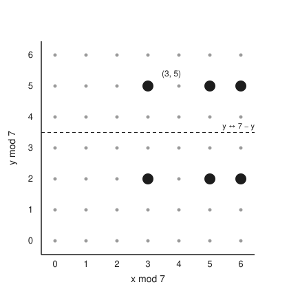
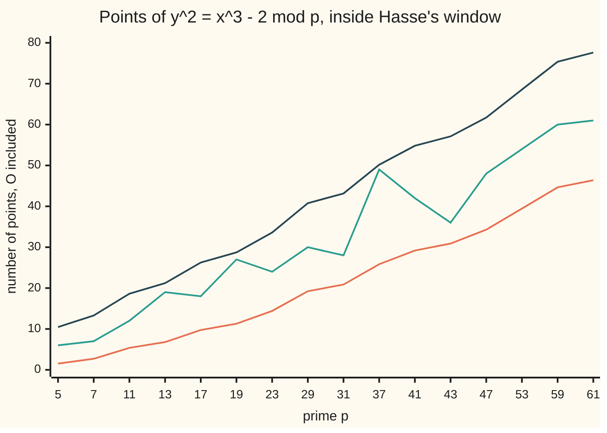

# The curve mod p: counting its points, and Hasse's bound on the count

[Syllabus](../../../SYLLABUS.md) → [Algebraic geometry](../README.md) → [Elliptic Curves](../README.md#s04) → The curve mod p

---

## General Overview

The curve y² = x³ − 2 passes through the point (3, 5), since 5² = 25 = 27 − 2. Over the rationals (fractions), its points are infinitely many and hard to list. Now read every number as its remainder mod 7, the way a clock reads hours ([Congruence](../../02-Number%20theory/03-Clock%20Arithmetic/01-congruence-mod-n.md)). Then x and y each take only seven values, 0 to 6, and the curve has finitely many points. They can be counted.

Trying all 49 pairs (x, y) finds six that fit: (3, 2), (3, 5), (5, 2), (5, 5), (6, 2) and (6, 5). Add the curve's zero point O, the point at infinity from [The group law](01-elliptic-curves-and-the-group-law.md), and the curve mod 7 has **7 points**. The house point (3, 5) is one of them.

There is a faster count. For each x, ask one question: is x³ − 2 a square mod 7? A yes gives two points, y and 7 − y. A no gives none. A zero gives one. Seven questions replace 49 trials, and the square test needs no list ([Quadratic residues](../../21-Algebraic%20and%20analytic%20number%20theory/03-Characters%20and%20L-functions/02-quadratic-residues-and-the-legendre-symbol.md)).

The count is not free to be anything. Hasse's theorem says it always lies within 2√p of p + 1. For p = 7 that window is 8 ± 5.29, from 2.71 to 13.29, and 7 sits inside. Last, two primes break the curve: mod 2 and mod 3 it grows a sharp point and stops being an elliptic curve. They are the **primes of bad reduction**, and they are exactly the primes that divide the curve's discriminant, −1728.

Why count at all? An elliptic-curve key lives in the group of points mod a large prime, and the count is the size of that group. Hasse's theorem says that size is p, give or take a little.

**Read mod a prime p, the curve has finitely many points: each x gives one point plus the square test's ±1, the total always lies within 2√p of p + 1, and only the primes that divide the discriminant, here 2 and 3, break the curve.**

**What kind of fact this is:** the counting rule and the bad-prime test are theorems, proved on this card in Why it works. Hasse's bound is a theorem, published in full in 1936; its proof is outlined in Why it works, with the two facts it borrows named and sourced. The code checks it exactly for all 166 primes from 5 to 997.

### The picture: the curve's points mod 7

<p align="center"></p>

Drawn to scale: one grid step for each remainder. The six large dots are the curve's points mod 7; the seventh point, O, has no place on the grid. The dots pair up across the dashed line, because y and 7 − y have the same square. This is the curve over the 7-element field only; it shows none of its rational or real points.

---

## The formula

Notation first, in words. This card introduces three names.

- $`\mathbb{F}_p`$ is the field of remainders 0 to p − 1, with adding and multiplying that wrap round at a prime $`p`$. It is wing 03's GF(p) ([Finite fields](../../03-Algebra/09-Rings%20and%20Fields/05-finite-fields.md)).
- $`\#E(\mathbb{F}_p)`$ is the number of points on the curve $`E`$ with both coordinates in $`\mathbb{F}_p`$, plus $`O`$. Read "the number of points of E over F p".
- $`a_p = p + 1 - \#E(\mathbb{F}_p)`$ is how far the count falls short of $`p + 1`$. Its name is the **trace of Frobenius**, explained in Step 4.

The Legendre symbol $`(v/p)`$ is +1 when $`v`$ is a nonzero square mod $`p`$, −1 when it is not a square, and 0 when $`p`$ divides $`v`$ ([Quadratic residues](../../21-Algebraic%20and%20analytic%20number%20theory/03-Characters%20and%20L-functions/02-quadratic-residues-and-the-legendre-symbol.md)). With it, the count is one line:

```math
\#E(\mathbb{F}_p) = 1 + \sum_{x=0}^{p-1}\left(1 + \left(\frac{x^3 - 2}{p}\right)\right) = p + 1 + \sum_{x=0}^{p-1}\left(\frac{x^3 - 2}{p}\right)
```

**Read it aloud:** one point for O, then for each x one point plus the square test's answer; that is p + 1 plus the sum of the answers.

Hasse's theorem bounds the shortfall:

```math
\lvert a_p\rvert \le 2\sqrt{p}, \qquad\text{that is}\qquad p + 1 - 2\sqrt{p} \;\le\; \#E(\mathbb{F}_p) \;\le\; p + 1 + 2\sqrt{p}
```

**Read it aloud:** the number of points mod p is never further than two square roots of p from p plus one.

The bad primes come from the discriminant. For a curve $`y^2 = x^3 + ax + b`$ it is

```math
\Delta = -16\,(4a^3 + 27b^2), \qquad\text{here}\qquad \Delta = -16 \times 27 \times 4 = -1728 = -2^6 \cdot 3^3
```

**Read it aloud:** the discriminant is minus sixteen times four a cubed plus twenty-seven b squared; for this curve it is minus 1728, and its only prime factors are 2 and 3.

Here $`\Delta`$ is −16 times the quantity $`4a^3 + 27b^2`$ that wing 05's [Elliptic curves](../../05-Geometry%20and%20trig/06-Beyond%20Euclid/05-elliptic-curves-and-point-addition.md) tests; [Weierstrass form](02-weierstrass-forms-discriminant-and-j-invariant.md) explains the factor. A prime $`p`$ is **bad** when $`p`$ divides $`\Delta`$, and **good** otherwise.

With the card's numbers, mod 7: three values of x give +1 and four give −1, so the count is 7 + 1 − 1 = 7 and $`a_7 = 1`$. The window is 8 ± 5.29.

| Symbol | Plain meaning | In our example | Push it up and the answer… |
| --- | --- | --- | --- |
| $`p`$ | a prime: the size of the clock | 7 | the count grows with it, about p + 1 |
| $`\mathbb{F}_p`$, $`\mathbb{F}_{49}`$, $`i`$ | the field of remainders mod p; a field of 49 elements (Step 5), built with a new square root i of −1 | 0 to 6 | — |
| $`x`$, $`y`$ | coordinates, each a remainder mod p | (3, 5) | — |
| $`v`$, $`(v/p)`$ | the value $`x^3 - 2`$ mod p; its Legendre symbol: +1 square, −1 not, 0 zero | v = 4 at x = 3; (4/7) = +1 | — |
| $`O`$ | the point at infinity, the zero of the group law | one point | — |
| $`E`$, $`\#E(\mathbb{F}_p)`$ | the curve; its number of points mod p, O included | 7 | — |
| $`a_p`$ | the trace of Frobenius: p + 1 minus the count | 1 | count falls |
| $`2\sqrt{p}`$ | the half-width of Hasse's window | 5.2915 | wider window, but only as fast as √p |
| $`a`$, $`b`$, $`\Delta`$, $`u`$ | the curve's coefficients in $`y^2 = x^3 + ax + b`$; its discriminant; a rescaling factor for coordinates | 0, −2; −1728 | — |
| $`P`$, $`nP`$, $`Q`$ | the house point (3, 5); P added to itself n times; any point of the curve | 2P mod 7 is (5, 5) | — |
| $`\varphi`$; $`m`$, $`n`$, $`q`$ | the Frobenius map, which raises both coordinates to the power p; whole numbers in the proof; the degree as a formula in m and n | $`\varphi(x, y) = (x^7, y^7)`$ | — |
| $`T`$, $`\alpha`$, $`\beta`$, $`k`$; $`c`$, $`d`$ | Step 5: an unknown; the two roots of $`T^2 - a_pT + p`$; the power in a field of $`p^k`$ elements; the parts of c + d·i | k = 2 | — |

### When it holds

- **The prime is odd.** Each nonzero square then has two roots, y and p − y. Mod 2 they coincide, and Euler's square test, which raises to the power (p − 1)/2, has nothing to say.
- **The prime is good: it does not divide Δ.** Mod 3 the curve has a sharp point at (2, 0), a cusp. The chord-and-tangent rule fails there, so the four points mod 3 are not a group, and Hasse's theorem, which is about smooth curves, does not apply.
- **The equation is minimal.** A change of coordinates x = u²x′, y = u³y′ divides Δ by $`u^{12}`$ and can remove a bad prime. Here −1728 = −2⁶ · 3³ has no twelfth power to remove, so 2 and 3 are bad for this curve under every equation.
- **The coefficients are whole numbers.** Reading the curve mod p needs integers, or at least fractions with no p below the line.
- **A count mod p sees only the curve mod p.** It does not list the rational points. It constrains them: at a good odd prime the rational points of finite order map one for one into the points mod p ([Torsion points](04-torsion-and-nagell-lutz.md)).

---

## Why it works

### Step 0: count by x, not by pairs

In a field, a number has at most two square roots. So instead of trying every pair (x, y), take each x, work out v = x³ − 2, and ask how many y have y² = v. The answer is 0, 1 or 2, and the Legendre symbol already knows which.

Hasse's bound has a different idea behind it. The sum of p answers of +1 or −1 looks like p coin tosses, which typically land about √p from zero. Hasse's theorem says the sum never strays further than 2√p. The reason is a symmetry of the curve, the Frobenius map, in Step 4.

### Step 1: each x gives 1 + (v/p) points

Take an odd prime p and a value v.

1. If v is 0, then y² = 0 forces y = 0: one point.
2. If v is a nonzero square, say y² = v, then (p − y)² = v too. The two roots differ, because y = p − y would need 2y = p, impossible for odd p. A degree-2 equation has at most two roots in a field, so there are exactly two points.
3. If v is not a square, there are no points.

In all three cases the number of points is 1 + (v/p): 1 + 0, 1 + 1 or 1 − 1. Euler's test computes the symbol as $`v^{(p-1)/2}`$ mod p ([Quadratic residues](../../21-Algebraic%20and%20analytic%20number%20theory/03-Characters%20and%20L-functions/02-quadratic-residues-and-the-legendre-symbol.md)).

### Step 2: add up over x

Sum 1 + (v/p) over the p values of x and add O: that is the formula. Mod 7, Euler's power is 3.

- x = 3, 5, 6 give v = 4, and 4³ = 64 leaves 1: a square, two points each.
- x = 0 gives v = 5, and x = 1, 2, 4 give v = 6; 5³ and 6³ both leave 6, which is −1: no points.

So the count is 3 × 2 + 1 = 7, and the trace is $`a_7 = 8 - 7 = 1`$.

### Step 3: the points form a group, and reduction keeps adding

At a good prime the chord-and-tangent rule works mod p, with division done by the multiplying partner ([Adding points by formula](03-point-arithmetic-and-double-and-add.md)). So the 7 points form a group. By Lagrange's theorem a point's order divides the group's size ([Cosets and Lagrange's theorem](../../03-Algebra/08-Groups/04-cosets-and-lagranges-theorem.md)).

The multiples of (3, 5) mod 7 run (3, 5), (5, 5), (6, 2), (6, 5), (5, 2), (3, 2), then O at 7P. That is a second count of 7: one point visits all six others.

Reading a point mod p is called **reduction**, and at a good prime it respects adding. Over the rationals, 2P is (129/100, −383/1000). Mod 7, 100 leaves 2, and 2 × 4 leaves 1, so dividing by 100 means multiplying by 4. Then 129/100 reads as 3 × 4 = 12, which leaves 5, and 2P reads as (5, 5): the same point that doubling mod 7 gives. 3P = (164323/29241, −66234835/5000211) reads as (6, 2), again a match.

Over the rationals, P never returns to O: 2P has fractional coordinates, so by the Nagell–Lutz test P has infinite order ([Torsion points](04-torsion-and-nagell-lutz.md)). Mod 7 its endless list folds into a cycle of 7.

### Step 4: Hasse's bound, from the Frobenius map

The Frobenius map φ raises both coordinates to the power p: φ(x, y) = (x^p, y^p). It is a symmetry of the curve, studied in the number-theory wing's [Finite fields](../../21-Algebraic%20and%20analytic%20number%20theory/05-Fields%20and%20Galois%20Theory/09-finite-fields-and-frobenius.md). Two facts make it useful.

1. **It keeps the curve.** Raising to the power p respects adding and multiplying mod p, and it fixes the coefficients 0 and −2. So if (x, y) is on the curve over a larger field, so is (x^p, y^p).
2. **Its fixed points are the points mod p.** By Fermat's little theorem, $`x^p = x`$ exactly when x lies in $`\mathbb{F}_p`$. So the points mod p are the points Q with φ(Q) = Q.

Now treat 1 − φ as a map of the curve: Q goes to Q − φ(Q). It sends Q to O exactly when φ(Q) = Q. So the count is the number of points that 1 − φ sends to O.

Two facts are borrowed, with proof in Silverman's book (Sources). Each map of this kind has a **degree** ([Isogenies](11-isogenies-and-the-dual-isogeny.md)): a whole number, never negative, that measures its size the way degree measures a polynomial. First, for 1 − φ the degree equals the number of points sent to O. Second, the degree of m − nφ, for whole numbers m and n, is

```math
\deg(m - n\varphi) = m^2 - a_p\,mn + p\,n^2
```

**Read it aloud:** the degree of m minus n times Frobenius is m squared, minus the trace times m times n, plus p times n squared.

Degrees are never negative. A quadratic expression that is never negative has a discriminant at most zero: $`a_p^2 - 4p \le 0`$. That is Hasse's bound.

Why "trace": as a map of the curve, φ obeys $`\varphi^2 - a_p\varphi + p = 0`$ (Silverman, Sources). Every 2 × 2 matrix obeys a rule of the same shape: its square, minus its trace (the sum of its diagonal entries) times itself, plus its determinant, is zero. So $`a_p`$ plays the part of φ's trace, and p, the degree of φ, plays the determinant.

<details>
<summary>Detailed proof: from "never negative" to the bound</summary>

Write $`q(m, n) = m^2 - a_p\,mn + p\,n^2`$. Set m = 1, n = 0 and m = 0, n = 1: the degrees of 1 and of φ are 1 and p. Then m = n = 1 gives the degree of 1 − φ, which is the count $`p + 1 - a_p`$. So the formula and the definition of $`a_p`$ agree.

Scaling m and n by the same whole number multiplies q by that number squared. So q is never negative at fractions m and n either. Any real pair is a limit of fraction pairs, and q is continuous, so q is never negative for real m and n.

Complete the square:

$`\displaystyle 4\,q(m, n) = (2m - a_p\,n)^2 + (4p - a_p^2)\,n^2`$

Choose n = 1 and m = $`a_p/2`$. The first term is zero, so $`4q = 4p - a_p^2`$. Since q is never negative, $`a_p^2 \le 4p`$, which is $`\lvert a_p\rvert \le 2\sqrt{p}`$.

</details>

### The picture: the count against p



Orange: the window's floor, p + 1 − 2√p. Green: the count. Dark blue: the window's ceiling, p + 1 + 2√p. The count zigzags inside the band. At p = 37 it reaches 49, just under the ceiling 50.17.

### Step 5: a check of the Frobenius picture, over 49 elements

The same theory predicts counts over larger fields. Factor $`T^2 - a_p T + p`$ as $`(T - \alpha)(T - \beta)`$. Then over the field of $`p^k`$ elements the count is $`p^k + 1 - \alpha^k - \beta^k`$ (Silverman, Sources). For k = 2, $`\alpha^2 + \beta^2 = a_p^2 - 2p`$.

Mod 7 that predicts 49 + 1 − (1 − 14) = 63 points over $`\mathbb{F}_{49}`$, built as the numbers c + d·i with i² = −1 (−1 is not a square mod 7, so i is new). The code counts all 2,401 pairs there and finds 63.

### Step 6: when p leaves 2 on division by 3, the count is exactly p + 1

The chart's counts at 5, 11, 17, 23, 29, 41, 47, 53 and 59 are 6, 12, 18 and so on: exactly p + 1. Each of those primes leaves remainder 2 on division by 3.

For such p, 3 shares no factor with p − 1, so cubing shuffles the remainders mod p without repeats. Then x³ − 2 runs over every remainder exactly once. Half of the nonzero remainders are squares and half are not, so the symbols sum to zero. The count is p + 1 and $`a_p = 0`$. A curve with $`a_p = 0`$ mod p is called **supersingular** at p. The code confirms all 86 such primes from 5 to 997.

### Step 7: the bad primes, two ways

A point is **singular** when both slopes of $`y^2 - x^3 - ax - b`$ vanish there: 2y = 0 and 3x² + a = 0. The tangent is undefined, so the group law breaks.

- **For p above 3**, here a = 0: 2y = 0 forces y = 0, and 3x² = 0 forces x = 0. The curve then needs 0 = 0 − 2, so p divides 2. No such p: the curve is smooth.
- **Mod 3**, x³ − 2 is x³ + 1 = (x + 1)³, a triple root at x = 2. The point (2, 0) is a cusp. The curve mod 3 has 4 points with O.
- **Mod 2**, the slope 2y is always 0, so every short curve $`y^2 = x^3 + ax + b`$ is singular. Here y² = x³, with a cusp at (0, 0) and 3 points with O.

In general, the cubic $`x^3 + ax + b`$ has a repeated root mod p exactly when p divides $`4a^3 + 27b^2`$. So the singular hunt and the factoring of Δ = −2⁶ · 3³ name the same primes: 2 and 3.

---

## Worked numbers, by hand

| Step | Arithmetic | Value |
| --- | --- | --- |
| values of x³ − 2 mod 7, for x = 0 to 6 | 0 − 2, 1 − 2, 8 − 2, 27 − 2, … | 5, 6, 6, 4, 6, 4, 4 |
| Euler's test on 4 | 4³ = 64 = 9 × 7 + 1 | +1: a square |
| Euler's test on 5 and 6 | 5³ = 125 = 17 × 7 + 6; 6³ = 216 = 30 × 7 + 6 | −1: not squares |
| points per x | 0, 0, 0, 2, 0, 2, 2 | 6 |
| add O | 6 + 1 | **7** |
| trace | 7 + 1 − 7 | $`a_7 = 1`$ |
| Hasse's window | 2√7 = 5.2915; 8 − 5.29 to 8 + 5.29 | 2.71 to 13.29: inside |
| discriminant | −16 × 27 × 4 | −1728 = −2⁶ · 3³ |
| bad primes | the primes dividing −1728 | **2 and 3** |

Mod 7 the curve has 7 points, well inside Hasse's window, and the curve stays smooth at every prime except 2 and 3.

### What breaks if you drop a piece

| Mistake | Comes out at | What went wrong |
| --- | --- | --- |
| Leave out O | 6 | O is a point of the curve, the group's zero; without it no group, and $`a_7`$ reads 2 |
| One point per square x | 4 | each nonzero square has two roots, y and 7 − y |
| Fermat's exponent p − 1 in Euler's test | 15, outside the window 2.71 to 13.29 | every nonzero number to the power p − 1 leaves 1, so every x looks like a square |
| Count at the bad prime 3 | 4 points, one of them the cusp (2, 0) | 3 divides Δ; with no tangent at (2, 0), the points are not a group |

The code prints all four.

---

## Code, from first principles, and it actually runs

The program counts the points mod 7 by trying all 49 pairs and by Euler's test, then a third way: the multiples of (3, 5) visit all seven points. It doubles and triples (3, 5) over the rationals and reads the answers mod 7. It counts the 2,401 pairs over the 49-element field against the Frobenius prediction. It finds the bad primes by factoring Δ and, separately, by hunting singular points. Last, it tests Hasse's bound exactly, as $`a_p^2 \le 4p`$, at every prime from 5 to 997, and prints the chart's points.

### Python

```python
# The curve mod p and Hasse's bound -- the check behind the card.  Nothing is
# imported.  The curve is y^2 = x^3 - 2, with the rational point (3, 5).  Its
# points mod p are counted three ways: by trying every pair (x, y), by Euler's
# square test on each x, and over the 49-element field, where Frobenius
# predicts the count.  Bad primes come from the discriminant and, separately,
# from a hunt for singular points.
B = -2                                       # the curve is y^2 = x^3 + B

def f(x, p):                                 # the right-hand side, mod p
    return (x * x * x + B) % p

def power(a, k, p):                          # square-and-multiply, mod p
    out, a = 1, a % p
    while k:
        if k & 1:
            out = out * a % p
        a, k = a * a % p, k >> 1
    return out

def euler(v, p):                             # Euler's test: +1, -1 or 0
    t = power(v, (p - 1) // 2, p)
    return -1 if t == p - 1 else t

def count_pairs(p):                          # road 1: every pair, plus O
    return 1 + sum(1 for x in range(p) for y in range(p) if (y * y - f(x, p)) % p == 0)

def count_euler(p):                          # road 2: 1 + (f(x)/p) points per x
    return p + 1 + sum(euler(f(x, p), p) for x in range(p))

def yn(claim):
    return "yes" if claim else "no"

def primes(n):
    return [q for q in range(2, n) if all(q % d for d in range(2, q) if d * d <= q)]

def add(P, Q, p):                            # chord and tangent, mod p; None is O
    if P is None or Q is None:
        return Q if P is None else P
    (x1, y1), (x2, y2) = P, Q
    if x1 == x2 and (y1 + y2) % p == 0:
        return None
    if P == Q:
        m = 3 * x1 * x1 * power(2 * y1, p - 2, p) % p
    else:
        m = (y2 - y1) * power(x2 - x1, p - 2, p) % p
    x3 = (m * m - x1 - x2) % p
    return (x3, (m * (x1 - x3) - y1) % p)

def fadd(a, b):                              # exact fractions as (top, bottom)
    t, d = a[0] * b[1] + b[0] * a[1], a[1] * b[1]
    g = gcd(t, d)
    return (t // g, d // g)

def fmul(a, b):
    t, d = a[0] * b[0], a[1] * b[1]
    g = gcd(t, d)
    return (t // g, d // g)

def gcd(a, b):
    a, b = abs(a), abs(b)
    while b:
        a, b = b, a % b
    return a

def qadd(P, Q):                              # chord and tangent over the rationals
    (x1, y1), (x2, y2) = P, Q
    if P == Q:
        top, bot = fmul((3, 1), fmul(x1, x1)), fmul((2, 1), y1)
    else:
        top, bot = fadd(y2, (-y1[0], y1[1])), fadd(x2, (-x1[0], x1[1]))
    m = fmul(top, (bot[1] * (1 if bot[0] > 0 else -1), abs(bot[0])))
    x3 = fadd(fmul(m, m), (-(x1[0] * x2[1] + x2[0] * x1[1]), x1[1] * x2[1]))
    y3 = fadd(fmul(m, fadd(x1, (-x3[0], x3[1]))), (-y1[0], y1[1]))
    return (x3, y3)

def fq(a, p):                                # a fraction read mod p
    return a[0] * power(a[1], p - 2, p) % p

def m49(a, b):                               # the 49-element field: c + d*i, i^2 = -1
    return ((a[0] * b[0] - a[1] * b[1]) % 7, (a[0] * b[1] + a[1] * b[0]) % 7)

p = 7
print(f"curve y^2 = x^3 - 2 over F_{p}; Euler's test raises to the power {(p - 1) // 2}")
for x in range(p):
    v = f(x, p)
    print(f"x = {x}: f = {v}, f^3 = {power(v, 3, p)}, symbol {euler(v, p):+d}, points {1 + euler(v, p)}")
pts = [(x, y) for x in range(p) for y in range(p) if (y * y - f(x, p)) % p == 0]
n7, a7 = count_euler(p), p + 1 - count_euler(p)
print(f"points: {pts} and O")
print(f"count by every pair {count_pairs(p)}; by Euler's test {n7}; a_7 = {a7}")
print(f"Hasse window: {p + 1} - {2 * p ** 0.5:.4f} to {p + 1} + {2 * p ** 0.5:.4f}; inside: {yn(a7 * a7 <= 4 * p)}")
P, mults = (3, 5), [(3, 5)]
while mults[-1] is not None:
    mults.append(add(mults[-1], P, p))
print(f"multiples of (3, 5) mod 7: {mults[:-1]}, then O at {len(mults)}P")
P2 = qadd(((3, 1), (5, 1)), ((3, 1), (5, 1)))
P3 = qadd(P2, ((3, 1), (5, 1)))
for name, Q, R in (("2P", P2, mults[1]), ("3P", P3, mults[2])):
    print(f"{name} over Q = ({Q[0][0]}/{Q[0][1]}, {Q[1][0]}/{Q[1][1]}) reads mod 7 as ({fq(Q[0], 7)}, {fq(Q[1], 7)}); mod-7 sum {R}")
F49 = [(c, d) for c in range(7) for d in range(7)]
roots = {}
for y in F49:
    s = m49(y, y)
    roots[s] = roots.get(s, 0) + 1
n49 = 1 + sum(roots.get(((m49(m49(x, x), x)[0] + B) % 7, m49(m49(x, x), x)[1]), 0) for x in F49)
print(f"over F_49: counted {n49}; Frobenius predicts 49 + 1 - (a_7^2 - 14) = {50 - (a7 * a7 - 14)}")
disc, rest, bad = -16 * 27 * B * B, 16 * 27 * B * B, []
for q in primes(100):
    while rest % q == 0:
        bad, rest = bad + [q], rest // q
singular = [q for q in primes(100) if any((y * y - f(x, q)) % q == 0 and 2 * y % q == 0
            and 3 * x * x % q == 0 for x in range(q) for y in range(q))]
print(f"discriminant {disc} = -({' x '.join(f'{q}^{bad.count(q)}' for q in sorted(set(bad)))}); bad primes {sorted(set(bad))}")
print(f"primes below 100 with a singular point mod p: {singular}")
for q in (2, 3):
    cusp = [(x, y) for x in range(q) for y in range(q) if (y * y - f(x, q)) % q == 0
            and 2 * y % q == 0 and 3 * x * x % q == 0]
    print(f"mod {q}: {count_pairs(q)} points with O; singular point {cusp[0]}")
sweep = primes(1000)[2:]
counts = {q: count_euler(q) for q in sweep}
worst = max(sweep, key=lambda q: abs(q + 1 - counts[q]) / q ** 0.5)
ss = [q for q in sweep if q % 3 == 2]
print(f"primes {sweep[0]} to {sweep[-1]}: {len(sweep)}; all inside Hasse's window: {yn(all((q + 1 - counts[q]) ** 2 <= 4 * q for q in sweep))}")
print(f"closest to the edge: p = {worst}, a_p = {worst + 1 - counts[worst]}, |a_p|/(2 sqrt p) = {abs(worst + 1 - counts[worst]) / (2 * worst ** 0.5):.4f}")
print(f"primes 2 mod 3: {len(ss)}; all with exactly p + 1 points: {yn(all(counts[q] == q + 1 for q in ss))}")
for q in primes(62)[2:]:
    print(f"chart, p = {q}, count {counts[q]}, low {q + 1 - 2 * q ** 0.5:.2f}, high {q + 1 + 2 * q ** 0.5:.2f}")
print(f"mistake 1, O left out: {n7 - 1}")
print(f"mistake 2, one point per square x: {1 + sum(1 for x in range(p) if euler(f(x, p), p) == 1)}")
print(f"mistake 3, exponent p - 1 for (p - 1)/2: {1 + sum(1 + power(f(x, p), p - 1, p) for x in range(p))}")
print(f"figure, F_7 points: {' '.join(f'({x},{y})' for x, y in pts)}")
assert count_pairs(p) == n7 == 7 and len(mults) == n7                   # three roads to 7
assert all(count_pairs(q) == counts[q] for q in sweep if q < 200)       # pairs against Euler
assert n49 == 50 - (a7 * a7 - 14) == 63                                 # Frobenius over F_49
assert all((fq(Q[0], 7), fq(Q[1], 7)) == R for Q, R in ((P2, mults[1]), (P3, mults[2])))
assert sorted(set(bad)) == singular == [2, 3]                           # two roads to bad primes
assert all((q + 1 - counts[q]) ** 2 <= 4 * q for q in sweep)            # Hasse, exactly
assert all(counts[q] == q + 1 for q in ss)                              # cubing permutes F_p
print("ALL CHECKS PASS")
```

**Ran 2026-11-17 on macOS, Python 3.14.10, standard library only. All checks passed. Output, pasted from the run:**

```
curve y^2 = x^3 - 2 over F_7; Euler's test raises to the power 3
x = 0: f = 5, f^3 = 6, symbol -1, points 0
x = 1: f = 6, f^3 = 6, symbol -1, points 0
x = 2: f = 6, f^3 = 6, symbol -1, points 0
x = 3: f = 4, f^3 = 1, symbol +1, points 2
x = 4: f = 6, f^3 = 6, symbol -1, points 0
x = 5: f = 4, f^3 = 1, symbol +1, points 2
x = 6: f = 4, f^3 = 1, symbol +1, points 2
points: [(3, 2), (3, 5), (5, 2), (5, 5), (6, 2), (6, 5)] and O
count by every pair 7; by Euler's test 7; a_7 = 1
Hasse window: 8 - 5.2915 to 8 + 5.2915; inside: yes
multiples of (3, 5) mod 7: [(3, 5), (5, 5), (6, 2), (6, 5), (5, 2), (3, 2)], then O at 7P
2P over Q = (129/100, -383/1000) reads mod 7 as (5, 5); mod-7 sum (5, 5)
3P over Q = (164323/29241, -66234835/5000211) reads mod 7 as (6, 2); mod-7 sum (6, 2)
over F_49: counted 63; Frobenius predicts 49 + 1 - (a_7^2 - 14) = 63
discriminant -1728 = -(2^6 x 3^3); bad primes [2, 3]
primes below 100 with a singular point mod p: [2, 3]
mod 2: 3 points with O; singular point (0, 0)
mod 3: 4 points with O; singular point (2, 0)
primes 5 to 997: 166; all inside Hasse's window: yes
closest to the edge: p = 937, a_p = -61, |a_p|/(2 sqrt p) = 0.9964
primes 2 mod 3: 86; all with exactly p + 1 points: yes
chart, p = 5, count 6, low 1.53, high 10.47
chart, p = 7, count 7, low 2.71, high 13.29
chart, p = 11, count 12, low 5.37, high 18.63
chart, p = 13, count 19, low 6.79, high 21.21
chart, p = 17, count 18, low 9.75, high 26.25
chart, p = 19, count 27, low 11.28, high 28.72
chart, p = 23, count 24, low 14.41, high 33.59
chart, p = 29, count 30, low 19.23, high 40.77
chart, p = 31, count 28, low 20.86, high 43.14
chart, p = 37, count 49, low 25.83, high 50.17
chart, p = 41, count 42, low 29.19, high 54.81
chart, p = 43, count 36, low 30.89, high 57.11
chart, p = 47, count 48, low 34.29, high 61.71
chart, p = 53, count 54, low 39.44, high 68.56
chart, p = 59, count 60, low 44.64, high 75.36
chart, p = 61, count 61, low 46.38, high 77.62
mistake 1, O left out: 6
mistake 2, one point per square x: 4
mistake 3, exponent p - 1 for (p - 1)/2: 15
figure, F_7 points: (3,2) (3,5) (5,2) (5,5) (6,2) (6,5)
ALL CHECKS PASS
```

### Rust

Same numbers, same labels, built with `rustc --edition 2021 -O`.

```rust
// The curve mod p and Hasse's bound -- the same check as the Python, in Rust.
// No crates.  The curve is y^2 = x^3 - 2, with the rational point (3, 5).  Its
// points mod p are counted three ways: by trying every pair (x, y), by Euler's
// square test on each x, and over the 49-element field, where Frobenius
// predicts the count.  Bad primes come from the discriminant and, separately,
// from a hunt for singular points.
const B: i64 = -2;                                   // the curve is y^2 = x^3 + B
type Pt = Option<(i64, i64)>;                        // None is O
type Fr = (i128, i128);                              // exact fraction (top, bottom)

fn f(x: i64, p: i64) -> i64 { (x * x * x + B).rem_euclid(p) }

fn power(a: i64, mut k: i64, p: i64) -> i64 {        // square-and-multiply, mod p
    let (mut out, mut a) = (1, a.rem_euclid(p));
    while k > 0 {
        if k & 1 == 1 { out = out * a % p }
        a = a * a % p;
        k >>= 1;
    }
    out
}

fn euler(v: i64, p: i64) -> i64 {                    // Euler's test: +1, -1 or 0
    let t = power(v, (p - 1) / 2, p);
    if t == p - 1 { -1 } else { t }
}

fn count_pairs(p: i64) -> i64 {                      // road 1: every pair, plus O
    1 + (0..p).map(|x| (0..p).filter(|y| (y * y - f(x, p)).rem_euclid(p) == 0).count() as i64).sum::<i64>()
}

fn count_euler(p: i64) -> i64 {                      // road 2: 1 + (f(x)/p) points per x
    p + 1 + (0..p).map(|x| euler(f(x, p), p)).sum::<i64>()
}

fn primes(n: i64) -> Vec<i64> {
    (2..n).filter(|&q| (2..q).filter(|d| d * d <= q).all(|d| q % d != 0)).collect()
}

fn yn(claim: bool) -> &'static str { if claim { "yes" } else { "no" } }

fn add(pp: Pt, qq: Pt, p: i64) -> Pt {               // chord and tangent, mod p
    let ((x1, y1), (x2, y2)) = match (pp, qq) { (None, _) => return qq, (_, None) => return pp, (Some(a), Some(b)) => (a, b) };
    if x1 == x2 && (y1 + y2) % p == 0 { return None }
    let m = if pp == qq { 3 * x1 * x1 % p * power(2 * y1, p - 2, p) % p }
            else { (y2 - y1).rem_euclid(p) * power(x2 - x1, p - 2, p) % p };
    let x3 = (m * m - x1 - x2).rem_euclid(p);
    Some((x3, (m * (x1 - x3) - y1).rem_euclid(p)))
}

fn gcd(a: i128, b: i128) -> i128 { let (mut a, mut b) = (a.abs(), b.abs()); while b != 0 { (a, b) = (b, a % b) } a }

fn norm(t: i128, d: i128) -> Fr {                    // lowest terms, bottom positive
    let g = gcd(t, d) * if d < 0 { -1 } else { 1 };
    (t / g, d / g)
}

fn fadd(a: Fr, b: Fr) -> Fr {
    norm(a.0.checked_mul(b.1).unwrap() + b.0.checked_mul(a.1).unwrap(), a.1.checked_mul(b.1).unwrap())
}

fn fmul(a: Fr, b: Fr) -> Fr { norm(a.0.checked_mul(b.0).unwrap(), a.1.checked_mul(b.1).unwrap()) }

fn neg(a: Fr) -> Fr { (-a.0, a.1) }

fn qadd(pp: (Fr, Fr), qq: (Fr, Fr)) -> (Fr, Fr) {   // chord and tangent over the rationals
    let ((x1, y1), (x2, y2)) = (pp, qq);
    let (top, bot) = if pp == qq { (fmul((3, 1), fmul(x1, x1)), fmul((2, 1), y1)) }
                     else { (fadd(y2, neg(y1)), fadd(x2, neg(x1))) };
    let m = fmul(top, norm(bot.1, bot.0));
    let x3 = fadd(fmul(m, m), neg(fadd(x1, x2)));
    (x3, fadd(fmul(m, fadd(x1, neg(x3))), neg(y1)))
}

fn fq(a: Fr, p: i64) -> i64 {                        // a fraction read mod p
    (a.0.rem_euclid(p as i128) as i64) * power(a.1.rem_euclid(p as i128) as i64, p - 2, p) % p
}

fn m49(a: (i64, i64), b: (i64, i64)) -> (i64, i64) { // the 49-element field: c + d*i, i^2 = -1
    ((a.0 * b.0 - a.1 * b.1).rem_euclid(7), (a.0 * b.1 + a.1 * b.0).rem_euclid(7))
}

fn show(v: &[(i64, i64)]) -> String {
    format!("[{}]", v.iter().map(|(x, y)| format!("({}, {})", x, y)).collect::<Vec<_>>().join(", "))
}

fn main() {
    let p = 7;
    println!("curve y^2 = x^3 - 2 over F_{}; Euler's test raises to the power {}", p, (p - 1) / 2);
    for x in 0..p {
        let v = f(x, p);
        println!("x = {}: f = {}, f^3 = {}, symbol {:+}, points {}", x, v, power(v, 3, p), euler(v, p), 1 + euler(v, p));
    }
    let pts: Vec<(i64, i64)> = (0..p).flat_map(|x| (0..p).map(move |y| (x, y)))
        .filter(|&(x, y)| (y * y - f(x, p)).rem_euclid(p) == 0).collect();
    let (n7, a7) = (count_euler(p), p + 1 - count_euler(p));
    println!("points: {} and O", show(&pts));
    println!("count by every pair {}; by Euler's test {}; a_7 = {}", count_pairs(p), n7, a7);
    let w = 2.0 * (p as f64).sqrt();
    println!("Hasse window: {} - {:.4} to {} + {:.4}; inside: {}", p + 1, w, p + 1, w, yn(a7 * a7 <= 4 * p));
    let mut mults: Vec<Pt> = vec![Some((3, 5))];
    while mults[mults.len() - 1].is_some() { let next = add(mults[mults.len() - 1], Some((3, 5)), p); mults.push(next) }
    let shown: Vec<(i64, i64)> = mults[..mults.len() - 1].iter().map(|q| q.unwrap()).collect();
    println!("multiples of (3, 5) mod 7: {}, then O at {}P", show(&shown), mults.len());
    let base: (Fr, Fr) = ((3, 1), (5, 1));
    let p2 = qadd(base, base);
    let p3 = qadd(p2, base);
    let mut reads_ok = true;
    for (name, q, r) in [("2P", p2, shown[1]), ("3P", p3, shown[2])] {
        let red = (fq(q.0, 7), fq(q.1, 7));
        reads_ok &= red == r;
        println!("{} over Q = ({}/{}, {}/{}) reads mod 7 as ({}, {}); mod-7 sum ({}, {})",
                 name, q.0.0, q.0.1, q.1.0, q.1.1, red.0, red.1, r.0, r.1);
    }
    let f49: Vec<(i64, i64)> = (0..7).flat_map(|c| (0..7).map(move |d| (c, d))).collect();
    let mut roots = std::collections::HashMap::new();
    for &y in &f49 { *roots.entry(m49(y, y)).or_insert(0i64) += 1 }
    let n49 = 1 + f49.iter().map(|&x| { let c = m49(m49(x, x), x); *roots.get(&((c.0 + B).rem_euclid(7), c.1)).unwrap_or(&0) }).sum::<i64>();
    println!("over F_49: counted {}; Frobenius predicts 49 + 1 - (a_7^2 - 14) = {}", n49, 50 - (a7 * a7 - 14));
    let (disc, mut rest, mut bad) = (-16 * 27 * B * B, 16 * 27 * B * B, Vec::new());
    for q in primes(100) { while rest % q == 0 { bad.push(q); rest /= q } }
    let mut bad_set = bad.clone();
    bad_set.dedup();
    let sing = |q: i64| -> Vec<(i64, i64)> { (0..q).flat_map(|x| (0..q).map(move |y| (x, y))).filter(|&(x, y)|
        (y * y - f(x, q)).rem_euclid(q) == 0 && 2 * y % q == 0 && 3 * x * x % q == 0).collect() };
    let singular: Vec<i64> = primes(100).into_iter().filter(|&q| !sing(q).is_empty()).collect();
    let fac: Vec<String> = bad_set.iter().map(|q| format!("{}^{}", q, bad.iter().filter(|&b| b == q).count())).collect();
    println!("discriminant {} = -({}); bad primes {:?}", disc, fac.join(" x "), bad_set);
    println!("primes below 100 with a singular point mod p: {:?}", singular);
    for q in [2, 3] { let c = sing(q)[0]; println!("mod {}: {} points with O; singular point ({}, {})", q, count_pairs(q), c.0, c.1) }
    let sweep: Vec<i64> = primes(1000)[2..].to_vec();
    let counts: std::collections::HashMap<i64, i64> = sweep.iter().map(|&q| (q, count_euler(q))).collect();
    let ratio = |q: i64| ((q + 1 - counts[&q]).abs() as f64) / (q as f64).sqrt();
    let mut worst = sweep[0];
    for &q in &sweep { if ratio(q) > ratio(worst) { worst = q } }
    let ss: Vec<i64> = sweep.iter().copied().filter(|q| q % 3 == 2).collect();
    let hasse_all = sweep.iter().all(|&q| (q + 1 - counts[&q]).pow(2) <= 4 * q);
    println!("primes {} to {}: {}; all inside Hasse's window: {}", sweep[0], sweep[sweep.len() - 1], sweep.len(), yn(hasse_all));
    println!("closest to the edge: p = {}, a_p = {}, |a_p|/(2 sqrt p) = {:.4}", worst, worst + 1 - counts[&worst], ratio(worst) / 2.0);
    println!("primes 2 mod 3: {}; all with exactly p + 1 points: {}", ss.len(), yn(ss.iter().all(|&q| counts[&q] == q + 1)));
    for &q in &primes(62)[2..] {
        let s = 2.0 * (q as f64).sqrt();
        println!("chart, p = {}, count {}, low {:.2}, high {:.2}", q, counts[&q], q as f64 + 1.0 - s, q as f64 + 1.0 + s);
    }
    println!("mistake 1, O left out: {}", n7 - 1);
    println!("mistake 2, one point per square x: {}", 1 + (0..p).filter(|&x| euler(f(x, p), p) == 1).count());
    println!("mistake 3, exponent p - 1 for (p - 1)/2: {}", 1 + (0..p).map(|x| 1 + power(f(x, p), p - 1, p)).sum::<i64>());
    println!("figure, F_7 points: {}", pts.iter().map(|(x, y)| format!("({},{})", x, y)).collect::<Vec<_>>().join(" "));
    assert!(count_pairs(p) == n7 && n7 == 7 && mults.len() as i64 == n7);             // three roads to 7
    assert!(sweep.iter().filter(|&&q| q < 200).all(|&q| count_pairs(q) == counts[&q])); // pairs against Euler
    assert!(n49 == 50 - (a7 * a7 - 14) && n49 == 63);                                  // Frobenius over F_49
    assert!(reads_ok);                                                                 // reduction respects adding
    assert!(bad_set == singular && singular == vec![2, 3]);                            // two roads to bad primes
    assert!(hasse_all);                                                                // Hasse, exactly
    assert!(ss.iter().all(|&q| counts[&q] == q + 1));                                 // cubing permutes F_p
    println!("ALL CHECKS PASS");
}
```

**Ran 2026-11-17 on macOS, rustc 1.98.1, no crates. All checks passed. Output, pasted from the run:**

```
curve y^2 = x^3 - 2 over F_7; Euler's test raises to the power 3
x = 0: f = 5, f^3 = 6, symbol -1, points 0
x = 1: f = 6, f^3 = 6, symbol -1, points 0
x = 2: f = 6, f^3 = 6, symbol -1, points 0
x = 3: f = 4, f^3 = 1, symbol +1, points 2
x = 4: f = 6, f^3 = 6, symbol -1, points 0
x = 5: f = 4, f^3 = 1, symbol +1, points 2
x = 6: f = 4, f^3 = 1, symbol +1, points 2
points: [(3, 2), (3, 5), (5, 2), (5, 5), (6, 2), (6, 5)] and O
count by every pair 7; by Euler's test 7; a_7 = 1
Hasse window: 8 - 5.2915 to 8 + 5.2915; inside: yes
multiples of (3, 5) mod 7: [(3, 5), (5, 5), (6, 2), (6, 5), (5, 2), (3, 2)], then O at 7P
2P over Q = (129/100, -383/1000) reads mod 7 as (5, 5); mod-7 sum (5, 5)
3P over Q = (164323/29241, -66234835/5000211) reads mod 7 as (6, 2); mod-7 sum (6, 2)
over F_49: counted 63; Frobenius predicts 49 + 1 - (a_7^2 - 14) = 63
discriminant -1728 = -(2^6 x 3^3); bad primes [2, 3]
primes below 100 with a singular point mod p: [2, 3]
mod 2: 3 points with O; singular point (0, 0)
mod 3: 4 points with O; singular point (2, 0)
primes 5 to 997: 166; all inside Hasse's window: yes
closest to the edge: p = 937, a_p = -61, |a_p|/(2 sqrt p) = 0.9964
primes 2 mod 3: 86; all with exactly p + 1 points: yes
chart, p = 5, count 6, low 1.53, high 10.47
chart, p = 7, count 7, low 2.71, high 13.29
chart, p = 11, count 12, low 5.37, high 18.63
chart, p = 13, count 19, low 6.79, high 21.21
chart, p = 17, count 18, low 9.75, high 26.25
chart, p = 19, count 27, low 11.28, high 28.72
chart, p = 23, count 24, low 14.41, high 33.59
chart, p = 29, count 30, low 19.23, high 40.77
chart, p = 31, count 28, low 20.86, high 43.14
chart, p = 37, count 49, low 25.83, high 50.17
chart, p = 41, count 42, low 29.19, high 54.81
chart, p = 43, count 36, low 30.89, high 57.11
chart, p = 47, count 48, low 34.29, high 61.71
chart, p = 53, count 54, low 39.44, high 68.56
chart, p = 59, count 60, low 44.64, high 75.36
chart, p = 61, count 61, low 46.38, high 77.62
mistake 1, O left out: 6
mistake 2, one point per square x: 4
mistake 3, exponent p - 1 for (p - 1)/2: 15
figure, F_7 points: (3,2) (3,5) (5,2) (5,5) (6,2) (6,5)
ALL CHECKS PASS
```

The two outputs match line for line.

### Lean

Lean proves three rules for every prime they name, and checks the card's numbers mod 2, 3, 7, 13 and 37.

- Take an odd prime p, whole numbers a and b, and $`v = x^3 + ax + b`$. Then the curve $`y^2 = v`$ has p + 1 points mod p, plus one $`(v/p)`$ for each x, O included.
- Take any prime p and whole numbers a and b. Then the curve $`y^2 = x^3 + ax + b`$ has a singular point mod p exactly when p divides Δ.
- Take a prime p that leaves 2 on division by 3. Then $`y^2 = x^3 - 2`$ has exactly p + 1 points mod p, O included, so $`a_p = 0`$.
- Take the house point (3, 5). Then it lies on $`y^2 = x^3 - 2`$.
- Take x = 0 to 6 mod 7. Then x³ − 2 takes the values 5, 6, 6, 4, 6, 4, 4.
- Take Euler's test mod 7. Then 4³ leaves 1, and 5³ and 6³ leave 6, that is −1.
- Take the Legendre symbols mod 7. Then (4/7) = +1 and (5/7) = (6/7) = −1, and the seven symbols for x = 0 to 6 sum to −1.
- Take all 49 pairs mod 7. Then exactly six fit: (3, 2), (3, 5), (5, 2), (5, 5), (6, 2) and (6, 5).
- Take the curve mod 7. Then it has 7 points, O included, and $`a_7^2 = 1`$ is at most 4 × 7 = 28.
- Take p = 13 and p = 37. Then the counts are 19 and 49, and $`a_p^2`$ is 36 ≤ 52 and 121 ≤ 148.
- Take the house curve. Then Δ = −1728 = −2⁶ · 3³.
- Take the bad primes 3 and 2. Then the curve has 4 and 3 points, O included, with singular points (2, 0) and (0, 0).

The Python and Rust checks keep Hasse's bound up to 997, the count over $`\mathbb{F}_{49}`$ and the multiples of (3, 5).

```lean
-- The curve mod p: at an odd prime p the curve y^2 = x^3 + ax + b has exactly p + 1 plus the sum of the Legendre symbols of x^3 + ax + b points, O included; mod a prime with p = 2 mod 3 the curve y^2 = x^3 - 2 has exactly p + 1; and a prime breaks the curve exactly when it divides the discriminant.
import Mathlib.AlgebraicGeometry.EllipticCurve.Affine.Basic
import Mathlib.NumberTheory.LegendreSymbol.Basic
import Mathlib.Tactic.NormNum.LegendreSymbol
import Mathlib.Data.ZMod.Basic

open WeierstrassCurve

/-- The short Weierstrass curve `y^2 = x^3 + a x + b`, as a Mathlib `WeierstrassCurve`
with `a₁ = a₂ = a₃ = 0`, `a₄ = a` and `a₆ = b`. -/
abbrev shortWeierstrass {K : Type*} [CommRing K] (a b : K) : WeierstrassCurve K :=
  { a₁ := 0, a₂ := 0, a₃ := 0, a₄ := a, a₆ := b }

/-- `#E(𝔽_p)`: the number of pairs `(x, y)` mod `p` with `y^2 = x^3 + a x + b`, plus one for the
point at infinity `O`. The whole-number coefficients `a` and `b` are read mod `p`. -/
def pointCount (p : ℕ) [NeZero p] (a b : ℤ) : ℕ :=
  (Finset.univ.filter fun xy : ZMod p × ZMod p =>
    xy.2 ^ 2 = xy.1 ^ 3 + (a : ZMod p) * xy.1 + (b : ZMod p)).card + 1

theorem sum_range_eq_sum_zmod (p : ℕ) [NeZero p] {M : Type*} [AddCommMonoid M]
    (f : ZMod p → M) : ∑ n ∈ Finset.range p, f (n : ZMod p) = ∑ x : ZMod p, f x := by
  refine Finset.sum_nbij' (fun n => (n : ZMod p)) ZMod.val ?_ ?_ ?_ ?_ ?_
  · intro n _; simp
  · intro x _; simpa using ZMod.val_lt x
  · intro n hn; simpa using ZMod.val_cast_of_lt (Finset.mem_range.mp hn)
  · intro x _; simp
  · intro n _; rfl

#print axioms sum_range_eq_sum_zmod

theorem natCast_ne_zero_of_lt_prime (p : ℕ) [Fact p.Prime] {n : ℕ} (hn0 : 0 < n) (hnp : n < p) :
    (n : ZMod p) ≠ 0 := by
  intro h
  rw [ZMod.natCast_eq_zero_iff] at h
  exact absurd (Nat.le_of_dvd hn0 h) (by omega)

#print axioms natCast_ne_zero_of_lt_prime

theorem singular_point_of_disc_zero_two : ∀ A B : ZMod 2, -16 * (4 * A ^ 3 + 27 * B ^ 2) = 0 →
    ∃ x y : ZMod 2, y ^ 2 = x ^ 3 + A * x + B ∧
      (y ^ 2 = x ^ 3 + A * x + B → 0 - (3 * x ^ 2 + A) = 0 ∧ 2 * y = 0) := by
  decide

#print axioms singular_point_of_disc_zero_two

theorem singular_point_of_disc_zero_three : ∀ A B : ZMod 3, -16 * (4 * A ^ 3 + 27 * B ^ 2) = 0 →
    ∃ x y : ZMod 3, y ^ 2 = x ^ 3 + A * x + B ∧
      (y ^ 2 = x ^ 3 + A * x + B → 0 - (3 * x ^ 2 + A) = 0 ∧ 2 * y = 0) := by
  decide

#print axioms singular_point_of_disc_zero_three

/-- The counting rule: at an odd prime `p`, each `x` gives `1 + ((x^3 + a x + b)/p)` points, so
the curve `y^2 = x^3 + a x + b` mod `p` has `p + 1 + Σ_{x=0}^{p-1} ((x^3 + a x + b)/p)` points,
`O` included. -/
theorem point_count_eq_p_add_one_add_sum_legendre (p : ℕ) [Fact p.Prime] (hp : p ≠ 2) (a b : ℤ) :
    (pointCount p a b : ℤ) =
      p + 1 + ∑ x ∈ Finset.range p, legendreSym p ((x : ℤ) ^ 3 + a * x + b) := by
  have key : ∀ c : ℤ, ((Finset.univ.filter fun y : ZMod p => y ^ 2 = (c : ZMod p)).card : ℤ) =
      legendreSym p c + 1 := by
    intro c
    rw [← legendreSym.card_sqrts p hp c]
    congr 2
    ext y; simp
  unfold pointCount
  push_cast
  rw [Finset.card_filter, Fintype.sum_prod_type]
  simp only [← Finset.card_filter]
  rw [← sum_range_eq_sum_zmod p (fun x => (Finset.univ.filter fun y : ZMod p =>
      y ^ 2 = x ^ 3 + (a : ZMod p) * x + (b : ZMod p)).card)]
  push_cast
  have h2 : ∀ n ∈ Finset.range p,
      (((Finset.univ.filter fun y : ZMod p =>
        y ^ 2 = (n : ZMod p) ^ 3 + (a : ZMod p) * n + (b : ZMod p)).card : ℕ) : ℤ) =
      legendreSym p ((n : ℤ) ^ 3 + a * n + b) + 1 := by
    intro n _
    rw [← key]
    congr 4
    ext y; push_cast; rfl
  rw [Finset.sum_congr rfl h2, Finset.sum_add_distrib]
  simp
  ring

/-- The primes of bad reduction: read mod a prime `p`, the curve `y^2 = x^3 + a x + b` with
whole-number coefficients has a singular point (a point of the curve where both slopes vanish)
exactly when `p` divides its discriminant `Δ = -16 (4a^3 + 27b^2)`. -/
theorem singular_mod_p_iff_dvd_discriminant (p : ℕ) [Fact p.Prime] (a b : ℤ) :
    (∃ x y : ZMod p, (shortWeierstrass (a : ZMod p) (b : ZMod p)).toAffine.Equation x y ∧
        ¬ (shortWeierstrass (a : ZMod p) (b : ZMod p)).toAffine.Nonsingular x y) ↔
      (p : ℤ) ∣ (shortWeierstrass a b).Δ := by
  have hΔ : (shortWeierstrass a b).Δ = -16 * (4 * a ^ 3 + 27 * b ^ 2) := by
    simp [Δ, b₂, b₄, b₆, b₈]; ring
  rw [hΔ, ← ZMod.intCast_zmod_eq_zero_iff_dvd]
  push_cast
  simp only [Affine.nonsingular_iff', Affine.equation_iff, not_and, not_or, not_not]
  simp only [zero_mul, mul_zero, add_zero]
  generalize (a : ZMod p) = A
  generalize (b : ZMod p) = B
  constructor
  · rintro ⟨x, y, he, hs⟩
    obtain ⟨h1, h2⟩ := hs he
    have hA : A = -3 * x ^ 2 := by linear_combination -h1
    have hB : B = y ^ 2 + 2 * x ^ 3 := by rw [hA] at he; linear_combination -he
    rw [hA, hB]
    linear_combination (-216 * y * (y ^ 2 + 4 * x ^ 3)) * h2
  · intro h
    have hp := (Fact.out : p.Prime)
    by_cases hp2 : p = 2
    · subst hp2
      exact singular_point_of_disc_zero_two A B h
    by_cases hp3 : p = 3
    · subst hp3
      exact singular_point_of_disc_zero_three A B h
    have hp5 : 5 ≤ p := by
      have := hp.two_le
      rcases (show p = 4 ∨ 5 ≤ p by omega) with h4 | h4
      · subst h4; exact absurd hp (by decide)
      · exact h4
    have h2 : (2 : ZMod p) ≠ 0 := by
      exact_mod_cast natCast_ne_zero_of_lt_prime p (n := 2) (by norm_num) (by omega)
    have h3 : (3 : ZMod p) ≠ 0 := by
      exact_mod_cast natCast_ne_zero_of_lt_prime p (n := 3) (by norm_num) (by omega)
    have h' : 4 * A ^ 3 + 27 * B ^ 2 = 0 := by
      have h16 : (-16 : ZMod p) ≠ 0 := by
        rw [show (-16 : ZMod p) = -(2 ^ 4) by norm_num, neg_ne_zero]
        exact pow_ne_zero _ h2
      exact (mul_eq_zero.mp h).resolve_left h16
    by_cases hA : A = 0
    · subst hA
      have hB : B = 0 := by
        have h27 : (27 : ZMod p) ≠ 0 := by
          rw [show (27 : ZMod p) = 3 ^ 3 by norm_num]; exact pow_ne_zero _ h3
        have : 27 * B ^ 2 = 0 := by linear_combination h'
        exact pow_eq_zero_iff (n := 2) (by norm_num) |>.mp ((mul_eq_zero.mp this).resolve_left h27)
      subst hB
      exact ⟨0, 0, by ring, fun _ => ⟨by ring, by ring⟩⟩
    · obtain ⟨x, hx⟩ : ∃ x : ZMod p, 2 * A * x + 3 * B = 0 :=
        ⟨-3 * B / (2 * A), by field_simp; ring⟩
      have hX : 3 * x ^ 2 + A = 0 := by
        have h4 : 4 * A ^ 2 ≠ 0 := mul_ne_zero (by
          rw [show (4 : ZMod p) = 2 ^ 2 by norm_num]; exact pow_ne_zero _ h2) (pow_ne_zero _ hA)
        have : 4 * A ^ 2 * (3 * x ^ 2 + A) = 0 := by
          linear_combination h' + 3 * (2 * A * x - 3 * B) * hx
        exact (mul_eq_zero.mp this).resolve_left h4
      have hY : x ^ 3 + A * x + B = 0 := by
        have : 3 * (x ^ 3 + A * x + B) = 0 := by linear_combination x * hX + hx
        exact (mul_eq_zero.mp this).resolve_left h3
      exact ⟨x, 0, by linear_combination -hY, fun _ => ⟨by linear_combination -hX, by ring⟩⟩

/-- Supersingular primes: when the prime `p` leaves 2 on division by 3, cubing shuffles the
remainders mod `p`, and the curve `y^2 = x^3 - 2` has exactly `p + 1` points mod `p`, so `a_p = 0`. -/
theorem point_count_eq_p_add_one_of_mod_three_eq_two (p : ℕ) [Fact p.Prime] (hp : p % 3 = 2) :
    pointCount p 0 (-2) = p + 1 := by
  have hp1 := (Fact.out : p.Prime).one_lt
  set k := (2 * p - 1) / 3 with hk
  have h3k : 3 * k = 2 * p - 1 := by omega
  have hpow : ∀ x : ZMod p, x ^ (3 * k) = x := by
    intro x
    rw [h3k, show 2 * p - 1 = (p - 1) + p by omega, pow_add, ZMod.pow_card, ← pow_succ,
      Nat.sub_add_cancel hp1.le, ZMod.pow_card]
  have hl : ∀ x : ZMod p, (x ^ 3) ^ k = x := fun x => by rw [← pow_mul, hpow]
  have hr : ∀ x : ZMod p, (x ^ k) ^ 3 = x := fun x => by rw [← pow_mul, mul_comm, hpow]
  unfold pointCount
  congr 1
  have hset : (Finset.univ.filter fun xy : ZMod p × ZMod p =>
      xy.2 ^ 2 = xy.1 ^ 3 + ((0 : ℤ) : ZMod p) * xy.1 + ((-2 : ℤ) : ZMod p)) =
      Finset.univ.image fun y : ZMod p => ((y ^ 2 + 2) ^ k, y) := by
    ext ⟨x, y⟩
    simp only [Finset.mem_filter, Finset.mem_univ, true_and, Finset.mem_image, Prod.mk.injEq]
    push_cast
    constructor
    · intro h
      rw [show y ^ 2 + 2 = x ^ 3 by linear_combination h, hl]
      exact ⟨rfl, rfl⟩
    · rintro ⟨rfl, -⟩
      rw [hr]; ring
  rw [hset, Finset.card_image_of_injective _ (fun u v h => (Prod.mk.inj h).2), Finset.card_univ,
    ZMod.card]

-- The house point (3, 5) is on y^2 = x^3 - 2.
example : (5 : ℤ) ^ 2 = 3 ^ 3 - 2 := by norm_num

-- Mod 7 the curve y^2 = x^3 - 2 has 7 points, O included, so a_7 = 8 - 7 = 1.
example : pointCount 7 0 (-2) = 7 := by decide +kernel

-- The values of x^3 - 2 mod 7 for x = 0 to 6 are 5, 6, 6, 4, 6, 4, 4.
example : ((List.range 7).map fun x : ℕ => ((x : ℤ) ^ 3 - 2) % 7) = [5, 6, 6, 4, 6, 4, 4] := by
  decide

-- Euler's test mod 7: 4^3 leaves 1 (a square), 5^3 and 6^3 leave 6, that is -1 (not squares).
example : 4 ^ 3 % 7 = 1 ∧ 5 ^ 3 % 7 = 6 ∧ 6 ^ 3 % 7 = 6 := by norm_num

-- The Legendre symbols agree: (4/7) = +1, (5/7) = -1, (6/7) = -1.
instance fact_prime_seven : Fact (Nat.Prime 7) := ⟨by decide⟩

example : legendreSym 7 4 = 1 ∧ legendreSym 7 5 = -1 ∧ legendreSym 7 6 = -1 := by
  norm_num

-- The counting rule at p = 7: three symbols +1 and four -1 sum to -1, so the count is 8 - 1 = 7.
example : ∑ x ∈ Finset.range 7, legendreSym 7 ((x : ℤ) ^ 3 + 0 * x + -2) = -1 := by
  simp [Finset.sum_range_succ]
  norm_num

-- The six affine points mod 7.
example : (Finset.univ.filter fun xy : ZMod 7 × ZMod 7 => xy.2 ^ 2 = xy.1 ^ 3 - 2) =
    {(3, 2), (3, 5), (5, 2), (5, 5), (6, 2), (6, 5)} := by decide +kernel

-- Hasse's window at p = 7: a_7^2 = 1 is at most 4 * 7 = 28.
example : (7 + 1 - (pointCount 7 0 (-2) : ℤ)) ^ 2 ≤ 4 * 7 := by decide +kernel

-- Mod 13 the count is 19, and a_13^2 = 36 is at most 52.
example : pointCount 13 0 (-2) = 19 ∧ (13 + 1 - 19 : ℤ) ^ 2 ≤ 4 * 13 := by decide +kernel

-- Mod 37 the count is 49, just under the ceiling: a_37^2 = 121 is at most 148.
example : pointCount 37 0 (-2) = 49 ∧ (37 + 1 - 49 : ℤ) ^ 2 ≤ 4 * 37 := by decide +kernel

-- The discriminant of y^2 = x^3 - 2 is -1728 = -(2^6 * 3^3).
example : (shortWeierstrass (0 : ℤ) (-2)).Δ = -1728 ∧ (-1728 : ℤ) = -(2 ^ 6 * 3 ^ 3) := by
  constructor
  · simp [Δ, b₂, b₄, b₆, b₈]
  · norm_num

-- At the bad primes: mod 3 the curve has 4 points, mod 2 it has 3, O included.
example : pointCount 3 0 (-2) = 4 ∧ pointCount 2 0 (-2) = 3 := by decide +kernel

-- The cusps: (2, 0) mod 3 and (0, 0) mod 2 are on the curve with both slopes zero.
example : ((0 : ZMod 3) ^ 2 = 2 ^ 3 - 2 ∧ 2 * (0 : ZMod 3) = 0 ∧ 3 * (2 : ZMod 3) ^ 2 = 0) ∧
    ((0 : ZMod 2) ^ 2 = 0 ^ 3 - 2 ∧ 2 * (0 : ZMod 2) = 0 ∧ 3 * (0 : ZMod 2) ^ 2 = 0) := by decide +kernel

#print axioms point_count_eq_p_add_one_add_sum_legendre
#print axioms singular_mod_p_iff_dvd_discriminant
#print axioms point_count_eq_p_add_one_of_mod_three_eq_two
```

**Checked 2026-11-17 on macOS, Lean 4.36.0-rc2, Mathlib v4.36.0-rc2. Every proof is complete and uses only Lean's standard axioms. Output, pasted from the run:**

```
'sum_range_eq_sum_zmod' depends on axioms: [propext, Classical.choice, Quot.sound]
'natCast_ne_zero_of_lt_prime' depends on axioms: [propext, Classical.choice, Quot.sound]
'singular_point_of_disc_zero_two' depends on axioms: [propext, Classical.choice, Quot.sound]
'singular_point_of_disc_zero_three' depends on axioms: [propext, Classical.choice, Quot.sound]
'point_count_eq_p_add_one_add_sum_legendre' depends on axioms: [propext, Classical.choice, Quot.sound]
'singular_mod_p_iff_dvd_discriminant' depends on axioms: [propext, Classical.choice, Quot.sound]
'point_count_eq_p_add_one_of_mod_three_eq_two' depends on axioms: [propext, Classical.choice, Quot.sound]
```

> [!TIP]
> **Try changing**
> Guess first, then run it.
> - **Another prime.** Set `p = 7` to `p = 13`. The count is 19, inside the window 6.79 to 21.21, and the wrong exponent now gives 27. The first assert is pinned to 7, so it stops the run.
> - **A longer sweep.** Change `primes(1000)[2:]` to `primes(3000)[2:]`. All 428 primes stay inside; the closest is p = 2659, with $`a_p = -103`$ at 0.9987 of the edge. The edge is approached, never crossed.
> - **Break Euler's test.** Change `(p - 1) // 2` to `p - 1` in `euler`. The count by Euler's test becomes 15, every window check says no, and the first assert stops it.
> - **Let a bad prime in.** Change `primes(1000)[2:]` to `primes(1000)[1:]`. The prime 3 joins with 4 points, inside its window, and nothing fails. Hasse's window cannot spot a bad prime; only Δ can.

---

## The usual mistake

> [!warning]
> **Forgetting the point at infinity.** Counting only the pairs (x, y) gives 6 mod 7, not 7. O is a genuine point of the curve, the zero of its group, and every formula on this card counts it: p + 1, Hasse's window and Lagrange's theorem all need it.
>
> - **One point per square.** Each x with x³ − 2 a nonzero square gives two points, y and p − y. Counting one gives 4 mod 7.
> - **Raising to p − 1 instead of (p − 1)/2.** Fermat's power gives 1 for every nonzero number, so every x looks like a square: 15 points, outside Hasse's window.
> - **Trusting the count at a bad prime.** Mod 3 the count is 4, inside the window, yet the curve has a cusp at (2, 0) and no group law. Check Δ first.

---

## Where you meet it in real life

- **Elliptic-curve keys.** A key lives in the group of points mod a large prime, and its size must be known exactly. Hasse's theorem says a 256-bit prime gives a group of about 256 bits; the exact count needs Schoof's method ([Curves for keys](09-elliptic-curve-cryptography-and-schoof.md)). A 7-point group is a toy, not a key.
- **Avoiding weak curves.** Mod a prime that leaves 2 on division by 3, this curve has exactly p + 1 points. Curves with $`a_p = 0`$ like this are supersingular, and their discrete logarithms move into a larger finite field where they are easier, so key standards check $`a_p`$.
- **Factoring by elliptic curves.** Lenstra's method reduces a random curve mod an unknown prime factor. It succeeds when the count there has only small prime factors. Hasse's theorem keeps every count inside the window round p + 1, and different curves land at different places in it.
- **Tables of curves.** The traces $`a_p`$ at good primes are the raw data of a curve's L-function ([The L-function](07-l-functions-of-elliptic-curves.md)), and Birch and Swinnerton-Dyer compared products of $`\#E(\mathbb{F}_p)/p`$ with the rank ([Birch and Swinnerton-Dyer](08-birch-and-swinnerton-dyer-statement.md)).

> **Say it back**
> Read mod a prime p, an elliptic curve has finitely many points, so they can be counted. Each x gives one point plus the Legendre symbol of x³ − 2, so mod 7 the curve y² = x³ − 2 has 7 points, O included. Hasse's theorem keeps the count within 2√p of p + 1, here inside 2.71 to 13.29, because the Frobenius map's degree is never negative. The primes that divide the discriminant −1728, here 2 and 3, give a cusp instead of a curve.

---

## What this builds on

- [Torsion points](04-torsion-and-nagell-lutz.md): the Nagell–Lutz test that shows (3, 5) has infinite order, and the use of counts mod p to bound torsion.
- [Finite fields](../../03-Algebra/09-Rings%20and%20Fields/05-finite-fields.md): the field of remainders mod p, and fields such as the 49-element one.
- [Congruence](../../02-Number%20theory/03-Clock%20Arithmetic/01-congruence-mod-n.md): reading every number as its remainder mod p.
- [Quadratic residues](../../21-Algebraic%20and%20analytic%20number%20theory/03-Characters%20and%20L-functions/02-quadratic-residues-and-the-legendre-symbol.md): the Legendre symbol and Euler's test, which decide each x.
- [Elliptic curves](../../05-Geometry%20and%20trig/06-Beyond%20Euclid/05-elliptic-curves-and-point-addition.md): the chord-and-tangent rule, and a curve mod 7 listed by trying every pair.

## Where this goes next

- [Mordell-Weil](06-mordell-weil-and-rank.md): the rational points form a finitely generated group, and reduction mod good primes helps find its torsion.
- [Curves for keys](09-elliptic-curve-cryptography-and-schoof.md): curves mod primes of 256 bits, and Schoof's method that counts their points without listing them.
- [The L-function](07-l-functions-of-elliptic-curves.md): the traces $`a_p`$ assembled into one function.
- [Isogenies](11-isogenies-and-the-dual-isogeny.md): maps between elliptic curves that respect addition, and the dual that undoes them up to a multiple.
- [Complex multiplication](12-complex-multiplication.md): curves with extra symmetries, and point counts read from p = a^2 + b^2.
- [The Weil conjectures](../08-Sheaf%20Cohomology%20and%20Differentials/07-weil-conjectures-and-etale-cohomology.md): point counts over every F_(q^n) packed into one rational function, explained by etale cohomology.

The traces $`a_p`$ zigzag inside Hasse's window with no visible pattern; how they are spread across it, prime after prime, this card leaves open.

---

## Sources

Verified 2026-11-17: every link below resolves to the publisher's page.

- Silverman, Joseph H., and John Tate. *Rational Points on Elliptic Curves*, 2nd ed. Springer, 2015. [doi:10.1007/978-3-319-18588-0](https://doi.org/10.1007/978-3-319-18588-0). Points over finite fields, reduction mod p, and its use with Nagell–Lutz.
- Silverman, Joseph H. *The Arithmetic of Elliptic Curves*, 2nd ed. Springer, 2009. [doi:10.1007/978-0-387-09494-6](https://doi.org/10.1007/978-0-387-09494-6). Chapter V proves Hasse's bound from the degree of m − nφ and gives the count over larger fields; Chapter VII treats good and bad reduction and minimal equations.
- Hasse, Helmut. "Zur Theorie der abstrakten elliptischen Funktionenkörper III." *Journal für die reine und angewandte Mathematik* 175 (1936). [doi:10.1515/crll.1936.175.193](https://doi.org/10.1515/crll.1936.175.193). The original proof of the bound.
- Washington, Lawrence C. *Elliptic Curves: Number Theory and Cryptography*, 2nd ed. Chapman and Hall/CRC, 2008. [doi:10.1201/9781420071474](https://doi.org/10.1201/9781420071474). Counting with the Legendre symbol, supersingular curves, and the Frobenius count over larger fields.
- Koblitz, Neal. "Elliptic curve cryptosystems." *Mathematics of Computation* 48 (1987). [doi:10.1090/S0025-5718-1987-0866109-5](https://doi.org/10.1090/S0025-5718-1987-0866109-5). Why the group of points mod p, and its count, matter for keys.
