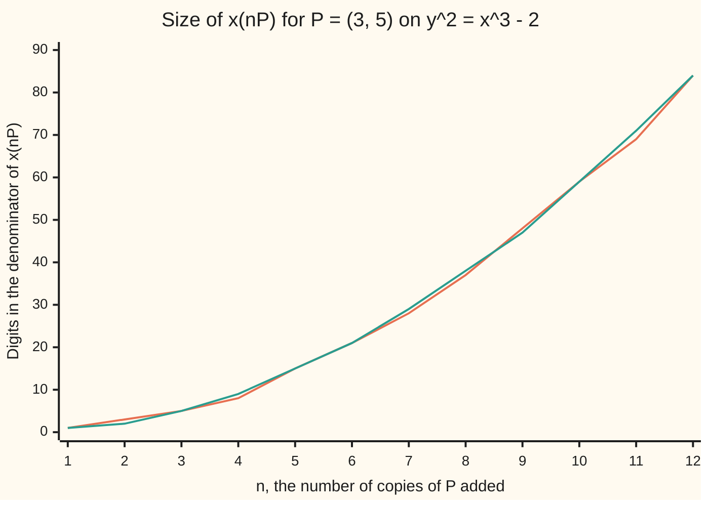
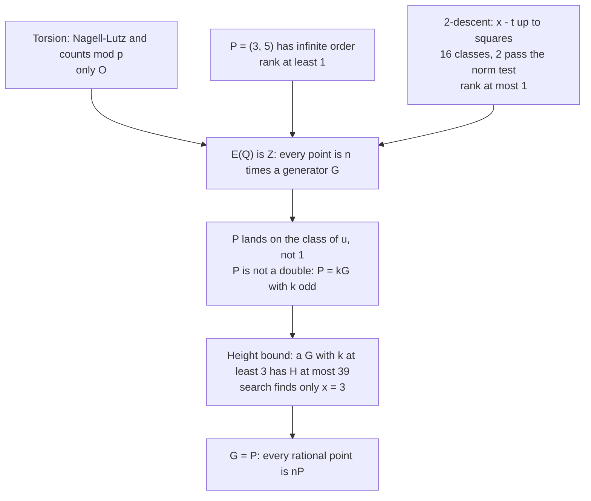

# Mordell-Weil: every rational point comes from a finite list of them

[Syllabus](../../../SYLLABUS.md) → [Algebraic geometry](../README.md) → [Elliptic Curves](../README.md#s04) → Mordell-Weil

---

## General Overview

Take the curve $`y^2 = x^3 - 2`$ and look for points whose coordinates are fractions. One is easy to see: $`(3, 5)`$, because $`5^2 = 25 = 27 - 2`$. Fermat noted in the 1650s that 25 and 27 are the only whole square and cube that differ by 2.

The chord and tangent rule turns one point into more. The tangent line at $`(3, 5)`$ meets the curve at one more point, and reflecting that point in the x-axis gives $`(129/100, -383/1000)`$. The next point has $`x = 164323/29241`$. By the twelfth, the denominator of $`x`$ has 84 digits.

So the curve has points without end. The question this card answers: are there rational points that do **not** come from $`(3, 5)`$? The answer is no. Every rational point on this curve is $`(3, 5)`$ added to itself some whole number of times, forwards or backwards.

The general theorem behind that answer is the **Mordell-Weil theorem**. It says every elliptic curve over the rational numbers has a finite list of points that builds all the others. The work is to find the list. This card does it for $`y^2 = x^3 - 2`$ by a **descent**: a method that shows any point is a small point plus twice another point, then shrinks points until only small ones are left.

**On an elliptic curve over the rationals, a finite list of points builds every rational point; for y² = x³ − 2 the list is the one point (3, 5), and a descent proves it.**

**What kind of fact this is:** the general statement is a theorem (Mordell 1922, Weil 1929), stated here with its key steps and a named source. The answer for $`y^2 = x^3 - 2`$ (no torsion, rank 1, generator $`(3, 5)`$) is proved on this card in Why it works. It rests on cited facts and on exact checks. The cited facts are two properties of the descent map (Step 3), three facts about the field of $`\sqrt[3]{2}`$ (Step 4) and Silverman's height bound (Step 6).

### The picture: the fractions grow like n squared



The first line counts the digits of the denominator of $`x(nP)`$. The second line is $`1.34958\, n^2 / \ln 10`$, rounded. The two agree closely: the number of digits grows like $`n^2`$. That growth is what makes a descent work. Halving a point divides its digits by about 4.

---

## The formula

Notation first, in words. The curve is $`E`$, and $`O`$ is its zero point, the point at the top of every vertical line ([The group law](01-elliptic-curves-and-the-group-law.md)). $`E(\mathbb{Q})`$ is the set of rational points together with $`O`$. $`nP`$ is the point $`P`$ added to itself $`n`$ times. A **torsion** point is one with $`nP = O`$ for some $`n \ge 1`$. The **rank** $`r`$ is the number of independent points of infinite order. [Rational points on a cubic](../../21-Algebraic%20and%20analytic%20number%20theory/07-Diophantine%20and%20Modular/05-elliptic-curves-over-q-and-mordell-weil.md) teaches both terms and states the theorem. In one line:

```math
E(\mathbb{Q}) \cong E(\mathbb{Q})_{\mathrm{tors}} \times \mathbb{Z}^{r}
```

**Read it aloud:** the rational points have the shape of a finite group of torsion points paired with lists of $`r`$ whole numbers.

The sign $`\times`$ is a direct product, pairs with each half added on its own ([Direct products](../../03-Algebra/08-Groups/07-direct-products.md)). The sign $`\cong`$ means "the same group, relabelled".

The descent counts one finite thing. $`2E(\mathbb{Q})`$ is the set of doubles: points $`2R`$ with $`R`$ rational. $`E(\mathbb{Q})/2E(\mathbb{Q})`$ is the group of points counted up to adding a double. $`E(\mathbb{Q})[2]`$ is the set of points with $`2Q = O`$. The structure above gives

```math
\lvert E(\mathbb{Q})/2E(\mathbb{Q})\rvert = 2^{r} \cdot \lvert E(\mathbb{Q})[2]\rvert
```

**Read it aloud:** the number of points left once doubles count as zero is 2 to the rank, times the number of points of order 1 or 2.

For our curve, $`x^3 = 2`$ has no rational root, so no rational point has $`y = 0`$. Then $`E(\mathbb{Q})[2] = \{O\}`$, and the count is exactly $`2^r`$. A descent bounds the count from above. One point that is not a double bounds it from below. The answer:

```math
E(\mathbb{Q}) = \{\, nP : n \in \mathbb{Z} \,\} \cong \mathbb{Z}, \qquad P = (3, 5), \qquad r = 1
```

The size of a point is its **naive height**: for $`x = m/e^2`$ in lowest terms, $`H(x) = \max(\lvert m\rvert, e^2)`$. This card introduces the **canonical height** $`\hat{h}`$, the limit that smooths the logarithm of the naive height:

```math
\hat{h}(P) = \lim_{n \to \infty} \frac{\ln H(x(nP))}{n^2}, \qquad \hat{h}(nP) = n^2\, \hat{h}(P)
```

**Read it aloud:** the canonical height is the natural log of the size of $`x(nP)`$, divided by $`n^2`$, in the long run. Here the hat marks a height, not an estimate.

For $`P = (3, 5)`$ it is 1.34958. This is the convention used by the LMFDB database. Silverman's papers use half of it.

| Symbol | Plain meaning | In our example | Push it up and the answer… |
| --- | --- | --- | --- |
| $`E`$; $`a`$, $`b`$; $`O`$ | the curve $`y^2 = x^3 + ax + b`$; its coefficients; its zero point | $`a = 0`$, $`b = -2`$ | — |
| $`\Delta`$; $`j`$ | the discriminant $`-16(4a^3 + 27b^2)`$, zero for a cusp or crossing; the j-invariant ([Weierstrass form](02-weierstrass-forms-discriminant-and-j-invariant.md)) | $`-1728`$; 0 | a larger height bound |
| $`E(\mathbb{Q})`$; $`P`$, $`nP`$; $`Q`$, $`R`$ | rational points plus $`O`$; a point; $`n`$ copies added; any rational point, and a half of one ($`2R = Q`$) | $`P = (3, 5)`$; $`2P = (129/100, -383/1000)`$ | longer fractions |
| $`E(\mathbb{Q})_{\mathrm{tors}}`$; $`r`$; $`\mathbb{Z}^r`$; $`\cong`$ | the torsion points; the rank; lists of $`r`$ whole numbers; same group, relabelled | $`\{O\}`$; $`r = 1`$ | more rank, more independent points |
| $`2E(\mathbb{Q})`$; $`E(\mathbb{Q})/2E(\mathbb{Q})`$; $`E(\mathbb{Q})[2]`$ | the doubles; points up to doubles; points with $`2Q = O`$ | the even multiples; 2 classes; $`\{O\}`$ | the count doubles with each unit of rank |
| $`t`$; $`\mathbb{Z}[t]`$, $`\mathbb{Q}(t)`$; $`u`$ | the real cube root of 2; numbers $`a + bt + ct^2`$ with whole $`a, b, c`$, and with fractions $`a, b, c`$; the unit $`t - 1`$, whose inverse is $`1 + t + t^2`$ | $`t^3 = 2`$; $`3 - t = u\,(1 + t^2)^2`$ | — |
| $`\delta`$; $`N`$; $`\pi`$, $`s`$, $`i_1`$, $`i_2`$, $`i_3`$ | the descent map $`Q \mapsto x(Q) - t`$, up to squares; the norm, a whole number attached to each $`a + bt + ct^2`$; in the fold, a prime of $`\mathbb{Z}[t]`$, the number whose square is split off, and the exponents (0 or 1) of $`u`$, $`t`$ and $`t + 1`$ | $`\delta(P)`$ is the class of $`u`$; $`N(3 - t) = 25`$ | — |
| $`x = m/e^2`$, $`y = w/e^3`$; $`H(x)`$ | a rational point in lowest terms; its naive height | $`H(3) = 3`$ | — |
| $`\hat{h}`$; $`\psi_n`$ | canonical height; the division polynomial that gives the denominator of $`x(nP)`$ as $`\psi_n^2`$ | $`\hat{h}(P) = 1.34958`$; $`\psi_2^2 = 100`$ | multiplies by $`n^2`$ for $`nP`$ |
| $`p`$; $`\#E(\mathbb{F}_p)`$ | a prime; the points of $`E`$ mod $`p`$, $`O`$ included | 5, 7; 6, 7 | — |
| $`G`$, $`k`$ | a generator, and the whole number with $`P = kG`$ | $`G = P`$, $`k = 1`$ | — |
| Ш | the Tate-Shafarevich group ("sha"): what makes a descent bound too big | trivial at 2 here | the descent bound rises above $`2^r`$ |

### When it holds

- **The field is $`\mathbb{Q}`$, or a finite extension of it.** Over the real numbers the points form a whole curve, far too many for any finite list. Over $`\mathbb{F}_p`$ the group is finite and the question is empty.
- **The curve is smooth: $`\Delta \ne 0`$.** Here $`\Delta = -16(4a^3 + 27b^2) = -1728`$. On a cusp such as $`y^2 = x^3`$, $`\Delta = 0`$ and the points add like all fractions, which no finite list generates.
- **The count $`2^r`$ needs $`E(\mathbb{Q})[2] = \{O\}`$.** On $`y^2 = x^3 - x`$ none of the three points on the x-axis is a double, so the count is 4, yet the rank is 0: all 4 comes from $`\lvert E(\mathbb{Q})[2]\rvert`$.
- **The descent gives only an upper bound.** When it is bigger than what a search finds, the gap is either a missing point or a nontrivial Ш. Here the bound, 2 classes, is met by $`P`$, so nothing is missing.
- **A search never proves a list complete.** It needs a height bound behind it, as in Step 6.

---

## Why it works

### Step 0: two finite questions settle an infinite one

Two facts make the theorem possible. First, $`E(\mathbb{Q})/2E(\mathbb{Q})`$ is finite: up to adding doubles, there are only finitely many points. Second, halving a point divides $`\ln H`$ by about 4, because $`\hat{h}(2R) = 4\,\hat{h}(R)`$.

Together they give a descent. Any point is a representative from the finite list plus a double $`2R`$. Then $`R`$ is about a quarter of the size. Repeat, and every point is built from the representatives and the finitely many points below a fixed height.



Steps 1 to 6 follow the chart from top to bottom.

### Step 1: no torsion

[Torsion points](04-torsion-and-nagell-lutz.md) proves the **Nagell-Lutz theorem**: a torsion point other than $`O`$ has whole coordinates, and either $`y = 0`$ or $`y^2`$ divides $`4a^3 + 27b^2`$. Here that number is 108. So $`y`$ is 0, 1, 2, 3 or 6, and $`x^3 = y^2 + 2`$ is 2, 3, 6, 11 or 38. None is a cube, so no torsion point exists besides $`O`$.

A second road: [The curve mod p](05-reduction-mod-p-and-hasse.md) shows torsion survives reduction mod a good prime $`p`$, so the number of torsion points divides every count $`\#E(\mathbb{F}_p)`$. The counts mod 5 and 7 are 6 and 7. Their greatest common divisor is 1.

### Step 2: rank at least 1

$`P = (3, 5)`$ is not $`O`$, and the torsion is only $`O`$, so $`P`$ has infinite order. Nagell-Lutz says the same thing another way: $`2P = (129/100, -383/1000)`$ is not whole, so $`P`$ cannot be torsion. One point of infinite order means $`r \ge 1`$.

### Step 3: the descent map

The descent works in $`\mathbb{Z}[t]`$, the numbers $`a + bt + ct^2`$ with $`t = \sqrt[3]{2}`$. The curve's right side factors there: $`x^3 - 2 = (x - t)(x^2 + tx + t^2)`$.

Its fractions $`\mathbb{Q}(t)`$ are the numbers $`a + bt + ct^2`$ with rational $`a, b, c`$. The descent map sends a rational point $`Q`$ to $`x(Q) - t`$, read up to squares:

```math
\delta(Q) = x(Q) - t \ \text{ modulo squares in } \mathbb{Q}(t), \qquad \delta(O) = 1
```

**Read it aloud:** take the x-coordinate, subtract the cube root of 2, and keep only what is left after removing every square factor.

Two facts about $`\delta`$ do the work. Both are proved in Silverman's *Arithmetic of Elliptic Curves*, Chapter X.

1. $`\delta(Q_1 + Q_2) = \delta(Q_1)\,\delta(Q_2)`$: the map respects adding.
2. $`\delta(Q) = 1`$ exactly when $`Q`$ is a double.

So $`\delta`$ sorts points into classes, one class per element of $`E(\mathbb{Q})/2E(\mathbb{Q})`$. Counting the possible classes bounds $`2^r`$.

### Step 4: only two classes are possible

Three facts about $`\mathbb{Z}[t]`$ are cited, not proved here. The LMFDB entry for the field $`\mathbb{Q}(\sqrt[3]{2})`$, in the Sources, lists them; the code checks the identities.

- it factors uniquely into primes, as the whole numbers do;
- its units (numbers with an inverse) are $`\pm u^k`$, with $`u = t - 1`$, since $`u\,(1 + t + t^2) = t^3 - 1 = 1`$;
- $`2 = t^3`$ and $`3 = u\,(t + 1)^3`$, so $`t`$ and $`t + 1`$ are the only primes over 2 and 3.

For a point $`x = m/e^2`$, $`y = w/e^3`$, the two factors $`m - te^2`$ and $`m^2 + mte^2 + t^2e^4`$ multiply to the square $`w^2`$. They share no prime except $`t`$ or $`t + 1`$. So $`x - t`$ is a square times a sign, a power of $`u`$, a power of $`t`$ and a power of $`t + 1`$. Up to squares that leaves $`2^4 = 16`$ classes.

The **norm** $`N`$ cuts them down. $`N(a + bt + ct^2) = a^3 + 2b^3 + 4c^3 - 6abc`$, it multiplies, and $`N(x - t) = x^3 - 2 = y^2`$ is a square. The norms of $`-1`$, $`u`$, $`t`$, $`t + 1`$ are $`-1`$, 1, 2, 3. A product of these is a square only with no $`-1`$, no 2 and no 3. Two classes pass: 1 and $`u`$.

```math
2^r = \lvert E(\mathbb{Q})/2E(\mathbb{Q})\rvert \le 2, \qquad \text{so } r \le 1
```

With Step 2, $`r = 1`$ exactly.

<details>
<summary>Detailed proof: why only t and t + 1 can divide both factors</summary>

Write $`x = m/e^2`$, $`y = w/e^3`$ in lowest terms, $`e \ge 1`$. Multiplying the curve by $`e^6`$ gives $`m^3 - 2e^6 = w^2`$, and in $`\mathbb{Z}[t]`$

$`\displaystyle (m - te^2)(m^2 + mte^2 + t^2e^4) = w^2.`$

Let a prime $`\pi`$ of $`\mathbb{Z}[t]`$ divide both factors. Modulo $`m - te^2`$, $`m`$ behaves like $`te^2`$, so the second factor behaves like $`3t^2e^4`$. Hence $`\pi`$ divides $`3t^2e^4`$.

If $`\pi`$ divided $`e`$, it would divide $`m = (m - te^2) + te^2`$ as well. Then the whole prime number under $`\pi`$ would divide both $`m`$ and $`e`$, against lowest terms. So $`\pi`$ divides $`3t^2`$, and $`\pi`$ is $`t`$ or $`t + 1`$.

Every other prime divides only one factor. It appears an even number of times in $`w^2`$, so an even number of times in that factor. Unique factorisation then writes

$`\displaystyle m - te^2 = \pm\, u^{i_1}\, t^{i_2}\, (t + 1)^{i_3} \cdot s^2`$

with $`s`$ in $`\mathbb{Z}[t]`$. Since $`x - t = (m - te^2)/e^2`$ and $`e^2`$ is a square, $`\delta`$ of the point is the class of $`\pm u^{i_1} t^{i_2} (t + 1)^{i_3}`$, with each exponent 0 or 1.

Taking norms, $`w^2 = \pm 1 \cdot 1^{i_1} \cdot 2^{i_2} \cdot 3^{i_3} \cdot N(s)^2`$. The left side is a positive square, so the sign is $`+`$, $`i_2 = 0`$ and $`i_3 = 0`$. Only $`i_1`$ is free: the classes 1 and $`u`$.

</details>

### Step 5: P is not a double, so P is an odd multiple of a generator

$`E(\mathbb{Q})`$ is $`\mathbb{Z}`$, so it has a generator $`G`$ and $`P = kG`$ for some whole $`k`$. The descent map decides whether $`k`$ is odd.

At $`P`$, $`x - t = 3 - t`$, of norm 25. It factors as a unit times a square:

```math
3 - t = u\,(1 + t^2)^2
```

**Read it aloud:** three minus the cube root of 2 equals the unit $`t - 1`$ times the square of $`1 + t^2`$.

So $`\delta(P)`$ is the class of $`u`$, not 1, and $`P`$ is not a double. $`P = kG`$ with $`k`$ odd.

The same fact shows up as a descent you can run. If $`2R = Q`$, then $`x(R)`$ is a rational root of a quartic built from the doubling formula of [Adding points by formula](03-point-arithmetic-and-double-and-add.md). Start from $`4P`$:

| Point | $`x`$ | $`\ln H(x)`$ | Rational halves |
| --- | --- | --- | --- |
| $`4P`$ | 2340922881/58675600 | 21.5738 | 129/100 |
| $`2P`$ | 129/100 | 4.8598 | 3 |
| $`P`$ | 3 | 1.0986 | none |

Each halving divides $`\ln H`$ by 4.44, then 4.42, close to the 4 that $`\hat{h}`$ predicts. The descent stops at $`P`$.

A third road works mod 17. There, $`t`$ becomes 8 and $`u`$ becomes 7, which is not a square mod 17. So $`x(nP) - 8`$ is a nonzero square mod 17 exactly when $`n`$ is even, as long as $`nP`$ does not land on $`O`$ or on $`(8, 0)`$ mod 17. The code checks $`n = 1`$ to 8: no, yes, no, yes, and so on.

### Step 6: P is the generator

Suppose $`P = kG`$ with $`k`$ odd and at least 3. Then $`\hat{h}(G) = \hat{h}(P)/k^2 \le \hat{h}(P)/9`$, so $`G`$ would be a small point. A height bound turns "small" into a finite search.

Silverman (1990) bounds the gap between the naive and canonical heights by the curve's $`j`$-invariant and $`\Delta`$. Here $`j = 0`$ and $`\lvert\Delta\rvert = 1728`$. In this card's convention the bound reads

```math
-2\left(\tfrac{\ln 1728}{12} + 1.07\right) \le \ln H(x(Q)) - \hat{h}(Q) \le 2\left(\tfrac{\ln 1728}{12} + 0.973\right)
```

The constant $`\ln 1728 / 12`$ is 0.62123. The left inequality at $`Q = P`$ gives $`\hat{h}(P) \le \ln 3 + 3.38245 = 4.4811`$. The right one at $`Q = G`$ gives $`\ln H(x(G)) \le 4.4811/9 + 3.18845 = 3.6863`$, so $`H(x(G)) \le 39`$.

A search of every $`x = m/e^2`$ with height up to 1000 finds only $`x = 3`$ and $`x = 129/100`$. Of these, only $`x = 3`$ has height at most 39. So $`G = \pm P`$, and $`k = 1`$.

<details>
<summary>Detailed note: Silverman's bound in his own convention</summary>

The constants 0.973 and 1.07 are Silverman's, for his height, which is half of this card's $`\hat{h}`$. His Theorem 1.1, for a curve with whole coefficients, reads

$`\displaystyle -\tfrac{1}{8}h(j) - \tfrac{1}{12}h(\Delta) - 0.973 \le \hat{h}_{S}(Q) - \tfrac{1}{2}\ln H(x(Q)) \le \tfrac{1}{12}h(j) + \tfrac{1}{12}h(\Delta) + 1.07,`$

where $`\hat{h}_S = \hat{h}/2`$ and $`h(j)`$, $`h(\Delta)`$ are the logarithmic heights of $`j`$ and $`\Delta`$. With $`j = 0`$, $`h(j) = 0`$, and $`h(\Delta) = \ln 1728`$. Multiplying by 2 gives the display above.

The search box, height 1000, is far wider than the bound of 39 needs. A small slip in a constant would not change the result.

</details>

The code also estimates $`\hat{h}(P)`$ from $`4^k P`$ up to $`64P`$, whose $`x`$ has a 2,400-digit denominator. It gets 1.34955, against the 1.34958 the LMFDB database lists for this curve (label 1728.o3).

### Step 7: Mordell-Weil in general, and where it gets hard

The proof for any curve over $`\mathbb{Q}`$ has the same two halves (Silverman, Chapters VIII and X).

1. **Weak Mordell-Weil.** $`E(\mathbb{Q})/2E(\mathbb{Q})`$ is finite. The proof is Steps 3 and 4 in general: $`x - t`$ lands in a finite set of square classes, built from the units and the primes over $`2\Delta`$.
2. **Height descent.** Heights grow by about 4 under doubling, and only finitely many points lie below any height. So a finite set of representatives plus the small points generates everything.

The proof does not say which square classes are really hit. The classes that pass every test mod every prime, and over the reals, form the **2-Selmer group**: the descent's upper bound. Classes that pass every test yet come from no rational point measure the 2-part of the **Tate-Shafarevich group** Ш.

Here the bound was 2 and $`P`$ met it, so Ш has no 2-part to hide. On other curves the bound can be bigger than the search, and nobody can tell whether a point is missing or Ш is in the way. Ш is conjectured to be finite. That is unproved as of 2026-11-17, and so is a method guaranteed to find every rank. [Birch and Swinnerton-Dyer](08-birch-and-swinnerton-dyer-statement.md) predicts the rank another way.

---

## Worked numbers, by hand

| Step | Arithmetic | Value |
| --- | --- | --- |
| $`P`$ is on the curve | $`5^2 = 25 = 3^3 - 2`$ | $`P = (3, 5)`$ |
| Nagell-Lutz | $`y^2 \mid 108`$, so $`y \in \{0, 1, 2, 3, 6\}`$; $`x^3 = y^2 + 2`$ | 2, 3, 6, 11, 38: no cube |
| counts mod 5 and 7 | $`\gcd(6, 7)`$ | 1: torsion is $`\{O\}`$ |
| double $`P`$ | slope $`3 \cdot 9 / 10 = 27/10`$; $`x = 729/100 - 6`$ | $`2P = (129/100, -383/1000)`$: not whole, so $`r \ge 1`$ |
| square classes | $`\pm 1`$, $`u`$, $`t`$, $`t + 1`$, each in or out | 16 |
| norm test | norms $`-1`$, 1, 2, 3; product must be a square | 2 classes: $`r \le 1`$ |
| $`\delta(P)`$ | $`u\,(1 + t^2)^2 = (t - 1)(1 + 2t + 2t^2) = 3 - t`$ | class $`u`$: $`P`$ not a double |
| height bound | $`(\ln 3 + 3.38245)/9 + 3.18845`$ | 3.6863, so $`H(x(G)) \le 39`$ |
| search | every $`x = m/e^2`$ with $`H \le 39`$ | only $`x = 3`$ |
| **the answer** | | $`E(\mathbb{Q}) = \{nP\} \cong \mathbb{Z}`$, **rank 1, generator** $`(3, 5)`$ |

Every rational point on $`y^2 = x^3 - 2`$ is $`n \cdot (3, 5)`$ for exactly one whole number $`n`$, with $`0 \cdot P = O`$ and $`-P = (3, -5)`$.

### What breaks if you drop a piece

| Mistake | Comes out at | What went wrong |
| --- | --- | --- |
| Skip the norm test | 16 classes, so $`r \le 4`$ | the bound is true but useless; the norm must be a square, as $`y^2`$ is |
| Use $`2^r`$ on $`y^2 = x^3 - x`$ | 3 points with no rational half, 4 classes, "r = 2"; the truth is $`r = 0`$ | the curve has points of order 2, so the count is $`2^r \cdot 4`$ |
| Call $`2P`$ the generator | $`2P`$ halves to $`x = 3`$ | $`2P`$ is a double; its multiples miss $`P`$, $`3P`$, $`5P`$, … |
| Search to height 2 and stop | 0 points: "rank 0" | a search only gives lower bounds; $`P`$ has height 3 |

The code prints every row.

---

## Code, from first principles, and it actually runs

Both programs work with exact fractions and, for the big multiples, whole numbers of any size (Python's own; in Rust, written here). They take **five roads**. Road 1: Nagell-Lutz and point counts mod 5 to 17 reach "no torsion" two ways. Road 2: square classes in $`\mathbb{Z}[t]`$ and the norm test bound the rank by 1, and $`3 - t = u\,(1 + t^2)^2`$ puts $`P`$ in class $`u`$. Road 3: rational halves, found from the halving quartic, run the descent from $`4P`$ to $`P`$, and each half is doubled back exactly. Road 4: a test mod 17 shows odd multiples are never doubles. In Rust it adds points in $`\mathbb{F}_{17}`$, apart from the fraction code. Road 5: Silverman's height bound and a search show $`P`$ generates. Division polynomials $`\psi_n`$ (from [Torsion points](04-torsion-and-nagell-lutz.md)) give $`x(nP)`$ a second way, checked against chord and tangent, and measure $`\hat{h}(P)`$ against the LMFDB value.

### Python

```python
# Mordell-Weil for y^2 = x^3 - 2: torsion, a 2-descent, and the generator (3, 5).
# Standard library only. Fraction is exact fractions; every other routine is written here.
from fractions import Fraction as F
from math import gcd, exp, isqrt, log

def add(p, q, a=0):                           # chord-tangent rule on y^2 = x^3 + a x + b; None is O
    if p is None: return q
    if q is None: return p
    if p[0] == q[0] and p[1] == -q[1]: return None
    m = (3 * p[0] ** 2 + a) / (2 * p[1]) if p == q else (q[1] - p[1]) / (q[0] - p[0])
    x = m * m - p[0] - q[0]
    return (x, m * (p[0] - x) - p[1])
def show(p): return f"({p[0]}, {p[1]})"
def is_sq(v): return v >= 0 and isqrt(v) ** 2 == v
def is_cube(v): return any(c ** 3 == v for c in range(0, v + 1))
def lnbig(v):                                 # natural log of a big whole number, from its digits
    s = str(abs(v)); k = min(len(s), 17)
    return log(float(s[:k])) + (len(s) - k) * log(10)
def H(x): return max(abs(x.numerator), x.denominator)       # the naive height of x

P = (F(3), F(5))
# Torsion, road 1: Nagell-Lutz. A torsion point is whole, with y = 0 or y^2 dividing 4a^3 + 27b^2 = 108
ys = [y for y in range(0, 11) if y == 0 or 108 % (y * y) == 0]
print(f"Nagell-Lutz: 4a^3 + 27b^2 = {27 * 4}, |discriminant| = {16 * 108}; allowed y {ys}; x^3 = y^2 + 2 = {[y * y + 2 for y in ys]}; none is a cube")
assert not any(is_cube(y * y + 2) for y in ys)
# Torsion, road 2: torsion survives reduction mod a good prime, so its size divides every count
def count(p): return 1 + sum((y * y - x ** 3 + 2) % p == 0 for x in range(p) for y in range(p))
cs = [(p, count(p)) for p in (5, 7, 11, 13, 17)]
g = 0
for _, c in cs: g = gcd(g, c)
print("points mod p: " + ", ".join(f"{p}:{c}" for p, c in cs) + f"; gcd {g}, so the torsion is O alone")
assert g == 1 and all(c == p + 1 for p, c in cs if p % 3 == 2)    # p = 2 mod 3: cubing is one-to-one
# Rank at least 1: 2P is not whole, so P is not torsion
mult = [None]
for n in range(12): mult.append(add(mult[-1], P))
print(f"tangent slope at P = {3 * P[0] ** 2 / (2 * P[1])}; 2P = {show(mult[2])}, 3P = {show(mult[3])}")
assert mult[2] == (F(129, 100), F(-383, 1000))
assert all(pt[1] ** 2 == pt[0] ** 3 - 2 for pt in mult[1:])     # every multiple stays on the curve

# The descent map x - t, with t the real cube root of 2, in Z[t] = {a + b t + c t^2}, t^3 = 2
def m3(u, v):
    a, b, c = u; d, e, f = v
    return (a * d + 2 * (b * f + c * e), a * e + b * d + 2 * c * f, a * f + b * e + c * d)
def norm(u): a, b, c = u; return a ** 3 + 2 * b ** 3 + 4 * c ** 3 - 6 * a * b * c
U, T, T1, S = (-1, 1, 0), (0, 1, 0), (1, 1, 0), (1, 0, 1)        # u = t - 1, t, t + 1, 1 + t^2
assert m3(U, (1, 1, 1)) == (1, 0, 0) and m3(T, m3(T, T)) == (2, 0, 0)
assert m3(U, m3(T1, m3(T1, T1))) == (3, 0, 0)                  # 3 = u (t + 1)^3: only t, t + 1 sit over 2, 3
print(f"u (1 + t^2)^2 = {m3(U, m3(S, S))} = 3 - t, of norm {norm((3, -1, 0))}: P lands on the class of u")
assert m3(U, m3(S, S)) == (3, -1, 0) and norm((3, -1, 0)) == 25 and norm((1, 1, 1)) == 1
cls = [(sg, i, j, k) for sg in (1, -1) for i in (0, 1) for j in (0, 1) for k in (0, 1)]
def nrm(c): return c[0] * norm(U) ** c[1] * norm(T) ** c[2] * norm(T1) ** c[3]
ok = [c for c in cls if is_sq(nrm(c))]
print(f"norms of -1, u, t, t + 1: -1, {norm(U)}, {norm(T)}, {norm(T1)}")
print(f"classes: {len(cls)} before the norm test, {len(ok)} after: 1 and u; so 2^r <= {len(ok)} and r <= 1")
assert len(ok) == 2 and (1, 1, 0, 0) in ok

# Halving: a half R of Q (2R = Q) has x(R) a rational root of a quartic from the doubling formula
def divs(v):
    return [d for d in range(1, isqrt(abs(v)) + 1) if v % d == 0] + [abs(v) // d for d in range(1, isqrt(abs(v)) + 1) if v % d == 0]
def halves(xq, a=0, b=-2):                    # x(2R) = (x^4 - 2a x^2 - 8b x + a^2) / (4 (x^3 + a x + b))
    n, d = xq.numerator, xq.denominator
    co = [d, -4 * n, -2 * a * d, -8 * b * d - 4 * a * n, a * a * d - 4 * b * n]
    roots = set()
    for r in divs(co[4]) or [0]:
        for s in divs(co[0]):
            for x in (F(r, s), F(-r, s)):
                if sum(c * x ** (4 - i) for i, c in enumerate(co)) == 0: roots.add(x)
    return sorted(roots)
Q = mult[4]
print(f"descent from {mult.index(Q)}P, x = {Q[0]}:")
lh = []
while True:
    h = halves(Q[0]); lh.append(log(H(Q[0])))
    print(f"  ln H(x) = {log(H(Q[0])):.4f}; rational halves x(R): {', '.join(map(str, h)) or 'none'}")
    if not h: break
    y2 = h[0] ** 3 - 2; y = F(isqrt(y2.numerator), isqrt(y2.denominator))
    Q = next(r for r in [(h[0], y), (h[0], -y)] if add(r, r) == Q)   # put the half back: it doubles to Q
falls = ", then ".join(f"{h1 / h2:.2f}" for h1, h2 in zip(lh, lh[1:]))
print(f"stop at {show(Q)}: no rational half, so it is not in 2E(Q)" + (f"; ln H fell by {falls} times" if falls else ""))
assert Q == P
# Second road: mod 17, t = 8 and u = 7 is not a square, so x(nP) - 8 is a square exactly for even n
def modp(x, p): return x.numerator * pow(x.denominator, -1, p) % p
sh = [pow(modp(mult[n][0], 17) - 8, 8, 17) == 1 for n in range(1, 9)]
print("mod 17, is x(nP) - 8 a square, n = 1..8: " + " ".join("yes" if v else "no" for v in sh))
assert sh == [n % 2 == 0 for n in range(1, 9)]

# P generates: if P = kG with k odd >= 3, Silverman's height bounds put G in a small search box
Lo, Up = log(1728) / 12 + 0.973, log(1728) / 12 + 1.07         # j = 0, |discriminant| = 1728
hmax = (log(3) + 2 * Up) / 9 + 2 * Lo
print(f"ln 1728 / 12 = {log(1728) / 12:.5f}; h-hat(P) <= ln 3 + {2 * Up:.5f} = {log(3) + 2 * Up:.4f}")
print(f"a G with P = kG, k >= 3, has ln H(x(G)) <= {log(3) + 2 * Up:.4f}/9 + {2 * Lo:.5f} = {hmax:.4f}, so H <= {exp(hmax):.1f}")
box = [F(m, e * e) for e in range(1, 32) for m in range(-1000, 1001)      # x = m/e^2, H = max(|m|, e^2)
       if gcd(m, e) == 1 and is_sq(m ** 3 - 2 * e ** 6)]
print(f"search H <= 1000 finds x = {', '.join(map(str, box))}; with H <= 39 only x = {', '.join(str(x) for x in box if H(x) <= 39)}")
assert box == [F(3), F(129, 100)] and 39 < exp(hmax) < 40

# Canonical height: division polynomials psi_n give x(nP) = phi_n / psi_n^2 in whole numbers
ps = [0, 1, 10, 171, -7660]
while len(ps) < 67:
    k = len(ps); m = k // 2
    ps.append(ps[m + 2] * ps[m] ** 3 - ps[m - 1] * ps[m + 1] ** 3 if k % 2 else
              ps[m] * (ps[m + 2] * ps[m - 1] ** 2 - ps[m - 2] * ps[m + 1] ** 2) // 10)
def xn(n): return 3 * ps[n] ** 2 - ps[n + 1] * ps[n - 1], ps[n] ** 2
assert all(F(*xn(n)) == mult[n][0] and xn(n)[1] == mult[n][0].denominator for n in range(1, 13))
print(f"digits of the denominator of x(nP), n = 1..12: {[len(str(xn(n)[1])) for n in range(1, 13)]}")
hh = [max(lnbig(v) for v in xn(2 ** k)) / 4 ** k for k in range(7)]
print("ln H(x(nP)) / n^2 at n = 1, 2, 4, ..., 64: " + ", ".join(f"{v:.5f}" for v in hh) + f"; x(64P) has a {len(str(xn(64)[1]))}-digit denominator")
print(f"trend line 1.34958 n^2 / ln 10, n = 1..12: {[round(1.34958 * n * n / log(10)) for n in range(1, 13)]}")
assert abs(hh[6] - 1.34958) < 0.002                              # LMFDB 1728.o3: regulator 1.34958

# What breaks: the 2-torsion curve y^2 = x^3 - x, where |E/2E| = 2^(r + 2), not 2^r
two = [len(halves(F(x), -1, 0)) for x in (-1, 0, 1)]
print(f"y^2 = x^3 - x: rational halves of (-1, 0), (0, 0), (1, 0): {two}, so |E/2E| = 4, yet r = 0")
assert two == [0, 0, 0]
print(f"search box H <= 2 on y^2 = x^3 - 2 finds {len([x for x in box if H(x) <= 2])} points; P has H = 3")
print("ALL CHECKS PASS")
```

**Ran 2026-11-17 on macOS, Python 3.14.10, standard library only. All checks passed. Output, pasted from the run:**

```
Nagell-Lutz: 4a^3 + 27b^2 = 108, |discriminant| = 1728; allowed y [0, 1, 2, 3, 6]; x^3 = y^2 + 2 = [2, 3, 6, 11, 38]; none is a cube
points mod p: 5:6, 7:7, 11:12, 13:19, 17:18; gcd 1, so the torsion is O alone
tangent slope at P = 27/10; 2P = (129/100, -383/1000), 3P = (164323/29241, -66234835/5000211)
u (1 + t^2)^2 = (3, -1, 0) = 3 - t, of norm 25: P lands on the class of u
norms of -1, u, t, t + 1: -1, 1, 2, 3
classes: 16 before the norm test, 2 after: 1 and u; so 2^r <= 2 and r <= 1
descent from 4P, x = 2340922881/58675600:
  ln H(x) = 21.5738; rational halves x(R): 129/100
  ln H(x) = 4.8598; rational halves x(R): 3
  ln H(x) = 1.0986; rational halves x(R): none
stop at (3, 5): no rational half, so it is not in 2E(Q); ln H fell by 4.44, then 4.42 times
mod 17, is x(nP) - 8 a square, n = 1..8: no yes no yes no yes no yes
ln 1728 / 12 = 0.62123; h-hat(P) <= ln 3 + 3.38245 = 4.4811
a G with P = kG, k >= 3, has ln H(x(G)) <= 4.4811/9 + 3.18845 = 3.6863, so H <= 39.9
search H <= 1000 finds x = 3, 129/100; with H <= 39 only x = 3
digits of the denominator of x(nP), n = 1..12: [1, 3, 5, 8, 15, 21, 28, 37, 48, 59, 69, 84]
ln H(x(nP)) / n^2 at n = 1, 2, 4, ..., 64: 1.09861, 1.21495, 1.34836, 1.34837, 1.34843, 1.34910, 1.34955; x(64P) has a 2400-digit denominator
trend line 1.34958 n^2 / ln 10, n = 1..12: [1, 2, 5, 9, 15, 21, 29, 38, 47, 59, 71, 84]
y^2 = x^3 - x: rational halves of (-1, 0), (0, 0), (1, 0): [0, 0, 0], so |E/2E| = 4, yet r = 0
search box H <= 2 on y^2 = x^3 - 2 finds 0 points; P has H = 3
ALL CHECKS PASS
```

### Rust

```rust
// Mordell-Weil for y^2 = x^3 - 2: torsion, a 2-descent, and the generator (3, 5).
// Standard library only: fractions in i128 (overflow stops the run) and big whole numbers written here.
#[derive(Clone, Copy, PartialEq, Debug)]
struct R { n: i128, d: i128 }                           // n/d in lowest terms, d > 0
fn ri(n: i128) -> R { r(n, 1) }
fn gcd(a: i128, b: i128) -> i128 { if b == 0 { a.abs() } else { gcd(b, a % b) } }
fn r(n: i128, d: i128) -> R { let g = gcd(n, d) * d.signum(); R { n: n / g, d: d / g } }
fn ml(a: R, b: R) -> R { r(a.n.checked_mul(b.n).unwrap(), a.d.checked_mul(b.d).unwrap()) }
fn dv(a: R, b: R) -> R { r(a.n.checked_mul(b.d).unwrap(), a.d.checked_mul(b.n).unwrap()) }
fn ad(a: R, b: R) -> R { r((a.n.checked_mul(b.d).unwrap()).checked_add(b.n.checked_mul(a.d).unwrap()).unwrap(), a.d.checked_mul(b.d).unwrap()) }
fn sb(a: R, b: R) -> R { ad(a, R { n: -b.n, d: b.d }) }
fn fs(a: R) -> String { if a.d == 1 { format!("{}", a.n) } else { format!("{}/{}", a.n, a.d) } }
type P = Option<(R, R)>;                                 // None is the point O
fn add(p: P, q: P) -> P {                                // chord-tangent rule on y^2 = x^3 + b
    let (p, q) = match (p, q) { (None, _) => return q, (_, None) => return p, (Some(p), Some(q)) => (p, q) };
    if p.0 == q.0 && p.1.n == -q.1.n && p.1.d == q.1.d { return None; }
    let m = if p == q { dv(ml(ri(3), ml(p.0, p.0)), ml(ri(2), p.1)) } else { dv(sb(q.1, p.1), sb(q.0, p.0)) };
    let x = sb(sb(ml(m, m), p.0), q.0);
    Some((x, sb(ml(m, sb(p.0, x)), p.1)))
}
fn show(p: P) -> String { let (x, y) = p.unwrap(); format!("({}, {})", fs(x), fs(y)) }
fn isqrt(v: i128) -> i128 { let mut s = (v as f64).sqrt() as i128; while s * s > v { s -= 1; } while (s + 1) * (s + 1) <= v { s += 1; } s }
fn is_sq(v: i128) -> bool { v >= 0 && isqrt(v) * isqrt(v) == v }
fn hgt(x: R) -> i128 { x.n.abs().max(x.d) }               // the naive height of x
// Big whole numbers: sign and base-10^9 digits, lowest first
#[derive(Clone, PartialEq)]
struct B { neg: bool, m: Vec<u64> }
const BASE: u64 = 1_000_000_000;
fn trim(mut m: Vec<u64>) -> Vec<u64> { while m.len() > 1 && *m.last().unwrap() == 0 { m.pop(); } m }
fn bi(v: i128) -> B { let (mut m, mut a) = (vec![], v.unsigned_abs()); loop { m.push((a % BASE as u128) as u64); a /= BASE as u128; if a == 0 { break; } } B { neg: v < 0, m } }
fn cmpm(a: &[u64], b: &[u64]) -> std::cmp::Ordering { a.len().cmp(&b.len()).then_with(|| a.iter().rev().cmp(b.iter().rev())) }
fn addm(a: &[u64], b: &[u64]) -> Vec<u64> {
    let (mut o, mut c) = (vec![], 0);
    for i in 0..a.len().max(b.len()) { let s = a.get(i).unwrap_or(&0) + b.get(i).unwrap_or(&0) + c; o.push(s % BASE); c = s / BASE; }
    o.push(c); trim(o)
}
fn subm(a: &[u64], b: &[u64]) -> Vec<u64> {                // needs a >= b
    let (mut o, mut br) = (vec![], 0i64);
    for i in 0..a.len() { let mut s = a[i] as i64 - *b.get(i).unwrap_or(&0) as i64 - br; br = 0; if s < 0 { s += BASE as i64; br = 1; } o.push(s as u64); }
    trim(o)
}
fn badd(a: &B, b: &B) -> B {
    if a.neg == b.neg { return B { neg: a.neg, m: addm(&a.m, &b.m) }; }
    if cmpm(&a.m, &b.m) != std::cmp::Ordering::Less { B { neg: a.neg, m: subm(&a.m, &b.m) } } else { B { neg: b.neg, m: subm(&b.m, &a.m) } }
}
fn bsub(a: &B, b: &B) -> B { badd(a, &B { neg: !b.neg, m: b.m.clone() }) }
fn bmul(a: &B, b: &B) -> B {
    let mut o = vec![0u128; a.m.len() + b.m.len() + 1];
    for (i, &x) in a.m.iter().enumerate() { for (j, &y) in b.m.iter().enumerate() { o[i + j] += x as u128 * y as u128; let c = o[i + j] / BASE as u128; o[i + j] %= BASE as u128; o[i + j + 1] += c; } }
    B { neg: a.neg != b.neg, m: trim(o.iter().map(|&v| v as u64).collect()) }
}
fn bdiv(a: &B, s: u64) -> B {                              // exact division by a small number
    let (mut o, mut rem) = (vec![0; a.m.len()], 0u64);
    for i in (0..a.m.len()).rev() { let cur = rem * BASE + a.m[i]; o[i] = cur / s; rem = cur % s; }
    assert!(rem == 0); B { neg: a.neg, m: trim(o) }
}
fn bstr(a: &B) -> String { let mut s = a.m.last().unwrap().to_string(); for v in a.m.iter().rev().skip(1) { s += &format!("{:09}", v); } s }
fn lnbig(a: &B) -> f64 { let s = bstr(a); let k = s.len().min(17); s[..k].parse::<f64>().unwrap().ln() + (s.len() - k) as f64 * 10f64.ln() }
fn divs(v: i128) -> Vec<i128> {
    let v = v.abs(); let lo: Vec<i128> = (1..=isqrt(v)).filter(|d| v % d == 0).collect();
    lo.iter().cloned().chain(lo.iter().map(|d| v / d)).collect()
}
fn halves(xq: R, a: i128, b: i128) -> Vec<R> {           // rational roots x(R) of the halving quartic
    let (n, d) = (xq.n, xq.d); let co = [d, -4 * n, -2 * a * d, -8 * b * d - 4 * a * n, a * a * d - 4 * b * n];
    let mut roots: Vec<R> = vec![];
    for &rr in &(if co[4] == 0 { vec![0] } else { divs(co[4]) }) { for &s in &divs(co[0]) { for &x in &[r(rr, s), r(-rr, s)] {
        let mut v = bi(0);
        for (i, &c) in co.iter().enumerate() {
            let mut t = bi(c);
            for _ in 0..(4 - i) { t = bmul(&t, &bi(x.n)); }
            for _ in 0..i { t = bmul(&t, &bi(x.d)); }
            v = badd(&v, &t);
        }
        if v.m == vec![0] && !roots.contains(&x) { roots.push(x); }
    } } }
    roots.sort_by(|p, q| (p.n * q.d).cmp(&(q.n * p.d))); roots
}
fn m3(u: [i128; 3], v: [i128; 3]) -> [i128; 3] {
    let ([a, b, c], [d, e, f]) = (u, v);
    [a * d + 2 * (b * f + c * e), a * e + b * d + 2 * c * f, a * f + b * e + c * d]
}
fn norm(u: [i128; 3]) -> i128 { let [a, b, c] = u; a.pow(3) + 2 * b.pow(3) + 4 * c.pow(3) - 6 * a * b * c }
fn join<T: ToString>(v: &[T]) -> String { v.iter().map(|x| x.to_string()).collect::<Vec<_>>().join(", ") }

fn main() {
    let p: P = Some((ri(3), ri(5)));
    // Torsion, road 1: Nagell-Lutz
    let ys: Vec<i128> = (0..11).filter(|&y| y == 0 || 108 % (y * y) == 0).collect();
    let rhs: Vec<i128> = ys.iter().map(|y| y * y + 2).collect();
    println!("Nagell-Lutz: 4a^3 + 27b^2 = {}, |discriminant| = {}; allowed y {:?}; x^3 = y^2 + 2 = {:?}; none is a cube", 27 * 4, 16 * 108, ys, rhs);
    assert!(rhs.iter().all(|&v| (0..=v).all(|c| c * c * c != v)));
    // Torsion, road 2: point counts mod good primes
    let cs: Vec<(i128, i128)> = [5i128, 7, 11, 13, 17].iter().map(|&q| (q, 1 + (0..q).map(|x| (0..q).filter(|y| (y * y - x * x * x + 2).rem_euclid(q) == 0).count() as i128).sum::<i128>())).collect();
    let g = cs.iter().fold(0, |g, &(_, c)| gcd(g, c));
    println!("points mod p: {}; gcd {}, so the torsion is O alone", cs.iter().map(|(q, c)| format!("{}:{}", q, c)).collect::<Vec<_>>().join(", "), g);
    assert!(g == 1 && cs.iter().all(|&(q, c)| q % 3 != 2 || c == q + 1));
    let mut mult: Vec<P> = vec![None];
    for _ in 0..4 { let l = *mult.last().unwrap(); mult.push(add(l, p)); }
    let (px, py) = p.unwrap(); println!("tangent slope at P = {}; 2P = {}, 3P = {}", fs(dv(ml(ri(3), ml(px, px)), ml(ri(2), py))), show(mult[2]), show(mult[3]));
    assert!(mult[2] == Some((r(129, 100), r(-383, 1000))));
    // The descent map x - t in Z[t], t^3 = 2
    let (u, t, t1, s) = ([-1, 1, 0], [0, 1, 0], [1, 1, 0], [1, 0, 1]);
    assert!(m3(u, [1, 1, 1]) == [1, 0, 0] && m3(t, m3(t, t)) == [2, 0, 0] && m3(u, m3(t1, m3(t1, t1))) == [3, 0, 0]);
    let us = m3(u, m3(s, s));
    println!("u (1 + t^2)^2 = ({}) = 3 - t, of norm {}: P lands on the class of u", join(&us), norm([3, -1, 0]));
    assert!(us == [3, -1, 0] && norm([3, -1, 0]) == 25 && norm([1, 1, 1]) == 1);
    let mut ok = vec![]; for sg in [1i128, -1] { for i in 0..2u32 { for j in 0..2u32 { for k in 0..2u32 {
        if is_sq(sg * norm(u).pow(i) * norm(t).pow(j) * norm(t1).pow(k)) { ok.push((sg, i, j, k)); }
    } } } }
    println!("norms of -1, u, t, t + 1: -1, {}, {}, {}", norm(u), norm(t), norm(t1));
    println!("classes: 16 before the norm test, {} after: 1 and u; so 2^r <= {} and r <= 1", ok.len(), ok.len());
    assert!(ok.len() == 2 && ok.contains(&(1, 1, 0, 0)));
    // Halving, from 4P down
    let (mut q, mut lh) = (mult[4], vec![]);
    println!("descent from {}P, x = {}:", mult.iter().position(|&m| m == q).unwrap(), fs(q.unwrap().0));
    loop {
        let x = q.unwrap().0; let h = halves(x, 0, -2); lh.push((hgt(x) as f64).ln());
        let hs = if h.is_empty() { "none".to_string() } else { h.iter().map(|&v| fs(v)).collect::<Vec<_>>().join(", ") };
        println!("  ln H(x) = {:.4}; rational halves x(R): {}", (hgt(x) as f64).ln(), hs);
        if h.is_empty() { break; }
        let y2 = sb(ml(h[0], ml(h[0], h[0])), ri(2)); let y = r(isqrt(y2.n), isqrt(y2.d));
        q = [Some((h[0], y)), Some((h[0], R { n: -y.n, d: y.d }))].into_iter().find(|&c| add(c, c) == q).unwrap();
    }
    println!("stop at {}: no rational half, so it is not in 2E(Q){}", show(q), if lh.len() > 1 { format!("; ln H fell by {} times", lh.windows(2).map(|w| format!("{:.2}", w[0] / w[1])).collect::<Vec<_>>().join(", then ")) } else { String::new() });
    assert!(q == p);
    // Second road: the points nP worked mod 17 directly, a separate group law over GF(17)
    let md = |v: i128| v.rem_euclid(17); let inv = |v: i128| (1..17).find(|&w| md(v * w) == 1).unwrap();
    let (mut cx, mut cy, mut sq) = (3i128, 5i128, vec![]); for n in 1..9 {
        if n > 1 {
            let m = if n == 2 { md(3 * cx * cx * inv(2 * cy)) } else { md((cy - 5) * inv(cx - 3)) };
            let nx = md(m * m - cx - if n == 2 { cx } else { 3 });
            cy = md(m * (cx - nx) - cy); cx = nx;
        }
        sq.push(if (1..17).any(|w| md(w * w) == md(cx - 8)) { "yes" } else { "no" });
    }
    println!("mod 17, is x(nP) - 8 a square, n = 1..8: {}", sq.join(" "));
    assert!(sq.iter().enumerate().all(|(i, &v)| (v == "yes") == (i % 2 == 1)));
    // P generates: Silverman's height bounds and a search box
    let (lo, up) = (1728f64.ln() / 12.0 + 0.973, 1728f64.ln() / 12.0 + 1.07);
    let hmax = (3f64.ln() + 2.0 * up) / 9.0 + 2.0 * lo;
    println!("ln 1728 / 12 = {:.5}; h-hat(P) <= ln 3 + {:.5} = {:.4}", 1728f64.ln() / 12.0, 2.0 * up, 3f64.ln() + 2.0 * up);
    println!("a G with P = kG, k >= 3, has ln H(x(G)) <= {:.4}/9 + {:.5} = {:.4}, so H <= {:.1}", 3f64.ln() + 2.0 * up, 2.0 * lo, hmax, hmax.exp());
    let mut bx: Vec<R> = vec![]; for e in 1..32i128 { for m in -1000..=1000i128 { if gcd(m, e) == 1 && is_sq(m.pow(3) - 2 * e.pow(6)) { bx.push(r(m, e * e)); } } }
    let small: Vec<String> = bx.iter().filter(|&&x| hgt(x) <= 39).map(|&x| fs(x)).collect();
    println!("search H <= 1000 finds x = {}; with H <= 39 only x = {}", bx.iter().map(|&x| fs(x)).collect::<Vec<_>>().join(", "), small.join(", "));
    assert!(bx == vec![ri(3), r(129, 100)] && hmax.exp() > 39.0 && hmax.exp() < 40.0);
    // Canonical height by division polynomials, in big whole numbers
    let mut ps: Vec<B> = [0i128, 1, 10, 171, -7660].iter().map(|&v| bi(v)).collect();
    while ps.len() < 67 {
        let (k, cube, sqr) = (ps.len(), |v: &B| bmul(v, &bmul(v, v)), |v: &B| bmul(v, v)); let m = k / 2;
        let nv = if k % 2 == 1 { bsub(&bmul(&ps[m + 2], &cube(&ps[m])), &bmul(&ps[m - 1], &cube(&ps[m + 1]))) }
                 else { bdiv(&bmul(&ps[m], &bsub(&bmul(&ps[m + 2], &sqr(&ps[m - 1])), &bmul(&ps[m - 2], &sqr(&ps[m + 1])))), 10) };
        ps.push(nv);
    }
    let xn = |n: usize| (bsub(&bmul(&bi(3), &bmul(&ps[n], &ps[n])), &bmul(&ps[n + 1], &ps[n - 1])), bmul(&ps[n], &ps[n]));
    for n in 1..5 { let (a, b) = xn(n); let x = mult[n].unwrap().0; assert!(bstr(&a) == x.n.abs().to_string() && a.neg == (x.n < 0) && bstr(&b) == x.d.to_string()); }
    let dg: Vec<usize> = (1..13).map(|n| bstr(&xn(n).1).len()).collect();
    println!("digits of the denominator of x(nP), n = 1..12: {:?}", dg);
    let hh: Vec<f64> = (0..7).map(|k| { let (a, b) = xn(1 << k); lnbig(&a).max(lnbig(&b)) / 4f64.powi(k as i32) }).collect();
    println!("ln H(x(nP)) / n^2 at n = 1, 2, 4, ..., 64: {}; x(64P) has a {}-digit denominator", hh.iter().map(|v| format!("{:.5}", v)).collect::<Vec<_>>().join(", "), bstr(&xn(64).1).len());
    let tr: Vec<i64> = (1..13).map(|n| (1.34958 * (n * n) as f64 / 10f64.ln()).round() as i64).collect();
    println!("trend line 1.34958 n^2 / ln 10, n = 1..12: {:?}", tr);
    assert!((hh[6] - 1.34958).abs() < 0.002);
    // What breaks
    let two: Vec<usize> = [-1i128, 0, 1].iter().map(|&x| halves(ri(x), -1, 0).len()).collect();
    println!("y^2 = x^3 - x: rational halves of (-1, 0), (0, 0), (1, 0): {:?}, so |E/2E| = 4, yet r = 0", two);
    assert!(two == vec![0, 0, 0]); // every non-zero point is a non-double
    println!("search box H <= 2 on y^2 = x^3 - 2 finds {} points; P has H = 3", bx.iter().filter(|&&x| hgt(x) <= 2).count());
    println!("ALL CHECKS PASS");
}
```

**Ran 2026-11-17 on macOS, rustc 1.98.1, no crates. All checks passed. Output, pasted from the run:**

```
Nagell-Lutz: 4a^3 + 27b^2 = 108, |discriminant| = 1728; allowed y [0, 1, 2, 3, 6]; x^3 = y^2 + 2 = [2, 3, 6, 11, 38]; none is a cube
points mod p: 5:6, 7:7, 11:12, 13:19, 17:18; gcd 1, so the torsion is O alone
tangent slope at P = 27/10; 2P = (129/100, -383/1000), 3P = (164323/29241, -66234835/5000211)
u (1 + t^2)^2 = (3, -1, 0) = 3 - t, of norm 25: P lands on the class of u
norms of -1, u, t, t + 1: -1, 1, 2, 3
classes: 16 before the norm test, 2 after: 1 and u; so 2^r <= 2 and r <= 1
descent from 4P, x = 2340922881/58675600:
  ln H(x) = 21.5738; rational halves x(R): 129/100
  ln H(x) = 4.8598; rational halves x(R): 3
  ln H(x) = 1.0986; rational halves x(R): none
stop at (3, 5): no rational half, so it is not in 2E(Q); ln H fell by 4.44, then 4.42 times
mod 17, is x(nP) - 8 a square, n = 1..8: no yes no yes no yes no yes
ln 1728 / 12 = 0.62123; h-hat(P) <= ln 3 + 3.38245 = 4.4811
a G with P = kG, k >= 3, has ln H(x(G)) <= 4.4811/9 + 3.18845 = 3.6863, so H <= 39.9
search H <= 1000 finds x = 3, 129/100; with H <= 39 only x = 3
digits of the denominator of x(nP), n = 1..12: [1, 3, 5, 8, 15, 21, 28, 37, 48, 59, 69, 84]
ln H(x(nP)) / n^2 at n = 1, 2, 4, ..., 64: 1.09861, 1.21495, 1.34836, 1.34837, 1.34843, 1.34910, 1.34955; x(64P) has a 2400-digit denominator
trend line 1.34958 n^2 / ln 10, n = 1..12: [1, 2, 5, 9, 15, 21, 29, 38, 47, 59, 71, 84]
y^2 = x^3 - x: rational halves of (-1, 0), (0, 0), (1, 0): [0, 0, 0], so |E/2E| = 4, yet r = 0
search box H <= 2 on y^2 = x^3 - 2 finds 0 points; P has H = 3
ALL CHECKS PASS
```

> [!TIP]
> **Try changing**
> - **Guess first:** can the descent start from an odd multiple? Change `Q = mult[4]` to `Q = mult[3]`. The halving quartic of $`3P`$ has no rational root, so the descent stops at once and the assert `Q == P` stops the run. An odd multiple is not a double.
> - **Guess first:** what fixes it? Change the same line to `Q = add(mult[3], (P[0], -P[1]))`, which is $`3P - P`$. The descent then runs $`2P \to P`$ and every check passes. In general each step first subtracts a representative, $`O`$ or $`P`$, then halves.
> - **Guess first:** does the mod-17 test work mod 11, where $`t`$ is 7? In the Python, change `pow(modp(mult[n][0], 17) - 8, 8, 17)` to `pow(modp(mult[n][0], 11) - 7, 5, 11)`. The answer for $`n = 6`$ flips to "no", and an assert fails. Mod 11, $`6P`$ lands on the point $`(7, 0)`$, where $`x - 7 = 0`$ is no nonzero square.

---

## The usual mistake

> [!warning]
> **Treating the first point you find as the generator.** Finding $`(3, 5)`$ shows the rank is at least 1. It does not show $`(3, 5)`$ builds every point. That needs two more facts: $`P`$ is not a double (the descent), and no point $`G`$ with $`P = 3G`$, $`5G`$, … exists (the height bound and search). Start from $`2P = (129/100, -383/1000)`$ instead and every claim about "the generator" is wrong by a factor of 2: $`2P`$ halves to $`(3, 5)`$.
>
> - **Reading $`\lvert E(\mathbb{Q})/2E(\mathbb{Q})\rvert`$ as $`2^r`$ on a curve with 2-torsion.** On $`y^2 = x^3 - x`$ the count is 4 and the rank is 0.
> - **Dropping the norm test.** The bound rises from 2 classes to 16, and the rank bound from 1 to 4.
> - **Taking a search for a proof.** Height 2 finds 0 points; height 1000 finds $`x = 3`$ and $`x = 129/100`$. Neither proves a list complete without the height bound.
> - **Mixing height conventions.** Silverman's $`\hat{h}`$ is half of the LMFDB's 1.34958 for $`P`$. Using his constants 0.973 and 1.07 without doubling them gives a search bound that is too small, and the proof that $`P`$ generates has a hole.

---

## Where you meet it in real life

- **A square plus 2 that is a cube.** Fermat's claim that $`25 + 2 = 27`$ is the only whole case is a question about the whole points of this curve. Every rational point is $`nP`$, so the search for whole points becomes a search over $`n`$.
- **Curve databases.** The LMFDB lists rank, torsion and generators for millions of curves over $`\mathbb{Q}`$. The ranks come from descents like Step 4. The generators are checked by height bounds like Step 6.
- **Congruent numbers.** Whether a whole number is the area of a right triangle with rational sides is a rank question for $`y^2 = x^3 - n^2x`$ ([What curves answer](10-modularity-and-the-congruent-number-problem.md)).
- **The rank conjecture.** [The L-function](07-l-functions-of-elliptic-curves.md) packs the counts $`\#E(\mathbb{F}_p)`$ into one function, and [Birch and Swinnerton-Dyer](08-birch-and-swinnerton-dyer-statement.md) predicts the rank from it. The descent here is the check that the prediction meets.

> **Say it back**
> Mordell-Weil says the rational points of an elliptic curve are a finite torsion part times $`r`$ copies of the whole numbers. On $`y^2 = x^3 - 2`$ the torsion is only $`O`$, and $`(3, 5)`$ has infinite order, so the rank is at least 1. The descent map $`x - t`$, read up to squares in $`\mathbb{Z}[\sqrt[3]{2}]`$, has only two possible values, so the rank is at most 1. $`(3, 5)`$ lands on the value that is not 1, so it is not a double. A height bound leaves no room for a smaller point, so $`(3, 5)`$ generates every rational point.

---

## What this builds on

- [The curve mod p](05-reduction-mod-p-and-hasse.md): point counts $`\#E(\mathbb{F}_p)`$ and reduction mod a good prime, used here to rule out torsion and to test which multiples are doubles.
- [Rational points on a cubic](../../21-Algebraic%20and%20analytic%20number%20theory/07-Diophantine%20and%20Modular/05-elliptic-curves-over-q-and-mordell-weil.md): the theorem's statement, torsion, rank and the denominators $`x = m/e^2`$, $`y = w/e^3`$.
- [Direct products](../../03-Algebra/08-Groups/07-direct-products.md): the $`\times`$ in $`E(\mathbb{Q}) \cong E(\mathbb{Q})_{\mathrm{tors}} \times \mathbb{Z}^r`$, and why a product's count multiplies.

## Where this goes next

- [The L-function](07-l-functions-of-elliptic-curves.md): every prime's point count packed into one series, whose behaviour at $`s = 1`$ is conjectured to give the rank found here.
- [What curves answer](10-modularity-and-the-congruent-number-problem.md): congruent numbers, where a positive rank means a rational right triangle, and the modularity theorem.

The question this card leaves open: given any curve, is there a method guaranteed to stop with its rank and generators?

---

## Sources

Verified 2026-11-17: every link below resolves to the publisher's page.

- Silverman, Joseph H., and John T. Tate. *Rational Points on Elliptic Curves*, 2nd ed. Springer, 2015. [doi:10.1007/978-3-319-18588-0](https://doi.org/10.1007/978-3-319-18588-0). Mordell's theorem with a full descent proof, heights, and Nagell-Lutz.
- Silverman, Joseph H. *The Arithmetic of Elliptic Curves*, 2nd ed. Springer, 2009. [doi:10.1007/978-0-387-09494-6](https://doi.org/10.1007/978-0-387-09494-6). The descent map and its kernel, Mordell-Weil over number fields, canonical heights, Selmer and Tate-Shafarevich groups.
- Silverman, Joseph H. "The difference between the Weil height and the canonical height on elliptic curves." *Mathematics of Computation* 55 (1990), 723–743. [doi:10.1090/S0025-5718-1990-1035944-5](https://doi.org/10.1090/S0025-5718-1990-1035944-5). The height bound with the constants 0.973 and 1.07 used in Step 6.
- LMFDB, elliptic curve 1728.o3, $`y^2 = x^3 - 2`$. [lmfdb.org/EllipticCurve/Q/1728/o/3](https://www.lmfdb.org/EllipticCurve/Q/1728/o/3). Rank 1, trivial torsion, generator $`(3, 5)`$, regulator 1.34958, discriminant $`-1728`$, analytic Ш about 1.
- LMFDB, number field 3.1.108.1, $`\mathbb{Q}(\sqrt[3]{2})`$. [lmfdb.org/NumberField/3.1.108.1](https://www.lmfdb.org/NumberField/3.1.108.1). Class number 1, integral basis $`1, t, t^2`$, fundamental unit $`t - 1`$, ramified primes 2 and 3: the three facts behind Step 4.
