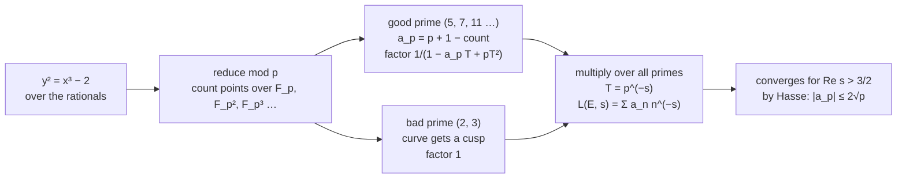
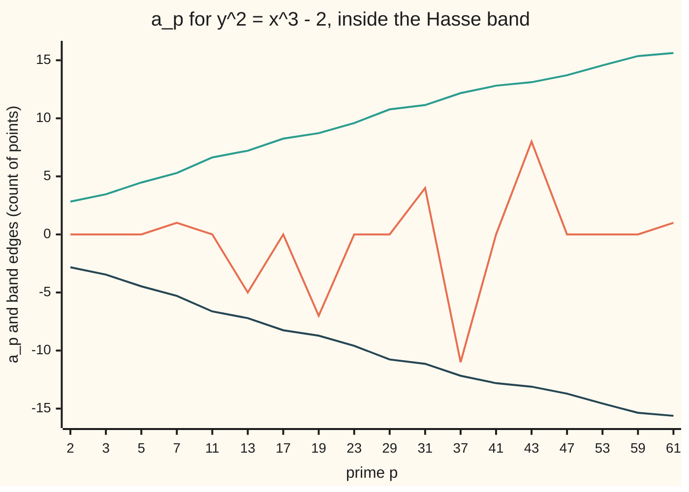

# The L-function: every prime's point count packed into one series

[Syllabus](../../../SYLLABUS.md) → [Algebraic geometry](../README.md) → [Elliptic Curves](../README.md#s04) → The L-function

---

## General Overview

Take the curve $`y^2 = x^3 - 2`$ and its rational point (3, 5): check it, 25 = 27 − 2. Now read the equation modulo a prime p, so x and y are remainders on division by p. Each prime gives a finite curve with a finite number of points.

Modulo 5 the curve has 6 points, counting the point at infinity O. Modulo 7 it has 7. [The curve mod p](05-reduction-mod-p-and-hasse.md) shows why such counts stay near p + 1. The gap from p + 1 is the number this card is about: $`a_p = p + 1 - \#E(\mathbb{F}_p)`$. Here $`a_5 = 0`$ and $`a_7 = 1`$.

One prime's count says little. The **L-function** takes every prime's count, turns each into a small fraction called a **local factor**, and multiplies them all into one function of a complex number s. For this curve the first three local factors, at 2, 3 and 5, are:

- **p = 2:** the curve breaks mod 2 (it gets a sharp point), and the factor is 1.
- **p = 3:** it breaks the same way mod 3, and the factor is 1.
- **p = 5:** the curve stays smooth, $`a_5 = 0`$, and the factor is $`1/(1 + 5 \cdot 5^{-2s})`$. At s = 2 that is 125/126.

Why build it? The Birch and Swinnerton-Dyer conjecture (unproved as of 2026-11-17) says this one function knows how many independent rational points the curve has. For our curve that is one, the point (3, 5).

**The L-function of an elliptic curve multiplies one local factor per prime: at a good prime $`1/(1 - a_p p^{-s} + p^{1-2s})`$, which packs the point counts over every field of size $`p^k`$; at a bad prime a shorter factor, here 1; and Hasse's bound $`|a_p| \le 2\sqrt p`$ makes the product converge for Re s > 3/2.**

**What kind of fact this is:** L(E, s) is a definition. The point-count formula behind the local factor is a theorem of Hasse and Weil, stated with its source and checked here at p = 5 and 7; the bad-prime counts are checked at 2 and 3. Convergence for Re s > 3/2 is proved on this card in Why it works. The symmetry that fixes the conductor 1728 is a theorem resting on modularity (2001), stated with its source and checked numerically.

### The picture: from counts to one function



---

## The formula

Notation first, in words. E is the curve. $`\mathbb{F}_{p^k}`$ is the finite field with $`p^k`$ elements ([Finite fields](../../21-Algebraic%20and%20analytic%20number%20theory/05-Fields%20and%20Galois%20Theory/09-finite-fields-and-frobenius.md)); $`\mathbb{F}_p`$ is wing 03's GF(p). $`\#E(\mathbb{F}_{p^k})`$ counts the curve's points with coordinates in that field, with O included. A prime is **good** when the curve stays smooth mod p, and **bad** when it gets a singular point. The bad primes are the primes dividing the discriminant Δ = −16(4a³ + 27b²) ([Weierstrass form](02-weierstrass-forms-discriminant-and-j-invariant.md)); here Δ = −1728 = −2⁶ · 3³, so they are 2 and 3. As on the zeta cards, s = σ + it is complex and $`n^{-s} = e^{-s \ln n}`$.

```math
L(E,s) = \prod_{p \text{ good}} \frac{1}{1 - a_p\,p^{-s} + p^{1-2s}} \prod_{p \text{ bad}} \frac{1}{1 - a_p\,p^{-s}} = \sum_{n=1}^{\infty} \frac{a_n}{n^{s}}, \qquad \mathrm{Re}\, s > \tfrac{3}{2}
```

**Read it aloud:** L of E at s is the product, over the good primes, of one over one minus a-p times p to the minus s plus p to the one minus two s, times a shorter factor at each bad prime; multiplied out, it is a series of numbers a-n over n to the s, and it converges when the real part of s is above three halves.

The quadratic is built to pack every count. Write T for $`p^{-s}`$ and split the quadratic into two linear pieces:

```math
1 - a_p T + p T^2 = (1 - \alpha T)(1 - \beta T), \qquad \#E(\mathbb{F}_{p^k}) = p^k + 1 - \alpha^k - \beta^k
```

**Read it aloud:** the local quadratic factors into one minus alpha T times one minus beta T, and the number of points over the field of size p to the k is p to the k, plus one, minus alpha to the k, minus beta to the k.

At p = 7 the quadratic is $`1 - T + 7T^2`$. It predicts 7, 63 and 364 points over the fields of size 7, 49 and 343; the code counts exactly those.

| Symbol | Plain meaning | In our example | Push it up and the answer… |
| --- | --- | --- | --- |
| $`E`$ | the curve | $`y^2 = x^3 - 2`$ | — |
| $`p`$, $`k`$ | a prime; the power in the field size $`p^k`$ | p = 7, k = 1, 2, 3 | bigger p: factor nearer 1 |
| $`\mathbb{F}_p`$, $`\mathbb{F}_{p^k}`$ | the fields with p and with $`p^k`$ elements | $`\mathbb{F}_{49}`$ | — |
| $`\#E(\mathbb{F}_{p^k})`$ | points over that field, O included | 7, 63, 364 at p = 7 | — |
| $`a_p`$ | the gap $`p + 1 - \#E(\mathbb{F}_p)`$ | $`a_5 = 0`$, $`a_7 = 1`$, $`a_{13} = -5`$ | bigger $`a_p`$: factor larger at real s |
| $`\alpha`$, $`\beta`$, $`\varphi`$ | the two roots behind $`a_p`$: $`\alpha + \beta = a_p`$, $`\alpha\beta = p`$; the Frobenius map they come from | size $`\sqrt 7`$ each at p = 7 | — |
| $`T`$ | shorthand for $`p^{-s}`$ | 1/25 at p = 5, s = 2 | — |
| $`s`$, $`\sigma`$, $`t`$ | the complex input; its real part; its imaginary part | s = 2 | larger σ: faster convergence |
| $`L(E,s)`$, $`a_n`$ | the L-function; its series coefficients | $`a_{25} = -5`$; L(E, 2) = 0.9578… | rises towards 1 as s grows |
| $`\Delta`$; $`v`$ | the discriminant: zero mod p exactly at bad primes; the parameter that lists a cusp curve's points (Step 3) | −1728 | — |
| $`N`$, $`w`$, $`\Lambda`$, $`\Gamma`$ | the conductor; the sign of the symmetry; the completed L-function; the gamma function | 1728; −1 | — |
| $`F(y)`$, $`y`$ | the sum of $`a_n e^{-2\pi n y}`$; a positive real number | y = 1.1/√1728 | — |

### When it holds

- **A good prime for the quadratic factor.** At a bad prime the counts do not follow $`p^k + 1 - \alpha^k - \beta^k`$. Using $`1 + 3T^2`$ at p = 3 predicts 16 points over $`\mathbb{F}_9`$; there are 10.
- **A minimal equation.** Rescaling $`x \to u^2 x`$, $`y \to u^3 y`$ gives the same curve with $`u^{12}`$ more in Δ, so the primes in u look bad without being bad. Our Δ has 2⁶ and 3³, both exponents below 12, so this equation is minimal and 2 and 3 really are bad.
- **The full quadratic.** A Dirichlet L-function has linear factors. Dropping the $`pT^2`$ here predicts 26 points over $`\mathbb{F}_{25}`$; there are 36.
- **Re s > 3/2 for the product.** Zeta's bound Re s > 1 is not enough: at σ = 1.25 the sum of $`|a_p| p^{-\sigma}`$ over primes is 0.9141, 1.9179, 3.2816 up to 100, 1,000 and 10,000, and still climbing.
- **Rational coefficients.** Reducing mod p needs coefficients that make sense mod p. A curve over the real numbers, such as $`y^2 = x^3 - \pi`$, has no primes to reduce by, so it has no L-function of this kind.

---

## Why it works

### Step 0: the idea

Counting points over $`\mathbb{F}_p`$ alone gives one number per prime. But the curve also has points over $`\mathbb{F}_{p^2}`$, $`\mathbb{F}_{p^3}`$ and so on, an infinite list of counts. The theorem of Hasse and Weil says that whole list is fixed by two numbers α and β. So one quadratic per prime holds all of it. Then the primes are multiplied together, exactly as zeta multiplies one factor per prime.

### Step 1: two numbers fix every count

On points with coordinates in any field $`\mathbb{F}_{p^k}`$, the map $`(x, y) \mapsto (x^p, y^p)`$ is the **Frobenius** map ([Finite fields](../../21-Algebraic%20and%20analytic%20number%20theory/05-Fields%20and%20Galois%20Theory/09-finite-fields-and-frobenius.md)). It sends points of E to points of E, because raising to the p-th power respects adding and multiplying mod p. It fixes exactly the points with coordinates in $`\mathbb{F}_p`$, and its k-th power fixes exactly those in $`\mathbb{F}_{p^k}`$.

As a map of the curve, Frobenius satisfies a quadratic, $`\varphi^2 - a_p\varphi + p = 0`$, where φ is the Frobenius map. Call that quadratic's roots α and β. Counting fixed points of $`\varphi^k`$ then gives $`p^k + 1 - \alpha^k - \beta^k`$. The proof needs the curve's group law and degrees of maps; it is in Silverman, chapter V. This card checks it.

| p | factor | predicted for k = 1, 2, 3 | counted by enumeration |
| --- | --- | --- | --- |
| 5 | $`1 + 5T^2`$ | 6, 36, 126 | 6, 36, 126 |
| 7 | $`1 - T + 7T^2`$ | 7, 63, 364 | 7, 63, 364 |

Hasse's theorem ([The curve mod p](05-reduction-mod-p-and-hasse.md)) is the same fact seen at k = 1: α and β are complex conjugates, each of size $`\sqrt p`$, so $`|a_p| = |\alpha + \beta| \le 2\sqrt p`$.

### Step 2: the counts pack into one fraction

Put every count into one generating series: weight the k-th count by $`T^k/k`$, add, and take the exponential. The weights are chosen because $`\sum_k u^k/k = -\ln(1 - u)`$, so each power sum of α turns into a simple factor:

```math
\exp\Big(\sum_{k \ge 1} \frac{\#E(\mathbb{F}_{p^k})}{k}\,T^k\Big) = \frac{1 - a_p T + p T^2}{(1 - T)(1 - pT)}
```

**Read it aloud:** the exponential of the sum of the counts, each divided by k and times T to the k, equals one minus a-p T plus p T squared, over one minus T times one minus p T.

The bottom is the same for every curve: it is what $`p^k + 1`$ points, a projective line, would give. The top is the curve's own part. The local factor of L(E, s) is one over the top, with $`T = p^{-s}`$.

<details>
<summary>Detailed proof: the series sums to the fraction</summary>

Use $`-\ln(1 - u) = u + u^2/2 + u^3/3 + \cdots`$ four times. With $`\#E(\mathbb{F}_{p^k}) = 1 + p^k - \alpha^k - \beta^k`$ the series splits into four:

$`\displaystyle \sum_{k\ge1}\frac{T^k}{k} + \sum_{k\ge1}\frac{(pT)^k}{k} - \sum_{k\ge1}\frac{(\alpha T)^k}{k} - \sum_{k\ge1}\frac{(\beta T)^k}{k} = -\ln(1-T) - \ln(1-pT) + \ln(1-\alpha T) + \ln(1-\beta T)`$

Take exponentials. The top is $`(1 - \alpha T)(1 - \beta T) = 1 - (\alpha + \beta)T + \alpha\beta T^2 = 1 - a_p T + pT^2`$.

Run backwards, the same identity rebuilds the top from the counts. The code does this with Newton's identities: from three counts it finds the coefficients of T, T² and T³. It gets −1, 7 and 0 at p = 7. The 0 confirms that the top stops at T².

</details>

### Step 3: at a bad prime the factor shrinks

Mod 3 the curve is $`y^2 = x^3 + 1 = (x + 1)^3`$, since cubing is additive mod 3. At (2, 0) both partial derivatives vanish, so the curve has a **cusp** there: a sharp point where one branch doubles back ([Nodes and cusps](../03-Plane%20Curves/04-singularities-nodes-and-cusps.md)). Mod 2 the curve is $`y^2 = x^3`$, with a cusp at (0, 0).

A cusp curve is a line in disguise. Set $`x + 1 = v^2`$ and $`y = v^3`$: every v in the field gives exactly one point, the cusp included. So the count over $`\mathbb{F}_{p^k}`$ is $`p^k + 1`$ for every k. The code counts 4, 10, 28 at p = 3 and 3, 5, 9 at p = 2. The counts fill the bottom of Step 2's fraction exactly, the top is 1, and so the local factor is 1.

There are three kinds of bad prime. Each gives a linear factor $`1/(1 - a_p p^{-s})`$:

| Singular point | Example shape | $`a_p`$ | Local factor |
| --- | --- | --- | --- |
| cusp: additive reduction | $`y^2 = x^3`$ | 0 | 1 |
| node, tangents defined over $`\mathbb{F}_p`$: split multiplicative | $`y^2 = x^2(x+1)`$ | 1 | $`1/(1 - p^{-s})`$ |
| node, tangents only over $`\mathbb{F}_{p^2}`$: non-split multiplicative | $`y^2 = x^2(x + c)`$, c not a square | −1 | $`1/(1 + p^{-s})`$ |

Our curve has only cusps, so both its bad factors are 1.

### Step 4: multiply the primes into one series

[The zeta function](../../07-Complex%20analysis/09-Special%20Functions%20and%20the%20Zeta%20Function/05-zeta-function-and-euler-product.md) proves that a product of one factor per prime multiplies out to a series over all n; [Dirichlet L-functions](../../21-Algebraic%20and%20analytic%20number%20theory/03-Characters%20and%20L-functions/03-dirichlet-l-functions.md) does the same with a weight in front. What changes here is the shape of the factor. Expand one good factor as a power series in T:

```math
\frac{1}{1 - a_p T + p T^2} = \sum_{k \ge 0} a_{p^k} T^k, \qquad a_{p^k} = a_p\,a_{p^{k-1}} - p\,a_{p^{k-2}}
```

**Read it aloud:** one over the quadratic is a power series whose coefficients obey a-sub-p-to-the-k equals a-p times the previous one minus p times the one before that.

Multiplying the primes gives $`a_n`$ for every n: $`a_{mn} = a_m a_n`$ when m and n share no prime factor. For our curve, $`a_{25} = a_5^2 - 5 = -5`$. The first 25 are 1, 0, 0, 0, 0, 0, 1, 0, 0, 0, 0, 0, −5, 0, 0, 0, 0, 0, −7, 0, 0, 0, 0, 0, −5.

Most are zero. Every prime $`p \equiv 2 \bmod 3`$ has $`a_p = 0`$, because cubing is one-to-one mod such a prime: $`x^3 - 2`$ takes every value once, and exactly half the nonzero values are squares.

### Step 5: where the product converges

This is the one place where an elliptic curve differs in kind from zeta. Each good factor splits into two zeta-like pieces, $`1/(1 - \alpha p^{-s})`$ and $`1/(1 - \beta p^{-s})`$. By Hasse, $`|\alpha| = |\beta| = \sqrt p`$, so

```math
|\alpha\,p^{-s}| = p^{1/2 - \sigma}
```

**Read it aloud:** the size of alpha times p to the minus s is p to the power one half minus sigma.

The zeta card's proof works when the sizes $`p^{-\sigma}`$ add up, which is σ > 1. Here the sizes are $`p^{1/2 - \sigma}`$, so the same proof needs σ − 1/2 > 1, that is σ > 3/2. On that half-plane the product converges absolutely, the series $`\sum a_n n^{-s}`$ does too, and since no factor is 0, L(E, s) ≠ 0 there.

The square root of p is the whole story. The chart shows $`a_p`$ inside its Hasse band: the coefficients grow like $`\sqrt p`$, so they eat half a power of convergence.



Orange: $`a_p`$. Green and dark: the band edges $`\pm 2\sqrt p`$. All 1,229 primes below 10,000 stay inside; the closest comes to 0.999659 of the edge.

### Step 6: beyond 3/2, the conductor and a symmetry

The product stops at σ = 3/2, but L(E, s) does not. Every elliptic curve over the rationals is modular (Breuil, Conrad, Diamond and Taylor, 2001; see [What curves answer](10-modularity-and-the-congruent-number-problem.md)). As a consequence, L(E, s) extends to every complex s and has a mirror symmetry about s = 1:

```math
\Lambda(s) = N^{s/2}(2\pi)^{-s}\,\Gamma(s)\,L(E,s), \qquad \Lambda(s) = w\,\Lambda(2 - s)
```

**Read it aloud:** lambda of s, which is N to the s over two, times two pi to the minus s, times gamma of s, times L, equals w times lambda of two minus s.

Here Γ is the gamma function, w is +1 or −1, and N is the **conductor**: a number built from the bad primes alone that measures how badly the curve reduces. A node contributes its prime once; a cusp at least twice. For our curve N = 2⁶ · 3³ = 1728, as the LMFDB lists for curve 1728.o3.

The code finds N without being told it. The symmetry is equivalent to $`F(1/(Ny)) = w\,N y^2 F(y)`$ for every y > 0, where $`F(y) = \sum a_n e^{-2\pi n y}`$. This y is a positive real number, not the curve's coordinate. The code tries all 54 numbers $`2^i 3^j`$ with i ≤ 8 and j ≤ 5, the largest exponents a conductor can have at 2 and 3. Only N = 1728 passes, with w = −1.000000000 at both test points.

<details>
<summary>Why the theta test is the symmetry</summary>

The gamma function's integral gives, for σ > 3/2,

$`\displaystyle (2\pi)^{-s}\Gamma(s)\,L(E,s) = \int_0^\infty F(y)\,y^{s-1}\,dy`$

Substitute $`y \to 1/(Ny)`$ in the integral. If $`F(1/(Ny)) = w N y^2 F(y)`$, the integral at s turns into $`w N^{1-s}`$ times the integral at 2 − s. Multiplying by $`N^{s/2}`$ gives $`\Lambda(s) = w\Lambda(2-s)`$. The converse also holds, by Mellin inversion, so testing F at a few y tests the symmetry. A wrong bad factor changes the $`a_n`$ and the test fails: with $`1 + pT^2`$ at 2 and 3, the ratio at N = 1728 is 1.249831 and no N passes.

</details>

The sign w = −1 has a sharp consequence. At s = 1 the symmetry reads Λ(1) = −Λ(1), so L(E, 1) = 0. [Birch and Swinnerton-Dyer](08-birch-and-swinnerton-dyer-statement.md) reads that zero as the point (3, 5).

---

## Worked numbers, by hand

At s = 2 each factor is an exact fraction, since T = 1/p².

| Step | Arithmetic | Value |
| --- | --- | --- |
| Δ | −16 · 27 · (−2)² | −1728 = −2⁶ · 3³ |
| p = 2 | y² = x³ mod 2, cusp at (0, 0) | factor 1 |
| p = 3 | y² = (x + 1)³ mod 3, cusp at (2, 0) | factor 1 |
| count mod 5 | cubing is one-to-one, so x³ − 2 hits 0 once, the squares 1 and 4 once each, the non-squares 2 and 3 once each: 1 + 2 + 2 + 0 + 0 points, plus O | 6 |
| $`a_5`$ | 5 + 1 − 6 | 0 |
| factor at 5 | $`1/(1 + 5/25^2) = 625/630`$ | 125/126 |
| first three factors | 1 · 1 · 125/126 | **125/126 = 0.992063** |
| count mod 7 | x³ is 0, 1 or 6; only x³ − 2 = 4 is a square, for x = 3, 5, 6, two roots each: 6 points, plus O | 7 |
| factor at 7 | $`a_7 = 1`$: $`2401/(2401 - 49 + 7)`$ | 343/337 |
| first four factors | 125/126 · 343/337 | 6125/6066 = 1.009726 |
| all primes below 10,000 | product 0.957882366, series 0.957861224 | L(E, 2) = 0.9578… |

The bad primes change nothing at s = 2, the factor at 5 pulls the product down, and a positive $`a_7`$ pushes it back up; all the primes together settle near 0.9578.

### What breaks if you drop a piece

| Mistake | Comes out at | What went wrong |
| --- | --- | --- |
| Quadratic factor $`1 + pT^2`$ at the bad primes | 9 points over $`\mathbb{F}_4`$ (true 5), 16 over $`\mathbb{F}_9`$ (true 10); factors 8/9 and 27/28 at s = 2 | A cusp's counts are $`p^k + 1`$: no α, β, so no quadratic |
| Same, then the symmetry test | ratio 1.249831 at N = 1728, not −1; no N passes | Wrong $`a_n`$ break modularity's symmetry |
| Linear factor at p = 5, as for a Dirichlet L-function | 26 points over $`\mathbb{F}_{25}`$ (true 36); factor 1, not 125/126 | The $`pT^2`$ term carries the counts over $`\mathbb{F}_{p^2}`$ and up |
| Trusting Re s > 1, as for zeta | $`\sum \lvert a_p\rvert p^{-1.25}`$: 0.9141, 1.9179, 3.2816, still rising | $`\lvert a_p\rvert`$ grows like $`\sqrt p`$, costing half a power |

The code prints all four.

---

## Code, from first principles, and it actually runs

The code counts points mod p for all 1,229 primes below 10,000 and turns each count into $`a_p`$. It then takes three independent roads. First, it builds the fields $`\mathbb{F}_{p^2}`$ and $`\mathbb{F}_{p^3}`$ from scratch and counts points there, against the counts the local factor predicts. Second, it computes the Euler product prime by prime and the series $`\sum a_n n^{-s}`$ term by term, at s = 2 and s = 3. Third, it runs the symmetry test over 54 candidate conductors. Fractions are exact; floats print to at most nine decimals.

### Python

```python
# The L-function of y^2 = x^3 - 2 -- the check behind the card.  Standard
# library only.  Every a_p comes from counting points mod p.  Road 1: the local
# factor predicts the counts over F_p, F_p^2, F_p^3, checked by enumeration.
# Road 2: the Euler product against the series sum of a_n / n^s.  Road 3: the
# symmetry a modular form must have picks the conductor 1728 out of 54 tries.
import math
from fractions import Fraction
from itertools import product

B, X = -2, 10000                               # the curve y^2 = x^3 + B; primes below X
sieve = [False, False] + [True] * (X - 2)
for i in range(2, 100):
    if sieve[i]:
        sieve[i * i::i] = [False] * len(sieve[i * i::i])
ps = [i for i in range(X) if sieve[i]]

def count_mod_p(p):                            # points over F_p, with O
    squares = [0] * p
    for y in range(p):
        squares[y * y % p] += 1
    return 1 + sum(squares[(x * x * x + B) % p] for x in range(p))

def count_over_field(p, k):                    # points over F_(p^k), enumerated
    rule = [0] * k                             # x^k = rule[0] + rule[1] x + ...
    if k > 1:                                  # degree 2 or 3: irreducible = no root
        rule = next(r for r in product(range(p), repeat=k) if all(
            (pow(z, k, p) - sum(c * z ** i for i, c in enumerate(r))) % p for z in range(p)))
    def mul(u, v):
        w = [0] * (2 * k - 1)
        for i, j in product(range(k), repeat=2):
            w[i + j] += u[i] * v[j]
        for d in range(2 * k - 2, k - 1, -1):  # replace x^d using the rule
            for i, c in enumerate(rule):
                w[d - k + i] += w[d] * c
        return tuple(c % p for c in w[:k])
    elems = list(product(range(p), repeat=k))
    squares = {}
    for y in elems:
        squares[mul(y, y)] = squares.get(mul(y, y), 0) + 1
    shift = lambda u: ((u[0] + B) % p,) + u[1:]
    return 1 + sum(squares.get(shift(mul(mul(x, x), x)), 0) for x in elems)

def predicted(p, c, d, k):                     # p^k + 1 - (alpha^k + beta^k)
    s = [2, c]                                 # power sums of the roots of 1 - cT + dT^2
    for _ in range(k - 1):
        s.append(c * s[-1] - d * s[-2])
    return p ** k + 1 - s[k]

def poly(c, d):
    terms = ["1"] + ([f"{'-' if c > 0 else '+'} {abs(c) if abs(c) != 1 else ''}T"] if c else [])
    return " ".join(terms + ([f"+ {d}T^2"] if d else []))

disc = -16 * 27 * B * B
bad = [p for p in ps if p < 50 and disc % p == 0]
a = {p: (0 if p in bad else p + 1 - count_mod_p(p)) for p in ps}
v = [max(j for j in range(20) if disc % p ** j == 0) for p in bad]
print(f"curve y^2 = x^3 - 2; discriminant -16(4a^3 + 27b^2) = {disc} = -2^{v[0]} * 3^{v[1]}; bad primes {bad}; "
      f"house point (3, 5) on it: {'yes' if 5 * 5 == 3 ** 3 + B else 'no'}")
at2 = []
for p in [2, 3, 5, 7]:
    sing = [(x, y) for x in range(p) for y in range(p) if (y * y - x ** 3 - B) % p == 0
            and 2 * y % p == 0 and 3 * x * x % p == 0]
    c, d = (0, 0) if sing else (p + 1 - count_mod_p(p), p)
    kind = (f"singular at {sing[0]}, " + ("a cusp" if 3 * sing[0][0] % p == 0 else "a node")
            if sing else "smooth")
    print(f"p = {p}: {count_mod_p(p)} points over F_{p}; {kind}; a_{p} = {c}; local factor "
          f"{f'1/({poly(c, d)})' if c or d else '1'}")
    got = [count_over_field(p, k) for k in (1, 2, 3)]
    want = [predicted(p, c, d, k) for k in (1, 2, 3)]
    s = [p ** k + 1 - got[k - 1] for k in (1, 2, 3)]   # Newton's identities: counts -> factor
    e1, e2 = s[0], Fraction(s[0] * s[0] - s[1], 2)
    e3 = (e2 * s[0] - e1 * s[1] + s[2]) / 3
    print(f"   counted over F_{p}, F_{p}^2, F_{p}^3: {got}; from the factor: {want}; "
          f"rebuilt from counts: {poly(e1, e2)}, T^3 coefficient {e3}")
    assert got == want and (e1, e2, e3) == (c, d, 0)
    at2.append(Fraction(p ** 4, p ** 4 - c * p * p + d))   # T = 1/p^2
three, four = at2[0] * at2[1] * at2[2], at2[0] * at2[1] * at2[2] * at2[3]
print(f"factors at s = 2 for p = 2, 3, 5, 7: {', '.join(str(v) for v in at2)}")
print(f"first three multiply to {three} = {float(three):.6f}; first four to {four} = {float(four):.6f}")
an = [0, 1] + [0] * (X - 2)                    # a_n, multiplicative, built prime by prime
for n in range(2, X):
    p = next(q for q in ps if n % q == 0)
    m, k = n, 0
    while m % p == 0:
        m, k = m // p, k + 1
    prev, cur = 1, a[p]                        # a_(p^k) = a_p a_(p^(k-1)) - p a_(p^(k-2))
    for _ in range(k - 1):
        prev, cur = cur, a[p] * cur - (0 if p in bad else p) * prev
    an[n] = an[m] * cur
print(f"a_1 to a_25: {an[1:26]}")
worst = max(abs(a[p]) / (2 * math.sqrt(p)) for p in ps)
print(f"Hasse a_p^2 <= 4p for all {len(ps)} primes below {X}: "
      f"{'yes' if all(a[p] ** 2 <= 4 * p for p in ps) else 'no'}; largest |a_p|/(2 sqrt p) = {worst:.6f}")
cp = [p for p in ps if p <= 61]
print(f"chart primes {cp}")
print(f"chart a_p {[a[p] for p in cp]}")
print(f"chart 2 sqrt p {[f'{2 * math.sqrt(p):.2f}' for p in cp]}".replace("'", ""))
for s in (2, 3):
    prods, sums = [], []
    for cut in (100, 1000, 10000):
        pr = 1.0
        for p in (q for q in ps if q < cut and q not in bad):
            pr /= 1 - a[p] * p ** -s + p ** (1 - 2 * s)
        prods.append(pr)
        sums.append(sum(an[n] * n ** -s for n in range(1, cut)))
    print(f"s = {s}: product over p < 100, 1000, 10000: {', '.join(f'{v:.9f}' for v in prods)}")
    print(f"s = {s}: series over n < 100, 1000, 10000:  {', '.join(f'{v:.9f}' for v in sums)}")
    assert abs(prods[2] - sums[2]) < (1e-4 if s == 2 else 1e-8)
for sigma in (1.25, 2):
    part = [sum(abs(a[p]) * p ** -sigma for p in ps if p < cut) for cut in (100, 1000, 10000)]
    print(f"sum of |a_p| p^-sigma, sigma = {sigma}, p < 100, 1000, 10000: {', '.join(f'{v:.4f}' for v in part)}")

def ratios(coef, N):                           # F(1/(N y)) / (N y^2 F(y)) at two y's
    F = lambda y: sum(coef[n] * math.exp(-2 * math.pi * n * y) for n in range(1, 4000))
    return [F(math.sqrt(N) / (N * t)) / (t * t * F(t / math.sqrt(N))) for t in (1.1, 1.3)]

def scan(coef):                                # every 2^i 3^j, i <= 8, j <= 5
    return [2 ** i * 3 ** j for i in range(9) for j in range(6)
            if all(abs(abs(r) - 1) < 1e-9 for r in ratios(coef, 2 ** i * 3 ** j))]

passed, w = scan(an), ratios(an, 1728)
print(f"conductor scan, N = 2^i 3^j with i <= 8, j <= 5 (54 tries): symmetry holds only at {passed}; "
      f"sign w = {w[0]:.9f}, {w[1]:.9f}")
assert passed == [1728] and abs(w[0] + 1) < 1e-9
assert all(a[p] ** 2 <= 4 * p for p in ps) and a[7] == 1 and a[13] == -5
wrong = an[:]                                  # mistake 3: 1 + pT^2 at 2 and 3
for n in range(2, X):
    for p in bad:
        k = next(j for j in range(20) if n % p ** (j + 1))
        if k:
            wrong[n] = 0 if k % 2 else wrong[n // p ** k] * (-p) ** (k // 2)
            break
print(f"mistake 1, factor 1 + pT^2 at a bad prime: F_p^2 counts {predicted(2, 0, 2, 2)} at p = 2 "
      f"(true {count_over_field(2, 2)}) and {predicted(3, 0, 3, 2)} at p = 3 (true {count_over_field(3, 2)}); s = 2 "
      f"factors {' and '.join(str(Fraction(p ** 4, p ** 4 + p)) for p in bad)}, not {at2[0]}")
print(f"mistake 2, dropping pT^2 at p = 5: F_25 count {predicted(5, 0, 0, 2)} (true {count_over_field(5, 2)}); "
      f"s = 2 factor {Fraction(5 ** 2, 5 ** 2 - a[5])}, not {at2[2]}")
print(f"mistake 3, those bad factors in the scan: ratio at N = 1728 is {ratios(wrong, 1728)[0]:.6f}, "
      f"not -1; scan passes {scan(wrong)}")
print("ALL CHECKS PASS")
```

**Ran 2026-11-17 on macOS, Python 3.14.10, standard library only. All checks passed. Output, pasted from the run:**

```
curve y^2 = x^3 - 2; discriminant -16(4a^3 + 27b^2) = -1728 = -2^6 * 3^3; bad primes [2, 3]; house point (3, 5) on it: yes
p = 2: 3 points over F_2; singular at (0, 0), a cusp; a_2 = 0; local factor 1
   counted over F_2, F_2^2, F_2^3: [3, 5, 9]; from the factor: [3, 5, 9]; rebuilt from counts: 1, T^3 coefficient 0
p = 3: 4 points over F_3; singular at (2, 0), a cusp; a_3 = 0; local factor 1
   counted over F_3, F_3^2, F_3^3: [4, 10, 28]; from the factor: [4, 10, 28]; rebuilt from counts: 1, T^3 coefficient 0
p = 5: 6 points over F_5; smooth; a_5 = 0; local factor 1/(1 + 5T^2)
   counted over F_5, F_5^2, F_5^3: [6, 36, 126]; from the factor: [6, 36, 126]; rebuilt from counts: 1 + 5T^2, T^3 coefficient 0
p = 7: 7 points over F_7; smooth; a_7 = 1; local factor 1/(1 - T + 7T^2)
   counted over F_7, F_7^2, F_7^3: [7, 63, 364]; from the factor: [7, 63, 364]; rebuilt from counts: 1 - T + 7T^2, T^3 coefficient 0
factors at s = 2 for p = 2, 3, 5, 7: 1, 1, 125/126, 343/337
first three multiply to 125/126 = 0.992063; first four to 6125/6066 = 1.009726
a_1 to a_25: [1, 0, 0, 0, 0, 0, 1, 0, 0, 0, 0, 0, -5, 0, 0, 0, 0, 0, -7, 0, 0, 0, 0, 0, -5]
Hasse a_p^2 <= 4p for all 1229 primes below 10000: yes; largest |a_p|/(2 sqrt p) = 0.999659
chart primes [2, 3, 5, 7, 11, 13, 17, 19, 23, 29, 31, 37, 41, 43, 47, 53, 59, 61]
chart a_p [0, 0, 0, 1, 0, -5, 0, -7, 0, 0, 4, -11, 0, 8, 0, 0, 0, 1]
chart 2 sqrt p [2.83, 3.46, 4.47, 5.29, 6.63, 7.21, 8.25, 8.72, 9.59, 10.77, 11.14, 12.17, 12.81, 13.11, 13.71, 14.56, 15.36, 15.62]
s = 2: product over p < 100, 1000, 10000: 0.956352348, 0.958036469, 0.957882366
s = 2: series over n < 100, 1000, 10000:  0.956108710, 0.957838131, 0.957861224
s = 3: product over p < 100, 1000, 10000: 0.999202344, 0.999214935, 0.999214774
s = 3: series over n < 100, 1000, 10000:  0.999206893, 0.999214771, 0.999214772
sum of |a_p| p^-sigma, sigma = 1.25, p < 100, 1000, 10000: 0.9141, 1.9179, 3.2816
sum of |a_p| p^-sigma, sigma = 2, p < 100, 1000, 10000: 0.0933, 0.1081, 0.1116
conductor scan, N = 2^i 3^j with i <= 8, j <= 5 (54 tries): symmetry holds only at [1728]; sign w = -1.000000000, -1.000000000
mistake 1, factor 1 + pT^2 at a bad prime: F_p^2 counts 9 at p = 2 (true 5) and 16 at p = 3 (true 10); s = 2 factors 8/9 and 27/28, not 1
mistake 2, dropping pT^2 at p = 5: F_25 count 26 (true 36); s = 2 factor 1, not 125/126
mistake 3, those bad factors in the scan: ratio at N = 1728 is 1.249831, not -1; scan passes []
ALL CHECKS PASS
```

### Rust

Same numbers, same labels, built with `rustc --edition 2021 -O`.

```rust
// The L-function of y^2 = x^3 - 2 -- the same check as the Python, in Rust.  No
// crates.  Every a_p comes from counting points mod p.  Road 1: the local
// factor predicts the counts over F_p, F_p^2, F_p^3, checked by enumeration.
// Road 2: the Euler product against the series sum of a_n / n^s.  Road 3: the
// symmetry a modular form must have picks the conductor 1728 out of 54 tries.
use std::collections::HashMap;
const B: i64 = -2;
const X: usize = 10000;

#[derive(Clone, Copy, PartialEq, Debug)]
struct Q { n: i128, d: i128 }                       // a fraction in lowest terms
fn gcd(a: i128, b: i128) -> i128 { if b == 0 { a.abs() } else { gcd(b, a % b) } }
fn q(n: i128, d: i128) -> Q { let g = gcd(n, d) * d.signum(); Q { n: n / g, d: d / g } }
fn qmul(a: Q, b: Q) -> Q { q(a.n.checked_mul(b.n).unwrap(), a.d.checked_mul(b.d).unwrap()) }
fn show(a: Q) -> String { if a.d == 1 { format!("{}", a.n) } else { format!("{}/{}", a.n, a.d) } }

fn count_mod_p(p: i64) -> i64 {                     // points over F_p, with O
    let mut squares = vec![0i64; p as usize];
    for y in 0..p { squares[(y * y % p) as usize] += 1 }
    1 + (0..p).map(|x| squares[(x * x * x + B).rem_euclid(p) as usize]).sum::<i64>()
}

fn digits(idx: i64, p: i64, k: usize) -> Vec<i64> {   // first coordinate most significant
    (0..k).map(|i| idx / p.pow((k - 1 - i) as u32) % p).collect()
}

fn count_over_field(p: i64, k: usize) -> i64 {      // points over F_(p^k), enumerated
    let size = p.pow(k as u32);
    let mut rule = vec![0i64; k];                   // x^k = rule[0] + rule[1] x + ...
    if k > 1 {                                      // degree 2 or 3: irreducible = no root
        rule = (0..size).map(|i| digits(i, p, k)).find(|r| (0..p).all(|z| {
            let lhs = z.pow(k as u32) - (0..k).map(|i| r[i] * z.pow(i as u32)).sum::<i64>();
            lhs.rem_euclid(p) != 0 })).unwrap();
    }
    let mul = |u: &Vec<i64>, v: &Vec<i64>| -> Vec<i64> {
        let mut w = vec![0i64; 2 * k - 1];
        for i in 0..k { for j in 0..k { w[i + j] += u[i] * v[j] } }
        for d in (k..2 * k - 1).rev() { for i in 0..k { w[d - k + i] += w[d] * rule[i] } }  // x^d by the rule
        w[..k].iter().map(|c| c.rem_euclid(p)).collect()
    };
    let elems: Vec<Vec<i64>> = (0..size).map(|i| digits(i, p, k)).collect();
    let mut squares: HashMap<Vec<i64>, i64> = HashMap::new();
    for y in &elems { *squares.entry(mul(y, y)).or_insert(0) += 1 }
    1 + elems.iter().map(|x| {
        let mut c = mul(&mul(x, x), x);
        c[0] = (c[0] + B).rem_euclid(p);
        *squares.get(&c).unwrap_or(&0)
    }).sum::<i64>()
}

fn predicted(p: i64, c: i64, d: i64, k: usize) -> i64 {   // p^k + 1 - (alpha^k + beta^k)
    let mut s = vec![2, c];                          // power sums of the roots of 1 - cT + dT^2
    for _ in 0..k - 1 { let n = s.len(); s.push(c * s[n - 1] - d * s[n - 2]) }
    p.pow(k as u32) + 1 - s[k]
}

fn poly(c: i64, d: i128) -> String {
    let mag = if c.abs() != 1 { c.abs().to_string() } else { String::new() };
    let mid = if c != 0 { format!(" {} {}T", if c > 0 { "-" } else { "+" }, mag) } else { String::new() };
    format!("1{}{}", mid, if d != 0 { format!(" + {}T^2", d) } else { String::new() })
}

fn list(v: &[f64], dp: usize) -> String { v.iter().map(|x| format!("{:.*}", dp, x)).collect::<Vec<_>>().join(", ") }

fn ratios(coef: &[i64], n: f64) -> Vec<f64> {      // F(1/(N y)) / (N y^2 F(y)) at two y's
    let f = |y: f64| (1..4000).map(|m| coef[m] as f64 * (-2.0 * std::f64::consts::PI * m as f64 * y).exp()).sum::<f64>();
    [1.1f64, 1.3].iter().map(|&t| f(n.sqrt() / (n * t)) / (t * t * f(t / n.sqrt()))).collect()
}

fn scan(coef: &[i64]) -> Vec<i64> {                 // every 2^i 3^j, i <= 8, j <= 5
    (0..9u32).flat_map(|i| (0..6u32).map(move |j| 2i64.pow(i) * 3i64.pow(j)))
        .filter(|&n| ratios(coef, n as f64).iter().all(|r| (r.abs() - 1.0).abs() < 1e-9)).collect()
}

fn main() {
    let mut sieve: Vec<bool> = (0..X).map(|i| i > 1).collect();
    for i in 2..100 { if sieve[i] { let mut m = i * i; while m < X { sieve[m] = false; m += i } } }
    let ps: Vec<i64> = (0..X).filter(|&i| sieve[i]).map(|i| i as i64).collect();
    let disc = -16 * 27 * B * B;
    let bad: Vec<i64> = ps.iter().copied().filter(|&p| p < 50 && disc % p == 0).collect();
    let mut a: HashMap<i64, i64> = HashMap::new();
    for &p in &ps { a.insert(p, if bad.contains(&p) { 0 } else { p + 1 - count_mod_p(p) }); }
    let v: Vec<u32> = bad.iter().map(|&p| (0..20u32).filter(|&j| disc % p.pow(j) == 0).max().unwrap()).collect();
    println!("curve y^2 = x^3 - 2; discriminant -16(4a^3 + 27b^2) = {} = -2^{} * 3^{}; bad primes {:?}; house point (3, 5) on it: {}",
             disc, v[0], v[1], bad, if 5 * 5 == 27 + B { "yes" } else { "no" });
    let mut at2: Vec<Q> = vec![];
    for p in [2i64, 3, 5, 7] {
        let sing: Vec<(i64, i64)> = (0..p).flat_map(|x| (0..p).map(move |y| (x, y)))
            .filter(|&(x, y)| (y * y - x.pow(3) - B).rem_euclid(p) == 0 && 2 * y % p == 0 && 3 * x * x % p == 0).collect();
        let (c, d) = if sing.is_empty() { (p + 1 - count_mod_p(p), p) } else { (0, 0) };
        let kind = if sing.is_empty() { "smooth".to_string() } else {
            format!("singular at {:?}, {}", sing[0], if 3 * sing[0].0 % p == 0 { "a cusp" } else { "a node" }) };
        let lf = if c != 0 || d != 0 { format!("1/({})", poly(c, d as i128)) } else { "1".to_string() };
        println!("p = {}: {} points over F_{}; {}; a_{} = {}; local factor {}", p, count_mod_p(p), p, kind, p, c, lf);
        let got: Vec<i64> = (1..4).map(|k| count_over_field(p, k)).collect();
        let want: Vec<i64> = (1..4).map(|k| predicted(p, c, d, k)).collect();
        let s: Vec<i128> = (1..4).map(|k| (p.pow(k as u32) + 1 - got[k - 1]) as i128).collect();
        let (e1, e2) = (s[0], q(s[0] * s[0] - s[1], 2));      // Newton's identities: counts -> factor
        let e3 = q(e2.n * s[0] - e1 * s[1] * e2.d + s[2] * e2.d, 3 * e2.d);
        println!("   counted over F_{p}, F_{p}^2, F_{p}^3: {:?}; from the factor: {:?}; rebuilt from counts: {}, T^3 coefficient {}",
                 got, want, poly(e1 as i64, e2.n), show(e3));
        assert!(got == want && e1 == c as i128 && e2 == q(d as i128, 1) && e3 == q(0, 1));
        let p4 = (p as i128).pow(4);
        at2.push(q(p4, p4 - (c * p * p) as i128 + d as i128));   // T = 1/p^2
    }
    let (three, four) = (qmul(qmul(at2[0], at2[1]), at2[2]), qmul(qmul(qmul(at2[0], at2[1]), at2[2]), at2[3]));
    println!("factors at s = 2 for p = 2, 3, 5, 7: {}", at2.iter().map(|&v| show(v)).collect::<Vec<_>>().join(", "));
    println!("first three multiply to {} = {:.6}; first four to {} = {:.6}", show(three),
             three.n as f64 / three.d as f64, show(four), four.n as f64 / four.d as f64);
    let mut an: Vec<i64> = (0..X).map(|i| (i == 1) as i64).collect();   // a_n, multiplicative
    for n in 2..X as i64 {
        let p = *ps.iter().find(|&&q| n % q == 0).unwrap();
        let (mut m, mut k) = (n, 0);
        while m % p == 0 { m /= p; k += 1 }
        let (mut prev, mut cur) = (1i64, a[&p]);     // a_(p^k) = a_p a_(p^(k-1)) - p a_(p^(k-2))
        for _ in 0..k - 1 { let nx = a[&p] * cur - (if bad.contains(&p) { 0 } else { p }) * prev; prev = cur; cur = nx }
        an[n as usize] = an[m as usize] * cur;
    }
    println!("a_1 to a_25: {:?}", &an[1..26]);
    let worst = ps.iter().map(|&p| a[&p].abs() as f64 / (2.0 * (p as f64).sqrt())).fold(0.0, f64::max);
    let hasse = ps.iter().all(|&p| a[&p] * a[&p] <= 4 * p);
    println!("Hasse a_p^2 <= 4p for all {} primes below {}: {}; largest |a_p|/(2 sqrt p) = {:.6}",
             ps.len(), X, if hasse { "yes" } else { "no" }, worst);
    let cp: Vec<i64> = ps.iter().copied().filter(|&p| p <= 61).collect();
    println!("chart primes {:?}", cp);
    println!("chart a_p {:?}", cp.iter().map(|p| a[p]).collect::<Vec<_>>());
    println!("chart 2 sqrt p [{}]", list(&cp.iter().map(|&p| 2.0 * (p as f64).sqrt()).collect::<Vec<_>>(), 2));
    for s in [2i64, 3] {
        let (mut prods, mut sums) = (vec![], vec![]);
        for cut in [100i64, 1000, 10000] {
            let mut pr = 1.0f64;
            for &p in ps.iter().filter(|&&q| q < cut && !bad.contains(&q)) {
                let pf = p as f64;
                pr /= 1.0 - a[&p] as f64 * pf.powf(-s as f64) + pf.powf((1 - 2 * s) as f64);
            }
            prods.push(pr);
            sums.push((1..cut).map(|n| an[n as usize] as f64 * (n as f64).powf(-s as f64)).sum::<f64>());
        }
        println!("s = {}: product over p < 100, 1000, 10000: {}", s, list(&prods, 9));
        println!("s = {}: series over n < 100, 1000, 10000:  {}", s, list(&sums, 9));
        assert!((prods[2] - sums[2]).abs() < if s == 2 { 1e-4 } else { 1e-8 });
    }
    for (sigma, label) in [(1.25f64, "1.25"), (2.0, "2")] {
        let part: Vec<f64> = [100i64, 1000, 10000].iter().map(|&cut| ps.iter().filter(|&&p| p < cut)
            .map(|&p| a[&p].abs() as f64 * (p as f64).powf(-sigma)).sum::<f64>()).collect();
        println!("sum of |a_p| p^-sigma, sigma = {}, p < 100, 1000, 10000: {}", label, list(&part, 4));
    }
    let (passed, w) = (scan(&an), ratios(&an, 1728.0));
    println!("conductor scan, N = 2^i 3^j with i <= 8, j <= 5 (54 tries): symmetry holds only at {:?}; sign w = {:.9}, {:.9}",
             passed, w[0], w[1]);
    assert!(passed == vec![1728] && (w[0] + 1.0).abs() < 1e-9);
    assert!(hasse && a[&7] == 1 && a[&13] == -5);
    let mut wrong = an.clone();                      // mistake 3: 1 + pT^2 at 2 and 3
    for n in 2..X as i64 {
        for &p in &bad {
            let k = (0..20u32).find(|&j| n % p.pow(j + 1) != 0).unwrap();
            if k > 0 { wrong[n as usize] = if k % 2 == 1 { 0 } else { wrong[(n / p.pow(k)) as usize] * (-p).pow(k / 2) }; break }
        }
    }
    let wrong_at2: Vec<String> = bad.iter().map(|&p| { let p4 = (p as i128).pow(4); show(q(p4, p4 + p as i128)) }).collect();
    println!("mistake 1, factor 1 + pT^2 at a bad prime: F_p^2 counts {} at p = 2 (true {}) and {} at p = 3 (true {}); s = 2 factors {}, not {}",
             predicted(2, 0, 2, 2), count_over_field(2, 2), predicted(3, 0, 3, 2), count_over_field(3, 2), wrong_at2.join(" and "), show(at2[0]));
    println!("mistake 2, dropping pT^2 at p = 5: F_25 count {} (true {}); s = 2 factor {}, not {}",
             predicted(5, 0, 0, 2), count_over_field(5, 2), show(q(25, 25 - a[&5] as i128)), show(at2[2]));
    println!("mistake 3, those bad factors in the scan: ratio at N = 1728 is {:.6}, not -1; scan passes {:?}",
             ratios(&wrong, 1728.0)[0], scan(&wrong));
    println!("ALL CHECKS PASS");
}
```

**Ran 2026-11-17 on macOS, rustc 1.98.1, no crates. All checks passed. Output, pasted from the run:**

```
curve y^2 = x^3 - 2; discriminant -16(4a^3 + 27b^2) = -1728 = -2^6 * 3^3; bad primes [2, 3]; house point (3, 5) on it: yes
p = 2: 3 points over F_2; singular at (0, 0), a cusp; a_2 = 0; local factor 1
   counted over F_2, F_2^2, F_2^3: [3, 5, 9]; from the factor: [3, 5, 9]; rebuilt from counts: 1, T^3 coefficient 0
p = 3: 4 points over F_3; singular at (2, 0), a cusp; a_3 = 0; local factor 1
   counted over F_3, F_3^2, F_3^3: [4, 10, 28]; from the factor: [4, 10, 28]; rebuilt from counts: 1, T^3 coefficient 0
p = 5: 6 points over F_5; smooth; a_5 = 0; local factor 1/(1 + 5T^2)
   counted over F_5, F_5^2, F_5^3: [6, 36, 126]; from the factor: [6, 36, 126]; rebuilt from counts: 1 + 5T^2, T^3 coefficient 0
p = 7: 7 points over F_7; smooth; a_7 = 1; local factor 1/(1 - T + 7T^2)
   counted over F_7, F_7^2, F_7^3: [7, 63, 364]; from the factor: [7, 63, 364]; rebuilt from counts: 1 - T + 7T^2, T^3 coefficient 0
factors at s = 2 for p = 2, 3, 5, 7: 1, 1, 125/126, 343/337
first three multiply to 125/126 = 0.992063; first four to 6125/6066 = 1.009726
a_1 to a_25: [1, 0, 0, 0, 0, 0, 1, 0, 0, 0, 0, 0, -5, 0, 0, 0, 0, 0, -7, 0, 0, 0, 0, 0, -5]
Hasse a_p^2 <= 4p for all 1229 primes below 10000: yes; largest |a_p|/(2 sqrt p) = 0.999659
chart primes [2, 3, 5, 7, 11, 13, 17, 19, 23, 29, 31, 37, 41, 43, 47, 53, 59, 61]
chart a_p [0, 0, 0, 1, 0, -5, 0, -7, 0, 0, 4, -11, 0, 8, 0, 0, 0, 1]
chart 2 sqrt p [2.83, 3.46, 4.47, 5.29, 6.63, 7.21, 8.25, 8.72, 9.59, 10.77, 11.14, 12.17, 12.81, 13.11, 13.71, 14.56, 15.36, 15.62]
s = 2: product over p < 100, 1000, 10000: 0.956352348, 0.958036469, 0.957882366
s = 2: series over n < 100, 1000, 10000:  0.956108710, 0.957838131, 0.957861224
s = 3: product over p < 100, 1000, 10000: 0.999202344, 0.999214935, 0.999214774
s = 3: series over n < 100, 1000, 10000:  0.999206893, 0.999214771, 0.999214772
sum of |a_p| p^-sigma, sigma = 1.25, p < 100, 1000, 10000: 0.9141, 1.9179, 3.2816
sum of |a_p| p^-sigma, sigma = 2, p < 100, 1000, 10000: 0.0933, 0.1081, 0.1116
conductor scan, N = 2^i 3^j with i <= 8, j <= 5 (54 tries): symmetry holds only at [1728]; sign w = -1.000000000, -1.000000000
mistake 1, factor 1 + pT^2 at a bad prime: F_p^2 counts 9 at p = 2 (true 5) and 16 at p = 3 (true 10); s = 2 factors 8/9 and 27/28, not 1
mistake 2, dropping pT^2 at p = 5: F_25 count 26 (true 36); s = 2 factor 1, not 125/126
mistake 3, those bad factors in the scan: ratio at N = 1728 is 1.249831, not -1; scan passes []
ALL CHECKS PASS
```

The two outputs match line for line.

### Lean

Lean proves Step 5's convergence for any numbers $`a_p`$ that obey Hasse's bound, and checks the arithmetic of $`y^2 = x^3 - 2`$.

- Take any set of bad primes, with the quadratic factor at each good prime and the linear one at each bad prime. Suppose $`|a_p| \le 2\sqrt p`$ at each good prime, and $`a_p`$ is 1, −1 or 0 at each bad prime. Then for Re s > 3/2 the product converges, and its value L(E, s) is not 0.
- Suppose the numbers $`a_{p^k}`$ start 1, $`a_p`$ and then follow Step 4's rule. Then $`(1 - a_p T + pT^2) \sum_{k \ge 0} a_{p^k} T^k = 1`$ as power series in T.
- Take any finite field. Then the cusp curve $`y^2 = x^3`$ has exactly one point (x, y) for each element of the field, O not counted.
- Take the curve $`y^2 = x^3 - 2`$. Then (3, 5) lies on it, and $`\Delta = -1728 = -2^6 \cdot 3^3`$.
- Modulo 2 the curve is $`y^2 = x^3`$. Modulo 3 it is $`y^2 = (x + 1)^3`$.
- Counting O, the curve has 3, 4, 6 and 7 points modulo 2, 3, 5 and 7. So $`a_5 = 0`$ and $`a_7 = 1`$.
- At s = 2 the factors at 5 and 7 are 125/126 and 343/337. The first four factors multiply to 6125/6066.
- Step 4's rule gives $`a_{25} = 0 \cdot 0 - 5 \cdot 1 = -5`$.

Hasse's bound itself, the larger-field counts, the conductor and the values of L(E, s) are left to the Python and Rust checks.

```lean
-- The L-function: Hasse's bound |a_p| ≤ 2√p makes the Euler product of the local factors 1/(1 - a_p p^(-s) + p^(1-2s)) at good primes and 1/(1 - a_p p^(-s)) at bad ones converge to a nonzero number for Re s > 3/2.
import Mathlib.Analysis.SpecialFunctions.Pow.Complex
import Mathlib.Analysis.SpecialFunctions.Log.Summable
import Mathlib.Analysis.SpecialFunctions.Pow.Real
import Mathlib.AlgebraicGeometry.EllipticCurve.Weierstrass
import Mathlib.RingTheory.PowerSeries.Basic
import Mathlib.Data.ZMod.Basic
import Mathlib.Data.Nat.Prime.Defs
import Mathlib.NumberTheory.SumPrimeReciprocals

open PowerSeries

/-- The local factor of L(E, s) at the prime p: `1/(1 - a_p p^(-s) + p^(1-2s))` at a good prime,
and the shorter `1/(1 - a_p p^(-s))` at a bad prime. -/
noncomputable def localFactor (good : Prop) [Decidable good] (a : ℤ) (p : ℕ) (s : ℂ) : ℂ :=
  (1 - (a : ℂ) * (p : ℂ) ^ (-s) + (if good then (p : ℂ) ^ (1 - 2 * s) else 0))⁻¹

lemma quad_ne_zero_aux (a p : ℝ) (hp : 0 < p) (ha : a ^ 2 ≤ 4 * p) (z : ℂ)
    (hz : p * ‖z‖ ^ 2 < 1) : 1 - (a : ℂ) * z + (p : ℂ) * z ^ 2 ≠ 0 := by
  intro h
  have hre := congrArg Complex.re h
  have him := congrArg Complex.im h
  simp [sq] at hre him
  rw [Complex.sq_norm, Complex.normSq_apply] at hz
  have him' : z.im * (2 * p * z.re - a) = 0 := by linarith
  rcases mul_eq_zero.mp him' with hy | hx
  · rw [hy] at hre hz
    have h1 : (2 * p * z.re - a) ^ 2 + (4 * p - a ^ 2) = 0 := by nlinarith
    have h3 : a ^ 2 = 4 * p := by nlinarith [sq_nonneg (2 * p * z.re - a)]
    have h4 : a = 2 * p * z.re := by nlinarith [sq_nonneg (2 * p * z.re - a)]
    rw [h4] at h3
    nlinarith
  · have h4 : a = 2 * p * z.re := by linarith
    rw [h4] at hre
    nlinarith

#print axioms quad_ne_zero_aux

/-- The card's main claim. Take one local factor per prime: the quadratic one at each good prime,
where Hasse's bound `|a_p| ≤ 2√p` holds, and the linear one at each bad prime, where `a_p` is
`1`, `-1` or `0` (split node, non-split node, cusp). Then for every complex `s` with
`Re s > 3/2` the product of all the local factors converges, and its value L(E, s) is not 0. -/
theorem euler_product_converges_of_hasse_bound
    (bad : Set Nat.Primes) [DecidablePred (· ∈ bad)] (a : Nat.Primes → ℤ)
    (hasse : ∀ p : Nat.Primes, p ∉ bad → |(a p : ℝ)| ≤ 2 * Real.sqrt (p : ℕ))
    (hbad : ∀ p ∈ bad, a p = 1 ∨ a p = -1 ∨ a p = 0)
    {s : ℂ} (hs : 3 / 2 < s.re) :
    ∃ L : ℂ, L ≠ 0 ∧
      HasProd (fun p : Nat.Primes => localFactor (p ∉ bad) (a p) (p : ℕ) s) L := by
  set z : Nat.Primes → ℂ := fun p => ((p : ℕ) : ℂ) ^ (-s) with hz
  set t : Nat.Primes → ℝ := fun p => ((p : ℕ) : ℝ) ^ ((1 : ℝ) / 2 - s.re) with ht
  set u : Nat.Primes → ℂ := fun p =>
    -((a p : ℂ) * z p) + (if p ∉ bad then ((p : ℕ) : ℂ) * z p ^ 2 else 0) with hu
  -- basic facts about one prime
  have hp1 : ∀ p : Nat.Primes, (1 : ℝ) < ((p : ℕ) : ℝ) := fun p => by
    exact_mod_cast p.2.one_lt
  have hnorm : ∀ p : Nat.Primes, ‖z p‖ = ((p : ℕ) : ℝ) ^ (-s.re) := fun p => by
    simp only [hz]
    rw [Complex.norm_natCast_cpow_of_pos p.2.pos]
    simp
  have hsqrt : ∀ p : Nat.Primes, Real.sqrt ((p : ℕ) : ℝ) * ‖z p‖ = t p := fun p => by
    rw [hnorm, Real.sqrt_eq_rpow, ← Real.rpow_add (by linarith [hp1 p])]
    simp only [ht]
    ring_nf
  have ht_nonneg : ∀ p, 0 ≤ t p := fun p => Real.rpow_nonneg (by linarith [hp1 p]) _
  have ht_lt : ∀ p, t p < 1 := fun p => Real.rpow_lt_one_of_one_lt_of_neg (hp1 p) (by linarith)
  have hsq1 : ∀ p : Nat.Primes, 1 ≤ Real.sqrt ((p : ℕ) : ℝ) := fun p => by
    rw [Real.one_le_sqrt]; exact (hp1 p).le
  have hz_le : ∀ p, ‖z p‖ ≤ t p := fun p => by
    rw [← hsqrt]
    have := norm_nonneg (z p)
    nlinarith [hsq1 p]
  have hpz2 : ∀ p : Nat.Primes, ‖((p : ℕ) : ℂ) * z p ^ 2‖ = t p ^ 2 := fun p => by
    rw [norm_mul, norm_pow, ← hsqrt, mul_pow, Real.sq_sqrt (by linarith [hp1 p])]
    simp
  -- the local factor in the form (1 + u)⁻¹
  have hfac : ∀ p : Nat.Primes,
      localFactor (p ∉ bad) (a p) (p : ℕ) s = (1 + u p)⁻¹ := fun p => by
    have hp0 : ((p : ℕ) : ℂ) ≠ 0 := by exact_mod_cast p.2.ne_zero
    have hpow : ((p : ℕ) : ℂ) ^ (1 - 2 * s) = ((p : ℕ) : ℂ) * z p ^ 2 := by
      simp only [hz]
      rw [show (1 : ℂ) - 2 * s = 1 + (-s) + (-s) by ring, Complex.cpow_add _ _ hp0,
        Complex.cpow_add _ _ hp0, Complex.cpow_one]
      ring
    simp only [localFactor, hu, hpow]
    congr 1
    split_ifs <;> ring
  -- bound on u
  have hbound : ∀ p, ‖u p‖ ≤ 3 * t p := fun p => by
    simp only [hu]
    have ht2 : t p ^ 2 ≤ t p := by nlinarith [ht_nonneg p, ht_lt p]
    by_cases hp : p ∈ bad
    · simp only [hp, not_true_eq_false, ite_false, add_zero, norm_neg, norm_mul,
        Complex.norm_intCast]
      have ha : |((a p : ℤ) : ℝ)| ≤ 1 := by
        rcases hbad p hp with h | h | h <;> simp [h]
      have := norm_nonneg (z p)
      nlinarith [hz_le p, ht_nonneg p]
    · simp only [hp, not_false_eq_true, ite_true]
      refine (norm_add_le _ _).trans ?_
      rw [hpz2, norm_neg, norm_mul, Complex.norm_intCast]
      have h1 : |((a p : ℤ) : ℝ)| * ‖z p‖ ≤ 2 * t p := by
        rw [← hsqrt, ← mul_assoc]
        exact mul_le_mul_of_nonneg_right (hasse p hp) (norm_nonneg _)
      linarith
  -- nonvanishing
  have hne : ∀ p, 1 + u p ≠ 0 := fun p => by
    simp only [hu]
    by_cases hp : p ∈ bad
    · simp only [hp, not_true_eq_false, ite_false, add_zero]
      intro h
      have h' : (a p : ℂ) * z p = 1 := by linear_combination -h
      have := congrArg norm h'
      rw [norm_mul, Complex.norm_intCast, norm_one] at this
      have ha : |((a p : ℤ) : ℝ)| ≤ 1 := by
        rcases hbad p hp with h | h | h <;> simp [h]
      have := norm_nonneg (z p)
      nlinarith [hz_le p, ht_lt p, abs_nonneg ((a p : ℤ) : ℝ)]
    · simp only [hp, not_false_eq_true, ite_true]
      have ha2 : ((a p : ℤ) : ℝ) ^ 2 ≤ 4 * ((p : ℕ) : ℝ) := by
        have h := hasse p hp
        have h0 : 0 ≤ 2 * Real.sqrt ((p : ℕ) : ℝ) := by positivity
        have : |((a p : ℤ) : ℝ)| ^ 2 ≤ (2 * Real.sqrt ((p : ℕ) : ℝ)) ^ 2 :=
          pow_le_pow_left₀ (abs_nonneg _) h 2
        rw [sq_abs, mul_pow, Real.sq_sqrt (by linarith [hp1 p])] at this
        linarith
      have hz2 : ((p : ℕ) : ℝ) * ‖z p‖ ^ 2 < 1 := by
        have h := hpz2 p
        rw [norm_mul, norm_pow, Complex.norm_natCast] at h
        rw [h]
        nlinarith [ht_nonneg p, ht_lt p]
      have := quad_ne_zero_aux ((a p : ℤ) : ℝ) ((p : ℕ) : ℝ) (by linarith [hp1 p]) ha2 (z p) hz2
      push_cast at this
      convert this using 1
      ring
  -- summability
  have hsum : Summable fun p => ‖u p‖ := by
    refine Summable.of_nonneg_of_le (fun p => norm_nonneg _) hbound ?_
    exact (Nat.Primes.summable_rpow.mpr (by linarith)).mul_left 3
  have hmul : Multipliable fun p => 1 + u p := multipliable_one_add_of_summable hsum
  have hne0 : ∏' p, (1 + u p) ≠ 0 := tprod_one_add_ne_zero_of_summable hne hsum
  refine ⟨(∏' p, (1 + u p))⁻¹, inv_ne_zero hne0, ?_⟩
  simp only [hfac]
  exact hmul.hasProd.inv₀ hne0

/-- Step 4: one over the good local quadratic, as a power series in T, has coefficients
`a_(p^k)` that start 1, a_p and then obey `a_(p^k) = a_p a_(p^(k-1)) - p a_(p^(k-2))`. -/
theorem inverse_local_factor_series (ap p : ℤ) (c : ℕ → ℤ)
    (h0 : c 0 = 1) (h1 : c 1 = ap) (hrec : ∀ k, c (k + 2) = ap * c (k + 1) - p * c k) :
    (1 - C ap * X + C p * X ^ 2) * PowerSeries.mk c = 1 := by
  ext n
  rcases n with _ | _ | n
  · simp [sub_mul, add_mul, mul_assoc, h0]
  · simp [sub_mul, add_mul, mul_assoc, coeff_X_pow_mul', h0, h1, coeff_one]
  · simp [sub_mul, add_mul, mul_assoc, coeff_X_pow_mul', hrec, coeff_one]

/-- Step 3: a cusp curve is a line in disguise. Over any finite field F the cusp curve
`y^2 = x^3` has exactly |F| points (x, y), one for each v through (v^2, v^3); with O that is
|F| + 1, which is why the local factor at a cusp is 1. -/
theorem cusp_curve_card (F : Type*) [Field F] [Fintype F] [DecidableEq F] :
    Fintype.card {q : F × F // q.2 ^ 2 = q.1 ^ 3} = Fintype.card F := by
  refine (Fintype.card_congr ?_).symm
  refine
    { toFun := fun v => ⟨(v ^ 2, v ^ 3), by ring⟩
      invFun := fun q => if q.1.1 = 0 then 0 else q.1.2 / q.1.1
      left_inv := ?_
      right_inv := ?_ }
  · intro v
    by_cases hv : v = 0
    · simp [hv]
    · simp only [pow_eq_zero_iff, ne_eq, OfNat.ofNat_ne_zero, not_false_eq_true, hv, ite_false]
      field_simp
  · rintro ⟨⟨x, y⟩, h⟩
    simp only at h
    by_cases hx : x = 0
    · have : y = 0 := by
        rw [hx] at h; simpa using h
      simp [hx, this]
    · simp only [hx, ite_false]
      ext
      · simp only
        rw [div_pow, h]; field_simp
      · simp only
        rw [div_pow, show y ^ 3 = y * y ^ 2 by ring, h]; field_simp

-- The house point (3, 5) lies on y^2 = x^3 - 2.
example : (5 : ℤ) ^ 2 = 3 ^ 3 - 2 := by norm_num

-- Mathlib's discriminant of y^2 = x^3 - 2 is -1728 = -2^6 * 3^3.
example : (⟨0, 0, 0, 0, -2⟩ : WeierstrassCurve ℤ).Δ = -1728 := by
  simp only [WeierstrassCurve.Δ, WeierstrassCurve.b₂, WeierstrassCurve.b₄,
    WeierstrassCurve.b₆, WeierstrassCurve.b₈]
  norm_num
example : (-1728 : ℤ) = -(2 ^ 6 * 3 ^ 3) := by norm_num

-- Point counts with O: 3 over F_2, 4 over F_3, 6 over F_5, 7 over F_7 (affine points plus 1).
example : Fintype.card {q : ZMod 2 × ZMod 2 // q.2 ^ 2 = q.1 ^ 3 - 2} + 1 = 3 := by decide
example : Fintype.card {q : ZMod 3 × ZMod 3 // q.2 ^ 2 = q.1 ^ 3 - 2} + 1 = 4 := by decide
example : Fintype.card {q : ZMod 5 × ZMod 5 // q.2 ^ 2 = q.1 ^ 3 - 2} + 1 = 6 := by decide
example : Fintype.card {q : ZMod 7 × ZMod 7 // q.2 ^ 2 = q.1 ^ 3 - 2} + 1 = 7 := by decide

-- a_5 = 5 + 1 - 6 = 0 and a_7 = 7 + 1 - 7 = 1.
example : (5 + 1 - 6 : ℤ) = 0 := by norm_num
example : (7 + 1 - 7 : ℤ) = 1 := by norm_num

-- Mod 2 the curve is y^2 = x^3 and mod 3 it is y^2 = (x + 1)^3.
example : ∀ x y : ZMod 2, (y ^ 2 = x ^ 3 - 2 ↔ y ^ 2 = x ^ 3) := by decide
example : ∀ x y : ZMod 3, (y ^ 2 = x ^ 3 - 2 ↔ y ^ 2 = (x + 1) ^ 3) := by decide

-- Local factors at s = 2, where T = 1/p^2: 125/126 at p = 5 and 343/337 at p = 7.
example : ((1 : ℚ) - 0 * (1 / 5 ^ 2) + 5 * (1 / 5 ^ 2) ^ 2)⁻¹ = 125 / 126 := by norm_num
example : ((1 : ℚ) - 1 * (1 / 7 ^ 2) + 7 * (1 / 7 ^ 2) ^ 2)⁻¹ = 343 / 337 := by norm_num

-- The first four factors at s = 2: 1 · 1 · 125/126 · 343/337 = 6125/6066.
example : (1 : ℚ) * 1 * (125 / 126) * (343 / 337) = 6125 / 6066 := by norm_num

-- a_25 = a_5 · a_5 - 5 · a_1 = -5.
example : (0 : ℤ) * 0 - 5 * 1 = -5 := by norm_num

#print axioms euler_product_converges_of_hasse_bound
#print axioms inverse_local_factor_series
#print axioms cusp_curve_card
```

**Checked 2026-11-17 on macOS, Lean 4.36.0-rc2, Mathlib v4.36.0-rc2. Every proof is complete and uses only Lean's standard axioms. Output, pasted from the run:**

```
'quad_ne_zero_aux' depends on axioms: [propext, Classical.choice, Quot.sound]
'euler_product_converges_of_hasse_bound' depends on axioms: [propext, Classical.choice, Quot.sound]
'inverse_local_factor_series' depends on axioms: [propext, Classical.choice, Quot.sound]
'cusp_curve_card' depends on axioms: [propext, Classical.choice, Quot.sound]
```

> [!TIP]
> **Try changing**
> Guess first, then run it. The asserts are pinned to $`y^2 = x^3 - 2`$, so expect one to stop the program.
> - **The twin curve.** Set `B = 2`. Guess: does the conductor change? No: the scan still finds only 1728, but $`a_7`$ flips to −1 and the assert on $`a_7`$ stops it.
> - **A smaller curve.** Set `B = 1`, the curve $`y^2 = x^3 + 1`$. Guess the conductor. The scan finds only 36, so the conductor assert stops it.
> - **Call 5 bad.** Append `+ [5]` to the line that builds `bad`. Guess: does the symmetry still hold? No N passes, because the factor at 5 is now 1.

---

## The usual mistake

> [!warning]
> **Using the good-prime factor at every prime.** The quadratic $`1 - a_p T + pT^2`$ holds only where the curve stays smooth. At 2 and 3 the curve has a cusp, its counts are exactly $`p^k + 1`$, and the factor is 1. The quadratic predicts 16 points over $`\mathbb{F}_9`$; there are 10.
>
> - **Dropping $`pT^2`$.** A linear factor, as for a Dirichlet character, predicts 26 points over $`\mathbb{F}_{25}`$; there are 36.
> - **Zeta's half-plane.** Convergence needs Re s > 3/2, not 1: at σ = 1.25 the sum of $`|a_p| p^{-\sigma}`$ reaches 3.2816 by 10,000 and keeps climbing.
> - **Forgetting O.** Counting only the affine points drops every count by one and raises every $`a_p`$ by one.
> - **A non-minimal equation.** Rescaling x and y by a prime adds a twelfth power of it to Δ and makes a good prime look bad.

---

## Where you meet it in real life

- **Birch and Swinnerton-Dyer.** One of the seven Millennium Prize problems is a statement about L(E, s) at s = 1, which only Step 6's extension can reach ([Birch and Swinnerton-Dyer](08-birch-and-swinnerton-dyer-statement.md)).
- **Fermat's last theorem.** The proof matches the $`a_p`$ of a curve with the coefficients of a modular form; equal L-functions are the bridge ([What curves answer](10-modularity-and-the-congruent-number-problem.md)).
- **Curve databases.** The LMFDB sorts every curve it lists by conductor, the number this card read off the bad primes.
- **Choosing curves for keys.** The same counts $`\#E(\mathbb{F}_p)`$, made huge, decide whether a curve is safe for cryptography ([Curves for keys](09-elliptic-curve-cryptography-and-schoof.md)).

> **Say it back**
> Reduce the curve mod each prime and count its points; the gap from p + 1 is $`a_p`$. At a good prime the quadratic $`1 - a_p T + pT^2`$ holds the counts over every field of size $`p^k`$, and one over it, at $`T = p^{-s}`$, is the local factor. At a bad prime the curve has a singular point and the factor is linear; for $`y^2 = x^3 - 2`$ it is 1 at both 2 and 3. Multiplying all the factors gives L(E, s), and Hasse's bound $`|a_p| \le 2\sqrt p`$ makes the product converge for Re s > 3/2. Modularity extends it further, with conductor 1728 and sign −1.

---

## What this builds on

- [Mordell-Weil](06-mordell-weil-and-rank.md): the rank, the count of independent rational points, which this function is built to detect.
- [The zeta function](../../07-Complex%20analysis/09-Special%20Functions%20and%20the%20Zeta%20Function/05-zeta-function-and-euler-product.md): the Euler product and its convergence for Re s > 1, reused here with σ − 1/2 in place of σ.
- [Dirichlet L-functions](../../21-Algebraic%20and%20analytic%20number%20theory/03-Characters%20and%20L-functions/03-dirichlet-l-functions.md): an L-function as one local factor per prime, with linear factors where this card's are quadratic.
- [The curve mod p](05-reduction-mod-p-and-hasse.md): $`\#E(\mathbb{F}_p)`$, $`a_p`$ and Hasse's bound.
- [Finite fields](../../21-Algebraic%20and%20analytic%20number%20theory/05-Fields%20and%20Galois%20Theory/09-finite-fields-and-frobenius.md): the fields $`\mathbb{F}_{p^k}`$ and the Frobenius map.

## Where this goes next

- [Birch and Swinnerton-Dyer](08-birch-and-swinnerton-dyer-statement.md): the conjecture that the order of the zero of L(E, s) at s = 1 is the rank, here 1.

This card found, through modularity's symmetry, that L(E, s) is zero at s = 1; what the order of that zero says about the rational points is the question it leaves open.

---

## Sources

Verified 2026-11-17: every link below resolves to the publisher's page.

- Silverman, Joseph H., and John T. Tate. *Rational Points on Elliptic Curves*, 2nd ed. Springer, 2015. [DOI 10.1007/978-3-319-18588-0](https://doi.org/10.1007/978-3-319-18588-0). Points mod p and the curve $`y^2 = x^3 + b`$ at first-course level.
- Silverman, Joseph H. *The Arithmetic of Elliptic Curves*, 2nd ed. Springer, 2009. [DOI 10.1007/978-0-387-09494-6](https://doi.org/10.1007/978-0-387-09494-6). Chapter V proves the count formula through Frobenius; chapter VII classifies reduction; appendix C defines L(E, s) and the conductor.
- Koblitz, Neal. *Introduction to Elliptic Curves and Modular Forms*, 2nd ed. Springer, 1993. [DOI 10.1007/978-1-4612-0909-6](https://doi.org/10.1007/978-1-4612-0909-6). The local zeta function as a fraction, and the L-function's half-plane of convergence.
- Breuil, Christophe, Brian Conrad, Fred Diamond, and Richard Taylor. "On the modularity of elliptic curves over Q: wild 3-adic exercises." *Journal of the American Mathematical Society* 14 (2001). [DOI 10.1090/S0894-0347-01-00370-8](https://doi.org/10.1090/S0894-0347-01-00370-8). Modularity for every curve over the rationals, which gives Step 6's symmetry.
- The LMFDB Collaboration. *The L-functions and Modular Forms Database*, elliptic curve 1728.o3. [Curve page](https://www.lmfdb.org/EllipticCurve/Q/1728/o/3). Lists $`y^2 = x^3 - 2`$ with conductor 1728, additive reduction at 2 and 3, rank 1 and generator (3, 5).
