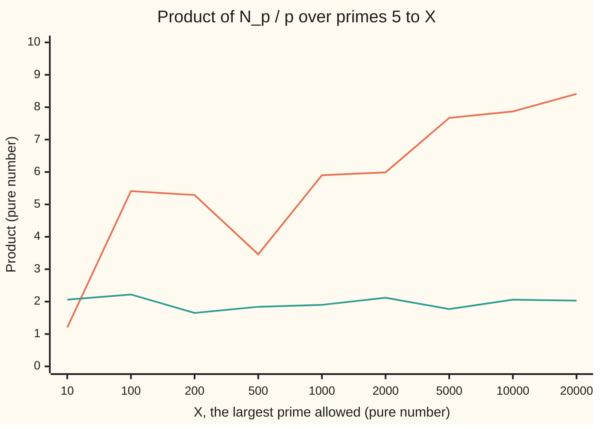

# Birch and Swinnerton-Dyer: the rank equals the order of vanishing at s equals 1

[Syllabus](../../../SYLLABUS.md) → [Algebraic geometry](../README.md) → [Elliptic Curves](../README.md#s04) → Birch and Swinnerton-Dyer

---

## General Overview

The curve $`y^2 = x^3 - 2`$ has the rational point (3, 5): $`5^2 = 25 = 27 - 2`$. Adding (3, 5) to itself with the chord and tangent rule gives (129/100, −383/1000), then points with longer and longer fractions. Every rational point on the curve is a whole-number multiple of (3, 5), positive, negative or zero. One point generates them all, so the curve's **rank** (the number of independent points of infinite order) is 1.

Finding a rank is hard. A search can find points but can never prove that no more exist. The conjecture of Birch and Swinnerton-Dyer reads the rank from different data: how many points the curve has modulo each prime. Modulo 7 the curve has 7 points, counting the point at infinity. Modulo 13 it has 19. These counts build one function, the L-function $`L(E, s)`$.

The conjecture says the rank equals how many times $`L(E, s)`$ vanishes at $`s = 1`$. For $`y^2 = x^3 - 2`$, $`L(E, 1) = 0`$ and the slope there is $`L'(E, 1) = 2.920054768253`$, not zero. So the function vanishes once, and the rank is 1. The strong form goes further: it predicts the number 2.920054768253 from five pieces of the curve's arithmetic. The period, 2.163681749014, times the height of (3, 5), 1.349576835680, gives 2.920054768253 again, to twelve digits.

**The rank of an elliptic curve over the rationals equals the order of vanishing of its L-function at s = 1, and the first non-zero Taylor coefficient there equals the period times the regulator times the Tamagawa numbers times the order of Ш, divided by the torsion count squared.**

**What kind of fact this is:** a conjecture, unproved as of 2026-11-17. When $`L(E, s)`$ vanishes at $`s = 1`$ to order 0 or 1, the rank part is a theorem (listed in Why it works). For $`y^2 = x^3 - 2`$ the rank part is therefore proved, and the strong form is checked numerically to twelve digits, with the order of Ш taken as 1.

### The picture: point counts already know the rank

Birch and Swinnerton-Dyer started from this observation in the early 1960s. Take the counts $`N_p`$ (points modulo $`p`$, with the point at infinity) and multiply the ratios $`N_p / p`$ over all primes up to a limit $`X`$. A curve with many rational points tends to have extra points modulo each prime, so the product grows. The chart compares the rank-1 curve of this card with the rank-0 curve $`y^2 = x^3 + 1`$ (LMFDB 36.a4, whose only rational points are six points of finite order).



The upper line is the rank-1 curve $`y^2 = x^3 - 2`$: it wobbles but climbs, roughly like $`\log X`$. The lower line is the rank-0 curve $`y^2 = x^3 + 1`$: it stays near 2. The product leaves out the primes 2 and 3, where both curves are singular. These products are only a heuristic. The precise statement uses $`L(E, s)`$, whose value at $`s = 1`$ is, formally, the reciprocal of this product as $`X`$ grows without bound.

---

## The formula

The weak form, which is about the rank alone:

```math
\mathrm{ord}_{s=1}\, L(E, s) = r = \mathrm{rank}\, E(\mathbb{Q})
```

**Read it aloud:** the number of times the L-function vanishes at s = 1 equals the number of independent rational points of infinite order.

The strong form, which predicts the first non-zero Taylor coefficient:

```math
\lim_{s \to 1} \frac{L(E, s)}{(s - 1)^r} = \frac{\Omega_E \cdot \mathrm{Reg}_E \cdot \prod_p c_p \cdot \#\text{Ш}(E)}{\left(\#E(\mathbb{Q})_{\mathrm{tors}}\right)^2}
```

**Read it aloud:** divide the L-function by the right power of (s − 1) and take the value at 1; it equals the period times the regulator times the Tamagawa numbers times the size of Ш, over the number of torsion points squared.

For rank 1 the left side is the slope $`L'(E, 1)`$. On $`y^2 = x^3 - 2`$ the strong form reads

```math
2.920054768253 = \frac{2.163681749014 \times 1.349576835680 \times 1 \times 1 \times 1}{1^2}
```

with the five factors in the order of the formula: period, regulator, $`c_2 c_3`$, the order of Ш, and torsion.

| Symbol | Plain meaning | In our example | Push it up and the answer… |
| --- | --- | --- | --- |
| $`E`$, $`P`$ | the elliptic curve over $`\mathbb{Q}`$ (the rationals), and a rational point on it | $`y^2 = x^3 - 2`$; $`P = (3, 5)`$ | — |
| $`E(\mathbb{Q})`$, $`r`$ | the group of rational points, and its rank: how many independent points of infinite order | all multiples of $`P`$; $`r = 1`$ | each extra independent point adds one to the order of vanishing |
| $`p`$, $`N_p`$, $`a_p`$ | a prime; the points modulo $`p`$, with the point at infinity; and $`a_p = p + 1 - N_p`$ | $`N_7 = 7`$, $`a_7 = 1`$ | a larger $`N_p`$ means a smaller $`a_p`$ |
| $`L(E, s)`$, $`s`$, $`w`$, $`\Lambda`$, $`\Gamma`$ | the L-function built from the $`a_p`$; its complex variable; the sign $`\pm 1`$ in its functional equation; the completed L-function; the gamma function | $`w = -1`$, so $`L(E, 1) = 0`$ | — |
| $`N`$, $`\Delta`$ | the conductor (which primes are bad, and how badly); the discriminant | $`N = 1728 = 2^6 \cdot 3^3`$; $`\Delta = -1728`$ | a larger $`N`$ makes the L-series converge more slowly |
| $`L'(E, 1)`$ | the slope of $`L(E, s)`$ at $`s = 1`$: the left side when $`r = 1`$ | 2.920054768253 | — |
| $`\Omega_E`$ | the real period: the integral of $`dx / 2y`$ over the curve's real points | 2.163681749014 | the right side grows in proportion |
| $`h`$, $`\hat h`$, $`\mathrm{Reg}_E`$ | the naive height $`\log \max(\lvert\text{numerator}\rvert, \text{denominator})`$ of $`x`$; the canonical height; the regulator, a determinant of heights | $`h(3) = 1.0986`$; $`\hat h(P) = \mathrm{Reg}_E = 1.349576835680`$ | the right side grows in proportion |
| $`c_p`$ | the Tamagawa number at a bad prime $`p`$ | $`c_2 = c_3 = 1`$ | the right side grows in proportion |
| $`\#E(\mathbb{Q})_{\mathrm{tors}}`$ | the number of rational points of finite order, $`O`$ included | 1 | the right side shrinks by its square |
| $`\#\text{Ш}(E)`$ | the order of the Tate–Shafarevich group: curves that pass every local test yet have no rational point | 1, as predicted | the right side grows in proportion |
| $`n`$, $`a_n`$, $`f`$, $`t`$, $`E_1`$ | the index of the L-series; its coefficients; the modular form $`\sum a_n e^{-2\pi n y}`$ on the imaginary axis; a free parameter of the fast series; the exponential integral | $`a_1 = 1`$; $`t = 1, 1.2, 1.5`$ | — |

### When it holds

- **The curve is over $`\mathbb{Q}`$.** The conjecture is stated over any number field, but every proved case below is over $`\mathbb{Q}`$, where modularity makes $`L(E, s)`$ defined at $`s = 1`$. The series $`\sum a_n n^{-s}`$ is only known to converge for $`\mathrm{Re}\, s > 3/2`$, so without modularity the left side has no meaning.
- **The model is minimal, and $`\Omega_E`$ uses its $`dx / 2y`$.** The rescaled model $`y^2 = x^3 - 2u^6`$ (put $`x = u^2 X`$, $`y = u^3 Y`$) divides the period by $`u`$, and the formula fails by that factor.
- **The height is the canonical one, with the normalization $`\hat h(P) = \lim h(x(nP)) / n^2`$.** Half of it, as some books define it, makes the order of Ш come out 2.0000, which no Ш can have.
- **The regulator uses generators.** Built on $`2P`$ instead of $`P`$, the regulator is 4 times larger, and the formula is off by that factor.
- **Ш is finite.** The right side needs a number for $`\#\text{Ш}`$. Finiteness is proved for analytic rank 0 and 1, and is open for every curve of higher analytic rank.

---

## Why it works

The conjecture is not proved, so this section explains why each term belongs in the formula, computes each one on $`y^2 = x^3 - 2`$, and lists what is proved.

### Step 0: more rational points mean more points modulo p

A rational point reduces to a point modulo almost every prime. A curve with infinitely many rational points therefore tends to have a few extra points modulo each $`p`$, so $`N_p`$ sits slightly above $`p + 1`$ on average. The Euler product of $`L(E, s)`$ at $`s = 1`$ is formally $`\prod_p p / N_p`$. Extra points push each factor below 1, and the product drifts toward 0. The chart above shows the reciprocal climbing for rank 1.

Higher rank pushes harder, and the conjecture says exactly how hard: each independent point adds one to the order of vanishing.

### Step 1: L(E, 1) is exactly zero, because the sign is −1

[The L-function](07-l-functions-of-elliptic-curves.md) sets up the functional equation and finds the sign $`w = -1`$ for this curve. Modularity (the card [What curves answer](10-modularity-and-the-congruent-number-problem.md)) is what extends $`L(E, s)`$ to every complex $`s`$, so that the equation holds. In words, the completed function $`\Lambda(s) = N^{s/2} (2\pi)^{-s} \Gamma(s) L(E, s)`$ satisfies $`\Lambda(2 - s) = w \Lambda(s)`$, with $`w = \pm 1`$. The point $`s = 1`$ is the centre of that symmetry. If $`w = -1`$, then $`\Lambda(1) = -\Lambda(1)`$, so $`L(E, 1) = 0`$ exactly.

The functional equation also gives a fast series. For any $`t > 0`$:

```math
L(E, 1) = \sum_{n \ge 1} \frac{a_n}{n} \left( e^{-2\pi n t / \sqrt{N}} + w\, e^{-2\pi n / (t \sqrt{N})} \right)
```

The answer cannot depend on $`t`$. This is a test of $`N`$ and $`w`$. With $`N = 1728`$ and $`w = -1`$ the sum is 0.000000000000 at $`t = 1.2`$ and at $`t = 1.5`$. With $`w = +1`$ it gives 1.6605 at $`t = 1`$ and 1.6483 at $`t = 1.2`$, so $`+1`$ is not this curve's sign.

<details>
<summary>Where the fast series comes from</summary>

Write $`f(iy) = \sum_n a_n e^{-2\pi n y}`$, the modular form of the curve on the imaginary axis. A Mellin transform turns it into the L-function:

$`\displaystyle (2\pi)^{-s} \Gamma(s) L(E, s) = \int_0^\infty f(iy)\, y^{s-1}\, dy.`$

Split the integral at $`y = t / \sqrt{N}`$. The piece from 0 to $`t / \sqrt{N}`$ is folded onto the other side by the substitution $`y \mapsto 1 / (N y)`$, using the symmetry $`f(i / (N y)) = w N y^2 f(iy)`$ of the modular form (the Fricke involution). At $`s = 1`$ both pieces integrate term by term to exponentials, which gives the series above. Differentiating in $`s`$ before setting $`s = 1`$ turns each exponential into an exponential integral, $`E_1(x) = \int_x^\infty e^{-u} u^{-1}\, du`$.

</details>

### Step 2: the slope L'(E, 1) is not zero

Differentiating the same identity at $`s = 1`$, for $`w = -1`$, gives

```math
L'(E, 1) = \sum_{n \ge 1} \frac{a_n}{n} \left( E_1\!\left(\frac{2\pi n t}{\sqrt{N}}\right) + E_1\!\left(\frac{2\pi n}{t \sqrt{N}}\right) \right)
```

The coefficients $`a_n`$ come from the point counts: $`a_p = p + 1 - N_p`$ at good primes, $`a_2 = a_3 = 0`$ at the two bad primes, and products and a recurrence for the rest. With 400 terms the sum is 2.920054768253 at $`t = 1`$, 1.2 and 1.5. It is far from 0, so $`L(E, s)`$ vanishes to order exactly 1 at $`s = 1`$.

A wrong conductor fails the same test: with $`N = 864`$ the sum moves from 2.3496 to 2.3537 as $`t`$ changes.

### Step 3: the period Ω measures the real curve

The curve's real points form one loop through $`x = 2^{1/3}`$, because $`\Delta < 0`$ (one real root of $`x^3 - 2`$). The period integrates the invariant differential $`dx / 2y`$ around that loop:

```math
\Omega_E = \int_{2^{1/3}}^{\infty} \frac{dx}{\sqrt{x^3 - 2}} = 2.163681749014
```

It is the curve's real size, measured in the curve's own units. A rescaled model changes $`dx / 2y`$, which is why the formula needs the minimal model. Two roads give the same 12 digits: an arithmetic-geometric mean (AGM) formula, and Simpson's rule after the substitution $`x = 2^{1/3} + \tan^2\theta`$.

### Step 4: the regulator measures how spread out the rational points are

The naive height of a point is $`h(x) = \log \max(\lvert\text{numerator}\rvert, \text{denominator})`$ of its $`x`$. For $`P = (3, 5)`$ it is $`\log 3 = 1.0986`$. The fractions in $`nP`$ grow so that $`h(x(nP))`$ grows like $`n^2`$. The **canonical height** is the exact growth rate:

```math
\hat h(P) = \lim_{n \to \infty} \frac{h(x(nP))}{n^2} = 1.349576835680
```

The first four ratios are 1.0986, 1.2150, 1.3344 and 1.3484. Tate's series reaches the limit fast: it starts from $`\log 3`$ and adds one correction per doubling of the point. The series measures only the real size of $`x`$; it gives the whole canonical height here because $`x(P) = 3`$ is a whole number and $`P`$ reduces to a smooth point modulo 2 and 3, so no prime adds a correction of its own. The **regulator** $`\mathrm{Reg}_E`$ is the determinant of the matrix of heights between generators. For rank 1 it is the canonical height of the one generator, so $`\mathrm{Reg}_E = 1.349576835680`$.

The regulator is large when the generators have long fractions. Few, large points mean a large leading coefficient.

### Step 5: Tamagawa numbers and torsion correct for local and finite pieces

- **Tamagawa numbers $`c_p`$.** At a bad prime the reduced curve has a singular point. The $`p`$-adic points of $`E`$ (its solutions in the $`p`$-adic numbers, the completion of $`\mathbb{Q}`$ in which high powers of $`p`$ count as small) split into those that reduce to smooth points and the rest; $`c_p`$ is the number of classes. Tate's algorithm decides it. Move the singular point mod $`p`$ to $`x = 0`$. If $`p`$ divides $`a_2`$, $`a_4`$ and $`a_6`$, but $`p^2`$ does not divide $`a_6`$, the type is II (a cusp) and $`c_p = 1`$. At $`p = 2`$ the shifted coefficients are 0, 0, −2. At $`p = 3`$, after $`x \mapsto x + 2`$, they are 6, 12, 6. Both are type II, so $`c_2 = c_3 = 1`$. For type II, Ogg's formula makes the conductor exponent equal $`v_p(\Delta)`$, the power of $`p`$ in $`\Delta`$: 6 and 3, so $`N = 1728`$.
- **Torsion.** Points of finite order inject into $`E(\mathbb{F}_p)`$ at good primes $`p \ge 3`$. Here $`N_5 = 6`$ and $`N_7 = 7`$, with greatest common divisor 1, so only $`O`$ has finite order. The torsion count enters squared: once for $`E`$ and once for its dual curve, which for an elliptic curve is $`E`$ itself.

### Step 6: Ш is what is left, and the formula predicts its size

The **Tate–Shafarevich group** Ш collects curves of genus 1 related to $`E`$ that have points over the reals and over every $`p`$-adic field, yet no rational point. Each one is a local-to-global failure: every test modulo $`p`$ passes, and still no solution exists. Ш is the obstruction that makes descent (the card [Mordell-Weil](06-mordell-weil-and-rank.md)) sometimes unable to settle the rank.

Nobody can count Ш directly for a general curve. Solving the strong form for it gives its predicted ("analytic") order:

```math
\#\text{Ш} = \frac{L'(E, 1) \cdot \left(\#E(\mathbb{Q})_{\mathrm{tors}}\right)^2}{\Omega_E \cdot \mathrm{Reg}_E \cdot c_2 c_3} = \frac{2.920054768253 \times 1}{2.920054768253} = 1.000000000000
```

When Ш is finite its order is a perfect square, by a pairing found by Cassels. So a computed value of 2.0000 or 1.2284 signals a wrong term, never a strange Ш.

### Step 7: what is proved, for rank 0, rank 1 and beyond

Here "analytic rank" means the order of vanishing of $`L(E, s)`$ at $`s = 1`$.

| Analytic rank | Proved | Still open |
| --- | --- | --- |
| 0 | $`E(\mathbb{Q})`$ is finite: Coates and Wiles (1977), for curves with complex multiplication. $`E(\mathbb{Q})`$ and Ш are finite for every curve over $`\mathbb{Q}`$: Kolyvagin (1988), completed by modularity (2001). The $`p`$-part of the strong form (its exact power of each prime $`p`$) is proved for many $`p`$. | the full strong form for every curve |
| 1 | the rank is exactly 1 and Ш is finite: Gross and Zagier (1986) build a point of infinite order whose height is tied to $`L'(E, 1)`$, and Kolyvagin (1988) shows the rank is no larger. The $`p`$-part of the strong form is proved for many $`p`$, and partial converses (rank 1 implies analytic rank 1, under conditions) date from 2014. | the full strong form for every curve |
| 2 or more | nothing in general; Ш is not known to be finite for a single such curve | both forms |

Two further facts frame the table. The full strong form has been proved for many individual curves of small conductor and analytic rank 0 or 1, by bounding Ш one prime at a time; this card does not check whether $`y^2 = x^3 - 2`$ is among them. And when curves are ordered by the size of their coefficients, more than 66 percent of them satisfy the weak form, by results from 2014.

For $`y^2 = x^3 - 2`$: Step 2 shows analytic rank 1, so by Gross–Zagier and Kolyvagin the rank is 1 and Ш is finite. The weak form is a theorem for this curve. The strong form here rests on $`\#\text{Ш} = 1`$, the order the formula predicts.

---

## Worked numbers, by hand

| Step | Arithmetic | Value |
| --- | --- | --- |
| point on the curve | $`5^2 = 25 = 3^3 - 2`$ | (3, 5) |
| doubling it | slope $`3 \cdot 3^2 / (2 \cdot 5) = 27/10`$; $`x = (27/10)^2 - 6`$ | $`2P = (129/100, -383/1000)`$ |
| points mod 7 | $`x^3 - 2`$ is a square for $`x = 3, 5, 6`$; 2 values of $`y`$ each, plus $`O`$ | $`N_7 = 7`$ |
| $`a_7`$, and Hasse's window | $`7 + 1 - 7`$; $`8 \pm 2\sqrt{7}`$ | $`a_7 = 1`$; $`8 \pm 5.29`$ |
| torsion | $`\gcd(N_5, N_7) = \gcd(6, 7)`$ | 1 |
| Tamagawa numbers | type II at 2 and at 3 | $`c_2 = c_3 = 1`$ |
| slope of $`L`$ at 1 | fast series, 400 terms (code) | 2.920054768253 |
| period | AGM, or Simpson (code) | 2.163681749014 |
| regulator | Tate's series for $`\hat h(3, 5)`$ (code) | 1.349576835680 |
| right side | $`2.163682 \times 1.349577 \times 1 \times 1 / 1^2`$ | 2.920054768253 |
| **order of Ш** | $`2.920054768253 / 2.920054768253`$ | **1.000000000000** |

The two sides agree to twelve digits, so the strong form holds for this curve exactly when Ш has one element.

### What breaks if you drop a piece

| Mistake | Comes out at | What went wrong |
| --- | --- | --- |
| Height halved, $`\hat h = 0.6748`$ | order of Ш 2.0000 | Some books halve $`\hat h`$; the formula needs the full limit of $`h(x(nP))/n^2`$. 2 is not a square |
| Naive height $`\log 3 = 1.0986`$ for the regulator | order of Ш 1.2284 | $`h`$ ignores how the fractions grow under addition |
| Sign $`w = +1`$ | $`L(E, 1)`$ 1.6605 at $`t = 1`$, 1.6483 at $`t = 1.2`$ | a true value cannot depend on $`t`$, so the functional equation is broken |
| Conductor 864 for 1728 | $`L'(E, 1)`$ 2.3496 at $`t = 1`$, 2.3537 at $`t = 1.2`$ | the hypothesis of the functional equation fails, and the series stops being one function |

The code prints all four.

---

## Code, from first principles, and it actually runs

The code computes both sides of the strong form by roads that share no arithmetic. The left side, $`L'(E, 1)`$, comes from counting points modulo every prime up to 400. The right side comes from an integral over the real curve, Tate's height series and Tate's algorithm at 2 and 3. Inside each side, every piece has its own second road: point counts by a squares table and by trying every pair; the L-value at three values of $`t`$; the period by the AGM and by Simpson's rule; the height by Tate's series against the naive ratios $`h(x(nP))/n^2`$ in exact fractions. The two sides agree to 12 digits, so 1 is the predicted order of Ш. The last two lines print the chart's points.

### Python

```python
# Birch and Swinnerton-Dyer -- the check behind the card.  Standard library only.
# The curve E: y^2 = x^3 - 2 and its rational point P = (3, 5).  Both sides of the
# strong form are computed by roads that share no arithmetic: L'(E, 1) from point
# counts mod p; the period, height, Tamagawa numbers and torsion.  Ratio: #Sha.
from fractions import Fraction as Fr
import math

A, B, M = 0, -2, 400                         # y^2 = x^3 + Ax + B; terms in each L-series

yn = lambda claim: "yes" if claim else "no"

def primes(n): return [p for p in range(2, n + 1) if all(p % d for d in range(2, math.isqrt(p) + 1))]

def count(p, b):                             # points of y^2 = x^3 + b mod p, with O
    sq = [0] * p
    for y in range(p):
        sq[y * y % p] += 1
    return 1 + sum(sq[(x * x * x + b) % p] for x in range(p))

def count_brute(p, b):                       # second road: try every pair (x, y)
    return 1 + sum(1 for x in range(p) for y in range(p) if (y * y - x ** 3 - b) % p == 0)

def add(P, Q):                               # chord and tangent, exact fractions
    (x1, y1), (x2, y2) = P, Q
    m = (3 * x1 * x1 + A) / (2 * y1) if P == Q else (y2 - y1) / (x2 - x1)
    x3 = m * m - x1 - x2
    return (x3, m * (x1 - x3) - y1)

def e1(x):                                   # exponential integral E1, written out
    if x < 1:
        s, t = -0.5772156649015329 - math.log(x), 1.0
        for k in range(1, 60):
            t *= -x / k
            s -= t / k
        return s
    b, c, d, h = x + 1, 1e300, 1 / (x + 1), 1 / (x + 1)
    for i in range(1, 200):                  # continued fraction, Lentz's method
        b += 2
        d = 1 / (b - i * i * d)
        c = b - i * i / c
        h *= c * d
    return h * math.exp(-x)

def agm(a, b):                               # arithmetic-geometric mean
    while abs(a - b) > 1e-15 * a:
        a, b = (a + b) / 2, math.sqrt(a * b)
    return a

def series(cond, t, kind):                   # L(E,1) or L'(E,1) for a trial conductor and sign
    tot, r = 0.0, math.sqrt(cond)
    for n in range(1, M + 1):
        u, v = 2 * math.pi * n * t / r, 2 * math.pi * n / (t * r)
        f = e1(u) + e1(v) if kind == 0 else math.exp(-u) + kind * math.exp(-v)
        tot += an[n] / n * f
    return tot

disc = -16 * (4 * A ** 3 + 27 * B * B)
print(f"curve y^2 = x^3 - 2; discriminant -16(4A^3 + 27B^2) = {disc}; j = 0")
print(f"P = (3, 5) lies on it, 5^2 = 25 = 3^3 - 2: {yn(5 ** 2 == 3 ** 3 - 2)}")
P = (Fr(3), Fr(5))
mult = [P, add(P, P)]
mult += [add(mult[1], P), add(mult[1], mult[1])]
for n in (2, 3, 4):
    print(f"{n}P = ({mult[n - 1][0]}, {mult[n - 1][1]})")
nh = [math.log(max(abs(x.numerator), x.denominator)) / n ** 2 for n, (x, y) in enumerate(mult, 1)]
print("naive height of x(nP) over n^2, n = 1 to 4: " + ", ".join(f"{v:.4f}" for v in nh))
ps = list(cnt := {p: count(p, B) for p in primes(M)})
print("points mod p, two roads: " + ", ".join(f"p={p}: {cnt[p]} {count_brute(p, B)}" for p in (5, 7, 11, 13)))
print(f"Hasse window at p = 7: 8 +- {2 * math.sqrt(7):.2f}; holds for every p from 5 to {M}: "
      f"{yn(all(abs(p + 1 - cnt[p]) <= 2 * math.sqrt(p) for p in ps if p > 3))}")
print(f"torsion: gcd(#E(F_5), #E(F_7)) = gcd({cnt[5]}, {cnt[7]}) = {math.gcd(cnt[5], cnt[7])}")
fx = {}
for p in (2, 3):                             # Tate's algorithm, steps 1 to 3
    x0 = [x for x in range(p) for y in range(p) if (y * y - x ** 3 - B) % p == 0
          and (2 * y) % p == 0 and (3 * x * x) % p == 0][0]
    a2, a4, a6 = 3 * x0, 3 * x0 * x0, x0 ** 3 + B   # move the singular point to x = 0
    fx[p] = max(v for v in range(20) if disc % p ** v == 0)
    print(f"p = {p}: singular point at x = {x0}; shifted a2, a4, a6 = {a2}, {a4}, {a6}; "
          f"p divides all three: {yn(a2 % p == a4 % p == a6 % p == 0)}; p^2 divides a6: "
          f"{yn(a6 % (p * p) == 0)}; so type II, c_{p} = 1, f_{p} = v_{p}(disc) = {fx[p]}")
    assert a2 % p == a4 % p == a6 % p == 0 != a6 % (p * p)          # Tate's test for type II
NC = 2 ** fx[2] * 3 ** fx[3]
print(f"conductor N = 2^{fx[2]} * 3^{fx[3]} = {NC}")
ap = {p: 0 if p < 5 else p + 1 - cnt[p] for p in ps}
print("a_p for p up to 31: " + ", ".join(f"{p}:{ap[p]}" for p in ps if p <= 31))
an = [0, 1] + [0] * (M - 1)
for n in range(2, M + 1):                    # multiply a_n out of the a_p
    p = next(q for q in ps if n % q == 0)
    pk, m = p, n // p
    while m % p == 0:
        pk, m = pk * p, m // p
    if m > 1:
        an[n] = an[pk] * an[m]
    else:
        an[n] = ap[p] if pk == p else 0 if p < 5 else ap[p] * an[pk // p] - p * an[pk // p // p]
l0 = [series(NC, t, -1) for t in (1.2, 1.5)]
l1 = [series(NC, t, 0) for t in (1.0, 1.2, 1.5)]
print("size of L(E,1), sign -1, at t = 1.2 and 1.5: " + ", ".join(f"{abs(v):.12f}" for v in l0))
print("L'(E,1) at t = 1.0, 1.2, 1.5: " + ", ".join(f"{v:.12f}" for v in l1))
wrong = [series(NC, t, 1) for t in (1.0, 1.2)] + [series(NC // 2, t, 0) for t in (1.0, 1.2)]
print(f"wrong sign +1: L(E,1) at t = 1.0 and 1.2: {wrong[0]:.4f}, {wrong[1]:.4f}")
print(f"wrong conductor {NC // 2}: L'(E,1) at t = 1.0 and 1.2: {wrong[2]:.4f}, {wrong[3]:.4f}")
e = 2 ** (1 / 3)                             # the real root of x^3 - 2
z = math.sqrt(3 * e * e + A)
om = 2 * math.pi / agm(2 * math.sqrt(z), math.sqrt(2 * z + 3 * e))
def g(th):                                   # integrand after x = e + tan(th)^2
    u = e + math.tan(th) ** 2
    return 2 / math.cos(th) ** 2 / math.sqrt(u * u + e * u + e * e) if th < math.pi / 2 else 2.0
hs = math.pi / 4000                          # Simpson's rule, 2000 steps
om_q = hs / 3 * (g(0) + g(math.pi / 2) + sum((4 if i % 2 else 2) * g(i * hs) for i in range(1, 2000)))
print(f"real period Omega by the AGM: {om:.12f}; by Simpson's rule: {om_q:.12f}")
x, h, parts = 3.0, math.log(3.0), [math.log(3.0)]
for j in range(40):                          # Tate's series for the canonical height
    zz = 1 - 2 * A / x ** 2 - 8 * B / x ** 3 + A * A / x ** 4
    h += math.log(zz) / 4 ** (j + 1)
    parts.append(h)
    x = x ** 4 * zz / (4 * (x ** 3 + A * x + B))
print("canonical height, Tate's series after 0 to 5 terms: " + ", ".join(f"{v:.6f}" for v in parts[:6])
      + f"; limit {h:.12f}")
rhs = om * h * 1 * 1 / 1 ** 2
print(f"right side Omega * Reg * c_2 * c_3 / tors^2 = {om:.6f} * {h:.6f} * 1 * 1 / 1 = {rhs:.12f}")
print(f"#Sha = L'(E,1) / right side = {(sha := l1[0] / rhs):.12f}")
print(f"mistake 1, height halved to {h / 2:.4f}: #Sha comes out {l1[0] / (rhs / 2):.4f}")
print(f"mistake 2, naive height log 3 = {math.log(3):.4f}: #Sha comes out {l1[0] / (om * math.log(3)):.4f}")
marks, big = [10, 100, 200, 500, 1000, 2000, 5000, 10000, 20000], primes(20000)
last = [max(q for q in big if q <= m) for m in marks]    # the last prime under each mark
for b, name in ((-2, "rank 1, y^2 = x^3 - 2"), (1, "rank 0, y^2 = x^3 + 1")):
    pr, out = 1.0, []
    for p in big:
        pr *= count(p, b) / p if p > 3 else 1.0
        if p in last:
            out.append(pr)
    print(f"product of N_p/p up to {marks}, {name}: " + ", ".join(f"{v:.2f}" for v in out))
assert all(cnt[p] == count_brute(p, B) for p in (5, 7, 11, 13))          # two roads to N_p
assert math.gcd(cnt[5], cnt[7]) == 1 and NC == 1728                       # torsion; conductor
assert max(abs(v) for v in l0) < 1e-12 and max(l1) - min(l1) < 1e-12     # sign -1, N = 1728
assert abs(wrong[0] - wrong[1]) > 1e-3 and abs(wrong[2] - wrong[3]) > 1e-3
assert abs(om - om_q) < 1e-12 and abs(nh[3] - h) < 0.01                   # two roads each
assert abs(sha - 1) < 1e-10                                                # the strong form
print("ALL CHECKS PASS")
```

**Ran 2026-11-17 on macOS, Python 3.14.10, standard library only. All checks passed. Output, pasted from the run:**

```
curve y^2 = x^3 - 2; discriminant -16(4A^3 + 27B^2) = -1728; j = 0
P = (3, 5) lies on it, 5^2 = 25 = 3^3 - 2: yes
2P = (129/100, -383/1000)
3P = (164323/29241, -66234835/5000211)
4P = (2340922881/58675600, 113259286337279/449455096000)
naive height of x(nP) over n^2, n = 1 to 4: 1.0986, 1.2150, 1.3344, 1.3484
points mod p, two roads: p=5: 6 6, p=7: 7 7, p=11: 12 12, p=13: 19 19
Hasse window at p = 7: 8 +- 5.29; holds for every p from 5 to 400: yes
torsion: gcd(#E(F_5), #E(F_7)) = gcd(6, 7) = 1
p = 2: singular point at x = 0; shifted a2, a4, a6 = 0, 0, -2; p divides all three: yes; p^2 divides a6: no; so type II, c_2 = 1, f_2 = v_2(disc) = 6
p = 3: singular point at x = 2; shifted a2, a4, a6 = 6, 12, 6; p divides all three: yes; p^2 divides a6: no; so type II, c_3 = 1, f_3 = v_3(disc) = 3
conductor N = 2^6 * 3^3 = 1728
a_p for p up to 31: 2:0, 3:0, 5:0, 7:1, 11:0, 13:-5, 17:0, 19:-7, 23:0, 29:0, 31:4
size of L(E,1), sign -1, at t = 1.2 and 1.5: 0.000000000000, 0.000000000000
L'(E,1) at t = 1.0, 1.2, 1.5: 2.920054768253, 2.920054768253, 2.920054768253
wrong sign +1: L(E,1) at t = 1.0 and 1.2: 1.6605, 1.6483
wrong conductor 864: L'(E,1) at t = 1.0 and 1.2: 2.3496, 2.3537
real period Omega by the AGM: 2.163681749014; by Simpson's rule: 2.163681749014
canonical height, Tate's series after 0 to 5 terms: 1.098612, 1.214953, 1.348363, 1.348367, 1.348430, 1.349095; limit 1.349576835680
right side Omega * Reg * c_2 * c_3 / tors^2 = 2.163682 * 1.349577 * 1 * 1 / 1 = 2.920054768253
#Sha = L'(E,1) / right side = 1.000000000000
mistake 1, height halved to 0.6748: #Sha comes out 2.0000
mistake 2, naive height log 3 = 1.0986: #Sha comes out 1.2284
product of N_p/p up to [10, 100, 200, 500, 1000, 2000, 5000, 10000, 20000], rank 1, y^2 = x^3 - 2: 1.20, 5.41, 5.29, 3.46, 5.90, 5.99, 7.67, 7.87, 8.41
product of N_p/p up to [10, 100, 200, 500, 1000, 2000, 5000, 10000, 20000], rank 0, y^2 = x^3 + 1: 2.06, 2.22, 1.65, 1.84, 1.90, 2.12, 1.77, 2.06, 2.03
ALL CHECKS PASS
```

### Rust

Same numbers, same labels, built with `rustc --edition 2021 -O`. Fractions are pairs of `i128` with `checked_mul` and `checked_sub`, so an overflow stops the run.

```rust
// Birch and Swinnerton-Dyer -- the same check as the Python, in Rust.  No crates.
// The curve E: y^2 = x^3 - 2 and its rational point P = (3, 5).  Both sides of the
// strong form are computed by roads that share no arithmetic: L'(E, 1) from point
// counts mod p; the period, height, Tamagawa numbers and torsion.  Ratio: #Sha.
use std::f64::consts::PI;
const A: i64 = 0;
const B: i64 = -2;
const M: usize = 400;
type Q = (i128, i128);                                // a fraction, numerator over denominator

fn gcd(a: i128, b: i128) -> i128 { if b == 0 { a.abs() } else { gcd(b, a % b) } }
fn fr(n: i128, d: i128) -> Q { let g = gcd(n, d) * d.signum(); (n / g, d / g) }
fn mul(a: Q, b: Q) -> Q { fr(a.0.checked_mul(b.0).unwrap(), a.1.checked_mul(b.1).unwrap()) }
fn sub(a: Q, b: Q) -> Q { fr(a.0.checked_mul(b.1).unwrap().checked_sub(b.0.checked_mul(a.1).unwrap()).unwrap(), a.1.checked_mul(b.1).unwrap()) }
fn div(a: Q, b: Q) -> Q { mul(a, fr(b.1, b.0)) }
fn show(a: Q) -> String { if a.1 == 1 { format!("{}", a.0) } else { format!("{}/{}", a.0, a.1) } }
fn yn(claim: bool) -> &'static str { if claim { "yes" } else { "no" } }
fn primes(n: usize) -> Vec<usize> { (2..=n).filter(|&p| (2..p).take_while(|d| d * d <= p).all(|d| p % d != 0)).collect() }
fn md(a: i64, p: i64) -> usize { a.rem_euclid(p) as usize }
fn join(v: &[f64], dp: usize) -> String { v.iter().map(|x| format!("{:.*}", dp, x)).collect::<Vec<_>>().join(", ") }

fn count(p: usize, b: i64) -> usize {                 // points of y^2 = x^3 + b mod p, with O
    let mut sq = vec![0; p];
    for y in 0..p { sq[y * y % p] += 1 }
    1 + (0..p as i64).map(|x| sq[md(x * x * x + b, p as i64)]).sum::<usize>()
}

fn count_brute(p: i64, b: i64) -> i64 {               // second road: try every pair (x, y)
    1 + (0..p).map(|x| (0..p).filter(|y| (y * y - x * x * x - b).rem_euclid(p) == 0).count() as i64).sum::<i64>()
}

fn add(p: (Q, Q), q: (Q, Q)) -> (Q, Q) {              // chord and tangent, exact fractions
    let m = if p == q { div(mul(fr(3, 1), mul(p.0, p.0)), mul(fr(2, 1), p.1)) } else { div(sub(q.1, p.1), sub(q.0, p.0)) };
    let x3 = sub(sub(mul(m, m), p.0), q.0);
    (x3, sub(mul(m, sub(p.0, x3)), p.1))
}

fn e1(x: f64) -> f64 {                                // exponential integral E1, written out
    if x < 1.0 {
        let (mut s, mut t) = (-0.5772156649015329 - x.ln(), 1.0);
        for k in 1..60 { t *= -x / k as f64; s -= t / k as f64 }
        return s;
    }
    let (mut b, mut c, mut d, mut h) = (x + 1.0, 1e300, 1.0 / (x + 1.0), 1.0 / (x + 1.0));
    for i in 1..200 {                                 // continued fraction, Lentz's method
        let ii = (i * i) as f64;
        b += 2.0;
        d = 1.0 / (b - ii * d);
        c = b - ii / c;
        h *= c * d;
    }
    h * (-x).exp()
}

fn agm(mut a: f64, mut b: f64) -> f64 {               // arithmetic-geometric mean
    while (a - b).abs() > 1e-15 * a { (a, b) = ((a + b) / 2.0, (a * b).sqrt()) }
    a
}

fn series(an: &[i64], cond: f64, t: f64, kind: f64) -> f64 { // L(E,1) or L'(E,1), trial conductor and sign
    let (mut tot, r) = (0.0, cond.sqrt());
    for n in 1..=M {
        let (u, v) = (2.0 * PI * n as f64 * t / r, 2.0 * PI * n as f64 / (t * r));
        let f = if kind == 0.0 { e1(u) + e1(v) } else { (-u).exp() + kind * (-v).exp() };
        tot += an[n] as f64 / n as f64 * f;
    }
    tot
}

fn main() {
    let disc = -16 * (4 * A.pow(3) + 27 * B * B);
    println!("curve y^2 = x^3 - 2; discriminant -16(4A^3 + 27B^2) = {}; j = 0", disc);
    println!("P = (3, 5) lies on it, 5^2 = 25 = 3^3 - 2: {}", yn(5 * 5 == 27 - 2));
    let p1 = (fr(3, 1), fr(5, 1));
    let p2 = add(p1, p1);
    let mult = [p1, p2, add(p2, p1), add(p2, p2)];
    for n in 2..=4 { println!("{}P = ({}, {})", n, show(mult[n - 1].0), show(mult[n - 1].1)) }
    let nh: Vec<f64> = mult.iter().enumerate().map(|(i, pt)| (pt.0 .0.abs().max(pt.0 .1) as f64).ln() / ((i + 1) * (i + 1)) as f64).collect();
    println!("naive height of x(nP) over n^2, n = 1 to 4: {}", join(&nh, 4));
    let ps = primes(M);
    let mut cnt = vec![0usize; M + 1];
    for &p in &ps { cnt[p] = count(p, B) }
    let two: Vec<String> = [5, 7, 11, 13].iter().map(|&p| format!("p={}: {} {}", p, cnt[p], count_brute(p as i64, B))).collect();
    println!("points mod p, two roads: {}", two.join(", "));
    let hasse = ps.iter().filter(|&&p| p > 3).all(|&p| ((p + 1) as f64 - cnt[p] as f64).abs() <= 2.0 * (p as f64).sqrt());
    println!("Hasse window at p = 7: 8 +- {:.2}; holds for every p from 5 to {}: {}", 2.0 * 7f64.sqrt(), M, yn(hasse));
    let tors = gcd(cnt[5] as i128, cnt[7] as i128);
    println!("torsion: gcd(#E(F_5), #E(F_7)) = gcd({}, {}) = {}", cnt[5], cnt[7], tors);
    let mut fx = [0u32; 4];
    for p in [2i64, 3] {                              // Tate's algorithm, steps 1 to 3
        let x0 = (0..p).find(|&x| (0..p).any(|y| (y * y - x * x * x - B).rem_euclid(p) == 0 && (2 * y) % p == 0 && (3 * x * x) % p == 0)).unwrap();
        let (a2, a4, a6) = (3 * x0, 3 * x0 * x0, x0 * x0 * x0 + B); // move the singular point to x = 0
        fx[p as usize] = (0..20).filter(|&v| disc % p.pow(v) == 0).max().unwrap();
        println!("p = {}: singular point at x = {}; shifted a2, a4, a6 = {}, {}, {}; p divides all three: {}; p^2 divides a6: {}; so type II, c_{} = 1, f_{} = v_{}(disc) = {}",
                 p, x0, a2, a4, a6, yn(a2 % p == 0 && a4 % p == 0 && a6 % p == 0), yn(a6 % (p * p) == 0), p, p, p, fx[p as usize]);
        assert!(a2 % p == 0 && a4 % p == 0 && a6 % p == 0 && a6 % (p * p) != 0); // Tate's test for type II
    }
    let nc = 2i64.pow(fx[2]) * 3i64.pow(fx[3]);
    println!("conductor N = 2^{} * 3^{} = {}", fx[2], fx[3], nc);
    let mut ap = vec![0i64; M + 1];
    for &p in &ps { ap[p] = if p < 5 { 0 } else { (p + 1) as i64 - cnt[p] as i64 } }
    let small: Vec<String> = ps.iter().filter(|&&p| p <= 31).map(|&p| format!("{}:{}", p, ap[p])).collect();
    println!("a_p for p up to 31: {}", small.join(", "));
    let mut an = vec![0i64; M + 1];
    an[1] = 1;
    for n in 2..=M {                                  // multiply a_n out of the a_p
        let p = *ps.iter().find(|&&q| n % q == 0).unwrap();
        let (mut pk, mut m) = (p, n / p);
        while m % p == 0 { pk *= p; m /= p }
        an[n] = if m > 1 { an[pk] * an[m] } else if pk == p { ap[p] } else if p < 5 { 0 }
                else { ap[p] * an[pk / p] - p as i64 * an[pk / p / p] };
    }
    let ncf = nc as f64;
    let l0: Vec<f64> = [1.2, 1.5].iter().map(|&t| series(&an, ncf, t, -1.0).abs()).collect();
    let l1: Vec<f64> = [1.0, 1.2, 1.5].iter().map(|&t| series(&an, ncf, t, 0.0)).collect();
    println!("size of L(E,1), sign -1, at t = 1.2 and 1.5: {}", join(&l0, 12));
    println!("L'(E,1) at t = 1.0, 1.2, 1.5: {}", join(&l1, 12));
    let w = [series(&an, ncf, 1.0, 1.0), series(&an, ncf, 1.2, 1.0), series(&an, ncf / 2.0, 1.0, 0.0), series(&an, ncf / 2.0, 1.2, 0.0)];
    println!("wrong sign +1: L(E,1) at t = 1.0 and 1.2: {:.4}, {:.4}", w[0], w[1]);
    println!("wrong conductor {}: L'(E,1) at t = 1.0 and 1.2: {:.4}, {:.4}", nc / 2, w[2], w[3]);
    let e = 2f64.powf(1.0 / 3.0);                     // the real root of x^3 - 2
    let z = (3.0 * e * e + A as f64).sqrt();
    let om = 2.0 * PI / agm(2.0 * z.sqrt(), (2.0 * z + 3.0 * e).sqrt());
    let g = |th: f64| -> f64 {                        // integrand after x = e + tan(th)^2
        let u = e + th.tan().powi(2);
        if th < PI / 2.0 { 2.0 / th.cos().powi(2) / (u * u + e * u + e * e).sqrt() } else { 2.0 }
    };
    let hs = PI / 4000.0;                             // Simpson's rule, 2000 steps
    let om_q = hs / 3.0 * (g(0.0) + g(PI / 2.0) + (1..2000).map(|i| (if i % 2 == 1 { 4.0 } else { 2.0 }) * g(i as f64 * hs)).sum::<f64>());
    println!("real period Omega by the AGM: {:.12}; by Simpson's rule: {:.12}", om, om_q);
    let (mut x, mut h) = (3.0f64, 3f64.ln());
    let mut parts = vec![h];
    for j in 0..40 {                                  // Tate's series for the canonical height
        let zz = 1.0 - 2.0 * A as f64 / x.powi(2) - 8.0 * B as f64 / x.powi(3) + (A * A) as f64 / x.powi(4);
        h += zz.ln() / 4f64.powi(j + 1);
        parts.push(h);
        x = x.powi(4) * zz / (4.0 * (x.powi(3) + A as f64 * x + B as f64));
    }
    println!("canonical height, Tate's series after 0 to 5 terms: {}; limit {:.12}", join(&parts[..6], 6), h);
    let rhs = om * h * 1.0 * 1.0 / 1.0;
    let sha = l1[0] / rhs;
    println!("right side Omega * Reg * c_2 * c_3 / tors^2 = {:.6} * {:.6} * 1 * 1 / 1 = {:.12}", om, h, rhs);
    println!("#Sha = L'(E,1) / right side = {:.12}", sha);
    println!("mistake 1, height halved to {:.4}: #Sha comes out {:.4}", h / 2.0, l1[0] / (rhs / 2.0));
    println!("mistake 2, naive height log 3 = {:.4}: #Sha comes out {:.4}", 3f64.ln(), l1[0] / (om * 3f64.ln()));
    let marks = [10, 100, 200, 500, 1000, 2000, 5000, 10000, 20000];
    let big = primes(20000);
    let last: Vec<usize> = marks.iter().map(|&m| *big.iter().filter(|&&q| q <= m).max().unwrap()).collect();
    for (b, name) in [(-2, "rank 1, y^2 = x^3 - 2"), (1, "rank 0, y^2 = x^3 + 1")] {
        let (mut pr, mut out) = (1.0f64, vec![]);
        for &p in &big {
            pr *= if p > 3 { count(p, b) as f64 / p as f64 } else { 1.0 };
            if last.contains(&p) { out.push(pr) }
        }
        println!("product of N_p/p up to {:?}, {}: {}", marks, name, join(&out, 2));
    }
    assert!([5, 7, 11, 13].iter().all(|&p| cnt[p] as i64 == count_brute(p as i64, B))); // two roads to N_p
    assert!(tors == 1 && nc == 1728);                                                   // torsion; conductor
    assert!(l0.iter().all(|v| *v < 1e-12) && l1.iter().fold(0.0f64, |m, v| m.max((v - l1[0]).abs())) < 1e-12);
    assert!((w[0] - w[1]).abs() > 1e-3 && (w[2] - w[3]).abs() > 1e-3);
    assert!((om - om_q).abs() < 1e-12 && (nh[3] - h).abs() < 0.01);                   // two roads each
    assert!((sha - 1.0).abs() < 1e-10);                                                 // the strong form
    println!("ALL CHECKS PASS");
}
```

**Ran 2026-11-17 on macOS, rustc 1.98.1, no crates. All checks passed. Output, pasted from the run:**

```
curve y^2 = x^3 - 2; discriminant -16(4A^3 + 27B^2) = -1728; j = 0
P = (3, 5) lies on it, 5^2 = 25 = 3^3 - 2: yes
2P = (129/100, -383/1000)
3P = (164323/29241, -66234835/5000211)
4P = (2340922881/58675600, 113259286337279/449455096000)
naive height of x(nP) over n^2, n = 1 to 4: 1.0986, 1.2150, 1.3344, 1.3484
points mod p, two roads: p=5: 6 6, p=7: 7 7, p=11: 12 12, p=13: 19 19
Hasse window at p = 7: 8 +- 5.29; holds for every p from 5 to 400: yes
torsion: gcd(#E(F_5), #E(F_7)) = gcd(6, 7) = 1
p = 2: singular point at x = 0; shifted a2, a4, a6 = 0, 0, -2; p divides all three: yes; p^2 divides a6: no; so type II, c_2 = 1, f_2 = v_2(disc) = 6
p = 3: singular point at x = 2; shifted a2, a4, a6 = 6, 12, 6; p divides all three: yes; p^2 divides a6: no; so type II, c_3 = 1, f_3 = v_3(disc) = 3
conductor N = 2^6 * 3^3 = 1728
a_p for p up to 31: 2:0, 3:0, 5:0, 7:1, 11:0, 13:-5, 17:0, 19:-7, 23:0, 29:0, 31:4
size of L(E,1), sign -1, at t = 1.2 and 1.5: 0.000000000000, 0.000000000000
L'(E,1) at t = 1.0, 1.2, 1.5: 2.920054768253, 2.920054768253, 2.920054768253
wrong sign +1: L(E,1) at t = 1.0 and 1.2: 1.6605, 1.6483
wrong conductor 864: L'(E,1) at t = 1.0 and 1.2: 2.3496, 2.3537
real period Omega by the AGM: 2.163681749014; by Simpson's rule: 2.163681749014
canonical height, Tate's series after 0 to 5 terms: 1.098612, 1.214953, 1.348363, 1.348367, 1.348430, 1.349095; limit 1.349576835680
right side Omega * Reg * c_2 * c_3 / tors^2 = 2.163682 * 1.349577 * 1 * 1 / 1 = 2.920054768253
#Sha = L'(E,1) / right side = 1.000000000000
mistake 1, height halved to 0.6748: #Sha comes out 2.0000
mistake 2, naive height log 3 = 1.0986: #Sha comes out 1.2284
product of N_p/p up to [10, 100, 200, 500, 1000, 2000, 5000, 10000, 20000], rank 1, y^2 = x^3 - 2: 1.20, 5.41, 5.29, 3.46, 5.90, 5.99, 7.67, 7.87, 8.41
product of N_p/p up to [10, 100, 200, 500, 1000, 2000, 5000, 10000, 20000], rank 0, y^2 = x^3 + 1: 2.06, 2.22, 1.65, 1.84, 1.90, 2.12, 1.77, 2.06, 2.03
ALL CHECKS PASS
```

The two outputs match line for line.

### Lean

Lean proves that sign −1 forces $`L(E, 1) = 0`$, and checks the exact arithmetic of $`y^2 = x^3 - 2`$.

- Take any function $`L`$ and conductor $`N > 0`$, with $`\Lambda`$ built as in Step 1. Suppose $`\Lambda(2 - s) = -\Lambda(s)`$ for every complex $`s`$. Then $`L(1) = 0`$.
- The curve $`y^2 = x^3 - 2`$ has discriminant $`\Delta = -1728`$. Its j-invariant, from [Weierstrass form](02-weierstrass-forms-discriminant-and-j-invariant.md), is 0.
- Take $`P = (3, 5)`$. Then $`P`$ lies on the curve, $`2P = (129/100, -383/1000)`$ and $`3P = (164323/29241, -66234835/5000211)`$.
- Modulo 5, 7, 11 and 13 the curve has 6, 7, 12 and 19 points, counting the point at infinity.

The L-values, the period, the height, the Tamagawa numbers and the order of Ш are left to the Python and Rust checks.

```lean
-- Birch and Swinnerton-Dyer: a functional equation with sign -1 forces L(E, 1) = 0, and the exact arithmetic of the house curve y^2 = x^3 - 2 (its discriminant, j-invariant, the points 2P and 3P of P = (3, 5), and its point counts modulo 5, 7, 11 and 13) is as the card states.
import Mathlib.AlgebraicGeometry.EllipticCurve.Affine.Point
import Mathlib.Analysis.SpecialFunctions.Gamma.Basic
import Mathlib.Analysis.SpecialFunctions.Pow.Complex
import Mathlib.Data.ZMod.Basic
import Mathlib.Tactic

open WeierstrassCurve

/-- If the completed L-function `Λ(s) = N^(s/2) (2π)^(-s) Γ(s) L(s)` (with conductor `N > 0`)
satisfies the functional equation `Λ(2 - s) = w Λ(s)` with sign `w = -1`, then `L(1) = 0`:
at the centre `s = 1` the equation reads `Λ(1) = -Λ(1)`, so `Λ(1) = 0`, and the factor in front
of `L(1)` is not zero. This is why `L(E, 1) = 0` exactly for the rank-1 curve `y^2 = x^3 - 2`,
whose sign is `-1`. -/
theorem L_one_eq_zero_of_sign_neg_one (N : ℕ) (hN : 0 < N) (L : ℂ → ℂ)
    (hfe : ∀ s : ℂ,
      (N : ℂ) ^ ((2 - s) / 2) * ((2 * Real.pi : ℝ) : ℂ) ^ (-(2 - s)) * Complex.Gamma (2 - s) *
          L (2 - s) =
        -((N : ℂ) ^ (s / 2) * ((2 * Real.pi : ℝ) : ℂ) ^ (-s) * Complex.Gamma s * L s)) :
    L 1 = 0 := by
  have h := hfe 1
  have h21 : (2 : ℂ) - 1 = 1 := by norm_num
  rw [h21] at h
  have hx : (N : ℂ) ^ ((1 : ℂ) / 2) * ((2 * Real.pi : ℝ) : ℂ) ^ (-(1 : ℂ)) * Complex.Gamma 1 *
      L 1 = 0 := by
    linear_combination h / 2
  have hN' : (N : ℂ) ≠ 0 := by exact_mod_cast hN.ne'
  have hpi : ((2 * Real.pi : ℝ) : ℂ) ≠ 0 := by
    exact_mod_cast (by positivity : (2 * Real.pi : ℝ) ≠ 0)
  have h1 : (N : ℂ) ^ ((1 : ℂ) / 2) ≠ 0 := by
    rw [Ne, Complex.cpow_eq_zero_iff]; tauto
  have h2 : ((2 * Real.pi : ℝ) : ℂ) ^ (-(1 : ℂ)) ≠ 0 := by
    rw [Ne, Complex.cpow_eq_zero_iff]; tauto
  rw [Complex.Gamma_one, mul_one] at hx
  rcases mul_eq_zero.mp hx with h | h
  · exact absurd h (mul_ne_zero h1 h2)
  · exact h

/-- The house curve `E : y^2 = x^3 - 2` over `ℚ` has discriminant `Δ = -1728` and `j = 0`;
`P = (3, 5)` is a nonsingular rational point on it, and the chord-and-tangent group law gives
`2P = (129/100, -383/1000)` and `3P = 2P + P = (164323/29241, -66234835/5000211)`. -/
theorem house_curve_discriminant_and_multiples :
    let W : WeierstrassCurve ℚ := ⟨0, 0, 0, 0, -2⟩
    W.Δ = -1728 ∧ (∀ [W.IsElliptic], W.j = 0) ∧
      ∃ (h₁ : W.toAffine.Nonsingular 3 5)
        (h₂ : W.toAffine.Nonsingular (129 / 100) (-383 / 1000))
        (h₃ : W.toAffine.Nonsingular (164323 / 29241) (-66234835 / 5000211)),
        Affine.Point.some 3 5 h₁ + Affine.Point.some 3 5 h₁ =
            Affine.Point.some (129 / 100) (-383 / 1000) h₂ ∧
          Affine.Point.some (129 / 100) (-383 / 1000) h₂ + Affine.Point.some 3 5 h₁ =
            Affine.Point.some (164323 / 29241) (-66234835 / 5000211) h₃ := by
  intro W
  refine ⟨?_, ?_, ?_⟩
  · simp [W, WeierstrassCurve.Δ, WeierstrassCurve.b₂, WeierstrassCurve.b₄, WeierstrassCurve.b₆,
      WeierstrassCurve.b₈]
    norm_num
  · intro _
    apply WeierstrassCurve.j_eq_zero
    simp [W, WeierstrassCurve.c₄, WeierstrassCurve.b₂, WeierstrassCurve.b₄]
  · have h₁ : W.toAffine.Nonsingular 3 5 := by
      rw [Affine.nonsingular_iff, Affine.equation_iff]; simp [W]; norm_num
    have h₂ : W.toAffine.Nonsingular (129 / 100) (-383 / 1000) := by
      rw [Affine.nonsingular_iff, Affine.equation_iff]; simp [W]; norm_num
    have h₃ : W.toAffine.Nonsingular (164323 / 29241) (-66234835 / 5000211) := by
      rw [Affine.nonsingular_iff, Affine.equation_iff]; simp [W]; norm_num
    refine ⟨h₁, h₂, h₃, ?_, ?_⟩
    · rw [Affine.Point.add_self_of_Y_ne (by simp [W, Affine.negY]; norm_num)]
      simp only [Affine.Point.some.injEq]
      constructor
      · simp [W, Affine.addX, Affine.slope, Affine.negY]; norm_num
      · simp [W, Affine.addY, Affine.addX, Affine.negAddY, Affine.slope, Affine.negY]; norm_num
    · rw [Affine.Point.add_of_X_ne (by norm_num)]
      simp only [Affine.Point.some.injEq]
      constructor
      · simp [W, Affine.addX, Affine.slope, Affine.negY]; norm_num
      · simp [W, Affine.addY, Affine.addX, Affine.negAddY, Affine.slope, Affine.negY]; norm_num

/-- The nonsingular points of a Weierstrass curve over a finite ring, the point at infinity
included, are the affine solutions passing the explicit nonsingularity test, plus one. -/
theorem card_point_eq {F : Type*} [CommRing F] [Fintype F] [DecidableEq F] (W : WeierstrassCurve F) :
    Nat.card W.toAffine.Point =
      ((Finset.univ : Finset (F × F)).filter (fun xy =>
        xy.2 ^ 2 + W.a₁ * xy.1 * xy.2 + W.a₃ * xy.2 =
            xy.1 ^ 3 + W.a₂ * xy.1 ^ 2 + W.a₄ * xy.1 + W.a₆ ∧
          (W.a₁ * xy.2 ≠ 3 * xy.1 ^ 2 + 2 * W.a₂ * xy.1 + W.a₄ ∨
            xy.2 ≠ -xy.2 - W.a₁ * xy.1 - W.a₃))).card + 1 := by
  rw [Nat.card_congr (Affine.nonsingularPointEquiv W.toAffine)]
  rw [show Nat.card (WithZero {xy : F × F // W.toAffine.Nonsingular xy.fst xy.snd}) =
    Nat.card (Option {xy : F × F // W.toAffine.Nonsingular xy.fst xy.snd}) from rfl,
    Finite.card_option]
  congr 1
  rw [Nat.card_congr (Equiv.subtypeEquivRight (fun xy => by
    rw [Affine.nonsingular_iff, Affine.equation_iff])), Nat.card_eq_fintype_card,
    Fintype.card_subtype]

#print axioms card_point_eq

/-- The number of points of `y^2 = x^3 - 2` modulo `p`, the point at infinity included, is
`N_5 = 6`, `N_7 = 7`, `N_11 = 12` and `N_13 = 19`. -/
theorem house_curve_points_mod_p :
    Nat.card (⟨0, 0, 0, 0, -2⟩ : WeierstrassCurve (ZMod 5)).toAffine.Point = 6 ∧
      Nat.card (⟨0, 0, 0, 0, -2⟩ : WeierstrassCurve (ZMod 7)).toAffine.Point = 7 ∧
      Nat.card (⟨0, 0, 0, 0, -2⟩ : WeierstrassCurve (ZMod 11)).toAffine.Point = 12 ∧
      Nat.card (⟨0, 0, 0, 0, -2⟩ : WeierstrassCurve (ZMod 13)).toAffine.Point = 19 := by
  refine ⟨?_, ?_, ?_, ?_⟩ <;> rw [card_point_eq] <;> decide +kernel

-- (3, 5) lies on the curve: 5^2 = 25 = 3^3 - 2.
example : (5 : ℤ) ^ 2 = 3 ^ 3 - 2 := by norm_num
-- Doubling (3, 5): slope 3 * 3^2 / (2 * 5) = 27/10, and x(2P) = (27/10)^2 - 6 = 129/100.
example : (3 * 3 ^ 2 : ℚ) / (2 * 5) = 27 / 10 := by norm_num
example : ((27 : ℚ) / 10) ^ 2 - 2 * 3 = 129 / 100 := by norm_num
example : (27 : ℚ) / 10 * (3 - 129 / 100) - 5 = -383 / 1000 := by norm_num
-- Discriminant -16(4A^3 + 27B^2) with A = 0, B = -2.
example : (-16 : ℤ) * (4 * 0 ^ 3 + 27 * (-2) ^ 2) = -1728 := by norm_num
-- Mod 7, x^3 - 2 is a nonzero square exactly for x = 3, 5, 6.
example : ((3 : ZMod 7) ^ 3 - 2 = 4) ∧ ((5 : ZMod 7) ^ 3 - 2 = 4) ∧ ((6 : ZMod 7) ^ 3 - 2 = 4) := by
  decide
-- a_p = p + 1 - N_p: a_5 = 0, a_7 = 1, a_11 = 0, a_13 = -5.
example : ((5 : ℤ) + 1 - 6, (7 : ℤ) + 1 - 7, (11 : ℤ) + 1 - 12, (13 : ℤ) + 1 - 19) = (0, 1, 0, -5) := by
  norm_num
-- Torsion: gcd(N_5, N_7) = gcd(6, 7) = 1.
example : Nat.gcd 6 7 = 1 := by decide
-- The conductor: 2^6 * 3^3 = 1728.
example : 2 ^ 6 * 3 ^ 3 = 1728 := by norm_num
-- An order of Ш of 2 is impossible: when Ш is finite its order is a square, and 2 is not.
example : ¬ IsSquare (2 : ℕ) := by decide +kernel

#print axioms L_one_eq_zero_of_sign_neg_one
#print axioms house_curve_discriminant_and_multiples
#print axioms house_curve_points_mod_p
```

**Checked 2026-11-17 on macOS, Lean 4.36.0-rc2, Mathlib v4.36.0-rc2. Every proof is complete and uses only Lean's standard axioms. Output, pasted from the run:**

```
'card_point_eq' depends on axioms: [propext, Classical.choice, Quot.sound]
'L_one_eq_zero_of_sign_neg_one' depends on axioms: [propext, Classical.choice, Quot.sound]
'house_curve_discriminant_and_multiples' depends on axioms: [propext, Classical.choice, Quot.sound]
'house_curve_points_mod_p' depends on axioms: [propext, Classical.choice, Quot.sound]
```

> [!TIP]
> **Try changing**
> - **Guess first:** do 200 terms of the L-series do as well as 400? Set `M = 200`. The slope still prints 2.920054768253, but the $`L(E, 1)`$ sum at $`t = 1.5`$ grows to about $`5 \times 10^{-12}`$, because its slowest terms shrink only like $`e^{-0.10 n}`$. The third assert at the end stops the run.
> - **Guess first:** how many Simpson steps does the period need? Change `math.pi / 4000` to `math.pi / 40` and `range(1, 2000)` to `range(1, 20)`. All twelve digits survive: after the substitution the integrand is smooth at both ends, and Simpson's rule converges very fast on it.
> - **Guess first:** what if the regulator uses $`2P`$ instead of the generator? Change the line that starts Tate's series to `x, h, parts = 129 / 100, math.log(129.0), [math.log(129.0)]`. The height becomes 5.398307342720, four times larger, so the order of Ш comes out 0.25. The assert comparing the two height roads stops the run first.

---

## The usual mistake

> [!warning]
> **Reading $`L(E, 1)`$ off the Euler product.** The product $`\prod_p p / N_p`$ is only known to converge for $`\mathrm{Re}\, s > 3/2`$, and nobody can prove it converges at $`s = 1`$. Its partial products for $`y^2 = x^3 - 2`$ are the reciprocals of 7.87 at $`X = 10000`$ and of 8.41 at 20000. They suggest a drift toward 0, never a value. The value $`L(E, 1) = 0`$ comes from the functional equation, which needs modularity.
>
> - **Halving the height.** Two conventions exist. With $`\hat h = 0.6748`$ the order of Ш comes out 2.0000, which is not a square.
> - **Using the naive height.** $`\log 3 = 1.0986`$ in place of 1.349577 gives an order of Ш of 1.2284, which is not a whole number.
> - **Guessing the sign.** With $`w = +1`$ the "value" of $`L(E, 1)`$ moves from 1.6605 to 1.6483 as the free parameter $`t`$ moves. A sum that depends on $`t`$ is not the L-value.
> - **Calling a numerical match a proof.** Twelve agreeing digits show that the predicted ("analytic") order of Ш is 1. That is the true order only if the strong form holds, which is unproved for this curve. The true order needs separate bounds on Ш.

---

## Where you meet it in real life

- **Curve tables.** Databases of elliptic curves, such as the LMFDB (the L-functions and modular forms database), list every term of the strong form for each curve. For $`y^2 = x^3 - 2`$, label 1728.o3, they agree with every value on this card.
- **Finding ranks in practice.** Software computes the analytic rank first, because it is fast, then searches for that many independent points. When the analytic rank is 1, the Gross–Zagier construction (a Heegner point) gives a point of infinite order, which software then divides down to a generator, even when its fractions have hundreds of digits.
- **Right triangles with rational sides.** Whether a whole number is the area of such a triangle is a rank question on a different cubic curve ($`y^2 = x^3 - 49x`$ for area 7); the weak form would settle every case. That use belongs to the number-theory wing's card, Birch-Swinnerton-Dyer (planned), and to [What curves answer](10-modularity-and-the-congruent-number-problem.md).
- **The open-problem lists.** The conjecture is one of the central open problems of number theory. Its status and the record of partial results are kept in the Frontier wing's card, [Birch and Swinnerton-Dyer](../../25-Frontier/02-The%20Millennium%20Problems/02-birch-and-swinnerton-dyer.md).

> **Say it back**
> An elliptic curve's rank is the number of independent rational points of infinite order. Its L-function is built from point counts modulo primes. The weak form says the rank equals how many times the L-function vanishes at s = 1; the strong form says the first non-zero coefficient equals period times regulator times Tamagawa numbers times the order of Ш, over the torsion count squared. For y² = x³ − 2 the L-function vanishes once, with slope 2.920054768253, and the period times the height of (3, 5) gives the same number, so the predicted order of Ш is 1. The weak form is proved when the L-function vanishes to order 0 or 1, and open beyond that.

---

## What this builds on

- [The L-function](07-l-functions-of-elliptic-curves.md): $`L(E, s)`$ from the $`a_p`$, the conductor $`N`$, and the functional equation with its sign. This card uses all three at $`s = 1`$.
- [Birch-Swinnerton-Dyer](../../21-Algebraic%20and%20analytic%20number%20theory/07-Diophantine%20and%20Modular/06-birch-swinnerton-dyer-and-the-congruent-number-problem.md): the number-theory wing's statement of the weak form and its use on right triangles. This card adds the strong form's terms.
- [Mordell-Weil](06-mordell-weil-and-rank.md): the rank, the canonical height $`\hat h`$ and Ш, the three arithmetic ideas the strong form needs.
- [Torsion points](04-torsion-and-nagell-lutz.md): why only $`O`$ has finite order here.
- [The curve mod p](05-reduction-mod-p-and-hasse.md): the counts $`N_p`$ and Hasse's window $`\lvert a_p \rvert \le 2\sqrt{p}`$.

## Where this goes next

- [Curves for keys](09-elliptic-curve-cryptography-and-schoof.md): the same counts $`N_p`$, now for one huge prime, decide whether a curve is safe for cryptography.
- [What curves answer](10-modularity-and-the-congruent-number-problem.md): modularity, which is what gives $`L(E, s)`$ a value at $`s = 1`$, and the right-triangle question the conjecture would settle.
- [Birch and Swinnerton-Dyer](../../25-Frontier/02-The%20Millennium%20Problems/02-birch-and-swinnerton-dyer.md): the Frontier wing's record of what is proved and what remains open.

The question this card leaves open: for a curve whose L-function vanishes twice or more at s = 1, how could anyone prove that its Tate–Shafarevich group is finite?

---

## Sources

Verified 2026-11-17: every link below resolves to the publisher's page.

- Birch, B. J., and H. P. F. Swinnerton-Dyer. "Notes on elliptic curves. II." *Journal für die reine und angewandte Mathematik* 218 (1965): 79–108. [doi:10.1515/crll.1965.218.79](https://doi.org/10.1515/crll.1965.218.79). The conjecture, from computed point counts and the period.
- Gross, Benedict H., and Don B. Zagier. "Heegner points and derivatives of L-series." *Inventiones Mathematicae* 84 (1986): 225–320. [doi:10.1007/BF01388809](https://doi.org/10.1007/BF01388809). The height of a Heegner point equals $`L'(E, 1)`$ up to known factors: the rank-1 half of the proved cases.
- Kolyvagin, V. A. "Finiteness of E(Q) and Ш(E, Q) for a subclass of Weil curves." *Mathematics of the USSR-Izvestiya* 32, no. 3 (1989): 523–541. [doi:10.1070/IM1989v032n03ABEH000779](https://doi.org/10.1070/IM1989v032n03ABEH000779). Finite rank and Ш for analytic rank 0 and 1.
- Cremona, J. E. "The analytic order of Ш for modular elliptic curves." *Journal de Théorie des Nombres de Bordeaux* 5, no. 1 (1993): 179–184. [doi:10.5802/jtnb.87](https://doi.org/10.5802/jtnb.87). Computing the predicted order of Ш from the strong form, as Step 6 does.
- The LMFDB Collaboration. *The L-functions and modular forms database*, elliptic curve 1728.o3. [Curve page](https://www.lmfdb.org/EllipticCurve/Q/1728/o/3). Cross-check of the conductor, Kodaira types II, $`\Omega_E`$, $`\mathrm{Reg}_E`$, $`L'(E, 1)`$ and the generator (3, 5).
