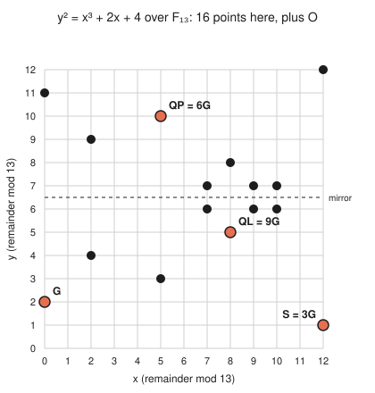
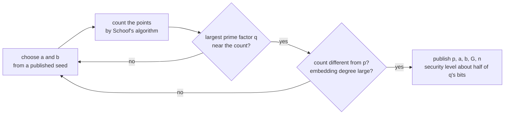

# Curves for keys: the discrete logarithm problem, and counting points to pick a safe curve

[Syllabus](../../../SYLLABUS.md) → [Algebraic geometry](../README.md) → [Elliptic Curves](../README.md#s04) → Curves for keys

---

## General Overview

A phone pairs with a smart door lock over Bluetooth. In its Secure Connections mode, Bluetooth pairing runs elliptic-curve Diffie-Hellman on a published curve called P-256. Each device keeps a secret number, sends one point of the curve, and both end up with the same point. A listener hears both points and still cannot find the shared one.

The whole exchange can be run on a curve small enough to check by hand. Take $`y^2 = x^3 + 2x + 4`$ with coordinates mod 13. It has **17 points**, counting the point at infinity O. The phone keeps 6, the lock keeps 9, and both reach the point (12, 1). A listener who tries 1, 2, 3, … finds the phone's secret on try 6, so this curve protects nothing. It shows the steps, not the safety.

The safety depends on one number: how many points the curve has. If that count splits into small factors, the key falls in a few steps, however large the prime. Two further properties of the count open other shortcuts. So someone must count the points before anyone trusts a curve. A 256-bit curve has about $`2^{256}`$ of them: too many to list. Schoof's algorithm counts them anyway, at a cost that grows like a fixed power of the number of digits.

**A curve is a safe home for keys when its point count has a prime factor near the size of the whole group, is not equal to p (the prime the coordinates are taken mod), and gives that factor a large embedding degree (it divides no $`p^\kappa - 1`$ for small κ), and Schoof's algorithm makes that count possible at 256 bits, which then sets the key size by the square-root cost of the best attack left.**

**What kind of fact this is:** the point count and the side-door attacks are theorems: Schoof's method is proved correct in his 1985 paper, its first step is proved on this card, and each side-door attack is a proved reduction. The rho cost is a well-tested estimate, not a theorem. That no faster attack exists on P-256 is an assumption, unproved as of 2026-11-17.

### The picture: the toy curve's points

<p align="center"></p>

Drawn to scale: every point with both coordinates in $`\mathbb{F}_{13}`$, the field of remainders mod 13. O lies at infinity and is not drawn. Each point (x, y) has a mirror (x, 13 − y), its negative. Marked: the base point G = (0, 2), the phone's public point (5, 10), the lock's (8, 5) and the shared point (12, 1).

---

## The formula

Notation first, in words. $`\mathbb{F}_p`$ is the field of remainders mod a prime p. $`E(\mathbb{F}_p)`$ is the group of points of the curve E with coordinates there, plus O, and $`\#E(\mathbb{F}_p)`$ is how many there are. The **trace** $`a_p`$ is the gap between that count and p + 1 ([The curve mod p](05-reduction-mod-p-and-hasse.md)). A whole number times a point, such as dG, means the point added to itself that many times ([Adding points by formula](03-point-arithmetic-and-double-and-add.md)).

The problem every key rests on, the **elliptic-curve discrete logarithm**: given the base point G and a public point Q, find the secret number d with

```math
Q = d\,G .
```

The count, and Hasse's window around p + 1:

```math
\#E(\mathbb{F}_p) = p + 1 - a_p, \qquad |a_p| \le 2\sqrt{p} .
```

The identity Schoof's algorithm runs on. The **Frobenius map** φ raises both coordinates to the power p. It fixes every point of $`E(\mathbb{F}_p)`$ and moves points whose coordinates lie in larger fields:

```math
\varphi(x, y) = (x^p,\, y^p), \qquad \varphi(\varphi(P)) - a_p\,\varphi(P) + p\,P = O \ \text{ for every point } P .
```

**Read it aloud:** apply Frobenius twice, take away $`a_p`$ copies of Frobenius applied once, add p copies of the point itself, and you always land on O.

The three tests a curve must pass, where q is the largest prime factor of the count and κ is the **embedding degree**, the least power with q dividing $`p^\kappa - 1`$:

```math
q \approx \#E(\mathbb{F}_p), \qquad \#E(\mathbb{F}_p) \ne p, \qquad \kappa \text{ large} .
```

What is left is the generic attack, Pollard's **rho method** (a pseudo-random walk through multiples of G that stops when two paths collide), whose cost sets the key size:

```math
\text{steps} \approx \sqrt{\pi q / 4} .
```

| Symbol | Plain meaning | In our example | Push it up and the answer… |
| --- | --- | --- | --- |
| $`p`$ | the prime: coordinates are remainders mod p | 13; for P-256 a 256-bit prime | more points, a harder search |
| $`a`$, $`b`$, $`f`$ | the curve's numbers; the cubic $`f(x) = x^3 + ax + b`$, so the curve is $`y^2 = f(x)`$ | 2 and 4 | a different curve and count |
| $`\#E(\mathbb{F}_p)`$ | the point count, O included | 17 | — |
| $`a_p`$ | the trace: p + 1 minus the count | 14 − 17 = −3 | fewer points |
| $`G`$, $`n`$, $`O`$ | the base point; its order, the multiples before O returns; the zero point, at infinity | (0, 2), order 17 | rho cost grows like $`\sqrt{n}`$ |
| $`d`$, $`Q`$ | a secret number, and its public point dG | 6 and (5, 10) | — |
| $`d_P`$, $`d_L`$, $`S`$ | the phone's and the lock's secret numbers; the shared point | 6, 9; (12, 1) | — |
| $`d_S`$, $`Q_S`$, $`k`$, $`z`$ | signing key and its public point; one-time number; the hash as a number | 5, (7, 6); 8; 6 | — |
| $`r`$, $`s`$, $`u_1`$, $`u_2`$ | the signature, and the checker's two multipliers | 8, 10; 4, 11 | — |
| $`\varphi`$ | Frobenius: both coordinates to the power p | fixes all 17 points | — |
| $`\ell`$, $`\psi_\ell`$, $`\tau`$ | a small prime Schoof works modulo; its division polynomial; a trial value of $`a_p`$ mod ℓ | 2, 3, 5 | more primes for bigger p |
| $`q`$, $`\kappa`$ | largest prime factor of the count; embedding degree | 17; 4 | larger q and κ, safer |

### When it holds

- **The count has a large prime factor q.** Otherwise the key falls piece by piece: on the shelf's house curve $`y^2 = x^3 - 2`$ mod 41, with 42 = 2 × 3 × 7 points, the key 29 falls in 7 trials.
- **The count is not p.** A curve with exactly p points is **anomalous**, and a p-adic logarithm (a map that turns point addition into ordinary addition, Step 4) reads the key off. The house curve mod 7 has 7 points.
- **The embedding degree κ is large.** For small κ, a pairing (a map from pairs of points to numbers, Step 4) moves the problem into a larger finite field, where faster attacks work. The house curve mod 41 has κ = 2.
- **q is near $`2^{256}`$.** Rho then costs about $`2^{127.8}`$ steps. On the 17-point toy, trying every key is the attack.
- **No large quantum computer.** Shor's algorithm finds d at a cost polynomial in the key length, which breaks every curve at once.

---

## Why it works

### Step 0: a curve is only as strong as its count's largest prime

Every known attack on a well-chosen curve either treats the group as a black box (using nothing but its addition) or exploits the count. Black-box attacks cost about the square root of q, the count's largest prime factor. The others need the count to be **smooth** (made of small primes only), equal to p, or tied to p by a small κ. So the count decides everything, and counting is the hard step.

### Step 1: the exchange and the signature on 17 points

[Elliptic curves](../../14-Applied%20and%20computational/04-Cryptography/06-elliptic-curve-cryptography.md) runs ECDH at full size on Curve25519 (the RFC 7748 test vectors) and ECDSA on a 19-point toy curve. Here both run on the 17-point curve.

**Key exchange (ECDH, elliptic-curve Diffie-Hellman).** The phone computes 6G = (5, 10) and sends it. The lock computes 9G = (8, 5) and sends it. Each multiplies the other's point by its own secret, and both get 54 copies of G. Since 17G = O, only 54 mod 17 = 3 matters: 3G = (12, 1).

**Signature (ECDSA, the elliptic-curve digital signature algorithm).** The lock's maker signs firmware "fw 1.4" with key $`d_S`$ = 5, public point 5G = (7, 6). There is no SHA-256 here: the code uses a stated toy hash, which gives z = 6. With one-time number k = 8:

```math
r = x(kG) \bmod n, \qquad s = k^{-1}(z + r\,d_S) \bmod n .
```

The checker computes $`u_1 = z s^{-1}`$ and $`u_2 = r s^{-1}`$ mod n, and accepts when $`u_1 G + u_2 Q_S`$ has x-coordinate r. Coordinates live mod p = 13; multipliers live mod n = 17.

### Step 2: why the attacks that work mod p fail on a curve

[Diffie-Hellman and ElGamal](../../14-Applied%20and%20computational/04-Cryptography/05-diffie-hellman-and-elgamal.md) states the discrete-log assumption for powers mod a prime. There the best attack is **index calculus**:

1. Pick a list of small primes, the **factor base**.
2. Collect many powers of the base that factor completely over that list.
3. Solve the linear equations for the logarithms of the small primes.
4. Factor one more number built from the target, and read off its logarithm.

It works because whole numbers factor into primes, and many factor into small ones. Its cost grows slower than any fixed power of p, which is why mod-p keys need 3,072 bits.

A point on a curve has no such factoring. Lifting points to rational points gives enormous heights (sizes of numerators and denominators, see [Mordell-Weil](06-mordell-weil-and-rank.md)), and no factor base of small points is known for curves over prime fields. So the attacker is left with black-box methods, at square-root cost.

### Step 3: a smooth count lets the key fall piece by piece

The **Pohlig–Hellman** method splits the problem along the count's prime factors. Take the house curve $`y^2 = x^3 - 2`$ mod 41. It has 42 = 2 × 3 × 7 points and a point G = (8, 10) of order 42. The public point is Q = 29G = (29, 22).

1. Multiply G and Q by 42/2. Both land in the subgroup of 2 points, where d mod 2 is found by trying 0 and 1: it is 1.
2. Multiply by 42/3. In the subgroup of 3 points, d mod 3 is 2.
3. Multiply by 42/7. In the subgroup of 7 points, d mod 7 is 1.
4. The Chinese remainder theorem joins 1 mod 2, 2 mod 3 and 1 mod 7 into d = 29.

That takes 7 trials, against 29 for trying G, 2G, 3G, …. At real sizes the cost is about the square root of the largest factor, so only q counts.

### Step 4: a small embedding degree or a count equal to p opens a side door

**The pairing transfer.** A **pairing** (the Weil or Tate pairing) maps two points of order q to a number in the larger field $`\mathbb{F}_{p^\kappa}`$. It turns "Q = dG" into "one number to the power d equals another number" in that field, where index calculus works. This is the MOV attack, named for Menezes, Okamoto and Vanstone, and it is fast only when κ is small. For a random curve κ is about as large as q: the house curve mod 13 has 19 points, a prime, and κ = 18. A **supersingular** curve over $`\mathbb{F}_p`$ has p + 1 points and κ = 2. The house curve mod 41 is one: 7 divides 41 × 41 − 1.

**The anomalous case.** When the count is exactly p, Smart's attack lifts the curve and both points to the p-adic numbers ([The p-adic numbers](../../21-Algebraic%20and%20analytic%20number%20theory/06-Algebraic%20Numbers/10-p-adic-numbers-and-hensels-lemma.md)). There, after multiplying by p, a logarithm turns point addition into ordinary addition, and dividing two logarithms gives d mod p. The house curve mod 7, with 7 points, is anomalous.

All three conditions read off the count, so a safe curve must be counted first.



Schematic. The loop runs until a curve passes every test; P-256's count is a 256-bit prime, so its cofactor (count divided by q) is 1.

### Step 5: Schoof's algorithm counts without listing

Listing points costs about p steps. Searching Hasse's window for a point's order still costs about the fourth root of p. Schoof instead finds $`a_p`$ modulo many small primes ℓ and joins the remainders.

1. **Frobenius obeys a quadratic.** Every point P, with coordinates in $`\mathbb{F}_p`$ or any larger finite field, satisfies $`\varphi(\varphi(P)) - a_p \varphi(P) + pP = O`$. On points with coordinates in $`\mathbb{F}_p`$, φ does nothing, and the identity says $`(p + 1 - a_p)P = O`$, the count.
2. **Work on the ℓ-torsion.** The points with ℓP = O have x-coordinates that are roots of the division polynomial $`\psi_\ell`$ ([Torsion points](04-torsion-and-nagell-lutz.md)). On them, multiples only matter mod ℓ. So test each candidate τ from 0 to ℓ − 1 in the identity, with polynomial arithmetic mod $`\psi_\ell`$. The τ that gives O is $`a_p`$ mod ℓ.
3. **Join the remainders.** Once the product of the primes used exceeds $`4\sqrt{p}`$, the Chinese remainder theorem pins $`a_p`$ inside Hasse's window.

For the toy, $`4\sqrt{13}`$ is 14.42, so ℓ = 2, 3 and 5 suffice, with product 30. For a 256-bit p, $`4\sqrt{p}`$ is about $`2^{130}`$, and the 27 primes from 2 up to 103 give a product of $`2^{134.1}`$. The polynomials have degree about $`\ell^2`$, so the count costs a fixed power of the number of digits of p.

**The ℓ = 2 step, proved and computed.** The points of order 2 are the points with y = 0, whose x is a root of $`f(x) = x^3 + ax + b`$. If f has a root in $`\mathbb{F}_p`$, the point with that x and y = 0 has order 2, so 2 divides the count ([Cosets and Lagrange's theorem](../../03-Algebra/08-Groups/04-cosets-and-lagranges-theorem.md)). If the count is even, the group has a point of order 2, which is its own negative, so its y is 0. Since p + 1 is even for odd p, $`a_p`$ is even exactly when f has a root in $`\mathbb{F}_p`$.

To test for a root without trying every x, Schoof computes $`x^p`$ reduced mod f by repeated squaring and takes the greatest common divisor with $`x^p - x`$, whose roots are exactly the elements of $`\mathbb{F}_p`$. On the toy, $`x^{13} \equiv 10x^2 + 2x + 9`$ mod f, and the gcd has degree 0. So f has no root, $`a_p`$ is odd, and indeed $`a_p`$ = −3.

<details>
<summary>The odd-ℓ step in more detail</summary>

For odd ℓ, take a point (x, y) with $`\psi_\ell(x) = 0`$. Compute $`(x^p, y^p)`$ and $`(x^{p^2}, y^{p^2})`$ by repeated squaring, with polynomials reduced mod $`\psi_\ell`$ and $`y^2 - f(x)`$. Add $`(p \bmod \ell)`$ copies of (x, y) to $`(x^{p^2}, y^{p^2})`$ by the usual slope formulas, dividing by inverses mod $`\psi_\ell`$. Compare the result with τ copies of $`(x^p, y^p)`$ for τ = 0, 1, …, ℓ − 1. The degree of $`\psi_\ell`$, $`(\ell^2 - 1)/2`$, sets the cost. The later SEA refinement (after Schoof, Elkies and Atkin) uses smaller factors of $`\psi_\ell`$ and makes 256-bit counts routine.

</details>

### Step 6: the key size

With the side doors shut, rho is the best known attack, at about $`\sqrt{\pi q / 4}`$ steps: in bits, just under half of q's length. A 256-bit q gives about $`2^{127.8}`$ steps, the 128-bit security level. Mod a prime, the same level needs a 3,072-bit modulus, by the NIST comparison quoted on [Elliptic curves](../../14-Applied%20and%20computational/04-Cryptography/06-elliptic-curve-cryptography.md).

| q (bits) | rho steps | modulus for the same level |
| --- | --- | --- |
| 224 | $`2^{111.8}`$ | 2,048 bits |
| 256 | $`2^{127.8}`$ | 3,072 bits |
| 384 | $`2^{191.8}`$ | 7,680 bits |
| 521 | $`2^{260.3}`$ | 15,360 bits |

P-256 is quoted from SEC 2, not computed here: $`p = 2^{256} - 2^{224} + 2^{192} + 2^{96} - 1`$, and the count is a 256-bit prime n, cofactor 1. Against a quantum computer running Shor's algorithm, at a cost polynomial in the key length, no curve size helps.

---

## Worked numbers, by hand

| Step | Arithmetic | Value |
| --- | --- | --- |
| Hasse window, p = 13 | $`14 \pm 2\sqrt{13}`$ | 14 ± 7.21 |
| count, every pair | try all (x, y) mod 13, add O | 17 |
| count, Euler's square test | each x gives 1 + (its square test) points, add O | 17 |
| order of G = (0, 2) | add G until O | 17, the only multiple of 17 in the window |
| Schoof, ℓ = 2 | $`x^{13}`$ mod f, gcd with $`x^{13} - x`$ | 10x² + 2x + 9; degree 0, $`a_p`$ odd |
| double-and-add for 6 = 110 | G, double, add G, double | 2G = (10, 6), 3G = (12, 1), 6G = (5, 10) |
| lock's public point | 9G, the same way | (8, 5) |
| shared point | 6 × 9 = 54; 54 mod 17 | 3, so **S = 3G = (12, 1)** |
| sign: kG and r | 8G | (8, 8), r = 8 |
| sign: s | $`15 \times (6 + 8 \times 5)`$ mod 17, with 15 = 1/8 | **s = 10** |
| check: multipliers | 1/10 = 12; $`6 \times 12`$ and $`8 \times 12`$ mod 17 | $`u_1`$ = 4, $`u_2`$ = 11 |
| check: point | $`4G + 11 Q_S`$ | (8, 8): x is 8 = r, **valid** |
| Pohlig–Hellman, mod 41 | key mod 2, 3 and 7, then joined | 1, 2, 1, so **d = 29** in 7 trials |

The phone and the lock share (12, 1); a listener needs the discrete logarithm of (5, 10) or (8, 5), which on 17 points takes at most 16 tries and on P-256 about $`2^{127.8}`$ steps.

### What breaks if you drop a piece

| Mistake | Comes out at | What went wrong |
| --- | --- | --- |
| Smooth count: house curve mod 41 | 42 = 2 × 3 × 7; key 29 in 7 trials | q is 7, not near 42 |
| Count equal to p: house curve mod 7 | 7 points, anomalous | Smart's p-adic logarithm applies |
| Supersingular count: house curve mod 41 | κ = 2 | the pairing moves the key into a small field |
| s worked mod 13 instead of mod 17 | s = 9, check fails | multipliers live mod n, coordinates mod p |

---

## Code, from first principles, and it actually runs

The script counts the toy curve's points, runs the exchange and the signature, and checks four curves against the three tests. It takes **five independent roads**:

- The count by trying every pair (x, y), by Euler's square test on 13 values of x, and by the order of G inside Hasse's window.
- Schoof's ℓ = 2 step by polynomial gcd, against roots found by trial, on all four curves.
- Every multiple from double-and-add against plain repeated addition.
- The Pohlig–Hellman key against the planted key 29, and its 7 trials against the planted key's remainders mod 2, 3 and 7.
- The embedding degree κ by powering p mod q, against a full list of the powers of p mod q, on all four curves.

The toy hash is a stand-in, not a real hash, and every toy curve here is insecure. P-256 enters only as quoted sizes.

### Python

```python
# Curves for keys -- the check behind the card.  Standard library only; nothing
# imported counts points or adds them.  The toy curve is y^2 = x^3 + 2x + 4 over
# F_13, with 17 points; the house curve y^2 = x^3 - 2 is reduced mod 7, 13 and 41.
# P-256 is quoted from SEC 2 as sizes only.  Every toy curve here is insecure.
import math
def inv(a, m): return pow(a % m, m - 2, m)  # reciprocal mod a prime m, by Fermat
def add(P, Q, a, p):                    # chord and tangent, coordinates mod p
    if P is None or Q is None: return P or Q
    (x1, y1), (x2, y2) = P, Q
    if x1 == x2 and (y1 + y2) % p == 0: return None
    if P == Q: m = (3 * x1 * x1 + a) * inv(2 * y1, p) % p
    else: m = (y2 - y1) * inv(x2 - x1, p) % p
    x3 = (m * m - x1 - x2) % p
    return (x3, (m * (x1 - x3) - y1) % p)
def mul(k, P, a, p):                    # double-and-add, top bit first
    R = None
    for bit in bin(k)[2:]:
        R = add(R, R, a, p)
        if bit == '1': R = add(R, P, a, p)
    return R
def rep(k, P, a, p):                    # second road: add P to itself k times
    R = None
    for _ in range(k): R = add(R, P, a, p)
    return R
def points(a, b, p):                    # every pair (x, y) tried; O is not listed
    return [(x, y) for x in range(p) for y in range(p) if (y * y - x**3 - a * x - b) % p == 0]
def count_euler(a, b, p):               # O, plus 1 + (Euler's square test) for each x
    n = 1
    for x in range(p):
        e = pow((x**3 + a * x + b) % p, (p - 1) // 2, p)
        n += 1 if e == 0 else 2 if e == 1 else 0
    return n
def order(P, a, p):
    k, R = 1, P
    while R is not None: k, R = k + 1, add(R, P, a, p)
    return k
def pmod(u, f, p):                      # remainder of polynomial u by f, mod p, low degree first
    u = [c % p for c in u]
    while u and u[-1] == 0: u.pop()
    while len(u) >= len(f):
        c, s = u[-1] * inv(f[-1], p) % p, len(u) - len(f)
        for i, fi in enumerate(f): u[s + i] = (u[s + i] - c * fi) % p
        while u and u[-1] == 0: u.pop()
    return u
def pmulmod(u, v, f, p):
    w = [0] * (len(u) + len(v) - 1)
    for i, ui in enumerate(u):
        for j, vj in enumerate(v): w[i + j] += ui * vj
    return pmod(w, f, p)
def two_step(a, b, p):                  # Schoof's l = 2 step: x^p mod f, then gcd(f, x^p - x)
    f, xp, sq, e = [b % p, a % p, 0, 1], [1], [0, 1], p
    while e:
        if e & 1: xp = pmulmod(xp, sq, f, p)
        sq, e = pmulmod(sq, sq, f, p), e >> 1
    g, h = f, pmod(xp[:1] + [xp[1] - 1 if len(xp) > 1 else -1] + xp[2:], f, p)
    while h: g, h = h, pmod(g, h, p)
    return xp, len(g) - 1
def is_prime(l): return l > 1 and all(l % d for d in range(2, l))
def emb_degree(q, p):                   # least k with q dividing p^k - 1; none if q = p
    return None if q == p else next(k for k in range(1, q) if pow(p, k, q) == 1)
p, a, b, n, G = 13, 2, 4, 17, (0, 2)
pts, ordG, rt = points(a, b, p), order(G, a, p), 2 * math.sqrt(p)
in_window = [m for m in range(1, 40) if m % ordG == 0 and p + 1 - rt <= m <= p + 1 + rt]
print(f"toy curve y^2 = x^3 + 2x + 4 over F_13; Hasse window 14 +/- {rt:.2f}")
print(f"count 1, every pair (x, y): {len(pts) + 1}")
print(f"count 2, Euler's square test on 13 values of x: {count_euler(a, b, p)}")
print(f"count 3, order of G = {G} is {ordG}; multiples of it in the window: {in_window}")
(xp, deg), t = two_step(a, b, p), p + 1 - n
roots = [x for x in range(p) if (x**3 + a * x + b) % p == 0]
print(f"Schoof l = 2: x^13 = {xp[2]}x^2 + {xp[1]}x + {xp[0]} mod f; gcd(f, x^13 - x) has degree "
      f"{deg}; roots by trial {len(roots)}; a_p = 14 - 17 = {t}, odd")
need, prod, l = [], 1, 1
while prod <= 2 * rt:
    l += 1
    if is_prime(l): need, prod = need + [l], prod * l
bits, cnt, l = 0.0, 0, 1
while bits <= 130:
    l += 1
    if is_prime(l): bits, cnt = bits + math.log2(l), cnt + 1
print(f"Schoof primes for p = 13: {need}, product {prod} > 4 sqrt(p) = {2 * rt:.2f}")
print(f"Schoof primes for a 256-bit p: {cnt} primes, 2 up to {l}, product 2^{bits:.1f} > 2^130")
dP, dL = 6, 9                           # the phone's and the lock's secret numbers
QP, QL = mul(dP, G, a, p), mul(dL, G, a, p)
SP, SL = mul(dP, QL, a, p), mul(dL, QP, a, p)
print(f"ECDH: phone 6G = {QP}, lock 9G = {QL}; phone 6 QL = {SP}, lock 9 QP = {SL}")
print(f"6 x 9 = 54 = {dP * dL % n} mod 17; 3G by repeated addition = {rep(dP * dL % n, G, a, p)}")
print("double-and-add, 6 = 110 in binary: " + ", ".join(f"{k}G {rep(k, G, a, p)}" for k in (1, 2, 3, 6)))
tries = next(k for k in range(1, n) if rep(k, G, a, p) == QP)
print(f"listener tries G, 2G, 3G, ...: phone's key found on try {tries} of at most 16")
def toy_hash(msg):                      # a stated stand-in for SHA-256, NOT a real hash
    h = 0
    for c in msg.encode(): h = (h * 31 + c) % 65521
    return h
def verify(z, r, s, Q):
    w = inv(s, n)
    X = add(mul(z * w % n, G, a, p), mul(r * w % n, Q, a, p), a, p)
    return X is not None and X[0] % n == r, w, z * w % n, r * w % n, X
dS, k = 5, 8                            # the maker's signing key, the one-time number
QS, hz, R = mul(dS, G, a, p), toy_hash("fw 1.4"), mul(k, G, a, p)
z, r = hz % n, R[0] % n
s = inv(k, n) * (z + r * dS) % n
ok, w, u1, u2, X = verify(z, r, s, QS)
z2, s13 = toy_hash("fw 1.5") % n, inv(k, p) * (z + r * dS) % p
print(f"ECDSA: QS = 5G = {QS}; toy hash of 'fw 1.4' = {hz}, z = {z}; 8G = {R}, r = {r}, 1/8 = {inv(k, n)}, s = {s}")
print(f"verify: 1/s = {w}, u1 = {u1}, u2 = {u2}, u1 G + u2 QS = {X}, valid {ok}")
print(f"same signature on 'fw 1.5' (z = {z2}): valid {verify(z2, r, s, QS)[0]}")
print(f"mistake, s worked mod 13 not 17: s = {s13}, valid {verify(z, r, s13, QS)[0]}")
print("curve           points  cubic roots  largest prime  anomalous  embedding degree")
table = []
for name, aa, bb, pp in [("toy, mod 13", 2, 4, 13), ("house, mod 7", 0, -2, 7),
                         ("house, mod 13", 0, -2, 13), ("house, mod 41", 0, -2, 41)]:
    N = len(points(aa, bb, pp)) + 1
    q = max(d for d in range(2, N + 1) if N % d == 0 and is_prime(d))
    kd, rts = emb_degree(q, pp), two_step(aa, bb, pp)[1]
    pj = [pp ** j % q for j in range(1, q)]  # second road: list p^j mod q; the first 1 is at kappa
    table.append((N, q, N == pp, kd, rts, pj.index(1) + 1 if 1 in pj else None))
    print(f"{name:<15} {N:>6}  {rts:>11}  {q:>13}  {'yes' if N == pp else 'no':>9}  {'-' if kd is None else kd:>16}")
G41 = next(P for P in points(0, -2, 41) if order(P, 0, 41) == 42)
d, trials, res = 29, 0, []
Q41 = mul(d, G41, 0, 41)
for q in (2, 3, 7):                     # Pohlig-Hellman: solve in each small piece
    Gq, Qq, e = mul(42 // q, G41, 0, 41), mul(42 // q, Q41, 0, 41), 0
    while rep(e, Gq, 0, 41) != Qq: e += 1
    trials, res = trials + e + 1, res + [e]
found = next(x for x in range(42) if [x % 2, x % 3, x % 7] == res)
print(f"Pohlig-Hellman mod 41: G = {G41}, Q = {d}G = {Q41}; key mod 2, 3, 7 = {res}; "
      f"key {found} in {trials} trials, against {d} by trying G, 2G, ...")
print("P-256 (SEC 2): p = 2^256 - 2^224 + 2^192 + 2^96 - 1, 256 bits; n prime, 256 bits; cofactor 1")
for nb, mod in [(224, 2048), (256, 3072), (384, 7680), (521, 15360)]:
    print(f"n of {nb} bits: rho about 2^{0.5 * (nb + math.log2(math.pi / 4)):.1f} steps; "
          f"SP 800-57 modulus at that level {mod} bits")
print("figure, points " + " ".join(f"({x},{y})" for x, y in pts) + f"; G {G} QP {QP} QL {QL} S {SP}")
assert len(pts) + 1 == count_euler(a, b, p) == n and in_window == [n]   # three counts agree
assert deg == len(roots) and all((r[4] > 0) == (r[0] % 2 == 0) for r in table)  # l = 2 step
assert SP == SL == rep(dP * dL % n, G, a, p) and QP == rep(dP, G, a, p)  # ECDH, two roads
assert ok and X == R and not verify(z2, r, s, QS)[0]                     # ECDSA checks, tamper fails
assert found == d and trials == sum(d % q + 1 for q in (2, 3, 7))         # Pohlig-Hellman, two roads
assert table[1][2] and table[3][1] == 7                                     # anomalous and smooth flags
assert all(r[3] == r[5] for r in table) and [r[3] for r in table[:4]] == [4, None, 18, 2]  # kappa, two roads
print("ALL CHECKS PASS")
```

**Ran 2026-11-17 on macOS, Python 3.14.10, standard library only. All checks passed. Output, pasted from the run:**

```
toy curve y^2 = x^3 + 2x + 4 over F_13; Hasse window 14 +/- 7.21
count 1, every pair (x, y): 17
count 2, Euler's square test on 13 values of x: 17
count 3, order of G = (0, 2) is 17; multiples of it in the window: [17]
Schoof l = 2: x^13 = 10x^2 + 2x + 9 mod f; gcd(f, x^13 - x) has degree 0; roots by trial 0; a_p = 14 - 17 = -3, odd
Schoof primes for p = 13: [2, 3, 5], product 30 > 4 sqrt(p) = 14.42
Schoof primes for a 256-bit p: 27 primes, 2 up to 103, product 2^134.1 > 2^130
ECDH: phone 6G = (5, 10), lock 9G = (8, 5); phone 6 QL = (12, 1), lock 9 QP = (12, 1)
6 x 9 = 54 = 3 mod 17; 3G by repeated addition = (12, 1)
double-and-add, 6 = 110 in binary: 1G (0, 2), 2G (10, 6), 3G (12, 1), 6G (5, 10)
listener tries G, 2G, 3G, ...: phone's key found on try 6 of at most 16
ECDSA: QS = 5G = (7, 6); toy hash of 'fw 1.4' = 7299, z = 6; 8G = (8, 8), r = 8, 1/8 = 15, s = 10
verify: 1/s = 12, u1 = 4, u2 = 11, u1 G + u2 QS = (8, 8), valid True
same signature on 'fw 1.5' (z = 7): valid False
mistake, s worked mod 13 not 17: s = 9, valid False
curve           points  cubic roots  largest prime  anomalous  embedding degree
toy, mod 13         17            0             17         no                 4
house, mod 7         7            0              7        yes                 -
house, mod 13       19            0             19         no                18
house, mod 41       42            1              7         no                 2
Pohlig-Hellman mod 41: G = (8, 10), Q = 29G = (29, 22); key mod 2, 3, 7 = [1, 2, 1]; key 29 in 7 trials, against 29 by trying G, 2G, ...
P-256 (SEC 2): p = 2^256 - 2^224 + 2^192 + 2^96 - 1, 256 bits; n prime, 256 bits; cofactor 1
n of 224 bits: rho about 2^111.8 steps; SP 800-57 modulus at that level 2048 bits
n of 256 bits: rho about 2^127.8 steps; SP 800-57 modulus at that level 3072 bits
n of 384 bits: rho about 2^191.8 steps; SP 800-57 modulus at that level 7680 bits
n of 521 bits: rho about 2^260.3 steps; SP 800-57 modulus at that level 15360 bits
figure, points (0,2) (0,11) (2,4) (2,9) (5,3) (5,10) (7,6) (7,7) (8,5) (8,8) (9,6) (9,7) (10,6) (10,7) (12,1) (12,12); G (0, 2) QP (5, 10) QL (8, 5) S (12, 1)
ALL CHECKS PASS
```

### Rust

Same numbers, same labels, built with `rustc --edition 2021 -O`.

```rust
// Curves for keys -- the same check as the Python, in Rust.  No crates; nothing
// counts points or adds them for us.  The toy curve is y^2 = x^3 + 2x + 4 over
// F_13, with 17 points; the house curve y^2 = x^3 - 2 is reduced mod 7, 13 and 41.
// P-256 is quoted from SEC 2 as sizes only.  Every toy curve here is insecure.
type Pt = Option<(i64, i64)>;

fn md(a: i64, m: i64) -> i64 { a.rem_euclid(m) }
fn pw(a: i64, mut e: i64, m: i64) -> i64 {          // a^e mod m by repeated squaring
    let (mut r, mut b) = (1, md(a, m));
    while e > 0 { if e & 1 == 1 { r = r * b % m } b = b * b % m; e >>= 1 }
    r
}
fn inv(a: i64, m: i64) -> i64 { pw(a, m - 2, m) }   // reciprocal mod a prime m, by Fermat
fn add(p1: Pt, p2: Pt, a: i64, p: i64) -> Pt {      // chord and tangent, coordinates mod p
    let ((x1, y1), (x2, y2)) = match (p1, p2) { (None, _) => return p2, (_, None) => return p1, (Some(u), Some(v)) => (u, v) };
    if x1 == x2 && md(y1 + y2, p) == 0 { return None }
    let m = if p1 == p2 { md((3 * x1 * x1 + a) * inv(2 * y1, p), p) } else { md((y2 - y1) * inv(x2 - x1, p), p) };
    let x3 = md(m * m - x1 - x2, p);
    Some((x3, md(m * (x1 - x3) - y1, p)))
}
fn mul(k: i64, pt: Pt, a: i64, p: i64) -> Pt {      // double-and-add, top bit first
    let mut r: Pt = None;
    for i in (0..64 - k.leading_zeros()).rev() { r = add(r, r, a, p); if (k >> i) & 1 == 1 { r = add(r, pt, a, p) } }
    r
}
fn rep(k: i64, pt: Pt, a: i64, p: i64) -> Pt {      // second road: add the point to itself k times
    let mut r: Pt = None;
    for _ in 0..k { r = add(r, pt, a, p) }
    r
}
fn points(a: i64, b: i64, p: i64) -> Vec<(i64, i64)> { // every pair (x, y) tried; O is not listed
    let mut v = Vec::new();
    for x in 0..p { for y in 0..p { if md(y * y - x * x * x - a * x - b, p) == 0 { v.push((x, y)) } } }
    v
}
fn count_euler(a: i64, b: i64, p: i64) -> i64 {     // O, plus 1 + (Euler's square test) for each x
    let mut n = 1;
    for x in 0..p { let e = pw(x * x * x + a * x + b, (p - 1) / 2, p); n += if e == 0 { 1 } else if e == 1 { 2 } else { 0 } }
    n
}
fn order(pt: Pt, a: i64, p: i64) -> i64 {
    let (mut k, mut r) = (1, pt);
    while r.is_some() { k += 1; r = add(r, pt, a, p) }
    k
}
fn pmod(u: &[i64], f: &[i64], p: i64) -> Vec<i64> {  // remainder of polynomial u by f, mod p, low degree first
    let mut u: Vec<i64> = u.iter().map(|&c| md(c, p)).collect();
    while u.last() == Some(&0) { u.pop(); }
    while u.len() >= f.len() {
        let (c, s) = (u[u.len() - 1] * inv(f[f.len() - 1], p) % p, u.len() - f.len());
        for (i, fi) in f.iter().enumerate() { u[s + i] = md(u[s + i] - c * fi, p) }
        while u.last() == Some(&0) { u.pop(); }
    }
    u
}
fn pmulmod(u: &[i64], v: &[i64], f: &[i64], p: i64) -> Vec<i64> {
    let mut w = vec![0; u.len() + v.len() - 1];
    for (i, ui) in u.iter().enumerate() { for (j, vj) in v.iter().enumerate() { w[i + j] += ui * vj } }
    pmod(&w, f, p)
}
fn two_step(a: i64, b: i64, p: i64) -> (Vec<i64>, usize) { // Schoof's l = 2 step: x^p mod f, then gcd(f, x^p - x)
    let f = vec![md(b, p), md(a, p), 0, 1];
    let (mut xp, mut sq, mut e) = (vec![1], vec![0, 1], p);
    while e > 0 { if e & 1 == 1 { xp = pmulmod(&xp, &sq, &f, p) } sq = pmulmod(&sq, &sq, &f, p); e >>= 1 }
    let mut xm = xp.clone(); while xm.len() < 2 { xm.push(0) } xm[1] -= 1;
    let (mut g, mut h) = (f.clone(), pmod(&xm, &f, p));
    while !h.is_empty() { let r = pmod(&g, &h, p); g = h; h = r }
    (xp, g.len() - 1)
}
fn is_prime(l: i64) -> bool { l > 1 && (2..l).all(|d| l % d != 0) }
fn emb_degree(q: i64, p: i64) -> Option<i64> {     // least k with q dividing p^k - 1; none if q = p
    if q == p { return None }
    let mut k = 1;
    while pw(p, k, q) != 1 { k += 1 }
    Some(k)
}
fn s(pt: Pt) -> String { match pt { Some((x, y)) => format!("({}, {})", x, y), None => "None".into() } }
fn tf(b: bool) -> &'static str { if b { "True" } else { "False" } }
fn toy_hash(msg: &str) -> i64 {                     // a stated stand-in for SHA-256, NOT a real hash
    let mut h = 0;
    for c in msg.bytes() { h = (h * 31 + c as i64) % 65521 }
    h
}
const P: i64 = 13; const A: i64 = 2; const B: i64 = 4; const N: i64 = 17; const G: Pt = Some((0, 2));
fn verify(z: i64, r: i64, sg: i64, q: Pt) -> (bool, i64, i64, i64, Pt) {
    let w = inv(sg, N);
    let x = add(mul(z * w % N, G, A, P), mul(r * w % N, q, A, P), A, P);
    (matches!(x, Some((xx, _)) if xx % N == r), w, z * w % N, r * w % N, x)
}
fn main() {
    let (pts, ord_g, rt) = (points(A, B, P), order(G, A, P), 2.0 * (P as f64).sqrt());
    let in_window: Vec<i64> = (1..40).filter(|&m| m % ord_g == 0 && (P + 1) as f64 - rt <= m as f64 && m as f64 <= (P + 1) as f64 + rt).collect();
    println!("toy curve y^2 = x^3 + 2x + 4 over F_13; Hasse window 14 +/- {:.2}", rt);
    println!("count 1, every pair (x, y): {}", pts.len() + 1);
    println!("count 2, Euler's square test on 13 values of x: {}", count_euler(A, B, P));
    println!("count 3, order of G = {} is {}; multiples of it in the window: {:?}", s(G), ord_g, in_window);
    let (xp, deg) = two_step(A, B, P);
    let roots = (0..P).filter(|&x| md(x * x * x + A * x + B, P) == 0).count();
    let t = P + 1 - N;
    println!("Schoof l = 2: x^13 = {}x^2 + {}x + {} mod f; gcd(f, x^13 - x) has degree {}; roots by trial {}; a_p = 14 - 17 = {}, odd",
             xp[2], xp[1], xp[0], deg, roots, t);
    let (mut need, mut prod, mut l) = (Vec::new(), 1, 1);
    while prod as f64 <= 2.0 * rt { l += 1; if is_prime(l) { need.push(l); prod *= l } }
    let (mut bits, mut cnt, mut l2) = (0.0f64, 0, 1);
    while bits <= 130.0 { l2 += 1; if is_prime(l2) { bits += (l2 as f64).log2(); cnt += 1 } }
    println!("Schoof primes for p = 13: {:?}, product {} > 4 sqrt(p) = {:.2}", need, prod, 2.0 * rt);
    println!("Schoof primes for a 256-bit p: {} primes, 2 up to {}, product 2^{:.1} > 2^130", cnt, l2, bits);
    let (dp, dl) = (6, 9);                          // the phone's and the lock's secret numbers
    let (qp, ql) = (mul(dp, G, A, P), mul(dl, G, A, P));
    let (sp, sl) = (mul(dp, ql, A, P), mul(dl, qp, A, P));
    println!("ECDH: phone 6G = {}, lock 9G = {}; phone 6 QL = {}, lock 9 QP = {}", s(qp), s(ql), s(sp), s(sl));
    println!("6 x 9 = 54 = {} mod 17; 3G by repeated addition = {}", dp * dl % N, s(rep(dp * dl % N, G, A, P)));
    let da: Vec<String> = [1, 2, 3, 6].iter().map(|&k| format!("{}G {}", k, s(rep(k, G, A, P)))).collect();
    println!("double-and-add, 6 = 110 in binary: {}", da.join(", "));
    let tries = (1..N).find(|&k| rep(k, G, A, P) == qp).unwrap();
    println!("listener tries G, 2G, 3G, ...: phone's key found on try {} of at most 16", tries);
    let (ds, k) = (5, 8);                           // the maker's signing key, the one-time number
    let (qs, hz, rr) = (mul(ds, G, A, P), toy_hash("fw 1.4"), mul(k, G, A, P));
    let (z, r) = (hz % N, rr.unwrap().0 % N);
    let sg = inv(k, N) * (z + r * ds) % N;
    let (ok, w, u1, u2, x) = verify(z, r, sg, qs);
    let (z2, s13) = (toy_hash("fw 1.5") % N, inv(k, P) * (z + r * ds) % P);
    println!("ECDSA: QS = 5G = {}; toy hash of 'fw 1.4' = {}, z = {}; 8G = {}, r = {}, 1/8 = {}, s = {}", s(qs), hz, z, s(rr), r, inv(k, N), sg);
    println!("verify: 1/s = {}, u1 = {}, u2 = {}, u1 G + u2 QS = {}, valid {}", w, u1, u2, s(x), tf(ok));
    println!("same signature on 'fw 1.5' (z = {}): valid {}", z2, tf(verify(z2, r, sg, qs).0));
    println!("mistake, s worked mod 13 not 17: s = {}, valid {}", s13, tf(verify(z, r, s13, qs).0));
    println!("curve           points  cubic roots  largest prime  anomalous  embedding degree");
    let mut table = Vec::new();
    for (name, aa, bb, pp) in [("toy, mod 13", 2, 4, 13), ("house, mod 7", 0, -2, 7), ("house, mod 13", 0, -2, 13), ("house, mod 41", 0, -2, 41)] {
        let nn = points(aa, bb, pp).len() as i64 + 1;
        let q = (2..nn + 1).filter(|&d| nn % d == 0 && is_prime(d)).max().unwrap();
        let (kd, rts) = (emb_degree(q, pp), two_step(aa, bb, pp).1);
        let pj: Vec<i64> = (1..q).map(|j| (0..j).fold(1, |acc, _| acc * pp % q)).collect(); // second road: list p^j mod q
        table.push((nn, q, nn == pp, kd, rts, pj.iter().position(|&v| v == 1).map(|i| i as i64 + 1)));
        let ks = match kd { Some(v) => v.to_string(), None => "-".into() };
        println!("{:<15} {:>6}  {:>11}  {:>13}  {:>9}  {:>16}", name, nn, rts, q, if nn == pp { "yes" } else { "no" }, ks);
    }
    let g41: Pt = points(0, -2, 41).into_iter().map(Some).find(|&pt| order(pt, 0, 41) == 42).unwrap();
    let (d, mut trials, mut res) = (29, 0, Vec::new());
    let q41 = mul(d, g41, 0, 41);
    for q in [2, 3, 7] {                            // Pohlig-Hellman: solve in each small piece
        let (gq, qq, mut e) = (mul(42 / q, g41, 0, 41), mul(42 / q, q41, 0, 41), 0);
        while rep(e, gq, 0, 41) != qq { e += 1 }
        trials += e + 1; res.push(e);
    }
    let found = (0..42).find(|&x| vec![x % 2, x % 3, x % 7] == res).unwrap();
    println!("Pohlig-Hellman mod 41: G = {}, Q = {}G = {}; key mod 2, 3, 7 = {:?}; key {} in {} trials, against {} by trying G, 2G, ...",
             s(g41), d, s(q41), res, found, trials, d);
    println!("P-256 (SEC 2): p = 2^256 - 2^224 + 2^192 + 2^96 - 1, 256 bits; n prime, 256 bits; cofactor 1");
    for (nb, m) in [(224, 2048), (256, 3072), (384, 7680), (521, 15360)] {
        println!("n of {} bits: rho about 2^{:.1} steps; SP 800-57 modulus at that level {} bits",
                 nb, 0.5 * (nb as f64 + (std::f64::consts::PI / 4.0).log2()), m);
    }
    let fig: Vec<String> = pts.iter().map(|(x, y)| format!("({},{})", x, y)).collect();
    println!("figure, points {}; G {} QP {} QL {} S {}", fig.join(" "), s(G), s(qp), s(ql), s(sp));
    assert!(pts.len() as i64 + 1 == count_euler(A, B, P) && count_euler(A, B, P) == N && in_window == vec![N]);
    assert!(deg == roots && table.iter().all(|r| (r.4 > 0) == (r.0 % 2 == 0)));  // l = 2 step
    assert!(sp == sl && sl == rep(dp * dl % N, G, A, P) && qp == rep(dp, G, A, P));
    assert!(ok && x == rr && !verify(z2, r, sg, qs).0);     // ECDSA checks, tamper fails
    assert!(found == d && trials == [2, 3, 7].iter().map(|q| d % q + 1).sum::<i64>()); // Pohlig-Hellman, two roads
    assert!(table[1].2 && table[3].1 == 7);                                            // anomalous and smooth flags
    assert!(table.iter().all(|r| r.3 == r.5) && table[..4].iter().map(|r| r.3).collect::<Vec<_>>() == [Some(4), None, Some(18), Some(2)]);
    println!("ALL CHECKS PASS");
}
```

**Ran 2026-11-17 on macOS, rustc 1.98.1, no crates. All checks passed. Output, pasted from the run:**

```
toy curve y^2 = x^3 + 2x + 4 over F_13; Hasse window 14 +/- 7.21
count 1, every pair (x, y): 17
count 2, Euler's square test on 13 values of x: 17
count 3, order of G = (0, 2) is 17; multiples of it in the window: [17]
Schoof l = 2: x^13 = 10x^2 + 2x + 9 mod f; gcd(f, x^13 - x) has degree 0; roots by trial 0; a_p = 14 - 17 = -3, odd
Schoof primes for p = 13: [2, 3, 5], product 30 > 4 sqrt(p) = 14.42
Schoof primes for a 256-bit p: 27 primes, 2 up to 103, product 2^134.1 > 2^130
ECDH: phone 6G = (5, 10), lock 9G = (8, 5); phone 6 QL = (12, 1), lock 9 QP = (12, 1)
6 x 9 = 54 = 3 mod 17; 3G by repeated addition = (12, 1)
double-and-add, 6 = 110 in binary: 1G (0, 2), 2G (10, 6), 3G (12, 1), 6G (5, 10)
listener tries G, 2G, 3G, ...: phone's key found on try 6 of at most 16
ECDSA: QS = 5G = (7, 6); toy hash of 'fw 1.4' = 7299, z = 6; 8G = (8, 8), r = 8, 1/8 = 15, s = 10
verify: 1/s = 12, u1 = 4, u2 = 11, u1 G + u2 QS = (8, 8), valid True
same signature on 'fw 1.5' (z = 7): valid False
mistake, s worked mod 13 not 17: s = 9, valid False
curve           points  cubic roots  largest prime  anomalous  embedding degree
toy, mod 13         17            0             17         no                 4
house, mod 7         7            0              7        yes                 -
house, mod 13       19            0             19         no                18
house, mod 41       42            1              7         no                 2
Pohlig-Hellman mod 41: G = (8, 10), Q = 29G = (29, 22); key mod 2, 3, 7 = [1, 2, 1]; key 29 in 7 trials, against 29 by trying G, 2G, ...
P-256 (SEC 2): p = 2^256 - 2^224 + 2^192 + 2^96 - 1, 256 bits; n prime, 256 bits; cofactor 1
n of 224 bits: rho about 2^111.8 steps; SP 800-57 modulus at that level 2048 bits
n of 256 bits: rho about 2^127.8 steps; SP 800-57 modulus at that level 3072 bits
n of 384 bits: rho about 2^191.8 steps; SP 800-57 modulus at that level 7680 bits
n of 521 bits: rho about 2^260.3 steps; SP 800-57 modulus at that level 15360 bits
figure, points (0,2) (0,11) (2,4) (2,9) (5,3) (5,10) (7,6) (7,7) (8,5) (8,8) (9,6) (9,7) (10,6) (10,7) (12,1) (12,12); G (0, 2) QP (5, 10) QL (8, 5) S (12, 1)
ALL CHECKS PASS
```

The two outputs match line for line.

### Lean

Lean proves Schoof's ℓ = 2 step for every odd prime, the exchange and Pohlig–Hellman identities on every curve, and the card's arithmetic.

- Take an odd prime p and $`f(x) = x^3 + ax + b`$ with no repeated root mod p. Then $`\#E(\mathbb{F}_p)`$ is even exactly when f has a root in $`\mathbb{F}_p`$.
- Take a base point G with nG = O, and secrets $`d_P`$ and $`d_L`$. Then $`d_P(d_L G) = d_L(d_P G)`$, and both equal $`(d_P d_L \bmod n)\,G`$.
- Take nG = O, a whole number q dividing n, and Q = dG. Then q copies of (n/q)G give O, and $`(n/q)\,Q = (d \bmod q)\,(n/q)\,G`$.
- Take the toy curve $`y^2 = x^3 + 2x + 4`$ mod 13. Then it has 16 points (x, y), 17 with O, and its cubic has no root.
- Take the count 17. Then it lies in Hasse's window 14 ± 2√13, and $`a_p`$ = 14 − 17 = −3, which is odd.
- Take p = 13. Then ℓ = 2, 3 and 5 suffice, since 30² > 16 × 13.
- Take the 27 primes from 2 up to 103. Then their product exceeds $`2^{130}`$, and without 103 it does not.
- Take the secrets 6 and 9 on 17 points. Then 6 × 9 = 54, and 54 mod 17 = 3.
- Take the toy hash 7299, k = 8, r = 8 and $`d_S`$ = 5, mod 17. Then z = 6, s = 10, $`u_1`$ = 4, $`u_2`$ = 11, and $`u_1 + u_2 d_S = 8 = k`$.
- Take s worked mod 13 instead of mod 17. Then 1/8 = 5 and s = 9.
- Take the house curve $`y^2 = x^3 - 2`$ mod 7, 13 and 41. Then it has 7, 19 and 42 points with O.
- Take the same three primes. Then $`x^3 - 2`$ has no root mod 7 or mod 13, and exactly one mod 41.
- Take q = 17 with p = 13, q = 19 with p = 13, and q = 7 with p = 41. Then the embedding degrees are 4, 18 and 2.
- Take the key 29 below 42 = 2 × 3 × 7. Then its remainders 1, 2 and 1 pick it out alone, in 7 trials.
- Take P-256's prime $`p = 2^{256} - 2^{224} + 2^{192} + 2^{96} - 1`$. Then p has 256 bits.

The points themselves, the gcd test, the rho costs and P-256's count are left to the Python and Rust checks.

```lean
-- Curves for keys: the point count of y² = x³ + ax + b over the field mod an odd prime is even exactly when the cubic has a root there, the shared key needs only the secrets' product mod the order, and a smooth order lets the key be found one prime factor at a time.
import Mathlib.AlgebraicGeometry.EllipticCurve.Affine.Point
import Mathlib.Algebra.Field.ZMod
import Mathlib.Tactic.NormNum.Prime
import Mathlib.GroupTheory.Perm.Cycle.Type

open WeierstrassCurve

/-- The curve y² = x³ + a x + b, as a Mathlib Weierstrass curve with a₁ = a₂ = a₃ = 0. -/
def shortCurve {F : Type*} [Field F] (a b : F) : WeierstrassCurve F :=
  { a₁ := 0, a₂ := 0, a₃ := 0, a₄ := a, a₆ := b }


/-- If n • g = 0, then k • g depends only on k mod n. -/
theorem nsmul_eq_mod_nsmul_of_nsmul_eq_zero {A : Type*} [AddMonoid A] (g : A) (n k : ℕ)
    (h : n • g = 0) : k • g = (k % n) • g := by
  conv_lhs => rw [← Nat.mod_add_div k n]
  have h0 : (n * (k / n)) • g = 0 := by rw [mul_comm n, mul_nsmul', h, nsmul_zero]
  rw [add_nsmul, h0, add_zero]

/-- A finite field gives finitely many points. -/
theorem finite_point_of_finite {F : Type*} [Field F] [Finite F] (W : WeierstrassCurve F) :
    Finite W.toAffine.Point :=
  haveI : Finite (Option {xy : F × F // W.toAffine.Nonsingular xy.1 xy.2}) := inferInstance
  @Finite.of_equiv _ _ this (W.toAffine.nonsingularPointEquiv).symm

/-- In ZMod p with p an odd prime, 2 ≠ 0. -/
theorem two_ne_zero_zmod_of_odd (p : ℕ) [Fact p.Prime] (hp : Odd p) : (2 : ZMod p) ≠ 0 := by
  intro h
  have h2 : ((2 : ℕ) : ZMod p) = 0 := by exact_mod_cast h
  rw [ZMod.natCast_eq_zero_iff] at h2
  have hp2 : p = 2 := ((Nat.prime_dvd_prime_iff_eq Fact.out Nat.prime_two).mp h2)
  subst hp2
  exact absurd hp (by decide)

/-- Schoof's step for ℓ = 2. Take an odd prime p and the curve y² = x³ + a x + b over 𝔽_p, with
4a³ + 27b² ≠ 0 so that the curve is smooth. Its number of points, O included, is even exactly
when the cubic x³ + a x + b has a root in 𝔽_p (that is, exactly when a_p is even). -/
theorem card_points_even_iff_cubic_has_root (p : ℕ) [Fact p.Prime] (hp : Odd p)
    (a b : ZMod p) (hΔ : 4 * a ^ 3 + 27 * b ^ 2 ≠ 0) :
    Even (Nat.card (shortCurve a b).toAffine.Point) ↔ ∃ x : ZMod p, x ^ 3 + a * x + b = 0 := by
  have := finite_point_of_finite (shortCurve a b)
  have h2 := two_ne_zero_zmod_of_odd p hp
  constructor
  · intro he
    have : Fact (Nat.Prime 2) := ⟨Nat.prime_two⟩
    obtain ⟨g, hg⟩ := exists_prime_addOrderOf_dvd_card' 2 (even_iff_two_dvd.mp he)
    rcases g with _ | ⟨x, y, h⟩
    · have h0 : addOrderOf (0 : (shortCurve a b).toAffine.Point) = 2 := hg
      simp at h0
    · refine ⟨x, ?_⟩
      have hgg : (2 : ℕ) • (WeierstrassCurve.Affine.Point.some x y h) = 0 := by
        rw [← hg]; exact addOrderOf_nsmul_eq_zero _
      rw [two_nsmul] at hgg
      have hy : y = (shortCurve a b).toAffine.negY x y := by
        by_contra hne
        rw [WeierstrassCurve.Affine.Point.add_self_of_Y_ne hne] at hgg
        exact WeierstrassCurve.Affine.Point.some_ne_zero _ hgg
      simp only [WeierstrassCurve.Affine.negY, shortCurve] at hy
      have hy0 : y = 0 := by
        have : 2 * y = 0 := by linear_combination hy
        rcases mul_eq_zero.mp this with h' | h'
        · exact absurd h' h2
        · exact h'
      have heq := h.1
      rw [WeierstrassCurve.Affine.equation_iff] at heq
      simp only [shortCurve, hy0] at heq
      linear_combination -heq
  · rintro ⟨x, hx⟩
    have hns : (shortCurve a b).toAffine.Nonsingular x 0 := by
      rw [WeierstrassCurve.Affine.nonsingular_iff']
      refine ⟨?_, Or.inl ?_⟩
      · rw [WeierstrassCurve.Affine.equation_iff]
        simp only [shortCurve]
        linear_combination -hx
      · simp only [shortCurve]
        intro h3
        apply hΔ
        have ha : a = -3 * x ^ 2 := by linear_combination -h3
        have hb : b = 2 * x ^ 3 := by linear_combination hx + x * h3
        rw [ha, hb]; ring
    have hP : WeierstrassCurve.Affine.Point.some x 0 hns + WeierstrassCurve.Affine.Point.some x 0 hns = 0 :=
      WeierstrassCurve.Affine.Point.add_self_of_Y_eq (by simp [shortCurve])
    have : Fact (Nat.Prime 2) := ⟨Nat.prime_two⟩
    have hord : addOrderOf (WeierstrassCurve.Affine.Point.some x 0 hns) = 2 :=
      addOrderOf_eq_prime (by rw [two_nsmul]; exact hP)
        (WeierstrassCurve.Affine.Point.some_ne_zero _)
    rw [even_iff_two_dvd, ← hord]
    exact addOrderOf_dvd_natCard _

/-- Elliptic-curve Diffie-Hellman. If n G = O, the phone's d_P (d_L G) and the lock's
d_L (d_P G) are the same point, and it equals ((d_P d_L) mod n) G: only the product of the two
secrets mod n matters. -/
theorem ecdh_shared_point_eq {F : Type*} [Field F] [DecidableEq F] (W : WeierstrassCurve F)
    (G : W.toAffine.Point) (n dP dL : ℕ) (hn : n • G = 0) :
    dP • (dL • G) = dL • (dP • G) ∧ dP • (dL • G) = ((dP * dL) % n) • G := by
  refine ⟨?_, ?_⟩
  · rw [smul_smul, smul_smul, mul_comm]
  · rw [smul_smul, mul_comm]
    exact nsmul_eq_mod_nsmul_of_nsmul_eq_zero G n _ hn

/-- The Pohlig–Hellman step. If n G = O, q divides n and Q = d G, then multiplying by n / q
sends G to a point of the subgroup of q points, and sends Q to (d mod q) times that point. So the
key d mod q is found inside a group of only q points. -/
theorem pohlig_hellman_step {F : Type*} [Field F] [DecidableEq F] (W : WeierstrassCurve F)
    (G : W.toAffine.Point) (n q d : ℕ) (hn : n • G = 0) (hq : q ∣ n) :
    q • ((n / q) • G) = 0 ∧ (n / q) • (d • G) = (d % q) • ((n / q) • G) := by
  have hq0 : q • ((n / q) • G) = 0 := by
    rw [smul_smul, Nat.mul_div_cancel' hq, hn]
  refine ⟨hq0, ?_⟩
  rw [smul_comm]
  exact nsmul_eq_mod_nsmul_of_nsmul_eq_zero _ q d hq0

/-! ### The card's worked numbers -/

-- The toy curve y² = x³ + 2x + 4 over 𝔽_13 is smooth and has 16 affine points, 17 with O.
example : (4 * 2 ^ 3 + 27 * 4 ^ 2 : ZMod 13) ≠ 0 := by decide
example : (Finset.univ.filter
    (fun P : ZMod 13 × ZMod 13 => P.2 ^ 2 = P.1 ^ 3 + 2 * P.1 + 4)).card = 16 := by decide
-- The count 17 lies in Hasse's window 14 ± 2√13, and a_p = 14 − 17 = −3.
example : ((17 : ℤ) - 14) ^ 2 ≤ 4 * 13 ∧ (13 : ℤ) + 1 - 17 = -3 := by norm_num
-- The ℓ = 2 step on the toy: the cubic has no root mod 13, and indeed a_p = −3 is odd.
example : ∀ x : ZMod 13, x ^ 3 + 2 * x + 4 ≠ 0 := by decide
-- Schoof's primes for p = 13: 2 · 3 · 5 = 30 > 4√13, since 30² > 16 · 13.
example : (2 * 3 * 5) ^ 2 > 16 * 13 := by norm_num
-- For a 256-bit p, 4√p < 2^130: the 27 primes up to 103 give a product above 2^130,
-- and the 26 primes up to 101 do not.
example : (List.range 104).filter Nat.Prime = [2, 3, 5, 7, 11, 13, 17, 19, 23, 29, 31, 37, 41,
    43, 47, 53, 59, 61, 67, 71, 73, 79, 83, 89, 97, 101, 103] := by decide
example : 2 ^ 130 < 2 * 3 * 5 * 7 * 11 * 13 * 17 * 19 * 23 * 29 * 31 * 37 * 41 * 43 * 47 * 53 *
    59 * 61 * 67 * 71 * 73 * 79 * 83 * 89 * 97 * 101 * 103 := by norm_num
example : 2 * 3 * 5 * 7 * 11 * 13 * 17 * 19 * 23 * 29 * 31 * 37 * 41 * 43 * 47 * 53 *
    59 * 61 * 67 * 71 * 73 * 79 * 83 * 89 * 97 * 101 < 2 ^ 130 := by norm_num
-- ECDH: secrets 6 and 9 on a group of 17 points; 6 × 9 = 54 and 54 mod 17 = 3.
example : 6 * 9 % 17 = 3 := by norm_num
-- ECDSA mod n = 17: the toy hash 7299 gives z = 6; 1/8 = 15; s = 15 (6 + 8 · 5) = 10;
-- 1/10 = 12; u₁ = 6 · 12 = 4, u₂ = 8 · 12 = 11; and u₁ + u₂ d_S = 4 + 11 · 5 = 8 = k.
example : 7299 % 17 = 6 := by norm_num
example : (8 : ZMod 17) * 15 = 1 ∧ (15 : ZMod 17) * (6 + 8 * 5) = 10 := by decide
example : (10 : ZMod 17) * 12 = 1 ∧ (6 : ZMod 17) * 12 = 4 ∧ (8 : ZMod 17) * 12 = 11 := by decide
example : (4 : ZMod 17) + 11 * 5 = 8 := by decide
-- The mistake: s worked mod 13 instead of mod 17 gives 1/8 = 5 and s = 9.
example : (8 : ZMod 13) * 5 = 1 ∧ (5 : ZMod 13) * (6 + 8 * 5) = 9 := by decide
-- The house curve y² = x³ − 2: 6 affine points mod 7 (7 with O, equal to p: anomalous),
-- 18 mod 13 (19 with O, a prime), 41 mod 41 (42 = 2 · 3 · 7 with O).
example : (Finset.univ.filter
    (fun P : ZMod 7 × ZMod 7 => P.2 ^ 2 = P.1 ^ 3 - 2)).card = 6 := by decide
example : (Finset.univ.filter
    (fun P : ZMod 13 × ZMod 13 => P.2 ^ 2 = P.1 ^ 3 - 2)).card = 18 := by decide
example : (Finset.univ.filter
    (fun P : ZMod 41 × ZMod 41 => P.2 ^ 2 = P.1 ^ 3 - 2)).card = 41 := by decide
-- Cubic roots: none mod 7 or mod 13 (odd counts 7 and 19), exactly one mod 41 (even count 42).
example : (∀ x : ZMod 7, x ^ 3 - 2 ≠ 0) ∧ (∀ x : ZMod 13, x ^ 3 - 2 ≠ 0) := by decide
example : (Finset.univ.filter (fun x : ZMod 41 => x ^ 3 - 2 = 0)).card = 1 := by decide
-- Embedding degrees: 4 for q = 17, p = 13; 18 for q = 19, p = 13; 2 for q = 7, p = 41.
example : (13 : ZMod 17) ^ 4 = 1 ∧ ∀ k ∈ [1, 2, 3], (13 : ZMod 17) ^ k ≠ 1 := by decide
example : (13 : ZMod 19) ^ 18 = 1 ∧ ∀ k ∈ List.range' 1 17, (13 : ZMod 19) ^ k ≠ 1 := by decide
example : (41 : ZMod 7) ^ 2 = 1 ∧ (41 : ZMod 7) ≠ 1 := by decide
-- Pohlig–Hellman mod 41: 42 = 2 · 3 · 7, and the key mod 2, 3, 7 = 1, 2, 1 joins to 29 alone
-- below 42, in (1 + 1) + (2 + 1) + (1 + 1) = 7 trials.
example : 42 = 2 * 3 * 7 ∧ (29 % 2, 29 % 3, 29 % 7) = (1, 2, 1) := by norm_num
example : ∀ x < 42, (x % 2 = 1 ∧ x % 3 = 2 ∧ x % 7 = 1) ↔ x = 29 := by decide
example : (1 + 1) + (2 + 1) + (1 + 1) = 7 := by norm_num
-- P-256 (SEC 2): its prime p = 2^256 − 2^224 + 2^192 + 2^96 − 1 has 256 bits.
example : 2 ^ 255 ≤ 2 ^ 256 - 2 ^ 224 + 2 ^ 192 + 2 ^ 96 - 1 ∧
    2 ^ 256 - 2 ^ 224 + 2 ^ 192 + 2 ^ 96 - 1 < 2 ^ 256 := by norm_num

#print axioms nsmul_eq_mod_nsmul_of_nsmul_eq_zero
#print axioms finite_point_of_finite
#print axioms two_ne_zero_zmod_of_odd
#print axioms card_points_even_iff_cubic_has_root
#print axioms ecdh_shared_point_eq
#print axioms pohlig_hellman_step
```

**Checked 2026-11-17 on macOS, Lean 4.36.0-rc2, Mathlib v4.36.0-rc2. Every proof is complete and uses only Lean's standard axioms. Output, pasted from the run:**

```
'nsmul_eq_mod_nsmul_of_nsmul_eq_zero' depends on axioms: [propext]
'finite_point_of_finite' depends on axioms: [propext, Classical.choice, Quot.sound]
'two_ne_zero_zmod_of_odd' depends on axioms: [propext, Classical.choice, Quot.sound]
'card_points_even_iff_cubic_has_root' depends on axioms: [propext, Classical.choice, Quot.sound]
'ecdh_shared_point_eq' depends on axioms: [propext, Classical.choice, Quot.sound]
'pohlig_hellman_step' depends on axioms: [propext, Classical.choice, Quot.sound]
```

> [!TIP]
> **Try changing**
> Guess first, then run it.
> - **A lucky forgery.** Set `dS, k = 4, 10`. The tampered message "fw 1.5" now passes: `valid True`, and the fourth assert stops the run. The checker lands on the negative of kG, which has the same x. On 17 points such collisions are common; at 256 bits they are hopeless.
> - **A bigger key on the smooth curve.** Set `d` to 41 in the Pohlig–Hellman block. The residues become 1, 2 and 6, and the key 41 falls in 12 trials, against 41 by trying multiples.
> - **One more house curve.** Add `("house, mod 37", 0, -2, 37)` to the table. It has 49 = 7 × 7 points, no root of the cubic (49 is odd), largest prime 7 and κ = 3: unsafe twice over.

---

## The usual mistake

> [!warning]
> **Judging a curve by the size of p.** The prime p fixes the coordinates, not the security. The house curve mod 41 has a perfectly good prime, but its 42 points split into 2 × 3 × 7, and the key 29 falls in 7 trials. Security comes from q, the largest prime factor of the count, so the count must be known.
>
> - **Mixing mod p and mod n.** Coordinates live mod 13, multipliers mod 17. Working s mod 13 gives s = 9, and the signature fails its own check.
> - **Assuming the count is p + 1.** That holds only on supersingular curves. The toy has 17 points, not 14, because $`a_p`$ = −3.
> - **Trusting a prime count without the other two tests.** The house curve mod 7 has 7 points, a prime, and is anomalous: its count equals p.

---

## Where you meet it in real life

- **Bluetooth pairing.** Secure Connections pairing runs ECDH on P-256 between a phone and a lock, a headset or a car.
- **Web connections.** Certificates signed with ECDSA on P-256, and ECDH key exchange, are common in secure web connections; [The TLS handshake](../../14-Applied%20and%20computational/04-Cryptography/08-key-exchange-in-practice-the-tls-handshake.md) puts them in order.
- **Point compression.** Points come in mirror pairs (x, y) and (x, p − y), as the figure shows, so a device sends x and one bit.
- **Factoring with curves.** Lenstra's elliptic-curve method turns Step 3 around. It tries random curves mod a composite N; when a count mod a hidden prime factor is smooth, a failed division reveals that factor.
- **Proving primes.** Elliptic-curve primality proving uses a point count with a large prime factor, together with Hasse's window, to certify that a large number is prime.

> **Say it back**
> A key on a curve is a secret multiple d of a public point G, and finding d from dG is the discrete logarithm problem. Index calculus, the fast attack mod a prime, needs factoring that points do not have. What remains depends on the point count: its largest prime factor must be huge, it must not equal p, and the embedding degree must be large. Schoof's algorithm finds the count by working out $`a_p`$ modulo small primes from the Frobenius identity. With the count checked, rho costs about the square root of q, so a 256-bit curve gives 128-bit security.

---

## What this builds on

- [Adding points by formula](03-point-arithmetic-and-double-and-add.md): the slopes and double-and-add that compute every dG here.
- [The curve mod p](05-reduction-mod-p-and-hasse.md): counting by Euler's test, the trace $`a_p`$, and Hasse's window that Schoof's remainders land in.
- [Diffie-Hellman key exchange](../../02-Number%20theory/06-Codes%20and%20Secrets/02-diffie-hellman.md): the exchange on a clock, which this card moves onto a curve.
- [Elliptic curves](../../14-Applied%20and%20computational/04-Cryptography/06-elliptic-curve-cryptography.md): ECDH at full size on Curve25519, ECDSA on a toy curve, and the NIST key-size comparison.
- [Diffie-Hellman and ElGamal](../../14-Applied%20and%20computational/04-Cryptography/05-diffie-hellman-and-elgamal.md): the discrete-log assumptions in a prime-order group, and Pohlig–Hellman mod a prime.

## Where this goes next

- [What curves answer](10-modularity-and-the-congruent-number-problem.md), the next card: curves over the rationals answering an ancient question, and the modularity theorem behind them.
- [The L-function](07-l-functions-of-elliptic-curves.md): every prime's trace $`a_p`$, the number Schoof computes, packed into one series.
- [The TLS handshake](../../14-Applied%20and%20computational/04-Cryptography/08-key-exchange-in-practice-the-tls-handshake.md): the exchange and the signature inside a real connection.
- [Lattices](../../14-Applied%20and%20computational/04-Cryptography/09-lattices-and-post-quantum-cryptography.md): the replacement for curves once quantum computers arrive.
- Shor and Grover, in the computability wing: why period finding breaks the discrete logarithm on any curve.
- [The Weil pairing](13-weil-pairing.md): a perfect pairing on the m-torsion, and how it moves a discrete log into a finite field.

The card leaves one question open: whether any curve over a prime field has an attack faster than the square root of q, which nobody has proved impossible.

---

## Sources

Verified 2026-11-17: every link below resolves to the publisher's page.

- Schoof, René. "Elliptic curves over finite fields and the computation of square roots mod p." *Mathematics of Computation* 44 (1985), 483–494. [doi:10.1090/S0025-5718-1985-0777280-6](https://doi.org/10.1090/S0025-5718-1985-0777280-6). The point-counting algorithm and its polynomial cost.
- Menezes, Alfred, Tatsuaki Okamoto and Scott Vanstone. "Reducing elliptic curve logarithms to logarithms in a finite field." *IEEE Transactions on Information Theory* 39 (1993), 1639–1646. [doi:10.1109/18.259647](https://doi.org/10.1109/18.259647). The pairing transfer and why supersingular curves fail.
- Smart, Nigel. "The discrete logarithm problem on elliptic curves of trace one." *Journal of Cryptology* 12 (1999), 193–196. [doi:10.1007/s001459900052](https://doi.org/10.1007/s001459900052). The p-adic attack on anomalous curves.
- Standards for Efficient Cryptography Group. *SEC 2: Recommended Elliptic Curve Domain Parameters*, version 2.0, 2010. [Publisher's PDF](https://www.secg.org/sec2-v2.pdf). The quoted P-256 parameters (secp256r1): the prime, the prime order and cofactor 1.
- National Institute of Standards and Technology. *Digital Signature Standard (DSS)*, FIPS 186-5, 2023. [doi:10.6028/NIST.FIPS.186-5](https://doi.org/10.6028/NIST.FIPS.186-5). ECDSA as standardised, with its approved curves, P-256 among them, listed in SP 800-186.
