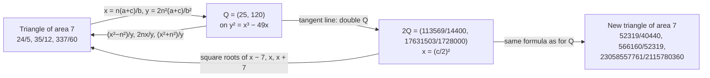

# What curves answer: congruent numbers, and the modularity theorem

[Syllabus](../../../SYLLABUS.md) → [Algebraic geometry](../README.md) → [Elliptic Curves](../README.md#s04) → What curves answer

---

## General Overview

A right triangle with legs 24/5 and 35/12 has hypotenuse 337/60. All three sides are fractions, and its area is exactly 7. A whole number that is the area of a right triangle with rational sides is called **congruent**. So 7 is congruent.

The word comes from the medieval Latin *congruum*, the common gap between three squares spaced evenly apart, not from "congruent triangles". The question is old and hard: given a number such as 7, is there such a triangle, and how would anyone find one?

This card turns the question into geometry. Every triangle of area 7 becomes a rational point on the curve $`y^2 = x^3 - 49x`$, and every rational point with $`y \neq 0`$ becomes a triangle. The triangle above becomes the point $`Q = (25, 120)`$. Then the theory of elliptic curves takes over. Adding $`Q`$ to itself on the curve gives new points, and each new point is a new triangle of area 7.

The modularity theorem enters at the end. It says the curve's point counts mod every prime are the coefficients of a modular form. That gives the curve's L-function a meaning at $`s = 1`$, the place where the rank question is decided. For 7, together with the work of Gross, Zagier and Kolyvagin, it proves that the rank is exactly 1.

**A whole number n is the area of a rational right triangle exactly when the curve $`y^2 = x^3 - n^2x`$ has a rational point of infinite order, and modularity gives that curve an L-function whose value at $`s = 1`$ is the tool for deciding it.**

**What kind of fact this is:** the triangle-to-point dictionary is a theorem, proved on this card in Why it works. The modularity theorem is a theorem, stated with its sources here and outlined in the number-theory wing. The full answer for every n waits on the Birch and Swinnerton-Dyer conjecture, unproved as of 2026-11-17.

### The picture: one triangle, one point, and the triangles it breeds



Every arrow is exact rational arithmetic, and the code below checks each one.

---

## The formula

The question is about a whole number $`n`$, the target area. Its curve is $`E_n`$, the set of points $`(x, y)`$ with

```math
E_n:\; y^2 = x^3 - n^2 x
```

**Read it aloud:** y squared equals x cubed minus n squared times x.

The dictionary has two directions. A triangle with legs $`a`$, $`b`$ and hypotenuse $`c`$ goes to a point, and a point with $`y \neq 0`$ goes to a triangle:

```math
(x, y) = \left(\frac{n(a+c)}{b},\; \frac{2n^2(a+c)}{b^2}\right), \qquad (a, b, c) = \left(\frac{x^2-n^2}{y},\; \frac{2nx}{y},\; \frac{x^2+n^2}{y}\right)
```

**Read it aloud:** x is n times leg-plus-hypotenuse over the other leg; going back, the three sides are x squared minus n squared, two n x, and x squared plus n squared, each divided by y.

The two maps undo each other. With the four points that have $`y = 0`$ set aside, this gives the theorem:

```math
n \text{ is congruent} \iff E_n(\mathbb{Q}) \text{ has a point with } y \neq 0 \iff \mathrm{rank}\, E_n(\mathbb{Q}) \geq 1
```

**Read it aloud:** n is congruent exactly when its curve has a rational point off the x-axis, which happens exactly when the rank is at least 1.

The modularity side packs the curve's counts into one function, $`g(t)`$, and states its symmetry:

```math
g(t) = \sum_{m \geq 1} a_m\, e^{-2\pi m t/\sqrt{N}}, \qquad g(1/t) = w\, t^2\, g(t)
```

**Read it aloud:** add up each coefficient times a decaying exponential; swapping t for one over t multiplies the sum by w times t squared.

| Symbol | Plain meaning | In our example | Push it up and the answer… |
| --- | --- | --- | --- |
| $`n`$ | the target area, a whole number | 7 | a new curve and a new question |
| $`x`$, $`y`$ | the two rational coordinates of a point on the curve | $`Q = (25, 120)`$ | — |
| $`a`$, $`b`$, $`c`$ | the two legs and the hypotenuse, all rational | 24/5, 35/12, 337/60 | — |
| $`E_n`$ | the curve $`y^2 = x^3 - n^2x`$ | $`y^2 = x^3 - 49x`$ | — |
| $`E_n(\mathbb{Q})`$, rank | its rational points plus the zero point $`O`$ at infinity, a group under the chord-and-tangent rule; the rank counts the independent points of infinite order it needs | contains $`Q`$, $`2Q`$, …; rank 1 | more independent families of triangles |
| $`Q`$, $`2Q`$ | the point from the triangle, and $`Q`$ added to itself | (25, 120); x of 2Q is 113569/14400 | each multiple is a new triangle |
| $`p`$, $`\mathbb{F}_p`$, $`a_p`$, $`a_m`$ | a prime, and arithmetic mod that prime; $`p + 1`$ minus the number of points mod $`p`$; $`a_m`$ for other $`m`$ is built from these | $`p`$ = 3, 5, 11, …; $`a_5 = 2`$, $`a_{13} = -6`$ | — |
| $`N`$ | the conductor: a whole number recording the primes where the curve breaks mod p; $`32n^2`$ for odd square-free $`n`$, meaning no square factor other than 1 (Koblitz, chapter II) | $`32 \cdot 49 = 1568`$ | the sums need more terms |
| $`L(E, s)`$ | the L-function, the series $`\sum a_m m^{-s}`$, with $`s`$ a complex variable | $`L(E_7, 1) = 0`$ | — |
| $`g(t)`$ | the same coefficients, weighted by exponentials in $`t`$ (a positive real number) | $`g(0.8) = -0.7675096764`$ | — |
| $`w`$ | the sign in the symmetry, +1 or −1 | −1 | at −1, $`L(E, 1)`$ is forced to be 0 |
| $`A`$, $`B`$ | Tunnell's counts of whole-number solutions of $`2x^2 + y^2 + 32z^2 = n`$ and $`2x^2 + y^2 + 8z^2 = n`$ | 0 and 0 | if $`2A \neq B`$, $`n`$ is not congruent |

### When it holds

- **The sides are rational.** Over the real numbers every area is possible: legs 1 and 2 give area 1 and a real point. The point is not rational, and the dictionary says nothing about it.
- **The point has $`y \neq 0`$.** The points $`(0, 0)`$, $`(7, 0)`$ and $`(-7, 0)`$ lie on the curve, but the triangle formula divides by $`y`$. They give no triangle.
- **The curve uses $`n^2`$, not $`n`$.** On $`y^2 = x^3 - 7x`$ the point $`x = 25`$ gives $`y^2 = 15450`$, not a square, and the dictionary breaks.
- **The curve is over $`\mathbb{Q}`$.** The modularity theorem is about elliptic curves with rational coefficients. Over other number fields it is proved only in some cases.
- **The L-function test is a statement about rank, not a search.** A sign $`w = -1`$ forces $`L(E, 1) = 0`$, which predicts a point; it does not hand over the point.

---

## Why it works

### Step 0: a right triangle is three squares spaced n apart

Halve the hypotenuse and square it: $`(c/2)^2`$. Add and subtract the area $`n = ab/2`$:

```math
\left(\tfrac{c}{2}\right)^2 \pm n = \frac{a^2 + b^2 \pm 2ab}{4} = \left(\frac{a \pm b}{2}\right)^2
```

So $`x - n`$, $`x`$ and $`x + n`$ are three rational squares when $`x = (c/2)^2`$. Their product, $`x^3 - n^2x`$, is then a square too. That is a point on $`E_n`$. The whole card grows from this one identity: a statement about triangles is a statement about a cubic curve.

For 7, the three squares are $`(113/120)^2`$, $`(337/120)^2`$ and $`(463/120)^2`$, spaced exactly 7 apart.

### Step 1: from a triangle to a point, by rational formulas

Set $`x = n(a+c)/b`$. Using $`b^2 = c^2 - a^2`$, the square $`(a + c)^2 - b^2`$ simplifies to $`2a(a + c)`$. That gives $`x^2 - n^2 = 2a n^2 (a+c)/b^2`$.

Multiply by $`x`$ and use $`2n = ab`$. The product $`x^3 - n^2x`$ becomes $`\big(a\,x\big)^2`$, a perfect square. So $`y = a\,x`$, which is the same number as $`2n^2(a+c)/b^2`$.

<details>
<summary>Detailed proof: x³ − n²x is the square of a·x</summary>

Write $`s = a + c`$. Then $`s^2 - b^2 = a^2 + 2ac + c^2 - (c^2 - a^2) = 2a s`$.

$`\displaystyle x^2 - n^2 = \frac{n^2 (s^2 - b^2)}{b^2} = \frac{2a\,n^2 s}{b^2}`$

$`\displaystyle x^3 - n^2 x = x\,(x^2 - n^2) = \frac{n s}{b}\cdot\frac{2a\,n^2 s}{b^2} = \frac{2n \cdot a\, n^2 s^2}{b^3}`$

Now $`2n = ab`$, so the numerator is $`a^2 b\, n^2 s^2`$ and the fraction is $`a^2 n^2 s^2 / b^2 = (a x)^2`$. Finally $`a = 2n/b`$, so $`a x = 2n^2 s / b^2`$.

</details>

For the triangle 24/5, 35/12, 337/60: $`a + c = 125/12`$, so $`x = 7 \cdot (125/12)/(35/12) = 25`$ and $`y = 120`$. Check: $`25^3 - 49 \cdot 25 = 15625 - 1225 = 14400 = 120^2`$.

### Step 2: from a point back to a triangle

Take a rational point $`(x, y)`$ with $`y \neq 0`$. Divide three numbers by $`y`$: $`x^2 - n^2`$, $`2nx`$ and $`x^2 + n^2`$.

- **Right angle.** $`(x^2 - n^2)^2 + (2nx)^2 = (x^2 + n^2)^2`$ is an identity, the same one that lists all Pythagorean triples.
- **Area.** Half the product of the legs is $`nx(x^2 - n^2)/y^2`$, and $`y^2 = x(x^2 - n^2)`$ on the curve, so the area is $`n`$.
- **Rational.** Every step is adding, multiplying and dividing rationals.

For $`Q = (25, 120)`$: $`x^2 - 49 = 576`$, $`2nx = 350`$, $`x^2 + 49 = 674`$. Divided by 120 these are 24/5, 35/12 and 337/60, the starting triangle. Negative sides, when they appear, are made positive.

### Step 3: the four points that give nothing are the only finite ones

On any curve $`y^2 = x^3 - n^2x`$ the points $`O`$, $`(0, 0)`$, $`(n, 0)`$ and $`(-n, 0)`$ have finite order: added to themselves, they return to $`O`$. No other point has finite order. [Torsion points](04-torsion-and-nagell-lutz.md) proves the general method: the finite-order points survive reduction mod a good prime $`p`$, so their number divides every count of points mod $`p`$.

For $`E_7`$ and the primes 3, 11, 19, 23 and 31, the counts are 4, 12, 20, 24 and 32. Their greatest common divisor is 4. So there are no other finite-order points.

Put the steps together. A triangle gives a point with $`y \neq 0`$, which has infinite order, so the rank is at least 1. A rank of at least 1 gives a point of infinite order, which has $`y \neq 0`$, so it gives a triangle. That proves the equivalence in The formula.

### Step 4: one triangle means infinitely many

$`Q`$, $`2Q`$, $`3Q`$ and so on are all different, because $`Q`$ has infinite order ([Mordell-Weil](06-mordell-weil-and-rank.md) for the group and its rank). Each one gives a triangle by Step 2. Only a few points share a triangle, by changing signs and swapping the legs. So one congruent triangle gives infinitely many.

Double $`Q`$ with the tangent line ([Adding points by formula](03-point-arithmetic-and-double-and-add.md)). The new point $`2Q`$ has $`x = 113569/14400`$, and Step 2 turns it into the triangle 52319/40440, 566160/52319, 23058557761/2115780360. Its area is again exactly 7.

### Step 5: the half-hypotenuse map lands on 2Q

Step 0 and Step 1 give two different points for one triangle. They are related: the $`x`$ of $`2Q`$ is $`113569/14400 = (337/120)^2 = (c/2)^2`$. The three-squares point is the double of the formula point.

This is a general fact from 2-descent (the test for whether a point is twice another rational point): on $`E_n`$, a point is a double exactly when $`x`$, $`x - n`$ and $`x + n`$ are all rational squares (the source is Koblitz, chapter I). Going back is three square roots. The legs are $`\sqrt{x+n} \pm \sqrt{x-n}`$ and the hypotenuse is $`2\sqrt{x}`$: here $`463/120 \pm 113/120`$ gives 24/5 and 35/12, and $`2 \cdot 337/120 = 337/60`$.

### Step 6: what modularity adds

The rank decides everything, and rank is hard to compute. [The L-function](07-l-functions-of-elliptic-curves.md) offers another route. Count the points mod each prime $`p`$, set $`a_p = p + 1 - \#E(\mathbb{F}_p)`$, and pack the $`a_p`$ into $`L(E, s) = \sum a_m m^{-s}`$. For $`E_7`$: $`a_3 = 0`$, $`a_5 = 2`$, $`a_{13} = -6`$, $`a_{17} = -2`$, $`a_{29} = -10`$.

That series is only guaranteed to converge when the real part of $`s`$ is above 3/2. The [Birch and Swinnerton-Dyer](08-birch-and-swinnerton-dyer-statement.md) conjecture is about $`s = 1`$, outside that range. Something must give $`L(E, 1)`$ a meaning.

The **modularity theorem** does. It says the $`a_m`$ are the coefficients of a weight-2 modular form of level $`N`$: a function on the upper half plane with a large group of symmetries. The level is the conductor $`N`$, and weight 2 fixes the factor, here $`t^2`$, that each symmetry multiplies by. Wiles, and Taylor and Wiles, proved it in 1995 for semistable curves, a large class that includes the curves Fermat's Last Theorem needs; Breuil, Conrad, Diamond and Taylor finished every curve over $`\mathbb{Q}`$ in 2001. Modularity (planned, number-theory wing) states the theorem and follows it to Fermat's Last Theorem.

What it gives a curve, in three lines:

1. **A symmetry.** One symmetry of the modular form becomes $`g(1/t) = w\,t^2\,g(t)`$, with $`w = \pm 1`$.
2. **A meaning at every $`s`$.** The integral of $`g(t)\, t^{s-1}`$ from 0 to infinity equals $`L(E, s)`$ times a known factor built from $`N`$ and $`s`$. Split it at $`t = 1`$ and fold one half over with the symmetry. The result converges for every $`s`$, so $`L(E, s)`$ extends to the whole complex plane.
3. **A forced zero.** At $`s = 1`$ the fold gives $`L(E, 1) = \sum (a_m / m)(1 + w)\,e^{-2\pi m/\sqrt{N}}`$. If $`w = -1`$, every term is zero and $`L(E, 1) = 0`$.

The curves $`E_n`$ were known to be modular long before 1995. They have an extra symmetry, $`(x, y) \mapsto (-x, iy)`$ with $`i^2 = -1`$, called complex multiplication. That lets their L-functions be written down directly (Koblitz, chapter II). For congruent numbers, this earlier case is the one that matters.

The code tests the symmetry with counted coefficients only. For $`E_7`$, $`N = 1568`$: $`g(0.8) = -0.7675096764`$ and $`1.25^2\,g(1.25) = 0.7675096764`$. So $`w = -1`$, and $`L(E_7, 1) = 0`$. For $`E_1`$, $`N = 32`$, the sign is $`+1`$ and $`L(E_1, 1) = 0.6555143886`$.

### Step 7: what this settles about congruent numbers

- **A test that proves "not congruent".** Tunnell (1983) proved: for odd square-free $`n`$, if $`n`$ is congruent then $`2A = B`$, where $`A`$ and $`B`$ count whole-number solutions of $`2x^2 + y^2 + 32z^2 = n`$ and $`2x^2 + y^2 + 8z^2 = n`$. The proof rests on the curves' modularity and on Coates and Wiles. For $`n = 1, 3, 11`$ the test fails, so they are not congruent.
- **The other direction is conditional.** If $`2A = B`$ then Birch and Swinnerton-Dyer predicts $`n`$ is congruent. That is unproved as of 2026-11-17.
- **Rank exactly 1 for 7.** The derivative $`L'(E_7, 1) = 2.9621148833`$ is not zero. Gross and Zagier, then Kolyvagin, proved that this forces rank exactly 1. Their proof uses the modular parametrisation: the map onto the curve that modularity provides. So every rational point on $`E_7`$ is a multiple of one generator, plus one of the four finite-order points.
- **The sign rule.** For square-free $`n`$, $`w = -1`$ exactly when $`n`$ leaves 5, 6 or 7 on division by 8. Birch and Swinnerton-Dyer would then make every such $`n`$ congruent. Tian (2014) proved there are infinitely many square-free congruent numbers in each of those three classes. The claim for every such $`n`$ is unproved as of 2026-11-17.

---

## Worked numbers, by hand

| Step | Arithmetic | Value |
| --- | --- | --- |
| area | $`\tfrac12 \cdot \tfrac{24}{5} \cdot \tfrac{35}{12}`$ | 7 |
| right angle | $`a^2 + b^2`$ and $`c^2`$ | both 113569/3600 |
| leg plus hypotenuse | $`\tfrac{24}{5} + \tfrac{337}{60}`$ | 125/12 |
| $`x`$ | $`7 \cdot \tfrac{125}{12} \div \tfrac{35}{12}`$ | 25 |
| $`y = a\,x`$ | $`\tfrac{24}{5} \cdot 25`$ | 120 |
| on the curve | $`25^3 - 49 \cdot 25 = 15625 - 1225`$ | 14400 = $`120^2`$ |
| back to sides | 576, 350, 674, each $`\div 120`$ | 24/5, 35/12, 337/60 |
| three squares | $`(c/2)^2 - 7`$, $`(c/2)^2`$, $`(c/2)^2 + 7`$ | $`(113/120)^2`$, $`(337/120)^2`$, $`(463/120)^2`$ |
| finite-order points | gcd of 4, 12, 20, 24, 32 | 4 |
| Tunnell for 7 | no solutions to either equation | $`A = B = 0`$, so $`2A = B`$ |
| sign | $`g(0.8) \div 1.25^2\,g(1.25)`$ | −1 |
| **verdict** | point of infinite order; $`L'(E_7, 1) = 2.9621148833 \neq 0`$ | **7 is congruent, rank exactly 1** |

The triangle and the point are one object written two ways. The rank says there are infinitely many triangles of area 7, all built from one point.

### What breaks if you drop a piece

| Mistake | Comes out at | What went wrong |
| --- | --- | --- |
| Use $`y^2 = x^3 - 7x`$, with $`n`$ not $`n^2`$ | at $`x = 25`$, $`y^2 = 15450`$, not a square | the three squares are spaced $`n`$ apart, so the product is $`x^3 - n^2x`$ |
| Ask for area 1 | Tunnell: $`A = 2`$, $`B = 2`$, so $`2A \neq B`$ | $`E_1`$ has rank 0: only the points with $`y = 0`$, where the formula divides by zero |
| Drop "rational": legs 1 and 2, hypotenuse $`\sqrt 5`$ | $`x = y = 1.6180339887`$, on the curve but irrational | over the reals every area is a triangle; the question lives over $`\mathbb{Q}`$ |
| Feed $`2Q`$ to Step 2 and expect the old triangle | 52319/40440, 566160/52319, 23058557761/2115780360 | Step 2 inverts Step 1, not Step 0; $`2Q`$ is a new triangle |

---

## Code, from first principles, and it actually runs

The code reaches the answer by four independent roads. Road 1 sends the triangle to $`Q`$ and back by the rational formulas, in exact fractions. Road 2 builds the three squares, doubles $`Q`$ with the tangent line, checks the $`x`$ values agree, and takes square roots back to the triangle. Road 3 counts points mod primes by listing every $`x`$, for the finite-order points and for the coefficients $`a_m`$. Road 4 tests the modular symmetry at two values of $`t`$, and computes $`L(E, 1)`$ and $`L'(E_7, 1)`$ with two different splits that must agree. It also prints Tunnell's counts and every "what breaks" row.

### Python

```python
# Congruent numbers and modularity -- the check behind the card.  Standard library only.
# Exact fractions for every triangle and point; point counts mod p by listing every x;
# floats only for the L-function sums, checked to a stated tolerance.
from fractions import Fraction as Fr
from math import exp, log, pi, sqrt, isqrt, gcd

def fs(q): return str(q.numerator) if q.denominator == 1 else f"{q.numerator}/{q.denominator}"
def pt(P): return f"({fs(P[0])}, {fs(P[1])})"
def on_curve(n, P): return P[1] * P[1] == P[0] ** 3 - n * n * P[0]
def tri_to_pt(n, a, b, c): return (n * (a + c) / b, 2 * n * n * (a + c) / (b * b))
def pt_to_tri(n, P):
    x, y = P
    return ((x * x - n * n) / y, 2 * n * x / y, (x * x + n * n) / y)
def double(n, P):                      # the tangent line at P meets the curve again at -2P
    x, y = P; m = (3 * x * x - n * n) / (2 * y); x3 = m * m - 2 * x
    return (x3, m * (x - x3) - y)
def qsqrt(q):                          # exact square root of a positive rational square
    r, s = isqrt(q.numerator), isqrt(q.denominator)
    return Fr(r, s) if r * r == q.numerator and s * s == q.denominator else None
def count(n, p):                       # points on y^2 = x^3 - n^2 x over F_p, plus O
    ways = [0] * p
    for y in range(p): ways[y * y % p] += 1
    return 1 + sum(ways[(x ** 3 - n * n * x) % p] for x in range(p))
def tunnell(n, k):                     # whole-number solutions of 2x^2 + y^2 + k z^2 = n
    R = isqrt(n) + 1
    return sum(1 for x in range(-R, R + 1) for y in range(-R, R + 1) for z in range(-R, R + 1)
               if 2 * x * x + y * y + k * z * z == n)

n = 7
a, b, c = Fr(24, 5), Fr(35, 12), Fr(337, 60)
print(f"n = 7: triangle a = {fs(a)}, b = {fs(b)}, c = {fs(c)}")
print(f"area ab/2 = {fs(a * b / 2)}; a^2 + b^2 = {fs(a * a + b * b)}; c^2 = {fs(c * c)}")
assert a * b / 2 == n and a * a + b * b == c * c
Q = tri_to_pt(n, a, b, c)
print(f"road 1, triangle to point: Q = {pt(Q)}")
print(f"  y^2 = {fs(Q[1] ** 2)}; x^3 - 49x = {fs(Q[0] ** 3 - n * n * Q[0])}")
print(f"  by hand: a + c = {fs(a + c)}; 25^3 = {25 ** 3}, 49 * 25 = {49 * 25}; x^2 - 49 = {fs(Q[0] ** 2 - 49)}, 2nx = {fs(2 * n * Q[0])}, x^2 + 49 = {fs(Q[0] ** 2 + 49)}")
back = pt_to_tri(n, Q)
print(f"  point back to triangle: {', '.join(map(fs, back))}")
assert on_curve(n, Q) and back == (a, b, c)
x2 = (c / 2) ** 2
sq = [qsqrt(x2 - n), qsqrt(x2), qsqrt(x2 + n)]
print(f"road 2, three squares 7 apart: {', '.join(fs(x2 + d) for d in (-n, 0, n))}")
print(f"  = ({fs(sq[0])})^2, ({fs(sq[1])})^2, ({fs(sq[2])})^2")
assert None not in sq and sq[0] == (a - b) / 2 and sq[2] == (a + b) / 2
P2 = double(n, Q)
print(f"  tangent at Q: 2Q = {pt(P2)}")
print(f"  x(2Q) = (c/2)^2: {fs(P2[0])} = {fs(x2)}")
assert P2[0] == x2 and on_curve(n, P2)
r = (sq[2] + sq[0], sq[2] - sq[0], 2 * sq[1])
print(f"  square roots back: {', '.join(map(fs, r))}")
assert r == (a, b, c)
t2 = [abs(v) for v in pt_to_tri(n, P2)]
print(f"new triangle from 2Q: {', '.join(map(fs, t2))}")
print(f"  area {fs(t2[0] * t2[1] / 2)}, a^2 + b^2 = c^2: {t2[0] ** 2 + t2[1] ** 2 == t2[2] ** 2}")
assert t2[0] * t2[1] / 2 == n and t2[0] ** 2 + t2[1] ** 2 == t2[2] ** 2 and t2[2] != c
five = tri_to_pt(5, Fr(3, 2), Fr(20, 3), Fr(41, 6))
print(f"n = 5: triangle 3/2, 20/3, 41/6 gives {pt(five)} on y^2 = x^3 - 25x: {on_curve(5, five)}")
assert on_curve(5, five)
ps = [3, 11, 19, 23, 31]
cnt = [count(n, p) for p in ps]
g = 0
for k in cnt: g = gcd(g, k)
print(f"torsion: #E(F_p) for p = 3, 11, 19, 23, 31: {cnt}; gcd {g}")
print(f"  y = 0 points (0, 0), (7, 0), (-7, 0) on curve: {all(on_curve(n, (Fr(x), Fr(0))) for x in (0, 7, -7))}")
assert cnt == [p + 1 for p in ps] and g == 4
print("Tunnell counts A (k = 32), B (k = 8); congruent forces 2A = B")
for m in (1, 3, 5, 7, 11):
    A, B = tunnell(m, 32), tunnell(m, 8)
    print(f"  n = {m}: A = {A}, B = {B}, 2A = B: {2 * A == B}")
    assert (2 * A == B) == (m in (5, 7))
bad = 25 ** 3 - n * 25
print(f"breaks: y^2 = x^3 - 7x at x = 25 gives {bad}, a square: {isqrt(bad) ** 2 == bad}")
xr, yr = (1 + sqrt(5)) / 2, 2 * (1 + sqrt(5)) / 4
print(f"breaks: legs 1, 2, hypotenuse sqrt 5, area 1: x = {xr:.10f}, y = {yr:.10f}, off curve by {abs(yr * yr - xr ** 3 + xr):.10f}")
assert isqrt(bad) ** 2 != bad and abs(yr * yr - xr ** 3 + xr) < 1e-12

def coeffs(n, M):                      # a_m for m <= M, from point counts mod p
    a = [0] * (M + 1); a[1] = 1
    for m in range(2, M + 1):
        p = next(q for q in range(2, m + 1) if m % q == 0)
        r = m
        while r % p == 0: r //= p
        if r > 1: a[m] = a[r] * a[m // r]; continue
        bad = (2 * n) % p == 0         # p = 2 and p | n: additive, a_p = 0
        ap = 0 if bad else (p + 1 - count(n, p) if m == p else a[p])
        a[m] = ap if m == p else ap * a[m // p] - (0 if bad else p) * a[m // p // p]
    return a
def E1(x):                             # exponential integral, series or continued fraction
    if x < 1:
        s, term = 0.0, 1.0
        for k in range(1, 40):
            term *= -x / k; s += term / k
        return -0.5772156649015329 - log(x) - s
    f = 0.0
    for k in range(60, 0, -1): f = k * k / (x + 2 * k + 1 - f)
    return exp(-x) / (x + 1 - f)
def gsum(a, N, t):
    s = 0.0
    for m in range(1, len(a)): s += a[m] * exp(-2 * pi * m * t / sqrt(N))
    return s
def L1(a, N, w, A):
    s, k = 0.0, 2 * pi / sqrt(N)
    for m in range(1, len(a)): s += a[m] / m * (exp(-k * m * A) + w * exp(-k * m / A))
    return s
def dL1(a, N, A):                      # L'(E, 1) when the sign w is -1
    s, k = 0.0, 2 * pi / sqrt(N)
    for m in range(1, len(a)):
        s += a[m] / m * (exp(-k * m * A) * log(A) + E1(k * m * A) - exp(-k * m / A) * log(A) + E1(k * m / A))
    return s

a7 = coeffs(7, 400)
print("a_p for y^2 = x^3 - 49x, p = 3, 5, 11, 13, 17, 19, 23, 29:", [a7[p] for p in (3, 5, 11, 13, 17, 19, 23, 29)])
assert all(a7[p] == 0 for p in (3, 11, 19, 23)) and all(a7[p] ** 2 <= 4 * p for p in (5, 13, 17, 29))
for m, N in ((1, 32), (7, 1568)):
    am = a7 if m == 7 else coeffs(1, 400)
    w = gsum(am, N, 0.8) / (1.25 ** 2 * gsum(am, N, 1.25))
    print(f"n = {m}, N = {N}: g(0.8) = {gsum(am, N, 0.8):.10f}, 1.25^2 g(1.25) = {1.25 ** 2 * gsum(am, N, 1.25):.10f}, sign w = {w:.10f}")
    assert abs(w - (-1 if m % 8 in (5, 6, 7) else 1)) < 1e-9
    wi = round(w)
    print(f"  L(E, 1) split at 1: {abs(L1(am, N, wi, 1.0)):.10f}; split at 1.25: {abs(L1(am, N, wi, 1.25)):.10f}")
    assert abs(L1(am, N, wi, 1.0) - L1(am, N, wi, 1.25)) < 1e-9
d1, d2 = dL1(a7, 1568, 1.0), dL1(a7, 1568, 1.25)
print(f"n = 7: L'(E, 1) split at 1: {d1:.10f}; split at 1.25: {d2:.10f}")
assert abs(d1 - d2) < 1e-9 and d1 > 0.1
print("ALL CHECKS PASS")
```

**Ran 2026-11-17 on macOS, Python 3.14.10, standard library only. All checks passed. Output, pasted from the run:**

```
n = 7: triangle a = 24/5, b = 35/12, c = 337/60
area ab/2 = 7; a^2 + b^2 = 113569/3600; c^2 = 113569/3600
road 1, triangle to point: Q = (25, 120)
  y^2 = 14400; x^3 - 49x = 14400
  by hand: a + c = 125/12; 25^3 = 15625, 49 * 25 = 1225; x^2 - 49 = 576, 2nx = 350, x^2 + 49 = 674
  point back to triangle: 24/5, 35/12, 337/60
road 2, three squares 7 apart: 12769/14400, 113569/14400, 214369/14400
  = (113/120)^2, (337/120)^2, (463/120)^2
  tangent at Q: 2Q = (113569/14400, 17631503/1728000)
  x(2Q) = (c/2)^2: 113569/14400 = 113569/14400
  square roots back: 24/5, 35/12, 337/60
new triangle from 2Q: 52319/40440, 566160/52319, 23058557761/2115780360
  area 7, a^2 + b^2 = c^2: True
n = 5: triangle 3/2, 20/3, 41/6 gives (25/4, 75/8) on y^2 = x^3 - 25x: True
torsion: #E(F_p) for p = 3, 11, 19, 23, 31: [4, 12, 20, 24, 32]; gcd 4
  y = 0 points (0, 0), (7, 0), (-7, 0) on curve: True
Tunnell counts A (k = 32), B (k = 8); congruent forces 2A = B
  n = 1: A = 2, B = 2, 2A = B: False
  n = 3: A = 4, B = 4, 2A = B: False
  n = 5: A = 0, B = 0, 2A = B: True
  n = 7: A = 0, B = 0, 2A = B: True
  n = 11: A = 4, B = 12, 2A = B: False
breaks: y^2 = x^3 - 7x at x = 25 gives 15450, a square: False
breaks: legs 1, 2, hypotenuse sqrt 5, area 1: x = 1.6180339887, y = 1.6180339887, off curve by 0.0000000000
a_p for y^2 = x^3 - 49x, p = 3, 5, 11, 13, 17, 19, 23, 29: [0, 2, 0, -6, -2, 0, 0, -10]
n = 1, N = 32: g(0.8) = 0.3867657998, 1.25^2 g(1.25) = 0.3867657998, sign w = 1.0000000000
  L(E, 1) split at 1: 0.6555143886; split at 1.25: 0.6555143886
n = 7, N = 1568: g(0.8) = -0.7675096764, 1.25^2 g(1.25) = 0.7675096764, sign w = -1.0000000000
  L(E, 1) split at 1: 0.0000000000; split at 1.25: 0.0000000000
n = 7: L'(E, 1) split at 1: 2.9621148833; split at 1.25: 2.9621148833
ALL CHECKS PASS
```

### Rust

```rust
// Congruent numbers and modularity -- the check behind the card.  std only, no crates.
// Exact fractions are an i128 struct with checked arithmetic, so overflow stops the run;
// point counts mod p list every x; floats only for the L-function sums.
use std::f64::consts::PI;
use std::ops::{Add, Div, Mul, Sub};

#[derive(Clone, Copy, PartialEq, Debug)]
struct Q { n: i128, d: i128 }
fn gcd(a: i128, b: i128) -> i128 { let (mut a, mut b) = (a.abs(), b.abs()); while b != 0 { let t = a % b; a = b; b = t; } a }
fn q(n: i128, d: i128) -> Q { assert!(d != 0); let g = gcd(n, d); let s = if d < 0 { -1 } else { 1 }; Q { n: s * n / g, d: s * d / g } }
fn z(k: i128) -> Q { q(k, 1) }
impl Mul for Q { type Output = Q; fn mul(self, b: Q) -> Q {
    let (g1, g2) = (gcd(self.n, b.d).max(1), gcd(b.n, self.d).max(1));
    q((self.n / g1).checked_mul(b.n / g2).unwrap(), (self.d / g2).checked_mul(b.d / g1).unwrap()) } }
impl Div for Q { type Output = Q; fn div(self, b: Q) -> Q { self * q(b.d, b.n) } }
impl Add for Q { type Output = Q; fn add(self, b: Q) -> Q { let g = gcd(self.d, b.d);
    let top = self.n.checked_mul(b.d / g).unwrap().checked_add(b.n.checked_mul(self.d / g).unwrap()).unwrap();
    q(top, (self.d / g).checked_mul(b.d).unwrap()) } }
impl Sub for Q { type Output = Q; fn sub(self, b: Q) -> Q { self + Q { n: -b.n, d: b.d } } }
fn fs(a: Q) -> String { if a.d == 1 { format!("{}", a.n) } else { format!("{}/{}", a.n, a.d) } }
fn pt(p: (Q, Q)) -> String { format!("({}, {})", fs(p.0), fs(p.1)) }
fn ab(a: Q) -> Q { Q { n: a.n.abs(), d: a.d } }
fn tf(b: bool) -> &'static str { if b { "True" } else { "False" } }
fn on_curve(n: i128, p: (Q, Q)) -> bool { p.1 * p.1 == p.0 * p.0 * p.0 - z(n * n) * p.0 }
fn tri_to_pt(n: i128, a: Q, b: Q, c: Q) -> (Q, Q) { (z(n) * (a + c) / b, z(2 * n * n) * (a + c) / (b * b)) }
fn pt_to_tri(n: i128, p: (Q, Q)) -> (Q, Q, Q) {
    let (x, y) = p; ((x * x - z(n * n)) / y, z(2 * n) * x / y, (x * x + z(n * n)) / y) }
fn double(n: i128, p: (Q, Q)) -> (Q, Q) {       // the tangent line at P meets the curve again at -2P
    let (x, y) = p; let m = (z(3) * x * x - z(n * n)) / (z(2) * y); let x3 = m * m - z(2) * x;
    (x3, m * (x - x3) - y) }
fn isqrt(v: i128) -> i128 { let mut r = (v as f64).sqrt() as i128;
    while r * r > v { r -= 1; } while (r + 1) * (r + 1) <= v { r += 1; } r }
fn qsqrt(a: Q) -> Option<Q> {                   // exact square root of a positive rational square
    let (r, s) = (isqrt(a.n), isqrt(a.d)); if r * r == a.n && s * s == a.d { Some(q(r, s)) } else { None } }
fn count(n: i64, p: i64) -> i64 {               // points on y^2 = x^3 - n^2 x over F_p, plus O
    let mut ways = vec![0i64; p as usize];
    for y in 0..p { ways[(y * y % p) as usize] += 1; }
    1 + (0..p).map(|x| ways[((x * x * x - n * n * x) % p + p) as usize % p as usize]).sum::<i64>() }
fn tunnell(n: i64, k: i64) -> i64 {             // whole-number solutions of 2x^2 + y^2 + k z^2 = n
    let r = isqrt(n as i128) as i64 + 1; let mut c = 0;
    for x in -r..=r { for y in -r..=r { for zz in -r..=r { if 2 * x * x + y * y + k * zz * zz == n { c += 1; } } } } c }
fn list(v: &[i64]) -> String { format!("[{}]", v.iter().map(|k| k.to_string()).collect::<Vec<_>>().join(", ")) }

fn coeffs(n: i64, mm: usize) -> Vec<i64> {      // a_m for m <= M, from point counts mod p
    let mut a = vec![0i64; mm + 1]; a[1] = 1;
    for m in 2..=mm {
        let p = (2..=m).find(|q| m % q == 0).unwrap();
        let mut r = m; while r % p == 0 { r /= p; }
        if r > 1 { a[m] = a[r] * a[m / r]; continue; }
        let bad = (2 * n) % p as i64 == 0;      // p = 2 and p | n: additive, a_p = 0
        let ap = if bad { 0 } else if m == p { p as i64 + 1 - count(n, p as i64) } else { a[p] };
        a[m] = if m == p { ap } else { ap * a[m / p] - (if bad { 0 } else { p as i64 }) * a[m / p / p] };
    }
    a }
fn e1(x: f64) -> f64 {                          // exponential integral, series or continued fraction
    if x < 1.0 {
        let (mut s, mut term) = (0.0f64, 1.0f64);
        for k in 1..40 { term *= -x / k as f64; s += term / k as f64; }
        return -0.5772156649015329 - x.ln() - s;
    }
    let mut f = 0.0f64;
    for k in (1..=60i64).rev() { f = (k * k) as f64 / (x + (2 * k) as f64 + 1.0 - f); }
    (-x).exp() / (x + 1.0 - f) }
fn gsum(a: &[i64], nn: f64, t: f64) -> f64 {
    let mut s = 0.0; for m in 1..a.len() { s += a[m] as f64 * (-2.0 * PI * m as f64 * t / nn.sqrt()).exp(); } s }
fn l1(a: &[i64], nn: f64, w: f64, aa: f64) -> f64 {
    let (mut s, k) = (0.0, 2.0 * PI / nn.sqrt());
    for m in 1..a.len() { let mf = m as f64; s += a[m] as f64 / mf * ((-k * mf * aa).exp() + w * (-k * mf / aa).exp()); } s }
fn dl1(a: &[i64], nn: f64, aa: f64) -> f64 {    // L'(E, 1) when the sign w is -1
    let (mut s, k) = (0.0, 2.0 * PI / nn.sqrt());
    for m in 1..a.len() { let mf = m as f64;
        s += a[m] as f64 / mf * ((-k * mf * aa).exp() * aa.ln() + e1(k * mf * aa) - (-k * mf / aa).exp() * aa.ln() + e1(k * mf / aa)); }
    s }

fn main() {
    let n = 7i128;
    let (a, b, c) = (q(24, 5), q(35, 12), q(337, 60));
    println!("n = 7: triangle a = {}, b = {}, c = {}", fs(a), fs(b), fs(c));
    println!("area ab/2 = {}; a^2 + b^2 = {}; c^2 = {}", fs(a * b / z(2)), fs(a * a + b * b), fs(c * c));
    assert!(a * b / z(2) == z(n) && a * a + b * b == c * c);
    let qp = tri_to_pt(n, a, b, c);
    println!("road 1, triangle to point: Q = {}", pt(qp));
    println!("  y^2 = {}; x^3 - 49x = {}", fs(qp.1 * qp.1), fs(qp.0 * qp.0 * qp.0 - z(n * n) * qp.0));
    println!("  by hand: a + c = {}; 25^3 = {}, 49 * 25 = {}; x^2 - 49 = {}, 2nx = {}, x^2 + 49 = {}", fs(a + c), 25 * 25 * 25, 49 * 25,
        fs(qp.0 * qp.0 - z(49)), fs(z(2 * n) * qp.0), fs(qp.0 * qp.0 + z(49)));
    let back = pt_to_tri(n, qp);
    println!("  point back to triangle: {}, {}, {}", fs(back.0), fs(back.1), fs(back.2));
    assert!(on_curve(n, qp) && back == (a, b, c));
    let x2 = (c / z(2)) * (c / z(2));
    let sq: Vec<Option<Q>> = vec![qsqrt(x2 - z(n)), qsqrt(x2), qsqrt(x2 + z(n))];
    assert!(sq.iter().all(|s| s.is_some()));
    let s: Vec<Q> = sq.iter().map(|s| s.unwrap()).collect();
    println!("road 2, three squares 7 apart: {}, {}, {}", fs(x2 - z(n)), fs(x2), fs(x2 + z(n)));
    println!("  = ({})^2, ({})^2, ({})^2", fs(s[0]), fs(s[1]), fs(s[2]));
    assert!(s[0] == (a - b) / z(2) && s[2] == (a + b) / z(2));
    let p2 = double(n, qp);
    println!("  tangent at Q: 2Q = {}", pt(p2));
    println!("  x(2Q) = (c/2)^2: {} = {}", fs(p2.0), fs(x2));
    assert!(p2.0 == x2 && on_curve(n, p2));
    let r = (s[2] + s[0], s[2] - s[0], z(2) * s[1]);
    println!("  square roots back: {}, {}, {}", fs(r.0), fs(r.1), fs(r.2));
    assert!(r == (a, b, c));
    let t = pt_to_tri(n, p2); let t2 = [ab(t.0), ab(t.1), ab(t.2)];
    println!("new triangle from 2Q: {}, {}, {}", fs(t2[0]), fs(t2[1]), fs(t2[2]));
    let pyth = t2[0] * t2[0] + t2[1] * t2[1] == t2[2] * t2[2];
    println!("  area {}, a^2 + b^2 = c^2: {}", fs(t2[0] * t2[1] / z(2)), tf(pyth));
    assert!(t2[0] * t2[1] / z(2) == z(n) && pyth && t2[2] != c);
    let five = tri_to_pt(5, q(3, 2), q(20, 3), q(41, 6));
    println!("n = 5: triangle 3/2, 20/3, 41/6 gives {} on y^2 = x^3 - 25x: {}", pt(five), tf(on_curve(5, five)));
    assert!(on_curve(5, five));
    let ps = [3i64, 11, 19, 23, 31];
    let cnt: Vec<i64> = ps.iter().map(|&p| count(7, p)).collect();
    let g = cnt.iter().fold(0i128, |g, &k| gcd(g, k as i128));
    println!("torsion: #E(F_p) for p = 3, 11, 19, 23, 31: {}; gcd {}", list(&cnt), g);
    let tors = [0i128, 7, -7].iter().all(|&x| on_curve(n, (z(x), z(0))));
    println!("  y = 0 points (0, 0), (7, 0), (-7, 0) on curve: {}", tf(tors));
    assert!(cnt.iter().zip(ps.iter()).all(|(k, p)| *k == p + 1) && g == 4);
    println!("Tunnell counts A (k = 32), B (k = 8); congruent forces 2A = B");
    for m in [1i64, 3, 5, 7, 11] {
        let (aa, bb) = (tunnell(m, 32), tunnell(m, 8));
        println!("  n = {}: A = {}, B = {}, 2A = B: {}", m, aa, bb, tf(2 * aa == bb));
        assert!((2 * aa == bb) == (m == 5 || m == 7));
    }
    let bad: i128 = 25 * 25 * 25 - n * 25;
    println!("breaks: y^2 = x^3 - 7x at x = 25 gives {}, a square: {}", bad, tf(isqrt(bad) * isqrt(bad) == bad));
    let (xr, yr) = ((1.0 + 5f64.sqrt()) / 2.0, 2.0 * (1.0 + 5f64.sqrt()) / 4.0);
    let off = (yr * yr - xr.powi(3) + xr).abs();
    println!("breaks: legs 1, 2, hypotenuse sqrt 5, area 1: x = {:.10}, y = {:.10}, off curve by {:.10}", xr, yr, off);
    assert!(isqrt(bad) * isqrt(bad) != bad && off < 1e-12);

    let a7 = coeffs(7, 400);
    let sm: Vec<i64> = [3usize, 5, 11, 13, 17, 19, 23, 29].iter().map(|&p| a7[p]).collect();
    println!("a_p for y^2 = x^3 - 49x, p = 3, 5, 11, 13, 17, 19, 23, 29: {}", list(&sm));
    assert!([3usize, 11, 19, 23].iter().all(|&p| a7[p] == 0) && [5usize, 13, 17, 29].iter().all(|&p| a7[p] * a7[p] <= 4 * p as i64));
    for (m, nn) in [(1i64, 32.0f64), (7, 1568.0)] {
        let am = if m == 7 { a7.clone() } else { coeffs(1, 400) };
        let w = gsum(&am, nn, 0.8) / (1.25 * 1.25 * gsum(&am, nn, 1.25));
        println!("n = {}, N = {}: g(0.8) = {:.10}, 1.25^2 g(1.25) = {:.10}, sign w = {:.10}", m, nn, gsum(&am, nn, 0.8), 1.25 * 1.25 * gsum(&am, nn, 1.25), w);
        let want = if [5, 6, 7].contains(&(m % 8)) { -1.0 } else { 1.0 };
        assert!((w - want).abs() < 1e-9);
        let wi = w.round();
        println!("  L(E, 1) split at 1: {:.10}; split at 1.25: {:.10}", l1(&am, nn, wi, 1.0).abs(), l1(&am, nn, wi, 1.25).abs());
        assert!((l1(&am, nn, wi, 1.0) - l1(&am, nn, wi, 1.25)).abs() < 1e-9);
    }
    let (d1, d2) = (dl1(&a7, 1568.0, 1.0), dl1(&a7, 1568.0, 1.25));
    println!("n = 7: L'(E, 1) split at 1: {:.10}; split at 1.25: {:.10}", d1, d2);
    assert!((d1 - d2).abs() < 1e-9 && d1 > 0.1);
    println!("ALL CHECKS PASS");
}
```

**Ran 2026-11-17 on macOS, rustc 1.98.1, no crates. All checks passed. Output, pasted from the run:**

```
n = 7: triangle a = 24/5, b = 35/12, c = 337/60
area ab/2 = 7; a^2 + b^2 = 113569/3600; c^2 = 113569/3600
road 1, triangle to point: Q = (25, 120)
  y^2 = 14400; x^3 - 49x = 14400
  by hand: a + c = 125/12; 25^3 = 15625, 49 * 25 = 1225; x^2 - 49 = 576, 2nx = 350, x^2 + 49 = 674
  point back to triangle: 24/5, 35/12, 337/60
road 2, three squares 7 apart: 12769/14400, 113569/14400, 214369/14400
  = (113/120)^2, (337/120)^2, (463/120)^2
  tangent at Q: 2Q = (113569/14400, 17631503/1728000)
  x(2Q) = (c/2)^2: 113569/14400 = 113569/14400
  square roots back: 24/5, 35/12, 337/60
new triangle from 2Q: 52319/40440, 566160/52319, 23058557761/2115780360
  area 7, a^2 + b^2 = c^2: True
n = 5: triangle 3/2, 20/3, 41/6 gives (25/4, 75/8) on y^2 = x^3 - 25x: True
torsion: #E(F_p) for p = 3, 11, 19, 23, 31: [4, 12, 20, 24, 32]; gcd 4
  y = 0 points (0, 0), (7, 0), (-7, 0) on curve: True
Tunnell counts A (k = 32), B (k = 8); congruent forces 2A = B
  n = 1: A = 2, B = 2, 2A = B: False
  n = 3: A = 4, B = 4, 2A = B: False
  n = 5: A = 0, B = 0, 2A = B: True
  n = 7: A = 0, B = 0, 2A = B: True
  n = 11: A = 4, B = 12, 2A = B: False
breaks: y^2 = x^3 - 7x at x = 25 gives 15450, a square: False
breaks: legs 1, 2, hypotenuse sqrt 5, area 1: x = 1.6180339887, y = 1.6180339887, off curve by 0.0000000000
a_p for y^2 = x^3 - 49x, p = 3, 5, 11, 13, 17, 19, 23, 29: [0, 2, 0, -6, -2, 0, 0, -10]
n = 1, N = 32: g(0.8) = 0.3867657998, 1.25^2 g(1.25) = 0.3867657998, sign w = 1.0000000000
  L(E, 1) split at 1: 0.6555143886; split at 1.25: 0.6555143886
n = 7, N = 1568: g(0.8) = -0.7675096764, 1.25^2 g(1.25) = 0.7675096764, sign w = -1.0000000000
  L(E, 1) split at 1: 0.0000000000; split at 1.25: 0.0000000000
n = 7: L'(E, 1) split at 1: 2.9621148833; split at 1.25: 2.9621148833
ALL CHECKS PASS
```

### Lean

Lean proves the triangle-to-point dictionary for every whole number n > 0, and checks the card's numbers for 7 and 5.

- Take a whole number n > 0. Then n is congruent exactly when $`E_n`$ has a rational point with $`y \neq 0`$.
- Take a right triangle with positive rational sides a, b, c and area n. Then Step 1 gives a point on $`E_n`$ with $`y \neq 0`$, and Step 2 gives back a, b, c.
- Take any rational point (x, y) on $`E_n`$ with $`y \neq 0`$. Then Step 2's three numbers satisfy $`a^2 + b^2 = c^2`$, and half the product of the legs is n.
- Take the triangle 24/5, 35/12, 337/60. Then its area is 7, and it goes to Q = (25, 120) and back.
- Take the three squares for 7. Then they are $`(113/120)^2`$, $`(337/120)^2`$ and $`(463/120)^2`$, spaced exactly 7 apart.
- Take the tangent line at Q. Then it gives 2Q = (113569/14400, 17631503/1728000), and 2Q lies on $`E_7`$.
- Take the square roots 113/120, 337/120 and 463/120. Then they give back the sides 24/5, 35/12 and 337/60.
- Take 2Q and apply Step 2. Then the new triangle 52319/40440, 566160/52319, 23058557761/2115780360 is right and has area 7.
- Take the triangle 3/2, 20/3, 41/6. Then its area is 5, and it gives the point (25/4, 75/8) on $`y^2 = x^3 - 25x`$.
- Take the points (0, 0), (7, 0) and (−7, 0). Then each one lies on $`E_7`$.
- Take $`E_7`$ mod 3, 11, 19, 23 and 31. Then the counts are 4, 12, 20, 24 and 32, with greatest common divisor 4.
- Take $`E_7`$ mod 5 and 13. Then the counts are 4 and 20, so $`a_5 = 2`$ and $`a_{13} = -6`$.
- Take n = 7. Then the conductor $`32n^2`$ is 1568.
- Take Tunnell's counts for 1, 3, 7 and 11. Then A is 2, 4, 0 and 4, and B is 2, 4, 0 and 12.
- Take $`y^2 = x^3 - 7x`$ at x = 25. Then $`y^2 = 15450`$, which is not a square.

The rank, the finite-order points, the coefficients $`a_m`$, the sign $`w`$ and the L-values are left to the Python and Rust checks.

```lean
-- What curves answer: a whole number n > 0 is the area of a right triangle with rational sides exactly when the curve y^2 = x^3 - n^2 x has a rational point with y ≠ 0, by explicit rational maps each way, and the card's triangles and points for 7 and 5 are as it states.
import Mathlib.AlgebraicGeometry.EllipticCurve.Affine.Basic
import Mathlib.Data.ZMod.Basic
import Mathlib.Tactic

open WeierstrassCurve

lemma cn_triangle_to_point (n : ℕ) (a b c : ℚ) (ha : 0 < a) (hb : 0 < b) (hc : 0 < c)
    (hright : a ^ 2 + b ^ 2 = c ^ 2) (harea : a * b / 2 = n) :
    let x := (n : ℚ) * (a + c) / b
    let y := 2 * (n : ℚ) ^ 2 * (a + c) / b ^ 2
    y ≠ 0 ∧ (⟨0, 0, 0, -(n : ℚ) ^ 2, 0⟩ : WeierstrassCurve ℚ).toAffine.Equation x y ∧
      (x ^ 2 - (n : ℚ) ^ 2) / y = a ∧ 2 * (n : ℚ) * x / y = b ∧ (x ^ 2 + (n : ℚ) ^ 2) / y = c := by
  intro x y
  have hn : (n : ℚ) = a * b / 2 := harea.symm
  have hac : 0 < a + c := by linarith
  have hx : x = a * (a + c) / 2 := by
    simp only [x, hn]; field_simp
  have hy : y = a ^ 2 * (a + c) / 2 := by
    simp only [y, hn]; field_simp
  rw [hx, hy, hn]
  refine ⟨by positivity, ?_, ?_, ?_, ?_⟩
  · rw [Affine.equation_iff]
    field_simp
    linear_combination (a ^ 3 * c + a ^ 4) * hright
  · field_simp
    linear_combination (-1:ℚ) * hright
  · field_simp
  · field_simp
    linear_combination hright

lemma cn_point_to_triangle (n : ℕ) (x y : ℚ) (hy : y ≠ 0)
    (hE : (⟨0, 0, 0, -(n : ℚ) ^ 2, 0⟩ : WeierstrassCurve ℚ).toAffine.Equation x y) :
    let a := (x ^ 2 - (n : ℚ) ^ 2) / y
    let b := 2 * (n : ℚ) * x / y
    let c := (x ^ 2 + (n : ℚ) ^ 2) / y
    a ^ 2 + b ^ 2 = c ^ 2 ∧ a * b / 2 = n := by
  intro a b c
  rw [Affine.equation_iff] at hE
  refine ⟨?_, ?_⟩
  · simp only [a, b, c]; field_simp; ring
  · simp only [a, b]; field_simp
    linear_combination (-(n:ℚ)) * hE

#print axioms cn_triangle_to_point
#print axioms cn_point_to_triangle

/-- The congruent number dictionary. A whole number `n > 0` is congruent (the area `a * b / 2`
of a right triangle whose legs `a`, `b` and hypotenuse `c` are positive rationals with
`a^2 + b^2 = c^2`) exactly when the curve `E_n : y^2 = x^3 - n^2 x` over `ℚ`, written as the
Weierstrass curve with `a₄ = -n^2` and every other coefficient `0`, has a rational point
`(x, y)` with `y ≠ 0`. -/
theorem congruent_iff_exists_rational_point_with_y_ne_zero (n : ℕ) (hn : 0 < n) :
    (∃ a b c : ℚ, 0 < a ∧ 0 < b ∧ 0 < c ∧ a ^ 2 + b ^ 2 = c ^ 2 ∧ a * b / 2 = n) ↔
      ∃ x y : ℚ, y ≠ 0 ∧
        (⟨0, 0, 0, -(n : ℚ) ^ 2, 0⟩ : WeierstrassCurve ℚ).toAffine.Equation x y := by
  constructor
  · rintro ⟨a, b, c, ha, hb, hc, hright, harea⟩
    obtain ⟨hy, hE, -⟩ := cn_triangle_to_point n a b c ha hb hc hright harea
    exact ⟨_, _, hy, hE⟩
  · rintro ⟨x, y, hy, hE⟩
    obtain ⟨hright, harea⟩ := cn_point_to_triangle n x y hy hE
    set a := (x ^ 2 - (n : ℚ) ^ 2) / y
    set b := 2 * (n : ℚ) * x / y
    set c := (x ^ 2 + (n : ℚ) ^ 2) / y
    have hn : (0 : ℚ) < n := by exact_mod_cast hn
    have hab : a * b ≠ 0 := by intro h; rw [h] at harea; linarith
    have ha : a ≠ 0 := left_ne_zero_of_mul hab
    have hb : b ≠ 0 := right_ne_zero_of_mul hab
    have hc : c ≠ 0 := by
      intro h; rw [h] at hright
      have : 0 < a ^ 2 + b ^ 2 := by positivity
      linarith
    refine ⟨|a|, |b|, |c|, abs_pos.2 ha, abs_pos.2 hb, abs_pos.2 hc, ?_, ?_⟩
    · simpa only [sq_abs] using hright
    · rw [← abs_mul, abs_of_pos (by linarith : 0 < a * b)]
      exact harea

/-- Triangle to point, and back. For a right triangle with positive rational legs `a`, `b`,
hypotenuse `c` and area `n`, the point `x = n(a + c)/b`, `y = 2n^2(a + c)/b^2` lies on
`y^2 = x^3 - n^2 x` with `y ≠ 0`, and the reverse formulas `(x^2 - n^2)/y`, `2nx/y`,
`(x^2 + n^2)/y` give back exactly `a`, `b` and `c`: the two maps undo each other. -/
theorem triangle_to_point_and_back (n : ℕ) (a b c : ℚ) (ha : 0 < a) (hb : 0 < b) (hc : 0 < c)
    (hright : a ^ 2 + b ^ 2 = c ^ 2) (harea : a * b / 2 = n) :
    let x := (n : ℚ) * (a + c) / b
    let y := 2 * (n : ℚ) ^ 2 * (a + c) / b ^ 2
    y ≠ 0 ∧ (⟨0, 0, 0, -(n : ℚ) ^ 2, 0⟩ : WeierstrassCurve ℚ).toAffine.Equation x y ∧
      (x ^ 2 - (n : ℚ) ^ 2) / y = a ∧ 2 * (n : ℚ) * x / y = b ∧ (x ^ 2 + (n : ℚ) ^ 2) / y = c := by
  exact cn_triangle_to_point n a b c ha hb hc hright harea

/-- Point to triangle. For any rational point `(x, y)` with `y ≠ 0` on `y^2 = x^3 - n^2 x`, the
three rationals `(x^2 - n^2)/y`, `2nx/y` and `(x^2 + n^2)/y` satisfy `a^2 + b^2 = c^2`, and half
the product of the first two is `n`. (Negative sides are made positive to get the triangle.) -/
theorem point_to_triangle (n : ℕ) (x y : ℚ) (hy : y ≠ 0)
    (hE : (⟨0, 0, 0, -(n : ℚ) ^ 2, 0⟩ : WeierstrassCurve ℚ).toAffine.Equation x y) :
    let a := (x ^ 2 - (n : ℚ) ^ 2) / y
    let b := 2 * (n : ℚ) * x / y
    let c := (x ^ 2 + (n : ℚ) ^ 2) / y
    a ^ 2 + b ^ 2 = c ^ 2 ∧ a * b / 2 = n := by
  exact cn_point_to_triangle n x y hy hE

-- The triangle 24/5, 35/12, 337/60 is right and has area 7.
example : ((24 : ℚ) / 5) ^ 2 + (35 / 12) ^ 2 = (337 / 60) ^ 2 ∧ (24 : ℚ) / 5 * (35 / 12) / 2 = 7 := by
  norm_num
-- a^2 + b^2 and c^2 are both 113569/3600; a + c = 125/12.
example : ((337 : ℚ) / 60) ^ 2 = 113569 / 3600 ∧ (24 : ℚ) / 5 + 337 / 60 = 125 / 12 := by norm_num
-- Triangle to point: x = 7 (125/12) / (35/12) = 25 and y = 2 * 49 (125/12) / (35/12)^2 = 120 = a x.
example : (7 : ℚ) * (125 / 12) / (35 / 12) = 25 ∧ 2 * 7 ^ 2 * ((125 : ℚ) / 12) / (35 / 12) ^ 2 = 120 ∧
    (24 : ℚ) / 5 * 25 = 120 := by norm_num
-- Q = (25, 120) is on y^2 = x^3 - 49x: 25^3 - 49 * 25 = 15625 - 1225 = 14400 = 120^2.
example : (25 : ℤ) ^ 3 - 49 * 25 = 15625 - 1225 ∧ (15625 : ℤ) - 1225 = 14400 ∧ (14400 : ℤ) = 120 ^ 2 := by
  norm_num
-- Point back to triangle: x^2 - 49 = 576, 2nx = 350, x^2 + 49 = 674, each divided by 120.
example : (25 : ℤ) ^ 2 - 49 = 576 ∧ 2 * 7 * 25 = (350 : ℤ) ∧ (25 : ℤ) ^ 2 + 49 = 674 := by norm_num
example : (576 : ℚ) / 120 = 24 / 5 ∧ (350 : ℚ) / 120 = 35 / 12 ∧ (674 : ℚ) / 120 = 337 / 60 := by
  norm_num
-- Three squares spaced 7 apart: (c/2)^2 - 7, (c/2)^2, (c/2)^2 + 7 are (113/120)^2, (337/120)^2, (463/120)^2.
example : ((337 : ℚ) / 120) ^ 2 - 7 = (113 / 120) ^ 2 ∧ ((337 : ℚ) / 60 / 2) ^ 2 = 113569 / 14400 ∧
    ((337 : ℚ) / 120) ^ 2 + 7 = (463 / 120) ^ 2 := by norm_num
-- Doubling Q by the tangent line gives 2Q = (113569/14400, 17631503/1728000).
example : (3 * 25 ^ 2 - 49 : ℚ) / (2 * 120) = 913 / 120 ∧
    ((913 : ℚ) / 120) ^ 2 - 2 * 25 = 113569 / 14400 ∧
    (913 : ℚ) / 120 * (25 - 113569 / 14400) - 120 = 17631503 / 1728000 := by norm_num
-- 2Q lies on y^2 = x^3 - 49x.
example : ((17631503 : ℚ) / 1728000) ^ 2 = (113569 / 14400) ^ 3 - 49 * (113569 / 14400) := by norm_num
-- Square roots back from 2Q: legs 463/120 ± 113/120 and hypotenuse 2 * 337/120.
example : (463 : ℚ) / 120 + 113 / 120 = 24 / 5 ∧ (463 : ℚ) / 120 - 113 / 120 = 35 / 12 ∧
    2 * ((337 : ℚ) / 120) = 337 / 60 := by norm_num
-- Step 2 applied to 2Q gives the new triangle 52319/40440, 566160/52319, 23058557761/2115780360.
example :
    let x : ℚ := 113569 / 14400
    let y : ℚ := 17631503 / 1728000
    |(x ^ 2 - 49) / y| = 52319 / 40440 ∧ |2 * 7 * x / y| = 566160 / 52319 ∧
      |(x ^ 2 + 49) / y| = 23058557761 / 2115780360 := by norm_num
-- The new triangle is right and has area 7.
example : ((52319 : ℚ) / 40440) ^ 2 + (566160 / 52319) ^ 2 = (23058557761 / 2115780360) ^ 2 ∧
    (52319 : ℚ) / 40440 * (566160 / 52319) / 2 = 7 := by norm_num
-- n = 5: the triangle 3/2, 20/3, 41/6 has area 5 and gives (25/4, 75/8) on y^2 = x^3 - 25x.
example : ((3 : ℚ) / 2) ^ 2 + (20 / 3) ^ 2 = (41 / 6) ^ 2 ∧ (3 : ℚ) / 2 * (20 / 3) / 2 = 5 ∧
    (5 : ℚ) * (3 / 2 + 41 / 6) / (20 / 3) = 25 / 4 ∧
    2 * 5 ^ 2 * ((3 : ℚ) / 2 + 41 / 6) / (20 / 3) ^ 2 = 75 / 8 ∧
    ((75 : ℚ) / 8) ^ 2 = (25 / 4) ^ 3 - 25 * (25 / 4) := by norm_num
-- The points with y = 0: (0, 0), (7, 0), (-7, 0) lie on y^2 = x^3 - 49x.
example : (0 : ℤ) ^ 3 - 49 * 0 = 0 ∧ (7 : ℤ) ^ 3 - 49 * 7 = 0 ∧ (-7 : ℤ) ^ 3 - 49 * (-7) = 0 := by
  norm_num
-- Point counts of y^2 = x^3 - 49x mod 3, 11, 19, 23, 31 (affine solutions, plus O): 4, 12, 20, 24, 32.
example : ((Finset.univ : Finset (ZMod 3 × ZMod 3)).filter
    (fun q => q.2 ^ 2 = q.1 ^ 3 - 49 * q.1)).card + 1 = 4 := by decide
example : ((Finset.univ : Finset (ZMod 11 × ZMod 11)).filter
    (fun q => q.2 ^ 2 = q.1 ^ 3 - 49 * q.1)).card + 1 = 12 := by decide
example : ((Finset.univ : Finset (ZMod 19 × ZMod 19)).filter
    (fun q => q.2 ^ 2 = q.1 ^ 3 - 49 * q.1)).card + 1 = 20 := by decide
example : ((Finset.univ : Finset (ZMod 23 × ZMod 23)).filter
    (fun q => q.2 ^ 2 = q.1 ^ 3 - 49 * q.1)).card + 1 = 24 := by decide
example : ((Finset.univ : Finset (ZMod 31 × ZMod 31)).filter
    (fun q => q.2 ^ 2 = q.1 ^ 3 - 49 * q.1)).card + 1 = 32 := by decide
-- Their greatest common divisor is 4.
example : Nat.gcd 4 (Nat.gcd 12 (Nat.gcd 20 (Nat.gcd 24 32))) = 4 := by decide
-- a_p = p + 1 - #E(F_p): mod 5 the count is 4, so a_5 = 2; mod 13 it is 20, so a_13 = -6.
example : ((Finset.univ : Finset (ZMod 5 × ZMod 5)).filter
    (fun q => q.2 ^ 2 = q.1 ^ 3 - 49 * q.1)).card + 1 = 4 := by decide
example : ((Finset.univ : Finset (ZMod 13 × ZMod 13)).filter
    (fun q => q.2 ^ 2 = q.1 ^ 3 - 49 * q.1)).card + 1 = 20 := by decide
example : (5 : ℤ) + 1 - 4 = 2 ∧ (13 : ℤ) + 1 - 20 = -6 := by norm_num
-- The conductor for n = 7: 32 * 7^2 = 1568.
example : 32 * 7 ^ 2 = 1568 := by norm_num
-- Tunnell's counts A (2x^2 + y^2 + 32z^2 = n) and B (2x^2 + y^2 + 8z^2 = n), over -3..3, which holds every solution for n up to 11.
example : ((Finset.Icc (-3 : ℤ) 3 ×ˢ Finset.Icc (-3 : ℤ) 3 ×ˢ Finset.Icc (-3 : ℤ) 3).filter
    (fun t => 2 * t.1 ^ 2 + t.2.1 ^ 2 + 32 * t.2.2 ^ 2 = 1)).card = 2 := by decide
example : ((Finset.Icc (-3 : ℤ) 3 ×ˢ Finset.Icc (-3 : ℤ) 3 ×ˢ Finset.Icc (-3 : ℤ) 3).filter
    (fun t => 2 * t.1 ^ 2 + t.2.1 ^ 2 + 8 * t.2.2 ^ 2 = 1)).card = 2 := by decide
example : ((Finset.Icc (-3 : ℤ) 3 ×ˢ Finset.Icc (-3 : ℤ) 3 ×ˢ Finset.Icc (-3 : ℤ) 3).filter
    (fun t => 2 * t.1 ^ 2 + t.2.1 ^ 2 + 32 * t.2.2 ^ 2 = 3)).card = 4 := by decide
example : ((Finset.Icc (-3 : ℤ) 3 ×ˢ Finset.Icc (-3 : ℤ) 3 ×ˢ Finset.Icc (-3 : ℤ) 3).filter
    (fun t => 2 * t.1 ^ 2 + t.2.1 ^ 2 + 8 * t.2.2 ^ 2 = 3)).card = 4 := by decide
example : ((Finset.Icc (-3 : ℤ) 3 ×ˢ Finset.Icc (-3 : ℤ) 3 ×ˢ Finset.Icc (-3 : ℤ) 3).filter
    (fun t => 2 * t.1 ^ 2 + t.2.1 ^ 2 + 32 * t.2.2 ^ 2 = 7)).card = 0 := by decide
example : ((Finset.Icc (-3 : ℤ) 3 ×ˢ Finset.Icc (-3 : ℤ) 3 ×ˢ Finset.Icc (-3 : ℤ) 3).filter
    (fun t => 2 * t.1 ^ 2 + t.2.1 ^ 2 + 8 * t.2.2 ^ 2 = 7)).card = 0 := by decide
example : ((Finset.Icc (-3 : ℤ) 3 ×ˢ Finset.Icc (-3 : ℤ) 3 ×ˢ Finset.Icc (-3 : ℤ) 3).filter
    (fun t => 2 * t.1 ^ 2 + t.2.1 ^ 2 + 32 * t.2.2 ^ 2 = 11)).card = 4 := by decide
example : ((Finset.Icc (-3 : ℤ) 3 ×ˢ Finset.Icc (-3 : ℤ) 3 ×ˢ Finset.Icc (-3 : ℤ) 3).filter
    (fun t => 2 * t.1 ^ 2 + t.2.1 ^ 2 + 8 * t.2.2 ^ 2 = 11)).card = 12 := by decide
-- The rows y^2 = x^3 - 7x at x = 25: 25^3 - 7 * 25 = 15450, not a square.
example : (25 : ℕ) ^ 3 - 7 * 25 = 15450 := by norm_num
example : ¬ IsSquare (15450 : ℕ) := by decide +kernel

#print axioms congruent_iff_exists_rational_point_with_y_ne_zero
#print axioms triangle_to_point_and_back
#print axioms point_to_triangle
```

**Checked 2026-11-17 on macOS, Lean 4.36.0-rc2, Mathlib v4.36.0-rc2. Every proof is complete and uses only Lean's standard axioms. Output, pasted from the run:**

```
'cn_triangle_to_point' depends on axioms: [propext, Classical.choice, Quot.sound]
'cn_point_to_triangle' depends on axioms: [propext, Classical.choice, Quot.sound]
'congruent_iff_exists_rational_point_with_y_ne_zero' depends on axioms: [propext, Classical.choice, Quot.sound]
'triangle_to_point_and_back' depends on axioms: [propext, Classical.choice, Quot.sound]
'point_to_triangle' depends on axioms: [propext, Classical.choice, Quot.sound]
```

> [!TIP]
> **Try changing**
> - **Guess first: a different area.** Replace the triangle and `n` by 3/2, 20/3, 41/6 and 5. The same formula gives the point (25/4, 75/8) on $`y^2 = x^3 - 25x`$, and the three squares come out $`(31/12)^2`$, $`(41/12)^2`$ and $`(49/12)^2`$, spaced 5 apart. Then the three-squares assert stops the run: this triangle lists its shorter leg first, so $`(a - b)/2`$ is −31/12, the negative of the root.
> - **Guess first: the wrong sign.** Replace `wi = round(w)` by `wi = 1`. Nothing changes for $`n = 1`$, whose sign is +1. For $`n = 7`$ the fold no longer cancels: $`L(E, 1)`$ prints 1.7658224849 split at 1 and 1.7439577371 split at 1.25, and the assert stops the run. A sum that depends on the split is not the L-value.
> - **Guess first: one more number.** Add 17 to the list `(1, 3, 5, 7, 11)` that Tunnell's counts run over. They print $`A = 4`$, $`B = 16`$, so $`2A \neq B`$ and 17 is proved not congruent.
> - **Guess first: double again.** In the line that sets `t2`, replace `P2` by `double(n, P2)`, the point 4Q. The new triangle still has area 7, and its hypotenuse numerator grows from 11 digits to 42.

---

## The usual mistake

> [!warning]
> **Reading Tunnell's test as a proof that a number is congruent.** The test runs one way without conditions: $`2A \neq B`$ proves $`n`$ is not congruent. When $`2A = B`$, as for 5 and 7, the test alone proves nothing. Congruence then needs a triangle, or a rank result, or the unproved Birch and Swinnerton-Dyer conjecture. For 7 the triangle settles it.
>
> Smaller traps:
> - **Treating the points with $`y = 0`$ as triangles.** The formulas divide by $`y`$. On $`E_1`$ those are the only points, and Tunnell's $`A = 2`$, $`B = 2`$ confirms no triangle of area 1 exists.
> - **Thinking rank 1 means one triangle.** Rank 1 means one generator. Its multiples give infinitely many triangles; $`2Q`$ already gives the one with hypotenuse 23058557761/2115780360.
> - **Worrying about the sign of $`y`$.** The point $`(113569/14400, -17631503/1728000)`$ is $`-2Q`$. Negating a point flips signs in Step 2, and the triangle is the same.
> - **Calling $`L(E_7, 1) = 0`$ a proof of a point.** The zero comes from $`w = -1`$. It is the derivative, $`L'(E_7, 1) = 2.9621148833 \neq 0`$, with Gross–Zagier and Kolyvagin, that proves the rank.

---

## Where you meet it in real life

- **Fibonacci's 1225 contest problem.** At the court of Frederick II he was asked for a square that stays a square when 5 is added or taken away. That is Step 0 with $`n = 5`$, and the triangle 3/2, 20/3, 41/6 answers it.
- **Fermat's area-1 theorem.** Fermat proved by descent that no rational right triangle has area 1. On this card that is the statement that $`E_1`$ has rank 0, and Tunnell's counts confirm it.
- **Fermat's Last Theorem.** The modularity theorem, applied to a curve built from a supposed solution, rules the solution out. Modularity (planned) tells that story.
- **Computer algebra and curve databases.** Ranks, signs $`w`$ and L-values for millions of curves are computed with sums like $`g(t)`$, whose fast convergence only modularity justifies.
- **Point counting for keys.** The routine that finds $`a_p`$ here is the slow version of the one in [Curves for keys](09-elliptic-curve-cryptography-and-schoof.md), where counts decide whether a curve is safe.

> **Say it back**
> A congruent number is the area of a right triangle with rational sides, and 7 is one: 24/5, 35/12, 337/60. Two rational formulas turn such a triangle into a point on $`y^2 = x^3 - n^2x`$ and back, so $`n`$ is congruent exactly when that curve has rank at least 1. One point gives infinitely many triangles, by adding it to itself. The modularity theorem makes the curve's L-function mean something at $`s = 1`$. For 7, the sign forces $`L(E_7, 1) = 0`$, the nonzero derivative proves rank exactly 1, and the general case waits on Birch and Swinnerton-Dyer.

---

## What this builds on

- [Mordell-Weil](06-mordell-weil-and-rank.md): the rational points form a finitely generated group, with a rank. This card reads "congruent" as "rank at least 1".
- [Modular forms](../../21-Algebraic%20and%20analytic%20number%20theory/07-Diophantine%20and%20Modular/07-modular-forms-in-outline.md): the functions on the upper half plane whose coefficients the modularity theorem matches to $`a_p`$.
- [Birch-Swinnerton-Dyer](../../21-Algebraic%20and%20analytic%20number%20theory/07-Diophantine%20and%20Modular/06-birch-swinnerton-dyer-and-the-congruent-number-problem.md): the number-theory wing's version, which uses the conjecture on the 3-4-5 triangle for 6 and links here for the general map.
- [Modularity](../../21-Algebraic%20and%20analytic%20number%20theory/07-Diophantine%20and%20Modular/08-modularity-and-the-proof-of-fermat.md): what Wiles and Taylor proved, and how it gives Fermat's Last Theorem.

## Where this goes next

- Birch and Swinnerton-Dyer (planned, Frontier wing): the conjecture's status and prize, and the exact gap that leaves "$`2A = B`$ implies congruent" open.
- [Modularity](../../21-Algebraic%20and%20analytic%20number%20theory/07-Diophantine%20and%20Modular/08-modularity-and-the-proof-of-fermat.md): the same theorem used for Fermat, where the curve has no complex multiplication and the 1995 proof is essential.

The question this card leaves open: is every square-free number that leaves 5, 6 or 7 on division by 8 congruent?

---

## Sources

Verified 2026-11-17: every link below resolves to the publisher's page.

- Koblitz, Neal. *Introduction to Elliptic Curves and Modular Forms*, 2nd ed. Springer, 1993. [doi:10.1007/978-1-4612-0909-6](https://doi.org/10.1007/978-1-4612-0909-6). Chapter I: the triangle-to-point map, the torsion points and the squares test for doubles; chapter II: the L-function of $`E_n`$ and its functional equation.
- Tunnell, J. B. "A Classical Diophantine Problem and Modular Forms of Weight 3/2." *Inventiones Mathematicae* 72 (1983): 323–334. [doi:10.1007/BF01389327](https://doi.org/10.1007/BF01389327). The counts $`A`$ and $`B`$ and the theorem behind them.
- Breuil, Christophe, Brian Conrad, Fred Diamond, and Richard Taylor. "On the Modularity of Elliptic Curves over Q: Wild 3-adic Exercises." *Journal of the American Mathematical Society* 14 (2001): 843–939. [doi:10.1090/S0894-0347-01-00370-8](https://doi.org/10.1090/S0894-0347-01-00370-8). The last step of the modularity theorem, for every curve over $`\mathbb{Q}`$.
- Gross, Benedict H., and Don B. Zagier. "Heegner Points and Derivatives of L-series." *Inventiones Mathematicae* 84 (1986): 225–320. [doi:10.1007/BF01388809](https://doi.org/10.1007/BF01388809). Why a nonzero $`L'(E, 1)`$ produces a point of infinite order; with Kolyvagin's work, rank exactly 1.
- Tian, Ye. "Congruent Numbers and Heegner Points." *Cambridge Journal of Mathematics* 2 (2014): 117–161. [doi:10.4310/CJM.2014.v2.n1.a4](https://doi.org/10.4310/CJM.2014.v2.n1.a4). Infinitely many congruent numbers in each of the classes 5, 6 and 7 mod 8.
