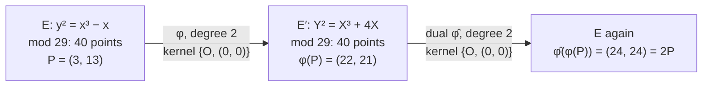

# Isogenies: maps between elliptic curves that respect addition, and the dual that undoes them up to a multiple

[Syllabus](../../../SYLLABUS.md) → [Algebraic geometry](../README.md) → [Elliptic Curves](../README.md#s04) → Isogenies

---

## General Overview

Take two curves. The first is $`y^2 = x^3 - x`$, called E. The second is $`Y^2 = X^3 + 4X`$, called E′ ("E prime"). Work mod 29, where both have exactly 40 points, the zero point O included ([The curve mod p](05-reduction-mod-p-and-hasse.md)). The point P = (3, 13) lies on E, since 13² = 169 leaves 24 mod 29, and so does 3³ − 3 = 24.

One formula carries E onto E′:

- $`\varphi(x, y) = \bigl(y^2/x^2,\ -y(x^2 + 1)/x^2\bigr)`$ sends P to (22, 21), a point of E′.
- It respects addition: φ(P + Q) = φ(P) + φ(Q) for every pair of points. The code checks every pair mod 5, 13, 17 and 29.
- It is two-to-one. It sends exactly two points to O: O itself and (0, 0), where the bottom x² is zero.

A second formula, the **dual** $`\hat\varphi`$ ("phi hat"), carries E′ back to E. It does not return P. It returns (24, 24), which is 2P, the point P added to itself. Going there and back doubles every point. The dual undoes φ up to a multiple, and the multiple is 2, the number of points φ sends to O.

Such a map is an **isogeny**. It explains why the two curves have the same count at every good prime: 8 points each mod 5 and mod 13, 16 mod 17, 40 mod 29. It also supplies the two facts that [The curve mod p](05-reduction-mod-p-and-hasse.md) borrowed to prove Hasse's bound. This card proves them.

**An isogeny is a map of elliptic curves, given by fractions of polynomials, that sends O to O; it then respects addition, its degree counts how many points land on each image point, and a dual isogeny comes back so that the round trip is multiplication by that degree.**

**What kind of fact this is:** theorems. The example's map, its dual and the round trip [2] are proved on this card by exact substitution; deg [m] = m² and the structure of $`E[m]`$ are proved in Why it works. Vélu's formula in general, the existence of every dual, and the rule that the dual of a sum is the sum of the duals are stated with sources and their proofs outlined. Hasse's bound is then proved from those facts.

### The picture: there and back



Each arrow is two-to-one: φ sends the 40 points of E mod 29 onto 20 points of E′. The round trip is doubling, [2], not the identity.

---

## The formula

Notation first, in words. This card introduces six names.

- An **isogeny** $`\varphi : E \to E'`$ is a map given by fractions of polynomials that sends O to O and is not constant. Its **kernel** $`\ker\varphi`$ is the set of points sent to O.
- $`[m]`$ is multiplication by a whole number m: P goes to mP. It is an isogeny from E to itself.
- $`E[m]`$ is the **m-torsion**: the points P with mP = O, counted over the **algebraic closure**, the field that holds a root of every polynomial ([Splitting fields](../../21-Algebraic%20and%20analytic%20number%20theory/05-Fields%20and%20Galois%20Theory/03-splitting-fields-and-algebraic-closure.md)).
- The **degree** $`\deg\varphi`$: write the x-coordinate of φ(x, y) as one fraction r(x) in lowest terms, with no factor shared by top and bottom. The degree is the larger of the two degrees, top or bottom.
- φ is **separable** when r(x) is not a function of $`x^p`$, where p is the field's characteristic (the prime with p = 0 in the field). Over the rationals every isogeny is separable.
- The **dual** $`\hat\varphi : E' \to E`$ is the isogeny defined by the first line below.

The card's map, and the dual the card builds for it, are

```math
\varphi(x, y) = \Bigl(\frac{y^2}{x^2},\ -\frac{y\,(x^2 + 1)}{x^2}\Bigr), \qquad \hat\varphi(X, Y) = \Bigl(\frac{Y^2}{4X^2},\ \frac{Y\,(4 - X^2)}{8X^2}\Bigr)
```

**Read it aloud:** phi sends (x, y) to y squared over x squared, and minus y times x squared plus one, over x squared; phi hat sends (X, Y) to Y squared over four X squared, and Y times four minus X squared, over eight X squared.

**Vélu's formula** (Jacques Vélu, 1971) builds the isogeny for a given kernel. For a kernel {O, T} with T = (t, 0) on $`y^2 = x^3 + ax + b`$:

```math
v = 3t^2 + a, \quad w = t\,v, \qquad E' : Y^2 = X^3 + (a - 5v)X + (b - 7w), \qquad X = x + \frac{v}{x - t}, \quad Y = y - \frac{v\,y}{(x - t)^2}
```

**Read it aloud:** from the kernel point compute v and w; the target curve has its coefficients shifted by five v and seven w; the new x adds v over x minus t, and the new y subtracts v y over x minus t squared.

The three facts the card proves are

```math
\hat\varphi \circ \varphi = [\deg\varphi], \qquad \deg\,[m] = m^2, \qquad E[m] \cong \mathbb{Z}/m \times \mathbb{Z}/m \ \text{ when the characteristic does not divide } m
```

**Read it aloud:** phi hat after phi is multiplication by the degree of phi; multiplication by m has degree m squared; and the points killed by m form a grid of m by m, as long as m is not a multiple of the characteristic.

From these, Step 6 shows that the degree of m − nπ, with π the Frobenius map, is $`m^2 - a_p mn + p n^2`$. It is never negative, and that is Hasse's bound $`a_p^2 \le 4p`$.

Here $`\mathbb{Z}/m`$ is the whole numbers mod m under addition ([Torsion points](04-torsion-and-nagell-lutz.md)), and $`\cong`$ means "has the same structure as".

| Symbol | Plain meaning | In our example | Push it up and the answer… |
| --- | --- | --- | --- |
| $`E`$, $`E'`$ | the source and target curves | $`y^2 = x^3 - x`$; $`Y^2 = X^3 + 4X`$ | — |
| $`\varphi`$, $`\hat\varphi`$ | the isogeny and its dual | P = (3, 13) goes to (22, 21), then to (24, 24) mod 29 | — |
| $`\ker\varphi`$ | the points φ sends to O | {O, (0, 0)} | a bigger kernel means a bigger degree |
| $`\deg\varphi`$, $`r(x)`$ | the degree; the x-part of φ as one fraction | 2; $`(x^2 - 1)/x`$ | each image point has more points above it |
| $`[m]`$, $`E[m]`$; $`\mathbb{Z}/m`$ | multiplication by m; the points it sends to O; a cycle of m steps | [2]; E[3] has 9 points | $`m^2`$ of them, so they grow fast |
| $`T = (t, 0)`$, $`v`$, $`w`$ | Vélu's kernel point and his two numbers | t = 0; v = −1, w = 0 | — |
| $`a`$, $`b`$; $`x`$, $`y`$; $`X`$, $`Y`$ | the coefficients of $`y^2 = x^3 + ax + b`$; coordinates on E; coordinates on E′ | a = −1, b = 0; (3, 13); (22, 21) | — |
| $`\pi`$, $`\pi'`$ | the Frobenius map $`(x, y) \mapsto (x^p, y^p)`$ on E, and on E′; π, not 3.14159; [The curve mod p](05-reduction-mod-p-and-hasse.md) called it φ | p = 5 | degree p |
| $`p`$, $`\mathbb{F}_p`$, $`\#E(\mathbb{F}_p)`$ | a prime; the field of remainders mod p; the number of points there, O included | 29; 40 points | the count grows about like p + 1 |
| $`a_p`$ | the trace of Frobenius, $`p + 1 - \#E(\mathbb{F}_p)`$ | $`a_5 = -2`$ | — |
| $`m`$, $`n`$, $`d`$, $`\ell`$, $`k`$, $`n_i`$; $`\psi_m`$ | whole numbers; a divisor of m or a degree; a prime; a number of cycles and their lengths; the m-th division polynomial | m = 2 to 5 for [m] | — |
| $`\langle\alpha, \beta\rangle`$ | the pairing $`\deg(\alpha + \beta) - \deg\alpha - \deg\beta`$ of two isogenies α and β | $`\langle 1, -\pi\rangle = -a_5 = 2`$ | — |

### When it holds

- **The map must send O to O.** A translation, P going to P + T with T ≠ O, does not, and it breaks addition: O + O goes to T, but the images of O and O add to T + T.
- **Separable, for "kernel size = degree".** Frobenius π has degree p but kernel {O}. Kernel size equals degree only for a separable isogeny.
- **The characteristic must not divide m.** Mod 3, [3] has degree 9 but is not separable. Over the 9-element field the curve has 16 points, none of order 3.
- **Count over the algebraic closure.** Mod 5 only O satisfies 3P = O. Mod 61 all nine points of $`E[3]`$ appear.
- **A kernel the field can see.** Vélu's map has coefficients in the field when the kernel, as a set, is fixed by the field's symmetries. Here (0, 0) is rational, so φ has whole-number coefficients and works mod every odd prime.

---

## Why it works

### Step 0: a map that keeps O keeps addition

The surprise is that respecting addition comes free. A map of curves that sends O to O automatically satisfies φ(P + Q) = φ(P) + φ(Q) (Silverman, Sources, Chapter III). The reason is rigid geometry, not algebra. The group law is fixed by the rule that three points on a line add to zero, and that rule is about divisors, the bookkeeping of zeros and poles from [Divisors and Riemann-Roch](../03-Plane%20Curves/07-divisors-and-riemann-roch.md). A map of curves carries that bookkeeping across.

So an isogeny is a homomorphism of groups, a map that respects the operation ([Homomorphisms and isomorphisms](../../03-Algebra/08-Groups/05-homomorphisms-and-isomorphisms.md)). Everything below follows from that, plus one number, the degree.

### Step 1: Vélu's formula gives the example

Take E: $`y^2 = x^3 - x`$, so a = −1 and b = 0, with the kernel point T = (0, 0).

1. Vélu's numbers: v = 3 · 0² − 1 = −1, and w = 0 · v = 0.
2. The target: $`Y^2 = X^3 + (-1 + 5)X + 0 = X^3 + 4X`$. That is E′.
3. The map: X = x − 1/x = (x² − 1)/x, and Y = y + y/x² = y(x² + 1)/x².

Since y² = x³ − x = x(x² − 1), the X here equals y²/x². So Vélu's map is the card's φ with the sign of Y flipped. Flipping that sign is P going to −P on E′, itself an isogeny. So φ is Vélu's map followed by negation: the same kernel, the same degree.

Does φ land on E′? Square its Y: $`y^2(x^2 + 1)^2/x^4 = (x^2 - 1)(x^2 + 1)^2/x^3`$. And $`X^3 + 4X = X(X^2 + 4)`$, where $`X^2 + 4 = (x^2 + 1)^2/x^2`$, gives the same. The code checks it point by point at all four primes, and checks φ = −(Vélu's map) at every point.

### Step 2: kernel and degree

The kernel: φ fails only where its bottom x² is zero, at (0, 0), and that point goes to O. So the kernel is {O, (0, 0)}.

The degree: r(x) = (x² − 1)/x has top degree 2 and bottom degree 1, with no shared factor. So deg φ = 2. Above a value X sit the two roots x of x² − Xx − 1 = 0, and φ's Y then picks one y for each.

Why the kernel size equals the degree, for a separable isogeny:

1. φ is a homomorphism, so φ(P) = φ(Q) exactly when P − Q is in the kernel. Every image point has the same number of points above it: #ker φ.
2. For a separable map of degree d, a typical image point has d distinct points above it (Silverman, Chapter III).
3. So #ker φ = deg φ.

Mod 29 that reads 40 points of E, landing on 20 points of E′, two above each.

### Step 3: the dual, built and checked

Apply Vélu again, now to E′ with a = 4 and the kernel point (0, 0). Then v = 4, w = 0, and the target is $`Y^2 = X^3 + (4 - 20)X = X^3 - 16X`$. That curve is E in disguise: put x = X/4 and y = Y/8, and $`64y^2 = 64x^3 - 64x`$. Vélu's map followed by that rescaling, and a sign, is the $`\hat\varphi`$ of The formula.

Now compose. The x-part of $`\hat\varphi`$ is $`(X^2 + 4)/(4X)`$. Put X = (x² − 1)/x:

```math
\frac{(x^2 - 1)^2 + 4x^2}{4x\,(x^2 - 1)} = \frac{(x^2 + 1)^2}{4(x^3 - x)} = \frac{x^4 + 2x^2 + 1}{4x^3 - 4x}
```

The tangent rule from [Adding points by formula](03-point-arithmetic-and-double-and-add.md) gives x(2P) = m² − 2x with slope m = (3x² − 1)/(2y). Clearing the bottom gives the same fraction, $`(x^4 + 2x^2 + 1)/(4x^3 - 4x)`$. The code multiplies out both and finds them equal as polynomials, and checks $`\hat\varphi(\varphi(P)) = 2P`$ and $`\varphi(\hat\varphi(Q)) = 2Q`$ at every point mod 5, 13, 17 and 29.

The general theorem (Silverman, Chapter III): every isogeny φ of degree d has exactly one dual, with $`\hat\varphi \circ \varphi = [d]`$ and $`\varphi \circ \hat\varphi = [d]`$. The proof's idea: ker φ has d points (for separable φ), so by Lagrange's theorem each has order dividing d ([Cosets and Lagrange's theorem](../../03-Algebra/08-Groups/04-cosets-and-lagranges-theorem.md)). So [d] kills ker φ, and a map that kills ker φ is "φ first, then something". That something is $`\hat\varphi`$.

The same source proves three more facts: the dual has the same degree, the dual of [m] is [m], and the dual of a sum is the sum of the duals, $`\widehat{\alpha + \beta} = \hat\alpha + \hat\beta`$. The last is the deep one; its proof goes through divisors.

### Step 4: deg [m] = m²

The x-coordinate of mP has a closed form from the division polynomials $`\psi_m`$ of [Torsion points](04-torsion-and-nagell-lutz.md):

```math
x(mP) = x - \frac{\psi_{m-1}\,\psi_{m+1}}{\psi_m^2} = \frac{x^{m^2} + \cdots}{m^2\,x^{m^2 - 1} + \cdots}
```

The leading terms follow by induction from the recursion that defines $`\psi_m`$: once $`y^2`$ is replaced by $`x^3 + ax + b`$, the square $`\psi_m^2`$ starts with $`m^2 x^{m^2 - 1}`$. Top and bottom share no factor (Washington, Sources), so the fraction is in lowest terms and deg [m] = m².

The code builds the fractions for m = 2 to 5: top degrees 4, 9, 16, 25 with leading coefficient 1, bottoms one degree lower with leading coefficient m², and no shared factor by Euclid's algorithm mod 10,007. It also matches each fraction, at a point mod 61, against mP from chord and tangent.

The house curve shows the same thing at m = 2. For $`y^2 = x^3 - 2`$ the code gives $`x(2P) = (x^4 + 16x)/(4x^3 - 8)`$, degree 4. At x = 3 it reads 129/100, the x of 2P for the house point (3, 5) ([The group law](01-elliptic-curves-and-the-group-law.md)).

The dual gives a one-line second proof. [m] is its own dual, so $`[m] \circ [m] = [\deg [m]]`$. The left side is $`[m^2]`$, so deg [m] = m².

### Step 5: the m-torsion is an m-by-m grid

Suppose the characteristic does not divide m. Then [m] is separable. The reason: the curve carries a standard differential, dx/(2y), a measure of small steps along it, and [m] multiplies it by m, which is not zero in the field (Silverman, Chapter III). By Step 2, $`\#E[m] = \deg [m] = m^2`$.

The same holds for every divisor d of m: exactly d² points with dP = O. That pins down the group. A finite commutative group, one where P + Q = Q + P, is a product of cycles $`\mathbb{Z}/n_1 \times \cdots \times \mathbb{Z}/n_k`$, each length $`n_i`$ larger than 1 and dividing the next. That form follows from two facts on [Direct products](../../03-Algebra/08-Groups/07-direct-products.md): every such group is a product of cycles (stated there), and cycles whose lengths share no factor make one cycle (proved there). Split each cycle into cycles of prime-power length, then merge the longest one for each prime into a single cycle, the next longest into another, and so on; each new length divides the one before.

<details>
<summary>Detailed proof: d² points for each divisor d force two cycles of length m</summary>

Write $`E[m] \cong \mathbb{Z}/n_1 \times \cdots \times \mathbb{Z}/n_k`$ with each $`n_i > 1`$ dividing the next. Every point is killed by m, so every $`n_i`$ divides m.

Pick a prime ℓ dividing $`n_1`$. It divides every $`n_i`$, since each is a multiple of $`n_1`$. A cycle whose length is a multiple of ℓ holds exactly ℓ points killed by ℓ, so the product holds $`\ell^k`$ of them. That count must be ℓ², so k = 2.

Now $`n_1 n_2 = m^2`$, with both lengths at most m. So $`n_1 = n_2 = m`$, and the group is $`\mathbb{Z}/m \times \mathbb{Z}/m`$.

</details>

The code sees this in finite fields big enough to hold all the points:

- **Mod 61:** 9 points with 3P = O: O and 8 points of order 3. That is $`\mathbb{Z}/3 \times \mathbb{Z}/3`$; a cycle of 9 would need a point of order 9.
- **Mod 17:** 16 points with 4P = O: O, 3 of order 2 and 12 of order 4. That is $`\mathbb{Z}/4 \times \mathbb{Z}/4`$. A cycle of 16 has one point of order 2, and $`\mathbb{Z}/2 \times \mathbb{Z}/8`$ has points of order 8.

When the characteristic divides m, it fails. Mod 3, this curve has 16 points over the 9-element field, a count not divisible by 3, so no point there has order 3. In fact $`E[3]`$ is O alone over every field of characteristic 3: the curve is **supersingular** at 3, meaning it has no point of order 3 over any such field (Silverman, Chapter V).

### Step 6: Hasse's bound, finished

[The curve mod p](05-reduction-mod-p-and-hasse.md) proved Hasse's bound from two borrowed facts. Here they are proved from the dual.

**Fact 1: deg(1 − π) = #E(𝔽_p).** The Frobenius map π fixes exactly the points with coordinates in $`\mathbb{F}_p`$, so the kernel of 1 − π is $`E(\mathbb{F}_p)`$. The map 1 − π is separable: π turns the standard differential of Step 5 into 0, since $`d(x^p) = p\,x^{p-1}\,dx`$ and p = 0 in the field, so 1 − π leaves it unchanged, which is not 0. By Step 2 its degree is its kernel size.

**Fact 2: the degree is a quadratic form.** Define the pairing $`\langle\alpha, \beta\rangle = \deg(\alpha + \beta) - \deg\alpha - \deg\beta`$. Since $`\hat\alpha\alpha = [\deg\alpha]`$,

```math
[\langle\alpha, \beta\rangle] = \widehat{(\alpha + \beta)}(\alpha + \beta) - \hat\alpha\alpha - \hat\beta\beta = \hat\alpha\beta + \hat\beta\alpha
```

The dual of a sum is the sum of the duals, so the right side is additive in α and in β. So the pairing is bilinear: it splits over sums in each slot. Then

```math
\deg(m - n\pi) = m^2 \deg 1 + n^2 \deg\pi - mn\,\langle 1, \pi\rangle = m^2 - a_p\,mn + p\,n^2
```

**Read it aloud:** the degree of m minus n pi is m squared times one, plus n squared times p, minus m n times the pairing of one and pi, which is the trace.

The pairing value comes from m = n = 1: $`\deg(1 - \pi) = 1 + p - \langle 1, \pi\rangle`$. By Fact 1 the left side is $`\#E(\mathbb{F}_p) = p + 1 - a_p`$, so $`\langle 1, \pi\rangle = a_p`$.

A degree is never negative, so this quadratic is never negative for whole m and n. Then its discriminant is at most zero (the fold on [The curve mod p](05-reduction-mod-p-and-hasse.md) passes from whole numbers to all reals), and $`a_p^2 - 4p \le 0`$.

At p = 5: the curve has 8 points, so $`a_5 = 6 - 8 = -2`$, and the discriminant is $`4 - 20 = -16`$.

A second road checks the quadratic. Degrees multiply under composition, and $`1 - \pi^2 = (1 - \pi)(1 + \pi)`$. The kernel of $`1 - \pi^2`$ is the set of points over the 25-element field. Its count should be $`\deg(1 - \pi)\deg(1 + \pi) = 8 \times 4 = 32`$, where deg(1 + π) is the quadratic at m = 1, n = −1: 1 − 2 + 5 = 4. The code counts all 625 pairs over that field and finds 32.

### Step 7: isogenous curves have equal counts

φ has whole-number coefficients, so raising to the power p commutes with it: $`\varphi \circ \pi = \pi' \circ \varphi`$, where π′ is Frobenius on E′. Subtract from φ:

```math
\varphi \circ (1 - \pi) = (1 - \pi') \circ \varphi
```

Take degrees, which multiply: $`2 \deg(1 - \pi) = 2 \deg(1 - \pi')`$. By Fact 1, E and E′ have the same number of points mod p. That is 8, 8, 16 and 40 at p = 5, 13, 17 and 29. The converse is Tate's theorem (Sources): two curves with the same count over $`\mathbb{F}_p`$ are isogenous over $`\mathbb{F}_p`$.

---

## Worked numbers, by hand

The point P = (3, 13) on E, mod 29.

| Step | Arithmetic | Value |
| --- | --- | --- |
| P is on E | 13² = 169 = 5 × 29 + 24; 3³ − 3 = 24 | yes |
| 1/x², with x² = 9 | 9 × 13 = 117 = 4 × 29 + 1 | 1/9 = 13 |
| X = y²/x² | 24 × 13 = 312 = 10 × 29 + 22 | 22 |
| Y = −y(x² + 1)/x² | −13 × 10 = −130; −130 × 13 | 21 |
| φ(P) on E′ | 21² = 441 leaves 6; 22³ + 4 × 22 = 10736 leaves 6 | yes |
| dual's x = Y²/(4X²) | Y² leaves 6; 4X² = 1936 leaves 22; 1/22 = 4, as 22 × 4 = 88 = 3 × 29 + 1 | 6 × 4 = 24 |
| dual's point | the y by the same steps, in the code | (24, 24) |
| 2P directly | slope (3 × 9 − 1)/(2 × 13) = 26/26 = 1; x = 1 − 6 = −5 | **(24, 24)** |

Going to E′ and back with the dual lands on 2P, as $`\hat\varphi \circ \varphi = [2]`$ says.

### What breaks if you drop a piece

| Mistake | Comes out at | What went wrong |
| --- | --- | --- |
| Read the dual as an inverse | φ̂(φ(3, 13)) = (24, 24), not (3, 13) | the dual undoes φ only up to [2]: φ is two-to-one, so nothing can undo it |
| Add degrees: deg(1 − π) = deg 1 + deg π | 1 + 5 = 6 at p = 5; the true count is 8 | the degree is quadratic; the cross term $`-\langle 1, \pi\rangle = -a_5 = 2`$ is missing |
| Count E[3] in a small field | 1 point with 3P = O mod 5, not 9 | the 9 points live over the algebraic closure; mod 61 they all appear |
| Let the characteristic divide m | mod 3, 16 points over 𝔽₉ and none of order 3, yet deg [3] = 9 | [3] is not separable in characteristic 3: mod 3 its x-part is $`x^9`$, a function of $`x^3`$, so kernel size and degree part ways |

The code prints all four.

---

## Code, from first principles, and it actually runs

The program checks every claim exactly, mod small primes and with whole-number polynomials, by four independent roads: Vélu's formula against the given φ at every point; the round trip $`\hat\varphi\varphi`$ against chord-and-tangent doubling, point by point and as an identity of fractions; the degree of [m] from division polynomials against counts of m-torsion mod 61 and mod 17; and Hasse's quadratic form at p = 5 against a count of all 625 pairs over the 25-element field.

### Python

```python
# Isogenies and the dual isogeny -- the check behind the card.  Nothing is imported.
# E is y^2 = x^3 - x, E2 is Y^2 = X^3 + 4X, phi(x, y) = (y^2/x^2, -y(x^2 + 1)/x^2).  Roads: Velu's
# formula against phi; dual(phi) against doubling, point by point and as fractions; deg[m] from
# division polynomials against m-torsion counts; Hasse's form against a brute-force count over F_25.
def ecadd(P, Q, a, p):                       # chord and tangent mod p; None is O
    if P is None or Q is None:
        return Q if P is None else P
    (x1, y1), (x2, y2) = P, Q
    if x1 == x2 and (y1 + y2) % p == 0:
        return None
    m = ((3 * x1 * x1 + a) * pow(2 * y1, p - 2, p) if P == Q else (y2 - y1) * pow(x2 - x1, p - 2, p)) % p
    x3 = (m * m - x1 - x2) % p
    return (x3, (m * (x1 - x3) - y1) % p)

def mult(n, P, a, p):                        # P added to itself n times
    return None if n == 0 else ecadd(mult(n - 1, P, a, p), P, a, p)

def points(a, p):                            # every pair (x, y) on y^2 = x^3 + ax, O left out
    return [(x, y) for x in range(p) for y in range(p) if (y * y - x ** 3 - a * x) % p == 0]

def phi(P, p):                               # E -> E2; (0, 0) goes to O
    return None if P is None or P[0] == 0 else (P[1] ** 2 * pow(P[0] ** 2, p - 2, p) % p,
                                                 -P[1] * (P[0] ** 2 + 1) * pow(P[0] ** 2, p - 2, p) % p)

def dual(Q, p):                              # E2 -> E; (0, 0) goes to O
    return None if Q is None or Q[0] == 0 else (2 * Q[1] ** 2 * pow(8 * Q[0] ** 2, p - 2, p) % p,
                                                 Q[1] * (4 - Q[0] ** 2) * pow(8 * Q[0] ** 2, p - 2, p) % p)

def velu(P, p):                              # Velu's map for the kernel {O, (0, 0)}
    return None if P is None or P[0] == 0 else ((P[0] - pow(P[0], p - 2, p)) % p,
                                                 (P[1] + P[1] * pow(P[0] ** 2, p - 2, p)) % p)

def pmul(f, g):                              # polynomials: lists, constant first
    return [sum(f[i] * g[k - i] for i in range(len(f)) if 0 <= k - i < len(g)) for k in range(len(f) + len(g) - 1)]

def psub(f, g):
    out = [(f[i] if i < len(f) else 0) - (g[i] if i < len(g) else 0) for i in range(max(len(f), len(g)))]
    while len(out) > 1 and out[-1] == 0:
        out.pop()
    return out

def gcd_deg(f, g, p):                        # degree of gcd(f, g) mod p, by Euclid
    f, g = [c % p for c in f], [c % p for c in g]
    while any(g):                            # leading terms stay nonzero mod p
        while len(f) >= len(g) and any(f):
            c, s = f[-1] * pow(g[-1], p - 2, p) % p, len(f) - len(g)
            f = [(f[i] - c * (g[i - s] if i >= s else 0)) % p for i in range(len(f))]
            while f and f[-1] == 0:
                f.pop()
        f, g = g, f
    return len(f) - 1

def xmult(m, a, b):                          # x([m]P) = top / bottom, by division polynomials
    F, g = [b, a, 0, 1], {0: [0], 1: [1], 2: [2], 3: [-a * a, 12 * b, 6 * a, 0, 3],
                          4: [4 * c for c in [-8 * b * b - a ** 3, -4 * a * b, -5 * a * a, 20 * b, 5 * a, 0, 1]]}
    for n in range(5, m + 2):                # psi_n = g_n for odd n, y * g_n for even n
        k, F2 = n // 2, pmul(F, F)
        if n % 2:
            s1, s2 = (F2, [1]) if k % 2 == 0 else ([1], F2)
            g[n] = psub(pmul(s1, pmul(g[k + 2], pmul(g[k], pmul(g[k], g[k])))),
                        pmul(s2, pmul(g[k - 1], pmul(g[k + 1], pmul(g[k + 1], g[k + 1])))))
        else:
            t = psub(pmul(g[k + 2], pmul(g[k - 1], g[k - 1])), pmul(g[k - 2], pmul(g[k + 1], g[k + 1])))
            g[n] = [c // 2 for c in pmul(g[k], t)]
    sq = pmul(g[m], g[m])
    if m % 2:
        return psub(pmul([0, 1], sq), pmul(F, pmul(g[m - 1], g[m + 1]))), sq
    return psub(pmul([0, 1], pmul(F, sq)), pmul(g[m - 1], g[m + 1])), pmul(F, sq)

def show(f):                                 # leading term first: x^4 + 2x^2 + 1
    out = ""
    for i in range(len(f) - 1, -1, -1):
        if f[i]:
            term = ("" if abs(f[i]) == 1 and i else str(abs(f[i]))) + ("" if i == 0 else "x" if i == 1 else f"x^{i}")
            out += (("-" if f[i] < 0 else "") if not out else (" - " if f[i] < 0 else " + ")) + term
    return out

def count2(p, r):                            # y^2 = x^3 - x over F_(p^2) = c + d*s, s^2 = r
    mul = lambda u, w: ((u[0] * w[0] + r * u[1] * w[1]) % p, (u[0] * w[1] + u[1] * w[0]) % p)
    F = [(c, d) for c in range(p) for d in range(p)]
    rhs = {x: tuple((mul(x, mul(x, x))[i] - x[i]) % p for i in range(2)) for x in F}
    return 1 + sum(1 for x in F for y in F if mul(y, y) == rhs[x])

v = 3 * 0 * 0 - 1                            # Velu at T = (0, 0) on y^2 = x^3 - x: v = 3x_T^2 + a, w = x_T v
print(f"Velu: v = {v}, w = {0 * v}; target Y^2 = X^3 + {-1 - 5 * v}X + {0 - 7 * 0 * v}")
counts = []
for p in [5, 13, 17, 29]:
    E, E2 = points(-1, p), points(4, p)
    homo = all(phi(ecadd(P, Q, -1, p), p) == ecadd(phi(P, p), phi(Q, p), 4, p) for P in E for Q in E)
    back = all(dual(phi(P, p), p) == mult(2, P, -1, p) for P in E)
    fwd = all(phi(dual(Q, p), p) == mult(2, Q, 4, p) for Q in E2)
    neg = all(phi(P, p) == (V and (V[0], -V[1] % p)) for P in E for V in [velu(P, p)])
    assert homo and back and fwd and neg and [P for P in E if phi(P, p) is None] == [(0, 0)] and len(E) == len(E2)
    counts.append(len(E) + 1)
    print(f"F_{p}: #E = {len(E) + 1}, #E2 = {len(E2) + 1}, kernel {{O, (0, 0)}}, image {len({phi(P, p) for P in E})}"
          f" points, adds: yes, dual(phi) = [2]: yes, phi = -Velu: yes")
assert counts == [8, 8, 16, 40]
P, R = (3, 13), dual(phi((3, 13), 29), 29)
print(f"F_29: P = {P}, phi(P) = {phi(P, 29)}, dual(phi(P)) = {R}, 2P = {mult(2, P, -1, 29)}; equals P: {['no', 'yes'][R == P]}")
print(f"by hand mod 29: 13^2 = {13 * 13} -> {13 * 13 % 29}, 3^3 - 3 = {27 - 3}; 9 x 13 = {9 * 13} -> {9 * 13 % 29}, so 1/9 = {pow(9, 27, 29)};"
      f" X = 24 x 13 = {24 * 13} -> {24 * 13 % 29}; Y = -13 x {9 + 1} = {-130}, x 13 -> {-130 * 13 % 29}; 21^2 = {21 * 21} -> {21 * 21 % 29}\n"
      f"by hand mod 29: 22^3 + 4 x 22 = {22 ** 3 + 88} -> {(22 ** 3 + 88) % 29}; 4X^2 = {4 * 22 * 22} -> {4 * 22 * 22 % 29}; 22 x 4 = {88} -> {88 % 29}, so"
      f" 1/22 = {pow(22, 27, 29)}; x = 6 x 4 = {6 * 4 % 29}; 2P: slope {3 * 9 - 1}/{2 * 13} = 1, x = 1 - {2 * 3} = {1 - 6} -> {-5 % 29}")
top, bot = xmult(2, -1, 0)                   # dual after phi, as exact fractions in x
ltop, lbot = psub(pmul([-1, 0, 1], [-1, 0, 1]), [0, 0, -4]), [4 * c for c in pmul([0, 1], [-1, 0, 1])]
assert pmul(ltop, bot) == pmul(top, lbot)
print(f"x(dual(phi(P))) = ({show(ltop)}) / ({show(lbot)}); x(2P) = ({show(top)}) / ({show(bot)})")
for m in [2, 3, 4, 5]:
    top, bot = xmult(m, -1, 0)
    d = max(len(top), len(bot)) - 1
    ev = lambda h, x: sum(c * x ** i for i, c in enumerate(h)) % 61     # a point mod 61, by chord and tangent
    Q = next(Q for Q in points(-1, 61) if ev(bot, Q[0]) and None not in (mult(m - 1, Q, -1, 61), mult(m + 1, Q, -1, 61)))
    assert d == m * m and gcd_deg(top, bot, 10007) == 0 and ev(top, Q[0]) * pow(ev(bot, Q[0]), 59, 61) % 61 == mult(m, Q, -1, 61)[0]
    print(f"[{m}]: top degree {len(top) - 1}, lead {top[-1]}; bottom degree {len(bot) - 1}, lead {bot[-1]};"
          f" coprime: yes; deg = {d}")
top, bot = xmult(2, 0, -2)                   # house point (3, 5): tangent slope 27/10, x(2P) = 27^2/10^2 - 6
t3, b3 = (sum(c * 3 ** i for i, c in enumerate(h)) for h in (top, bot))
assert t3 * 100 == b3 * (27 * 27 - 6 * 100)
print(f"house curve y^2 = x^3 - 2: x(2P) = ({show(top)}) / ({show(bot)}); at x = 3: {t3}/{b3}")
for m, p in [(3, 61), (4, 17), (3, 5)]:
    tors = [P for P in points(-1, p) if mult(m, P, -1, p) is None]
    orders = [1] + [min(n for n in range(1, m + 1) if mult(n, P, -1, p) is None) for P in tors]
    assert len(orders) == (m * m if p != 5 else 1)
    print(f"points P of E(F_{p}) with {m}P = O: {len(orders)}; by order " + ", ".join(
        f"{n}: {orders.count(n)}" for n in range(1, m + 1) if orders.count(n)))
n9, (t9, b9) = count2(3, 2), ([c % 3 for c in h] for h in xmult(3, -1, 0))   # F_9: s^2 = 2 = -1; x(3P) mod 3
assert n9 == 16 and t9[-1] and b9[0] and not any(b9[1:])  # mod 3 the bottom is a constant: lowest terms
print(f"char 3: #E(F_9) = {n9}, not divisible by 3, so its only point with 3P = O is O; x(3P) mod 3 = ({show(t9)}) / ({show(b9)}), deg[3] = {len(t9) - 1}")
p, a5, n25 = 5, 5 + 1 - counts[0], count2(5, 2)     # Hasse at p = 5; F_25 with s^2 = 2
form = lambda m, n: m * m - a5 * m * n + p * n * n
assert n25 == form(1, 1) * form(1, -1)
assert all(form(m, n) >= 0 for m in range(-9, 10) for n in range(-9, 10))
print(f"p = 5: a_5 = {a5}; deg(1 - pi) = #E(F_5) = {form(1, 1)}; additive guess deg 1 + deg pi = {1 + p}")
print(f"deg(m - n pi) = m^2 - ({a5})mn + 5n^2 >= 0 on -9..9; discriminant a_5^2 - 4p = {a5 * a5 - 4 * p}")
print(f"#E(F_25) by brute force {n25}; deg(1 - pi) deg(1 + pi) = {form(1, 1)} x {form(1, -1)} = {form(1, 1) * form(1, -1)}")
assert all((q + 1 - (len(points(-1, q)) + 1)) ** 2 <= 4 * q for q in [5, 7, 11, 13, 17, 19, 23, 29, 31, 37, 41, 43, 47])
print("Hasse a_p^2 <= 4p at every prime from 5 to 47: yes")
print("ALL CHECKS PASS")
```

**Ran 2026-11-24 on macOS, Python 3.14.10, standard library only. All checks passed. Output, pasted from the run:**

```
Velu: v = -1, w = 0; target Y^2 = X^3 + 4X + 0
F_5: #E = 8, #E2 = 8, kernel {O, (0, 0)}, image 4 points, adds: yes, dual(phi) = [2]: yes, phi = -Velu: yes
F_13: #E = 8, #E2 = 8, kernel {O, (0, 0)}, image 4 points, adds: yes, dual(phi) = [2]: yes, phi = -Velu: yes
F_17: #E = 16, #E2 = 16, kernel {O, (0, 0)}, image 8 points, adds: yes, dual(phi) = [2]: yes, phi = -Velu: yes
F_29: #E = 40, #E2 = 40, kernel {O, (0, 0)}, image 20 points, adds: yes, dual(phi) = [2]: yes, phi = -Velu: yes
F_29: P = (3, 13), phi(P) = (22, 21), dual(phi(P)) = (24, 24), 2P = (24, 24); equals P: no
by hand mod 29: 13^2 = 169 -> 24, 3^3 - 3 = 24; 9 x 13 = 117 -> 1, so 1/9 = 13; X = 24 x 13 = 312 -> 22; Y = -13 x 10 = -130, x 13 -> 21; 21^2 = 441 -> 6
by hand mod 29: 22^3 + 4 x 22 = 10736 -> 6; 4X^2 = 1936 -> 22; 22 x 4 = 88 -> 1, so 1/22 = 4; x = 6 x 4 = 24; 2P: slope 26/26 = 1, x = 1 - 6 = -5 -> 24
x(dual(phi(P))) = (x^4 + 2x^2 + 1) / (4x^3 - 4x); x(2P) = (x^4 + 2x^2 + 1) / (4x^3 - 4x)
[2]: top degree 4, lead 1; bottom degree 3, lead 4; coprime: yes; deg = 4
[3]: top degree 9, lead 1; bottom degree 8, lead 9; coprime: yes; deg = 9
[4]: top degree 16, lead 1; bottom degree 15, lead 16; coprime: yes; deg = 16
[5]: top degree 25, lead 1; bottom degree 24, lead 25; coprime: yes; deg = 25
house curve y^2 = x^3 - 2: x(2P) = (x^4 + 16x) / (4x^3 - 8); at x = 3: 129/100
points P of E(F_61) with 3P = O: 9; by order 1: 1, 3: 8
points P of E(F_17) with 4P = O: 16; by order 1: 1, 2: 3, 4: 12
points P of E(F_5) with 3P = O: 1; by order 1: 1
char 3: #E(F_9) = 16, not divisible by 3, so its only point with 3P = O is O; x(3P) mod 3 = (x^9) / (1), deg[3] = 9
p = 5: a_5 = -2; deg(1 - pi) = #E(F_5) = 8; additive guess deg 1 + deg pi = 6
deg(m - n pi) = m^2 - (-2)mn + 5n^2 >= 0 on -9..9; discriminant a_5^2 - 4p = -16
#E(F_25) by brute force 32; deg(1 - pi) deg(1 + pi) = 8 x 4 = 32
Hasse a_p^2 <= 4p at every prime from 5 to 47: yes
ALL CHECKS PASS
```

### Rust

```rust
// Isogenies and the dual isogeny -- the check behind the card.  std only; polynomial arithmetic
// uses checked i128, so an overflow stops the run.  E is y^2 = x^3 - x, E2 is Y^2 = X^3 + 4X,
// phi(x, y) = (y^2/x^2, -y(x^2 + 1)/x^2).  Roads: Velu's formula against phi; dual(phi) against
// doubling, point by point and as fractions; deg[m] from division polynomials against m-torsion
// counts; Hasse's form against a brute-force count over F_25.
type Pt = Option<(i64, i64)>; // None is O
type Poly = Vec<i128>; // constant first

fn md(a: i64, p: i64) -> i64 { a.rem_euclid(p) }
fn pw(a: i64, mut e: i64, p: i64) -> i64 {
    let (mut out, mut b) = (1i64, md(a, p));
    while e > 0 { if e & 1 == 1 { out = out * b % p; } b = b * b % p; e >>= 1; }
    out
}
fn ecadd(a_: Pt, b_: Pt, a: i64, p: i64) -> Pt {
    let ((x1, y1), (x2, y2)) = match (a_, b_) { (None, q) => return q, (q, None) => return q, (Some(u), Some(v)) => (u, v) };
    if x1 == x2 && md(y1 + y2, p) == 0 { return None; }
    let m = if a_ == b_ { md((3 * x1 * x1 + a) * pw(2 * y1, p - 2, p), p) } else { md((y2 - y1) * pw(x2 - x1, p - 2, p), p) };
    let x3 = md(m * m - x1 - x2, p);
    Some((x3, md(m * (x1 - x3) - y1, p)))
}
fn mult(n: i64, p_: Pt, a: i64, p: i64) -> Pt { (0..n).fold(None, |r, _| ecadd(r, p_, a, p)) }
fn points(a: i64, p: i64) -> Vec<(i64, i64)> { // every pair (x, y) on y^2 = x^3 + ax, O left out
    (0..p * p).map(|k| (k / p, k % p)).filter(|&(x, y)| md(y * y - x * x * x - a * x, p) == 0).collect()
}
fn phi(q: Pt, p: i64) -> Pt {
    match q { Some((x, y)) if x != 0 => { let i = pw(x * x, p - 2, p);
        Some((md(y * y % p * i, p), md(-y * md(x * x + 1, p) % p * i, p))) } _ => None }
}
fn dual(q: Pt, p: i64) -> Pt {
    match q { Some((x, y)) if x != 0 => { let i = pw(8 * x * x, p - 2, p);
        Some((md(2 * y * y % p * i, p), md(y * md(4 - x * x, p) % p * i, p))) } _ => None }
}
fn velu(q: Pt, p: i64) -> Pt {
    match q { Some((x, y)) if x != 0 => Some((md(x - pw(x, p - 2, p), p), md(y + y * pw(x * x, p - 2, p), p))), _ => None }
}
fn pmul(f: &Poly, g: &Poly) -> Poly {
    let mut out = vec![0i128; f.len() + g.len() - 1];
    for (i, c) in f.iter().enumerate() { for (j, d) in g.iter().enumerate() {
        out[i + j] = out[i + j].checked_add(c.checked_mul(*d).expect("overflow")).expect("overflow"); } }
    out
}
fn psub(f: &Poly, g: &Poly) -> Poly {
    let n = f.len().max(g.len());
    let mut out: Poly = (0..n).map(|i| f.get(i).unwrap_or(&0).checked_sub(*g.get(i).unwrap_or(&0)).expect("overflow")).collect();
    while out.len() > 1 && *out.last().unwrap() == 0 { out.pop(); }
    out
}
fn gcd_deg(f: &Poly, g: &Poly, p: i128) -> i64 { // degree of gcd(f, g) mod p, by Euclid
    let mut f: Poly = f.iter().map(|c| c.rem_euclid(p)).collect();
    let mut g: Poly = g.iter().map(|c| c.rem_euclid(p)).collect();
    while g.iter().any(|c| *c != 0) { // leading terms stay nonzero mod p
        while f.len() >= g.len() && f.iter().any(|c| *c != 0) {
            let c = f[f.len() - 1] * pw(g[g.len() - 1] as i64, (p - 2) as i64, p as i64) as i128 % p;
            let s = f.len() - g.len();
            f = (0..f.len()).map(|i| (f[i] - c * if i >= s { g[i - s] } else { 0 }).rem_euclid(p)).collect();
            while !f.is_empty() && *f.last().unwrap() == 0 { f.pop(); }
        }
        std::mem::swap(&mut f, &mut g);
    }
    f.len() as i64 - 1
}
fn xmult(m: usize, a: i128, b: i128) -> (Poly, Poly) { // x([m]P) = top / bottom
    let f: Poly = vec![b, a, 0, 1];
    let mut g: Vec<Poly> = vec![vec![0], vec![1], vec![2], vec![-a * a, 12 * b, 6 * a, 0, 3],
        [-8 * b * b - a * a * a, -4 * a * b, -5 * a * a, 20 * b, 5 * a, 0, 1].iter().map(|c| 4 * c).collect()];
    for n in 5..m + 2 { // psi_n = g_n for odd n, y * g_n for even n
        let (k, f2) = (n / 2, pmul(&f, &f));
        let gn = if n % 2 == 1 {
            let (s1, s2) = if k % 2 == 0 { (f2.clone(), vec![1]) } else { (vec![1], f2.clone()) };
            psub(&pmul(&s1, &pmul(&g[k + 2], &pmul(&g[k], &pmul(&g[k], &g[k])))),
                 &pmul(&s2, &pmul(&g[k - 1], &pmul(&g[k + 1], &pmul(&g[k + 1], &g[k + 1])))))
        } else {
            let t = psub(&pmul(&g[k + 2], &pmul(&g[k - 1], &g[k - 1])), &pmul(&g[k - 2], &pmul(&g[k + 1], &g[k + 1])));
            pmul(&g[k], &t).iter().map(|c| c / 2).collect()
        };
        g.push(gn);
    }
    let sq = pmul(&g[m], &g[m]);
    if m % 2 == 1 { return (psub(&pmul(&vec![0, 1], &sq), &pmul(&f, &pmul(&g[m - 1], &g[m + 1]))), sq); }
    (psub(&pmul(&vec![0, 1], &pmul(&f, &sq)), &pmul(&g[m - 1], &g[m + 1])), pmul(&f, &sq))
}
fn show(f: &Poly) -> String { // leading term first: x^4 + 2x^2 + 1
    let mut out = String::new();
    for i in (0..f.len()).rev() { if f[i] != 0 {
        let c = if f[i].abs() == 1 && i > 0 { String::new() } else { f[i].abs().to_string() };
        let term = c + &(if i == 0 { String::new() } else if i == 1 { "x".to_string() } else { format!("x^{}", i) });
        out += if out.is_empty() { if f[i] < 0 { "-" } else { "" } } else if f[i] < 0 { " - " } else { " + " };
        out += &term; } }
    out
}
fn count2(p: i64, r: i64) -> i64 { // y^2 = x^3 - x over F_(p^2) = c + d*s, s^2 = r
    let mul = |u: (i64, i64), w: (i64, i64)| (md(u.0 * w.0 + r * u.1 * w.1, p), md(u.0 * w.1 + u.1 * w.0, p));
    let fl: Vec<(i64, i64)> = (0..p * p).map(|k| (k / p, k % p)).collect();
    let mut n = 1;
    for &x in &fl { let c = mul(x, mul(x, x)); let rhs = (md(c.0 - x.0, p), md(c.1 - x.1, p));
        for &y in &fl { if mul(y, y) == rhs { n += 1; } } }
    n
}
fn s(q: Pt) -> String { match q { Some((x, y)) => format!("({}, {})", x, y), None => "O".into() } }
fn ev(h: &Poly, x: i64) -> i64 { h.iter().rev().fold(0i64, |acc, c| md(acc * x + (*c % 61) as i64, 61)) }

fn main() {
    let v = 3 * 0 * 0 - 1; // Velu at T = (0, 0) on y^2 = x^3 - x: v = 3x_T^2 + a, w = x_T v
    println!("Velu: v = {}, w = {}; target Y^2 = X^3 + {}X + {}", v, 0 * v, -1 - 5 * v, 0 - 7 * 0 * v);
    let mut counts = vec![];
    for p in [5i64, 13, 17, 29] {
        let (e, e2) = (points(-1, p), points(4, p));
        let homo = e.iter().all(|&a| e.iter().all(|&b| phi(ecadd(Some(a), Some(b), -1, p), p) == ecadd(phi(Some(a), p), phi(Some(b), p), 4, p)));
        let back = e.iter().all(|&a| dual(phi(Some(a), p), p) == mult(2, Some(a), -1, p));
        let fwd = e2.iter().all(|&q| phi(dual(Some(q), p), p) == mult(2, Some(q), 4, p));
        let neg = e.iter().all(|&a| phi(Some(a), p) == velu(Some(a), p).map(|(x, y)| (x, md(-y, p))));
        let ker: Vec<_> = e.iter().filter(|&&a| phi(Some(a), p).is_none()).collect();
        assert!(homo && back && fwd && neg && ker == vec![&(0, 0)] && e.len() == e2.len());
        counts.push(e.len() as i64 + 1);
        let mut img: Vec<Pt> = e.iter().map(|&a| phi(Some(a), p)).collect();
        img.sort(); img.dedup();
        println!("F_{}: #E = {}, #E2 = {}, kernel {{O, (0, 0)}}, image {} points, adds: yes, dual(phi) = [2]: yes, phi = -Velu: yes",
            p, e.len() + 1, e2.len() + 1, img.len());
    }
    assert!(counts == vec![8, 8, 16, 40]);
    let (pp, r) = (Some((3, 13)), dual(phi(Some((3, 13)), 29), 29));
    println!("F_29: P = {}, phi(P) = {}, dual(phi(P)) = {}, 2P = {}; equals P: {}", s(pp), s(phi(pp, 29)), s(r), s(mult(2, pp, -1, 29)), if r == pp { "yes" } else { "no" });
    println!("by hand mod 29: 13^2 = {} -> {}, 3^3 - 3 = {}; 9 x 13 = {} -> {}, so 1/9 = {}; X = 24 x 13 = {} -> {}; Y = -13 x {} = {}, x 13 -> {}; 21^2 = {} -> {}",
        13 * 13, 13 * 13 % 29, 27 - 3, 9 * 13, 9 * 13 % 29, pw(9, 27, 29), 24 * 13, 24 * 13 % 29, 9 + 1, -130, md(-130 * 13, 29), 21 * 21, 21 * 21 % 29);
    println!("by hand mod 29: 22^3 + 4 x 22 = {} -> {}; 4X^2 = {} -> {}; 22 x 4 = {} -> {}, so 1/22 = {}; x = 6 x 4 = {}; 2P: slope {}/{} = 1, x = 1 - {} = {} -> {}",
        22 * 22 * 22 + 88, (22 * 22 * 22 + 88) % 29, 4 * 22 * 22, 4 * 22 * 22 % 29, 88, 88 % 29, pw(22, 27, 29), 6 * 4 % 29, 3 * 9 - 1, 2 * 13, 2 * 3, 1 - 6, md(-5, 29));
    let (top, bot) = xmult(2, -1, 0); // dual after phi, as exact fractions in x
    let ltop = psub(&pmul(&vec![-1, 0, 1], &vec![-1, 0, 1]), &vec![0, 0, -4]);
    let lbot: Poly = pmul(&vec![0, 1], &vec![-1, 0, 1]).iter().map(|c| 4 * c).collect();
    assert!(pmul(&ltop, &bot) == pmul(&top, &lbot));
    println!("x(dual(phi(P))) = ({}) / ({}); x(2P) = ({}) / ({})", show(&ltop), show(&lbot), show(&top), show(&bot));
    for m in [2usize, 3, 4, 5] {
        let (top, bot) = xmult(m, -1, 0);
        let d = top.len().max(bot.len()) - 1;
        let mi = m as i64;
        let q = points(-1, 61).into_iter().find(|&q| ev(&bot, q.0) != 0 && mult(mi - 1, Some(q), -1, 61).is_some() && mult(mi + 1, Some(q), -1, 61).is_some()).unwrap();
        assert!(d == m * m && gcd_deg(&top, &bot, 10007) == 0 && Some(ev(&top, q.0) * pw(ev(&bot, q.0), 59, 61) % 61) == mult(mi, Some(q), -1, 61).map(|t| t.0));
        println!("[{}]: top degree {}, lead {}; bottom degree {}, lead {}; coprime: yes; deg = {}", m, top.len() - 1, top[top.len() - 1], bot.len() - 1, bot[bot.len() - 1], d);
    }
    let (top, bot) = xmult(2, 0, -2); // house point (3, 5): tangent slope 27/10, x(2P) = 27^2/10^2 - 6
    let (t3, b3) = (top.iter().rev().fold(0i128, |acc, c| acc * 3 + c), bot.iter().rev().fold(0i128, |acc, c| acc * 3 + c));
    assert!(t3 * 100 == b3 * (27 * 27 - 6 * 100));
    println!("house curve y^2 = x^3 - 2: x(2P) = ({}) / ({}); at x = 3: {}/{}", show(&top), show(&bot), t3, b3);
    for (m, p) in [(3i64, 61i64), (4, 17), (3, 5)] {
        let tors: Vec<_> = points(-1, p).into_iter().filter(|&q| mult(m, Some(q), -1, p).is_none()).collect();
        let mut orders = vec![1];
        for &q in &tors { orders.push((1..=m).find(|&n| mult(n, Some(q), -1, p).is_none()).unwrap()); }
        assert!(orders.len() as i64 == if p != 5 { m * m } else { 1 });
        let by: Vec<String> = (1..=m).filter(|n| orders.contains(n)).map(|n| format!("{}: {}", n, orders.iter().filter(|&&o| o == n).count())).collect();
        println!("points P of E(F_{}) with {}P = O: {}; by order {}", p, m, orders.len(), by.join(", "));
    }
    let (n9, (t9, b9)) = (count2(3, 2), xmult(3, -1, 0)); // F_9: s^2 = 2 = -1; x(3P) mod 3
    let (t9, b9): (Poly, Poly) = (t9.iter().map(|c| c.rem_euclid(3)).collect(), b9.iter().map(|c| c.rem_euclid(3)).collect());
    assert!(n9 == 16 && t9[t9.len() - 1] != 0 && b9[0] != 0 && b9[1..].iter().all(|&c| c == 0)); // mod 3 the bottom is a constant
    println!("char 3: #E(F_9) = {}, not divisible by 3, so its only point with 3P = O is O; x(3P) mod 3 = ({}) / ({}), deg[3] = {}", n9, show(&t9), show(&b9), t9.len() - 1);
    let (p, a5, n25) = (5i64, 5 + 1 - counts[0], count2(5, 2)); // Hasse at p = 5; F_25 with s^2 = 2
    let form = |m: i64, n: i64| m * m - a5 * m * n + p * n * n;
    assert!(n25 == form(1, 1) * form(1, -1));
    assert!((-9..10).all(|m| (-9..10).all(|n| form(m, n) >= 0)));
    println!("p = 5: a_5 = {}; deg(1 - pi) = #E(F_5) = {}; additive guess deg 1 + deg pi = {}", a5, form(1, 1), 1 + p);
    println!("deg(m - n pi) = m^2 - ({})mn + 5n^2 >= 0 on -9..9; discriminant a_5^2 - 4p = {}", a5, a5 * a5 - 4 * p);
    println!("#E(F_25) by brute force {}; deg(1 - pi) deg(1 + pi) = {} x {} = {}", n25, form(1, 1), form(1, -1), form(1, 1) * form(1, -1));
    for q in [5i64, 7, 11, 13, 17, 19, 23, 29, 31, 37, 41, 43, 47] {
        let aq = q + 1 - (points(-1, q).len() as i64 + 1);
        assert!(aq * aq <= 4 * q);
    }
    println!("Hasse a_p^2 <= 4p at every prime from 5 to 47: yes");
    println!("ALL CHECKS PASS");
}
```

**Ran 2026-11-24 on macOS, rustc 1.98.1, no crates. All checks passed. Output, pasted from the run:**

```
Velu: v = -1, w = 0; target Y^2 = X^3 + 4X + 0
F_5: #E = 8, #E2 = 8, kernel {O, (0, 0)}, image 4 points, adds: yes, dual(phi) = [2]: yes, phi = -Velu: yes
F_13: #E = 8, #E2 = 8, kernel {O, (0, 0)}, image 4 points, adds: yes, dual(phi) = [2]: yes, phi = -Velu: yes
F_17: #E = 16, #E2 = 16, kernel {O, (0, 0)}, image 8 points, adds: yes, dual(phi) = [2]: yes, phi = -Velu: yes
F_29: #E = 40, #E2 = 40, kernel {O, (0, 0)}, image 20 points, adds: yes, dual(phi) = [2]: yes, phi = -Velu: yes
F_29: P = (3, 13), phi(P) = (22, 21), dual(phi(P)) = (24, 24), 2P = (24, 24); equals P: no
by hand mod 29: 13^2 = 169 -> 24, 3^3 - 3 = 24; 9 x 13 = 117 -> 1, so 1/9 = 13; X = 24 x 13 = 312 -> 22; Y = -13 x 10 = -130, x 13 -> 21; 21^2 = 441 -> 6
by hand mod 29: 22^3 + 4 x 22 = 10736 -> 6; 4X^2 = 1936 -> 22; 22 x 4 = 88 -> 1, so 1/22 = 4; x = 6 x 4 = 24; 2P: slope 26/26 = 1, x = 1 - 6 = -5 -> 24
x(dual(phi(P))) = (x^4 + 2x^2 + 1) / (4x^3 - 4x); x(2P) = (x^4 + 2x^2 + 1) / (4x^3 - 4x)
[2]: top degree 4, lead 1; bottom degree 3, lead 4; coprime: yes; deg = 4
[3]: top degree 9, lead 1; bottom degree 8, lead 9; coprime: yes; deg = 9
[4]: top degree 16, lead 1; bottom degree 15, lead 16; coprime: yes; deg = 16
[5]: top degree 25, lead 1; bottom degree 24, lead 25; coprime: yes; deg = 25
house curve y^2 = x^3 - 2: x(2P) = (x^4 + 16x) / (4x^3 - 8); at x = 3: 129/100
points P of E(F_61) with 3P = O: 9; by order 1: 1, 3: 8
points P of E(F_17) with 4P = O: 16; by order 1: 1, 2: 3, 4: 12
points P of E(F_5) with 3P = O: 1; by order 1: 1
char 3: #E(F_9) = 16, not divisible by 3, so its only point with 3P = O is O; x(3P) mod 3 = (x^9) / (1), deg[3] = 9
p = 5: a_5 = -2; deg(1 - pi) = #E(F_5) = 8; additive guess deg 1 + deg pi = 6
deg(m - n pi) = m^2 - (-2)mn + 5n^2 >= 0 on -9..9; discriminant a_5^2 - 4p = -16
#E(F_25) by brute force 32; deg(1 - pi) deg(1 + pi) = 8 x 4 = 32
Hasse a_p^2 <= 4p at every prime from 5 to 47: yes
ALL CHECKS PASS
```

### Lean

Lean proves the round trip, the leading terms of x(mP) and Hasse's last step in general, and checks the worked numbers.

- Take a field where 2 ≠ 0, and a point P = (x, y) of E with x ≠ 0 and y ≠ 0. Then φ(P) lies on E′, and $`\hat\varphi(\varphi(P)) = 2P`$.
- Take any curve $`y^2 = x^3 + ax + b`$ and a whole number m that the characteristic does not divide. Then the top of x(mP) has degree m² and leading coefficient 1. The bottom has degree m² − 1 and leading coefficient m².
- Suppose $`m^2 - a_p mn + p n^2 \ge 0`$ for all whole numbers m and n. Then $`a_p^2 \le 4p`$, Hasse's bound.
- Take E and E′ over $`\mathbb{F}_p`$ for p = 5, 13, 17 and 29. Then each has 8, 8, 16 and 40 points, O included.
- Take P = (3, 13) mod 29. Then φ(P) = (22, 21), $`\hat\varphi(\varphi(P))`$ = (24, 24), and the tangent rule gives 2P = (24, 24).
- The house curve's x(2P) = 129/100 and the arithmetic of Step 6 at p = 5 also check.

Python and Rust check the rest: that φ respects addition, its kernel, that top and bottom share no factor, and the torsion and 𝔽₂₅ counts.

```lean
-- Isogenies: the map φ(x, y) = (y²/x², −y(x² + 1)/x²) carries y² = x³ − x onto Y² = X³ + 4X and its dual brings every point back as twice itself, multiplication by m has an x-fraction of degree m², and a never-negative degree form m² − a·m·n + p·n² forces Hasse's bound a² ≤ 4p.
import Mathlib.AlgebraicGeometry.EllipticCurve.Affine.Point
import Mathlib.AlgebraicGeometry.EllipticCurve.DivisionPolynomial.Degree
import Mathlib.Algebra.Field.ZMod
import Mathlib.Data.Fintype.Prod

open WeierstrassCurve

/-- The card's curve E : y² = x³ − x. -/
def curveE (F : Type*) [Field F] : WeierstrassCurve F :=
  { a₁ := 0, a₂ := 0, a₃ := 0, a₄ := -1, a₆ := 0 }

/-- The card's curve E′ : Y² = X³ + 4X. -/
def curveE' (F : Type*) [Field F] : WeierstrassCurve F :=
  { a₁ := 0, a₂ := 0, a₃ := 0, a₄ := 4, a₆ := 0 }

/-- The isogeny φ(x, y) = (y²/x², −y(x² + 1)/x²), coordinate by coordinate. -/
def phiX {F : Type*} [Field F] (x y : F) : F := y ^ 2 / x ^ 2
def phiY {F : Type*} [Field F] (x y : F) : F := -y * (x ^ 2 + 1) / x ^ 2

/-- The dual φ̂(X, Y) = (Y²/(4X²), Y(4 − X²)/(8X²)), coordinate by coordinate. -/
def dualX {F : Type*} [Field F] (X Y : F) : F := Y ^ 2 / (4 * X ^ 2)
def dualY {F : Type*} [Field F] (X Y : F) : F := Y * (4 - X ^ 2) / (8 * X ^ 2)

/-- The card's main claim for its example, over any field where 2 ≠ 0 (every odd prime):
for a point P = (x, y) of E : y² = x³ − x with x ≠ 0 and y ≠ 0 (so neither φ nor φ̂ sends it
to O), the image φ(P) is a point of E′ : Y² = X³ + 4X, and the dual sends φ(P) back to a point
of E that equals P + P in E's group law: φ̂ ∘ φ = [2], where 2 = deg φ. -/
theorem dual_comp_phi_eq_two {F : Type*} [Field F] [DecidableEq F] (h2 : (2 : F) ≠ 0) {x y : F}
    (hP : (curveE F).toAffine.Nonsingular x y) (hx : x ≠ 0) (hy : y ≠ 0) :
    (curveE' F).toAffine.Nonsingular (phiX x y) (phiY x y) ∧
    ∃ hR : (curveE F).toAffine.Nonsingular (dualX (phiX x y) (phiY x y)) (dualY (phiX x y) (phiY x y)),
      Affine.Point.some x y hP + Affine.Point.some x y hP = Affine.Point.some _ _ hR := by
  have hE : y ^ 2 = x ^ 3 - x := by
    have := hP.1
    rw [Affine.equation_iff] at this
    simp only [curveE] at this
    linear_combination this
  have h2y : 2 * y ≠ 0 := mul_ne_zero h2 hy
  have hne : y ≠ (curveE F).toAffine.negY x y := by
    simp only [Affine.negY, curveE]
    intro h; apply h2y; linear_combination h
  have h4 : (4 : F) ≠ 0 := by
    have := mul_ne_zero h2 h2; norm_num at this; exact this
  have h8 : (8 : F) ≠ 0 := by
    have := mul_ne_zero h4 h2; norm_num at this; exact this
  refine ⟨?_, ?_⟩
  · rw [Affine.nonsingular_iff]
    refine ⟨?_, ?_⟩
    · rw [Affine.equation_iff]
      simp only [curveE', phiX, phiY]
      field_simp
      linear_combination (-y ^ 2 * (y ^ 2 + x ^ 3 - x)) * hE
    · simp only [curveE']
      by_cases hx1 : x ^ 2 + 1 = 0
      · left
        have hXv : phiX x y = 2 * x := by
          simp only [phiX]
          rw [div_eq_iff (pow_ne_zero 2 hx)]
          linear_combination hE - x * hx1
        rw [hXv]
        intro h
        apply h8
        linear_combination h + 12 * hx1
      · right
        have hYv : phiY x y ≠ 0 := by
          simp only [phiY]
          exact div_ne_zero (mul_ne_zero (neg_ne_zero.mpr hy) hx1) (pow_ne_zero 2 hx)
        intro h
        apply mul_ne_zero h2 hYv
        linear_combination h
  · have hs : (curveE F).toAffine.slope x x y y = (3 * x ^ 2 - 1) / (2 * y) := by
      rw [Affine.slope_of_Y_ne rfl hne]
      simp only [Affine.negY, curveE]
      congr 1 <;> ring
    have hX : dualX (phiX x y) (phiY x y) = (curveE F).toAffine.addX x x ((curveE F).toAffine.slope x x y y) := by
      rw [hs]
      simp only [dualX, phiX, phiY, Affine.addX, curveE]
      field_simp
      linear_combination 32 * x * hE
    have hY : dualY (phiX x y) (phiY x y) = (curveE F).toAffine.addY x x y ((curveE F).toAffine.slope x x y y) := by
      rw [hs]
      simp only [dualY, phiX, phiY, Affine.addY, Affine.negAddY, Affine.addX, Affine.negY, curveE]
      field_simp
      linear_combination ((8 : F) * y ^ 2 - 8 * x + 72 * x ^ 2 * y ^ 2 + 32 * x ^ 3 - 216 * x ^ 5) * hE
    have key : ∀ {a b c d : F} (h1 : (curveE F).toAffine.Nonsingular a b),
        c = a → d = b → ∃ h2 : (curveE F).toAffine.Nonsingular c d,
          Affine.Point.some a b h1 = Affine.Point.some c d h2 := by
      rintro a b c d h1 rfl rfl; exact ⟨h1, rfl⟩
    rw [Affine.Point.add_self_of_Y_ne hne]
    exact key _ hX hY

/-- deg [m] = m², leading terms: when the characteristic does not divide m, the x-coordinate of
mP is Φ_m / ψ_m², whose top Φ_m has degree m² and leading coefficient 1, and whose bottom ψ_m²
has degree m² − 1 and leading coefficient m². -/
theorem x_mul_top_bottom_degrees {F : Type*} [Field F] (W : WeierstrassCurve F) (m : ℕ)
    (hm : (m : F) ≠ 0) :
    (W.Φ m).natDegree = m ^ 2 ∧ (W.Φ m).leadingCoeff = 1 ∧
    (W.ΨSq m).natDegree = m ^ 2 - 1 ∧ (W.ΨSq m).leadingCoeff = (m : F) ^ 2 := by
  have h : (((m : ℤ) : F)) ≠ 0 := by rwa [Int.cast_natCast]
  refine ⟨?_, ?_, ?_, ?_⟩
  · rw [W.natDegree_Φ]; simp
  · exact W.leadingCoeff_Φ _
  · rw [W.natDegree_ΨSq h]; simp
  · rw [W.leadingCoeff_ΨSq h]; simp

/-- Hasse's bound from the degree form: if deg(m − nπ) = m² − a·m·n + p·n² is never negative
for whole numbers m and n, then a² ≤ 4p. -/
theorem hasse_of_degree_form_nonneg (a p : ℤ)
    (h : ∀ m n : ℤ, 0 ≤ m ^ 2 - a * m * n + p * n ^ 2) : a ^ 2 ≤ 4 * p := by
  have := h a 2
  linarith

instance : Fact (Nat.Prime 29) := ⟨by decide⟩

-- Isogenous curves, equal counts (O included): 8 over 𝔽₅ and 𝔽₁₃, 16 over 𝔽₁₇, 40 over 𝔽₂₉.
example : ((Finset.univ : Finset (ZMod 5 × ZMod 5)).filter
    (fun q => q.2 ^ 2 = q.1 ^ 3 - q.1)).card + 1 = 8 := by decide
example : ((Finset.univ : Finset (ZMod 5 × ZMod 5)).filter
    (fun q => q.2 ^ 2 = q.1 ^ 3 + 4 * q.1)).card + 1 = 8 := by decide
example : ((Finset.univ : Finset (ZMod 13 × ZMod 13)).filter
    (fun q => q.2 ^ 2 = q.1 ^ 3 - q.1)).card + 1 = 8 := by decide
example : ((Finset.univ : Finset (ZMod 13 × ZMod 13)).filter
    (fun q => q.2 ^ 2 = q.1 ^ 3 + 4 * q.1)).card + 1 = 8 := by decide
example : ((Finset.univ : Finset (ZMod 17 × ZMod 17)).filter
    (fun q => q.2 ^ 2 = q.1 ^ 3 - q.1)).card + 1 = 16 := by decide
example : ((Finset.univ : Finset (ZMod 17 × ZMod 17)).filter
    (fun q => q.2 ^ 2 = q.1 ^ 3 + 4 * q.1)).card + 1 = 16 := by decide
example : ((Finset.univ : Finset (ZMod 29 × ZMod 29)).filter
    (fun q => q.2 ^ 2 = q.1 ^ 3 - q.1)).card + 1 = 40 := by decide
example : ((Finset.univ : Finset (ZMod 29 × ZMod 29)).filter
    (fun q => q.2 ^ 2 = q.1 ^ 3 + 4 * q.1)).card + 1 = 40 := by decide

-- The worked numbers mod 29: P = (3, 13) is on E, φ(P) = (22, 21) is on E′,
-- φ̂(φ(P)) = (24, 24), and 2P by the tangent rule (slope (3·9 − 1)/(2·13) = 1) is (24, 24).
example : (13 : ZMod 29) ^ 2 = 3 ^ 3 - 3 := by decide
example : phiX (3 : ZMod 29) 13 = 22 := by
  rw [phiX, div_eq_iff (by decide)]; decide
example : phiY (3 : ZMod 29) 13 = 21 := by
  rw [phiY, div_eq_iff (by decide)]; decide
example : (21 : ZMod 29) ^ 2 = 22 ^ 3 + 4 * 22 := by decide
example : dualX (22 : ZMod 29) 21 = 24 := by
  rw [dualX, div_eq_iff (by decide)]; decide
example : dualY (22 : ZMod 29) 21 = 24 := by
  rw [dualY, div_eq_iff (by decide)]; decide
example : ((3 * 3 ^ 2 - 1) / (2 * 13) : ZMod 29) = 1 := by
  rw [div_eq_iff (by decide)]; decide
example : (1 : ZMod 29) ^ 2 - 2 * 3 = 24 ∧ (1 : ZMod 29) * (3 - 24) - 13 = 24 := by decide

-- The house curve y² = x³ − 2: x(2P) = (x⁴ + 16x)/(4x³ − 8) at x = 3 is 129/100,
-- the tangent rule's (27/10)² − 2·3.
example : ((3 : ℚ) ^ 4 + 16 * 3) / (4 * 3 ^ 3 - 8) = 129 / 100 ∧
    ((27 : ℚ) / 10) ^ 2 - 2 * 3 = 129 / 100 := by norm_num

-- Hasse at p = 5: 8 points, so a₅ = 5 + 1 − 8 = −2, and the discriminant a₅² − 4·5 is −16.
example : (5 + 1 - 8 : ℤ) = -2 ∧ (-2 : ℤ) ^ 2 - 4 * 5 = -16 := by norm_num
-- deg(1 + π) at p = 5 is the form at m = 1, n = −1: 1 − 2 + 5 = 4; and 8 × 4 = 32.
example : (1 : ℤ) ^ 2 - (-2) * 1 * (-1) + 5 * (-1) ^ 2 = 4 ∧ (8 : ℤ) * 4 = 32 := by norm_num

#print axioms dual_comp_phi_eq_two
#print axioms x_mul_top_bottom_degrees
#print axioms hasse_of_degree_form_nonneg
```

**Checked 2026-11-24 on macOS, Lean 4.36.0-rc2, Mathlib v4.36.0-rc2. Every proof is complete and uses only Lean's standard axioms. Output, pasted from the run:**

```
'dual_comp_phi_eq_two' depends on axioms: [propext, Classical.choice, Quot.sound]
'x_mul_top_bottom_degrees' depends on axioms: [propext, Classical.choice, Quot.sound]
'hasse_of_degree_form_nonneg' depends on axioms: [propext, Classical.choice, Quot.sound]
```

> [!TIP]
> **Try changing**
> - Guess first: do E and E′ still agree at the next prime with a large count? Add 37 to the list `[5, 13, 17, 29]`, and add 40 to the list in the `counts` assert. Both curves have **40** points mod 37, and every check in the loop still passes.
> - Guess first: is the round trip still doubling at another point? On the `P, R` line, change both (3, 13) to (5, 2). Then φ(P) = (28, 13) and $`\hat\varphi(\varphi(P))`$ = (6, 23), which is again 2P.
> - Guess first: what degree does [6] have? Add 6 to the list in the `[m]` loop. Top degree **36**, bottom 35 with leading coefficient 36, no shared factor.
> - Guess first: does Hasse's check hold at p = 13? Set `p, a5, n25 = 13, 13 + 1 - counts[1], count2(13, 2)` (2 is not a square mod 13). The labels still say 5, but the trace is **6**, the discriminant is 36 − 52 = **−16**, and the 169-element field holds **160** points, which is 8 × 20.

---

## The usual mistake

> [!warning]
> **Treating the dual as an inverse.** An isogeny of degree 2 sends two points to each image point, so no map can undo it. The dual is the best available: the round trip is [2], and mod 29 it sends (3, 13) to (24, 24), not back to (3, 13). Isogenous curves share their point counts, but they need not be the same curve.
>
> - **Adding degrees.** deg(α + β) is not deg α + deg β. At p = 5 that guess gives deg(1 − π) = 6 instead of the true 8.
> - **Counting torsion in the field you started with.** Mod 5 only O satisfies 3P = O. The 9 points of $`E[3]`$ need a bigger field; mod 61 holds them.
> - **Forgetting the characteristic.** Mod 3, [3] has degree 9 but its kernel over 𝔽₉ is O alone, among 16 points.

---

## Where you meet it in real life

- **Checking point counts.** Two curves linked by an isogeny over $`\mathbb{F}_p`$ have the same count, by Step 7, and Tate's theorem turns this into an exact test: equal counts mean isogenous.
- **Schoof's method.** The count of a curve mod a 256-bit prime is found from the trace $`a_p`$ mod small primes ℓ, using Frobenius acting on $`E[\ell]`$, the ℓ-by-ℓ grid of Step 5 ([Curves for keys](09-elliptic-curve-cryptography-and-schoof.md)).
- **Tables of curves.** Curve databases group curves over the rationals into isogeny classes, families linked by isogenies. Every curve in a class shares its L-function ([The L-function](07-l-functions-of-elliptic-curves.md)) and its conductor.
- **The congruent-number curve.** $`y^2 = x^3 - x`$ is the curve of the congruent-number problem for n = 1 ([What curves answer](10-modularity-and-the-congruent-number-problem.md)). Its 2-isogeny to $`Y^2 = X^3 + 4X`$ is the first step of the descent that shows its rank is 0 ([Mordell-Weil](06-mordell-weil-and-rank.md)).
- **Isogeny-based cryptography.** Some key schemes walk along chains of isogenies between curves. They are named here only; this card's toy curves are not keys.

> **Say it back**
> An isogeny is a map of elliptic curves, made of fractions of polynomials, that sends O to O, and so respects addition. Vélu's formula builds one from its kernel: here {O, (0, 0)} gives φ from $`y^2 = x^3 - x`$ to $`Y^2 = X^3 + 4X`$, of degree 2. Its dual comes back so that the round trip is [2]: mod 29, (3, 13) goes to (22, 21) and back to (24, 24) = 2P. Multiplication by m has degree m², so away from the characteristic the m-torsion is an m-by-m grid. Because degree is a never-negative quadratic form, the Frobenius trace obeys $`a_p^2 \le 4p`$, which is Hasse's bound, and isogenous curves have equal point counts.

---

## What this builds on

- [The group law](01-elliptic-curves-and-the-group-law.md): the chord-and-tangent addition that an isogeny respects, and the house point (3, 5) whose double has x = 129/100.
- [Adding points by formula](03-point-arithmetic-and-double-and-add.md): the doubling slope, matched here against the dual after φ.
- [Torsion points](04-torsion-and-nagell-lutz.md): division polynomials, which give deg [m] = m².
- [The curve mod p](05-reduction-mod-p-and-hasse.md): Frobenius, the trace $`a_p`$, and the half of Hasse's proof that turns a never-negative quadratic into the bound.
- [Maps between varieties](../02-Affine%20and%20Projective%20Varieties/05-regular-and-rational-maps.md): maps given by fractions of polynomials, and where they fail.

## Where this goes next

- [Complex multiplication](12-complex-multiplication.md): once a square root i of −1 is allowed, E′ becomes E itself, and φ becomes, up to a symmetry of E, the map "multiply by 1 + i", of degree 2 = (1 + i)(1 − i). Curves with such extra maps are that card's subject.
- [The Weil pairing](13-weil-pairing.md): a pairing on the m-by-m grid $`E[m]`$ of Step 5, which moves a discrete logarithm from a curve into a finite field.

Every finite subgroup is the kernel of some isogeny, by Vélu; which curves can be reached from a given one by isogenies of degree 2, and how that web of curves is shaped, this card leaves open.

---

## Sources

Verified 2026-11-24: every link below resolves to the publisher's page.

- Silverman, Joseph H. *The Arithmetic of Elliptic Curves*, 2nd ed. Springer, 2009. [doi:10.1007/978-0-387-09494-6](https://doi.org/10.1007/978-0-387-09494-6). Chapter III: isogenies respect addition, separable degree and kernel size, the dual isogeny and its additivity, deg [m] = m² and the structure of $`E[m]`$; Chapter V: Hasse's bound and supersingular curves.
- Washington, Lawrence C. *Elliptic Curves: Number Theory and Cryptography*, 2nd ed. Chapman and Hall/CRC, 2008. [doi:10.1201/9781420071474](https://doi.org/10.1201/9781420071474). Division polynomials and the degree of [m], the torsion grid, and Vélu's formulas for an isogeny from its kernel.
- Tate, John. "Endomorphisms of abelian varieties over finite fields." *Inventiones Mathematicae* 2 (1966). [doi:10.1007/BF01404549](https://doi.org/10.1007/BF01404549). Curves over a finite field are isogenous exactly when their point counts agree.
- Silverman, Joseph H., and John Tate. *Rational Points on Elliptic Curves*, 2nd ed. Springer, 2015. [doi:10.1007/978-3-319-18588-0](https://doi.org/10.1007/978-3-319-18588-0). The 2-isogeny between $`y^2 = x^3 + ax^2 + bx`$ and $`Y^2 = X^3 - 2aX^2 + (a^2 - 4b)X`$, used for descent.
