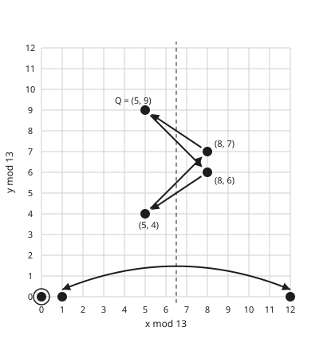
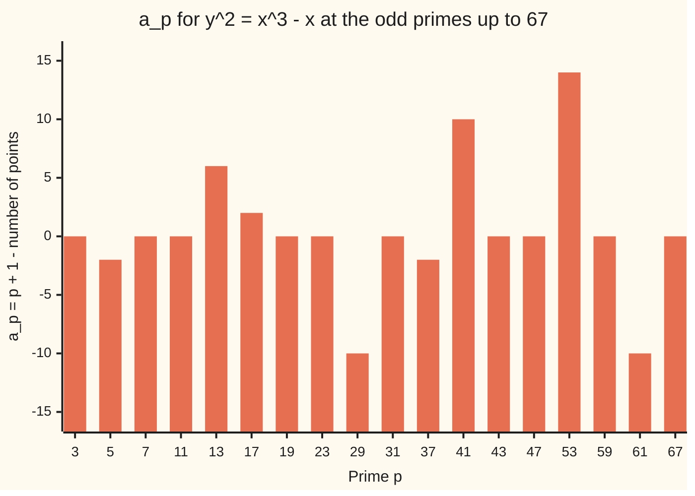

# Complex multiplication: curves with extra symmetries, and point counts read from p = a^2 + b^2

[Syllabus](../../../SYLLABUS.md) → [Algebraic geometry](../README.md) → [Elliptic Curves](../README.md#s04) → Complex multiplication

---

## General Overview

Take the curve $`y^2 = x^3 - x`$ and read it mod 13. Trying every pair finds 7 points, and with the point at infinity $`O`$ that makes **8 points**. Mod 7 the curve has 8 points, mod 11 it has 12, mod 17 it has 16, and mod 29 it has 40.

[The curve mod p](05-reduction-mod-p-and-hasse.md) counted points one $`x`$ at a time, and for most curves that is the only way. This curve has a shortcut. Mod 7 and mod 11, primes that leave 3 on division by 4, the count is always $`p + 1`$. Mod 13, write $`13 = 3^2 + 2^2`$; then the count is $`13 + 1 - 2 \times 3 = 8`$. Mod 29, write $`29 = 5^2 + 2^2`$; the count is $`29 + 1 + 2 \times 5 = 40`$. No points are listed.

The reason is an extra symmetry. Let $`i`$ be a square root of −1, so $`i \times i = -1`$. The map $`(x, y) \mapsto (-x, iy)`$ sends the curve to itself and respects the adding of points. Applied twice, it turns every point into its negative, exactly as multiplying twice by $`i`$ turns 1 into −1. So the curve's points can be multiplied by the complex number $`i`$, not only by whole numbers. That is **complex multiplication**, CM for short.

The symmetry turns point counting into arithmetic with the Gaussian integers $`a + bi`$. It also explains why the j-values $`1728 = 12^3`$, $`8000 = 20^3`$ and $`287496 = 66^3`$ are whole numbers, and it lets cryptographers build a curve with a point count chosen in advance.

**A curve with complex multiplication has a symmetry that acts like a complex number, so its maps that respect adding form a ring bigger than the whole numbers (for $`y^2 = x^3 - x`$, the Gaussian integers), and its point count mod p comes from writing p as $`a^2 + b^2`$ instead of from counting.**

**What kind of fact this is:** theorems. The symmetry, the ring rule $`[i][i] = [-1]`$, the rule $`a_p = 0`$ for primes that leave 3 on division by 4, and the sign of $`a_p`$ are proved on this card in Why it works. Two facts are borrowed with their sources: no other maps respect adding (Step 2), and a map that commutes with $`[i]`$ is a Gaussian integer (Step 4). The whole-number j-values are Weber's theorem, stated with a source and checked in floating point.

### The picture: the symmetry at work mod 13

<p align="center"></p>

Drawn to scale, one grid step per remainder. Mod 13, $`5 \times 5 = 25`$ leaves −1, so $`i = 5`$ and the map is $`(x, y) \mapsto (-x, 5y)`$: a mirror across the dashed line, then $`y`$ times 5. Four points go round a cycle, (1, 0) and (12, 0) swap, and (0, 0) stays fixed. The eighth point, $`O`$, is off the grid. Only points over the 13-element field are shown, no real or rational points.

---

## The formula

Notation first, in words. This card introduces four names.

- An **endomorphism** of a curve $`E`$ is a map from $`E`$ to itself, given by fractions of polynomials, that sends $`O`$ to $`O`$ and respects adding: the image of $`P + Q`$ is the image of $`P`$ plus the image of $`Q`$. It is an isogeny from the curve to itself ([Isogenies](11-isogenies-and-the-dual-isogeny.md)).
- $`[n]`$ is the endomorphism "add the point to itself $`n`$ times", so $`[n]P = nP`$ and $`[-1]P = -P`$.
- $`\mathrm{End}(E)`$ is the set of all endomorphisms. Two of them add pointwise, $`(f + g)(P) = f(P) + g(P)`$, and multiply by doing one after the other. That makes $`\mathrm{End}(E)`$ a ring ([Rings](../../03-Algebra/09-Rings%20and%20Fields/01-rings.md)): its elements add and multiply like numbers.
- $`\mathbb{Z}[i]`$ is the ring of **Gaussian integers** $`a + bi`$ with $`a`$, $`b`$ whole numbers. The **norm** of $`a + bi`$ is $`a^2 + b^2`$ ([Two squares](../../21-Algebraic%20and%20analytic%20number%20theory/07-Diophantine%20and%20Modular/02-sums-of-squares-and-gaussian-integers.md)).

The symbol $`a_p = p + 1 - \#E(\mathbb{F}_p)`$ is the trace of Frobenius from [The curve mod p](05-reduction-mod-p-and-hasse.md): how far the count of points mod $`p`$ falls short of $`p + 1`$.

For $`E: y^2 = x^3 - x`$ the card proves:

```math
[i](x, y) = (-x,\ iy), \qquad [i] \circ [i] = [-1], \qquad \mathrm{End}(E) = \mathbb{Z}[i] \ \text{ over } \mathbb{C}
```

**Read it aloud:** the map "negate x, multiply y by i" is a symmetry of the curve; doing it twice negates every point; and the curve's endomorphisms over the complex numbers are exactly the Gaussian integers, with $`a + bi`$ acting as $`[a] + [b] \circ [i]`$.

The point count follows. For an odd prime $`p`$:

```math
a_p = \begin{cases} 0, & p \equiv 3 \ (\mathrm{mod}\ 4), \\ 2a, & p = a^2 + b^2 \text{ with } b \text{ even and } a + b \equiv 1 \ (\mathrm{mod}\ 4). \end{cases}
```

**Read it aloud:** if p leaves 3 on division by 4, the count is exactly p + 1; if p leaves 1, write p as an odd square plus an even square, give the odd root the sign that makes a + b leave 1 on division by 4, and the shortfall is twice that root.

With the card's numbers: $`13 = 3^2 + 2^2`$ and $`3 + 2 = 5`$ leaves 1, so $`a_{13} = 6`$ and the count is $`13 + 1 - 6 = 8`$. For 29, $`5 + 2 = 7`$ leaves 3, so the sign flips: $`a = -5`$, $`a_{29} = -10`$, and the count is 40. For 17, $`17 = 1^2 + 4^2`$ gives $`a_{17} = 2`$ and 16 points.

| Symbol | Plain meaning | In our example | Push it up and the answer… |
| --- | --- | --- | --- |
| $`E`$, $`O`$ | the curve $`y^2 = x^3 - x`$; its point at infinity, the zero of adding | 8 points mod 13 | — |
| $`p`$, $`\mathbb{F}_p`$ | an odd prime; the field of remainders mod p | 13 | count grows, about p + 1 |
| $`i`$ | a square root of −1: a complex number, or a remainder when $`p \equiv 1`$ mod 4 | 5 mod 13; 12 mod 29 | — |
| $`[n]`$, $`[i]`$ | add a point to itself n times; the map $`(x, y) \mapsto (-x, iy)`$ | $`[i](5, 4) = (8, 7)`$ | — |
| $`\mathrm{End}(E)`$, $`\mathbb{Z}[i]`$ | the ring of endomorphisms; the Gaussian integers | equal, over $`\mathbb{C}`$ | — |
| $`a`$, $`b`$ | the odd and even roots in $`p = a^2 + b^2`$, a signed so $`a + b \equiv 1`$ mod 4 | 3, 2 for p = 13 | a up, $`a_p`$ up, count down |
| $`a_p`$, $`\#E(\mathbb{F}_p)`$ | the trace of Frobenius; the number of points mod p, O included | 6; 8 | count = p + 1 − $`a_p`$ |
| $`\varphi`$, $`\alpha = c + di`$ | the Frobenius map $`(x, y) \mapsto (x^p, y^p)`$, called π on [Isogenies](11-isogenies-and-the-dual-isogeny.md), where φ is the 2-isogeny; the Gaussian integer it equals, with whole numbers $`c`$, $`d`$ | mod 29: $`-5 - 2[i]`$ | — |
| $`Q`$ | the point $`(i, 1 - i)`$, of order 4 | (5, 9) mod 13 | — |
| $`\tau`$, $`\Lambda`$, $`j(\tau)`$ | a complex number with positive imaginary part; the lattice of all $`m + n\tau`$; its j-invariant | $`\tau = i`$, $`j = 1728`$ | — |
| $`D`$, $`h(D)`$ | the discriminant of the lattice's multipliers; the class number: how many reduced forms have it | −4; 1 | j stops being a whole number once h > 1 |

### The picture: the shortfall $`a_p`$, prime by prime



Every prime that leaves 3 on division by 4 has a bar of height zero. Every other bar is twice an odd number, as the formula says.

### When it holds

- **The field must contain $`i`$.** Over the complex numbers, and mod a prime that leaves 1 on division by 4, $`[i]`$ is defined. Over the rationals it is not, since $`i`$ is not a fraction. So the ring $`\mathbb{Z}[i]`$ is the endomorphism ring over $`\mathbb{C}`$; over $`\mathbb{Q}`$ the only endomorphisms are the $`[n]`$.
- **The prime must be odd.** The discriminant of $`y^2 = x^3 - x`$ is $`-16(4 \cdot (-1)^3) = 64`$, so 2 is the one bad prime. Mod 2 the curve has a singular point and no group.
- **The sign rule is for this exact curve.** The curve $`y^2 = x^3 - 49x`$ also has $`[i]`$, but its signs follow whether 7 is a square mod p: $`a_{13} = -6`$, $`a_{17} = -2`$, $`a_{29} = -10`$. These are the values [What curves answer](10-modularity-and-the-congruent-number-problem.md) found for the congruent number 7.
- **The curve must have CM.** $`y^2 = x^3 - x + 1`$ has no extra symmetry: its $`a_7 = -4`$, not 0, and its $`a_{13} = -5`$ is odd.
- **Whole-number j needs class number 1.** The lattice of $`1.5i`$ has CM, but class number 4, and $`j(1.5i) = 13151.6767`$ is not whole.

---

## Why it works

### Step 0: a symmetry that respects adding is a number

A map that respects adding behaves like a multiplier: $`[2]`$ doubles, $`[-1]`$ negates. On most curves over the complex numbers, the whole numbers are all the multipliers there are.

Once $`[i]`$ exists with $`[i][i] = [-1]`$, every Gaussian integer $`a + bi`$ acts on the points too. Mod a prime that leaves 1 on division by 4, the Frobenius map that counts points commutes with $`[i]`$, so it is itself a Gaussian integer. Its norm must be p, and that is why $`p = a^2 + b^2`$ appears.

### Step 1: $`[i]`$ is an endomorphism

1. **It keeps the curve.** If $`y^2 = x^3 - x`$, then $`(iy)^2 = -y^2 = -(x^3 - x) = (-x)^3 - (-x)`$. So $`(-x, iy)`$ is on the curve too.
2. **It respects adding.** The map changes coordinates by a linear rule, so it sends lines to lines. Three points on a line add up to $`O`$ ([The group law](01-elliptic-curves-and-the-group-law.md)), and their images still lie on a line, so they still add up to $`O`$. The vertical direction stays vertical, so $`O`$ goes to $`O`$.
3. **Twice is negation.** $`[i][i](x, y) = (x, i \cdot i\, y) = (x, -y)`$, which is $`-P`$.

The check tests all three mod 13, where $`i = 5`$: every point lands on the curve, applying the map twice gives the negative, and $`[i](P + Q) = [i]P + [i]Q`$ for all 64 pairs.

### Step 2: the endomorphisms are the Gaussian integers

Let $`a + bi`$ act by $`P \mapsto aP + b\,[i]P`$. These maps add and compose by the rule $`i^2 = -1`$, because $`[i][i] = [-1]`$. So every Gaussian integer is an endomorphism. The check confirms $`(1 - [i])(1 + [i]) = [2]`$ on every point mod 13, matching $`(1 - i)(1 + i) = 2`$.

The size of a map is its **degree**: for these maps, the number of points it sends to $`O`$ over a large enough field ([Isogenies](11-isogenies-and-the-dual-isogeny.md)). For $`a + bi`$ the degree is the norm $`a^2 + b^2`$. Two cases, computed:

- **$`1 + [i]`$, norm 2.** $`[i]P = -P`$ means $`(-x, iy) = (x, -y)`$, so $`x = 0`$ and $`y = 0`$. The kernel is $`O`$ and (0, 0): two points, the same kernel as the 2-isogeny of [Isogenies](11-isogenies-and-the-dual-isogeny.md).
- **$`2 - [i]`$, norm 5.** Mod 29 it sends 5 of the 40 points to $`O`$. Its partner $`2 + [i]`$ sends only 1 there; its other 4 kernel points need a larger field.

Are there other endomorphisms? Over the complex numbers, no. The ring of endomorphisms of a curve over $`\mathbb{C}`$ is either $`\mathbb{Z}`$ or an **order** (a subring of finite index) in a field $`\mathbb{Q}(\sqrt{-d})`$, with $`d`$ a positive whole number (Silverman, *The Arithmetic of Elliptic Curves*, Corollary III.9.4). Ours contains $`i`$, so the field is $`\mathbb{Q}(i)`$. Its largest order is $`\mathbb{Z}[i]`$, which we already have. So $`\mathrm{End}(E) = \mathbb{Z}[i]`$.

### Step 3: when $`p \equiv 3`$ mod 4, $`a_p = 0`$

Write $`f(x) = x^3 - x`$. Two facts:

1. **$`f`$ is odd:** $`f(-x) = -f(x)`$.
2. **−1 is not a square mod p** when p leaves 3 on division by 4 ([Quadratic residues](../../21-Algebraic%20and%20analytic%20number%20theory/03-Characters%20and%20L-functions/02-quadratic-residues-and-the-legendre-symbol.md)). So the Legendre symbol (the square test: +1 square, −1 not, 0 zero) gives $`(-v/p) = -(v/p)`$.

Together, the square test at $`-x`$ is minus the test at $`x`$. In the count $`\#E(\mathbb{F}_p) = p + 1 + \sum_x (f(x)/p)`$ from [The curve mod p](05-reduction-mod-p-and-hasse.md), the terms cancel in pairs. The sum is 0, so the count is $`p + 1`$ and $`a_p = 0`$.

Mod 7, the tests for $`x = 1`$ to 6 are 0, −1, −1, 1, 1, 0. The pairs (2, 5) and (3, 4) cancel, and 1, 6 give 0. The count is 8.

In the language of symmetry: mod such a p, the Frobenius map $`\varphi`$ sends $`i`$ to $`i^p = -i`$, so $`\varphi [i] = -[i] \varphi`$. Conjugating by $`[i]`$ turns $`\varphi`$ into $`-\varphi`$, so the trace equals minus itself: 0. A curve with $`a_p = 0`$ is **supersingular** at p (Deuring, 1941).

### Step 4: when $`p \equiv 1`$ mod 4, Frobenius is a Gaussian integer

Now $`i`$ is a remainder mod p, and $`[i]`$ has coefficients in $`\mathbb{F}_p`$. The Frobenius map $`\varphi(x, y) = (x^p, y^p)`$ commutes with it, since $`(iy)^p = i^p y^p = iy^p`$ when $`i`$ lies in $`\mathbb{F}_p`$.

One fact is borrowed: an endomorphism that commutes with $`[i]`$ is itself $`c + d[i]`$ for whole numbers $`c`$, $`d`$ (Silverman, *Advanced Topics*, Chapter II). So $`\varphi = \alpha = c + di`$, and two numbers about $`\varphi`$ become numbers about $`\alpha`$:

1. **Degree.** The degree of $`\varphi`$ is $`p`$ ([The curve mod p](05-reduction-mod-p-and-hasse.md), Step 4). The degree of $`\alpha`$ is its norm. So $`c^2 + d^2 = p`$.
2. **Trace.** $`a_p`$ is the trace of $`\varphi`$: $`\alpha + \bar\alpha = 2c`$, where $`\bar\alpha = c - di`$ is the mirror image.

A prime has only one way to be a sum of an odd square and an even square, up to signs ([Two squares](../../21-Algebraic%20and%20analytic%20number%20theory/07-Diophantine%20and%20Modular/02-sums-of-squares-and-gaussian-integers.md)). So $`c`$ is $`\pm a`$ or $`\pm b`$; Step 5 shows it is $`\pm a`$, so $`a_p = \pm 2a`$. Hasse's bound is automatic: $`\lvert 2c \rvert \le 2\sqrt{p}`$ since $`c^2 \le p`$.

The check tests this directly. Mod 29 with $`i = 12`$, of the eight maps $`\pm 5 \pm 2[i]`$ and $`\pm 2 \pm 5[i]`$ only $`-5 - 2[i]`$ fixes all 40 points, as Frobenius does. Mod 13, both $`3 \pm 2[i]`$ fix all 8 points and no $`\pm 2 \pm 3[i]`$ does: too few points to tell the two apart, but the 3 and its sign are forced.

### Step 5: the sign comes from a point of order 4

The sign of $`a`$ needs one more fact: mod such a p, **8 divides the count**.

The curve has three points with $`y = 0`$: (0, 0), (1, 0), (−1, 0). Each is its own negative, so with $`O`$ they form a group of 4. Now take $`Q = (i, 1 - i)`$. It is on the curve, since $`(1 - i)^2 = 1 - 2i - 1 = -2i`$ and $`i^3 - i = -i - i = -2i`$. Doubling it gives (0, 0), so $`Q`$ has order 4. The points $`Q`$ and (1, 0) together make a subgroup of 8, and by Lagrange's theorem 8 divides the count ([Cosets and Lagrange's theorem](../../03-Algebra/08-Groups/04-cosets-and-lagranges-theorem.md)).

Mod 13, $`Q = (5, 9)`$, $`2Q = (0, 0)`$ and $`4Q = O`$.

Now the count is $`p + 1 - 2c = (c - 1)^2 + d^2`$, using $`p = c^2 + d^2`$. First, $`c`$ is odd. If $`c`$ were even, $`d`$ would be odd, so $`(c - 1)^2`$ and $`d^2`$ would both be odd squares, each leaving 1 on division by 4, and the count would leave 2; but 8 divides it. So $`d`$ is even and $`c = \pm a`$.

| Case | $`(c - 1)^2`$ mod 8 | $`d^2`$ mod 8 | Count mod 8 |
| --- | --- | --- | --- |
| $`c \equiv 1`$, $`d \equiv 0`$ mod 4 | 0 | 0 | 0 |
| $`c \equiv 1`$, $`d \equiv 2`$ mod 4 | 0 | 4 | 4 |
| $`c \equiv 3`$, $`d \equiv 0`$ mod 4 | 4 | 0 | 4 |
| $`c \equiv 3`$, $`d \equiv 2`$ mod 4 | 4 | 4 | 0 |

Only the rows with $`c + d \equiv 1`$ mod 4 give a multiple of 8. So $`c = a`$ with that sign, and $`a_p = 2a`$. The check confirms all three roads agree at all 167 odd primes below 1000, and that 8 divides the count at all 80 of them that leave 1 on division by 4.

### Step 6: why the j-values are whole numbers

[Riemann surfaces](../03-Plane%20Curves/08-riemann-surfaces-and-the-weierstrass-p-function.md) built a curve over $`\mathbb{C}`$ from a lattice $`\Lambda`$: all points $`m + n\tau`$ with $`m`$, $`n`$ whole. An endomorphism is then multiplication by a complex number $`\alpha`$ with $`\alpha\Lambda \subseteq \Lambda`$. Whole numbers always work. CM means some other $`\alpha`$ works too.

- **$`\tau = i`$, the square lattice.** Multiplying by $`i`$ turns it a quarter turn onto itself. Its curve is $`y^2 = x^3 - x`$, with $`j = 1728 = 12^3`$.
- **$`\tau = i\sqrt{2}`$.** Multiplying by $`\sqrt{-2}`$ sends 1 to $`\tau`$ and $`\tau`$ to −2. Its curve is $`y^2 = x^3 - 30x + 56`$, with $`j = 8000 = 20^3`$.
- **$`\tau = 2i`$.** Multiplying by $`2i`$ sends 1 to $`\tau`$ and $`\tau`$ to −4. Here $`i`$ itself fails, so the ring is the smaller order $`\mathbb{Z}[2i]`$. Its curve is $`y^2 = x^3 - 11x + 14`$, with $`j = 287496 = 66^3`$.

Weber's theorem: $`j(\tau)`$ of a CM lattice is an algebraic integer (a root of a whole-number polynomial with leading coefficient 1), of degree equal to the class number $`h(D)`$ (Cox, Chapter 3). Here $`D`$ is the discriminant of the ring of multipliers, and $`h(D)`$ counts the reduced forms $`ax^2 + bxy + cy^2`$ with $`b^2 - 4ac = D`$ (here $`a`$, $`b`$, $`c`$ are the form's whole-number coefficients) ([Class groups](../../21-Algebraic%20and%20analytic%20number%20theory/06-Algebraic%20Numbers/05-class-groups-and-the-minkowski-bound.md)). For $`D = -4`$, −8 and −16 there is one form, so j is a whole number. For $`\tau = 1.5i`$, $`D = -144`$ has 4 forms, and $`j(1.5i) = 13151.6767`$ is a root of a degree-4 polynomial.

<details>
<summary>The two series behind the floating-point j-values</summary>

Put $`q = e^{2\pi i \tau}`$; for $`\tau = it`$ this is the real number $`e^{-2\pi t}`$. Let $`\sigma_k(n)`$ be the sum of the k-th powers of the divisors of n. The two Eisenstein series are

$`\displaystyle E_4 = 1 + 240\sum_{n \ge 1} \sigma_3(n)\, q^n, \qquad E_6 = 1 - 504\sum_{n \ge 1} \sigma_5(n)\, q^n.`$

Road A uses $`j = 1728\, E_4^3 / (E_4^3 - E_6^2)`$. Road B uses the product $`\Delta = q \prod_{n \ge 1} (1 - q^n)^{24}`$ and $`j = E_4^3 / \Delta`$. The check sums 39 terms of each. The two roads agree to a millionth, and match 1728, 8000 and 287496 to a millionth.

</details>

The whole numbers also come exactly from the curves, by the j formula of [Weierstrass form](02-weierstrass-forms-discriminant-and-j-invariant.md). Hilbert's twelfth problem asks for such special values in general. For fields like $`\mathbb{Q}(i)`$, CM j-values and torsion coordinates build the field's abelian extensions (larger fields whose symmetries commute), the story of Artin reciprocity.

---

## Worked numbers, by hand

The prime 13, from the formula, with no list of points:

| Step | Arithmetic | Value |
| --- | --- | --- |
| Remainder of 13 on division by 4 | 13 = 3 × 4 + 1 | 1: use the two-squares rule |
| Odd square plus even square | 13 = 9 + 4 = $`3^2 + 2^2`$ | a = ±3, b = 2 |
| Sign of a | 3 + 2 = 5, which leaves 1 on division by 4 | a = 3 |
| Shortfall | $`a_{13} = 2a`$ | 6 |
| Count | 13 + 1 − 6 | **8 points** |

So mod 13 the curve has 8 points, O included, matching the 7 dots in the picture plus O. The same steps for 29 give $`5 + 2 = 7`$, which leaves 3, so $`a = -5`$, $`a_{29} = -10`$ and 40 points.

### What breaks if you drop a piece

| Mistake | Comes out at | What went wrong |
| --- | --- | --- |
| Use $`a_p = 0`$ for 13 too | 14 points (true: 8) | The zero rule needs $`p \equiv 3`$ mod 4; 13 leaves 1 |
| Take $`a = -3`$ for 13 | 20 points (true: 8) | Wrong sign: 8 does not divide 20, so the order-4 point rules it out |
| Use $`2b`$ in place of $`2a`$ | 10 points (true: 8) | The trace is twice the odd root: the three points with y = 0 and O make 4 divide the count, and 4 does not divide 10 |
| Apply the rule to $`y^2 = x^3 - x + 1`$ | predicts $`a_{13} = \pm 6`$; true $`a_{13} = -5`$ | That curve has no CM, so its Frobenius is not a Gaussian integer |

---

## Code, from first principles, and it actually runs

The program takes four roads to $`a_p`$. Road 1 counts points: it squares every $`y`$, then looks up each $`x`$. Road 2 sums Euler's square test. Road 3 uses only $`p = a^2 + b^2`$ and the sign rule. These three agree at every odd prime below 1000. Road 4 tests the reason: it finds which of the maps $`\pm a \pm b[i]`$ and $`\pm b \pm a[i]`$ fixes every point, as Frobenius does. The program also tests $`[i]`$ as a map of the group mod 13, and finds the j-values three ways: exactly from the curves, by two q-series, and by counting reduced forms.

### Python

```python
# Complex multiplication -- the check behind the card.  Standard library only.
# The curve E is y^2 = x^3 - x.  A point mod p is a pair (x, y); None is O.
# Road 1 counts the points mod p: square every y, then look up each x.
# Road 2 adds up Euler's square test over x, one question per x.
# Road 3 reads a_p from p = a^2 + b^2 alone, with no counting.
# Road 4 tests the Frobenius claim: the Gaussian integer a + b[i] fixes every
# point mod p, and no b + a[i] does.  The map [i](x, y) = (-x, iy) is tested as a map of the group.
# Lattice j-values come from q-series in floats, by two separate series.
from fractions import Fraction as Fr
import math

def add(P, Q, p):  # chord and tangent on y^2 = x^3 - x, mod p
    if P is None: return Q
    if Q is None: return P
    (x1, y1), (x2, y2) = P, Q
    if x1 == x2 and (y1 + y2) % p == 0: return None
    if P == Q: m = (3 * x1 * x1 - 1) * pow(2 * y1, p - 2, p) % p
    else: m = (y2 - y1) * pow(x2 - x1, p - 2, p) % p
    x3 = (m * m - x1 - x2) % p
    return (x3, (m * (x1 - x3) - y1) % p)

def mul(n, P, p):  # n times P by repeated adding; a negative n flips P first
    if n < 0: n, P = -n, (None if P is None else (P[0], -P[1] % p))
    R = None
    for _ in range(n): R = add(R, P, p)
    return R

def imap(i, P, p):  # [i](x, y) = (-x, iy), with i a square root of -1 mod p
    return None if P is None else (-P[0] % p, i * P[1] % p)

def points(p, A=-1, B=0):  # road 1: O, then for each x every y with y^2 = f(x)
    roots = {}
    for y in range(p): roots.setdefault(y * y % p, []).append(y)
    return [None] + [(x, y) for x in range(p) for y in roots.get((x**3 + A * x + B) % p, [])]

def legendre(v, p):
    t = pow(v % p, (p - 1) // 2, p)
    return -1 if t == p - 1 else t

def ap_euler(p, A=-1, B=0):  # road 2: a_p is minus the sum of the square test
    return -sum(legendre(x**3 + A * x + B, p) for x in range(p))

def two_squares(p):  # p = a^2 + b^2, a odd, b even, sign of a so a + b = 1 mod 4
    for b in range(0, math.isqrt(p) + 1, 2):
        a = math.isqrt(p - b * b)
        if a * a == p - b * b: return (a if (a + b) % 4 == 1 else -a), b

def ap_cm(p):  # road 3
    return 0 if p % 4 == 3 else 2 * two_squares(p)[0]

def sqrt_m1(p): return next(t for t in range(p) if t * t % p == p - 1)

primes = [p for p in range(3, 1000) if all(p % d for d in range(2, math.isqrt(p) + 1))]
print("E: y^2 = x^3 - x, Delta =", -16 * (4 * (-1)**3 + 27 * 0**2), " [i](x, y) = (-x, iy): (iy)^2 = -y^2 = -(x^3 - x) = (-x)^3 - (-x)")
for p in [7, 11, 13, 17, 29]:
    n = len(points(p))
    if p % 4 == 3: print(f"p = {p}, 3 mod 4: {n} points, a_{p} = {p + 1 - n}")
    else:
        a, b = two_squares(p)
        print(f"p = {p} = {abs(a)}^2 + {b}^2, a = {a}, a + b = {a + b} = {(a + b) % 4} mod 4: "
              f"{n} points, a_{p} = {p + 1 - n} = 2a")
print("p = 7, square test of x^3 - x for x = 1..6:", [legendre(x**3 - x, 7) for x in range(1, 7)])
for p in primes:  # roads 1, 2 and 3 agree at every odd prime below 1000
    n = len(points(p))
    assert n == p + 1 - ap_euler(p) and ap_euler(p) == ap_cm(p)
    assert p % 4 == 3 or n % 8 == 0
print(f"roads 1, 2, 3 agree at all {len(primes)} odd primes below 1000; "
      f"8 divides the count at all {sum(p % 4 == 1 for p in primes)} primes = 1 mod 4")
print("chart, p:", primes[:18])
print("chart, a_p:", [ap_cm(p) for p in primes[:18]])
pt = lambda P: "O" if P is None else str(P)
p, i = 13, sqrt_m1(13); E = points(13)
print(f"figure, E mod 13 (i = {i}):", " ".join(str(P) for P in E[1:]))
orbit = [(5, 4)]
while len(orbit) < 4: orbit.append(imap(i, orbit[-1], p))
print("figure, [i] cycle:", " -> ".join(map(str, orbit)), "->", imap(i, orbit[-1], p))
neg = lambda P: None if P is None else (P[0], -P[1] % p)
assert all(imap(i, P, p) in E and imap(i, imap(i, P, p), p) == neg(P) for P in E)
assert all(imap(i, add(P, Q, p), p) == add(imap(i, P, p), imap(i, Q, p), p) for P in E for Q in E)
assert all(add(R, neg(imap(i, R, p)), p) == mul(2, P, p) for P in E for R in [add(P, imap(i, P, p), p)])
ker = [P for P in E if add(P, imap(i, P, p), p) is None]
print(f"mod 13: [i] keeps the curve, [i][i] = [-1], [i](P + Q) = [i]P + [i]Q for all 64 pairs, "
      f"(1 - [i])(1 + [i]) = [2]; kernel of 1 + [i]: {", ".join(map(pt, ker))}")
Q = (i, (1 - i) % p)
print(f"order-4 point Q = (i, 1 - i) = {Q}: 2Q = {pt(mul(2, Q, p))}, 4Q = {pt(mul(4, Q, p))}")
assert Q in E and mul(2, Q, p) == (0, 0) and mul(4, Q, p) is None
p29, i29 = 29, sqrt_m1(29); E29 = points(29)
k5 = [sum(add(mul(2, P, p29), mul(s, imap(i29, P, p29), p29), p29) is None for P in E29) for s in (1, -1)]
print(f"mod 29 (i = {i29}, {len(E29)} points): kernel of 2 + [i] has {k5[0]}, of 2 - [i] has {k5[1]}")
assert sorted(k5) == [1, 5]
for p in [q for q in primes if q % 4 == 1 and q < 100]:  # road 4: Frobenius = a + b[i], never b + a[i]
    i, (a, b), E = sqrt_m1(p), two_squares(p), points(p)
    fix = [(s, t) for u, v in ((a, b), (b, a)) for s in (u, -u) for t in (v, -v)
           if all(add(mul(s, P, p), mul(t, imap(i, P, p), p), p) == P for P in E)]
    assert fix and all(s == a for s, t in fix) and len(fix) <= 2
    if p in (13, 29): print(f"Frobenius mod {p} (i = {i}): of the eight a + b[i] and b + a[i] with a, b = {abs(a)}, {b} up to sign, "
                            f"those fixing all {len(E)} points:", ", ".join(f"{s} + ({t})[i]" for s, t in fix))
print("house curve y^2 = x^3 - 2:", {p: ap_euler(p, 0, -2) for p in (5, 7, 11, 13)})
print("twist y^2 = x^3 - 49x:", {p: ap_euler(p, -49, 0) for p in (13, 17, 29)})
print("no CM, y^2 = x^3 - x + 1:", {p: ap_euler(p, -1, 1) for p in (7, 11, 13, 17)})
for p in (13, 17, 29): assert ap_euler(p, -49, 0) == legendre(7, p) * ap_cm(p)

curves = {"y^2 = x^3 - x": (-1, 0), "y^2 = x^3 - 30x + 56": (-30, 56), "y^2 = x^3 - 11x + 14": (-11, 14)}
for name, (A, B) in curves.items():
    j = Fr(1728 * 4 * A**3, 4 * A**3 + 27 * B**2); c = round(float(j) ** (1 / 3))
    assert j == c**3
    print(f"{name}: j = {j} = {c}^3")

def j_tau(t):  # tau = i t; road A: 1728 E4^3/(E4^3 - E6^2); road B: E4^3/Delta, Delta a product
    q = math.exp(-2 * math.pi * t); e4 = e6 = 1.0; dprod = q; qn = 1.0
    for n in range(1, 40):
        qn *= q
        e4 += 240 * sum(d * d * d for d in range(1, n + 1) if n % d == 0) * qn
        e6 -= 504 * sum(d * d * d * d * d for d in range(1, n + 1) if n % d == 0) * qn
        f = 1.0 - qn
        for _ in range(24): dprod *= f
    return 1728 * e4**3 / (e4**3 - e6 * e6), e4**3 / dprod

for label, t, want in [("i", 1.0, 1728), ("i sqrt2", math.sqrt(2), 8000), ("2i", 2.0, 287496), ("1.5i", 1.5, None)]:
    ja, jb = j_tau(t)
    assert abs(ja - jb) < 1e-6 * jb and (want is None or abs(jb - want) < 1e-6 * want)
    print(f"j({label}) = {jb:.4f}")
assert abs(j_tau(1.5)[1] - round(j_tau(1.5)[1])) > 0.01

def class_number(D):  # reduced primitive forms ax^2 + bxy + cy^2 with b^2 - 4ac = D
    h = 0
    for a in range(1, math.isqrt(-D // 3) + 1):
        for b in range(-a + 1, a + 1):
            if (b * b - D) % (4 * a): continue
            c = (b * b - D) // (4 * a)
            if c >= a and not (b < 0 and c == a) and math.gcd(math.gcd(a, b), c) == 1: h += 1
    return h

print("class numbers h(D):", {D: class_number(D) for D in (-4, -8, -16, -144)})
assert [class_number(D) for D in (-4, -8, -16, -144)] == [1, 1, 1, 4]

a, b = two_squares(13)  # the three wrong rules, read from 13 = a^2 + b^2
print(f"what breaks, p = 13: rule a_p = 0 gives {13 + 1} points; a = {-a} gives {13 + 1 + 2 * a}; "
      f"2b in place of 2a gives {13 + 1 - 2 * b}; the count is {len(points(13))}")
print("ALL CHECKS PASS")
```

**Ran 2026-11-24 on macOS, Python 3.14.10, standard library only. All checks passed. Output, pasted from the run:**

```text
E: y^2 = x^3 - x, Delta = 64  [i](x, y) = (-x, iy): (iy)^2 = -y^2 = -(x^3 - x) = (-x)^3 - (-x)
p = 7, 3 mod 4: 8 points, a_7 = 0
p = 11, 3 mod 4: 12 points, a_11 = 0
p = 13 = 3^2 + 2^2, a = 3, a + b = 5 = 1 mod 4: 8 points, a_13 = 6 = 2a
p = 17 = 1^2 + 4^2, a = 1, a + b = 5 = 1 mod 4: 16 points, a_17 = 2 = 2a
p = 29 = 5^2 + 2^2, a = -5, a + b = -3 = 1 mod 4: 40 points, a_29 = -10 = 2a
p = 7, square test of x^3 - x for x = 1..6: [0, -1, -1, 1, 1, 0]
roads 1, 2, 3 agree at all 167 odd primes below 1000; 8 divides the count at all 80 primes = 1 mod 4
chart, p: [3, 5, 7, 11, 13, 17, 19, 23, 29, 31, 37, 41, 43, 47, 53, 59, 61, 67]
chart, a_p: [0, -2, 0, 0, 6, 2, 0, 0, -10, 0, -2, 10, 0, 0, 14, 0, -10, 0]
figure, E mod 13 (i = 5): (0, 0) (1, 0) (5, 4) (5, 9) (8, 6) (8, 7) (12, 0)
figure, [i] cycle: (5, 4) -> (8, 7) -> (5, 9) -> (8, 6) -> (5, 4)
mod 13: [i] keeps the curve, [i][i] = [-1], [i](P + Q) = [i]P + [i]Q for all 64 pairs, (1 - [i])(1 + [i]) = [2]; kernel of 1 + [i]: O, (0, 0)
order-4 point Q = (i, 1 - i) = (5, 9): 2Q = (0, 0), 4Q = O
mod 29 (i = 12, 40 points): kernel of 2 + [i] has 1, of 2 - [i] has 5
Frobenius mod 13 (i = 5): of the eight a + b[i] and b + a[i] with a, b = 3, 2 up to sign, those fixing all 8 points: 3 + (2)[i], 3 + (-2)[i]
Frobenius mod 29 (i = 12): of the eight a + b[i] and b + a[i] with a, b = 5, 2 up to sign, those fixing all 40 points: -5 + (-2)[i]
house curve y^2 = x^3 - 2: {5: 0, 7: 1, 11: 0, 13: -5}
twist y^2 = x^3 - 49x: {13: -6, 17: -2, 29: -10}
no CM, y^2 = x^3 - x + 1: {7: -4, 11: 2, 13: -5, 17: 4}
y^2 = x^3 - x: j = 1728 = 12^3
y^2 = x^3 - 30x + 56: j = 8000 = 20^3
y^2 = x^3 - 11x + 14: j = 287496 = 66^3
j(i) = 1728.0000
j(i sqrt2) = 8000.0000
j(2i) = 287496.0000
j(1.5i) = 13151.6767
class numbers h(D): {-4: 1, -8: 1, -16: 1, -144: 4}
what breaks, p = 13: rule a_p = 0 gives 14 points; a = -3 gives 20; 2b in place of 2a gives 10; the count is 8
ALL CHECKS PASS
```

### Rust

Same numbers, same labels, built with `rustc --edition 2021 -O`.

```rust
// Complex multiplication -- the same check as the Python, in Rust.  No crates.
// The curve E is y^2 = x^3 - x.  A point mod p is Some((x, y)); None is O.
// Road 1 counts the points mod p: square every y, then look up each x.
// Road 2 adds up Euler's square test over x, one question per x.
// Road 3 reads a_p from p = a^2 + b^2 alone, with no counting.
// Road 4 tests the Frobenius claim: the Gaussian integer a + b[i] fixes every
// point mod p, and no b + a[i] does.  The map [i](x, y) = (-x, iy) is tested as a map of the group.
// Lattice j-values come from q-series in floats, by two separate series.
type Pt = Option<(i64, i64)>;

fn power(a: i64, mut k: i64, p: i64) -> i64 {       // square-and-multiply, mod p
    let (mut out, mut a) = (1, a.rem_euclid(p));
    while k > 0 { if k & 1 == 1 { out = out * a % p } a = a * a % p; k >>= 1 }
    out
}

fn add(pp: Pt, qq: Pt, p: i64) -> Pt {              // chord and tangent on y^2 = x^3 - x, mod p
    let ((x1, y1), (x2, y2)) = match (pp, qq) { (None, _) => return qq, (_, None) => return pp, (Some(a), Some(b)) => (a, b) };
    if x1 == x2 && (y1 + y2) % p == 0 { return None }
    let m = if pp == qq { (3 * x1 * x1 - 1).rem_euclid(p) * power(2 * y1, p - 2, p) % p }
            else { (y2 - y1).rem_euclid(p) * power(x2 - x1, p - 2, p) % p };
    let x3 = (m * m - x1 - x2).rem_euclid(p);
    Some((x3, (m * (x1 - x3) - y1).rem_euclid(p)))
}

fn neg(pp: Pt, p: i64) -> Pt { pp.map(|(x, y)| (x, (-y).rem_euclid(p))) }
fn mul(n: i64, pp: Pt, p: i64) -> Pt {              // n times P by repeated adding
    let (n, pp) = if n < 0 { (-n, neg(pp, p)) } else { (n, pp) };
    let mut r = None;
    for _ in 0..n { r = add(r, pp, p) }
    r
}

fn imap(i: i64, pp: Pt, p: i64) -> Pt { pp.map(|(x, y)| ((-x).rem_euclid(p), i * y % p)) }
fn f(x: i64, a: i64, b: i64, p: i64) -> i64 { (x * x % p * x + a * x + b).rem_euclid(p) }

fn points(p: i64, a: i64, b: i64) -> Vec<Pt> {     // road 1: O, then each x with every y
    let mut roots = vec![Vec::new(); p as usize];
    for y in 0..p { roots[(y * y % p) as usize].push(y) }
    let mut out = vec![None];
    for x in 0..p { for &y in &roots[f(x, a, b, p) as usize] { out.push(Some((x, y))) } }
    out
}

fn legendre(v: i64, p: i64) -> i64 { let t = power(v, (p - 1) / 2, p); if t == p - 1 { -1 } else { t } }
fn ap_euler(p: i64, a: i64, b: i64) -> i64 { -(0..p).map(|x| legendre(f(x, a, b, p), p)).sum::<i64>() }
fn isqrt(n: i64) -> i64 { let mut r = (n as f64).sqrt() as i64; while r * r > n { r -= 1 } while (r + 1) * (r + 1) <= n { r += 1 } r }

fn two_squares(p: i64) -> (i64, i64) {              // a odd, b even, a + b = 1 mod 4
    let b = (0..).step_by(2).find(|b| { let a = isqrt(p - b * b); a * a == p - b * b }).unwrap();
    let a = isqrt(p - b * b);
    (if (a + b) % 4 == 1 { a } else { -a }, b)
}

fn ap_cm(p: i64) -> i64 { if p % 4 == 3 { 0 } else { 2 * two_squares(p).0 } }
fn sqrt_m1(p: i64) -> i64 { (0..p).find(|t| t * t % p == p - 1).unwrap() }
fn pt(pp: Pt) -> String { match pp { None => "O".to_string(), Some((x, y)) => format!("({}, {})", x, y) } }
fn list(v: &[i64]) -> String { format!("[{}]", v.iter().map(|x| x.to_string()).collect::<Vec<_>>().join(", ")) }
fn dict(ps: &[i64], a: i64, b: i64) -> String {
    format!("{{{}}}", ps.iter().map(|&p| format!("{}: {}", p, ap_euler(p, a, b))).collect::<Vec<_>>().join(", "))
}
fn gcd(a: i64, b: i64) -> i64 { if b == 0 { a.abs() } else { gcd(b, a % b) } }

fn j_tau(t: f64) -> (f64, f64) {                    // tau = i t; road A and road B
    let q = (-2.0 * std::f64::consts::PI * t).exp();
    let (mut e4, mut e6, mut dprod, mut qn) = (1.0f64, 1.0f64, q, 1.0f64);
    for n in 1..40i64 {
        qn *= q;
        e4 += 240.0 * (1..=n).filter(|d| n % d == 0).map(|d| d * d * d).sum::<i64>() as f64 * qn;
        e6 -= 504.0 * (1..=n).filter(|d| n % d == 0).map(|d| d * d * d * d * d).sum::<i64>() as f64 * qn;
        let fq = 1.0 - qn;
        for _ in 0..24 { dprod *= fq }
    }
    (1728.0 * e4.powf(3.0) / (e4.powf(3.0) - e6 * e6), e4.powf(3.0) / dprod)
}

fn class_number(d: i64) -> i64 {                    // reduced primitive forms of discriminant d
    let mut h = 0;
    for a in 1..=isqrt(-d / 3) {
        for b in (-a + 1)..=a {
            if (b * b - d) % (4 * a) != 0 { continue }
            let c = (b * b - d) / (4 * a);
            if c >= a && !(b < 0 && c == a) && gcd(gcd(a, b), c) == 1 { h += 1 }
        }
    }
    h
}

fn main() {
    let primes: Vec<i64> = (3..1000).filter(|&p| (2..=isqrt(p)).all(|d| p % d != 0)).collect();
    println!("E: y^2 = x^3 - x, Delta = {}  [i](x, y) = (-x, iy): (iy)^2 = -y^2 = -(x^3 - x) = (-x)^3 - (-x)", -16 * (4 * (-1i64).pow(3) + 27 * 0i64.pow(2)));
    for &p in &[7i64, 11, 13, 17, 29] {
        let n = points(p, -1, 0).len() as i64;
        if p % 4 == 3 { println!("p = {}, 3 mod 4: {} points, a_{} = {}", p, n, p, p + 1 - n) } else {
            let (a, b) = two_squares(p);
            println!("p = {} = {}^2 + {}^2, a = {}, a + b = {} = {} mod 4: {} points, a_{} = {} = 2a",
                     p, a.abs(), b, a, a + b, (a + b).rem_euclid(4), n, p, p + 1 - n);
        }
    }
    println!("p = 7, square test of x^3 - x for x = 1..6: {}", list(&(1..7).map(|x| legendre(f(x, -1, 0, 7), 7)).collect::<Vec<_>>()));
    for &p in &primes {                              // roads 1, 2 and 3 agree at every odd prime below 1000
        let n = points(p, -1, 0).len() as i64;
        assert!(n == p + 1 - ap_euler(p, -1, 0) && ap_euler(p, -1, 0) == ap_cm(p));
        assert!(p % 4 == 3 || n % 8 == 0);
    }
    println!("roads 1, 2, 3 agree at all {} odd primes below 1000; 8 divides the count at all {} primes = 1 mod 4",
             primes.len(), primes.iter().filter(|&&p| p % 4 == 1).count());
    println!("chart, p: {}", list(&primes[..18]));
    println!("chart, a_p: {}", list(&primes[..18].iter().map(|&p| ap_cm(p)).collect::<Vec<_>>()));
    let (p, i) = (13, sqrt_m1(13));
    let e = points(13, -1, 0);
    println!("figure, E mod 13 (i = {}): {}", i, e[1..].iter().map(|&q| pt(q)).collect::<Vec<_>>().join(" "));
    let mut orbit = vec![Some((5i64, 4i64))];
    while orbit.len() < 4 { let last = *orbit.last().unwrap(); orbit.push(imap(i, last, p)) }
    println!("figure, [i] cycle: {} -> {}", orbit.iter().map(|&q| pt(q)).collect::<Vec<_>>().join(" -> "), pt(imap(i, orbit[3], p)));
    assert!(e.iter().all(|&q| e.contains(&imap(i, q, p)) && imap(i, imap(i, q, p), p) == neg(q, p)));
    assert!(e.iter().all(|&a| e.iter().all(|&b| imap(i, add(a, b, p), p) == add(imap(i, a, p), imap(i, b, p), p))));
    assert!(e.iter().all(|&q| { let r = add(q, imap(i, q, p), p); add(r, neg(imap(i, r, p), p), p) == mul(2, q, p) }));
    let ker: Vec<Pt> = e.iter().cloned().filter(|&q| add(q, imap(i, q, p), p).is_none()).collect();
    println!("mod 13: [i] keeps the curve, [i][i] = [-1], [i](P + Q) = [i]P + [i]Q for all 64 pairs, (1 - [i])(1 + [i]) = [2]; kernel of 1 + [i]: {}",
             ker.iter().map(|&q| pt(q)).collect::<Vec<_>>().join(", "));
    let qq = Some((i, (1 - i).rem_euclid(p)));
    println!("order-4 point Q = (i, 1 - i) = {}: 2Q = {}, 4Q = {}", pt(qq), pt(mul(2, qq, p)), pt(mul(4, qq, p)));
    assert!(e.contains(&qq) && mul(2, qq, p) == Some((0, 0)) && mul(4, qq, p).is_none());
    let (p29, i29) = (29, sqrt_m1(29));
    let e29 = points(29, -1, 0);
    let k5: Vec<usize> = [1i64, -1].iter().map(|&s| e29.iter().filter(|&&q| add(mul(2, q, p29), mul(s, imap(i29, q, p29), p29), p29).is_none()).count()).collect();
    println!("mod 29 (i = {}, {} points): kernel of 2 + [i] has {}, of 2 - [i] has {}", i29, e29.len(), k5[0], k5[1]);
    assert!(k5.iter().min() == Some(&1) && k5.iter().max() == Some(&5));
    for &p in primes.iter().filter(|&&q| q % 4 == 1 && q < 100) {   // road 4: Frobenius = a + b[i], never b + a[i]
        let (i, (a, b), e) = (sqrt_m1(p), two_squares(p), points(p, -1, 0));
        let mut fix = Vec::new();
        for &(u, v) in &[(a, b), (b, a)] { for &s in &[u, -u] { for &t in &[v, -v] {
            if e.iter().all(|&q| add(mul(s, q, p), mul(t, imap(i, q, p), p), p) == q) { fix.push((s, t)) }
        } } }
        assert!(!fix.is_empty() && fix.iter().all(|&(s, _)| s == a) && fix.len() <= 2);
        if p == 13 || p == 29 {
            println!("Frobenius mod {} (i = {}): of the eight a + b[i] and b + a[i] with a, b = {}, {} up to sign, those fixing all {} points: {}",
                     p, i, a.abs(), b, e.len(), fix.iter().map(|&(s, t)| format!("{} + ({})[i]", s, t)).collect::<Vec<_>>().join(", "));
        }
    }
    println!("house curve y^2 = x^3 - 2: {}", dict(&[5, 7, 11, 13], 0, -2));
    println!("twist y^2 = x^3 - 49x: {}", dict(&[13, 17, 29], -49, 0));
    println!("no CM, y^2 = x^3 - x + 1: {}", dict(&[7, 11, 13, 17], -1, 1));
    for &p in &[13i64, 17, 29] { assert!(ap_euler(p, -49, 0) == legendre(7, p) * ap_cm(p)) }
    for (name, a, b) in [("y^2 = x^3 - x", -1i64, 0i64), ("y^2 = x^3 - 30x + 56", -30, 56), ("y^2 = x^3 - 11x + 14", -11, 14)] {
        let (top, bot) = (1728 * 4 * a * a * a, 4 * a * a * a + 27 * b * b);
        let g = gcd(top, bot) * bot.signum();
        let (top, bot) = (top / g, bot / g);
        let c = (top as f64 / bot as f64).powf(1.0 / 3.0).round() as i64;
        assert!(bot == 1 && top == c * c * c);
        println!("{}: j = {} = {}^3", name, top, c);
    }
    for (label, t, want) in [("i", 1.0f64, Some(1728.0f64)), ("i sqrt2", 2f64.sqrt(), Some(8000.0)), ("2i", 2.0, Some(287496.0)), ("1.5i", 1.5, None)] {
        let (ja, jb) = j_tau(t);
        assert!((ja - jb).abs() < 1e-6 * jb && want.map_or(true, |w| (jb - w).abs() < 1e-6 * w));
        println!("j({}) = {:.4}", label, jb);
    }
    let j15 = j_tau(1.5).1;
    assert!((j15 - j15.round()).abs() > 0.01);
    let ds = [-4i64, -8, -16, -144];
    println!("class numbers h(D): {{{}}}", ds.iter().map(|&d| format!("{}: {}", d, class_number(d))).collect::<Vec<_>>().join(", "));
    assert!(ds.iter().map(|&d| class_number(d)).collect::<Vec<_>>() == vec![1, 1, 1, 4]);
    let (a, b) = two_squares(13);                   // the three wrong rules, read from 13 = a^2 + b^2
    println!("what breaks, p = 13: rule a_p = 0 gives {} points; a = {} gives {}; 2b in place of 2a gives {}; the count is {}",
             13 + 1, -a, 13 + 1 + 2 * a, 13 + 1 - 2 * b, points(13, -1, 0).len());
    println!("ALL CHECKS PASS");
}
```

**Ran 2026-11-24 on macOS, rustc 1.98.1, no crates. All checks passed. Output, pasted from the run:**

```text
E: y^2 = x^3 - x, Delta = 64  [i](x, y) = (-x, iy): (iy)^2 = -y^2 = -(x^3 - x) = (-x)^3 - (-x)
p = 7, 3 mod 4: 8 points, a_7 = 0
p = 11, 3 mod 4: 12 points, a_11 = 0
p = 13 = 3^2 + 2^2, a = 3, a + b = 5 = 1 mod 4: 8 points, a_13 = 6 = 2a
p = 17 = 1^2 + 4^2, a = 1, a + b = 5 = 1 mod 4: 16 points, a_17 = 2 = 2a
p = 29 = 5^2 + 2^2, a = -5, a + b = -3 = 1 mod 4: 40 points, a_29 = -10 = 2a
p = 7, square test of x^3 - x for x = 1..6: [0, -1, -1, 1, 1, 0]
roads 1, 2, 3 agree at all 167 odd primes below 1000; 8 divides the count at all 80 primes = 1 mod 4
chart, p: [3, 5, 7, 11, 13, 17, 19, 23, 29, 31, 37, 41, 43, 47, 53, 59, 61, 67]
chart, a_p: [0, -2, 0, 0, 6, 2, 0, 0, -10, 0, -2, 10, 0, 0, 14, 0, -10, 0]
figure, E mod 13 (i = 5): (0, 0) (1, 0) (5, 4) (5, 9) (8, 6) (8, 7) (12, 0)
figure, [i] cycle: (5, 4) -> (8, 7) -> (5, 9) -> (8, 6) -> (5, 4)
mod 13: [i] keeps the curve, [i][i] = [-1], [i](P + Q) = [i]P + [i]Q for all 64 pairs, (1 - [i])(1 + [i]) = [2]; kernel of 1 + [i]: O, (0, 0)
order-4 point Q = (i, 1 - i) = (5, 9): 2Q = (0, 0), 4Q = O
mod 29 (i = 12, 40 points): kernel of 2 + [i] has 1, of 2 - [i] has 5
Frobenius mod 13 (i = 5): of the eight a + b[i] and b + a[i] with a, b = 3, 2 up to sign, those fixing all 8 points: 3 + (2)[i], 3 + (-2)[i]
Frobenius mod 29 (i = 12): of the eight a + b[i] and b + a[i] with a, b = 5, 2 up to sign, those fixing all 40 points: -5 + (-2)[i]
house curve y^2 = x^3 - 2: {5: 0, 7: 1, 11: 0, 13: -5}
twist y^2 = x^3 - 49x: {13: -6, 17: -2, 29: -10}
no CM, y^2 = x^3 - x + 1: {7: -4, 11: 2, 13: -5, 17: 4}
y^2 = x^3 - x: j = 1728 = 12^3
y^2 = x^3 - 30x + 56: j = 8000 = 20^3
y^2 = x^3 - 11x + 14: j = 287496 = 66^3
j(i) = 1728.0000
j(i sqrt2) = 8000.0000
j(2i) = 287496.0000
j(1.5i) = 13151.6767
class numbers h(D): {-4: 1, -8: 1, -16: 1, -144: 4}
what breaks, p = 13: rule a_p = 0 gives 14 points; a = -3 gives 20; 2b in place of 2a gives 10; the count is 8
ALL CHECKS PASS
```

### Lean

Lean proves both point-count rules for every odd prime, and the symmetry $`[i]`$ over every field that contains $`i`$.

- Take a prime p that leaves 3 on division by 4. Then the curve has exactly $`p + 1`$ points mod p, O included, so $`a_p = 0`$.
- Take an odd prime $`p = a^2 + b^2`$, with b even and $`a + b`$ leaving 1 on division by 4. Then the count is $`p + 1 - 2a`$, so $`a_p = 2a`$.
- Take any field that contains a square root $`i`$ of −1. Then $`[i]`$ is an endomorphism: it keeps the curve, sends O to O and respects adding.
- Take that map $`[i]`$ and any point P. Then $`[i][i]P = -P`$.
- Take p = 7, 11, 13, 17 and 29. Then the curve has 8, 12, 8, 16 and 40 points, O included.
- Mod 13, $`5 \times 5`$ leaves −1, $`[i](5, 4) = (8, 7)`$, and Q = (5, 9) is on the curve.
- The j formula gives exactly 1728, 8000 and 287496 for the three curves of Step 6.

Python and Rust check the rest: the kernels, which Gaussian integer Frobenius is, the lattice j-values and the class numbers.

```lean
-- Complex multiplication: for y^2 = x^3 - x the map (x, y) ↦ (-x, iy) is a symmetry of the group with [i][i] = [-1], and the number of points mod an odd prime p is p + 1 when p leaves 3 on division by 4 and p + 1 - 2a when p = a^2 + b^2 with b even and a + b leaving 1 on division by 4.
import Mathlib.AlgebraicGeometry.EllipticCurve.Affine.Point
import Mathlib.Data.ZMod.Basic
import Mathlib.Data.Fintype.Prod
import Mathlib.Algebra.Order.Group.Unbundled.Int
import Mathlib.Tactic.NormNum
import Mathlib.Tactic.FinCases
import Mathlib.NumberTheory.LegendreSymbol.QuadraticChar.Basic
import Mathlib.NumberTheory.LegendreSymbol.Basic

/-- The curve y^2 = x^3 - x as a Weierstrass curve over a commutative ring `F`. -/
abbrev cmCurve (F : Type*) [CommRing F] : WeierstrassCurve F :=
  { a₁ := 0, a₂ := 0, a₃ := 0, a₄ := -1, a₆ := 0 }

/-- The points of y^2 = x^3 - x mod `p`, the point at infinity O included: one for O plus the
number of pairs `(x, y)` of remainders mod `p` with `y^2 = x^3 - x`. -/
def cmCount (p : ℕ) [NeZero p] : ℕ :=
  ((Finset.univ : Finset (ZMod p × ZMod p)).filter (fun q => q.2 ^ 2 = q.1 ^ 3 - q.1)).card + 1

section CmCharSums

open Finset

variable {F : Type*} [Field F] [Fintype F] [DecidableEq F]

lemma cm_card_sqrts (hF : ringChar F ≠ 2) (a : F) :
    ∑ y : F, (if y ^ 2 = a then (1 : ℤ) else 0) = quadraticChar F a + 1 := by
  rw [sum_boole]
  have := quadraticChar_card_sqrts hF a
  rw [Set.toFinset_ofPred] at this
  exact this
lemma cm_chi_cube (a : F) : quadraticChar F (a ^ 3) = quadraticChar F a := by
  rw [map_pow]
  rcases eq_or_ne a 0 with rfl | ha
  · simp
  · rcases quadraticChar_dichotomy ha with h | h <;> rw [h] <;> norm_num

lemma cm_chi_sq_self (a : F) : quadraticChar F a * quadraticChar F a = if a = 0 then 0 else 1 := by
  split_ifs with ha
  · simp [ha]
  · rw [← sq, quadraticChar_sq_one ha]

lemma cm_sum_nonzero : ∑ x : F, (if x = 0 then (0 : ℤ) else 1) = Fintype.card F - 1 := by
  have : ∀ x : F, (if x = 0 then (0 : ℤ) else 1) = 1 - if x = 0 then 1 else 0 := by
    intro x; split_ifs <;> simp
  simp only [this, sum_sub_distrib, sum_ite_eq', mem_univ, ite_true, sum_const, card_univ,
    nsmul_eq_mul, mul_one]

/-- `φ(c) = ∑ χ(x^3 + c x)`. -/
def cmPhi (F : Type*) [Field F] [Fintype F] [DecidableEq F] (c : F) : ℤ :=
  ∑ x : F, quadraticChar F (x ^ 3 + c * x)

lemma cmPhi_scale (c t : F) (ht : t ≠ 0) :
    cmPhi F (c * t ^ 2) = quadraticChar F t * cmPhi F c := by
  unfold cmPhi
  rw [← (mulLeft_bijective₀ t ht).sum_comp, mul_sum]
  refine sum_congr rfl fun x _ => ?_
  rw [show (t * x) ^ 3 + c * t ^ 2 * (t * x) = t ^ 3 * (x ^ 3 + c * x) by ring, map_mul,
    cm_chi_cube]

lemma cmPhi_zero (hF : ringChar F ≠ 2) : cmPhi F 0 = 0 := by
  unfold cmPhi
  simp only [zero_mul, add_zero, cm_chi_cube]
  exact quadraticChar_sum_zero hF

lemma cm_sum_shift (hF : ringChar F ≠ 2) (d : F) (hd : d ≠ 0) :
    ∑ u : F, quadraticChar F u * quadraticChar F (u + d) = -1 := by
  have key : ∀ u : F, quadraticChar F u * quadraticChar F (u + d) =
      quadraticChar F (1 + d * u⁻¹) - if u = 0 then 1 else 0 := by
    intro u
    rcases eq_or_ne u 0 with rfl | hu
    · simp
    · simp only [hu, ite_false, sub_zero]
      rw [← map_mul, show u * (u + d) = (1 + d * u⁻¹) * u ^ 2 by field_simp, map_mul,
        quadraticChar_sq_one' hu, mul_one]
  simp only [key, sum_sub_distrib, sum_ite_eq', mem_univ, ite_true]
  have h1 : ∑ u : F, quadraticChar F (1 + d * u⁻¹) = ∑ v : F, quadraticChar F (1 + d * v) :=
    (Equiv.inv F).bijective.sum_comp (fun v => quadraticChar F (1 + d * v))
  have h2 : ∑ v : F, quadraticChar F (1 + d * v) = ∑ w : F, quadraticChar F w :=
    ((Equiv.addLeft (1 : F)).bijective.comp (mulLeft_bijective₀ d hd)).sum_comp
      (fun w => quadraticChar F w)
  rw [h1, h2, quadraticChar_sum_zero hF]
  simp

lemma cm_sum_pair (hF : ringChar F ≠ 2) (α β : F) :
    ∑ c : F, quadraticChar F (α + c) * quadraticChar F (β + c) =
      if α = β then (Fintype.card F : ℤ) - 1 else -1 := by
  rw [← (Equiv.addLeft (-α)).bijective.sum_comp]; simp only [Equiv.coe_addLeft]
  split_ifs with h
  · subst h
    simp only [add_neg_cancel_left, cm_chi_sq_self]
    exact cm_sum_nonzero
  · have := cm_sum_shift hF (β - α) (sub_ne_zero.mpr (Ne.symm h))
    rw [← this]
    refine sum_congr rfl fun u _ => ?_
    congr 2 <;> ring

lemma cm_inner (hF : ringChar F ≠ 2) (hneg : quadraticChar F (-1) = 1) (x : F) :
    ∑ y : F, (if x ^ 2 = y ^ 2 then quadraticChar F x * quadraticChar F y else 0) =
      if x = 0 then 0 else 2 := by
  rcases eq_or_ne x 0 with rfl | hx
  · simp
  · have : ∀ y : F, (if x ^ 2 = y ^ 2 then quadraticChar F x * quadraticChar F y else 0) =
        if y ^ 2 = x ^ 2 then 1 else 0 := by
      intro y
      by_cases h : y ^ 2 = x ^ 2
      · rw [ite_eq_left h.symm, ite_eq_left h]
        rcases sq_eq_sq_iff_eq_or_eq_neg.mp h with rfl | rfl
        · rw [cm_chi_sq_self, ite_eq_right hx]
        · rw [show -x = -1 * x by ring, map_mul, hneg, one_mul, cm_chi_sq_self, ite_eq_right hx]
      · rw [ite_eq_right (fun h' => h h'.symm), ite_eq_right h]
    rw [sum_congr rfl fun y _ => this y, cm_card_sqrts hF, quadraticChar_sq_one' hx, ite_eq_right hx]
    norm_num

lemma cmPhi_sum_sq (hF : ringChar F ≠ 2) (hneg : quadraticChar F (-1) = 1) :
    ∑ c : F, cmPhi F c ^ 2 = 2 * Fintype.card F * (Fintype.card F - 1) := by
  have expand : ∀ c : F, cmPhi F c ^ 2 = ∑ x : F, ∑ y : F,
      quadraticChar F x * quadraticChar F y *
        (quadraticChar F (x ^ 2 + c) * quadraticChar F (y ^ 2 + c)) := by
    intro c
    rw [cmPhi, sq, sum_mul_sum]
    refine sum_congr rfl fun x _ => sum_congr rfl fun y _ => ?_
    rw [show x ^ 3 + c * x = x * (x ^ 2 + c) by ring, show y ^ 3 + c * y = y * (y ^ 2 + c) by ring,
      map_mul, map_mul]
    ring
  simp only [expand]
  rw [sum_comm]
  rw [sum_congr rfl fun x _ => sum_comm]
  simp only [← mul_sum, cm_sum_pair hF]
  have step : ∀ x y : F, quadraticChar F x * quadraticChar F y *
      (if x ^ 2 = y ^ 2 then (Fintype.card F : ℤ) - 1 else -1) =
      Fintype.card F * (if x ^ 2 = y ^ 2 then quadraticChar F x * quadraticChar F y else 0) -
        quadraticChar F x * quadraticChar F y := by
    intro x y; split_ifs <;> ring
  simp only [step, sum_sub_distrib, ← mul_sum, cm_inner hF hneg,
    quadraticChar_sum_zero hF, mul_zero, sub_zero]
  have : ∑ x : F, (if x = 0 then (0 : ℤ) else 2) = 2 * ∑ x : F, (if x = 0 then (0 : ℤ) else 1) := by
    rw [mul_sum]; refine sum_congr rfl fun x _ => ?_; split_ifs <;> norm_num
  rw [this, cm_sum_nonzero]
  ring

lemma cmPhi_sq_class (r : F) (hr : quadraticChar F r = -1) (c : F) (hc : c ≠ 0) :
    2 * cmPhi F c ^ 2 = (1 + quadraticChar F c) * cmPhi F 1 ^ 2 +
      (1 - quadraticChar F c) * cmPhi F r ^ 2 := by
  have sqχ : ∀ t : F, t ≠ 0 → quadraticChar F t ^ 2 = 1 := fun t ht => quadraticChar_sq_one ht
  rcases quadraticChar_dichotomy hc with h | h
  · obtain ⟨t, rfl⟩ := (quadraticChar_one_iff_isSquare hc).mp h
    have ht : t ≠ 0 := by rintro rfl; simp at hc
    have := cmPhi_scale (1 : F) t ht
    rw [one_mul, sq] at this
    rw [this, h, mul_pow, sqχ t ht]
    ring
  · have hr0 : r ≠ 0 := by rintro rfl; simp at hr
    have hcr : quadraticChar F (c / r) = 1 := by
      have e : quadraticChar F (c / r) * quadraticChar F r = quadraticChar F c := by
        rw [← map_mul, div_mul_cancel₀ c hr0]
      rw [h, hr] at e
      linarith
    have hcr0 : c / r ≠ 0 := div_ne_zero hc hr0
    obtain ⟨t, ht⟩ := (quadraticChar_one_iff_isSquare hcr0).mp hcr
    have ht0 : t ≠ 0 := by rintro rfl; rw [mul_zero] at ht; exact hcr0 ht
    have hc' : c = r * t ^ 2 := by rw [sq, ← ht, mul_div_cancel₀ c hr0]
    rw [hc', cmPhi_scale r t ht0, mul_pow, sqχ t ht0, ← hc', h]
    ring

lemma cmPhi_four_q (hF : ringChar F ≠ 2) (hneg : quadraticChar F (-1) = 1) (r : F)
    (hr : quadraticChar F r = -1) :
    cmPhi F 1 ^ 2 + cmPhi F r ^ 2 = 4 * Fintype.card F := by
  set A := cmPhi F 1 ^ 2
  set B := cmPhi F r ^ 2
  have pt : ∀ c : F, 2 * cmPhi F c ^ 2 = (1 + quadraticChar F c) * A +
      (1 - quadraticChar F c) * B - if c = 0 then A + B else 0 := by
    intro c
    rcases eq_or_ne c 0 with rfl | hc
    · simp [cmPhi_zero hF]
    · rw [ite_eq_right hc, sub_zero, cmPhi_sq_class r hr c hc]
  have hsum := cmPhi_sum_sq hF hneg
  have h2 : ∑ c : F, 2 * cmPhi F c ^ 2 = 2 * (2 * (Fintype.card F : ℤ) * (Fintype.card F - 1)) := by
    rw [← mul_sum, hsum]
  simp only [pt, sum_sub_distrib, sum_add_distrib, ← sum_mul, sum_ite_eq', mem_univ, ite_true,
    quadraticChar_sum_zero hF, sum_const, card_univ, nsmul_eq_mul, mul_one, add_zero,
    sub_zero] at h2
  have hq : (1 : ℤ) < Fintype.card F := by exact_mod_cast Fintype.one_lt_card
  have : ((Fintype.card F : ℤ) - 1) * (A + B) = ((Fintype.card F : ℤ) - 1) * (4 * Fintype.card F) := by
    linear_combination h2
  exact mul_left_cancel₀ (by linarith) this

lemma cm_zeros (hF : ringChar F ≠ 2) :
    (univ.filter (fun x : F => x ^ 3 - x = 0)).card = 3 := by
  have h2 : (2 : F) ≠ 0 := Ring.two_ne_zero hF
  have e : univ.filter (fun x : F => x ^ 3 - x = 0) = {0, 1, -1} := by
    ext x
    simp only [mem_filter, mem_univ, true_and, mem_insert, mem_singleton]
    constructor
    · intro h
      have : x * (x - 1) * (x + 1) = 0 := by linear_combination h
      rcases mul_eq_zero.mp this with h' | h'
      · rcases mul_eq_zero.mp h' with h'' | h''
        · left; exact h''
        · right; left; linear_combination h''
      · right; right; linear_combination h'
    · rintro (rfl | rfl | rfl) <;> ring
  rw [e, card_insert_of_notMem, card_pair]
  · intro h; apply h2; linear_combination h
  · simp only [mem_insert, mem_singleton, not_or]
    exact ⟨zero_ne_one, by intro h; exact one_ne_zero (neg_eq_zero.mp h.symm)⟩

lemma cm_S_eq (hF : ringChar F ≠ 2) :
    ∑ x : F, quadraticChar F (x ^ 3 - x) =
      (Fintype.card F - 3 : ℤ) -
        2 * (univ.filter (fun x : F => quadraticChar F (x ^ 3 - x) = -1)).card := by
  have pt : ∀ x : F, quadraticChar F (x ^ 3 - x) =
      (1 - if x ^ 3 - x = 0 then 1 else 0) -
        2 * (if quadraticChar F (x ^ 3 - x) = -1 then 1 else 0) := by
    intro x
    by_cases h0 : x ^ 3 - x = 0
    · rw [h0]; simp
    · rcases quadraticChar_dichotomy h0 with h | h <;> simp [h, h0]
  rw [sum_congr rfl fun x _ => pt x]
  simp only [sum_sub_distrib, ← mul_sum, sum_boole, sum_const, card_univ, nsmul_eq_mul,
    mul_one, cm_zeros hF]
  push_cast
  ring

lemma cm_inv_mem (hneg : quadraticChar F (-1) = 1) (x : F) (hx : x ≠ 0) :
    quadraticChar F (x⁻¹ ^ 3 - x⁻¹) = quadraticChar F (x ^ 3 - x) := by
  have hx' : x⁻¹ ≠ 0 := inv_ne_zero hx
  rw [show x⁻¹ ^ 3 - x⁻¹ = -1 * (x ^ 3 - x) * (x⁻¹ ^ 2) ^ 2 by field_simp; ring, map_mul, map_mul,
    hneg, quadraticChar_sq_one' (pow_ne_zero 2 hx'), one_mul, mul_one]

lemma cm_neg_mem (hneg : quadraticChar F (-1) = 1) (x : F) :
    quadraticChar F ((-x) ^ 3 - -x) = quadraticChar F (x ^ 3 - x) := by
  rw [show (-x) ^ 3 - -x = -1 * (x ^ 3 - x) by ring, map_mul, hneg, one_mul]

lemma cm_four_dvd (hF : ringChar F ≠ 2) (hneg : quadraticChar F (-1) = 1) :
    4 ∣ (univ.filter (fun x : F => quadraticChar F (x ^ 3 - x) = -1)).card := by
  set M := univ.filter (fun x : F => quadraticChar F (x ^ 3 - x) = -1) with hM
  have h2 : (2 : F) ≠ 0 := Ring.two_ne_zero hF
  have memM : ∀ x, x ∈ M ↔ quadraticChar F (x ^ 3 - x) = -1 := by
    intro x; simp [hM]
  have props : ∀ x ∈ M, x ≠ 0 ∧ x ^ 2 ≠ 1 ∧ x ^ 2 ≠ -1 := by
    intro x hx
    rw [memM] at hx
    have hg : x ^ 3 - x ≠ 0 := by intro h; rw [h] at hx; simp at hx
    refine ⟨?_, ?_, ?_⟩
    · rintro rfl; simp at hg
    · intro h; apply hg; linear_combination x * h
    · intro h
      have e : x ^ 3 - x = (1 - x) ^ 2 := by linear_combination x * h - h
      have hne : 1 - x ≠ 0 := by intro h1; apply hg; rw [e, h1]; ring
      rw [e, quadraticChar_sq_one' hne] at hx
      norm_num at hx
  set h : F → F := fun x => x ^ 2 + x⁻¹ ^ 2 with hh
  rw [card_eq_sum_card_image h M]
  rw [sum_const_nat (m := 4)]
  · exact dvd_mul_left 4 _
  intro b hb
  obtain ⟨x, hxM, rfl⟩ := mem_image.mp hb
  obtain ⟨hx0, hx1, hxi⟩ := props x hxM
  have hxM' := (memM x).mp hxM
  rw [card_eq_four]
  refine ⟨x, -x, x⁻¹, -x⁻¹, ?_, ?_, ?_, ?_, ?_, ?_, ?_⟩
  · intro e; apply hx0; have : 2 * x = 0 := by linear_combination e
    exact (mul_eq_zero.mp this).resolve_left h2
  · intro e; apply hx1; field_simp at e; linear_combination e
  · intro e; apply hxi; field_simp at e; linear_combination e
  · intro e; apply hxi; field_simp at e; linear_combination -e
  · intro e; apply hx1; field_simp at e; linear_combination -e
  · intro e; apply hx0; have : 2 * x⁻¹ = 0 := by linear_combination e
    exact inv_eq_zero.mp ((mul_eq_zero.mp this).resolve_left h2)
  · ext a
    simp only [mem_filter, mem_insert, mem_singleton, memM, hh]
    constructor
    · rintro ⟨haM, hha⟩
      have ha0 : a ≠ 0 := by rintro rfl; simp at haM
      have key : (a - x) * (a + x) * (a * x - 1) * (a * x + 1) = 0 := by
        field_simp at hha
        linear_combination hha
      rcases mul_eq_zero.mp key with k | k
      · rcases mul_eq_zero.mp k with k | k
        · rcases mul_eq_zero.mp k with k | k
          · left; linear_combination k
          · right; left; linear_combination k
        · right; right; left; field_simp; linear_combination k
      · right; right; right; field_simp; linear_combination k
    · rintro (rfl | rfl | rfl | rfl)
      · exact ⟨hxM', rfl⟩
      · exact ⟨by rw [cm_neg_mem hneg]; exact hxM', by ring⟩
      · exact ⟨by rw [cm_inv_mem hneg x hx0]; exact hxM', by rw [inv_inv]; ring⟩
      · refine ⟨by rw [cm_neg_mem hneg, cm_inv_mem hneg x hx0]; exact hxM', ?_⟩
        rw [inv_neg, inv_inv]; ring

end CmCharSums

lemma cm_not_two_dvd_odd (x : ℤ) (h : 2 * x + 1 = 0) : False := by omega

lemma cm_int_endgame (p : ℕ) (hp : p.Prime) (a b S R : ℤ) (hab : (p : ℤ) = a ^ 2 + b ^ 2)
    (hb : Even b) (hsign : a + b ≡ 1 [ZMOD 4]) (hSR : S ^ 2 + R ^ 2 = 4 * p)
    (h8 : (8 : ℤ) ∣ S - p + 3) : S = -2 * a := by
  obtain ⟨m, hm⟩ := hb
  obtain ⟨k, hk⟩ := hsign.dvd
  obtain ⟨j, hj⟩ := h8
  obtain ⟨a', ha'⟩ : ∃ a', a' = -m - 2 * k := ⟨_, rfl⟩
  have ha : a = 2 * a' + 1 := by rw [ha']; linarith
  obtain ⟨t, ht⟩ : ∃ t, t = a' ^ 2 + a' + m ^ 2 - 1 + 2 * j := ⟨_, rfl⟩
  obtain ⟨A, hA⟩ : ∃ A, A = 2 * t + 1 := ⟨_, rfl⟩
  have hS : S = 2 * A := by
    rw [hA, ht]; rw [hab, ha, hm] at hj; linear_combination hj
  -- `R` is even
  obtain ⟨B, hB⟩ : Even R := by
    rcases Int.even_or_odd R with h | ⟨n, hn⟩
    · exact h
    · exfalso
      apply cm_not_two_dvd_odd (2 * n ^ 2 + 2 * n - 2 * p + 2 * A ^ 2)
      rw [hS, hn] at hSR; linear_combination hSR
  have hAB : (p : ℤ) = A ^ 2 + B ^ 2 := by
    rw [hS, hB] at hSR; linarith
  -- `B` is even
  obtain ⟨n, hn⟩ : Even B := by
    rcases Int.even_or_odd B with h | ⟨n, hn⟩
    · exact h
    · exfalso
      apply cm_not_two_dvd_odd
        (2 * n ^ 2 + 2 * n + 2 * t ^ 2 + 2 * t - 2 * a' ^ 2 - 2 * a' - 2 * m ^ 2)
      rw [hn, hA] at hAB; rw [hab, ha, hm] at hAB; linear_combination -hAB
  have hpZ : Prime (p : ℤ) := Nat.prime_iff_prime_int.mp hp
  have hp0 : (0 : ℤ) < p := by exact_mod_cast hp.pos
  have hprod : (a * B - b * A) * (a * B + b * A) = p * (a ^ 2 - A ^ 2) := by
    linear_combination A ^ 2 * hab - a ^ 2 * hAB
  have hid1 : (a * A + b * B) ^ 2 + (a * B - b * A) ^ 2 = (p : ℤ) ^ 2 := by
    linear_combination (-(A ^ 2 + B ^ 2)) * hab + (-(p : ℤ)) * hAB
  have hid2 : (a * A - b * B) ^ 2 + (a * B + b * A) ^ 2 = (p : ℤ) ^ 2 := by
    linear_combination (-(A ^ 2 + B ^ 2)) * hab + (-(p : ℤ)) * hAB
  have hodd1 : a * A + b * B ≠ 0 := by
    intro h; apply cm_not_two_dvd_odd (2 * a' * t + a' + t + 2 * m * n)
    rw [ha, hA, hm, hn] at h; linear_combination h
  have hodd2 : a * A - b * B ≠ 0 := by
    intro h; apply cm_not_two_dvd_odd (2 * a' * t + a' + t - 2 * m * n)
    rw [ha, hA, hm, hn] at h; linear_combination h
  -- the cross term divisible by `p` vanishes
  have small : ∀ X Y : ℤ, X ≠ 0 → X ^ 2 + Y ^ 2 = (p : ℤ) ^ 2 → (p : ℤ) ∣ Y → Y = 0 := by
    intro X Y hX hXY ⟨u, hu⟩
    rcases eq_or_ne u 0 with rfl | hu0
    · simpa using hu
    · exfalso
      have hu1 : 1 ≤ u ^ 2 := by
        have := sq_pos_of_ne_zero hu0; omega
      have hX2 : 0 < X ^ 2 := sq_pos_of_ne_zero hX
      rw [hu] at hXY
      nlinarith
  have hsq : a ^ 2 = A ^ 2 := by
    have hdvd : (p : ℤ) ∣ (a * B - b * A) * (a * B + b * A) := ⟨_, hprod⟩
    rcases hpZ.dvd_or_dvd hdvd with h | h
    · have := small _ _ hodd1 hid1 h
      rw [this, zero_mul] at hprod
      have := (mul_eq_zero.mp hprod.symm).resolve_left hp0.ne'
      linarith
    · have := small _ _ hodd2 hid2 h
      rw [this, mul_zero] at hprod
      have := (mul_eq_zero.mp hprod.symm).resolve_left hp0.ne'
      linarith
  rcases sq_eq_sq_iff_eq_or_eq_neg.mp hsq with h | h
  · exfalso
    apply cm_not_two_dvd_odd (-(m ^ 2 + 2 * m * k + 2 * k ^ 2 + j))
    rw [ha, hA, ht, ha'] at h
    linarith
  · rw [hS, h]; ring

/-- One plus the number of affine points is `p + 1 + ∑ χ(x^3 - x)`, `χ` the quadratic character. -/
lemma cm_count_eq (p : ℕ) [Fact p.Prime] (hp2 : p ≠ 2) :
    (cmCount p : ℤ) = p + 1 + ∑ x : ZMod p, quadraticChar (ZMod p) (x ^ 3 - x) := by
  have hF : ringChar (ZMod p) ≠ 2 := by rw [ZMod.ringChar_zmod_n]; exact hp2
  unfold cmCount
  push_cast
  rw [← Finset.sum_boole, Fintype.sum_prod_type]
  simp only [cm_card_sqrts hF, Finset.sum_add_distrib, Finset.sum_const, Finset.card_univ,
    ZMod.card, nsmul_eq_mul, mul_one]
  ring

open WeierstrassCurve WeierstrassCurve.Affine in
lemma cm_nonsingular {F : Type*} [Field F] (i : F) (hi : i ^ 2 = -1) {x y : F}
    (h : (cmCurve F).toAffine.Nonsingular x y) :
    (cmCurve F).toAffine.Nonsingular (-x) (i * y) := by
  rw [nonsingular_iff', equation_iff'] at h ⊢
  obtain ⟨h1, h2⟩ := h
  have hi0 : i ≠ 0 := by rintro rfl; simp at hi
  refine ⟨by linear_combination (-1 : F) * h1 + y ^ 2 * hi, ?_⟩
  rcases h2 with h2 | h2
  · left; convert h2 using 1; ring
  · right
    intro h; apply h2
    have : i * (2 * y + 0 * x + 0) = 0 := by linear_combination h
    exact (mul_eq_zero.mp this).resolve_left hi0

lemma cm_inv_i {F : Type*} [Field F] (i : F) (hi : i ^ 2 = -1) : i⁻¹ = -i :=
  inv_eq_of_mul_eq_one_right (by linear_combination -hi)

open WeierstrassCurve WeierstrassCurve.Affine in
lemma cm_slope {F : Type*} [Field F] [DecidableEq F] (i : F) (hi : i ^ 2 = -1) (x₁ x₂ y₁ y₂ : F) :
    (cmCurve F).toAffine.slope (-x₁) (-x₂) (i * y₁) (i * y₂) =
      -i * (cmCurve F).toAffine.slope x₁ x₂ y₁ y₂ := by
  have hi0 : i ≠ 0 := by rintro rfl; simp at hi
  simp only [slope, negY]
  have e1 : (-x₁ = -x₂) ↔ x₁ = x₂ := neg_inj
  have e2 : (i * y₁ = -(i * y₂) - 0 * -x₂ - 0) ↔ (y₁ = -y₂ - 0 * x₂ - 0) := by
    constructor
    · intro h; apply mul_left_cancel₀ hi0; linear_combination h
    · intro h; rw [h]; ring
  simp only [e1, e2]
  split_ifs with hx hy
  · simp
  · have : i * y₁ - (-(i * y₁) - 0 * -x₁ - 0) = (y₁ - (-y₁ - 0 * x₁ - 0)) * i := by ring
    rw [this, ← div_div, div_eq_mul_inv _ i, cm_inv_i i hi]
    ring
  · rw [show -x₁ - -x₂ = (x₁ - x₂) * (-1) by ring, show i * y₁ - i * y₂ = (y₁ - y₂) * i by ring,
      mul_div_mul_comm, div_neg, div_one]
    ring

open WeierstrassCurve WeierstrassCurve.Affine in
/-- The map `(x, y) ↦ (-x, i y)` on points, `O` going to `O`. -/
def cmMulI {F : Type*} [Field F] (i : F) (hi : i ^ 2 = -1) :
    (cmCurve F).toAffine.Point → (cmCurve F).toAffine.Point
  | .zero => .zero
  | .some _ _ h => .some _ _ (cm_nonsingular i hi h)

#print axioms cm_card_sqrts
#print axioms cm_chi_cube
#print axioms cm_chi_sq_self
#print axioms cm_sum_nonzero
#print axioms cmPhi_scale
#print axioms cmPhi_zero
#print axioms cm_sum_shift
#print axioms cm_sum_pair
#print axioms cm_inner
#print axioms cmPhi_sum_sq
#print axioms cmPhi_sq_class
#print axioms cmPhi_four_q
#print axioms cm_zeros
#print axioms cm_S_eq
#print axioms cm_inv_mem
#print axioms cm_neg_mem
#print axioms cm_four_dvd
#print axioms cm_not_two_dvd_odd
#print axioms cm_int_endgame
#print axioms cm_count_eq
#print axioms cm_nonsingular
#print axioms cm_inv_i
#print axioms cm_slope

/-- The point count read from two squares: for an odd prime `p` written as `p = a^2 + b^2`
with `b` even and the sign of `a` chosen so that `a + b` leaves 1 on division by 4, the curve
y^2 = x^3 - x has exactly `p + 1 - 2a` points mod `p`, so `a_p = 2a`. -/
theorem card_points_eq_of_two_squares (p : ℕ) [Fact p.Prime] (hp2 : p ≠ 2) (a b : ℤ)
    (hab : (p : ℤ) = a ^ 2 + b ^ 2) (hb : Even b) (hsign : a + b ≡ 1 [ZMOD 4]) :
    (cmCount p : ℤ) = p + 1 - 2 * a := by
  have hF : ringChar (ZMod p) ≠ 2 := by rw [ZMod.ringChar_zmod_n]; exact hp2
  have hcard : Fintype.card (ZMod p) = p := ZMod.card p
  -- `p` leaves 1 on division by 4, so -1 is a square mod `p`
  have hp4 : p % 4 ≠ 3 := by
    obtain ⟨m, hm⟩ := hb
    obtain ⟨k, hk⟩ := hsign.dvd
    have ha : a = 1 - 4 * k - (m + m) := by linarith
    obtain ⟨w, hw⟩ : ∃ w : ℤ, (p : ℤ) = 4 * w + 1 :=
      ⟨-m - 2 * k + 2 * m ^ 2 + 4 * m * k + 4 * k ^ 2, by rw [hab, ha, hm]; ring⟩
    omega
  obtain ⟨i, hi⟩ := ZMod.exists_sq_eq_neg_one_iff.mpr hp4
  have hi0 : i ≠ 0 := by
    rintro rfl
    rw [mul_zero] at hi
    exact one_ne_zero (neg_eq_zero.mp hi)
  have hneg : quadraticChar (ZMod p) (-1) = 1 :=
    (quadraticChar_one_iff_isSquare (neg_ne_zero.mpr one_ne_zero)).mpr ⟨i, hi⟩
  obtain ⟨r, hr⟩ := quadraticChar_exists_neg_one hF
  have hS : ∑ x : ZMod p, quadraticChar (ZMod p) (x ^ 3 - x) = cmPhi (ZMod p) (-1) := by
    unfold cmPhi
    refine Finset.sum_congr rfl fun x _ => ?_
    congr 1
    ring
  have hS2 : cmPhi (ZMod p) (-1) ^ 2 = cmPhi (ZMod p) 1 ^ 2 := by
    have := cmPhi_scale (1 : ZMod p) i hi0
    rw [one_mul, sq i, ← hi] at this
    rw [this, mul_pow, quadraticChar_sq_one hi0, one_mul]
  have h4 := cmPhi_four_q hF hneg r hr
  rw [hcard] at h4
  obtain ⟨M4, hM4⟩ := cm_four_dvd hF hneg
  have h8 : (8 : ℤ) ∣ cmPhi (ZMod p) (-1) - p + 3 := by
    refine ⟨-(M4 : ℤ), ?_⟩
    rw [← hS, cm_S_eq hF, hM4, hcard]
    push_cast
    ring
  have key := cm_int_endgame p Fact.out a b (cmPhi (ZMod p) (-1)) (cmPhi (ZMod p) r) hab hb hsign (by rw [hS2]; exact h4) h8
  rw [cm_count_eq p hp2, hS, key]
  ring

/-- The supersingular case: for a prime `p` that leaves 3 on division by 4, the curve
y^2 = x^3 - x has exactly `p + 1` points mod `p`, so `a_p = 0`. -/
theorem card_points_eq_of_three_mod_four (p : ℕ) [Fact p.Prime] (hp : p % 4 = 3) :
    cmCount p = p + 1 := by
  have hp2 : p ≠ 2 := by omega
  have hF : ringChar (ZMod p) ≠ 2 := by rw [ZMod.ringChar_zmod_n]; exact hp2
  have hneg : quadraticChar (ZMod p) (-1) = -1 :=
    quadraticChar_neg_one_iff_not_isSquare.mpr (by rw [ZMod.exists_sq_eq_neg_one_iff]; omega)
  have hsum : ∑ x : ZMod p, quadraticChar (ZMod p) (x ^ 3 - x) = 0 := by
    have e := (Equiv.neg (ZMod p)).bijective.sum_comp
      (fun x => quadraticChar (ZMod p) (x ^ 3 - x))
    have e2 : ∀ x : ZMod p, quadraticChar (ZMod p) ((Equiv.neg (ZMod p)) x ^ 3 -
        (Equiv.neg (ZMod p)) x) = -quadraticChar (ZMod p) (x ^ 3 - x) := by
      intro x
      rw [Equiv.neg_apply, show (-x) ^ 3 - -x = -1 * (x ^ 3 - x) by ring, map_mul, hneg]
      ring
    simp only [e2, Finset.sum_neg_distrib] at e
    linarith
  have h := cm_count_eq p hp2
  rw [hsum, add_zero] at h
  exact_mod_cast h

/-- Complex multiplication by `i`: over any field containing a square root `i` of -1, the map
`(x, y) ↦ (-x, i y)` sends the points of y^2 = x^3 - x to points, respects adding (it is an
additive map of the group of points, O going to O), and applying it twice negates every point. -/
theorem exists_mul_i_endomorphism (F : Type*) [Field F] [DecidableEq F] (i : F) (hi : i ^ 2 = -1) :
    ∃ φ : (cmCurve F).toAffine.Point →+ (cmCurve F).toAffine.Point,
      (∀ (x y : F) (h : (cmCurve F).toAffine.Nonsingular x y),
        ∃ h' : (cmCurve F).toAffine.Nonsingular (-x) (i * y),
          φ (WeierstrassCurve.Affine.Point.some x y h) =
            WeierstrassCurve.Affine.Point.some (-x) (i * y) h') ∧
      ∀ P, φ (φ P) = -P := by
  have hi0 : i ≠ 0 := by rintro rfl; simp at hi
  refine ⟨{ toFun := cmMulI i hi, map_zero' := rfl, map_add' := ?_ }, ?_, ?_⟩
  · rintro (_ | ⟨x₁, y₁, h₁⟩) (_ | ⟨x₂, y₂, h₂⟩)
    · rfl
    · rfl
    · rfl
    by_cases hxy : x₁ = x₂ ∧ y₁ = (cmCurve F).toAffine.negY x₂ y₂
    · have hxy' : -x₁ = -x₂ ∧ i * y₁ = (cmCurve F).toAffine.negY (-x₂) (i * y₂) := by
        refine ⟨by rw [hxy.1], ?_⟩
        rw [hxy.2]; simp only [WeierstrassCurve.Affine.negY]; ring
      show cmMulI i hi (WeierstrassCurve.Affine.Point.some _ _ h₁ + WeierstrassCurve.Affine.Point.some _ _ h₂) =
        WeierstrassCurve.Affine.Point.some _ _ (cm_nonsingular i hi h₁) + WeierstrassCurve.Affine.Point.some _ _ (cm_nonsingular i hi h₂)
      rw [WeierstrassCurve.Affine.Point.add_of_Y_eq hxy.1 hxy.2, WeierstrassCurve.Affine.Point.add_of_Y_eq hxy'.1 hxy'.2]
      rfl
    · have hxy' : ¬(-x₁ = -x₂ ∧ i * y₁ = (cmCurve F).toAffine.negY (-x₂) (i * y₂)) := by
        rintro ⟨h1, h2⟩
        apply hxy
        refine ⟨neg_inj.mp h1, ?_⟩
        apply mul_left_cancel₀ hi0
        rw [h2]; simp only [WeierstrassCurve.Affine.negY]; ring
      show cmMulI i hi (WeierstrassCurve.Affine.Point.some _ _ h₁ + WeierstrassCurve.Affine.Point.some _ _ h₂) =
        WeierstrassCurve.Affine.Point.some _ _ (cm_nonsingular i hi h₁) + WeierstrassCurve.Affine.Point.some _ _ (cm_nonsingular i hi h₂)
      rw [WeierstrassCurve.Affine.Point.add_some hxy, WeierstrassCurve.Affine.Point.add_some hxy']
      simp only [cmMulI, WeierstrassCurve.Affine.Point.some.injEq, cm_slope i hi]
      constructor
      · simp only [WeierstrassCurve.Affine.addX]; linear_combination (-(WeierstrassCurve.Affine.slope (cmCurve F).toAffine x₁ x₂ y₁ y₂) ^ 2) * hi
      · simp only [WeierstrassCurve.Affine.addY, WeierstrassCurve.Affine.negAddY, WeierstrassCurve.Affine.addX, WeierstrassCurve.Affine.negY]
        linear_combination (-i * WeierstrassCurve.Affine.slope (cmCurve F).toAffine x₁ x₂ y₁ y₂ ^ 3) * hi
  · intro x y h
    exact ⟨cm_nonsingular i hi h, rfl⟩
  · rintro (_ | ⟨x, y, h⟩)
    · rfl
    · show cmMulI i hi (cmMulI i hi (WeierstrassCurve.Affine.Point.some x y h)) = -WeierstrassCurve.Affine.Point.some x y h
      simp only [cmMulI, WeierstrassCurve.Affine.Point.neg_some, WeierstrassCurve.Affine.Point.some.injEq, WeierstrassCurve.Affine.negY]
      constructor
      · ring
      · linear_combination y * hi

-- The card's counts: a_7 = a_11 = 0 (8 and 12 points), a_13 = 6, a_17 = 2, a_29 = -10.
example : cmCount 7 = 8 := by decide
example : cmCount 11 = 12 := by decide
example : cmCount 13 = 8 := by decide
example : cmCount 17 = 16 := by decide
example : cmCount 29 = 40 := by decide

-- The two-squares data behind them: 13 = 3^2 + 2^2 with 3 + 2 = 1 mod 4, so 13 + 1 - 2 * 3 = 8;
-- 17 = 1^2 + 4^2, so 16 points; 29 = (-5)^2 + 2^2 with -5 + 2 = 1 mod 4, so 29 + 1 + 10 = 40.
example : (13 : ℤ) = 3 ^ 2 + 2 ^ 2 ∧ (3 + 2 : ℤ) ≡ 1 [ZMOD 4] ∧ 13 + 1 - 2 * 3 = (8 : ℤ) := by
  decide
example : (17 : ℤ) = 1 ^ 2 + 4 ^ 2 ∧ (1 + 4 : ℤ) ≡ 1 [ZMOD 4] ∧ 17 + 1 - 2 * 1 = (16 : ℤ) := by
  decide
example : (29 : ℤ) = (-5) ^ 2 + 2 ^ 2 ∧ (-5 + 2 : ℤ) ≡ 1 [ZMOD 4] ∧ 29 + 1 - 2 * (-5) = (40 : ℤ) := by
  decide

-- Mod 13, i = 5: 5 * 5 leaves -1, [i](5, 4) = (8, 7), and Q = (5, 9) = (i, 1 - i) is on the curve.
example : (5 : ZMod 13) ^ 2 = -1 := by decide
example : ((-5 : ZMod 13), (5 : ZMod 13) * 4) = (8, 7) := by decide
example : (9 : ZMod 13) = 1 - 5 ∧ (9 : ZMod 13) ^ 2 = 5 ^ 3 - 5 := by decide

-- The whole j-values, from j = 1728 * 4A^3 / (4A^3 + 27B^2) for y^2 = x^3 + Ax + B.
example : (1728 * 4 * (-1) ^ 3 : ℚ) / (4 * (-1) ^ 3 + 27 * 0 ^ 2) = 12 ^ 3 := by norm_num
example : (1728 * 4 * (-30) ^ 3 : ℚ) / (4 * (-30) ^ 3 + 27 * 56 ^ 2) = 20 ^ 3 := by norm_num
example : (1728 * 4 * (-11) ^ 3 : ℚ) / (4 * (-11) ^ 3 + 27 * 14 ^ 2) = 66 ^ 3 := by norm_num

#print axioms card_points_eq_of_two_squares
#print axioms card_points_eq_of_three_mod_four
#print axioms exists_mul_i_endomorphism
```

**Checked 2026-11-24 on macOS, Lean 4.36.0-rc2, Mathlib v4.36.0-rc2. Every proof is complete and uses only Lean's standard axioms. Output, pasted from the run:**

```
'cm_card_sqrts' depends on axioms: [propext, Classical.choice, Quot.sound]
'cm_chi_cube' depends on axioms: [propext, Classical.choice, Quot.sound]
'cm_chi_sq_self' depends on axioms: [propext, Classical.choice, Quot.sound]
'cm_sum_nonzero' depends on axioms: [propext, Classical.choice, Quot.sound]
'cmPhi_scale' depends on axioms: [propext, Classical.choice, Quot.sound]
'cmPhi_zero' depends on axioms: [propext, Classical.choice, Quot.sound]
'cm_sum_shift' depends on axioms: [propext, Classical.choice, Quot.sound]
'cm_sum_pair' depends on axioms: [propext, Classical.choice, Quot.sound]
'cm_inner' depends on axioms: [propext, Classical.choice, Quot.sound]
'cmPhi_sum_sq' depends on axioms: [propext, Classical.choice, Quot.sound]
'cmPhi_sq_class' depends on axioms: [propext, Classical.choice, Quot.sound]
'cmPhi_four_q' depends on axioms: [propext, Classical.choice, Quot.sound]
'cm_zeros' depends on axioms: [propext, Classical.choice, Quot.sound]
'cm_S_eq' depends on axioms: [propext, Classical.choice, Quot.sound]
'cm_inv_mem' depends on axioms: [propext, Classical.choice, Quot.sound]
'cm_neg_mem' depends on axioms: [propext, Classical.choice, Quot.sound]
'cm_four_dvd' depends on axioms: [propext, Classical.choice, Quot.sound]
'cm_not_two_dvd_odd' depends on axioms: [propext, Quot.sound]
'cm_int_endgame' depends on axioms: [propext, Classical.choice, Quot.sound]
'cm_count_eq' depends on axioms: [propext, Classical.choice, Quot.sound]
'cm_nonsingular' depends on axioms: [propext, Classical.choice, Quot.sound]
'cm_inv_i' depends on axioms: [propext, Classical.choice, Quot.sound]
'cm_slope' depends on axioms: [propext, Classical.choice, Quot.sound]
'card_points_eq_of_two_squares' depends on axioms: [propext, Classical.choice, Quot.sound]
'card_points_eq_of_three_mod_four' depends on axioms: [propext, Classical.choice, Quot.sound]
'exists_mul_i_endomorphism' depends on axioms: [propext, Classical.choice, Quot.sound]
```

> [!TIP]
> **Try changing**
>
> - **Another prime.** Guess first: $`41 = 5^2 + 4^2`$ and $`5 + 4 = 9`$ leaves 1, so $`a_{41}`$ should be 10. Add 41 to the list `[7, 11, 13, 17, 29]`. The count is 32 and $`a_{41} = 10`$, as in the chart.
> - **Break the sign rule.** Guess first: which prime catches it? Change `(a + b) % 4 == 1` to `(a + b) % 4 == 3` in `two_squares`. The first assert stops at p = 5, where the count is 8 and the broken rule predicts 4.
> - **A twist.** Guess first: the sign of $`a_{13}`$ for $`y^2 = x^3 - 49x`$. It is −6, because 7 is not a square mod 13. The check asserts the rule "multiply by the square test of 7" at 13, 17 and 29.
> - **Another lattice.** Add `("i sqrt3", math.sqrt(3), 54000)` to the j loop. Guess first: whole or not? $`\tau = i\sqrt{3}`$ has $`D = -12`$, which has one reduced form, so $`j(i\sqrt{3}) = 54000`$, a whole number, and the assert holds.

---

## The usual mistake

> [!warning]
> **Reading point counts from $`p = a^2 + b^2`$ for any curve.** The rule belongs to curves with complex multiplication, and its exact form to $`y^2 = x^3 - x`$. For $`y^2 = x^3 - x + 1`$, with no CM, mod 13 the trace is −5: odd, so it is not twice anything. A general curve needs real counting ([Curves for keys](09-elliptic-curve-cryptography-and-schoof.md)).
>
> - **Ignoring the sign.** $`a = -3`$ for 13 gives 20 points, which 8 does not divide.
> - **Forgetting the twist.** For $`y^2 = x^3 - 49x`$, $`a_{13} = -6`$, not 6.
> - **Using $`[i]`$ over the rationals.** It needs $`i`$; over $`\mathbb{Q}`$ the only endomorphisms are the $`[n]`$.
> - **Calling every CM j-value whole.** $`j(1.5i) = 13151.6767`$: class number 4.

---

## Where you meet it in real life

- **Faster signatures.** The secp256k1 curve $`y^2 = x^3 + 7`$ (SEC 2 standard) has the extra symmetry $`(x, y) \mapsto (\beta x, y)`$, with $`\beta`$ a cube root of 1 mod p. It splits one long point multiplication into two half-length ones (the GLV method).
- **Curves with a chosen count.** The CM method picks the trace first: whole numbers $`t`$ and $`v`$ with $`4p = t^2 + \lvert D \rvert v^2`$. It then builds a curve with CM by $`\sqrt{D}`$ from the j-values of Step 6, and that curve, or its twist, has $`p + 1 - t`$ points. Pairing-based cryptography and elliptic curve primality proving both build their curves this way.
- **Supersingular curves.** Curves with $`a_p = 0`$ have unusual pairings and isogeny graphs, so cryptographers either avoid them or build on them on purpose.
- **The house curve.** $`y^2 = x^3 - 2`$ has the same kind of symmetry, $`(x, y) \mapsto (\beta x, y)`$, so $`a_p = 0`$ whenever p leaves 2 on division by 3: $`a_5 = a_{11} = 0`$, while $`a_7 = 1`$ and $`a_{13} = -5`$.
- **Number theory.** CM curves were the first where part of Birch and Swinnerton-Dyer was proved, by Coates and Wiles in 1977.

> **Say it back**
> The curve $`y^2 = x^3 - x`$ has a symmetry $`(x, y) \mapsto (-x, iy)`$ that respects adding and, done twice, negates every point. So the Gaussian integers act on its points, and over the complex numbers they are all its endomorphisms. Mod a prime that leaves 3 on division by 4, the square tests cancel in pairs and the curve has exactly p + 1 points. Mod a prime that leaves 1, Frobenius is a Gaussian integer of norm p, so $`a_p = 2a`$ with $`p = a^2 + b^2`$ and the sign fixed by an order-4 point: 8 points mod 13, 40 mod 29. Lattices with CM and class number 1 give whole-number j-values: 1728, 8000 and 287496.

---

## What this builds on

- [Isogenies](11-isogenies-and-the-dual-isogeny.md): maps that respect adding, their degree and kernel; an endomorphism is an isogeny from a curve to itself.
- [Weierstrass form](02-weierstrass-forms-discriminant-and-j-invariant.md): the discriminant that makes 2 the one bad prime, and the j-invariant formula behind 1728, 8000 and 287496.
- [The curve mod p](05-reduction-mod-p-and-hasse.md): the count by square tests, the trace $`a_p`$, and the Frobenius map of degree p.
- [What curves answer](10-modularity-and-the-congruent-number-problem.md): the twists $`y^2 = x^3 - n^2x`$, whose CM symmetry it named and whose $`a_p`$ this card explains.
- [Two squares](../../21-Algebraic%20and%20analytic%20number%20theory/07-Diophantine%20and%20Modular/02-sums-of-squares-and-gaussian-integers.md): the Gaussian integers, their norm, and the one way to write such a prime as two squares.
- [Riemann surfaces](../03-Plane%20Curves/08-riemann-surfaces-and-the-weierstrass-p-function.md): the curve over $`\mathbb{C}`$ as a lattice, where an endomorphism is multiplication by a complex number.

## Where this goes next

- [The Weil pairing](13-weil-pairing.md): a pairing on torsion points. An endomorphism such as $`[i]`$ can move a point off its own cyclic group, which pairing-based keys on supersingular curves rely on.
- [Moduli spaces](../06-Schemes%20and%20Modern%20Language/07-moduli-spaces-in-outline.md): the space of all lattice shapes, on which the CM points are special, isolated values of j.
- Artin reciprocity: the Hilbert class field, which the j-values of CM lattices generate over imaginary quadratic fields.

The rule $`a_p = 2a`$ fixes each trace exactly; how the traces of a curve without CM spread across Hasse's window as p grows, this card leaves open.

---

## Sources

Verified 2026-11-24: every link below resolves to the publisher's page.

- Silverman, Joseph H. *The Arithmetic of Elliptic Curves*, 2nd ed. Springer, 2009. [doi:10.1007/978-0-387-09494-6](https://doi.org/10.1007/978-0-387-09494-6). Chapter III: endomorphism rings over $`\mathbb{C}`$ are $`\mathbb{Z}`$ or an order in an imaginary quadratic field; Chapter V: Frobenius, its degree and supersingular curves.
- Silverman, Joseph H. *Advanced Topics in the Arithmetic of Elliptic Curves*. Springer, 1994. [doi:10.1007/978-1-4612-0851-8](https://doi.org/10.1007/978-1-4612-0851-8). Chapter II: complex multiplication, Frobenius as an element of the CM ring, and integrality of j.
- Ireland, Kenneth, and Michael Rosen. *A Classical Introduction to Modern Number Theory*, 2nd ed. Springer, 1990. [doi:10.1007/978-1-4757-2103-4](https://doi.org/10.1007/978-1-4757-2103-4). Chapter 18: the point count of $`y^2 = x^3 - nx`$ from a primary Gaussian prime, the source of the sign rule.
- Cox, David A. *Primes of the Form x² + ny²*, 2nd ed. Wiley, 2013. [doi:10.1002/9781118400722](https://doi.org/10.1002/9781118400722). Chapter 3: complex multiplication, Weber's theorem that j is an algebraic integer of degree equal to the class number.
- Deuring, Max. "Die Typen der Multiplikatorenringe elliptischer Funktionenkörper." *Abhandlungen aus dem Mathematischen Seminar der Universität Hamburg* 14 (1941). [doi:10.1007/BF02940746](https://doi.org/10.1007/BF02940746). The endomorphism rings of curves mod p, and supersingular reduction.
