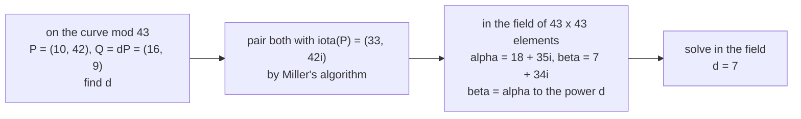

# The Weil pairing: a perfect pairing on the m-torsion, and how it moves a discrete log into a finite field

[Syllabus](../../../SYLLABUS.md) → [Algebraic geometry](../README.md) → [Elliptic Curves](../README.md#s04) → The Weil pairing

---

## General Overview

Take the curve $`y^2 = x^3 - x`$ over the rational numbers. Its right side factors as $`x(x - 1)(x + 1)`$, so three points sit on the x-axis: (0, 0), (1, 0) and (−1, 0). Each one, added to itself, gives O, the curve's zero point at infinity ([The group law](01-elliptic-curves-and-the-group-law.md)). With O they form the **2-torsion**: the four points P with 2P = O.

The **Weil pairing** takes two such points and returns a number. Here the rule is short. For two different points off O it gives −1; for a point paired with itself, or with O, it gives +1. So (0, 0) with (1, 0) gives −1, and (1, 0) with (1, 0) gives +1. Every point other than O has a partner that gives −1. That is what "perfect" means: no point except O pairs to +1 with everything.

Now reduce the same curve mod 43. It has exactly 44 = 43 + 1 points, with a subgroup of 11 of them. A key holder publishes a point P and Q = dP and keeps the whole number d secret. Finding d is the **elliptic-curve discrete logarithm**, the problem keys rest on ([Curves for keys](09-elliptic-curve-cryptography-and-schoof.md)).

The pairing of order 11 turns P and Q into two numbers α and β in a field of 43² = 1,849 elements, with $`\beta = \alpha^d`$. Finding d there is a discrete log in a finite field, where faster attacks exist. This transfer is the **MOV attack** of Menezes, Okamoto and Vanstone (1993). Here the field gives d = 7, the same answer as a search on the curve.

The same pairing, used on purpose, builds keys that plain curves cannot: three parties agree on one key in one round, and many signatures merge into one.

**For each m, the Weil pairing $`e_m`$ turns two points of order dividing m into an m-th root of unity, built from functions whose zeros and poles are prescribed; it multiplies when either point is added to, gives 1 on a point paired with itself, and detects every nonzero point, and Miller's algorithm computes it in about $`2\log_2 m`$ line steps for each of its two functions.**

**What kind of fact this is:** a definition, with a theorem about it. That the value does not depend on the choices, is an m-th root of unity and is bilinear is proved on this card in Why it works, from Weil reciprocity, which is stated with a source. Alternation for odd m is proved here; alternation for even m, nondegeneracy and Miller's formula are stated with their key steps and a named source. The MOV transfer is a proved reduction. Every value on the example is checked exactly.

### The picture: the MOV transfer



Schematic. The arrow from curve to field is cheap: 5 line steps for each Miller function here, about 2 per bit of the order in general. The last box is the hard part, and it is easier in a field than on a curve.

---

## The formula

Notation first, in words.

- m is a whole number not divisible by the field's characteristic (the prime p when working mod p). Here m counts torsion; it is not wing 05's slope m.
- $`E[m]`$ is the set of points P with mP = O, taken over the algebraic closure, the field with every root of every polynomial. It is a group of $`m^2`$ points, two copies of the clock group $`\mathbb{Z}/m`$ side by side.
- $`\mu_m`$ is the set of **m-th roots of unity**: the numbers ζ with $`\zeta^m = 1`$.
- A divisor is a list of points with whole-number weights, and $`\mathrm{div}(f)`$ lists a function's zeros (weight +) and poles (weight −) ([Divisors and Riemann-Roch](../03-Plane%20Curves/07-divisors-and-riemann-roch.md)). For a divisor $`D = \sum n_X X`$ and a function f with no zero or pole on it, $`f(D) = \prod f(X)^{n_X}`$.

The definition. For P and Q in $`E[m]`$, pick divisors $`D_P \sim (P) - (O)`$ and $`D_Q \sim (Q) - (O)`$ with no point in common (∼ means the two sides differ by a function's divisor). Then $`mD_P`$ and $`mD_Q`$ are divisors of functions $`f_P`$ and $`f_Q`$, and

```math
e_m(P, Q) = \frac{f_P(D_Q)}{f_Q(D_P)}, \qquad \mathrm{div}(f_P) = m D_P, \quad \mathrm{div}(f_Q) = m D_Q .
```

**Read it aloud:** evaluate P's function on Q's divisor, evaluate Q's function on P's divisor, and divide.

The properties, for all P, P′, Q, Q′ in $`E[m]`$:

```math
e_m(P + P', Q) = e_m(P, Q)\, e_m(P', Q), \quad e_m(P, Q + Q') = e_m(P, Q)\, e_m(P, Q'), \quad e_m(P, P) = 1, \quad e_m(P, Q)^m = 1 .
```

And **nondegenerate**: if $`e_m(P, Q) = 1`$ for every Q, then P = O.

Miller's algorithm builds $`f_{n,P}`$, the function with divisor $`n(P) - (nP) - (n - 1)(O)`$, one line at a time:

```math
f_{j+k,P} = f_{j,P}\, f_{k,P}\, \frac{\ell_{jP,\,kP}}{v_{(j+k)P}}, \qquad e_m(P, Q) = (-1)^m \frac{f_{m,P}(Q)}{f_{m,Q}(P)} \ \text{ for } P \ne Q .
```

**Read it aloud:** the function for j + k copies is the two smaller functions times the line through jP and kP, over the vertical line at their sum; at n = m the function has divisor $`m(P) - m(O)`$, and the pairing is a ratio of two such functions, with a sign.

The MOV transfer, for P of prime order q and a point T in $`E[q]`$ with $`e_q(P, T) \ne 1`$:

```math
Q = dP \quad \Longrightarrow \quad e_q(Q, T) = e_q(P, T)^d \ \text{ in } \mathbb{F}_{p^\kappa}, \qquad \kappa = \text{least power with } q \mid p^\kappa - 1 .
```

| Symbol | Plain meaning | In our example | Push it up and the answer… |
| --- | --- | --- | --- |
| $`E`$, $`O`$, $`X`$ | the curve; its zero point at infinity; any point of it | $`y^2 = x^3 - x`$ | — |
| $`m`$, $`E[m]`$, $`[m]`$ | the torsion order; the points with mP = O; the map that multiplies a point by m | 2 and 11; 4 and 121 points | $`m^2`$ points, more values |
| $`e_m`$, $`\mu_m`$, $`\zeta`$ | the pairing; the m-th roots of unity it lands in; one such root | −1 and +1 for m = 2 | — |
| $`D`$, $`D_P`$, $`D_Q`$, $`f_P`$, $`f_Q`$ | divisors, each like (P) − (O); the functions with divisor $`mD_P`$ and $`mD_Q`$ | $`D_P = (P + R) - (R)`$ | — |
| $`R`$, $`S`$, $`h`$, $`g`$ | shift points that keep two divisors apart; helper functions in the proofs | R = G, S = ι(G) | — |
| $`f_{n,P}`$, $`\ell`$, $`v`$, $`n`$, $`j`$, $`k`$ | Miller's function; a line through two points; a vertical line; counts of copies of P | 5 line steps for n = 11 | about 2 steps per bit of n |
| $`p`$, $`\mathbb{F}_p`$, $`\mathbb{F}_{p^2}`$, $`i`$ | the prime; remainders mod p; numbers a + bi with $`i^2 = -1`$ | 43; 43 and 1,849 elements | bigger field, slower attack |
| $`\iota`$, $`T`$ | the distortion map (x, y) ↦ (−x, iy); a second point for MOV, here ι(P) | ι(10, 42) = (33, 42i) | — |
| $`G`$, $`P`$, $`Q`$ | a point of order 22; two points being paired, with P = 2G of order 11 and, in MOV, Q = dP | (2, 7), (10, 42), (16, 9) | — |
| $`q`$, $`d`$, $`a`$, $`b`$, $`c`$ | the prime order of P; the secret key; three parties' secrets. The code's 120 × 120 test reuses a, b, c, d as coefficients, and a + bi writes a field element | 11; 7; 2, 5, 9 | rho cost grows like $`\sqrt{q}`$ |
| $`\alpha`$, $`\beta`$ | $`e_{11}(P, \iota P)`$ and $`e_{11}(Q, \iota P)`$ | 18 + 35i and 7 + 34i | — |
| $`\kappa`$ | the embedding degree: least power with q dividing $`p^\kappa - 1`$ | 2 | large κ blocks MOV |

### When it holds

- **m is not divisible by the characteristic.** Then $`E[m]`$ has $`m^2`$ points. For m = p it has at most p, and on a curve with p + 1 points it has only O, even over larger fields. Then $`e_{43}`$ has nothing to pair.
- **Both points are m-torsion.** Put G, of order 22, into $`e_{11}`$ and the result 22 + 20i has 11th power 33i, not 1. No function with divisor $`11(G) - 11(O)`$ exists.
- **The divisors share no point, and Miller's formula needs P ≠ Q.** Pair P with 3P by Miller's formula: computing $`f_{11,3P}`$ doubles 6P to 12P = P, and the vertical line there vanishes at P, so the check stops on a zero. Shifting by R and S, as the definition does, avoids it.
- **A second, independent point exists over a small field.** Every point of $`E(\mathbb{F}_{43})[11]`$ is a multiple of P, and $`e_{11}(P, kP) = 1`$ for all k. The map ι supplies a point outside that line, over $`\mathbb{F}_{43^2}`$.
- **For MOV, κ is small.** The house curve $`y^2 = x^3 - 2`$ mod 13 has 19 points, and κ = 18. The pairing then lands in a field of $`13^{18}`$ elements, against 19 points on the curve: no gain.

---

## Why it works

### Step 0: a point is a divisor class, and a pairing compares two classes

On an elliptic curve, a divisor of degree 0 is the divisor of a function exactly when its points, added in the group law, give O ([Divisors and Riemann-Roch](../03-Plane%20Curves/07-divisors-and-riemann-roch.md)). So (P) − (O) is a function's divisor only when P = O. But if mP = O, then m copies, $`m(P) - m(O)`$, are a function's divisor.

So each m-torsion point owns a function, $`f_P`$, with an m-fold zero at P and an m-fold pole at O. The pairing evaluates one point's function on the other point's divisor, and corrects by the reverse. One fact makes this well behaved:

**Weil reciprocity.** For two functions f and g on a smooth projective curve whose divisors share no point, $`f(\mathrm{div}\, g) = g(\mathrm{div}\, f)`$. On the line it is a short check with factors $`x - a`$; on any such curve it is a theorem, proved in Washington's chapter 11. Every step below is one use of it.

### Step 1: the 2-torsion by hand

For m = 2, the tangent at a point with y = 0 is vertical, so $`f_{2,P} = x - x_P`$. Its divisor is 2(P) − 2(O): a double zero at P, where the vertical line is tangent, and a double pole at O. Miller's formula gives, for two different points of order 2:

```math
e_2(P, Q) = (-1)^2\, \frac{x_Q - x_P}{x_P - x_Q} = -1 .
```

So the four points give a 4 × 4 table: +1 on the diagonal and in the row and column of O, −1 everywhere else. Each row except O's holds a −1, so the pairing is nondegenerate. As a group, $`E[2] = \mathbb{Z}/2 \times \mathbb{Z}/2`$, and this table is the only nondegenerate alternating pairing on it.

### Step 2: the value does not depend on the choices

Replace $`D_P`$ by $`D_P + \mathrm{div}(h)`$, another divisor in the same class. Then $`f_P`$ becomes $`f_P h^m`$, and $`f_Q(D_P)`$ gains a factor $`f_Q(\mathrm{div}\, h)`$. The ratio changes by

```math
\frac{h(D_Q)^m}{f_Q(\mathrm{div}\, h)} = \frac{h(mD_Q)}{f_Q(\mathrm{div}\, h)} = \frac{h(\mathrm{div}\, f_Q)}{f_Q(\mathrm{div}\, h)} = 1 ,
```

by reciprocity. The same works for $`D_Q`$. A constant factor in $`f_P`$ cancels, since $`D_Q`$ has degree 0.

### Step 3: the values are m-th roots of unity

Raise the definition to the power m and move the m inside:

```math
e_m(P, Q)^m = \frac{f_P(mD_Q)}{f_Q(mD_P)} = \frac{f_P(\mathrm{div}\, f_Q)}{f_Q(\mathrm{div}\, f_P)} = 1 .
```

A field $`\mathbb{F}_{p^k}`$ holds all m of the m-th roots of unity only when m divides $`p^k - 1`$, the size of its group of nonzero elements ([Cosets and Lagrange's theorem](../../03-Algebra/08-Groups/04-cosets-and-lagranges-theorem.md)). That is where the embedding degree κ comes from.

### Step 4: bilinear and alternating

**Bilinear.** By Step 0, $`(P + P') - (O)`$ is in the class of $`D_P + D_{P'}`$, since their difference has points adding to O. So take $`D_{P+P'} = D_P + D_{P'}`$ and $`f_{P+P'} = f_P f_{P'}`$. Both the top and the bottom of the ratio then split into a product, which gives the first slot. Swapping P and Q in the definition inverts the value, so the second slot follows.

**Alternating.** Swapping gives $`e_m(P, Q)\, e_m(Q, P) = 1`$, so $`e_m(P, P)^2 = 1`$. Step 3 gives $`e_m(P, P)^m = 1`$. For odd m, 2 and m share no factor, so $`e_m(P, P) = 1`$.

For even m the proof needs another route, through a second form of the definition. The 2-torsion table shows the answer for m = 2.

<details>
<summary>Alternation for every m, and nondegeneracy: the key steps</summary>

Silverman's chapter III, section 8 uses an equivalent form. Take $`f`$ with divisor $`m(Q) - m(O)`$. Pick Q′ with mQ′ = Q, and g with $`g^m = f \circ [m]`$, where [m] multiplies a point by m. Then for P in $`E[m]`$:

$`\displaystyle e_m(P, Q) = \frac{g(X + P)}{g(X)} \quad \text{for any point } X .`$

This agrees with the divisor form, up to inverting the value, which changes none of the properties.

**Alternation.** The product $`\prod_{j=0}^{m-1} f(X + jQ)`$ has divisor $`\sum_j m\,((1 - j)Q) - m\,(-jQ)`$, which cancels to 0. So the product is constant. Since $`g(X + jQ')^m = f(mX + jQ)`$, the product $`\prod_j g(X + jQ')`$ has a constant m-th power, so it is constant too. Comparing it at X and at X + Q′ leaves $`g(X + mQ') = g(X)`$, that is $`g(X + Q) = g(X)`$, so $`e_m(Q, Q) = 1`$.

**Nondegeneracy.** If $`e_m(P, Q) = 1`$ for every P in $`E[m]`$, then $`g(X + P) = g(X)`$ for all such P. A function unchanged by every m-torsion shift is a function of mX: $`g = h \circ [m]`$. Then $`h^m = f`$, so $`\mathrm{div}(h) = (Q) - (O)`$. On a curve of genus 1 no function has a single simple pole, so Q = O.

</details>

### Step 5: Miller's algorithm makes the functions cheap

Writing $`f_P`$ down for a 256-bit m is hopeless: its degree is about m. Miller never writes it down. He builds its value at one point, step by step.

The line $`\ell_{jP, kP}`$ through jP and kP meets the curve a third time at −(j + k)P. The vertical $`v_{(j+k)P}`$ meets it at ±(j + k)P. Each has its poles at O. So their ratio has divisor

```math
\mathrm{div}\!\left(\frac{\ell_{jP,\,kP}}{v_{(j+k)P}}\right) = (jP) + (kP) - ((j+k)P) - (O) .
```

Adding this to the divisors of $`f_{j,P}`$ and $`f_{k,P}`$ gives the divisor of $`f_{j+k,P}`$: the middle terms cancel. Run j + k along the binary digits of m, doubling and adding, and m needs about $`\log_2 m`$ doublings and fewer adds. For m = 11 = 1011 in binary: 1 → 2 → 4 → 5 → 10 → 11, five line steps. At n = m, (mP) is O, so the divisor is $`m(P) - m(O)`$.

The sign in $`(-1)^m f_{m,P}(Q)/f_{m,Q}(P)`$ comes from comparing both functions near O, where both have their poles. Miller (2004) proves the formula. The check computes the pairing both ways, by this formula and by the shifted-divisor definition, and they agree.

### Step 6: why the curve mod 43 has 44 points, and where the second point comes from

**The count.** 43 leaves 3 on division by 4, so −1 is not a square mod 43. The map x ↦ −x sends $`x^3 - x`$ to its negative. So for each pair {x, −x} with $`x^3 - x \ne 0`$, exactly one of the two values is a nonzero square, and that x gives 2 points. The 20 pairs give 40 points. Add (0, 0), (1, 0), (−1, 0) and O: 44 = p + 1. [Complex multiplication](12-complex-multiplication.md) proves the same count for every prime that leaves 3 on division by 4.

**The embedding degree.** 11 divides 44 = 43 + 1, so it divides $`43^2 - 1 = 42 \times 44`$. And 43 mod 11 is 10, not 1. So κ = 2: the pairing lands in $`\mathbb{F}_{43^2}`$, written a + bi with $`i^2 = -1`$.

**The distortion map.** Define $`\iota(x, y) = (-x, iy)`$. It sends the curve to itself: $`(iy)^2 = -y^2 = -(x^3 - x) = (-x)^3 - (-x)`$. It is the map [i] of [Complex multiplication](12-complex-multiplication.md), so it respects the group law; cryptographers call it a **distortion map**. For P of order 11, ι(P) has order 11 too. Its y-coordinate is i times a nonzero number, so it is not a point over $`\mathbb{F}_{43}`$ and not a multiple of P. So P and ι(P) span all of $`E[11]`$, and $`e_{11}(P, \iota P)`$ is not 1 by nondegeneracy.

### Step 7: the MOV transfer and pairing-based keys

Bilinearity gives the whole attack in one line:

```math
e_q(dP, \iota P) = e_q(P, \iota P)^d, \quad\text{so}\quad \beta = \alpha^d .
```

1. Compute α and β by Miller's algorithm: a few hundred line steps for each Miller function at real sizes.
2. Solve $`\beta = \alpha^d`$ in $`\mathbb{F}_{p^\kappa}`$. There **index calculus** works: it factors numbers over small primes ([Diffie-Hellman and ElGamal](../../14-Applied%20and%20computational/04-Cryptography/05-diffie-hellman-and-elgamal.md)), and its cost grows slower than any power of the field size.

On every curve with p + 1 points over $`\mathbb{F}_p`$, p > 3, each prime factor q of the count divides $`p^2 - 1`$, so κ ≤ 2. A 256-bit curve of that kind lands in a 512-bit field. NIST's comparison asks 3,072 bits of a finite field for 128-bit security ([Elliptic curves](../../14-Applied%20and%20computational/04-Cryptography/06-elliptic-curve-cryptography.md)), so such a curve is far weaker than its size suggests. For a random curve, κ is about as large as q, and the field is astronomically large.

**Keys from the same identity.** Joux (2000; journal version 2004) turned the attack around. Three parties hold secrets a, b, c and publish aP, bP, cP. Each pairs the other two public points and raises to its own secret:

```math
e(bP, \iota(cP))^a = e(aP, \iota(cP))^b = e(aP, \iota(bP))^c = e(P, \iota P)^{abc} .
```

One round, one shared key. On the toy curve, secrets 2, 5 and 9 all reach $`\alpha^{90}`$ = 2 + 13i. Short signatures built the same way are the BLS scheme of Boneh, Lynn and Shacham.

---

## Worked numbers, by hand

| Step | Arithmetic | Value |
| --- | --- | --- |
| 2-torsion over ℚ | roots of $`x(x - 1)(x + 1)`$ | (0, 0), (1, 0), (−1, 0), O |
| $`e_2((0, 0), (1, 0))`$ | $`(1 - 0)/(0 - 1)`$ | −1 |
| $`e_2((1, 0), (-1, 0))`$ | $`(-1 - 1)/(1 - (-1)) = -2/2`$ | −1 |
| count mod 43 | 20 pairs × 2 + 3 + O | 44 = 43 + 1 |
| P and ι(P) | P = 2G with G = (2, 7); ι(10, 42) | (10, 42) and (33, 42i); 42 is −1 mod 43 |
| tangent at P | slope $`(3 \cdot 10^2 - 1)/(2 \cdot 42) = 299/84 = 41/41`$ | 1, so 2P = (24, 30) |
| first Miller value at ι(P) | $`(42i - 42 - (33 - 10))/(33 - 24) = (21 + 42i)/9`$ | 31 + 19i |
| after all 5 steps | 2P, 4P, 5P, 10P, 11P = O | $`f_{11,P}(\iota P)`$ = 18 + 34i |
| the other function | Miller again, with ι(P) and P swapped | $`f_{11,\iota P}(P)`$ = 34 + 18i |
| α | $`-(18 + 34i)/(34 + 18i)`$ | **18 + 35i** |
| β for d = 7 | Miller on Q = (16, 9) and ι(P) | 7 + 34i |
| solve $`\alpha^k = \beta`$ | try k = 0, 1, … in $`\mathbb{F}_{43^2}`$ | **k = 7 = d** |

The key d = 7, hidden on the curve, comes out of a power in a 1,849-element field: the curve was never harder than that field.

### What breaks if you drop a piece

| Mistake | Comes out at | What went wrong |
| --- | --- | --- |
| Pair P with its own multiples (no ι) | $`e_{11}(P, kP)`$ = 1 for every k | Alternating: one cyclic group carries no information |
| Drop the sign $`(-1)^{11}`$ | 25 + 8i, whose 11th power is −1 | Not an 11th root of unity: the formula needs its sign |
| Put G, of order 22, into $`e_{11}`$ | 22 + 20i, whose 11th power is 33i | G is not 11-torsion; $`f_{11,G}`$ has the wrong divisor |
| MOV on the house curve mod 13 | 19 points, κ = 18, field of $`13^{18}`$ elements | κ is large: the field problem is bigger than the curve problem |

---

## Code, from first principles, and it actually runs

The script builds the field $`\mathbb{F}_{43^2}`$ as pairs a + bi, adds points by chord and tangent, and computes the pairing by Miller's loop. It takes **four independent roads**:

- The point count by listing every (x, y), against Euler's square test, against p + 1.
- Every pairing value by Miller's formula, against the shifted-divisor definition with R = G and S = ι(G), which uses different evaluation points and agrees only because of Weil reciprocity.
- All 120 × 120 pairs of nonzero points aP + b·ι(P) and cP + d·ι(P) in $`E[11]`$, with coefficients from 0 to 10, against the determinant rule $`\alpha^{ad - bc}`$, which bilinearity and alternation force: one test of both properties and of nondegeneracy.
- The MOV logarithm in the field, against brute force on the curve.

Every toy curve here is insecure.

### Python

```python
# The Weil pairing -- the check behind the card.  Standard library only;
# nothing imported adds points or computes pairings.  The curve is
# y^2 = x^3 - x.  Its 2-torsion gives e_2.  Over F_43 (43 = 3 mod 4) it has
# 44 = 4 x 11 points, and e_11 moves a discrete log into F_(43^2) = F_43(i).
p = 43
ONE, ZERO, I = (1, 0), (0, 0), (0, 1)
def fa(u, v): return ((u[0] + v[0]) % p, (u[1] + v[1]) % p)
def fs(u, v): return ((u[0] - v[0]) % p, (u[1] - v[1]) % p)
def fm(u, v): return ((u[0] * v[0] - u[1] * v[1]) % p, (u[0] * v[1] + u[1] * v[0]) % p)
def fi(u):                               # 1/(a + bi) = (a - bi)/(a^2 + b^2)
    n = (u[0] * u[0] + u[1] * u[1]) % p
    assert n != 0, "division by zero"
    k = pow(n, p - 2, p)
    return (u[0] * k % p, -u[1] * k % p)
def fpow(u, k):
    r = ONE
    for _ in range(k): r = fm(r, u)
    return r
def c(n): return (n % p, 0)
def show(u):                             # an element a + bi of F_(43^2)
    if u[1] == 0: return str(u[0])
    return f"{u[1]}i" if u[0] == 0 else f"{u[0]} + {u[1]}i"
def pt(P): return "O" if P is None else f"({show(P[0])}, {show(P[1])})"
def pm(u): return {ONE: "+1", c(-1): "-1"}.get(u, show(u))
def slope(T, U):                         # tangent slope if T = U, chord slope otherwise
    if T == U: return fm(fs(fm(c(3), fm(T[0], T[0])), ONE), fi(fm(c(2), T[1])))
    return fm(fs(U[1], T[1]), fi(fs(U[0], T[0])))
def add(P, Q):                           # chord and tangent on y^2 = x^3 - x
    if P is None: return Q
    if Q is None: return P
    if P[0] == Q[0] and fa(P[1], Q[1]) == ZERO: return None
    lam = slope(P, Q)
    x = fs(fs(fm(lam, lam), P[0]), Q[0])
    return (x, fs(fm(lam, fs(P[0], x)), P[1]))
def mul(k, P):
    R = None
    for _ in range(k): R = add(R, P)
    return R
def iota(P): return None if P is None else (fs(ZERO, P[0]), fm(I, P[1]))  # (x, y) -> (-x, iy)
def g(T, U, X):                          # line through T and U, over the vertical at T + U, at X
    V = add(T, U)
    if V is None: num, den = fs(X[0], T[0]), ONE
    else:
        num = fs(fs(X[1], T[1]), fm(slope(T, U), fs(X[0], T[0])))
        den = fs(X[0], V[0])
    assert num != ZERO and den != ZERO, "X sits on a zero or pole"
    return fm(num, fi(den)), V
def miller(m, P, X, log=None):            # f_(m,P)(X): divisor m(P) - m(O) when mP = O
    f, T, n, steps = ONE, P, 1, 0
    for bit in bin(m)[3:]:               # double, then add when the bit is 1
        v, T = g(T, T, X); f = fm(fm(f, f), v); n, steps = 2 * n, steps + 1
        if log is not None: log.append(f"  double to {n}P = {pt(T)}: f = {show(f)}")
        if bit == "1":
            v, T = g(T, P, X); f = fm(f, v); n, steps = n + 1, steps + 1
            if log is not None: log.append(f"  add P to {n}P = {pt(T)}: f = {show(f)}")
    return f, steps
def road1(m, P, Q):                      # (-1)^m f_P(Q) / f_Q(P)
    r = fm(miller(m, P, Q)[0], fi(miller(m, Q, P)[0]))
    return r if m % 2 == 0 else fs(ZERO, r)
def road2(m, P, Q, R, S):                # f_P(D_Q) / f_Q(D_P), D_P = (P+R) - (R), D_Q = (Q+S) - (S)
    def F(A, B, X): return fm(miller(m, A, X)[0], fi(fpow(g(A, B, X)[0], m)))
    top = fm(F(P, R, add(Q, S)), fi(F(P, R, S)))
    return fm(top, fi(fm(F(Q, S, add(P, R)), fi(F(Q, S, R)))))

pts = [(c(x), c(y)) for x in range(p) for y in range(p) if (y * y - x ** 3 + x) % p == 0]
euler = p + 1 + sum(1 if pow(x ** 3 - x, (p - 1) // 2, p) == 1 else -1
                    for x in range(p) if (x ** 3 - x) % p)
order = lambda P: next(k for k in range(1, 45) if mul(k, P) is None)
G = next(P for P in pts if order(P) == 22)
R, S = G, iota(G)
print(f"y^2 = x^3 - x over F_{p}: {len(pts) + 1} points by listing, {euler} by Euler's test, p + 1 = {p + 1}")
print(f"G = {pt(G)}, order {order(G)}; shifts R = G, S = iota(G) = {pt(S)}")
assert len(pts) + 1 == euler == p + 1
sq = [x for x in range(p) if (x ** 3 - x) % p and pow(x ** 3 - x, (p - 1) // 2, p) == 1]
split = all((x in sq) != (p - x in sq) for x in range(p) if (x ** 3 - x) % p)
print(f"x with x^3 - x a nonzero square: {len(sq)}, one from each pair x, -x: {'yes' if split else 'no'}")
assert split and 2 * len(sq) + 4 == len(pts) + 1
T2 = [P for P in pts if P[1] == ZERO]
print("e_2 on the 2-torsion, road 1 (Miller) / road 2 (divisors):")
for A in T2:
    row = [(road1(2, A, B) if A != B else None, road2(2, A, B, R, S)) for B in T2]
    print(f"  {pt(A):8} " + "  ".join(f"{'n/a' if a is None else pm(a)} / {pm(b)}" for a, b in row))
    assert all(b == (ONE if A == B else c(-1)) and a in (None, b) for (a, b), B in zip(row, T2))
P = mul(2, G); Qd = iota(P)
trace = []
fP, nsteps = miller(11, P, Qd, trace)
alpha = road1(11, P, Qd)
print(f"P = 2G = {pt(P)}, order {order(P)}; iota(P) = {pt(Qd)}")
print(f"Miller, m = 11 = 1011 in binary: {nsteps} line steps; f_P(iota P) = {show(fP)}, "
      f"f_iotaP(P) = {show(miller(11, Qd, P)[0])}")
print("\n".join(trace))
print(f"alpha = e_11(P, iota P) = {show(alpha)} by road 1, {show(road2(11, P, Qd, R, S))} by road 2")
print(f"alpha^11 = {show(fpow(alpha, 11))}; alpha = 1? {'yes' if alpha == ONE else 'no'}")
assert road2(11, P, Qd, R, S) == alpha and alpha != ONE and fpow(alpha, 11) == ONE
E11 = {(a, b): add(mul(a, P), mul(b, Qd)) for a in range(11) for b in range(11)}
bad = 0
for (a, b), A in E11.items():
    for (cc, d), B in E11.items():
        if A is not None and B is not None:
            bad += road2(11, A, B, R, S) != fpow(alpha, (a * d - b * cc) % 11)
print(f"e_11(aP + b iotaP, cP + d iotaP) = alpha^(ad - bc), all 120 x 120 pairs: {bad} failures")
assert bad == 0
d = 7; Q = mul(d, P); beta = road1(11, Q, Qd)
mov = next(k for k in range(11) if fpow(alpha, k) == beta)
brute = next(k for k in range(11) if mul(k, P) == Q)
print(f"secret d = {d}: Q = dP = {pt(Q)}; beta = e_11(Q, iota P) = {show(beta)}")
print(f"MOV: alpha^k = beta in F_43^2 at k = {mov}; brute force on the curve: k = {brute}")
assert mov == brute == d
kap = next(k for k in range(1, 12) if pow(p, k, 11) == 1)
print(f"embedding degree of 11 over F_43: {kap} (43 mod 11 = {p % 11}); the field F_43^{kap} has {p ** kap} elements")
assert kap == 2
a1, b1, c1 = 2, 5, 9
keys = [fpow(road1(11, mul(b1, P), iota(mul(c1, P))), a1),
        fpow(road1(11, mul(a1, P), iota(mul(c1, P))), b1),
        fpow(road1(11, mul(a1, P), iota(mul(b1, P))), c1)]
print(f"three-party key, secrets {a1}, {b1}, {c1}: {', '.join(show(k) for k in keys)}; "
      f"alpha^{a1 * b1 * c1} = {show(fpow(alpha, a1 * b1 * c1))}")
assert keys[0] == keys[1] == keys[2] == fpow(alpha, a1 * b1 * c1)
same = [road2(11, P, mul(k, P), R, S) for k in range(1, 11)]
print(f"mistake 1, no distortion map: e_11(P, kP) for k = 1..10 takes the values {', '.join(sorted(set(show(v) for v in same)))}")
neg = fs(ZERO, alpha)
print(f"mistake 2, sign (-1)^11 dropped: {show(neg)}, whose 11th power is {pm(fpow(neg, 11))}")
wrong = road1(11, G, Qd)
print(f"mistake 3, G of order 22 put into e_11: {show(wrong)}, whose 11th power is {show(fpow(wrong, 11))}")
hn = 1 + sum(1 for x in range(13) for y in range(13) if (y * y - x ** 3 + 2) % 13 == 0)
kh = next(k for k in range(1, 19) if pow(13, k, 19) == 1)
print(f"mistake 4, house curve y^2 = x^3 - 2 mod 13: {hn} points, embedding degree {kh}, "
      f"field of 13^{kh} = {13 ** kh} elements")
assert all(v == ONE for v in same) and fpow(wrong, 11) != ONE
assert hn == 19 and kh == 18
print("ALL CHECKS PASS")
```

**Ran 2026-11-24 on macOS, Python 3.14.10, standard library only. All checks passed. Output, pasted from the run:**

```
y^2 = x^3 - x over F_43: 44 points by listing, 44 by Euler's test, p + 1 = 44
G = (2, 7), order 22; shifts R = G, S = iota(G) = (41, 7i)
x with x^3 - x a nonzero square: 20, one from each pair x, -x: yes
e_2 on the 2-torsion, road 1 (Miller) / road 2 (divisors):
  (0, 0)   n/a / +1  -1 / -1  -1 / -1
  (1, 0)   -1 / -1  n/a / +1  -1 / -1
  (42, 0)  -1 / -1  -1 / -1  n/a / +1
P = 2G = (10, 42), order 11; iota(P) = (33, 42i)
Miller, m = 11 = 1011 in binary: 5 line steps; f_P(iota P) = 18 + 34i, f_iotaP(P) = 34 + 18i
  double to 2P = (24, 30): f = 31 + 19i
  double to 4P = (16, 34): f = 13 + 17i
  add P to 5P = (14, 35): f = 12 + 2i
  double to 10P = (10, 1): f = 12 + 37i
  add P to 11P = O: f = 18 + 34i
alpha = e_11(P, iota P) = 18 + 35i by road 1, 18 + 35i by road 2
alpha^11 = 1; alpha = 1? no
e_11(aP + b iotaP, cP + d iotaP) = alpha^(ad - bc), all 120 x 120 pairs: 0 failures
secret d = 7: Q = dP = (16, 9); beta = e_11(Q, iota P) = 7 + 34i
MOV: alpha^k = beta in F_43^2 at k = 7; brute force on the curve: k = 7
embedding degree of 11 over F_43: 2 (43 mod 11 = 10); the field F_43^2 has 1849 elements
three-party key, secrets 2, 5, 9: 2 + 13i, 2 + 13i, 2 + 13i; alpha^90 = 2 + 13i
mistake 1, no distortion map: e_11(P, kP) for k = 1..10 takes the values 1
mistake 2, sign (-1)^11 dropped: 25 + 8i, whose 11th power is -1
mistake 3, G of order 22 put into e_11: 22 + 20i, whose 11th power is 33i
mistake 4, house curve y^2 = x^3 - 2 mod 13: 19 points, embedding degree 18, field of 13^18 = 112455406951957393129 elements
ALL CHECKS PASS
```

### Rust

Same numbers, same labels, built with `rustc --edition 2021 -O`.

```rust
// The Weil pairing -- the same check as the Python, in Rust.  No crates;
// nothing used adds points or computes pairings.  The curve is
// y^2 = x^3 - x.  Its 2-torsion gives e_2.  Over F_43 (43 = 3 mod 4) it has
// 44 = 4 x 11 points, and e_11 moves a discrete log into F_(43^2) = F_43(i).
const P_: i64 = 43;
type F = (i64, i64);                     // a + bi, with i^2 = -1
type Pt = Option<(F, F)>;                // None is O, the point at infinity
const ONE: F = (1, 0);
const ZERO: F = (0, 0);
fn md(a: i64) -> i64 { a.rem_euclid(P_) }
fn c(n: i64) -> F { (md(n), 0) }
fn fa(u: F, v: F) -> F { (md(u.0 + v.0), md(u.1 + v.1)) }
fn fs(u: F, v: F) -> F { (md(u.0 - v.0), md(u.1 - v.1)) }
fn fm(u: F, v: F) -> F { (md(u.0 * v.0 - u.1 * v.1), md(u.0 * v.1 + u.1 * v.0)) }
fn powmod(b: i64, e: i64, m: i64) -> i64 {
    let (mut r, mut b, mut e) = (1i64, b.rem_euclid(m), e);
    while e > 0 { if e & 1 == 1 { r = r * b % m } b = b * b % m; e >>= 1 }
    r
}
fn fi(u: F) -> F {                       // 1/(a + bi) = (a - bi)/(a^2 + b^2)
    let n = md(u.0 * u.0 + u.1 * u.1);
    assert!(n != 0, "division by zero");
    let k = powmod(n, P_ - 2, P_);
    (md(u.0 * k), md(-u.1 * k))
}
fn fpow(u: F, k: i64) -> F { let mut r = ONE; for _ in 0..k { r = fm(r, u) } r }
fn show(u: F) -> String {                // an element a + bi of F_(43^2)
    if u.1 == 0 { return format!("{}", u.0) }
    if u.0 == 0 { format!("{}i", u.1) } else { format!("{} + {}i", u.0, u.1) }
}
fn pt(p: Pt) -> String { match p { None => "O".to_string(), Some((x, y)) => format!("({}, {})", show(x), show(y)) } }
fn pm(u: F) -> String { if u == ONE { "+1".into() } else if u == c(-1) { "-1".into() } else { show(u) } }
fn slope(t: (F, F), u: (F, F)) -> F {    // tangent slope if T = U, chord slope otherwise
    if t == u { return fm(fs(fm(c(3), fm(t.0, t.0)), ONE), fi(fm(c(2), t.1))) }
    fm(fs(u.1, t.1), fi(fs(u.0, t.0)))
}
fn add(p: Pt, q: Pt) -> Pt {             // chord and tangent on y^2 = x^3 - x
    let (a, b) = match (p, q) { (None, _) => return q, (_, None) => return p, (Some(a), Some(b)) => (a, b) };
    if a.0 == b.0 && fa(a.1, b.1) == ZERO { return None }
    let lam = slope(a, b);
    let x = fs(fs(fm(lam, lam), a.0), b.0);
    Some((x, fs(fm(lam, fs(a.0, x)), a.1)))
}
fn mul(k: i64, p: Pt) -> Pt { let mut r = None; for _ in 0..k { r = add(r, p) } r }
fn iota(p: Pt) -> Pt { p.map(|(x, y)| (fs(ZERO, x), fm((0, 1), y))) }  // (x, y) -> (-x, iy)
fn g(t: Pt, u: Pt, x: Pt) -> (F, Pt) {   // line through T and U, over the vertical at T + U, at X
    let (t0, u0, x0) = (t.unwrap(), u.unwrap(), x.unwrap());
    let v = add(t, u);
    let (num, den) = match v {
        None => (fs(x0.0, t0.0), ONE),
        Some(v0) => (fs(fs(x0.1, t0.1), fm(slope(t0, u0), fs(x0.0, t0.0))), fs(x0.0, v0.0)),
    };
    assert!(num != ZERO && den != ZERO, "X sits on a zero or pole");
    (fm(num, fi(den)), v)
}
fn miller(m: i64, p: Pt, x: Pt, log: &mut Vec<String>) -> (F, i64) {  // f_(m,P)(X)
    let (mut f, mut t, mut n, mut steps) = (ONE, p, 1, 0);
    let bits = format!("{:b}", m);
    for bit in bits.chars().skip(1) {    // double, then add when the bit is 1
        let (v, t2) = g(t, t, x); f = fm(fm(f, f), v); t = t2; n *= 2; steps += 1;
        log.push(format!("  double to {}P = {}: f = {}", n, pt(t), show(f)));
        if bit == '1' {
            let (v, t2) = g(t, p, x); f = fm(f, v); t = t2; n += 1; steps += 1;
            log.push(format!("  add P to {}P = {}: f = {}", n, pt(t), show(f)));
        }
    }
    (f, steps)
}
fn mil(m: i64, p: Pt, x: Pt) -> F { miller(m, p, x, &mut Vec::new()).0 }
fn road1(m: i64, p: Pt, q: Pt) -> F {    // (-1)^m f_P(Q) / f_Q(P)
    let r = fm(mil(m, p, q), fi(mil(m, q, p)));
    if m % 2 == 0 { r } else { fs(ZERO, r) }
}
fn road2(m: i64, p: Pt, q: Pt, r: Pt, s: Pt) -> F {  // f_P(D_Q) / f_Q(D_P)
    let ff = |a: Pt, b: Pt, x: Pt| fm(mil(m, a, x), fi(fpow(g(a, b, x).0, m)));
    let top = fm(ff(p, r, add(q, s)), fi(ff(p, r, s)));
    fm(top, fi(fm(ff(q, s, add(p, r)), fi(ff(q, s, r)))))
}
fn order(p: Pt) -> i64 { (1..45).find(|&k| mul(k, p).is_none()).unwrap() }

fn main() {
    let p = P_;
    let pts: Vec<Pt> = (0..p).flat_map(|x| (0..p).map(move |y| (x, y)))
        .filter(|&(x, y)| md(y * y - x * x * x + x) == 0).map(|(x, y)| Some((c(x), c(y)))).collect();
    let euler = p + 1 + (0..p).filter(|&x| md(x * x * x - x) != 0)
        .map(|x| if powmod(x * x * x - x, (p - 1) / 2, p) == 1 { 1 } else { -1 }).sum::<i64>();
    let gg = *pts.iter().find(|&&q| order(q) == 22).unwrap();
    let (r, s) = (gg, iota(gg));
    println!("y^2 = x^3 - x over F_{}: {} points by listing, {} by Euler's test, p + 1 = {}", p, pts.len() + 1, euler, p + 1);
    println!("G = {}, order {}; shifts R = G, S = iota(G) = {}", pt(gg), order(gg), pt(s));
    assert!(pts.len() as i64 + 1 == euler && euler == p + 1);
    let f = |x: i64| md(x * x * x - x);
    let sq: Vec<i64> = (0..p).filter(|&x| f(x) != 0 && powmod(f(x), (p - 1) / 2, p) == 1).collect();
    let split = (0..p).filter(|&x| f(x) != 0).all(|x| sq.contains(&x) != sq.contains(&(p - x)));
    println!("x with x^3 - x a nonzero square: {}, one from each pair x, -x: {}", sq.len(), if split { "yes" } else { "no" });
    assert!(split && 2 * sq.len() + 4 == pts.len() + 1);
    let t2: Vec<Pt> = pts.iter().copied().filter(|q| q.unwrap().1 == ZERO).collect();
    println!("e_2 on the 2-torsion, road 1 (Miller) / road 2 (divisors):");
    for &a in &t2 {
        let row: Vec<(Option<F>, F)> = t2.iter().map(|&b| (if a != b { Some(road1(2, a, b)) } else { None }, road2(2, a, b, r, s))).collect();
        let cells: Vec<String> = row.iter().map(|&(x, y)| format!("{} / {}", x.map_or("n/a".to_string(), pm), pm(y))).collect();
        println!("  {:8} {}", pt(a), cells.join("  "));
        assert!(row.iter().zip(&t2).all(|(&(x, y), &b)| y == (if a == b { ONE } else { c(-1) }) && x.map_or(true, |v| v == y)));
    }
    let pp = mul(2, gg); let qd = iota(pp);
    let mut trace = Vec::new();
    let (fp, nsteps) = miller(11, pp, qd, &mut trace);
    let alpha = road1(11, pp, qd);
    println!("P = 2G = {}, order {}; iota(P) = {}", pt(pp), order(pp), pt(qd));
    println!("Miller, m = 11 = 1011 in binary: {} line steps; f_P(iota P) = {}, f_iotaP(P) = {}", nsteps, show(fp), show(mil(11, qd, pp)));
    println!("{}", trace.join("\n"));
    println!("alpha = e_11(P, iota P) = {} by road 1, {} by road 2", show(alpha), show(road2(11, pp, qd, r, s)));
    println!("alpha^11 = {}; alpha = 1? {}", show(fpow(alpha, 11)), if alpha == ONE { "yes" } else { "no" });
    assert!(road2(11, pp, qd, r, s) == alpha && alpha != ONE && fpow(alpha, 11) == ONE);
    let mut e11: Vec<((i64, i64), Pt)> = Vec::new();
    for a in 0..11 { for b in 0..11 { e11.push(((a, b), add(mul(a, pp), mul(b, qd)))) } }
    let mut bad = 0;
    for &((a, b), x) in &e11 { for &((cc, d), y) in &e11 {
        if x.is_some() && y.is_some() && road2(11, x, y, r, s) != fpow(alpha, (a * d - b * cc).rem_euclid(11)) { bad += 1 }
    } }
    println!("e_11(aP + b iotaP, cP + d iotaP) = alpha^(ad - bc), all 120 x 120 pairs: {} failures", bad);
    assert!(bad == 0);
    let d = 7; let q = mul(d, pp); let beta = road1(11, q, qd);
    let mov = (0..11).find(|&k| fpow(alpha, k) == beta).unwrap();
    let brute = (0..11).find(|&k| mul(k, pp) == q).unwrap();
    println!("secret d = {}: Q = dP = {}; beta = e_11(Q, iota P) = {}", d, pt(q), show(beta));
    println!("MOV: alpha^k = beta in F_43^2 at k = {}; brute force on the curve: k = {}", mov, brute);
    assert!(mov == brute && brute == d);
    let kap = (1..12).find(|&k| powmod(p, k, 11) == 1).unwrap();
    println!("embedding degree of 11 over F_43: {} (43 mod 11 = {}); the field F_43^{} has {} elements", kap, p % 11, kap, p.pow(kap as u32));
    assert!(kap == 2);
    let (a1, b1, c1) = (2, 5, 9);
    let keys = [fpow(road1(11, mul(b1, pp), iota(mul(c1, pp))), a1),
                fpow(road1(11, mul(a1, pp), iota(mul(c1, pp))), b1),
                fpow(road1(11, mul(a1, pp), iota(mul(b1, pp))), c1)];
    println!("three-party key, secrets {}, {}, {}: {}; alpha^{} = {}", a1, b1, c1,
             keys.iter().map(|&k| show(k)).collect::<Vec<_>>().join(", "), a1 * b1 * c1, show(fpow(alpha, a1 * b1 * c1)));
    assert!(keys[0] == keys[1] && keys[1] == keys[2] && keys[2] == fpow(alpha, a1 * b1 * c1));
    let same: Vec<F> = (1..11).map(|k| road2(11, pp, mul(k, pp), r, s)).collect();
    let mut vals: Vec<String> = same.iter().map(|&v| show(v)).collect(); vals.sort(); vals.dedup();
    println!("mistake 1, no distortion map: e_11(P, kP) for k = 1..10 takes the values {}", vals.join(", "));
    let neg = fs(ZERO, alpha);
    println!("mistake 2, sign (-1)^11 dropped: {}, whose 11th power is {}", show(neg), pm(fpow(neg, 11)));
    let wrong = road1(11, gg, qd);
    println!("mistake 3, G of order 22 put into e_11: {}, whose 11th power is {}", show(wrong), show(fpow(wrong, 11)));
    let hn = 1 + (0..13i64).flat_map(|x| (0..13i64).map(move |y| (x, y))).filter(|&(x, y)| (y * y - x * x * x + 2).rem_euclid(13) == 0).count();
    let kh = (1..19).find(|&k| powmod(13, k, 19) == 1).unwrap();
    println!("mistake 4, house curve y^2 = x^3 - 2 mod 13: {} points, embedding degree {}, field of 13^{} = {} elements",
             hn, kh, kh, 13i128.pow(kh as u32));
    assert!(same.iter().all(|&v| v == ONE) && fpow(wrong, 11) != ONE);
    assert!(hn == 19 && kh == 18);
    println!("ALL CHECKS PASS");
}
```

**Ran 2026-11-24 on macOS, rustc 1.98.1, no crates. All checks passed. Output, pasted from the run:**

```
y^2 = x^3 - x over F_43: 44 points by listing, 44 by Euler's test, p + 1 = 44
G = (2, 7), order 22; shifts R = G, S = iota(G) = (41, 7i)
x with x^3 - x a nonzero square: 20, one from each pair x, -x: yes
e_2 on the 2-torsion, road 1 (Miller) / road 2 (divisors):
  (0, 0)   n/a / +1  -1 / -1  -1 / -1
  (1, 0)   -1 / -1  n/a / +1  -1 / -1
  (42, 0)  -1 / -1  -1 / -1  n/a / +1
P = 2G = (10, 42), order 11; iota(P) = (33, 42i)
Miller, m = 11 = 1011 in binary: 5 line steps; f_P(iota P) = 18 + 34i, f_iotaP(P) = 34 + 18i
  double to 2P = (24, 30): f = 31 + 19i
  double to 4P = (16, 34): f = 13 + 17i
  add P to 5P = (14, 35): f = 12 + 2i
  double to 10P = (10, 1): f = 12 + 37i
  add P to 11P = O: f = 18 + 34i
alpha = e_11(P, iota P) = 18 + 35i by road 1, 18 + 35i by road 2
alpha^11 = 1; alpha = 1? no
e_11(aP + b iotaP, cP + d iotaP) = alpha^(ad - bc), all 120 x 120 pairs: 0 failures
secret d = 7: Q = dP = (16, 9); beta = e_11(Q, iota P) = 7 + 34i
MOV: alpha^k = beta in F_43^2 at k = 7; brute force on the curve: k = 7
embedding degree of 11 over F_43: 2 (43 mod 11 = 10); the field F_43^2 has 1849 elements
three-party key, secrets 2, 5, 9: 2 + 13i, 2 + 13i, 2 + 13i; alpha^90 = 2 + 13i
mistake 1, no distortion map: e_11(P, kP) for k = 1..10 takes the values 1
mistake 2, sign (-1)^11 dropped: 25 + 8i, whose 11th power is -1
mistake 3, G of order 22 put into e_11: 22 + 20i, whose 11th power is 33i
mistake 4, house curve y^2 = x^3 - 2 mod 13: 19 points, embedding degree 18, field of 13^18 = 112455406951957393129 elements
ALL CHECKS PASS
```

The two outputs match line for line.

### Lean

Lean proves the determinant rule, alternation for odd m and the p + 1 point count in general, then checks the worked numbers.

- Take a pairing e that multiplies when either point is added to, and gives 1 on each point paired with itself. Then $`e(aP + bT, cP + dT) = e(P, T)^{ad - bc}`$ for whole a, b, c, d.
- Take any pairing e with $`e(P, Q) e(Q, P) = 1`$ and $`e(P, Q)^m = 1`$ for all P and Q. Then for odd m, $`e(P, P) = 1`$ for every P.
- Take a prime p that leaves 3 on division by 4. Then $`y^2 = x^3 - x`$ over $`\mathbb{F}_p`$ has exactly p + 1 points, counting O.
- Over ℚ, $`x^3 - x`$ is 0 at x = 0, 1 and −1. Miller's ratio gives −1 for (0, 0) with (1, 0), and for (1, 0) with (−1, 0).
- Mod 43 the curve has 43 points besides O. G, P, 2P and Q = (16, 9) lie on it.
- The tangent at P = (10, 42) has slope 1, and it gives 2P = (24, 30).
- 11 divides $`43^2 - 1`$ but not 43 − 1, so κ = 2.
- The house curve mod 13 has 18 points besides O. The least k with $`13^k`$ equal to 1 mod 19 is 18.
- In $`\mathbb{F}_{43^2}`$, the first Miller value $`(21 + 42i)/9`$ is 31 + 19i.
- The ratio $`-(18 + 34i)/(34 + 18i)`$ is α = 18 + 35i. Then $`\alpha^{11} = 1`$, yet α is not 1.
- β = 7 + 34i equals $`\alpha^7`$, and no smaller power of α gives β.
- The three-party key is $`\alpha^{90}`$ = 2 + 13i.
- The mistakes give $`(25 + 8i)^{11} = -1`$ and $`(22 + 20i)^{11} = 33i`$.

Computing the pairing itself, by Miller's algorithm or by divisors, and the 120 × 120 test are left to the Python and Rust checks.

```lean
-- The Weil pairing: any pairing that multiplies in each slot and gives 1 on a point paired with itself is fixed on the span of P and T by the one value e(P, T) through the determinant rule, alternation follows from swapping when m is odd, and y² = x³ − x has p + 1 points mod every prime p that leaves 3 on division by 4.
import Mathlib.AlgebraicGeometry.EllipticCurve.Affine.Point
import Mathlib.Algebra.QuadraticAlgebra.Defs
import Mathlib.Data.ZMod.Basic
import Mathlib.Data.Fintype.Prod
import Mathlib.Algebra.Group.Int.Even
import Mathlib.Tactic.NormNum
import Mathlib.NumberTheory.LegendreSymbol.QuadraticChar.Basic

open WeierstrassCurve

/-- The card's curve y² = x³ − x, over any commutative ring. -/
def curveE (R : Type*) [CommRing R] : WeierstrassCurve R :=
  { a₁ := 0, a₂ := 0, a₃ := 0, a₄ := -1, a₆ := 0 }

/-- Helper: a pairing that multiplies in the left slot turns whole-number multiples there
into powers. -/
theorem pairing_zpow_left {M G : Type*} [AddCommGroup M] [CommGroup G] (e : M → M → G)
    (hleft : ∀ P P' Q, e (P + P') Q = e P Q * e P' Q) (n : ℤ) (P Q : M) :
    e (n • P) Q = e P Q ^ n := by
  let f : M →+ Additive G := AddMonoidHom.mk' (fun P => Additive.ofMul (e P Q)) (by
    intro a b; simp [hleft])
  have := map_zsmul f n P
  simpa [f] using congrArg Additive.toMul this

/-- Helper: the same for the right slot. -/
theorem pairing_zpow_right {M G : Type*} [AddCommGroup M] [CommGroup G] (e : M → M → G)
    (hright : ∀ P Q Q', e P (Q + Q') = e P Q * e P Q') (n : ℤ) (P Q : M) :
    e P (n • Q) = e P Q ^ n :=
  pairing_zpow_left (fun Q P => e P Q) (fun Q Q' P => hright P Q Q') n Q P

/-- The determinant rule. Let `e` be a pairing on a commutative group of points `M` with values
in a commutative group `G`, written multiplicatively. If `e` multiplies when either point is
added to (bilinear) and gives 1 on a point paired with itself (alternating), then on the span of
two points `P` and `T` it is fixed by the single value `e(P, T)`:
`e(aP + bT, cP + dT) = e(P, T)^(ad − bc)` for all whole numbers `a`, `b`, `c`, `d`.
With `T = ι(P)` this is the card's 120 × 120 check of `e₁₁`, and with `b = d = 0`, `c = 1`
it is the MOV identity `e(dP, T) = e(P, T)^d`. -/
theorem pairing_determinant_rule {M G : Type*} [AddCommGroup M] [CommGroup G] (e : M → M → G)
    (hleft : ∀ P P' Q, e (P + P') Q = e P Q * e P' Q)
    (hright : ∀ P Q Q', e P (Q + Q') = e P Q * e P Q')
    (halt : ∀ P, e P P = 1) (P T : M) (a b c d : ℤ) :
    e (a • P + b • T) (c • P + d • T) = e P T ^ (a * d - b * c) := by
  have hTP : e T P = (e P T)⁻¹ := by
    have h := halt (P + T)
    rw [hleft, hright, hright, halt, halt] at h
    rw [eq_inv_iff_mul_eq_one, mul_comm]
    simpa using h
  rw [hleft, pairing_zpow_left e hleft, pairing_zpow_left e hleft, hright, hright,
    pairing_zpow_right e hright, pairing_zpow_right e hright,
    pairing_zpow_right e hright, pairing_zpow_right e hright, halt, halt, hTP]
  simp only [one_zpow, one_mul, mul_one, inv_zpow', ← zpow_mul, ← zpow_add]
  congr 1; ring

/-- Alternation for odd m (the card's Step 4): if swapping the two points inverts the value,
and every value is an m-th root of unity with m odd, then every point pairs to 1 with itself. -/
theorem pairing_alternating_of_odd {M G : Type*} [CommGroup G] (e : M → M → G) (m : ℕ)
    (hswap : ∀ P Q, e P Q * e Q P = 1) (hroot : ∀ P Q, e P Q ^ m = 1) (hm : Odd m) (P : M) :
    e P P = 1 := by
  obtain ⟨k, rfl⟩ := hm
  have h2 := hswap P P
  have h := hroot P P
  rw [pow_succ, pow_mul, sq, h2, one_pow, one_mul] at h
  exact h

/-- The point count (the card's Step 6): for a prime p that leaves 3 on division by 4, the curve
y² = x³ − x over 𝔽_p has exactly p + 1 points, counting the point O at infinity. -/
theorem card_points_curveE_of_mod_four_eq_three (p : ℕ) [Fact p.Prime] (hp : p % 4 = 3) :
    Nat.card (curveE (ZMod p)).toAffine.Point = p + 1 := by
  classical
  have hp2 : p ≠ 2 := by rintro rfl; norm_num at hp
  have hchar : ringChar (ZMod p) ≠ 2 := by rw [ZMod.ringChar_zmod_n]; exact hp2
  have two_ne : (2 : ZMod p) ≠ 0 := by
    intro h
    have : ((2 : ℕ) : ZMod p) = 0 := by exact_mod_cast h
    rw [ZMod.natCast_eq_zero_iff] at this
    exact hp2 ((Nat.prime_dvd_prime_iff_eq (Fact.out) Nat.prime_two).mp this)
  have : (curveE (ZMod p)).IsElliptic := by
    rw [isElliptic_iff]
    have : (curveE (ZMod p)).Δ = 2 ^ 6 := by
      simp only [Δ, b₂, b₄, b₆, b₈, curveE]; ring
    rw [this]
    exact (IsUnit.mk0 _ two_ne).pow 6
  set W := (curveE (ZMod p)).toAffine
  have eqv := (Equiv.subtypeUnivEquiv (fun _ => trivial)).symm.trans
    (Affine.pointEquivSubtype (W' := W) (p := fun _ => True) trivial)
  have hS : ∀ xy : ZMod p × ZMod p,
      (∃ _ : W.Equation xy.1 xy.2, True) ↔ xy.2 ^ 2 = xy.1 ^ 3 - xy.1 := by
    intro xy
    simp only [exists_prop, and_true, W, Affine.equation_iff, curveE]
    constructor <;> intro h <;> linear_combination h
  rw [Nat.card_congr (eqv.trans (Equiv.optionCongr (Equiv.subtypeEquivRight hS))),
    Nat.card_eq_fintype_card, Fintype.card_option, Fintype.card_subtype]
  congr 1
  rw [Finset.card_filter, Fintype.sum_prod_type]
  simp only [← Finset.card_filter]
  have hsq : ∀ a : ZMod p,
      ((Finset.univ.filter (fun y : ZMod p => y ^ 2 = a)).card : ℤ)
        = quadraticChar (ZMod p) a + 1 := by
    intro a
    rw [← quadraticChar_card_sqrts hchar a]
    simp
  have hneg : quadraticChar (ZMod p) (-1) = -1 := by
    rw [quadraticChar_neg_one_iff_not_isSquare, FiniteField.isSquare_neg_one_iff, ZMod.card]
    simp [hp]
  have hsum : ∑ x : ZMod p, quadraticChar (ZMod p) (x ^ 3 - x) = 0 := by
    have h1 := Equiv.sum_comp (Equiv.neg (ZMod p)) (fun x => quadraticChar (ZMod p) (x ^ 3 - x))
    have h2 : ∀ x : ZMod p, quadraticChar (ZMod p) ((-x) ^ 3 - -x)
        = - quadraticChar (ZMod p) (x ^ 3 - x) := by
      intro x
      rw [show (-x) ^ 3 - -x = (-1) * (x ^ 3 - x) by ring, map_mul, hneg, neg_one_mul]
    simp only [Equiv.neg_apply, h2, Finset.sum_neg_distrib] at h1
    linarith
  have key : ((∑ x : ZMod p,
      (Finset.univ.filter (fun y : ZMod p => y ^ 2 = x ^ 3 - x)).card : ℕ) : ℤ) = p := by
    push_cast
    simp only [hsq, Finset.sum_add_distrib, hsum]
    simp
  exact_mod_cast key

/-! ### The card's whole-number examples -/

-- e₂ over ℚ, by Miller's formula `(x_Q − x_P)/(x_P − x_Q)` with the sign (−1)² = 1.
example : ((1 : ℚ) - 0) / (0 - 1) = -1 := by norm_num
example : ((-1 : ℚ) - 1) / (1 - (-1)) = -1 := by norm_num
-- The 2-torsion over ℚ: x³ − x is 0 at x = 0, 1, −1.
example : ∀ x ∈ ({0, 1, -1} : Finset ℚ), x ^ 3 - x = 0 := by norm_num

-- Mod 43: 43 affine points (x, y) on y² = x³ − x; with O, 44 = 43 + 1.
example : (Finset.univ.filter
    (fun xy : ZMod 43 × ZMod 43 => xy.2 ^ 2 = xy.1 ^ 3 - xy.1)).card = 43 := by decide
-- G = (2, 7), P = (10, 42), 2P = (24, 30) and Q = 7P = (16, 9) lie on the curve mod 43.
example : (7 : ZMod 43) ^ 2 = 2 ^ 3 - 2 := by decide
example : (42 : ZMod 43) ^ 2 = 10 ^ 3 - 10 := by decide
example : (30 : ZMod 43) ^ 2 = 24 ^ 3 - 24 := by decide
example : (9 : ZMod 43) ^ 2 = 16 ^ 3 - 16 := by decide
-- The tangent slope at P is (3·10² − 1)/(2·42) = 1, and it gives 2P = (24, 30).
example : (1 : ZMod 43) * (2 * 42) = 3 * 10 ^ 2 - 1 := by decide
example : (1 : ZMod 43) ^ 2 - 2 * 10 = 24 ∧ (1 : ZMod 43) * (10 - 24) - 42 = 30 := by decide

-- The embedding degree of 11 over 𝔽₄₃ is 2: 11 divides 43² − 1 but not 43 − 1.
example : 11 ∣ 43 ^ 2 - 1 ∧ ¬ 11 ∣ 43 ^ 1 - 1 := by decide
-- The house curve y² = x³ − 2 mod 13: 18 affine points, 19 with O, and embedding degree 18.
example : (Finset.univ.filter
    (fun xy : ZMod 13 × ZMod 13 => xy.2 ^ 2 = xy.1 ^ 3 - 2)).card = 18 := by decide
example : (13 : ZMod 19) ^ 18 = 1 ∧ ∀ k < 18, 0 < k → (13 : ZMod 19) ^ k ≠ 1 := by decide

/-! The field 𝔽₄₃² as numbers `a + bi` with `i² = −1`: `QuadraticAlgebra (ZMod 43) (-1) 0`,
where `⟨a, b⟩` is `a + bi`. -/

-- The first Miller value: (21 + 42i)/9 = 31 + 19i.
example : (⟨9, 0⟩ : QuadraticAlgebra (ZMod 43) (-1) 0) * ⟨31, 19⟩ = ⟨21, 42⟩ := by decide
-- α = −(18 + 34i)/(34 + 18i) = 18 + 35i.
example : (⟨18, 35⟩ : QuadraticAlgebra (ZMod 43) (-1) 0) * ⟨34, 18⟩ = -⟨18, 34⟩ := by decide
-- α is an 11th root of unity other than 1.
example : (⟨18, 35⟩ : QuadraticAlgebra (ZMod 43) (-1) 0) ^ 11 = 1 := by decide
example : (⟨18, 35⟩ : QuadraticAlgebra (ZMod 43) (-1) 0) ≠ 1 := by decide
-- MOV: β = 7 + 34i is α⁷, and no smaller power of α gives β.
example : (⟨18, 35⟩ : QuadraticAlgebra (ZMod 43) (-1) 0) ^ 7 = ⟨7, 34⟩ := by decide
example : ∀ k < 7, (⟨18, 35⟩ : QuadraticAlgebra (ZMod 43) (-1) 0) ^ k ≠ ⟨7, 34⟩ := by decide
-- The three-party key with secrets 2, 5, 9: α⁹⁰ = 2 + 13i.
set_option maxRecDepth 4000 in
example : (⟨18, 35⟩ : QuadraticAlgebra (ZMod 43) (-1) 0) ^ 90 = ⟨2, 13⟩ := by decide
-- Mistake 2, the sign dropped: (25 + 8i)¹¹ = −1.
example : (⟨25, 8⟩ : QuadraticAlgebra (ZMod 43) (-1) 0) ^ 11 = -1 := by decide
-- Mistake 3, G of order 22 put into e₁₁: (22 + 20i)¹¹ = 33i.
example : (⟨22, 20⟩ : QuadraticAlgebra (ZMod 43) (-1) 0) ^ 11 = ⟨0, 33⟩ := by decide

#print axioms pairing_zpow_left
#print axioms pairing_zpow_right
#print axioms pairing_determinant_rule
#print axioms pairing_alternating_of_odd
#print axioms card_points_curveE_of_mod_four_eq_three
```

**Checked 2026-11-24 on macOS, Lean 4.36.0-rc2, Mathlib v4.36.0-rc2. Every proof is complete and uses only Lean's standard axioms. Output, pasted from the run:**

```
'pairing_zpow_left' depends on axioms: [propext, Quot.sound]
'pairing_zpow_right' depends on axioms: [propext, Quot.sound]
'pairing_determinant_rule' depends on axioms: [propext, Quot.sound]
'pairing_alternating_of_odd' depends on axioms: [propext]
'card_points_curveE_of_mod_four_eq_three' depends on axioms: [propext, Classical.choice, Quot.sound]
```

> [!TIP]
> **Try changing**
> Guess first, then run it.
> - **Another secret.** Set `d = 3`. Guess first: does MOV still find it? Yes: Q = (15, 36), β = 11 + 3i, and both roads give k = 3.
> - **No distortion map.** Set `Qd = mul(3, P)`. Guess first: what is α? The run stops on "X sits on a zero or pole": doubling 6P lands on 12P = P, whose vertical line vanishes at P, and the value would be 1 anyway.
> - **Shifts too close.** Set `R, S = G, mul(3, G)`. Guess first: does the definition care? The e_2 table survives, but road 2 for α stops: S = 3G = P + R, so $`D_P = (P + R) - (R)`$ and $`D_Q`$ share the point 3G.
> - **Other key holders.** Set the three secrets to 3, 4 and 6. Guess first: which power of α? All three reach $`\alpha^{72}`$ = 26 + 23i.

---

## The usual mistake

> [!warning]
> **Expecting the pairing to say something about two points of the same cyclic group.** It is alternating, so $`e_m(P, kP) = e_m(P, P)^k = 1`$ for every k. On $`E(\mathbb{F}_{43})`$ alone, every 11-torsion point is a multiple of P, and the pairing returns 1 for all ten values of k. MOV needs a second, independent point: here ι(P), over $`\mathbb{F}_{43^2}`$.
>
> - **Dropping the sign.** Without $`(-1)^{11}`$ the value is 25 + 8i, whose 11th power is −1, not 1.
> - **Pairing points of the wrong order.** G has order 22; its "$`e_{11}`$" is 22 + 20i, whose 11th power is 33i.
> - **Calling every curve weak.** MOV is fast only for small κ. The house curve mod 13 has κ = 18, and its transfer lands in a field of 112,455,406,951,957,393,129 elements.
> - **Reading 42 as a large number.** In $`\mathbb{F}_{43}`$, 42 is −1: the point (−1, 0) prints as (42, 0), and P = (10, 42) has y-coordinate −1.

---

## Where you meet it in real life

- **Rejecting weak curves.** Curve standards require a large embedding degree because of MOV. Supersingular curves, with p + 1 points like this one, are excluded from ordinary key exchange ([Curves for keys](09-elliptic-curve-cryptography-and-schoof.md)).
- **BLS signatures.** Ethereum's proof-of-stake layer signs with BLS signatures on the curve BLS12-381, so many validators' signatures merge into one. It uses a faster relative of the Weil pairing, built from the same Miller functions.
- **One-round three-party keys.** Joux's protocol, in Step 7, was one of the first uses of a pairing to build something rather than break it.
- **Zero-knowledge proofs.** Short proofs such as those in Zcash check equations "in the exponent" with pairings ([Zero-knowledge](../../14-Applied%20and%20computational/04-Cryptography/10-zero-knowledge-proofs-in-outline.md)).

> **Say it back**
> Each m-torsion point P owns a function with an m-fold zero at P and an m-fold pole at O. The Weil pairing evaluates one point's function on the other's divisor and divides by the reverse. Weil reciprocity makes it well defined, bilinear and an m-th root of unity; it is also alternating and nondegenerate. Miller's algorithm computes it in about two line steps per bit for each of its two functions. On $`y^2 = x^3 - x`$ mod 43 the pairing moves the key d = 7 into a 1,849-element field, which is the MOV attack.

---

## What this builds on

- [Isogenies](11-isogenies-and-the-dual-isogeny.md): the multiplication-by-m map, its degree $`m^2`$, and the proof that $`E[m]`$ is an m-by-m grid.
- [Complex multiplication](12-complex-multiplication.md): the map (x, y) ↦ (−x, iy) on this same curve, and its count of p + 1 points when p leaves 3 on division by 4.
- [Divisors and Riemann-Roch](../03-Plane%20Curves/07-divisors-and-riemann-roch.md): divisors, div(f), linear equivalence, and the test that a degree-zero divisor is principal when its points add to O.
- [Curves for keys](09-elliptic-curve-cryptography-and-schoof.md): the discrete logarithm on a curve and the embedding degree κ, which this card explains.
- [Elliptic curves](../../14-Applied%20and%20computational/04-Cryptography/06-elliptic-curve-cryptography.md): ECDH and ECDSA in practice, and the NIST key-size comparison.

## Where this goes next

- [Digital signatures](../../14-Applied%20and%20computational/04-Cryptography/07-digital-signatures.md): hash then sign, the frame that BLS signatures fill with a pairing check.
- [Zero-knowledge](../../14-Applied%20and%20computational/04-Cryptography/10-zero-knowledge-proofs-in-outline.md): proving knowledge of a secret, which pairing-based proof systems make short.

The card leaves one question open: which curves have an embedding degree small enough for pairings to be fast, yet large enough for the field's discrete log to stay hard.

---

## Sources

Verified 2026-11-24: every link below resolves to the publisher's page.

- Silverman, Joseph H. *The Arithmetic of Elliptic Curves*, 2nd ed. Springer, 2009. [doi:10.1007/978-0-387-09494-6](https://doi.org/10.1007/978-0-387-09494-6). Chapter III, section 8: the Weil pairing and the proofs of its properties.
- Washington, Lawrence C. *Elliptic Curves: Number Theory and Cryptography*, 2nd ed. Chapman and Hall/CRC, 2008. [doi:10.1201/9781420071474](https://doi.org/10.1201/9781420071474). Chapter 11: divisors, the divisor form of the pairing, Weil reciprocity and Miller's algorithm.
- Miller, Victor S. "The Weil pairing, and its efficient calculation." *Journal of Cryptology* 17 (2004), 235–261. [doi:10.1007/s00145-004-0315-8](https://doi.org/10.1007/s00145-004-0315-8). The line-by-line algorithm and the formula with the sign $`(-1)^m`$.
- Menezes, Alfred, Tatsuaki Okamoto and Scott Vanstone. "Reducing elliptic curve logarithms to logarithms in a finite field." *IEEE Transactions on Information Theory* 39 (1993), 1639–1646. [doi:10.1109/18.259647](https://doi.org/10.1109/18.259647). The MOV transfer and the embedding degree of supersingular curves.
- Joux, Antoine. "A one round protocol for tripartite Diffie–Hellman." *Journal of Cryptology* 17 (2004), 263–276. [doi:10.1007/s00145-004-0312-y](https://doi.org/10.1007/s00145-004-0312-y). The three-party key from a pairing.
