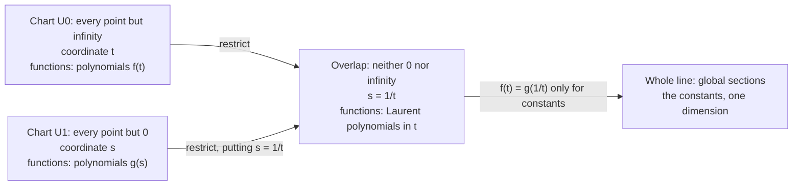

# Sheaves: data that exists locally, glued together with bookkeeping

[Syllabus](../../../SYLLABUS.md) → [Algebraic geometry](../README.md) → [Cohomology and the Hodge Conjecture](../README.md#s05) → Sheaves

---

## General Overview

The projective line is the ordinary number line with one extra point, called infinity, so that it closes up into a loop. Over the complex numbers it is the Riemann sphere. No single coordinate covers it. The coordinate t works everywhere except infinity. A second coordinate, s = 1/t, works everywhere except 0.

Ask a plain question: which polynomial formulas make sense on the whole line, infinity included? The formula 3 + 2t reads 7 at t = 2, 23 at t = 10, 2003 at t = 1000. In the coordinate s it reads (3s + 2)/s, and at s = 0, the point at infinity, it divides by zero. It is a good function on most of the line, but not on all of it.

Every non-constant polynomial in t fails the same way. The constant 3 reads 3 in both coordinates. So the whole line carries only the constants, while every smaller non-empty open piece carries infinitely many functions.

A **sheaf** is the bookkeeping that makes this exact. It records the data on every open piece of a space (here, the functions), how to cut it down to a smaller piece, and the rule that pieces agreeing on overlaps glue into one. Then "which functions exist on the whole line?" becomes exact linear algebra.

**A sheaf assigns data to every open set, with a rule for cutting it down to smaller open sets, such that data that agrees on overlaps glues uniquely; on the projective line the regular functions on two charts glue only when both are the same constant, so the global ones are just the numbers.**

**What kind of fact this is:** a definition (sheaf, sections, global sections), and a theorem proved in Why it works: the regular functions on the whole projective line are the constants. The same argument gives d + 1 global sections for the twist d when d ≥ 0, and none when d < 0.

### The picture: two charts, one gluing rule



The diagram is schematic: it shows how the data moves, not the shape of the line.

---

## The formula

Some reminders first, each in one line.

- **Field.** The numbers come from a field k: here ℂ. The code also uses ℚ and $`\mathbb{F}_5`$, the integers mod 5.
- **The projective line.** $`\mathbb{P}^1`$ is the set of ratios $`(x_0 : x_1)`$ of two numbers, not both zero ([Projective space](../02-Affine%20and%20Projective%20Varieties/03-projective-space-and-homogeneous-coordinates.md)). The point $`(1 : t)`$ has coordinate t; $`(0 : 1)`$ is infinity.
- **Open sets.** These come from [The Zariski topology](../02-Affine%20and%20Projective%20Varieties/02-zariski-topology-and-irreducibility.md): on $`\mathbb{P}^1`$, the whole line minus finitely many points, or the empty set.
- **Regular function.** Near each point, a ratio of polynomials whose denominator is not zero there: a function with no pole ([Maps between varieties](../02-Affine%20and%20Projective%20Varieties/05-regular-and-rational-maps.md)).

Now the new notation, in words first. A **sheaf** $`\mathcal{F}`$ hands out a set $`\mathcal{F}(U)`$ for each open set U. Its members are called **sections over U**. For $`V \subseteq U`$ it gives a **restriction** $`\sigma \mapsto \sigma\vert_V`$ that cuts a section down to V. The sections over the whole space X are the **global sections**, written $`\Gamma(X, \mathcal{F})`$. The sheaf of regular functions on X is written $`\mathcal{O}_X`$. Curly $`\mathcal{O}`$ is a sheaf; plain O is an elliptic curve's zero, and $`O(\cdot)`$ a cost.

Restricting in two steps is the same as restricting in one:

```math
(\sigma\vert_V)\vert_W = \sigma\vert_W \quad \text{for } W \subseteq V \subseteq U
```

**Read it aloud:** cut the data down to V, then to W, and you get what you would get by cutting straight to W.

The gluing rule is what makes a sheaf more than a table of data. Take an open set U covered by open pieces $`U_i`$, with one section $`\sigma_i`$ on each piece:

```math
\sigma_i\vert_{U_i \cap U_j} = \sigma_j\vert_{U_i \cap U_j} \text{ for all } i, j \implies \text{exactly one } \sigma \in \mathcal{F}(U) \text{ has } \sigma\vert_{U_i} = \sigma_i \text{ for all } i
```

**Read it aloud:** local pieces of data that agree on every overlap come from one, and only one, piece of data on the whole union.

This is the pasting lemma of [Continuity by pre-images, and homeomorphism](../../17-Topology/02-Topological%20Spaces/03-continuity-and-homeomorphism.md), where continuous pieces that agree on overlaps glue into one continuous map, asked of any kind of data.

On $`\mathbb{P}^1`$ with the two charts, the gluing rule turns into one equation, and the card's theorem is its solution:

```math
\Gamma(\mathbb{P}^1, \mathcal{O}) = \{ (f, g) \in k[t] \times k[s] : f(t) = g(1/t) \} = k
```

**Read it aloud:** a regular function on the whole projective line is a polynomial in t and a polynomial in s that agree on the overlap, and the only such pairs are a constant and the same constant.

| Symbol | Plain meaning | In our example | Push it up and the answer… |
| --- | --- | --- | --- |
| $`k`$ | the field the numbers come from | ℂ; also ℚ and $`\mathbb{F}_5`$ in the code | a finite field gives finitely many sections to count |
| $`X`$, $`U`$, $`V`$, $`W`$, $`U_i`$ | the space, and open sets in it | $`X = \mathbb{P}^1`$; $`U_0`$, $`U_1`$ | remove more points from U and more functions survive |
| $`\mathcal{F}`$, $`\mathcal{F}(U)`$ | a sheaf; its sections over U | $`\mathcal{O}(U_0) = k[t]`$ | — |
| $`\sigma`$, $`\sigma\vert_V`$ | a section; the same section cut down to V | 3 + 2t on $`U_0`$, cut to the overlap | — |
| $`\mathcal{O}_X`$, $`\mathcal{O}`$ | the sheaf of regular functions | on $`\mathbb{P}^1`$ | — |
| $`\Gamma(X, \mathcal{F})`$ | global sections: the sections over all of X | $`\Gamma(\mathbb{P}^1, \mathcal{O}) = k`$, one dimension | — |
| $`\mathbb{P}^1`$, $`(x_0 : x_1)`$ | the projective line; a point as a ratio | $`(1 : 2)`$ has t = 2; $`(0 : 1)`$ is infinity | — |
| $`U_0`$, $`U_1`$, $`t`$, $`s`$ | the two charts and their coordinates, $`s = 1/t`$ on the overlap | $`U_0`$ misses infinity, $`U_1`$ misses 0 | — |
| $`k[t]`$, $`k[t, t^{-1}]`$ | polynomials in t; Laurent polynomials, which allow negative powers of t | sections over $`U_0`$; over the overlap | — |
| $`f`$, $`g`$, $`b_j`$ | a section over $`U_0`$, written in t; one over $`U_1`$, written in s; the coefficients of g | $`f = 3 + 2t`$ fails; $`f = g = 3`$ glues | higher degree, a bigger pole at infinity |
| $`\mathcal{O}(d)`$, $`d`$ | the twist: the same charts glued by $`f(t) = t^d g(1/t)`$ | $`d = 0`$ is $`\mathcal{O}`$ itself | each step up adds one global section |
| $`N`$ | the degree cap the code puts on f and g | 6; 2 for the count over $`\mathbb{F}_5`$ | the answer does not change once N ≥ d |

### When it holds

- **The gluing rule is part of the definition.** Data with restrictions but no gluing rule is a **presheaf**. Constant functions on the disjoint intervals (0, 1) and (2, 3) form one: 0 on the first and 1 on the second agree on the empty overlap, yet no constant restricts to both. Gluing needs 2 free values; the presheaf has 1.
- **The space must be closed up.** Remove the point at infinity and the sections are all of $`k[t]`$: 7 independent ones up to degree 6, and one more for every degree.
- **The charts must be glued by $`s = 1/t`$.** Glued by $`s = t`$, the two copies make a line with a doubled origin, and every polynomial glues: 7 up to degree 6.
- **Any field, compared by coefficients.** The proof compares coefficients, so any field works. Compare values instead and a finite field misleads: over $`\mathbb{F}_5`$, $`t^5`$ and t agree at each of the 5 points of $`U_0`$ with coordinates in $`\mathbb{F}_5`$, yet differ as polynomials and at points with coordinates in a larger field.

---

## Why it works

### Step 0: a global function is two local functions that agree

$`U_0`$ and $`U_1`$ cover the line. By the gluing rule, a global section is exactly a pair, f on $`U_0`$ and g on $`U_1`$, with the same restriction to the overlap. So the question becomes: what do two rings of functions share on the overlap?

### Step 1: list the sections over each open set

On $`U_0`$ the coordinate is t, and $`U_0`$ is a copy of the ordinary line. Its regular functions are the polynomials $`k[t]`$, as [Affine varieties](../02-Affine%20and%20Projective%20Varieties/01-affine-varieties-and-coordinate-rings.md) shows for the line. On $`U_1`$ they are $`k[s]`$.

On the overlap, 0 is also removed, so 1/t is regular too. Its sections are the Laurent polynomials $`k[t, t^{-1}]`$: sums like $`5t^{-2} + 3 + 2t`$.

| Open set | Sections | Independent ones up to degree 6 |
| --- | --- | --- |
| $`U_0`$, the line without infinity | $`k[t]`$ | 7, one per degree |
| overlap, without 0 and infinity | $`k[t, t^{-1}]`$ | 13, powers −6 to 6 |
| $`\mathbb{P}^1`$, the whole line | the constants | 1 |

The smaller the open set, the more functions it carries: each removed point is a place where a pole is allowed.

### Step 2: restrict both to the overlap

Restriction from $`U_0`$ keeps f as it is: a polynomial in t, now read in the bigger ring. Restriction from $`U_1`$ puts s = 1/t into g. That turns $`g(s) = b_0 + b_1 s + b_2 s^2`$ into $`b_0 + b_1 t^{-1} + b_2 t^{-2}`$.

So f uses only powers $`t^0, t^1, t^2, \dots`$, and $`g(1/t)`$ uses only $`t^0, t^{-1}, t^{-2}, \dots`$.

### Step 3: compare coefficients

Two Laurent polynomials are equal when every power of t has the same coefficient. Power $`t^1`$ and above appear only in f, so those coefficients of f are 0. Power $`t^{-1}`$ and below appear only in $`g(1/t)`$, so those coefficients of g are 0. What is left is power $`t^0`$: f and g are the same constant.

Every constant does glue, so $`\Gamma(\mathbb{P}^1, \mathcal{O}) = k`$: one dimension.

<details>
<summary>The twisted sheaves O(d): d + 1 global sections, by the same comparison</summary>

Glue the same two charts by a different rule: f on $`U_0`$ and g on $`U_1`$ match when $`f(t) = t^d g(1/t)`$. Only the bookkeeping on the overlap changes. The result is the sheaf $`\mathcal{O}(d)`$, which [Line bundles and divisors](06-line-bundles-and-divisor-classes.md) explains.

Write $`g(s) = \sum_j b_j s^j`$. Then

$`\displaystyle t^d g(1/t) = \sum_{j \ge 0} b_j t^{d - j}`$

which uses only the powers $`t^d, t^{d-1}, t^{d-2}, \dots`$, while f uses only $`t^0, t^1, \dots`$. They can match only on the powers from 0 to d. So f is any polynomial of degree at most d, and g is fixed by f. That is d + 1 free coefficients when d ≥ 0, and none when d < 0.

For d = 2, the section $`1 + 4t + t^2`$ on $`U_0`$ glues with $`1 + 4s + s^2`$ on $`U_1`$, since $`t^2(1 + 4/t + 1/t^2) = t^2 + 4t + 1`$.

For d = −2 something else shows. The power $`t^{-1}`$ is reached by neither side. A Laurent polynomial on the overlap with a $`t^{-1}`$ term can never be split as a section on $`U_0`$ plus one on $`U_1`$. That one missing term is the first sign of cohomology: it counts what local data cannot account for.

</details>

### Step 4: why scarcity is the point

The line is closed up: no point is missing, so every non-constant polynomial meets its pole at infinity. Over ℂ this is Liouville's theorem: a function analytic on the whole Riemann sphere is bounded, so constant. The algebra above needs no analysis.

Every projective variety over ℂ in one piece behaves this way. So the subject counts sections of twisted sheaves like $`\mathcal{O}(d)`$ instead: finitely many, but not trivial. [Divisors and Riemann-Roch](../03-Plane%20Curves/07-divisors-and-riemann-roch.md) counts them on curves.

---

## Worked numbers, by hand

Take the candidate $`f = 3 + 2t`$ on $`U_0`$, and try to find a g on $`U_1`$ that glues with it.

| Step | Arithmetic | Value |
| --- | --- | --- |
| f at the point $`(1 : 2)`$ | 3 + 2 × 2 | 7 |
| the same point in chart $`U_1`$ | s = 1/2 | s = 1/2 |
| f written in s | 3 + 2/s = (3s + 2)/s | (3s + 2)/s |
| check at s = 1/2 | (3/2 + 2) ÷ (1/2) | 7 |
| further out: t = 10, 100, 1000 | 3 + 2t | 23, 203, 2003 |
| at infinity, s = 0 | (0 + 2)/0 | no value |
| the coefficient of $`t^1`$ in f | must be 0 for g to exist | 2, so no g |
| constant 3 instead | f = 3, g = 3 | **glues: one global section per constant** |

3 + 2t is a good section over $`U_0`$, but it grows without limit toward infinity, so it is not global. Only constants survive.

### What breaks if you drop a piece

| Mistake | Comes out at | What went wrong |
| --- | --- | --- |
| Use chart $`U_0`$ alone | 7 independent sections up to degree 6, one more per degree | That is the line without infinity, not $`\mathbb{P}^1`$ |
| Never check the overlap | 14 free coefficients up to degree 6; 15625 pairs over $`\mathbb{F}_5`$ | Pairs that disagree are not one function |
| Glue the charts by s = t | 7 glued sections up to degree 6 | The space is a line with a doubled origin |
| Read 3 + 2t as global | f(1000) = 2003, and no value at s = 0 | A pole at infinity was ignored |

The code prints all four.

---

## Code, from first principles, and it actually runs

The code stores a Laurent polynomial as its coefficients for the powers $`t^{-12}`$ to $`t^{12}`$, and both restriction maps write into that list. It counts global sections by three roads.

1. **Rank.** The map $`(f, g) \mapsto f - t^d g(1/t)`$ is a matrix; global sections are its kernel, the pairs sent to zero. Exact elimination over ℚ gives the rank, and the kernel's size is unknowns minus rank.
2. **Brute force.** Over $`\mathbb{F}_5`$, degree at most 2, it tests all 15625 pairs and counts those that glue: 5 to the power of the kernel's size.
3. **The formula.** The proof's answer, max(d + 1, 0).

It also prints the worked numbers, the four mistakes, the 6 points over $`\mathbb{F}_5`$ and the two-interval presheaf.

### Python

```python
# Sheaves in outline -- the check behind the card.  Standard library only.
# The space is the projective line P^1, covered by two charts: U0 with
# coordinate t, and U1 with coordinate s, overlapping where s = 1/t.  A section
# over U0 is a polynomial f(t), over U1 a polynomial g(s); both restrict to the
# overlap as Laurent polynomials in t (powers of t from -12 to 12, as a list).
# The twist d sets the gluing rule f(t) = t^d g(1/t); d = 0 is the sheaf O.
# flip=False glues by s = t instead: the wrong rule, for "What breaks".
from fractions import Fraction

LO, HI = -12, 12

def from_u0(f):                            # restrict f(t) to the overlap
    out = [0] * (HI - LO + 1)
    for i, c in enumerate(f):
        out[i - LO] += c
    return out

def from_u1(g, d, flip=True):              # restrict g(s), s = 1/t, times t^d
    out = [0] * (HI - LO + 1)
    for j, c in enumerate(g):
        out[(d - j if flip else d + j) - LO] += c
    return out

def rank(rows):                            # Gaussian elimination over Q, exact
    rows, r = [row[:] for row in rows], 0
    for col in range(len(rows[0])):
        piv = next((i for i in range(r, len(rows)) if rows[i][col] != 0), None)
        if piv is None:
            continue
        rows[r], rows[piv] = rows[piv], rows[r]
        for i in range(len(rows)):
            if i != r and rows[i][col] != 0:
                k = rows[i][col] / rows[r][col]
                rows[i] = [x - k * y for x, y in zip(rows[i], rows[r])]
        r += 1
    return r

def glue_road(n, d, flip=True):            # road one: rank of (f, g) -> f - t^d g(1/t)
    cols = []
    for i in range(n + 1):
        cols.append(from_u0([1 if k == i else 0 for k in range(i + 1)]))
    for j in range(n + 1):
        cols.append([-x for x in from_u1([1 if k == j else 0 for k in range(j + 1)], d, flip)])
    used = [e for e in range(HI - LO + 1) if any(c[e] for c in cols)]
    window = range(used[0], used[-1] + 1)  # every power of t between the extremes
    rows = [[Fraction(c[e]) for c in cols] for e in window]
    rk = rank(rows)
    return 2 * (n + 1) - rk, len(window) - rk   # (glued sections, terms never reached)

def polys(p, n):                           # every polynomial of degree <= n over F_p
    for code in range(p ** (n + 1)):
        yield [code // p ** k % p for k in range(n + 1)]

def brute_road(p, n, d):                   # road two: test every pair, mod p
    hits = 0
    for f in polys(p, n):
        left = [x % p for x in from_u0(f)]
        for g in polys(p, n):
            if left == [x % p for x in from_u1(g, d)]:
                hits += 1
    return hits

def components(intervals):                 # open intervals: count connected pieces
    pieces, end = 0, None
    for a, b in sorted(intervals):
        if end is None or a >= end:
            pieces += 1
        end = b if end is None else max(end, b)
    return pieces

def yn(claim):
    return "yes" if claim else "no"

N, P, BN = 6, 5, 2
print("P^1 = U0 (coordinate t) and U1 (coordinate s), overlap s = 1/t")
f = lambda t: 3 + 2 * t                    # a section over U0
g = lambda s: (3 * s + 2) / s              # the same function, written in s
for t in (2, 10, 100, 1000):
    print(f"t = {t}: f = 3 + 2t = {f(t)}; s = 1/{t}: (3s + 2)/s = {g(Fraction(1, t))}")
print("at s = 0, the point at infinity: (3s + 2)/s has denominator 0, so 3 + 2t is not global")
print(f"constant 3 on U0 glues with constant 3 on U1: {yn(from_u0([3]) == from_u1([3], 0))}")
q2 = [1, 4, 1]                             # twist 2: f = 1 + 4t + t^2, g = 1 + 4s + s^2
print(f"twist 2: 1 + 4t + t^2 glues with 1 + 4s + s^2: {yn(from_u0(q2) == from_u1(q2, 2))}")
table = {}
for d in range(-2, 4):
    k, left = glue_road(N, d)
    table[d] = (k, left)
    print(f"twist d = {d:2}: glued sections up to degree {N}: {k}; "
          f"Laurent terms never reached: {left}; formula max(d + 1, 0) = {max(d + 1, 0)}")
counts = {}
for d in range(-2, 3):
    counts[d] = brute_road(P, BN, d)
    print(f"over F_{P}, degree <= {BN}, twist {d:2}: {counts[d]} of {P ** (2 * BN + 2)} pairs glue")
only_u0 = N + 1
same_t, _ = glue_road(N, 0, flip=False)
print(f"mistake 1, chart U0 alone: {only_u0} independent sections up to degree {N}, one more per degree")
print(f"mistake 2, overlap never checked: {2 * (N + 1)} free coefficients up to degree {N}; "
      f"{P ** (2 * BN + 2)} pairs over F_{P}")
print(f"mistake 3, charts glued by s = t: {same_t} glued sections up to degree {N}")
print(f"mistake 4, 3 + 2t read as global: f(1000) = {f(1000)}, and no value at s = 0")
print(f"sections up to degree {N}: chart U0 {N + 1}; overlap, powers -{N} to {N}: {2 * N + 1}")
line = {(1, x) for x in range(P)} | {(0, 1)}                  # (1 : t) and infinity
pairs = {(a, b) for a in range(P) for b in range(P) if (a, b) != (0, 0)}
scaled = {min((a * c % P, b * c % P) for c in range(1, P)) for a, b in pairs}
u0 = [t for a, t in line if a == 1]                           # the points (1 : t) of U0 over F_5
same = all(pow(t, P, P) == t for t in u0)
print(f"points of P^1 over F_{P}: {len(line)}; t^{P} and t agree at each of the {len(u0)} points of U0 over F_{P}: {yn(same)}")
pieces = components([(0, 1), (2, 3)])
one = rank([[Fraction(1)] for _ in range(pieces)])            # one constant c restricts to (c, c): rank 1
print(f"constants on (0, 1) and (2, 3): {one} free value; sections that glue: {pieces}")
assert all(counts[d] == P ** table[d][0] for d in counts)          # rank against brute force
assert all(table[d][0] == max(d + 1, 0) for d in table)            # rank against the formula
assert table[-2][1] == 1 and table[0][1] == 0                     # the gap at t^-1 only
assert same_t == N + 1 and pieces == 2 and one == 1 and same and len(scaled) == len(line) == P + 1
assert all(g(Fraction(1, t)) == f(t) for t in (2, 10, 100, 1000))  # two charts, one function
assert from_u0([3]) == from_u1([3], 0) and from_u0(q2) == from_u1(q2, 2)  # the glued examples
print("ALL CHECKS PASS")
```

**Ran 2026-11-17 on macOS, Python 3.14.10, standard library only. All checks passed. Output, pasted from the run:**

```
P^1 = U0 (coordinate t) and U1 (coordinate s), overlap s = 1/t
t = 2: f = 3 + 2t = 7; s = 1/2: (3s + 2)/s = 7
t = 10: f = 3 + 2t = 23; s = 1/10: (3s + 2)/s = 23
t = 100: f = 3 + 2t = 203; s = 1/100: (3s + 2)/s = 203
t = 1000: f = 3 + 2t = 2003; s = 1/1000: (3s + 2)/s = 2003
at s = 0, the point at infinity: (3s + 2)/s has denominator 0, so 3 + 2t is not global
constant 3 on U0 glues with constant 3 on U1: yes
twist 2: 1 + 4t + t^2 glues with 1 + 4s + s^2: yes
twist d = -2: glued sections up to degree 6: 0; Laurent terms never reached: 1; formula max(d + 1, 0) = 0
twist d = -1: glued sections up to degree 6: 0; Laurent terms never reached: 0; formula max(d + 1, 0) = 0
twist d =  0: glued sections up to degree 6: 1; Laurent terms never reached: 0; formula max(d + 1, 0) = 1
twist d =  1: glued sections up to degree 6: 2; Laurent terms never reached: 0; formula max(d + 1, 0) = 2
twist d =  2: glued sections up to degree 6: 3; Laurent terms never reached: 0; formula max(d + 1, 0) = 3
twist d =  3: glued sections up to degree 6: 4; Laurent terms never reached: 0; formula max(d + 1, 0) = 4
over F_5, degree <= 2, twist -2: 1 of 15625 pairs glue
over F_5, degree <= 2, twist -1: 1 of 15625 pairs glue
over F_5, degree <= 2, twist  0: 5 of 15625 pairs glue
over F_5, degree <= 2, twist  1: 25 of 15625 pairs glue
over F_5, degree <= 2, twist  2: 125 of 15625 pairs glue
mistake 1, chart U0 alone: 7 independent sections up to degree 6, one more per degree
mistake 2, overlap never checked: 14 free coefficients up to degree 6; 15625 pairs over F_5
mistake 3, charts glued by s = t: 7 glued sections up to degree 6
mistake 4, 3 + 2t read as global: f(1000) = 2003, and no value at s = 0
sections up to degree 6: chart U0 7; overlap, powers -6 to 6: 13
points of P^1 over F_5: 6; t^5 and t agree at each of the 5 points of U0 over F_5: yes
constants on (0, 1) and (2, 3): 1 free value; sections that glue: 2
ALL CHECKS PASS
```

### Rust

Same numbers, same labels, built with `rustc --edition 2021 -O`.

```rust
// Sheaves in outline -- the same check as the Python, in Rust.  No crates.
// The space is the projective line P^1, covered by two charts: U0 with
// coordinate t, and U1 with coordinate s, overlapping where s = 1/t.  A section
// over U0 is a polynomial f(t), over U1 a polynomial g(s); both restrict to the
// overlap as Laurent polynomials in t (powers of t from -12 to 12, as a list).
// The twist d sets the gluing rule f(t) = t^d g(1/t); d = 0 is the sheaf O.
// flip=false glues by s = t instead: the wrong rule, for "What breaks".
const LO: i64 = -12;
const HI: i64 = 12;
const W: usize = (HI - LO + 1) as usize;

#[derive(Clone, Copy, PartialEq, Debug)]
struct Q { n: i128, d: i128 }              // a fraction in lowest terms, d > 0

fn gcd(a: i128, b: i128) -> i128 { if b == 0 { a.abs() } else { gcd(b, a % b) } }

impl Q {
    fn new(n: i128, d: i128) -> Q {
        let g = gcd(n, d).max(1);
        let s = if d < 0 { -1 } else { 1 };
        Q { n: s * n / g, d: s * d / g }
    }
    fn int(n: i128) -> Q { Q { n, d: 1 } }
    fn mul(self, o: Q) -> Q { Q::new(self.n.checked_mul(o.n).unwrap(), self.d.checked_mul(o.d).unwrap()) }
    fn add(self, o: Q) -> Q {
        Q::new(self.n.checked_mul(o.d).unwrap() + o.n.checked_mul(self.d).unwrap(),
               self.d.checked_mul(o.d).unwrap())
    }
    fn neg(self) -> Q { Q { n: -self.n, d: self.d } }
    fn inv(self) -> Q { Q::new(self.d, self.n) }
}

impl std::fmt::Display for Q {
    fn fmt(&self, f: &mut std::fmt::Formatter) -> std::fmt::Result {
        if self.d == 1 { write!(f, "{}", self.n) } else { write!(f, "{}/{}", self.n, self.d) }
    }
}

fn from_u0(f: &[i64]) -> Vec<i64> {        // restrict f(t) to the overlap
    let mut out = vec![0; W];
    for (i, &c) in f.iter().enumerate() { out[(i as i64 - LO) as usize] += c }
    out
}

fn from_u1(g: &[i64], d: i64, flip: bool) -> Vec<i64> {   // restrict g(s), s = 1/t, times t^d
    let mut out = vec![0; W];
    for (j, &c) in g.iter().enumerate() {
        let e = if flip { d - j as i64 } else { d + j as i64 };
        out[(e - LO) as usize] += c;
    }
    out
}

fn rank(mut rows: Vec<Vec<Q>>) -> usize {  // Gaussian elimination over Q, exact
    let mut r = 0;
    for col in 0..rows[0].len() {
        let piv = match (r..rows.len()).find(|&i| rows[i][col].n != 0) { Some(p) => p, None => continue };
        rows.swap(r, piv);
        for i in 0..rows.len() {
            if i != r && rows[i][col].n != 0 {
                let k = rows[i][col].mul(rows[r][col].inv());
                let pivot_row = rows[r].clone();
                for (x, y) in rows[i].iter_mut().zip(pivot_row.iter()) { *x = x.add(k.mul(*y).neg()) }
            }
        }
        r += 1;
    }
    r
}

fn unit(i: usize) -> Vec<i64> { (0..=i).map(|k| if k == i { 1 } else { 0 }).collect() }

fn glue_road(n: usize, d: i64, flip: bool) -> (usize, usize) {   // road one: rank
    let mut cols: Vec<Vec<i64>> = (0..=n).map(|i| from_u0(&unit(i))).collect();
    for j in 0..=n { cols.push(from_u1(&unit(j), d, flip).iter().map(|x| -x).collect()) }
    let used: Vec<usize> = (0..W).filter(|&e| cols.iter().any(|c| c[e] != 0)).collect();
    let window = used[0]..=used[used.len() - 1];   // every power of t between the extremes
    let rows: Vec<Vec<Q>> = window.clone().map(|e| cols.iter().map(|c| Q::int(c[e] as i128)).collect()).collect();
    let rk = rank(rows);
    (2 * (n + 1) - rk, window.count() - rk)        // (glued sections, terms never reached)
}

fn polys(p: i64, n: usize) -> Vec<Vec<i64>> {      // every polynomial of degree <= n over F_p
    (0..p.pow(n as u32 + 1)).map(|code| (0..=n).map(|k| code / p.pow(k as u32) % p).collect()).collect()
}

fn brute_road(p: i64, n: usize, d: i64) -> i64 {   // road two: test every pair, mod p
    let mut hits = 0;
    let all = polys(p, n);
    for f in &all {
        let left: Vec<i64> = from_u0(f).iter().map(|x| x.rem_euclid(p)).collect();
        for g in &all {
            if left == from_u1(g, d, true).iter().map(|x| x.rem_euclid(p)).collect::<Vec<i64>>() { hits += 1 }
        }
    }
    hits
}

fn components(mut iv: Vec<(i64, i64)>) -> usize {  // open intervals: count connected pieces
    iv.sort();
    let (mut pieces, mut end): (usize, Option<i64>) = (0, None);
    for (a, b) in iv {
        if end.map_or(true, |e| a >= e) { pieces += 1 }
        end = Some(end.map_or(b, |e| e.max(b)));
    }
    pieces
}

fn yn(claim: bool) -> &'static str { if claim { "yes" } else { "no" } }

fn f(t: i64) -> i64 { 3 + 2 * t }                  // a section over U0
fn g(s: Q) -> Q { Q::int(3).mul(s).add(Q::int(2)).mul(s.inv()) }   // the same, in s

fn main() {
    let (n, p, bn) = (6usize, 5i64, 2usize);
    println!("P^1 = U0 (coordinate t) and U1 (coordinate s), overlap s = 1/t");
    for t in [2, 10, 100, 1000] {
        println!("t = {}: f = 3 + 2t = {}; s = 1/{}: (3s + 2)/s = {}", t, f(t), t, g(Q::new(1, t as i128)));
    }
    println!("at s = 0, the point at infinity: (3s + 2)/s has denominator 0, so 3 + 2t is not global");
    println!("constant 3 on U0 glues with constant 3 on U1: {}", yn(from_u0(&[3]) == from_u1(&[3], 0, true)));
    let q2 = [1, 4, 1];                             // twist 2: f = 1 + 4t + t^2, g = 1 + 4s + s^2
    println!("twist 2: 1 + 4t + t^2 glues with 1 + 4s + s^2: {}", yn(from_u0(&q2) == from_u1(&q2, 2, true)));
    let mut table = Vec::new();
    for d in -2..4i64 {
        let (k, left) = glue_road(n, d, true);
        table.push((d, k, left));
        println!("twist d = {:2}: glued sections up to degree {}: {}; Laurent terms never reached: {}; formula max(d + 1, 0) = {}",
                 d, n, k, left, (d + 1).max(0));
    }
    let mut counts = Vec::new();
    for d in -2..3i64 {
        let c = brute_road(p, bn, d);
        counts.push((d, c));
        println!("over F_{}, degree <= {}, twist {:2}: {} of {} pairs glue", p, bn, d, c, p.pow(2 * bn as u32 + 2));
    }
    let only_u0 = n + 1;
    let (same_t, _) = glue_road(n, 0, false);
    println!("mistake 1, chart U0 alone: {} independent sections up to degree {}, one more per degree", only_u0, n);
    println!("mistake 2, overlap never checked: {} free coefficients up to degree {}; {} pairs over F_{}",
             2 * (n + 1), n, p.pow(2 * bn as u32 + 2), p);
    println!("mistake 3, charts glued by s = t: {} glued sections up to degree {}", same_t, n);
    println!("mistake 4, 3 + 2t read as global: f(1000) = {}, and no value at s = 0", f(1000));
    println!("sections up to degree {}: chart U0 {}; overlap, powers -{} to {}: {}", n, n + 1, n, n, 2 * n + 1);
    let line = p + 1;                                            // (1 : t) for each t, and infinity
    let mut scaled: Vec<(i64, i64)> = Vec::new();
    for a in 0..p { for b in 0..p { if (a, b) != (0, 0) {
        let r = (1..p).map(|c| (a * c % p, b * c % p)).min().unwrap();
        if !scaled.contains(&r) { scaled.push(r) }
    } } }
    let u0: Vec<i64> = (0..p).collect();                         // the points (1 : t) of U0 over F_5
    let same = u0.iter().all(|&x| x.pow(p as u32) % p == x);
    println!("points of P^1 over F_{}: {}; t^{} and t agree at each of the {} points of U0 over F_{}: {}", p, line, p, u0.len(), p, yn(same));
    let pieces = components(vec![(0, 1), (2, 3)]);
    let one = rank(vec![vec![Q::int(1)]; pieces]);               // one constant c restricts to (c, c): rank 1
    println!("constants on (0, 1) and (2, 3): {} free value; sections that glue: {}", one, pieces);
    let kernel = |d: i64| table.iter().find(|r| r.0 == d).unwrap();
    assert!(counts.iter().all(|&(d, c)| c == p.pow(kernel(d).1 as u32)));           // rank against brute force
    assert!(table.iter().all(|&(d, k, _)| k as i64 == (d + 1).max(0)));             // rank against the formula
    assert!(kernel(-2).2 == 1 && kernel(0).2 == 0);                                 // the gap at t^-1 only
    assert!(same_t == n + 1 && pieces == 2 && one == 1 && same && scaled.len() as i64 == line);
    assert!([2, 10, 100, 1000].iter().all(|&t| g(Q::new(1, t)) == Q::int(f(t as i64) as i128)));
    assert!(from_u0(&[3]) == from_u1(&[3], 0, true) && from_u0(&q2) == from_u1(&q2, 2, true));   // the glued examples
    println!("ALL CHECKS PASS");
}
```

**Ran 2026-11-17 on macOS, rustc 1.98.1, no crates. All checks passed. Output, pasted from the run:**

```
P^1 = U0 (coordinate t) and U1 (coordinate s), overlap s = 1/t
t = 2: f = 3 + 2t = 7; s = 1/2: (3s + 2)/s = 7
t = 10: f = 3 + 2t = 23; s = 1/10: (3s + 2)/s = 23
t = 100: f = 3 + 2t = 203; s = 1/100: (3s + 2)/s = 203
t = 1000: f = 3 + 2t = 2003; s = 1/1000: (3s + 2)/s = 2003
at s = 0, the point at infinity: (3s + 2)/s has denominator 0, so 3 + 2t is not global
constant 3 on U0 glues with constant 3 on U1: yes
twist 2: 1 + 4t + t^2 glues with 1 + 4s + s^2: yes
twist d = -2: glued sections up to degree 6: 0; Laurent terms never reached: 1; formula max(d + 1, 0) = 0
twist d = -1: glued sections up to degree 6: 0; Laurent terms never reached: 0; formula max(d + 1, 0) = 0
twist d =  0: glued sections up to degree 6: 1; Laurent terms never reached: 0; formula max(d + 1, 0) = 1
twist d =  1: glued sections up to degree 6: 2; Laurent terms never reached: 0; formula max(d + 1, 0) = 2
twist d =  2: glued sections up to degree 6: 3; Laurent terms never reached: 0; formula max(d + 1, 0) = 3
twist d =  3: glued sections up to degree 6: 4; Laurent terms never reached: 0; formula max(d + 1, 0) = 4
over F_5, degree <= 2, twist -2: 1 of 15625 pairs glue
over F_5, degree <= 2, twist -1: 1 of 15625 pairs glue
over F_5, degree <= 2, twist  0: 5 of 15625 pairs glue
over F_5, degree <= 2, twist  1: 25 of 15625 pairs glue
over F_5, degree <= 2, twist  2: 125 of 15625 pairs glue
mistake 1, chart U0 alone: 7 independent sections up to degree 6, one more per degree
mistake 2, overlap never checked: 14 free coefficients up to degree 6; 15625 pairs over F_5
mistake 3, charts glued by s = t: 7 glued sections up to degree 6
mistake 4, 3 + 2t read as global: f(1000) = 2003, and no value at s = 0
sections up to degree 6: chart U0 7; overlap, powers -6 to 6: 13
points of P^1 over F_5: 6; t^5 and t agree at each of the 5 points of U0 over F_5: yes
constants on (0, 1) and (2, 3): 1 free value; sections that glue: 2
ALL CHECKS PASS
```

The two outputs match line for line.

### Lean

Lean proves the card's theorem and the count of glued sections for every twist d, over any field k.

- Take a polynomial f on chart $`U_0`$ and a polynomial g on $`U_1`$, over any field k. Then they glue under $`s = 1/t`$ exactly when both are the same constant.
- Take the twist d, any whole number, with the gluing rule $`f(t) = t^d g(1/t)`$. Then the glued pairs form a space of dimension d + 1 when d ≥ 0, and 0 when d < 0.
- Take d ≥ 0 and a polynomial f on $`U_0`$. Then f glues with some g under the twisted rule exactly when f has degree at most d, and that g is unique.
- Take 3 + 2t at t = 2, 10, 100 and 1000. Then it reads 7, 23, 203 and 2003, and (3s + 2)/s reads 7 at s = 1/2.
- Take the twist d = 2. Then $`1 + 4t + t^2`$ on $`U_0`$ glues with $`1 + 4s + s^2`$ on $`U_1`$.
- Take $`\mathbb{F}_5`$ and degree at most 2. Then the arithmetic behind the counts holds: $`5^6 = 15625`$, and 5, 25, 125 are $`5^1`$, $`5^2`$, $`5^3`$.
- Take $`\mathbb{F}_5`$. Then $`t^5`$ and t agree at every point of $`\mathbb{F}_5`$, yet differ as polynomials.

The presheaf, the wrong gluings and the computed counts are left to the Python and Rust checks.

```lean
-- Sheaves: a polynomial in t on one chart of the projective line and a polynomial in s = 1/t on the other glue into one global function only when both are the same constant, and under the twisted rule f(t) = t^d g(1/t) the glued pairs form a space of dimension d + 1 when d ≥ 0 and 0 when d < 0.
import Mathlib.Algebra.Polynomial.Laurent
import Mathlib.LinearAlgebra.Dimension.Finrank
import Mathlib.LinearAlgebra.FiniteDimensional.Defs
import Mathlib.Data.ZMod.Basic
import Mathlib.Tactic.NormNum
import Mathlib.Tactic.Ring
import Mathlib.RingTheory.Polynomial.Basic
import Mathlib.LinearAlgebra.Dimension.Constructions

open Polynomial LaurentPolynomial

/-- The gluing map for the twist `O(d)` on the projective line over a field `k`. A pair
`(f, g)` is a polynomial `f(t)` on the chart `U₀` and a polynomial `g(s)` on the chart `U₁`.
Both are restricted to the overlap, where sections are Laurent polynomials in `t`: `f` as it
is, and `g` by putting `s = 1/t` (the map `invert`) and multiplying by `t^d`. The map sends the
pair to the difference `f(t) - t^d g(1/t)`; the pairs that glue are exactly its kernel. -/
noncomputable def twistGlue (k : Type*) [Field k] (d : ℤ) : k[X] × k[X] →ₗ[k] k[T;T⁻¹] :=
  (Polynomial.toLaurentAlg (R := k)).toLinearMap ∘ₗ LinearMap.fst k k[X] k[X] -
    LinearMap.mulLeft k (T d : k[T;T⁻¹]) ∘ₗ (invert (R := k)).toLinearMap ∘ₗ
      (Polynomial.toLaurentAlg (R := k)).toLinearMap ∘ₗ LinearMap.snd k k[X] k[X]

theorem lc_nat {k : Type*} [Field k] (p : k[X]) (n : ℕ) :
    (toLaurent p).coeff (n : ℤ) = p.coeff n := by
  rw [coeff_toLaurent]
  have := Finsupp.mapDomain_apply_of_injective (Nat.castEmbedding (R := ℤ)).injective p.toFinsupp.coeff n
  simpa [toFinsupp_apply] using this

theorem lc_neg {k : Type*} [Field k] (p : k[X]) (n : ℤ) (hn : n < 0) :
    (toLaurent p).coeff n = 0 := by
  rw [coeff_toLaurent]
  apply Finsupp.mapDomain_of_notMem_range
  rintro ⟨m, rfl⟩
  simp at hn
  omega

theorem glue_iff {k : Type*} [Field k] (f g : k[X]) (d : ℤ) :
    toLaurent f = T d * invert (toLaurent g) ↔
      ∀ n : ℤ, (toLaurent f).coeff n = (toLaurent g).coeff (d - n) := by
  constructor
  · intro h n
    rw [h, T, AddMonoidAlgebra.coeff_single_mul_apply, invert_apply, one_mul]
    congr 1; ring
  · intro h
    ext n
    rw [h, T, AddMonoidAlgebra.coeff_single_mul_apply, invert_apply, one_mul]
    congr 1; ring

theorem lc_zero_of_lt {k : Type*} [Field k] (p : k[X]) (d : ℤ) (n : ℕ) (h : d < n) :
    (toLaurent p).coeff (d - n) = 0 :=
  lc_neg p _ (by omega)

theorem partner_reflect {k : Type*} [Field k] (d : ℕ) (f : k[X]) (hf : f.degree ≤ d) :
    toLaurent f = T (d : ℤ) * invert (toLaurent (reflect d f)) := by
  rw [glue_iff]
  intro n
  rcases lt_or_ge n 0 with hn | hn
  · rw [lc_neg f n hn]
    obtain ⟨m, hm⟩ : ∃ m : ℕ, (d : ℤ) - n = m := ⟨((d : ℤ) - n).toNat, by omega⟩
    rw [hm, lc_nat, coeff_reflect, revAt_eq_self_of_lt (by omega)]
    exact ((degree_le_iff_coeff_zero f d).1 hf m (by exact_mod_cast (by omega : d < m))).symm
  · obtain ⟨m, rfl⟩ : ∃ m : ℕ, n = m := ⟨n.toNat, by omega⟩
    rw [lc_nat]
    rcases le_or_gt m d with hmd | hmd
    · have : (d : ℤ) - m = ((d - m : ℕ) : ℤ) := by omega
      rw [this, lc_nat, coeff_reflect, revAt_le (by omega)]
      congr 1; omega
    · rw [lc_zero_of_lt _ _ _ (by exact_mod_cast hmd)]
      exact (degree_le_iff_coeff_zero f d).1 hf m (by exact_mod_cast hmd)

theorem partner_unique {k : Type*} [Field k] (d : ℤ) (f g₁ g₂ : k[X])
    (h₁ : toLaurent f = T d * invert (toLaurent g₁))
    (h₂ : toLaurent f = T d * invert (toLaurent g₂)) : g₁ = g₂ := by
  rw [h₁] at h₂
  have := (isUnit_T d).mul_left_cancel h₂
  exact toLaurent_injective (invert.injective this)

theorem coeff_zero_of_glue {k : Type*} [Field k] (d : ℤ) (f g : k[X])
    (h : toLaurent f = T d * invert (toLaurent g)) (m : ℕ) (hm : d < m) : f.coeff m = 0 := by
  rw [← lc_nat, (glue_iff f g d).1 h m]
  exact lc_zero_of_lt g d m hm

theorem mem_ker_twistGlue {k : Type*} [Field k] (d : ℤ) (x : k[X] × k[X]) :
    x ∈ LinearMap.ker (twistGlue k d) ↔ toLaurent x.1 = T d * invert (toLaurent x.2) := by
  simp [twistGlue, sub_eq_zero]

theorem twist_ker_mem_degreeLT {k : Type*} [Field k] (d : ℤ) (x : k[X] × k[X])
    (hx : x ∈ LinearMap.ker (twistGlue k d)) : x.1 ∈ degreeLT k (d + 1).toNat := by
  rw [mem_degreeLT, degree_lt_iff_coeff_zero]
  intro m hm
  exact coeff_zero_of_glue d x.1 x.2 ((mem_ker_twistGlue d x).1 hx) m (by omega)

#print axioms lc_nat
#print axioms lc_neg
#print axioms glue_iff
#print axioms lc_zero_of_lt
#print axioms partner_reflect
#print axioms partner_unique
#print axioms coeff_zero_of_glue
#print axioms mem_ker_twistGlue
#print axioms twist_ker_mem_degreeLT

/-- Global regular functions on the projective line are the constants. Over any field `k`,
a polynomial `f(t)` on the chart `U₀` and a polynomial `g(s)` on the chart `U₁` agree on the
overlap, where `s = 1/t`, exactly when `f` and `g` are the same constant `c`. So
`Γ(P¹, 𝒪) = k`. -/
theorem global_sections_of_projective_line_are_constants {k : Type*} [Field k] (f g : k[X]) :
    toLaurent f = invert (toLaurent g) ↔ ∃ c : k, f = Polynomial.C c ∧ g = Polynomial.C c := by
  constructor
  · intro h
    have h' : toLaurent f = T 0 * invert (toLaurent g) := by rw [T_zero, one_mul, h]
    have hg : toLaurent g = T 0 * invert (toLaurent f) := by
      rw [T_zero, one_mul, h, ← AlgEquiv.trans_apply]
      exact (involutive_invert _).symm
    have hf0 := coeff_zero_of_glue 0 f g h'
    have hg0 := coeff_zero_of_glue 0 g f hg
    have hc : f.coeff 0 = g.coeff 0 := by
      rw [← lc_nat, ← lc_nat, (glue_iff f g 0).1 h' ((0 : ℕ) : ℤ)]
      simp
    refine ⟨f.coeff 0, ?_, ?_⟩
    · ext m
      rcases m with _ | m
      · simp
      · rw [hf0 (m + 1) (by omega), coeff_C]; simp
    · ext m
      rcases m with _ | m
      · simp [hc]
      · rw [hg0 (m + 1) (by omega), coeff_C]; simp
  · rintro ⟨c, rfl, rfl⟩
    simp [toLaurent_C]

/-- The twisted sheaf `O(d)` has `max(d + 1, 0)` global sections. Over any field `k`, the
pairs `(f, g)` of polynomials with `f(t) = t^d g(1/t)` on the overlap form a finite-dimensional
space of dimension `d + 1` when `d ≥ 0` and `0` (only the zero pair) when `d < 0`. -/
theorem twist_global_sections_finrank (k : Type*) [Field k] (d : ℤ) :
    Module.Finite k (LinearMap.ker (twistGlue k d)) ∧
      Module.finrank k (LinearMap.ker (twistGlue k d)) = (d + 1).toNat := by
  let φ : LinearMap.ker (twistGlue k d) →ₗ[k] degreeLT k (d + 1).toNat :=
    ((LinearMap.fst k k[X] k[X]).comp (LinearMap.ker (twistGlue k d)).subtype).codRestrict _
      (fun x => twist_ker_mem_degreeLT d x.1 x.2)
  have hφ : Function.Bijective φ := by
    constructor
    · rintro ⟨⟨f₁, g₁⟩, h₁⟩ ⟨⟨f₂, g₂⟩, h₂⟩ h
      have hf : f₁ = f₂ := congrArg Subtype.val h
      subst hf
      have := partner_unique d f₁ g₁ g₂ ((mem_ker_twistGlue d _).1 h₁)
        ((mem_ker_twistGlue d _).1 h₂)
      subst this
      rfl
    · rintro ⟨f, hf⟩
      rw [mem_degreeLT] at hf
      rcases lt_or_ge d 0 with hd | hd
      · have h0 : (d + 1).toNat = 0 := by omega
        rw [h0, degree_lt_iff_coeff_zero] at hf
        have hf0 : f = 0 := by
          ext m
          simpa using hf m (Nat.zero_le m)
        subst hf0
        exact ⟨0, rfl⟩
      · obtain ⟨n, rfl⟩ : ∃ n : ℕ, d = n := ⟨d.toNat, by omega⟩
        have hle : f.degree ≤ n := by
          rw [degree_le_iff_coeff_zero]
          intro m hm
          rw [degree_lt_iff_coeff_zero] at hf
          exact hf m (by
            have : (n : WithBot ℕ) < m := hm
            have : n < m := by exact_mod_cast this
            omega)
        refine ⟨⟨(f, reflect n f), (mem_ker_twistGlue _ _).2 (partner_reflect n f hle)⟩, rfl⟩
  let e' := (LinearEquiv.ofBijective φ hφ).trans (degreeLTEquiv k (d + 1).toNat)
  refine ⟨Module.Finite.equiv e'.symm, ?_⟩
  rw [e'.finrank_eq]
  exact Module.finrank_fin_fun k

/-- Which sections of `O(d)` on the chart `U₀` extend to the whole line, for `d ≥ 0`: a
polynomial `f(t)` glues with some `g(s)` under `f(t) = t^d g(1/t)` exactly when `f` has degree at
most `d`, and then the partner `g` is unique. -/
theorem twist_section_glues_iff_degree_le {k : Type*} [Field k] (d : ℕ) (f : k[X]) :
    (∃! g : k[X], toLaurent f = T (d : ℤ) * invert (toLaurent g)) ↔ f.degree ≤ d := by
  constructor
  · rintro ⟨g, hg, -⟩
    rw [degree_le_iff_coeff_zero]
    intro m hm
    exact coeff_zero_of_glue d f g hg m (by exact_mod_cast hm)
  · intro hf
    exact ⟨reflect d f, partner_reflect d f hf,
      fun g hg => partner_unique d f g _ hg (partner_reflect d f hf)⟩

-- The candidate 3 + 2t on U₀: 7 at t = 2, then 23, 203, 2003 at t = 10, 100, 1000.
example : (3 + 2 * 2 : ℤ) = 7 ∧ (3 + 2 * 10 : ℤ) = 23 ∧ (3 + 2 * 100 : ℤ) = 203 ∧
    (3 + 2 * 1000 : ℤ) = 2003 := by norm_num
-- The same point in chart U₁: s = 1/2 gives (3s + 2)/s = 7.
example : ((3 * (1 / 2) + 2) / (1 / 2) : ℚ) = 7 := by norm_num

-- Twist 2: 1 + 4t + t² on U₀ glues with 1 + 4s + s² on U₁.
example : toLaurent (1 + 4 * X + X ^ 2 : ℚ[X]) =
    T 2 * invert (toLaurent (1 + 4 * X + X ^ 2 : ℚ[X])) := by
  simp only [map_add, map_mul, map_pow, map_one, map_ofNat, Polynomial.toLaurent_X, invert_T]
  rw [T_pow, T_pow, mul_add, mul_add, ← mul_assoc, mul_comm (T 2 : ℚ[T;T⁻¹]) 4, mul_assoc,
    ← T_add, ← T_add]
  norm_num [T_zero]
  ring

-- Over F₅ with degree at most 2: 5^6 = 15625 pairs in all, and 5^(d + 1) glue for
-- d = 0, 1, 2 (5, 25, 125); 2 · 7 = 14 free coefficients up to degree 6 if the overlap is
-- never checked.
example : (5 : ℕ) ^ 6 = 15625 ∧ (5 : ℕ) ^ 1 = 5 ∧ (5 : ℕ) ^ 2 = 25 ∧ (5 : ℕ) ^ 3 = 125 ∧
    2 * (6 + 1) = 14 := by norm_num

-- Comparing by values misleads over F₅: t⁵ and t agree at every point of F₅ ...
example : ∀ x : ZMod 5, x ^ 5 = x := by decide
-- ... yet differ as polynomials.
example : (X ^ 5 : (ZMod 5)[X]) ≠ X := by
  intro h
  have := congrArg (fun p => Polynomial.coeff p 5) h
  simp [Polynomial.coeff_X] at this
  exact absurd this (by decide)

#print axioms global_sections_of_projective_line_are_constants
#print axioms twist_global_sections_finrank
#print axioms twist_section_glues_iff_degree_le
```

**Checked 2026-11-17 on macOS, Lean 4.36.0-rc2, Mathlib v4.36.0-rc2. Every proof is complete and uses only Lean's standard axioms. Output, pasted from the run:**

```
'lc_nat' depends on axioms: [propext, Classical.choice, Quot.sound]
'lc_neg' depends on axioms: [propext, Classical.choice, Quot.sound]
'glue_iff' depends on axioms: [propext, Classical.choice, Quot.sound]
'lc_zero_of_lt' depends on axioms: [propext, Classical.choice, Quot.sound]
'partner_reflect' depends on axioms: [propext, Classical.choice, Quot.sound]
'partner_unique' depends on axioms: [propext, Classical.choice, Quot.sound]
'coeff_zero_of_glue' depends on axioms: [propext, Classical.choice, Quot.sound]
'mem_ker_twistGlue' depends on axioms: [propext, Classical.choice, Quot.sound]
'twist_ker_mem_degreeLT' depends on axioms: [propext, Classical.choice, Quot.sound]
'global_sections_of_projective_line_are_constants' depends on axioms: [propext, Classical.choice, Quot.sound]
'twist_global_sections_finrank' depends on axioms: [propext, Classical.choice, Quot.sound]
'twist_section_glues_iff_degree_le' depends on axioms: [propext, Classical.choice, Quot.sound]
```

> [!TIP]
> **Try changing**
> Guess first, then run it.
> - **More room.** Set `N = 10`. Guess first: does the d = 0 count change? It stays 1; chart $`U_0`$ alone grows to 11.
> - **A bigger field.** Set `P = 7`. Guess first: how many pairs glue for d = 1? 49, which is 7 squared; the asserts pass.
> - **The wrong gluing.** In `from_u1`, change `d - j if flip` to `d + j if flip`, so that s = t. Guess first: the d = 0 count? 7, and the rank-against-brute-force assert stops the run.
> - **A deeper twist.** Change `range(-2, 4)` to `range(-3, 4)`. Guess first: terms never reached at d = −3? Two, $`t^{-1}`$ and $`t^{-2}`$.

---

## The usual mistake

> [!warning]
> **A function on a big open set is not a function on the whole space.** $`U_0`$ misses one point, so 3 + 2t looks global. At infinity it reads (3s + 2)/s with s = 0: no value. The missing point is where every pole goes.
>
> - **Calling a presheaf a sheaf.** Constants on (0, 1) and (2, 3) give 1 free value; gluing needs 2.
> - **Forgetting the overlap check.** Two charts' functions taken freely give 14 coefficients up to degree 6, not 1.
> - **Gluing by the wrong map.** Glued by s = t, the charts make a line with a doubled origin, and 7 sections up to degree 6 glue.
> - **Comparing by values over a finite field.** Over $`\mathbb{F}_5`$ the line has 6 points with coordinates in $`\mathbb{F}_5`$, and $`t^5`$ agrees with t at each of the 5 in $`U_0`$. Compare coefficients.

---

## Where you meet it in real life

- **Maps of the Earth.** No single flat map covers a sphere, so an atlas uses several charts with overlap rules. A sheaf keeps the same books for functions.
- **Data from many sensors.** Each sensor covers a patch. Readings that agree on overlaps combine into one picture; a clash flags a fault. Sheaf methods are used to fuse such data.
- **The shelf's torus.** On the complex torus of the square lattice, the analytic functions are again only constants. Lifted to the plane, such a function repeats on every square of the lattice, so it is bounded, and [Liouville's theorem](../../07-Complex%20analysis/03-Contour%20Integrals%20and%20Cauchy%27s%20Theorem/07-liouville-and-the-fundamental-theorem-of-algebra.md) makes it constant.
- **Modern geometry.** A scheme, the subject's central object, is a space carrying a sheaf of rings; [The spectrum of a ring](../06-Schemes%20and%20Modern%20Language/02-spectrum-of-a-ring-and-schemes.md) builds one.

> **Say it back**
> A sheaf hands out data on every open set, with restrictions that cut data down to smaller sets. Its gluing rule says data that agrees on every overlap comes from exactly one piece of data on the union. On the projective line, a global regular function is a polynomial in t and a polynomial in s = 1/t that agree on the overlap. Comparing coefficients leaves only the constants. Twisting the gluing rule to $`f(t) = t^d g(1/t)`$ gives d + 1 global sections when d ≥ 0, and none when d < 0.

---

## What this builds on

- [Affine varieties](../02-Affine%20and%20Projective%20Varieties/01-affine-varieties-and-coordinate-rings.md): the regular functions on a chart, $`k[t]`$ for the line.
- [Maps between varieties](../02-Affine%20and%20Projective%20Varieties/05-regular-and-rational-maps.md): functions that are ratios of polynomials, defined away from a bad set.
- [Continuity by pre-images, and homeomorphism](../../17-Topology/02-Topological%20Spaces/03-continuity-and-homeomorphism.md): open sets, restriction to a piece, and the pasting lemma, the model for the gluing rule.

## Where this goes next

- [De Rham cohomology](02-de-rham-cohomology-of-varieties.md): the next card; differential forms are another sheaf, and cohomology counts the closed ones that do not come from anything.
- [Cohomology of projective space](03-cohomology-of-projective-space.md): the same two charts, now with their cohomology counted in every degree.
- [Line bundles and divisors](06-line-bundles-and-divisor-classes.md): the twisted sheaves $`\mathcal{O}(d)`$, and what their gluing rules record.
- [The Hodge conjecture](08-hodge-conjecture-statement-and-known-cases.md): the shelf's goal, stated with the cohomology these sheaves feed.

The question this card leaves open: the twist d = −2 left one Laurent term that no pair of local sections can produce; how is that leftover measured in general, and what does it say about the space?

---

## Sources

Verified 2026-11-17: every link below resolves to the publisher's page.

- Serre, Jean-Pierre. "Faisceaux algébriques cohérents." *Annals of Mathematics* 61, no. 2 (1955): 197–278. [doi:10.2307/1969915](https://doi.org/10.2307/1969915). The paper that brought sheaves into algebraic geometry.
- Hartshorne, Robin. *Algebraic Geometry*. Springer, 1977. [doi:10.1007/978-1-4757-3849-0](https://doi.org/10.1007/978-1-4757-3849-0). Sheaves and gluing in Chapter II; the global sections of $`\mathcal{O}(d)`$.
- Shafarevich, Igor R. *Basic Algebraic Geometry 1*, 3rd ed. Springer, 2013. [doi:10.1007/978-3-642-37956-7](https://doi.org/10.1007/978-3-642-37956-7). Why regular functions on a projective variety are constant.
- Reid, Miles. *Undergraduate Algebraic Geometry*. Cambridge University Press, 1988. [doi:10.1017/CBO9781139163699](https://doi.org/10.1017/CBO9781139163699). The projective line by two charts, at this card's level.
- Griffiths, Phillip, and Joseph Harris. *Principles of Algebraic Geometry*. Wiley, 1994. [doi:10.1002/9781118032527](https://doi.org/10.1002/9781118032527). Sheaves on complex manifolds, for later on this shelf.
