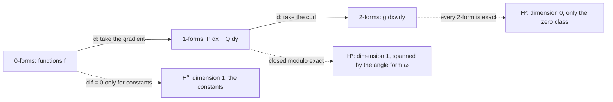

# De Rham cohomology: closed forms modulo exact ones, counted degree by degree

[Syllabus](../../../SYLLABUS.md) → [Algebraic geometry](../README.md) → [Cohomology and the Hodge Conjecture](../README.md#s05) → De Rham cohomology

---

## General Overview

A straight wire carries a steady 10 A current. An electrician closes a clamp meter round it. The jaws are a loop, and the meter adds up the magnetic field's push along that loop.

The total is $`\mu_0 I`$: the magnetic constant times the current, 12.566371 microtesla metres. A round loop of radius 5 cm gives that; at that distance the field is only 40 microtesla. A square loop set off-centre gives the same. Any loop that circles the wire once gives the same. A loop that misses the wire gives 0. The meter divides by the magnetic constant and shows 10 A.

Away from the wire, the field has zero curl: it does not spin any small paddle wheel. On a region with no holes, zero curl means a potential exists, and then every loop gives 0 ([Conservative fields](../../06-Calculus%20and%20analysis/09-Vector%20Calculus/04-conservative-fields-and-potentials.md)). Round the wire it gives 12.566371. So the field has no potential, and the failure is not noise: it is one number, the same on every loop round the wire.

De Rham cohomology collects exactly these failures. It takes every field with zero curl, treats any two as the same when they differ by a field that has a potential, and counts what is left. Round the wire, one number is left. That number is what the clamp reads.

**De Rham cohomology is the closed forms (zero curl) modulo the exact forms (those with a potential), one group per degree; on the punctured plane the first group is one-dimensional, spanned by the angle form (the wire's field pattern, scaled so one loop round the hole gives 2π), and the one number that reads a class is its loop integral divided by 2π.**

**What kind of fact this is:** a definition, plus a theorem proved on this card in Why it works: the punctured plane's de Rham groups have dimensions 1, 1 and 0 in degrees 0, 1 and 2, and the same count holds for the algebraic forms on the variety $`\mathbb{C}^\times`$, the complex line with 0 removed. Two comparison theorems, de Rham's and Grothendieck's, are stated with sources, not proved.

### The picture: the de Rham complex of the punctured plane



Each solid arrow is the derivative $`d`$. Each dotted arrow is the count that survives in that degree.

---

## The formula

Notation first, in words. The space is $`X`$; here mostly the **punctured plane** $`\mathbb{R}^2 \setminus \{0\}`$, the plane with the origin removed. Its points are $`(x, y)`$, and $`r = \sqrt{x^2 + y^2}`$ is the distance to the origin.

- A **0-form** is a function $`f(x, y)`$.
- A **1-form** is $`\alpha = P\,dx + Q\,dy`$: a field with east part $`P`$ and north part $`Q`$, written ready to be integrated along a path. This is the $`M\,dx + N\,dy`$ of the differential-equations wing.
- A **2-form** is $`g\,dx \wedge dy`$: a density to be integrated over areas. The wedge $`\wedge`$ records orientation: $`dy \wedge dx = -dx \wedge dy`$. Forms of every degree are the subject of the differential-geometry wing; this card needs only these three.

The **exterior derivative** $`d`$ raises the degree by one. On a function it is the gradient; on a 1-form it is the curl:

```math
df = \frac{\partial f}{\partial x}\,dx + \frac{\partial f}{\partial y}\,dy, \qquad d(P\,dx + Q\,dy) = \left(\frac{\partial Q}{\partial x} - \frac{\partial P}{\partial y}\right) dx \wedge dy
```

A form is **closed** when $`d\alpha = 0`$. It is **exact** when $`\alpha = dF`$ for some form $`F`$ one degree lower: a potential. The de Rham cohomology in degree $`k`$ is:

```math
H^k_{dR}(X) = \frac{\{\text{closed } k\text{-forms on } X\}}{\{\text{exact } k\text{-forms on } X\}}
```

**Read it aloud:** the k-th de Rham group of X is the closed k-forms, with any two counted as the same when their difference is exact.

The class of a closed form $`\alpha`$ is written $`[\alpha]`$. The card's main example is the **angle form**, written $`\omega`$ on this card only; from [Complex manifolds and Kahler forms](04-complex-manifolds-and-kahler-forms.md) on, $`\omega`$ names a Kahler form:

```math
\omega = \frac{-y\,dx + x\,dy}{x^2 + y^2}, \qquad H^1_{dR}(\mathbb{R}^2 \setminus \{0\}) = \mathbb{R}\,[\omega], \qquad [\alpha] = c\,[\omega] \text{ with } c = \frac{1}{2\pi}\oint_{r = 1} \alpha
```

**Read it aloud:** the angle form is minus y dx plus x dy, over r squared; every closed 1-form on the punctured plane is a multiple of the angle form plus an exact form, and the multiple is its integral once round the unit circle divided by 2π.

The wire's field, written as a 1-form, is $`B_x\,dx + B_y\,dy = \frac{\mu_0 I}{2\pi}\,\omega`$. With $`\mu_0 I / 2\pi`$ = 2 microtesla metres, its class is 2 microtesla metres times $`[\omega]`$, and the clamp reads $`2\pi`$ times that.

| Symbol | Plain meaning | In our example | Push it up and the answer… |
| --- | --- | --- | --- |
| $`X`$; $`\mathbb{R}`$, $`\mathbb{C}`$ | the space; the real and the complex numbers | the punctured plane | more holes, more classes |
| $`x`$, $`y`$, $`r`$; $`t`$; $`\rho`$, $`\phi`$ | position east and north; distance to the origin; the angle run round a circle; polar radius and angle in the folds | the unit circle has r = 1 and $`x = \cos t`$ | — |
| $`f`$, $`F`$ | a function (a 0-form); a potential, with $`dF`$ the given form | $`F = \ln(x^2 + y^2)`$ | adding a constant changes nothing |
| $`\alpha = P\,dx + Q\,dy`$, $`\beta`$ | a 1-form: east part P, north part Q; what is left after removing $`c\,\omega`$ | the wire's field; $`\beta = \alpha - 3\omega`$ | — |
| $`d`$ | the exterior derivative: gradient on functions, curl on 1-forms | $`d\omega = 0`$ | — |
| $`g\,dx \wedge dy`$ | a 2-form: an oriented area density | $`dx \wedge dy`$, the area form | — |
| $`\omega`$, $`\theta`$ | the angle form; a local angle, with $`d\theta = \omega`$ where it is defined | $`\oint \omega = 2\pi`$ | each extra turn of the loop adds 2π |
| $`H^k_{dR}(X)`$, $`k`$ | closed k-forms modulo exact ones; the degree | dimensions 1, 1, 0 for k = 0, 1, 2 | — |
| $`[\alpha]`$, $`c`$, $`\oint_\gamma`$ | the class of α; its coordinate; the integral once round a loop γ | the wire: c = 2 microtesla metres | a bigger current, a bigger c |
| $`z`$, $`n`$, $`m`$, $`\mathbb{C}[z, z^{-1}]`$, $`dz/z`$ | the complex coordinate; whole-number powers; Laurent polynomials, the functions on $`\mathbb{C}^\times`$; the algebraic angle form | $`\oint dz/z = 2\pi i`$ | — |
| $`\mathbb{F}_5`$ | the integers modulo 5 | a field where $`d(z^5) = 0`$ | — |
| $`\mu_0`$, $`I`$, $`B`$ | the magnetic constant, taken as $`4\pi \times 10^{-7}`$ T·m/A; the current; the magnetic field, with east and north parts $`B_x`$, $`B_y`$ | I = 10 A; B = 40 microtesla at 5 cm | the clamp reading grows with I |

### When it holds

- **Smooth forms on an open set.** P and Q need continuous partial derivatives, or the curl is not defined. At the origin the angle form blows up, so the origin is left out, and that hole is what the class detects.
- **Closed before exact.** Every exact form is closed, because mixed partial derivatives agree. A form with nonzero curl, such as $`x\,dy`$, has no class at all.
- **Real coefficients for de Rham's theorem.** De Rham classes see holes counted with real numbers. Torsion, a loop that bounds only when doubled, is invisible here; it needs whole-number cohomology ([Homology groups](../../17-Topology/05-Homology/02-homology-groups.md)).
- **Characteristic zero for algebraic forms.** Over $`\mathbb{C}`$ the derivative of $`z^n`$ is $`n z^{n-1}`$, never 0 for $`n \ne 0`$. Over $`\mathbb{F}_5`$, $`d(z^5) = 5z^4\,dz = 0`$, and the count goes wrong (What breaks, below).

---

## Why it works

### Step 0: a loop integral cannot see exact forms

If $`\alpha = dF`$, then integrating $`\alpha`$ along a path gives F at the end minus F at the start. Round a loop the ends agree, so the integral is 0 ([Conservative fields](../../06-Calculus%20and%20analysis/09-Vector%20Calculus/04-conservative-fields-and-potentials.md)).

So adding an exact form never changes a loop integral. A loop integral is therefore a measurement of the class $`[\alpha]`$, not of the form.

Also, every exact form is closed. For $`F`$ a function, $`d(dF)`$ has coefficient $`\partial^2 F/\partial x \partial y - \partial^2 F / \partial y \partial x = 0`$. So the exact forms sit inside the closed forms, and the quotient makes sense.

### Step 1: the angle form is closed

For $`\omega`$, $`P = -y/r^2`$ and $`Q = x/r^2`$. By the quotient rule both cross rates equal $`(y^2 - x^2)/r^4`$. At (1, 2) both are 3/25 = 0.12, and their difference, the curl, is 0. The calculus wing met this as the whirlpool field ([Conservative fields](../../06-Calculus%20and%20analysis/09-Vector%20Calculus/04-conservative-fields-and-potentials.md)); here it is a closed 1-form.

### Step 2: the angle form is not exact

On the unit circle $`x = \cos t`$, $`y = \sin t`$, so $`-y\,dx + x\,dy = (\sin^2 t + \cos^2 t)\,dt = dt`$ and $`r^2 = 1`$. Once round, t runs from 0 to 2π:

```math
\oint_{r = 1} \omega = \int_0^{2\pi} dt = 2\pi \ne 0
```

**Read it aloud:** the angle form, integrated once round the unit circle, gives 2π, which is not zero.

By Step 0 an exact form would give 0. So $`[\omega] \ne 0`$, and $`H^1_{dR}`$ has at least one dimension.

### Step 3: every closed 1-form is a multiple of ω plus an exact form

Take any closed $`\alpha`$ and set $`c = \frac{1}{2\pi}\oint \alpha`$ round the unit circle. Then $`\beta = \alpha - c\,\omega`$ is closed and integrates to 0 round the unit circle.

Any loop in the punctured plane can be deformed to the unit circle traversed some whole number of times, its **winding number**. A closed form gives the same integral on two loops that bound a region together: Green's theorem turns the difference into the curl over that region, which is 0 ([Stokes' theorem](../../06-Calculus%20and%20analysis/09-Vector%20Calculus/08-stokes-theorem.md)). So every loop integral of $`\beta`$ is its winding number times 0.

All loop integrals of $`\beta`$ vanish, so its path integrals depend only on the ends, and a potential exists. So $`\alpha = c\,\omega + dF`$, and $`H^1_{dR}`$ is exactly one-dimensional.

<details>
<summary>Detailed proof: zero round the circle gives a potential everywhere</summary>

Let $`\beta = P\,dx + Q\,dy`$ be closed on the punctured plane, with $`\oint \beta = 0`$ round the unit circle. Write points in polar form $`(\rho\cos\phi, \rho\sin\phi)`$ with $`\rho > 0`$. Define $`F(\rho, \phi)`$ as the integral of $`\beta`$ along the ray from (1, 0) out to radius $`\rho`$, then along the circle of radius $`\rho`$ from angle 0 to angle $`\phi`$:

$`\displaystyle F(\rho, \phi) = \int_1^{\rho} \beta(s, 0)\cdot(1, 0)\,ds + \int_0^{\phi} \beta(\rho\cos u, \rho\sin u)\cdot(-\rho\sin u, \rho\cos u)\,du.`$

The circle of radius $`\rho`$ and the unit circle bound an annulus, and $`d\beta = 0`$ on it, so Green's theorem gives the same integral on both: 0. So F at angle 2π equals F at angle 0, and F is a single-valued function on the punctured plane. The rate $`\partial F/\partial \phi`$ is $`\beta`$ read along the circle, by the fundamental theorem of calculus. For $`\partial F/\partial \rho`$, compare with the path that first runs round the unit circle to angle $`\phi`$, then out along the ray at that angle. The two paths bound a sector of the annulus where $`d\beta = 0`$, so Green's theorem makes them agree, and the second path's rate in $`\rho`$ is $`\beta`$ read along the ray. Those two directions span the plane at every point, so $`dF = \beta`$.

</details>

### Step 4: degree 0 and degree 2

**Degree 0.** A closed 0-form has $`df = 0`$: both partial derivatives vanish. On a connected space that makes f constant. Nothing is exact in degree 0, since there are no (−1)-forms. So $`H^0_{dR}`$ is the constants, dimension 1: it counts pieces.

**Degree 2.** Every 2-form on the punctured plane is exact, so $`H^2_{dR} = 0`$. For the area form, $`dx \wedge dy = d\big(\tfrac{r^2 - 1}{2}\,\omega\big)`$. Its curl at (1, 2), computed in the code by finite differences, is 1.000000.

<details>
<summary>Detailed proof: every 2-form on the punctured plane is exact</summary>

In polar coordinates $`dx \wedge dy = \rho\,d\rho \wedge d\phi`$ and $`\omega = d\phi`$ locally. Given $`g\,dx \wedge dy`$, set

$`\displaystyle G(\rho, \phi) = \int_1^{\rho} g(s\cos\phi, s\sin\phi)\,s\,ds.`$

G is single-valued, since g is. The 1-form $`G\,\omega`$ is defined on the whole punctured plane, and $`d(G\omega) = dG \wedge \omega + G\,d\omega = \frac{\partial G}{\partial \rho}\,d\rho \wedge d\phi = g\,\rho\,d\rho \wedge d\phi = g\,dx \wedge dy`$. For g = 1, $`G = (\rho^2 - 1)/2`$.

</details>

### Step 5: the same count by pure algebra, on a variety

The punctured complex line $`\mathbb{C}^\times`$ is a variety: the hyperbola $`V(zw - 1)`$ in the plane $`\mathbb{A}^2`$, with coordinate ring $`\mathbb{C}[z, w]/(zw - 1) = \mathbb{C}[z, z^{-1}]`$, the Laurent polynomials. Its **algebraic** forms use only these: 0-forms are Laurent polynomials, and 1-forms are $`h(z)\,dz`$ with h a Laurent polynomial.

The derivative is the formal one, $`d(z^n) = n z^{n-1}\,dz`$. It hits $`z^m\,dz`$ for every $`m \ne -1`$, as $`d\big(z^{m+1}/(m+1)\big)`$. It never hits $`z^{-1}\,dz`$, because that would need $`n = 0`$, and $`d(1) = 0`$. So:

```math
H^0_{dR}(\mathbb{C}^\times) = \mathbb{C}, \qquad H^1_{dR}(\mathbb{C}^\times) = \mathbb{C}\,\Big[\frac{dz}{z}\Big]
```

**Read it aloud:** on the punctured complex line the only closed functions are constants, and every algebraic 1-form is exact except for a multiple of dz over z.

Reading the class means taking the coefficient of $`z^{-1}`$: the **residue**. The contour integral gives $`2\pi i`$ times it. This is the algebraic form of the fact on [Antiderivatives](../../07-Complex%20analysis/03-Contour%20Integrals%20and%20Cauchy%27s%20Theorem/02-antiderivatives-and-path-independence.md): $`1/z`$ is the one power with no antiderivative round 0.

The two pictures match. With $`z = x + iy`$:

```math
\frac{dz}{z} = \frac{x\,dx + y\,dy}{x^2 + y^2} + i\,\frac{-y\,dx + x\,dy}{x^2 + y^2} = d\big(\ln r\big) + i\,\omega
```

**Read it aloud:** dz over z is the exact form d of log r, plus i times the angle form; so its class is i times the class of ω.

Grothendieck proved in 1966 that this is no accident. For a smooth variety over $`\mathbb{C}`$, algebraic forms compute the same cohomology as smooth ones (for an affine variety, with the plain quotient above). That is why a card in an algebra wing can count holes with polynomials.

### Step 6: the class as a failure to glue

Near any point, $`\omega`$ has a potential: a local angle $`\theta`$. Cut the plane along the negative x-axis and $`\theta_1`$, the angle in $`(-\pi, \pi)`$, works. Cut along the positive x-axis and $`\theta_2`$, the angle in $`(0, 2\pi)`$, works.

On the overlap the two differ by a constant on each piece: 0 on the upper half plane, 2π on the lower. The local potentials cannot be glued into one, and the jump, 2π, is the loop integral. This is the language of [Sheaves](01-sheaves-in-outline.md): local solutions, and the bookkeeping of how they fail to agree.

### Step 7: counting degree by degree

**De Rham's theorem** (1931) says that for a smooth manifold the dimension of $`H^k_{dR}`$ is the k-th Betti number: the count of independent k-dimensional holes ([Homology groups](../../17-Topology/05-Homology/02-homology-groups.md)). The punctured plane shrinks onto a circle, with Betti numbers 1, 1, 0. Steps 2 to 4 found exactly that.

The shelf's house examples, counted the same way:

```
punctured plane, H0   #                         1
punctured plane, H1   #                         1
punctured plane, H2                             0
square torus, H0      #                         1
square torus, H1      ##                        2
square torus, H2      #                         1
quartic surface, H0   #                         1
quartic surface, H1                             0
quartic surface, H2   ######################   22
quartic surface, H3                             0
quartic surface, H4   #                         1
```

One mark per dimension. The punctured plane's counts come from Steps 2 to 4; the other two are quoted, with their Euler counts shown below.

The torus $`\mathbb{C}/\mathbb{Z}[i]`$, the plane with points a whole-number step apart in either direction treated as one, has Euler count 9 − 27 + 18 = 0 on a 3 × 3 grid of 9 corners, 27 edges and 18 triangles. With one piece and one sealed surface, its $`H^1`$ has dimension 2 − 0 = 2: the forms $`dx`$ and $`dy`$, one per direction round it. A smooth quartic surface in space has Euler count $`4^3 - 4 \cdot 4^2 + 6 \cdot 4`$ = 64 − 64 + 24 = 24 (the standard count for a smooth surface of degree d, quoted here, not proved), so $`H^2`$ has dimension 24 − 2 = 22. [Hodge decomposition](05-hodge-decomposition.md) splits those 22.

---

## Worked numbers, by hand

| Step | Arithmetic | Value |
| --- | --- | --- |
| cross rates of ω at (1, 2) | $`(2^2 - 1^2)/(1^2 + 2^2)^2 = 3/25`$ | 0.12 and 0.12: closed |
| ω on the unit circle | $`-y\,dx + x\,dy = (\sin^2 t + \cos^2 t)\,dt`$ | $`dt`$ |
| once round | $`\int_0^{2\pi} dt`$ | **2π = 6.283185**: not exact |
| a second form | $`\alpha = \frac{(2x - 3y)\,dx + (3x + 2y)\,dy}{x^2 + y^2} = d\ln(x^2 + y^2) + 3\omega`$ | curl 0 |
| read its class | $`\oint \alpha / 2\pi = 18.849556 / 6.283185`$ | **c = 3** |
| algebraic form | $`(3z^2 - 2 + 5z^{-1} + 4z^{-3})\,dz = d(z^3 - 2z - 2z^{-2}) + 5\,dz/z`$ | residue 5 |
| its contour integral | $`2\pi i \times 5`$ | 31.415927i |
| the wire | $`\mu_0 I / 2\pi = 4\pi \times 10^{-7} \times 10 / 2\pi`$ T·m | 2 microtesla metres |
| the clamp reading | $`2\pi \times 2`$ microtesla metres | **12.566371**, so I = 10 A |
| dimensions | Steps 2 to 4 | **1, 1, 0** |

The punctured plane has one independent class in degree 1, and the clamp meter reads the wire's coordinate on it: 2 microtesla metres per unit of $`[\omega]`$, which is 10 A.

### What breaks if you drop a piece

| Mistake | Comes out at | What went wrong |
| --- | --- | --- |
| Zero curl, so a potential exists | predicted 0; the unit circle gives 6.283185 | the test is local; the origin is a hole |
| The angle `atan2(y, x)` as one global potential | end minus start round the circle: 0.000000; crossing the negative x-axis it jumps by −6.283185 | θ is a potential only on a slit plane |
| Algebraic forms over $`\mathbb{F}_5`$, degrees −6 to 6 | rank 10, dim $`H^0`$ = 3, dim $`H^1`$ = 3; $`z^{-6}\,dz`$, $`z^{-1}\,dz`$, $`z^4\,dz`$ not hit | $`d(z^5) = 0`$: the field must have characteristic 0 |
| Forget the puncture: $`\mathbb{C}[z]`$, degrees 0 to 6 | dim $`H^1`$ = 0 | $`dz/z`$ is not a form on the whole line |

Over $`\mathbb{F}_5`$ the three numbers are for this window; over the whole ring, every $`z^{5k}`$ is closed and the count is infinite. The code prints all four rows.

---

## Code, from first principles, and it actually runs

Three independent roads reach one answer. Road 1 is algebra: the matrix of $`d`$ on $`\mathbb{C}[z, z^{-1}]`$ for degrees −6 to 6, its rank by exact whole-number elimination, and the 1-forms it never hits. Road 2 is analysis: Simpson's rule, written out, integrates forms round circles and squares. Road 3 measures the jump between the two local angles. All three find one independent class in degree 1, read by 2π.

### Python

```python
# De Rham cohomology of the punctured plane -- the check behind the card.
# Standard library only.  Three roads to one answer, H^0 = 1, H^1 = 1, H^2 = 0:
#   road 1: algebraic de Rham of C[z, 1/z], ranks by exact integer elimination
#   road 2: loop integrals of the angle form, by Simpson's rule written out
#   road 3: two local angle potentials on slit planes, and the jump between them
from fractions import Fraction
import math
TAU = 2 * math.pi

def rank(m, p=0):                 # fraction-free elimination; p = 0 means over Q
    m = [[v % p if p else v for v in row] for row in m]
    r = 0
    for c in range(len(m[0])):
        piv = next((i for i in range(r, len(m)) if m[i][c] != 0), None)
        if piv is None:
            continue
        m[r], m[piv] = m[piv], m[r]
        for i in range(len(m)):
            if i != r and m[i][c] != 0:
                a, b = m[r][c], m[i][c]
                m[i] = [(a * x - b * y) % p if p else a * x - b * y for x, y in zip(m[i], m[r])]
        r += 1
    return r

def de_rham(lo, hi, p=0):         # d: z^n -> n z^(n-1) dz, n = lo..hi; no z^-1 dz when lo = 0
    src, tgt = list(range(lo, hi + 1)), list(range(lo - 1 if lo else 0, hi))
    d = [[n if m == n - 1 else 0 for n in src] for m in tgt]
    rk = rank(d, p)
    missed = [m for m in tgt if rank([row + [1 if t == m else 0] for row, t in zip(d, tgt)], p) > rk]
    return rk, len(src) - rk, len(tgt) - rk, missed

def show(poly):                   # a Laurent polynomial {exponent: coefficient}, leading term first
    out = ""
    for e in sorted(poly, reverse=True):
        c = poly[e]
        s = ("-" if c < 0 else "+") if out else ("-" if c < 0 else "")
        out += (" " + s + " " if out else s) + ("" if abs(c) == 1 and e != 0 else str(abs(c)))
        out += "" if e == 0 else "z" if e == 1 else f"z^{e}"
    return out

def simpson(f, n=2000):           # integral of f over [0, 1]
    h = 1 / n
    return h / 3 * sum(f(k * h) * (1 if k in (0, n) else 4 if k % 2 else 2) for k in range(n + 1))

def along(form, path, vel):       # integral of P dx + Q dy along a path on [0, 1]
    def g(t):
        (x, y), (u, v) = path(t), vel(t)
        P, Q = form(x, y)
        return P * u + Q * v
    return simpson(g)

def circle(cx, cy, R, turns=1):
    w = TAU * turns
    return (lambda t: (cx + R * math.cos(w * t), cy + R * math.sin(w * t)),
            lambda t: (-R * w * math.sin(w * t), R * w * math.cos(w * t)))

def square(form, cx, cy, s):      # anticlockwise square of half-side s, four straight sides
    c = [(cx + s, cy - s), (cx + s, cy + s), (cx - s, cy + s), (cx - s, cy - s)]
    total = 0.0
    for (ax, ay), (bx, by) in zip(c, c[1:] + c[:1]):
        total += along(form, lambda t: (ax + t * (bx - ax), ay + t * (by - ay)), lambda t: (bx - ax, by - ay))
    return total

def omega(x, y):
    r2 = x * x + y * y
    return (-y / r2, x / r2)

def alpha(x, y):                  # d ln(x^2 + y^2) + 3 omega, written out as one form
    r2 = x * x + y * y
    return ((2 * x - 3 * y) / r2, (3 * x + 2 * y) / r2)

def f6(x):
    return f"{0.0 if abs(x) < 5e-7 else x:.6f}"

def theta1(x, y): return math.atan2(y, x)             # slit along the negative x-axis
def theta2(x, y): return math.atan2(-y, -x) + math.pi  # slit along the positive x-axis

rk, h0, h1, missed = de_rham(-6, 6)
print("road 1, algebra on C[z, 1/z], degrees -6 to 6, exact ranks")
print(f"rank of d over Q: {rk} of 13; dim H^0 = {h0}; dim H^1 = {h1}; not hit: {', '.join('z^%d dz' % m for m in missed)}")
alg = {2: Fraction(3), 0: Fraction(-2), -1: Fraction(5), -3: Fraction(4)}
res = alg[-1]
F = {m + 1: c / (m + 1) for m, c in alg.items() if m != -1}       # antiderivative, term by term
dF = {e - 1: e * c for e, c in F.items() if e != 0}
dF[-1] = dF.get(-1, 0) + res
print(f"alpha = ({show(alg)}) dz = d({show(F)}) + {res} dz/z: {'yes' if dF == alg else 'no'}")
fz = lambda z: sum(float(c) * z ** e for e, c in alg.items())
zi = simpson(lambda t: fz(complex(math.cos(TAU * t), math.sin(TAU * t))) * 1j * TAU * complex(math.cos(TAU * t), math.sin(TAU * t)))
print(f"contour integral of alpha round |z| = 1: {f6(zi.real)} + {f6(zi.imag)}i; 2 pi x {res} = {f6(TAU * float(res))}")
print("road 2, loop integrals of omega = (-y dx + x dy)/(x^2 + y^2)")
h = 1e-5
qx = (omega(1 + h, 2)[1] - omega(1 - h, 2)[1]) / (2 * h)
py = (omega(1, 2 + h)[0] - omega(1, 2 - h)[0]) / (2 * h)
print(f"cross rates at (1, 2): dQ/dx = {f6(qx)}, dP/dy = {f6(py)}")
loops = [("unit circle, once round", along(omega, *circle(0, 0, 1))),
         ("square of half-side 1 round the origin", square(omega, 0, 0, 1)),
         ("square of half-side 1 centred at (3, 0)", square(omega, 3, 0, 1)),
         ("circle of radius 2, twice round", along(omega, *circle(0, 0, 2, 2)))]
for name, v in loops:
    print(f"{name}: {f6(v)}")
la = along(alpha, *circle(0, 0, 1))
rest = along(lambda x, y: tuple(a - 3 * w for a, w in zip(alpha(x, y), omega(x, y))), *circle(0.5, -0.2, 2))
ca = (alpha(1 + h, 2)[1] - alpha(1 - h, 2)[1]) / (2 * h) - (alpha(1, 2 + h)[0] - alpha(1, 2 - h)[0]) / (2 * h)
print(f"alpha_real = ((2x - 3y) dx + (3x + 2y) dy)/(x^2 + y^2): curl at (1, 2) {f6(ca)}, loop {f6(la)}, class c = {f6(la / TAU)}")
print(f"alpha_real - 3 omega round a circle of radius 2 at (0.5, -0.2): {f6(rest)}")
g = lambda x, y: tuple(((x * x + y * y - 1) / 2) * w for w in omega(x, y))
curl = (g(1 + h, 2)[1] - g(1 - h, 2)[1]) / (2 * h) - (g(1, 2 + h)[0] - g(1, 2 - h)[0]) / (2 * h)
print(f"H^2: dx dy = d(((x^2 + y^2 - 1)/2) omega); curl at (1, 2) = {f6(curl)}")
print("road 3, two local angles, slit along the negative and the positive x-axis")
gap = max(abs((th(1 + h, 2) - th(1 - h, 2)) / (2 * h) - omega(1, 2)[0]) for th in (theta1, theta2))
jump = theta2(0, -1) - theta1(0, -1)
print(f"d(theta) = omega at (1, 2): {'yes' if gap < 1e-8 else 'no'}; theta2 - theta1 at (0, 1): "
      f"{f6(theta2(0, 1) - theta1(0, 1))}, at (0, -1): {f6(jump)}")
mu_i = 4 * math.pi * 1e-7 * 10 * 1e6                               # mu0 I in microtesla metres
wire = lambda x, y: tuple(mu_i / TAU * w for w in omega(x, y))
c1, c2 = along(wire, *circle(0, 0, 0.05)), square(wire, 0.03, 0.02, 0.1)
print(f"wire, 10 A: B-form = {f6(mu_i / TAU)} omega microtesla m; |B| at 0.05 m = {f6(mu_i / TAU / 0.05)} microtesla")
print(f"clamp loops: circle r 0.05 m {f6(c1)}, square half-side 0.1 m at (0.03, 0.02) {f6(c2)}; current {f6(c2 / mu_i * 10)} A")
rk5, h05, h15, missed5 = de_rham(-6, 6, 5)
rkz, h0z, h1z, _ = de_rham(0, 6)
print(f"mistake 1, zero curl so exact: predicted 0.000000, unit circle {f6(loops[0][1])}")
print(f"mistake 2, atan2 as one potential: end - start {f6(theta1(*circle(0, 0, 1)[0](1)) - theta1(*circle(0, 0, 1)[0](0)))}; "
      f"across the negative x-axis it jumps {f6(theta1(-1, -1e-9) - theta1(-1, 1e-9))}")
print(f"mistake 3, over F_5: rank {rk5}, dim H^0 = {h05}, dim H^1 = {h15}, not hit: {', '.join('z^%d dz' % m for m in missed5)}")
print(f"mistake 4, the whole line C[z], degrees 0 to 6: rank {rkz}, dim H^0 = {h0z}, dim H^1 = {h1z}")
circ, tor, chi = 3 - 3, 9 - 27 + 18, 4 ** 3 - 4 * 4 ** 2 + 6 * 4   # Euler counts: hollow triangle, 3 x 3 torus grid, quartic
print(f"Betti counts from Euler counts: punctured plane, circle 3 - 3 = {circ}, so 1 {1 - circ} 0; "
      f"square-lattice torus 9 - 27 + 18 = {tor}, so 1 {2 - tor} 1; quartic 64 - 64 + 24 = {chi}, so 1 0 {chi - 2} 0 1")
assert (h0, h1, missed) == (1, 1, [-1]) and dF == alg            # road 1: one class, dz/z
assert abs(zi.imag - TAU * 5) < 1e-9 and abs(zi.real) < 1e-9       # residue against contour
assert all(abs(v - TAU) < 1e-9 for _, v in loops[:2]) and abs(loops[2][1]) < 1e-9
assert abs(loops[3][1] - 2 * TAU) < 1e-9 and abs(la - 3 * TAU) < 1e-9 and abs(rest) < 1e-9 and abs(ca) < 1e-6
assert abs(jump - loops[0][1]) < 1e-9 and gap < 1e-8               # road 3 against road 2
assert abs(curl - 1) < 1e-6 and abs(c1 - c2) < 1e-9 and abs(c2 / mu_i * 10 - 10) < 1e-9
assert (h05, missed5) == (3, [-6, -1, 4]) and h1z == 0
print("ALL CHECKS PASS")
```

**Ran 2026-11-17 on macOS, Python 3.14.10, standard library only. All checks passed. Output, pasted from the run:**

```
road 1, algebra on C[z, 1/z], degrees -6 to 6, exact ranks
rank of d over Q: 12 of 13; dim H^0 = 1; dim H^1 = 1; not hit: z^-1 dz
alpha = (3z^2 - 2 + 5z^-1 + 4z^-3) dz = d(z^3 - 2z - 2z^-2) + 5 dz/z: yes
contour integral of alpha round |z| = 1: 0.000000 + 31.415927i; 2 pi x 5 = 31.415927
road 2, loop integrals of omega = (-y dx + x dy)/(x^2 + y^2)
cross rates at (1, 2): dQ/dx = 0.120000, dP/dy = 0.120000
unit circle, once round: 6.283185
square of half-side 1 round the origin: 6.283185
square of half-side 1 centred at (3, 0): 0.000000
circle of radius 2, twice round: 12.566371
alpha_real = ((2x - 3y) dx + (3x + 2y) dy)/(x^2 + y^2): curl at (1, 2) 0.000000, loop 18.849556, class c = 3.000000
alpha_real - 3 omega round a circle of radius 2 at (0.5, -0.2): 0.000000
H^2: dx dy = d(((x^2 + y^2 - 1)/2) omega); curl at (1, 2) = 1.000000
road 3, two local angles, slit along the negative and the positive x-axis
d(theta) = omega at (1, 2): yes; theta2 - theta1 at (0, 1): 0.000000, at (0, -1): 6.283185
wire, 10 A: B-form = 2.000000 omega microtesla m; |B| at 0.05 m = 40.000000 microtesla
clamp loops: circle r 0.05 m 12.566371, square half-side 0.1 m at (0.03, 0.02) 12.566371; current 10.000000 A
mistake 1, zero curl so exact: predicted 0.000000, unit circle 6.283185
mistake 2, atan2 as one potential: end - start 0.000000; across the negative x-axis it jumps -6.283185
mistake 3, over F_5: rank 10, dim H^0 = 3, dim H^1 = 3, not hit: z^-6 dz, z^-1 dz, z^4 dz
mistake 4, the whole line C[z], degrees 0 to 6: rank 6, dim H^0 = 1, dim H^1 = 0
Betti counts from Euler counts: punctured plane, circle 3 - 3 = 0, so 1 1 0; square-lattice torus 9 - 27 + 18 = 0, so 1 2 1; quartic 64 - 64 + 24 = 24, so 1 0 22 0 1
ALL CHECKS PASS
```

### Rust

Same numbers, same labels, built with `rustc --edition 2021 -O`.

```rust
// De Rham cohomology of the punctured plane -- the same check as the Python, in Rust.
// No crates.  Three roads to one answer, H^0 = 1, H^1 = 1, H^2 = 0:
//   road 1: algebraic de Rham of C[z, 1/z], ranks by exact integer elimination
//   road 2: loop integrals of the angle form, by Simpson's rule written out
//   road 3: two local angle potentials on slit planes, and the jump between them
use std::f64::consts::PI;
const TAU: f64 = 2.0 * PI;

#[derive(Clone, Copy, PartialEq, Debug)]
struct Frac { n: i128, d: i128 }           // a fraction in lowest terms, d > 0
fn gcd(a: i128, b: i128) -> i128 { if b == 0 { a.abs() } else { gcd(b, a % b) } }
fn frac(n: i128, d: i128) -> Frac {
    let g = gcd(n, d).max(1);
    let s = if d < 0 { -1 } else { 1 };
    Frac { n: s * n / g, d: s * d / g }
}
fn mul(a: Frac, b: Frac) -> Frac { frac(a.n.checked_mul(b.n).unwrap(), a.d.checked_mul(b.d).unwrap()) }
fn add(a: Frac, b: Frac) -> Frac { frac(a.n.checked_mul(b.d).unwrap() + b.n.checked_mul(a.d).unwrap(), a.d.checked_mul(b.d).unwrap()) }
fn fstr(a: Frac) -> String { if a.d == 1 { format!("{}", a.n) } else { format!("{}/{}", a.n, a.d) } }

fn rank(m0: &Vec<Vec<i128>>, p: i128) -> usize {   // fraction-free elimination; p = 0 means over Q
    let red = |v: i128| if p != 0 { v.rem_euclid(p) } else { v };
    let mut m: Vec<Vec<i128>> = m0.iter().map(|row| row.iter().map(|&v| red(v)).collect()).collect();
    let mut r = 0;
    for c in 0..m[0].len() {
        let Some(piv) = (r..m.len()).find(|&i| m[i][c] != 0) else { continue };
        m.swap(r, piv);
        for i in 0..m.len() {
            if i != r && m[i][c] != 0 {
                let (a, b) = (m[r][c], m[i][c]);
                let row: Vec<i128> = m[i].iter().zip(m[r].iter()).map(|(&x, &y)| red(a.checked_mul(x).unwrap() - b.checked_mul(y).unwrap())).collect();
                m[i] = row;
            }
        }
        r += 1;
    }
    r
}

fn de_rham(lo: i128, hi: i128, p: i128) -> (usize, usize, usize, Vec<i128>) {
    let src: Vec<i128> = (lo..=hi).collect();
    let tgt: Vec<i128> = ((if lo != 0 { lo - 1 } else { 0 })..hi).collect();
    let d: Vec<Vec<i128>> = tgt.iter().map(|&m| src.iter().map(|&n| if m == n - 1 { n } else { 0 }).collect()).collect();
    let rk = rank(&d, p);
    let missed: Vec<i128> = tgt.iter().copied().filter(|&m| {
        let aug: Vec<Vec<i128>> = d.iter().zip(tgt.iter())
            .map(|(row, &t)| { let mut r = row.clone(); r.push(if t == m { 1 } else { 0 }); r }).collect();
        rank(&aug, p) > rk
    }).collect();
    (rk, src.len() - rk, tgt.len() - rk, missed)
}

fn show(poly: &Vec<(i128, Frac)>) -> String {      // leading term first
    let mut v = poly.clone();
    v.sort_by(|a, b| b.0.cmp(&a.0));
    let mut out = String::new();
    for (e, c) in v {
        let neg = c.n < 0;
        let s = if neg { "-" } else if out.is_empty() { "" } else { "+" };
        out += &(if out.is_empty() { s.to_string() } else { format!(" {} ", s) });
        let a = Frac { n: c.n.abs(), d: c.d };
        if !(a == frac(1, 1) && e != 0) { out += &fstr(a) }
        if e == 1 { out += "z" } else if e != 0 { out += &format!("z^{}", e) }
    }
    out
}

fn simpson(f: &dyn Fn(f64) -> f64) -> f64 {
    let n = 2000;
    let h = 1.0 / n as f64;
    let w = |k: i32| if k == 0 || k == n { 1.0 } else if k % 2 == 1 { 4.0 } else { 2.0 };
    h / 3.0 * (0..=n).fold(0.0, |s, k| s + f(k as f64 * h) * w(k))
}

type Form<'a> = &'a dyn Fn(f64, f64) -> (f64, f64);
fn along(form: Form, path: &dyn Fn(f64) -> (f64, f64), vel: &dyn Fn(f64) -> (f64, f64)) -> f64 {
    simpson(&|t| { let ((x, y), (u, v)) = (path(t), vel(t)); let (p, q) = form(x, y); p * u + q * v })
}
fn circle(form: Form, cx: f64, cy: f64, r: f64, turns: f64) -> f64 {
    let w = TAU * turns;
    along(form, &|t| (cx + r * (w * t).cos(), cy + r * (w * t).sin()),
          &|t| (-r * w * (w * t).sin(), r * w * (w * t).cos()))
}
fn square(form: Form, cx: f64, cy: f64, s: f64) -> f64 {
    let c = [(cx + s, cy - s), (cx + s, cy + s), (cx - s, cy + s), (cx - s, cy - s)];
    (0..4).fold(0.0, |total, i| { let ((ax, ay), (bx, by)) = (c[i], c[(i + 1) % 4]);
        total + along(form, &|t| (ax + t * (bx - ax), ay + t * (by - ay)), &|_| (bx - ax, by - ay)) })
}
fn omega(x: f64, y: f64) -> (f64, f64) { let r2 = x * x + y * y; (-y / r2, x / r2) }
fn alpha(x: f64, y: f64) -> (f64, f64) { let r2 = x * x + y * y; ((2.0 * x - 3.0 * y) / r2, (3.0 * x + 2.0 * y) / r2) }
fn f6(x: f64) -> String { format!("{:.6}", if x.abs() < 5e-7 { 0.0 } else { x }) }
fn theta1(x: f64, y: f64) -> f64 { y.atan2(x) }
fn theta2(x: f64, y: f64) -> f64 { (-y).atan2(-x) + PI }
fn cmul(a: (f64, f64), b: (f64, f64)) -> (f64, f64) { (a.0 * b.0 - a.1 * b.1, a.0 * b.1 + a.1 * b.0) }
fn cpow(z: (f64, f64), e: i32) -> (f64, f64) {
    let o = (0..e.abs()).fold((1.0, 0.0), |o, _| cmul(o, z));
    if e < 0 { let m = o.0 * o.0 + o.1 * o.1; (o.0 / m, -o.1 / m) } else { o }
}
fn hits(v: &Vec<i128>) -> String { v.iter().map(|m| format!("z^{} dz", m)).collect::<Vec<_>>().join(", ") }

fn main() {
    let (rk, h0, h1, missed) = de_rham(-6, 6, 0);
    println!("road 1, algebra on C[z, 1/z], degrees -6 to 6, exact ranks");
    println!("rank of d over Q: {} of 13; dim H^0 = {}; dim H^1 = {}; not hit: {}", rk, h0, h1, hits(&missed));
    let alg: Vec<(i128, Frac)> = vec![(2, frac(3, 1)), (0, frac(-2, 1)), (-1, frac(5, 1)), (-3, frac(4, 1))];
    let res = alg[2].1;
    let big_f: Vec<(i128, Frac)> = alg.iter().filter(|t| t.0 != -1).map(|&(m, c)| (m + 1, mul(c, frac(1, m + 1)))).collect();
    let mut df: Vec<(i128, Frac)> = big_f.iter().filter(|t| t.0 != 0).map(|&(e, c)| (e - 1, mul(frac(e, 1), c))).collect();
    df.push((-1, add(frac(0, 1), res)));
    let mut sa = alg.clone(); sa.sort_by(|a, b| a.0.cmp(&b.0)); df.sort_by(|a, b| a.0.cmp(&b.0));
    let same = df == sa;
    println!("alpha = ({}) dz = d({}) + {} dz/z: {}", show(&alg), show(&big_f), fstr(res), if same { "yes" } else { "no" });
    let fz = |z: (f64, f64)| alg.iter().fold((0.0, 0.0), |s, &(e, c)| {
        let t = cpow(z, e as i32); let k = c.n as f64 / c.d as f64; (s.0 + k * t.0, s.1 + k * t.1) });
    let integrand = |t: f64| { let z = ((TAU * t).cos(), (TAU * t).sin()); cmul(cmul(fz(z), (0.0, TAU)), z) };
    let zi = (simpson(&|t| integrand(t).0), simpson(&|t| integrand(t).1));
    let resf = res.n as f64 / res.d as f64;
    println!("contour integral of alpha round |z| = 1: {} + {}i; 2 pi x {} = {}", f6(zi.0), f6(zi.1), fstr(res), f6(TAU * resf));
    println!("road 2, loop integrals of omega = (-y dx + x dy)/(x^2 + y^2)");
    let h = 1e-5;
    let qx = (omega(1.0 + h, 2.0).1 - omega(1.0 - h, 2.0).1) / (2.0 * h);
    let py = (omega(1.0, 2.0 + h).0 - omega(1.0, 2.0 - h).0) / (2.0 * h);
    println!("cross rates at (1, 2): dQ/dx = {}, dP/dy = {}", f6(qx), f6(py));
    let loops = [("unit circle, once round", circle(&omega, 0.0, 0.0, 1.0, 1.0)),
                 ("square of half-side 1 round the origin", square(&omega, 0.0, 0.0, 1.0)),
                 ("square of half-side 1 centred at (3, 0)", square(&omega, 3.0, 0.0, 1.0)),
                 ("circle of radius 2, twice round", circle(&omega, 0.0, 0.0, 2.0, 2.0))];
    for (name, v) in loops.iter() { println!("{}: {}", name, f6(*v)) }
    let la = circle(&alpha, 0.0, 0.0, 1.0, 1.0);
    let diff = |x: f64, y: f64| { let (a, w) = (alpha(x, y), omega(x, y)); (a.0 - 3.0 * w.0, a.1 - 3.0 * w.1) };
    let rest = circle(&diff, 0.5, -0.2, 2.0, 1.0);
    let ca = (alpha(1.0 + h, 2.0).1 - alpha(1.0 - h, 2.0).1) / (2.0 * h) - (alpha(1.0, 2.0 + h).0 - alpha(1.0, 2.0 - h).0) / (2.0 * h);
    println!("alpha_real = ((2x - 3y) dx + (3x + 2y) dy)/(x^2 + y^2): curl at (1, 2) {}, loop {}, class c = {}", f6(ca), f6(la), f6(la / TAU));
    println!("alpha_real - 3 omega round a circle of radius 2 at (0.5, -0.2): {}", f6(rest));
    let g = |x: f64, y: f64| { let w = omega(x, y); let k = (x * x + y * y - 1.0) / 2.0; (k * w.0, k * w.1) };
    let curl = (g(1.0 + h, 2.0).1 - g(1.0 - h, 2.0).1) / (2.0 * h) - (g(1.0, 2.0 + h).0 - g(1.0, 2.0 - h).0) / (2.0 * h);
    println!("H^2: dx dy = d(((x^2 + y^2 - 1)/2) omega); curl at (1, 2) = {}", f6(curl));
    println!("road 3, two local angles, slit along the negative and the positive x-axis");
    let ths: [fn(f64, f64) -> f64; 2] = [theta1, theta2];
    let gap = ths.iter().map(|th| ((th(1.0 + h, 2.0) - th(1.0 - h, 2.0)) / (2.0 * h) - omega(1.0, 2.0).0).abs()).fold(0.0, f64::max);
    let jump = theta2(0.0, -1.0) - theta1(0.0, -1.0);
    println!("d(theta) = omega at (1, 2): {}; theta2 - theta1 at (0, 1): {}, at (0, -1): {}",
             if gap < 1e-8 { "yes" } else { "no" }, f6(theta2(0.0, 1.0) - theta1(0.0, 1.0)), f6(jump));
    let mu_i = 4.0 * PI * 1e-7 * 10.0 * 1e6;                          // mu0 I in microtesla metres
    let wire = |x: f64, y: f64| { let w = omega(x, y); (mu_i / TAU * w.0, mu_i / TAU * w.1) };
    let (c1, c2) = (circle(&wire, 0.0, 0.0, 0.05, 1.0), square(&wire, 0.03, 0.02, 0.1));
    println!("wire, 10 A: B-form = {} omega microtesla m; |B| at 0.05 m = {} microtesla", f6(mu_i / TAU), f6(mu_i / TAU / 0.05));
    println!("clamp loops: circle r 0.05 m {}, square half-side 0.1 m at (0.03, 0.02) {}; current {} A", f6(c1), f6(c2), f6(c2 / mu_i * 10.0));
    let (rk5, h05, h15, missed5) = de_rham(-6, 6, 5);
    let (rkz, h0z, h1z, _) = de_rham(0, 6, 0);
    println!("mistake 1, zero curl so exact: predicted 0.000000, unit circle {}", f6(loops[0].1));
    println!("mistake 2, atan2 as one potential: end - start {}; across the negative x-axis it jumps {}",
             f6(theta1(TAU.cos(), TAU.sin()) - theta1(0f64.cos(), 0f64.sin())), f6(theta1(-1.0, -1e-9) - theta1(-1.0, 1e-9)));
    println!("mistake 3, over F_5: rank {}, dim H^0 = {}, dim H^1 = {}, not hit: {}", rk5, h05, h15, hits(&missed5));
    println!("mistake 4, the whole line C[z], degrees 0 to 6: rank {}, dim H^0 = {}, dim H^1 = {}", rkz, h0z, h1z);
    let (circ, tor, chi): (i64, i64, i64) = (3 - 3, 9 - 27 + 18, 64 - 4 * 16 + 6 * 4);
    println!("Betti counts from Euler counts: punctured plane, circle 3 - 3 = {}, so 1 {} 0; square-lattice torus 9 - 27 + 18 = {}, so 1 {} 1; quartic 64 - 64 + 24 = {}, so 1 0 {} 0 1",
             circ, 1 - circ, tor, 2 - tor, chi, chi - 2);
    assert!(h0 == 1 && h1 == 1 && missed == vec![-1] && same);          // road 1: one class, dz/z
    assert!((zi.1 - TAU * 5.0).abs() < 1e-9 && zi.0.abs() < 1e-9);       // residue against contour
    assert!(loops[..2].iter().all(|l| (l.1 - TAU).abs() < 1e-9) && loops[2].1.abs() < 1e-9);
    assert!((loops[3].1 - 2.0 * TAU).abs() < 1e-9 && (la - 3.0 * TAU).abs() < 1e-9 && rest.abs() < 1e-9 && ca.abs() < 1e-6);
    assert!((jump - loops[0].1).abs() < 1e-9 && gap < 1e-8);              // road 3 against road 2
    assert!((curl - 1.0).abs() < 1e-6 && (c1 - c2).abs() < 1e-9 && (c2 / mu_i * 10.0 - 10.0).abs() < 1e-9);
    assert!(h05 == 3 && missed5 == vec![-6, -1, 4] && h1z == 0);
    println!("ALL CHECKS PASS");
}
```

**Ran 2026-11-17 on macOS, rustc 1.98.1, no crates. All checks passed. Output, pasted from the run:**

```
road 1, algebra on C[z, 1/z], degrees -6 to 6, exact ranks
rank of d over Q: 12 of 13; dim H^0 = 1; dim H^1 = 1; not hit: z^-1 dz
alpha = (3z^2 - 2 + 5z^-1 + 4z^-3) dz = d(z^3 - 2z - 2z^-2) + 5 dz/z: yes
contour integral of alpha round |z| = 1: 0.000000 + 31.415927i; 2 pi x 5 = 31.415927
road 2, loop integrals of omega = (-y dx + x dy)/(x^2 + y^2)
cross rates at (1, 2): dQ/dx = 0.120000, dP/dy = 0.120000
unit circle, once round: 6.283185
square of half-side 1 round the origin: 6.283185
square of half-side 1 centred at (3, 0): 0.000000
circle of radius 2, twice round: 12.566371
alpha_real = ((2x - 3y) dx + (3x + 2y) dy)/(x^2 + y^2): curl at (1, 2) 0.000000, loop 18.849556, class c = 3.000000
alpha_real - 3 omega round a circle of radius 2 at (0.5, -0.2): 0.000000
H^2: dx dy = d(((x^2 + y^2 - 1)/2) omega); curl at (1, 2) = 1.000000
road 3, two local angles, slit along the negative and the positive x-axis
d(theta) = omega at (1, 2): yes; theta2 - theta1 at (0, 1): 0.000000, at (0, -1): 6.283185
wire, 10 A: B-form = 2.000000 omega microtesla m; |B| at 0.05 m = 40.000000 microtesla
clamp loops: circle r 0.05 m 12.566371, square half-side 0.1 m at (0.03, 0.02) 12.566371; current 10.000000 A
mistake 1, zero curl so exact: predicted 0.000000, unit circle 6.283185
mistake 2, atan2 as one potential: end - start 0.000000; across the negative x-axis it jumps -6.283185
mistake 3, over F_5: rank 10, dim H^0 = 3, dim H^1 = 3, not hit: z^-6 dz, z^-1 dz, z^4 dz
mistake 4, the whole line C[z], degrees 0 to 6: rank 6, dim H^0 = 1, dim H^1 = 0
Betti counts from Euler counts: punctured plane, circle 3 - 3 = 0, so 1 1 0; square-lattice torus 9 - 27 + 18 = 0, so 1 2 1; quartic 64 - 64 + 24 = 24, so 1 0 22 0 1
ALL CHECKS PASS
```

The two outputs match line for line.

### Lean

Lean proves the card's three main facts: the punctured plane's first group, the angle form's class, and the algebraic count on $`\mathbb{C}^\times`$.

- Suppose $`\alpha = P\,dx + Q\,dy`$ is closed on the punctured plane, and P and Q have continuous partial derivatives. Then $`\alpha - c\,\omega`$ is exact, where c is the loop integral of α round the unit circle, divided by 2π.
- The angle form ω has zero curl at every point except the origin.
- Once round the unit circle, ω integrates to 2π.
- No function F on the punctured plane has $`dF = \omega`$, so $`[\omega] \ne 0`$.
- Take Laurent polynomials with coefficients in any field of characteristic zero, such as $`\mathbb{C}`$. Then $`dF = 0`$ only for constant F, and $`dz/z`$ is not $`dF`$ for any F.
- Take the same coefficients and any algebraic 1-form $`h(z)\,dz`$. Then it equals $`dF + c\,dz/z`$, where c is its residue.
- The file also checks the hand numbers: cross rates 3/25, the wire's 2 microtesla metres, the $`\mathbb{F}_5`$ window and both Euler counts.

The degree-2 count, loops round squares and the jump between local angles are left to the Python and Rust checks.

```lean
-- De Rham cohomology: on the punctured plane every closed 1-form is a multiple of the angle form plus an exact one, with the multiple read by its loop integral over 2π, the angle form itself is closed but not exact, and the same count holds for algebraic forms on the punctured line over any field of characteristic zero.
import Mathlib.Analysis.SpecialFunctions.Trigonometric.Basic
import Mathlib.MeasureTheory.Integral.IntervalIntegral.Basic
import Mathlib.Analysis.Calculus.FDeriv.Basic
import Mathlib.Analysis.Calculus.ContDiff.Defs
import Mathlib.Algebra.Polynomial.Laurent
import Mathlib.Tactic.NormNum
import Mathlib.Tactic.FieldSimp
import Mathlib.MeasureTheory.Integral.CurveIntegral.Poincare
import Mathlib.MeasureTheory.Integral.IntervalIntegral.FundThmCalculus
import Mathlib.Analysis.SpecialFunctions.Trigonometric.Deriv
import Mathlib.Analysis.Calculus.MeanValue
import Mathlib.Analysis.Calculus.Deriv.Inv
import Mathlib.Analysis.Calculus.FDeriv.Mul
import Mathlib.Analysis.Calculus.FDeriv.Pow

open Real LaurentPolynomial

lemma deRham_normSq_ne_zero {p : ℝ × ℝ} (hp : p ≠ 0) : p.1 ^ 2 + p.2 ^ 2 ≠ 0 := by
  intro h
  apply hp
  have h1 : p.1 ^ 2 = 0 := by linarith [sq_nonneg p.1, sq_nonneg p.2]
  have h2 : p.2 ^ 2 = 0 := by linarith [sq_nonneg p.1, sq_nonneg p.2]
  exact Prod.ext (pow_eq_zero_iff two_ne_zero |>.mp h1) (pow_eq_zero_iff two_ne_zero |>.mp h2)

lemma deRham_hasFDerivAt_div {c d : ℝ × ℝ → ℝ} {c' d' : ℝ × ℝ →L[ℝ] ℝ} {x : ℝ × ℝ}
    (hc : HasFDerivAt c c' x) (hd : HasFDerivAt d d' x) (hx : d x ≠ 0) :
    HasFDerivAt (fun y => c y / d y) ((d x)⁻¹ • c' - (c x / d x ^ 2) • d') x := by
  have hi : HasFDerivAt (fun y => (d y)⁻¹)
      ((ContinuousLinearMap.toSpanSingleton ℝ (-(d x ^ 2)⁻¹)).comp d') x :=
    (hasFDerivAt_inv hx).comp x hd
  have := hc.fun_mul hi
  simp only [div_eq_mul_inv]
  convert this using 1
  refine ContinuousLinearMap.ext fun v => ?_
  simp
  field_simp
  ring

lemma deRham_normSq_hasFDerivAt (p : ℝ × ℝ) :
    HasFDerivAt (fun q : ℝ × ℝ => q.1 ^ 2 + q.2 ^ 2)
      ((2 * p.1) • ContinuousLinearMap.fst ℝ ℝ ℝ + (2 * p.2) • ContinuousLinearMap.snd ℝ ℝ ℝ) p := by
  have := ((hasFDerivAt_fst (𝕜 := ℝ) (p := p)).pow 2).add ((hasFDerivAt_snd (𝕜 := ℝ) (p := p)).pow 2)
  convert this using 1
  refine ContinuousLinearMap.ext fun v => ?_
  simp

lemma deRham_angle_cross (p : ℝ × ℝ) (hp : p ≠ 0) :
    fderiv ℝ (fun q : ℝ × ℝ => q.1 / (q.1 ^ 2 + q.2 ^ 2)) p (1, 0)
      = fderiv ℝ (fun q : ℝ × ℝ => -q.2 / (q.1 ^ 2 + q.2 ^ 2)) p (0, 1) := by
  have hr := deRham_normSq_ne_zero hp
  have hn : HasFDerivAt (fun q : ℝ × ℝ => -q.2) (-ContinuousLinearMap.snd ℝ ℝ ℝ) p :=
    hasFDerivAt_snd.neg
  rw [(deRham_hasFDerivAt_div hasFDerivAt_fst (deRham_normSq_hasFDerivAt p) hr).fderiv,
    (deRham_hasFDerivAt_div hn (deRham_normSq_hasFDerivAt p) hr).fderiv]
  simp
  field_simp
  ring


lemma deRham_pt_ne (t : ℝ) : ((cos t, sin t) : ℝ × ℝ) ≠ 0 := by
  intro h
  have h1 : cos t = 0 := congrArg Prod.fst h
  have h2 : sin t = 0 := congrArg Prod.snd h
  have := sin_sq_add_cos_sq t
  rw [h1, h2] at this
  norm_num at this

lemma deRham_circle_hasDerivAt {f : ℝ × ℝ → ℝ} {L : ℝ × ℝ →L[ℝ] ℝ} {t : ℝ}
    (hf : HasFDerivAt f L (cos t, sin t)) :
    HasDerivAt (fun t => f (cos t, sin t)) (L (-sin t, cos t)) t :=
  hf.comp_hasDerivAt t ((hasDerivAt_cos t).prodMk (hasDerivAt_sin t))

lemma deRham_arc {ω : ℝ × ℝ → (ℝ × ℝ →L[ℝ] ℝ)} {f : ℝ × ℝ → ℝ} {s : Set (ℝ × ℝ)}
    (hf : ∀ a ∈ s, HasFDerivAt f (ω a) a)
    (hcont : Continuous fun t : ℝ => ω (cos t, sin t) (-sin t, cos t))
    {a b : ℝ} (hab : a ≤ b) (harc : ∀ t ∈ Set.Icc a b, (cos t, sin t) ∈ s) :
    ∫ t in a..b, ω (cos t, sin t) (-sin t, cos t) = f (cos b, sin b) - f (cos a, sin a) :=
  intervalIntegral.integral_eq_sub_of_hasDerivAt
    (fun t ht => deRham_circle_hasDerivAt (hf _ (harc t (by rwa [Set.uIcc_of_le hab] at ht))))
    (hcont.intervalIntegrable a b)

lemma deRham_sub_const {ω : ℝ × ℝ → (ℝ × ℝ →L[ℝ] ℝ)} {f g : ℝ × ℝ → ℝ} {s : Set (ℝ × ℝ)}
    (hs : Convex ℝ s) (hso : IsOpen s)
    (hf : ∀ a ∈ s, HasFDerivAt f (ω a) a) (hg : ∀ a ∈ s, HasFDerivAt g (ω a) a)
    {x y : ℝ × ℝ} (hx : x ∈ s) (hy : y ∈ s) : g x - f x = g y - f y :=
  hso.is_const_of_fderiv_eq_zero (f := fun p => g p - f p) hs.isPreconnected
    (fun a ha => ((hg a ha).fun_sub (hf a ha)).differentiableAt.differentiableWithinAt)
    (fun a ha => by rw [((hg a ha).fun_sub (hf a ha)).fderiv, sub_self]; rfl) hx hy

lemma deRham_glue {ω : ℝ × ℝ → (ℝ × ℝ →L[ℝ] ℝ)}
    (hω : DifferentiableOn ℝ ω {p | p ≠ 0})
    (hsym : ∀ a ∈ {p : ℝ × ℝ | p ≠ 0}, ∀ x y, fderiv ℝ ω a x y = fderiv ℝ ω a y x)
    (hloop : ∫ t in (0 : ℝ)..2 * π, ω (cos t, sin t) (-sin t, cos t) = 0) :
    ∃ F : ℝ × ℝ → ℝ, ∀ p : ℝ × ℝ, p ≠ 0 → HasFDerivAt F (ω p) p := by
  have prim : ∀ s : Set (ℝ × ℝ), Convex ℝ s → IsOpen s → (∀ p ∈ s, p ≠ 0) →
      ∃ f : ℝ × ℝ → ℝ, ∀ a ∈ s, HasFDerivAt f (ω a) a := fun s hs hso hsub =>
    hs.exists_forall_hasFDerivAt_of_fderiv_symmetric hso (hω.mono fun p hp => hsub p hp)
      (fun a ha => hsym a (hsub a ha))
  have hcont : Continuous fun t : ℝ => ω (cos t, sin t) (-sin t, cos t) :=
    (hω.continuousOn.comp_continuous (by fun_prop) (fun t => deRham_pt_ne t)).clm_apply
      (by fun_prop)
  -- the four open half-planes
  set R : Set (ℝ × ℝ) := Set.Ioi 0 ×ˢ Set.univ with hR
  set U : Set (ℝ × ℝ) := Set.univ ×ˢ Set.Ioi 0 with hU
  set L : Set (ℝ × ℝ) := Set.Iio 0 ×ˢ Set.univ with hL
  set D : Set (ℝ × ℝ) := Set.univ ×ˢ Set.Iio 0 with hD
  have mR : ∀ x : ℝ × ℝ, x ∈ R ↔ 0 < x.1 := fun x => by simp [hR]
  have mU : ∀ x : ℝ × ℝ, x ∈ U ↔ 0 < x.2 := fun x => by simp [hU]
  have mL : ∀ x : ℝ × ℝ, x ∈ L ↔ x.1 < 0 := fun x => by simp [hL]
  have mD : ∀ x : ℝ × ℝ, x ∈ D ↔ x.2 < 0 := fun x => by simp [hD]
  have oR : IsOpen R := isOpen_Ioi.prod isOpen_univ
  have oU : IsOpen U := isOpen_univ.prod isOpen_Ioi
  have oL : IsOpen L := isOpen_Iio.prod isOpen_univ
  have oD : IsOpen D := isOpen_univ.prod isOpen_Iio
  have ne : ∀ x : ℝ × ℝ, (0 < x.1 ∨ 0 < x.2 ∨ x.1 < 0 ∨ x.2 < 0) → x ≠ 0 := by
    rintro x hx rfl
    simp at hx
  obtain ⟨fR, hfR⟩ := prim R ((convex_Ioi 0).prod convex_univ) oR
    (fun x hx => ne x (Or.inl ((mR x).1 hx)))
  obtain ⟨fU, hfU⟩ := prim U (convex_univ.prod (convex_Ioi 0)) oU
    (fun x hx => ne x (Or.inr (Or.inl ((mU x).1 hx))))
  obtain ⟨fL, hfL⟩ := prim L ((convex_Iio 0).prod convex_univ) oL
    (fun x hx => ne x (Or.inr (Or.inr (Or.inl ((mL x).1 hx)))))
  obtain ⟨fD, hfD⟩ := prim D (convex_univ.prod (convex_Iio 0)) oD
    (fun x hx => ne x (Or.inr (Or.inr (Or.inr ((mD x).1 hx)))))
  -- the four open quadrants
  have cQ : ∀ (I J : Set ℝ), Convex ℝ I → Convex ℝ J → Convex ℝ (I ×ˢ J) :=
    fun I J hI hJ => hI.prod hJ
  set Q1 : Set (ℝ × ℝ) := Set.Ioi 0 ×ˢ Set.Ioi 0 with hQ1
  set Q2 : Set (ℝ × ℝ) := Set.Iio 0 ×ˢ Set.Ioi 0 with hQ2
  set Q3 : Set (ℝ × ℝ) := Set.Iio 0 ×ˢ Set.Iio 0 with hQ3
  set Q4 : Set (ℝ × ℝ) := Set.Ioi 0 ×ˢ Set.Iio 0 with hQ4
  have m1 : ∀ x : ℝ × ℝ, x ∈ Q1 ↔ 0 < x.1 ∧ 0 < x.2 := fun x => by simp [hQ1]
  have m2 : ∀ x : ℝ × ℝ, x ∈ Q2 ↔ x.1 < 0 ∧ 0 < x.2 := fun x => by simp [hQ2]
  have m3 : ∀ x : ℝ × ℝ, x ∈ Q3 ↔ x.1 < 0 ∧ x.2 < 0 := fun x => by simp [hQ3]
  have m4 : ∀ x : ℝ × ℝ, x ∈ Q4 ↔ 0 < x.1 ∧ x.2 < 0 := fun x => by simp [hQ4]
  have c1 : Convex ℝ Q1 := (convex_Ioi 0).prod (convex_Ioi 0)
  have c2 : Convex ℝ Q2 := (convex_Iio 0).prod (convex_Ioi 0)
  have c3 : Convex ℝ Q3 := (convex_Iio 0).prod (convex_Iio 0)
  have c4 : Convex ℝ Q4 := (convex_Ioi 0).prod (convex_Iio 0)
  have o1 : IsOpen Q1 := isOpen_Ioi.prod isOpen_Ioi
  have o2 : IsOpen Q2 := isOpen_Iio.prod isOpen_Ioi
  have o3 : IsOpen Q3 := isOpen_Iio.prod isOpen_Iio
  have o4 : IsOpen Q4 := isOpen_Ioi.prod isOpen_Iio
  -- signs of cos and sin on the five arcs
  have pi0 := pi_pos
  have s1 : ∀ t ∈ Set.Icc (0 : ℝ) (π / 4), 0 < cos t := fun t ht =>
    cos_pos_of_mem_Ioo ⟨by linarith [ht.1], by linarith [ht.2]⟩
  have s2 : ∀ t ∈ Set.Icc (π / 4) (3 * π / 4), 0 < sin t := fun t ht =>
    sin_pos_of_pos_of_lt_pi (by linarith [ht.1]) (by linarith [ht.2])
  have s3 : ∀ t ∈ Set.Icc (3 * π / 4) (5 * π / 4), cos t < 0 := fun t ht =>
    cos_neg_of_pi_div_two_lt_of_lt (by linarith [ht.1]) (by linarith [ht.2])
  have s4 : ∀ t ∈ Set.Icc (5 * π / 4) (7 * π / 4), sin t < 0 := fun t ht => by
    have := sin_pos_of_pos_of_lt_pi (x := t - π) (by linarith [ht.1]) (by linarith [ht.2])
    rw [sin_sub_pi] at this
    linarith
  have s5 : ∀ t ∈ Set.Icc (7 * π / 4) (2 * π), 0 < cos t := fun t ht => by
    rw [← cos_sub_two_pi]
    exact cos_pos_of_mem_Ioo ⟨by linarith [ht.1], by linarith [ht.2]⟩
  have l1 : (0 : ℝ) ≤ π / 4 := by linarith
  have l2 : π / 4 ≤ 3 * π / 4 := by linarith
  have l3 : 3 * π / 4 ≤ 5 * π / 4 := by linarith
  have l4 : 5 * π / 4 ≤ 7 * π / 4 := by linarith
  have l5 : 7 * π / 4 ≤ 2 * π := by linarith
  -- the corner points
  set a : ℝ × ℝ := (cos (π / 4), sin (π / 4)) with ha
  set b : ℝ × ℝ := (cos (3 * π / 4), sin (3 * π / 4)) with hb
  set c : ℝ × ℝ := (cos (5 * π / 4), sin (5 * π / 4)) with hc
  set d : ℝ × ℝ := (cos (7 * π / 4), sin (7 * π / 4)) with hd
  have ha1 : a ∈ Q1 := (m1 a).2 ⟨s1 _ ⟨l1, le_rfl⟩, s2 _ ⟨le_rfl, l2⟩⟩
  have hb2 : b ∈ Q2 := (m2 b).2 ⟨s3 _ ⟨le_rfl, l3⟩, s2 _ ⟨l2, le_rfl⟩⟩
  have hc3 : c ∈ Q3 := (m3 c).2 ⟨s3 _ ⟨l3, le_rfl⟩, s4 _ ⟨le_rfl, l4⟩⟩
  have hd4 : d ∈ Q4 := (m4 d).2 ⟨s5 _ ⟨le_rfl, l5⟩, s4 _ ⟨l4, le_rfl⟩⟩
  -- the loop integral, arc by arc
  have hi : ∀ x y : ℝ, IntervalIntegrable (fun t : ℝ => ω (cos t, sin t) (-sin t, cos t))
      MeasureTheory.volume x y := fun x y => hcont.intervalIntegrable x y
  have A1 := deRham_arc hfR hcont l1 (fun t ht => (mR _).2 (s1 t ht))
  have A2 := deRham_arc hfU hcont l2 (fun t ht => (mU _).2 (s2 t ht))
  have A3 := deRham_arc hfL hcont l3 (fun t ht => (mL _).2 (s3 t ht))
  have A4 := deRham_arc hfD hcont l4 (fun t ht => (mD _).2 (s4 t ht))
  have A5 := deRham_arc hfR hcont l5 (fun t ht => (mR _).2 (s5 t ht))
  rw [← intervalIntegral.integral_add_adjacent_intervals (hi 0 (π / 4)) (hi _ _),
    ← intervalIntegral.integral_add_adjacent_intervals (hi (π / 4) (3 * π / 4)) (hi _ _),
    ← intervalIntegral.integral_add_adjacent_intervals (hi (3 * π / 4) (5 * π / 4)) (hi _ _),
    ← intervalIntegral.integral_add_adjacent_intervals (hi (5 * π / 4) (7 * π / 4)) (hi _ _),
    A1, A2, A3, A4, A5] at hloop
  simp only [cos_two_pi, sin_two_pi, cos_zero, sin_zero] at hloop
  -- matching constants on the quadrants
  obtain ⟨k1, hk1⟩ : ∃ k : ℝ, k = fU a - fR a := ⟨_, rfl⟩
  obtain ⟨k2, hk2⟩ : ∃ k : ℝ, k = fL b - (fU b - k1) := ⟨_, rfl⟩
  obtain ⟨k3, hk3⟩ : ∃ k : ℝ, k = fD c - (fL c - k2) := ⟨_, rfl⟩
  have e1 : ∀ x ∈ Q1, fU x - k1 = fR x := fun x hx => by
    have := deRham_sub_const c1 o1 (fun y hy => hfR y ((mR y).2 ((m1 y).1 hy).1))
      (fun y hy => hfU y ((mU y).2 ((m1 y).1 hy).2)) hx ha1
    linarith
  have e2 : ∀ x ∈ Q2, fL x - k2 = fU x - k1 := fun x hx => by
    have := deRham_sub_const c2 o2 (fun y hy => hfU y ((mU y).2 ((m2 y).1 hy).2))
      (fun y hy => hfL y ((mL y).2 ((m2 y).1 hy).1)) hx hb2
    linarith
  have e3 : ∀ x ∈ Q3, fD x - k3 = fL x - k2 := fun x hx => by
    have := deRham_sub_const c3 o3 (fun y hy => hfL y ((mL y).2 ((m3 y).1 hy).1))
      (fun y hy => hfD y ((mD y).2 ((m3 y).1 hy).2)) hx hc3
    linarith
  have e4 : ∀ x ∈ Q4, fD x - k3 = fR x := fun x hx => by
    have := deRham_sub_const c4 o4 (fun y hy => hfR y ((mR y).2 ((m4 y).1 hy).1))
      (fun y hy => hfD y ((mD y).2 ((m4 y).1 hy).2)) hx hd4
    linarith
  -- the glued primitive
  refine ⟨fun x => if 0 < x.1 then fR x else if 0 < x.2 then fU x - k1
    else if x.1 < 0 then fL x - k2 else fD x - k3, ?_⟩
  have FR : ∀ x ∈ R, (if 0 < x.1 then fR x else if 0 < x.2 then fU x - k1
      else if x.1 < 0 then fL x - k2 else fD x - k3) = fR x := fun x hx => by
    simp only [(mR x).1 hx, ↓reduceIte]
  have FU : ∀ x ∈ U, (if 0 < x.1 then fR x else if 0 < x.2 then fU x - k1
      else if x.1 < 0 then fL x - k2 else fD x - k3) = fU x - k1 := fun x hx => by
    have h2 := (mU x).1 hx
    split_ifs with h1
    · exact (e1 x ((m1 x).2 ⟨h1, h2⟩)).symm
    · rfl
  have FL : ∀ x ∈ L, (if 0 < x.1 then fR x else if 0 < x.2 then fU x - k1
      else if x.1 < 0 then fL x - k2 else fD x - k3) = fL x - k2 := fun x hx => by
    have h1 := (mL x).1 hx
    split_ifs with h1' h2
    · linarith
    · exact (e2 x ((m2 x).2 ⟨h1, h2⟩)).symm
    · rfl
  have FD : ∀ x ∈ D, (if 0 < x.1 then fR x else if 0 < x.2 then fU x - k1
      else if x.1 < 0 then fL x - k2 else fD x - k3) = fD x - k3 := fun x hx => by
    have h2 := (mD x).1 hx
    split_ifs with h1 h2' h3
    · exact (e4 x ((m4 x).2 ⟨h1, h2⟩)).symm
    · linarith
    · exact (e3 x ((m3 x).2 ⟨h3, h2⟩)).symm
    · rfl
  intro p hp
  rcases lt_trichotomy p.1 0 with h1 | h1 | h1
  · have hpL : p ∈ L := (mL p).2 h1
    exact ((hfL p hpL).sub_const k2).congr_of_eventuallyEq
      (Filter.eventually_of_mem (oL.mem_nhds hpL) FL)
  · rcases lt_trichotomy p.2 0 with h2 | h2 | h2
    · have hpD : p ∈ D := (mD p).2 h2
      exact ((hfD p hpD).sub_const k3).congr_of_eventuallyEq
        (Filter.eventually_of_mem (oD.mem_nhds hpD) FD)
    · exact absurd (Prod.ext h1 h2) hp
    · have hpU : p ∈ U := (mU p).2 h2
      exact ((hfU p hpU).sub_const k1).congr_of_eventuallyEq
        (Filter.eventually_of_mem (oU.mem_nhds hpU) FU)
  · have hpR : p ∈ R := (mR p).2 h1
    exact (hfR p hpR).congr_of_eventuallyEq (Filter.eventually_of_mem (oR.mem_nhds hpR) FR)

lemma deRham_clm_decomp (L : ℝ × ℝ →L[ℝ] ℝ) (v : ℝ × ℝ) :
    L v = v.1 * L (1, 0) + v.2 * L (0, 1) := by
  conv_lhs => rw [show v = v.1 • ((1 : ℝ), (0 : ℝ)) + v.2 • ((0 : ℝ), (1 : ℝ)) by ext <;> simp]
  rw [map_add, map_smul, map_smul, smul_eq_mul, smul_eq_mul]

lemma deRham_form_hasFDerivAt {A B : ℝ × ℝ → ℝ} {a : ℝ × ℝ} (hA : DifferentiableAt ℝ A a)
    (hB : DifferentiableAt ℝ B a) :
    HasFDerivAt
      (fun p => A p • ContinuousLinearMap.fst ℝ ℝ ℝ + B p • ContinuousLinearMap.snd ℝ ℝ ℝ)
      ((fderiv ℝ A a).smulRight (ContinuousLinearMap.fst ℝ ℝ ℝ)
        + (fderiv ℝ B a).smulRight (ContinuousLinearMap.snd ℝ ℝ ℝ)) a :=
  (hA.hasFDerivAt.smul_const (ContinuousLinearMap.fst ℝ ℝ ℝ)).add
    (hB.hasFDerivAt.smul_const (ContinuousLinearMap.snd ℝ ℝ ℝ))

lemma deRham_sym {A B : ℝ × ℝ → ℝ} {a : ℝ × ℝ} (hA : DifferentiableAt ℝ A a)
    (hB : DifferentiableAt ℝ B a) (hcross : fderiv ℝ B a (1, 0) = fderiv ℝ A a (0, 1))
    (x y : ℝ × ℝ) :
    fderiv ℝ (fun p => A p • ContinuousLinearMap.fst ℝ ℝ ℝ + B p • ContinuousLinearMap.snd ℝ ℝ ℝ)
        a x y
      = fderiv ℝ
          (fun p => A p • ContinuousLinearMap.fst ℝ ℝ ℝ + B p • ContinuousLinearMap.snd ℝ ℝ ℝ)
          a y x := by
  rw [(deRham_form_hasFDerivAt hA hB).fderiv]
  simp only [add_apply, ContinuousLinearMap.smulRight_apply,
    smul_apply, ContinuousLinearMap.coe_fst', ContinuousLinearMap.coe_snd',
    smul_eq_mul]
  rw [deRham_clm_decomp (fderiv ℝ A a) x, deRham_clm_decomp (fderiv ℝ A a) y,
    deRham_clm_decomp (fderiv ℝ B a) x, deRham_clm_decomp (fderiv ℝ B a) y, hcross]
  ring


/-- **Every closed 1-form on the punctured plane is c ω plus an exact form.** Let
α = P dx + Q dy be a 1-form on the punctured plane ℝ² ∖ {0} whose parts P and Q have continuous
partial derivatives there, and suppose α is closed: its curl ∂Q/∂x − ∂P/∂y is zero at every point
other than the origin. Let c be the integral of α once round the unit circle
(x = cos t, y = sin t, t from 0 to 2π), divided by 2π. Then α − c ω is exact, where
ω = (−y dx + x dy)/(x² + y²) is the angle form: some function F on the punctured plane has
dF = α − c ω, that is ∂F/∂x = P − c(−y/r²) and ∂F/∂y = Q − c(x/r²) at every point other than
the origin. So H¹_dR of the punctured plane is spanned by [ω], and a class is read by its loop
integral divided by 2π. -/
theorem closed_one_form_eq_angle_multiple_add_exact
    {P Q : ℝ × ℝ → ℝ} (hP : ContDiffOn ℝ 1 P {p | p ≠ 0}) (hQ : ContDiffOn ℝ 1 Q {p | p ≠ 0})
    (hclosed : ∀ p : ℝ × ℝ, p ≠ 0 → fderiv ℝ Q p (1, 0) = fderiv ℝ P p (0, 1))
    (c : ℝ)
    (hc : c = (1 / (2 * π)) *
      ∫ t in (0 : ℝ)..2 * π, (P (cos t, sin t) * (-sin t) + Q (cos t, sin t) * cos t)) :
    ∃ F : ℝ × ℝ → ℝ, ∀ p : ℝ × ℝ, p ≠ 0 →
      HasFDerivAt F
        ((P p - c * (-p.2 / (p.1 ^ 2 + p.2 ^ 2))) • ContinuousLinearMap.fst ℝ ℝ ℝ
          + (Q p - c * (p.1 / (p.1 ^ 2 + p.2 ^ 2))) • ContinuousLinearMap.snd ℝ ℝ ℝ) p := by
  have hS : IsOpen {p : ℝ × ℝ | p ≠ 0} := isOpen_ne
  have hPd : DifferentiableOn ℝ P {p | p ≠ 0} := hP.differentiableOn one_ne_zero
  have hQd : DifferentiableOn ℝ Q {p | p ≠ 0} := hQ.differentiableOn one_ne_zero
  have hPa : ∀ p : ℝ × ℝ, p ≠ 0 → DifferentiableAt ℝ P p := fun p hp =>
    (hPd p hp).differentiableAt (hS.mem_nhds hp)
  have hQa : ∀ p : ℝ × ℝ, p ≠ 0 → DifferentiableAt ℝ Q p := fun p hp =>
    (hQd p hp).differentiableAt (hS.mem_nhds hp)
  have hBd : ∀ p : ℝ × ℝ, p ≠ 0 →
      DifferentiableAt ℝ (fun q : ℝ × ℝ => q.1 / (q.1 ^ 2 + q.2 ^ 2)) p := fun p hp =>
    (deRham_hasFDerivAt_div hasFDerivAt_fst (deRham_normSq_hasFDerivAt p)
      (deRham_normSq_ne_zero hp)).differentiableAt
  have hAd : ∀ p : ℝ × ℝ, p ≠ 0 →
      DifferentiableAt ℝ (fun q : ℝ × ℝ => -q.2 / (q.1 ^ 2 + q.2 ^ 2)) p := fun p hp =>
    (deRham_hasFDerivAt_div
      (hasFDerivAt_snd.neg : HasFDerivAt (fun q : ℝ × ℝ => -q.2) _ p)
      (deRham_normSq_hasFDerivAt p) (deRham_normSq_ne_zero hp)).differentiableAt
  have hA : ∀ p : ℝ × ℝ, p ≠ 0 →
      DifferentiableAt ℝ (fun q : ℝ × ℝ => P q - c * (-q.2 / (q.1 ^ 2 + q.2 ^ 2))) p :=
    fun p hp => (hPa p hp).fun_sub ((hAd p hp).const_mul c)
  have hB : ∀ p : ℝ × ℝ, p ≠ 0 →
      DifferentiableAt ℝ (fun q : ℝ × ℝ => Q q - c * (q.1 / (q.1 ^ 2 + q.2 ^ 2))) p :=
    fun p hp => (hQa p hp).fun_sub ((hBd p hp).const_mul c)
  have hcross : ∀ p : ℝ × ℝ, p ≠ 0 →
      fderiv ℝ (fun q : ℝ × ℝ => Q q - c * (q.1 / (q.1 ^ 2 + q.2 ^ 2))) p (1, 0)
        = fderiv ℝ (fun q : ℝ × ℝ => P q - c * (-q.2 / (q.1 ^ 2 + q.2 ^ 2))) p (0, 1) :=
    fun p hp => by
      rw [((hQa p hp).hasFDerivAt.fun_sub ((hBd p hp).hasFDerivAt.const_mul c)).fderiv,
        ((hPa p hp).hasFDerivAt.fun_sub ((hAd p hp).hasFDerivAt.const_mul c)).fderiv]
      simp only [sub_apply, smul_apply, smul_eq_mul]
      rw [hclosed p hp, deRham_angle_cross p hp]
  refine deRham_glue (ω := fun p => (P p - c * (-p.2 / (p.1 ^ 2 + p.2 ^ 2)))
      • ContinuousLinearMap.fst ℝ ℝ ℝ
      + (Q p - c * (p.1 / (p.1 ^ 2 + p.2 ^ 2))) • ContinuousLinearMap.snd ℝ ℝ ℝ) ?_ ?_ ?_
  · intro p hp
    exact (deRham_form_hasFDerivAt (hA p hp) (hB p hp)).differentiableAt.differentiableWithinAt
  · intro p hp x y
    exact deRham_sym (hA p hp) (hB p hp) (hcross p hp) x y
  · have hg : Continuous fun t : ℝ => P (cos t, sin t) * (-sin t) + Q (cos t, sin t) * cos t := by
      have h1 : Continuous fun t : ℝ => P (cos t, sin t) :=
        hP.continuousOn.comp_continuous (by fun_prop) (fun t => deRham_pt_ne t)
      have h2 : Continuous fun t : ℝ => Q (cos t, sin t) :=
        hQ.continuousOn.comp_continuous (by fun_prop) (fun t => deRham_pt_ne t)
      exact (h1.mul continuous_sin.neg).add (h2.mul continuous_cos)
    rw [intervalIntegral.integral_congr (g := fun t : ℝ =>
        (P (cos t, sin t) * (-sin t) + Q (cos t, sin t) * cos t) - c) (fun t _ => by
      simp only [add_apply, smul_apply,
        ContinuousLinearMap.coe_fst', ContinuousLinearMap.coe_snd', smul_eq_mul,
        cos_sq_add_sin_sq, div_one]
      linear_combination (-c) * sin_sq_add_cos_sq t)]
    rw [intervalIntegral.integral_sub (hg.intervalIntegrable _ _) intervalIntegrable_const,
      intervalIntegral.integral_const, smul_eq_mul]
    have hpi : (2 * π) ≠ 0 := by positivity
    rw [hc]
    field_simp
    ring

/-- **The angle form is closed but not exact.** The angle form ω = (−y dx + x dy)/(x² + y²) on
the punctured plane has zero curl at every point other than the origin (its two cross rates
∂Q/∂x and ∂P/∂y agree); its integral once round the unit circle is 2π; and no function F on the
punctured plane has dF = ω. So [ω] ≠ 0, and H¹_dR of the punctured plane is exactly
one-dimensional. -/
theorem angle_form_closed_not_exact :
    (∀ p : ℝ × ℝ, p ≠ 0 →
      fderiv ℝ (fun q : ℝ × ℝ => q.1 / (q.1 ^ 2 + q.2 ^ 2)) p (1, 0)
        = fderiv ℝ (fun q : ℝ × ℝ => -q.2 / (q.1 ^ 2 + q.2 ^ 2)) p (0, 1)) ∧
    (∫ t in (0 : ℝ)..2 * π,
        ((-sin t) / (cos t ^ 2 + sin t ^ 2) * (-sin t)
          + cos t / (cos t ^ 2 + sin t ^ 2) * cos t)) = 2 * π ∧
    ¬ ∃ F : ℝ × ℝ → ℝ, ∀ p : ℝ × ℝ, p ≠ 0 →
      HasFDerivAt F
        ((-p.2 / (p.1 ^ 2 + p.2 ^ 2)) • ContinuousLinearMap.fst ℝ ℝ ℝ
          + (p.1 / (p.1 ^ 2 + p.2 ^ 2)) • ContinuousLinearMap.snd ℝ ℝ ℝ) p := by
  have h1 : ∀ t : ℝ, (-sin t) / (cos t ^ 2 + sin t ^ 2) * (-sin t)
      + cos t / (cos t ^ 2 + sin t ^ 2) * cos t = 1 := fun t => by
    rw [cos_sq_add_sin_sq]
    linear_combination sin_sq_add_cos_sq t
  refine ⟨deRham_angle_cross, ?_, ?_⟩
  · simp only [h1, intervalIntegral.integral_const, smul_eq_mul, mul_one, sub_zero]
  · rintro ⟨F, hF⟩
    have hd : ∀ t ∈ Set.uIcc 0 (2 * π), HasDerivAt (fun t => F (cos t, sin t)) 1 t := by
      intro t _
      have := deRham_circle_hasDerivAt (hF _ (deRham_pt_ne t))
      convert this using 1
      simp only [add_apply, smul_apply,
        ContinuousLinearMap.coe_fst', ContinuousLinearMap.coe_snd', smul_eq_mul]
      rw [h1]
    have := intervalIntegral.integral_eq_sub_of_hasDerivAt hd intervalIntegrable_const
    simp only [intervalIntegral.integral_const, smul_eq_mul, mul_one, sub_zero, cos_two_pi,
      sin_two_pi, cos_zero, sin_zero, sub_self] at this
    linarith [pi_pos]

/-- **The same count by algebra, on the variety ℂ^× (any field of characteristic zero).** The
algebraic forms on the punctured line over a field K of characteristic zero are built from
Laurent polynomials K[z, z⁻¹]: a 0-form is a Laurent polynomial F, a 1-form is h(z) dz, and
d(z^n) = n z^(n−1) dz, so the coefficient of z^m in dF is (m + 1) times the coefficient of
z^(m+1) in F. Then: (H⁰) a Laurent polynomial with dF = 0 is a constant; (H¹) every 1-form
h(z) dz equals dF + c dz/z for some F, where c is the coefficient of z⁻¹ in h, the residue; and
dz/z itself is not dF for any F. So H⁰ is K and H¹ is K · [dz/z]. -/
theorem laurent_de_rham_H0_H1 {K : Type*} [Field K] [CharZero K] :
    (∀ F : K[T;T⁻¹], (∀ m : ℤ, ((m + 1 : ℤ) : K) * F.coeff (m + 1) = 0) →
      F = C (F.coeff 0)) ∧
    (∀ h : K[T;T⁻¹], ∃ F : K[T;T⁻¹], ∀ m : ℤ,
      h.coeff m = ((m + 1 : ℤ) : K) * F.coeff (m + 1) + (if m = -1 then h.coeff (-1) else 0)) ∧
    ¬ ∃ F : K[T;T⁻¹], ∀ m : ℤ,
      (T (-1) : K[T;T⁻¹]).coeff m = ((m + 1 : ℤ) : K) * F.coeff (m + 1) := by
  refine ⟨?_, ?_, ?_⟩
  · intro F hF
    ext n
    rw [C_apply]
    split_ifs with hn
    · rw [hn]
    · have := hF (n - 1)
      simp only [sub_add_cancel] at this
      rcases mul_eq_zero.mp this with h | h
      · exact absurd (by exact_mod_cast h) hn
      · exact h
  · intro h
    refine ⟨AddMonoidAlgebra.ofCoeff (Finsupp.onFinset (h.coeff.support.image (· + 1))
        (fun n => if n = 0 then 0 else h.coeff (n - 1) / (n : K)) ?_), ?_⟩
    · intro n hn
      simp only [Finset.mem_image, Finsupp.mem_support_iff]
      refine ⟨n - 1, ?_, by ring⟩
      intro h0
      apply hn
      simp [h0]
    · intro m
      rw [AddMonoidAlgebra.coeff_ofCoeff, Finsupp.onFinset_apply]
      by_cases hm : m = -1
      · subst hm
        simp
      · have hm' : m + 1 ≠ 0 := by omega
        have hK : ((m + 1 : ℤ) : K) ≠ 0 := by exact_mod_cast hm'
        simp only [hm, hm', ↓reduceIte, add_sub_cancel_right, add_zero]
        field_simp
  · rintro ⟨F, hF⟩
    have := hF (-1)
    simp at this

-- The angle form's cross rate at (1, 2): (2^2 − 1^2)/(1^2 + 2^2)^2 = 3/25 = 0.12.
example : ((2 : ℚ) ^ 2 - 1 ^ 2) / (1 ^ 2 + 2 ^ 2) ^ 2 = 3 / 25 := by norm_num
-- d(z^3 − 2z − 2z^−2) = (3z^2 − 2 + 4z^−3) dz: the coefficients n · a_n are 3 · 1, 1 · (−2), (−2) · (−2).
example : (3 : ℤ) * 1 = 3 ∧ (1 : ℤ) * (-2) = -2 ∧ (-2 : ℤ) * (-2) = 4 := by norm_num
-- The wire: μ0 I/2π = 4π × 10^−7 × 10/(2π) = 2 × 10^−6 tesla metres, 2 microtesla metres.
example : 4 * π * (1 / 10 ^ 7) * 10 / (2 * π) = 2 / 10 ^ 6 := by
  field_simp [Real.pi_ne_zero]
  norm_num
-- Over F_5, d(z^5) = 5 z^4 dz = 0, since 5 = 0 in F_5.
example : (5 : ZMod 5) = 0 := by decide
-- Over F_5, degrees −6 to 6: the closed 0-forms are z^n with 5 dividing n, here n = −5, 0, 5 (dim H^0 = 3).
example : (Finset.Icc (-6 : ℤ) 6).filter (fun n => n % 5 = 0) = {-5, 0, 5} := by decide
-- Over F_5, the forms z^m dz (m from −7 to 5) not hit are those with 5 dividing m + 1: m = −6, −1, 4.
example : (Finset.Icc (-7 : ℤ) 5).filter (fun m => (m + 1) % 5 = 0) = {-6, -1, 4} := by decide
-- Euler counts: the 3 × 3 torus grid 9 − 27 + 18 = 0, so dim H^1 = 2 − 0 = 2.
example : (9 : ℤ) - 27 + 18 = 0 ∧ (2 : ℤ) - (9 - 27 + 18) = 2 := by norm_num
-- The smooth quartic surface: 4^3 − 4 · 4^2 + 6 · 4 = 24, so dim H^2 = 24 − 2 = 22.
example : (4 : ℤ) ^ 3 - 4 * 4 ^ 2 + 6 * 4 = 24 ∧ (24 : ℤ) - 2 = 22 := by norm_num

#print axioms deRham_normSq_ne_zero
#print axioms deRham_hasFDerivAt_div
#print axioms deRham_normSq_hasFDerivAt
#print axioms deRham_angle_cross
#print axioms deRham_pt_ne
#print axioms deRham_circle_hasDerivAt
#print axioms deRham_arc
#print axioms deRham_sub_const
#print axioms deRham_glue
#print axioms deRham_clm_decomp
#print axioms deRham_form_hasFDerivAt
#print axioms deRham_sym
#print axioms closed_one_form_eq_angle_multiple_add_exact
#print axioms angle_form_closed_not_exact
#print axioms laurent_de_rham_H0_H1
```

**Checked 2026-11-17 on macOS, Lean 4.36.0-rc2, Mathlib v4.36.0-rc2. Every proof is complete and uses only Lean's standard axioms. Output, pasted from the run:**

```
'deRham_normSq_ne_zero' depends on axioms: [propext, Classical.choice, Quot.sound]
'deRham_hasFDerivAt_div' depends on axioms: [propext, Classical.choice, Quot.sound]
'deRham_normSq_hasFDerivAt' depends on axioms: [propext, Classical.choice, Quot.sound]
'deRham_angle_cross' depends on axioms: [propext, Classical.choice, Quot.sound]
'deRham_pt_ne' depends on axioms: [propext, Classical.choice, Quot.sound]
'deRham_circle_hasDerivAt' depends on axioms: [propext, Classical.choice, Quot.sound]
'deRham_arc' depends on axioms: [propext, Classical.choice, Quot.sound]
'deRham_sub_const' depends on axioms: [propext, Classical.choice, Quot.sound]
'deRham_glue' depends on axioms: [propext, Classical.choice, Quot.sound]
'deRham_clm_decomp' depends on axioms: [propext, Classical.choice, Quot.sound]
'deRham_form_hasFDerivAt' depends on axioms: [propext, Classical.choice, Quot.sound]
'deRham_sym' depends on axioms: [propext, Classical.choice, Quot.sound]
'closed_one_form_eq_angle_multiple_add_exact' depends on axioms: [propext, Classical.choice, Quot.sound]
'angle_form_closed_not_exact' depends on axioms: [propext, Classical.choice, Quot.sound]
'laurent_de_rham_H0_H1' depends on axioms: [propext, Classical.choice, Quot.sound]
```

> [!TIP]
> **Try changing**
> Guess first, then run it. The asserts are pinned to the card's numbers, so expect one to stop the program.
> - **A different residue.** In `alg`, change `-1: Fraction(5)` to `Fraction(7)`. Guess the contour integral first: 2πi times 7. The exact check still says yes; the residue assert stops the run.
> - **A wider window over a new prime.** Change `de_rham(-6, 6, 5)` to `de_rham(-6, 6, 7)`. Guess first: no multiple of 7 but 0 lies in the window, so dim $`H^0`$ = 1 and the last assert stops the run. The window hides the problem; `de_rham(-14, 14, 7)` shows it.
> - **Move the clamp off the wire.** Change `square(wire, 0.03, 0.02, 0.1)` to `square(wire, 0.3, 0.0, 0.1)`. Guess first: the loop no longer circles the wire, so it reads 0 and the current reads 0 A. The clamp assert stops the run.

---

## The usual mistake

> [!warning]
> **Counting forms instead of classes.** The forms $`\omega`$ and $`\alpha = \frac{(2x - 3y)\,dx + (3x + 2y)\,dy}{x^2 + y^2}`$ look different, but $`\alpha - 3\omega`$ integrates to 0.000000 round a circle about the origin, so it is exact. They give one class direction, not two: $`[\alpha] = 3[\omega]`$. The dimension stays 1.
>
> - **Zero curl read as "has a potential".** The unit circle gives 6.283185, not 0.
> - **One angle function for the whole plane.** `atan2` returns to its start value round the loop, so "end minus start" says 0.000000; it hides a jump of −6.283185 across the negative x-axis.
> - **Any field of numbers.** Over $`\mathbb{F}_5`$ the window gives dim $`H^0`$ = 3, not 1, because $`z^5`$ has derivative 0.
> - **Forgetting the puncture.** On $`\mathbb{C}[z]`$, the whole line, $`dz/z`$ is not allowed and dim $`H^1`$ = 0.

---

## Where you meet it in real life

- **Clamp meters and Rogowski coils.** A current measured without breaking the circuit is a de Rham class read by a loop integral: any loop round the wire gives $`\mu_0 I`$, 12.566371 microtesla metres for 10 A, and any loop beside it gives 0. Ampère's law, on [Magnetic fields](../../13-Engineering%20mathematics/06-Circuits%20and%20Electromagnetism/05-magnetism-and-faradays-law.md), is this statement.
- **Residues in complex analysis.** The coefficient of $`z^{-1}`$ is the class of $`h(z)\,dz`$ in $`H^1_{dR}(\mathbb{C}^\times)`$; [The residue theorem](../../07-Complex%20analysis/05-Laurent%20Series%2C%20Singularities%20and%20Residues/05-the-residue-theorem.md) evaluates real integrals by reading it.
- **Phase unwrapping.** Radar and optical instruments measure a phase angle that wraps at 2π. Round a point where the signal vanishes, no single unwrapped phase exists: the angle form's class again.
- **Algebraic geometry.** The Betti numbers of a variety, 1, 0, 22, 0, 1 for a smooth quartic surface, are dimensions of de Rham groups, computed with polynomial forms by Grothendieck's theorem. The rest of this shelf splits and tests them.

> **Say it back**
> A closed form has zero curl; an exact form has a potential; every exact form is closed. De Rham cohomology is the closed forms with exact ones counted as zero, one group per degree. Loop integrals cannot see exact forms, so they measure classes. On the punctured plane the angle form integrates to 2π round the origin, so it is closed but not exact, and every closed 1-form is a multiple of it plus an exact form. The counts 1, 1, 0 match the plane's Betti numbers, and polynomial forms on $`\mathbb{C}^\times`$ give the same count with $`dz/z`$.

---

## What this builds on

- [Sheaves](01-sheaves-in-outline.md): local data glued together; the two local angles of Step 6 are local potentials that will not glue.
- [Conservative fields](../../06-Calculus%20and%20analysis/09-Vector%20Calculus/04-conservative-fields-and-potentials.md): the whirlpool field with zero curl, a 2π loop and no potential; this card reads it as a class.
- [Stokes' theorem](../../06-Calculus%20and%20analysis/09-Vector%20Calculus/08-stokes-theorem.md): loops that bound a region together give the same integral of a closed form.
- [Homology groups](../../17-Topology/05-Homology/02-homology-groups.md): Betti numbers, the counts that de Rham's theorem matches.
- [Antiderivatives](../../07-Complex%20analysis/03-Contour%20Integrals%20and%20Cauchy%27s%20Theorem/02-antiderivatives-and-path-independence.md): $`1/z`$ has no antiderivative round 0; $`dz/z`$ is the algebraic form of the same class.

## Where this goes next

- [Cohomology of projective space](03-cohomology-of-projective-space.md): the first compact example, with one independent class in every even degree.
- de Rham cohomology (planned): forms of every degree on manifolds, the wedge in full, and the proof of de Rham's theorem.
- [Hodge decomposition](05-hodge-decomposition.md) and [Algebraic cycles](07-algebraic-cycles-and-cycle-classes.md): splitting these groups by type, and asking which classes come from subvarieties.

Classes in degree 1 are read by loops; which classes in higher degrees are read by subvarieties is the question [The Hodge conjecture](08-hodge-conjecture-statement-and-known-cases.md) makes exact.

---

## Sources

Verified 2026-11-17: every link below resolves to the publisher's page.

- Bott, Raoul, and Loring W. Tu. *Differential Forms in Algebraic Topology*. Springer, 1982. [DOI 10.1007/978-1-4757-3951-0](https://doi.org/10.1007/978-1-4757-3951-0). De Rham cohomology from the start, the punctured plane and the circle, and de Rham's theorem.
- Grothendieck, Alexander. "On the de Rham cohomology of algebraic varieties." *Publications Mathématiques de l'IHÉS* 29 (1966), 95–103. [DOI 10.1007/BF02684807](https://doi.org/10.1007/BF02684807). Algebraic forms on a smooth variety over ℂ compute the complex cohomology.
- Voisin, Claire. *Hodge Theory and Complex Algebraic Geometry I*. Cambridge University Press, 2002. [DOI 10.1017/CBO9780511615344](https://doi.org/10.1017/CBO9780511615344). De Rham cohomology of complex manifolds and varieties, leading to the Hodge decomposition.
- Griffiths, David J. *Introduction to Electrodynamics*, 4th ed. Cambridge University Press, 2017. [DOI 10.1017/9781108333511](https://doi.org/10.1017/9781108333511). The field of a straight wire and Ampère's law, the loop integral the clamp meter reads.
