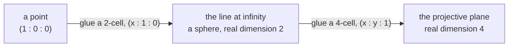

# Cohomology of projective space: one class in every even degree

[Syllabus](../../../SYLLABUS.md) → [Algebraic geometry](../README.md) → [Cohomology and the Hodge Conjecture](../README.md#s05) → Cohomology of projective space

---

## General Overview

Draw the circle $`x^2 + y^2 = 25`$, radius 5, and the hyperbola $`xy = 12`$. They cross at exactly four points: (3, 4), (4, 3), (−3, −4) and (−4, −3).

Four is no accident. Each curve has degree 2 (its equation has degree 2), and 2 × 2 = 4. A line meets either curve in 2 points. Two lines meet in 1 point, even parallel ones, once the points at infinity are added. Counting crossings behaves like multiplying degrees.

Cohomology says why. Cohomology attaches to a space a group of classes in each degree; the Betti number of a degree counts its independent classes. The complex projective plane, the plane with its points at infinity and complex coordinates, has Betti numbers 1, 0, 1, 0, 1. That is one class in each even degree, 0, 2 and 4, and none in odd degrees. The three classes are the whole plane, a line and a point.

Every curve of degree d is worth d lines. A line times a line is a point. So a conic times a conic is 2 × 2 = 4 points, and that count holds for every pair of conics, counted the right way.

**Complex projective space is built from one cell in each even dimension, so it has exactly one cohomology class in each even degree, all powers of the class h of a hyperplane; multiplying classes is intersecting, so a curve of degree d is d times h and two plane curves meet in the product of their degrees.**

**What kind of fact this is:** a theorem. The Betti numbers and the ring are proved in outline in Why it works, from a cell structure built there. Two inputs are stated with sources: that cells compute cohomology ([Cellular homology](../../17-Topology/05-Homology/05-cellular-homology.md)), and that the cup product of two classes counts the points where their curves cross (Poincaré duality).

### The picture: the plane's classes, by degree

```
Betti numbers of the complex projective plane, by degree of the class

degree 0  ##########  1   the whole plane
degree 1              0
degree 2  ##########  1   a line: the class h
degree 3              0
degree 4  ##########  1   a point: the class h^2
```

Each bar is one class. The odd degrees are empty. The code prints this row, and the rows for $`\mathbb{P}^1`$, $`\mathbb{P}^3`$ and $`\mathbb{P}^4`$.

---

## The formula

Carried over, each in one line:

- **Projective space.** $`\mathbb{P}^n`$ is the set of ratios $`(x_0 : \dots : x_n)`$, not all zero: ordinary charts plus points at infinity ([Projective space](../02-Affine%20and%20Projective%20Varieties/03-projective-space-and-homogeneous-coordinates.md)). In the plane, $`(x : y : z)`$; the chart z = 1 is the ordinary xy-plane.
- **The field** is $`\mathbb{C}`$ unless named. So $`\mathbb{P}^n`$ has complex dimension n and real dimension 2n.
- **Cohomology.** $`H^k`$ is the k-th cohomology group; the **cup product** $`\smile`$ multiplies degrees j and k into degree j + k ([Cohomology and the cup product in outline](../../17-Topology/05-Homology/08-cohomology-and-cup-product-in-outline.md)). The **Betti number** $`\beta_k`$ is the number of independent classes in $`H^k`$: its dimension over the fractions $`\mathbb{Q}`$.

New on this card, in words first. The **hyperplane class** h is the class in $`H^2`$ that stands for a hyperplane: a line in the plane, a plane in 3-space. Its powers $`h^k`$ are cup products of h with itself.

```math
H^k(\mathbb{P}^n; \mathbb{Z}) = \begin{cases} \mathbb{Z}\, h^{k/2} & k \text{ even},\ 0 \le k \le 2n \\ 0 & \text{otherwise} \end{cases} \qquad H^{*}(\mathbb{P}^n; \mathbb{Z}) = \mathbb{Z}[h] / (h^{n+1})
```

**Read it aloud:** in every even degree from 0 to 2n there is one class, a whole-number multiple of a power of h; odd degrees are empty; and the classes multiply like polynomials in h, with $`h^{n+1}`$ set to zero.

For the plane, n = 2: the classes are 1, h and $`h^2`$, and $`h^3 = 0`$. The Betti numbers are 1, 0, 1, 0, 1.

A plane curve C is the zero set of one polynomial of degree d. Write $`[C]`$ for its class in $`H^2`$. Read a top-degree class by $`\int_{\mathbb{P}^2}`$, which counts it in points.

```math
[C] = d\,h, \qquad [C] \smile [D] = de\, h^2, \qquad \int_{\mathbb{P}^2} h^2 = 1 \quad \Longrightarrow \quad \#(C \cap D) = de
```

**Read it aloud:** a curve of degree d is worth d lines; multiplying two curve classes multiplies their degrees; one $`h^2`$ is one point; so two curves with no common piece meet in de points, counted in the complex projective plane with multiplicity. This is Bezout's theorem.

For the circle and the hyperbola: $`2h \smile 2h = 4h^2`$, four points.

| Symbol | Plain meaning | In our example | Push it up and the answer… |
| --- | --- | --- | --- |
| $`\mathbb{P}^n`$, $`n`$ | complex projective n-space; its complex dimension | the plane, n = 2 | one more class, in degree 2n |
| $`(x_0 : \dots : x_n)`$, $`(x : y : z)`$ | homogeneous coordinates: a point, up to scaling | (3 : 4 : 1) is (3, 4) in the chart | — |
| $`\mathbb{C}`$, $`i`$, $`\mathbb{Q}`$, $`\mathbb{Z}`$ | complex numbers, with $`i^2 = -1`$; fractions; whole numbers | coordinates in $`\mathbb{C}`$, classes over $`\mathbb{Z}`$ | — |
| $`H^k`$, $`\beta_k`$ | the k-th cohomology group; its dimension over $`\mathbb{Q}`$, the number of independent classes | $`H^2(\mathbb{P}^2) = \mathbb{Z}h`$; 1, 0, 1, 0, 1 | — |
| $`h`$ | the hyperplane class: one line | the line x + y = 7z | — |
| $`h^k`$, $`\smile`$ | the cup product; h multiplied by itself k times | $`h^2`$ is one point; $`h^3 = 0`$ | — |
| $`\mathbb{Z}[h]/(h^{n+1})`$ | polynomials in h with $`h^{n+1}`$ set to zero | $`\mathbb{Z}[h]/(h^3)`$ | — |
| $`C`$, $`D`$, $`[C]`$, $`d`$, $`e`$ | two curves; the class of a curve; their degrees | $`[C] = 2h`$; d = e = 2 | more crossing points, de of them |
| $`\int_{\mathbb{P}^2}`$, $`\#`$ | read a top class as a number of points; a count of points | $`\int h^2 = 1`$ | — |
| $`\mathbb{F}_p`$, $`p`$ | the integers mod a prime p | p = 7: 57 points | $`p^2 + p + 1`$ points |
| $`\chi`$ | Euler characteristic: Betti numbers added with signs + − + − + | 1 − 0 + 1 − 0 + 1 = 3 | — |
| $`t`$; $`z_1, z_2`$; $`r`$, $`s`$, $`\theta`$; $`\Delta`$; $`dA`$, $`dV`$ | chart coordinates on a curve and on the plane; their sizes, such as $`r = \lvert t \rvert`$, and an angle; the Laplacian; area and 4-dimensional volume | the conic $`(1 : t : t^2)`$ | — |

### When it holds

- **Complex numbers.** The real projective plane has cells in the adjacent dimensions 0, 1 and 2, joined by a boundary of 2. Over $`\mathbb{Q}`$ its Betti numbers are 1, 0, 0: the top class is lost.
- **Projective space, not one chart.** Two circles of radius 5 with centres 6 apart cross at (3, 4) and (3, −4) in the real chart: 2 points, not 4. The other two are the complex points $`(1 : i : 0)`$ and $`(1 : -i : 0)`$ at infinity.
- **With multiplicity.** The line y = 5z touches the circle once, at (0 : 5 : 1), and counts twice: substituting gives $`x^2 = 0`$.
- **Projective space, not another variety.** The quadric surface $`x_0 x_3 = x_1 x_2`$ in $`\mathbb{P}^3`$ has 2 classes in degree 2, not 1. The torus of the square lattice has odd classes: Betti numbers 1, 2, 1.
- **No shared piece.** A circle meets itself everywhere, not in 4 points: Bezout needs curves with no common component.

---

## Why it works

### Step 0: peel off one chart at a time

Projective space is one chart plus what that chart misses. The chart is $`\mathbb{C}^n`$, ordinary complex n-space. What it misses is the hyperplane at infinity, a copy of $`\mathbb{P}^{n-1}`$ ([Projective space](../02-Affine%20and%20Projective%20Varieties/03-projective-space-and-homogeneous-coordinates.md)).

Peel again and again. $`\mathbb{P}^n`$ splits into $`\mathbb{C}^n`$, $`\mathbb{C}^{n-1}`$, and so on down to $`\mathbb{C}^0`$, a single point. Each $`\mathbb{C}^k`$ is an open cell of real dimension 2k. So there is one cell in each even dimension, and none in odd ones. Everything else follows from that gap.

### Step 1: the three cells of the plane

| Cell | Points | Real dimension | Points over $`\mathbb{F}_p`$ |
| --- | --- | --- | --- |
| the chart | $`(x : y : 1)`$, any x and y | 4 | $`p^2`$ |
| the line at infinity, minus a point | $`(x : 1 : 0)`$, any x | 2 | p |
| the last point | (1 : 0 : 0) | 0 | 1 |

Every point is in exactly one row: scale it so its last nonzero coordinate is 1. Gluing runs upwards:



The diagram is schematic: it shows the order of gluing, not shapes.

Over the field with 7 elements the brute-force count is 57 points, split 49 + 7 + 1 by cell.

### Step 2: no cell has a neighbour, so every boundary is zero

Cellular homology gives each cell one generator and joins cells one dimension apart by boundary numbers ([Cellular homology](../../17-Topology/05-Homology/05-cellular-homology.md)). A boundary map runs from dimension k to dimension k − 1. Here one of those two dimensions is always odd, and odd dimensions hold no cells. So every boundary map is zero.

With nothing to cancel, each cell is one class. The chain groups read $`\mathbb{Z}, 0, \mathbb{Z}, 0, \mathbb{Z}`$, and so do the homology and cohomology. The Betti numbers are 1, 0, 1, 0, 1, and $`\chi = 3`$.

The real projective plane shows what the gap buys. Its cells sit in the adjacent dimensions 0, 1 and 2, and the 2-cell's rim runs twice round the 1-cell. That boundary of 2 kills the top class over $`\mathbb{Q}`$: Betti numbers 1, 0, 0. Over the integers mod 2, where 2 is zero, it reads 1, 1, 1.

### Step 3: the hyperplane class reads 1 on a line

$`H^2(\mathbb{P}^2; \mathbb{Z})`$ is one copy of $`\mathbb{Z}`$. Its generator h is the class that reads 1 on a line: the line at infinity from Step 1 is the closure of the 2-cell, and it carries one generator of $`H_2`$, the degree-2 homology group.

Every line gives the same class. Lines move continuously into each other, and a class read on a moving cycle cannot jump. So h is the class of any line, such as x + y = 7z.

The same class comes from calculus. On smooth spaces a class is a closed form, and a class is read by integrating it ([De Rham cohomology](02-de-rham-cohomology-of-varieties.md)). The **Fubini-Study form** is a 2-form on $`\mathbb{P}^n`$ that looks the same at every point. Divided by π, as here, on a line with chart coordinate t it is the density $`1 / (\pi (1 + \lvert t \rvert^2)^2)`$ per unit area. Its integral over the whole line is 1, so it represents h. The code integrates it numerically: 1.00000.

### Step 4: products are intersections

Poincaré duality, stated here and proved in the sources, says more. On a compact complex manifold, the product of two subvarieties' classes is the class of their intersection, when they cross cleanly (their tangent spaces together fill the space).

Two lines in the plane meet in exactly one point, cleanly. So $`h \smile h`$ is the class of one point, and $`\int_{\mathbb{P}^2} h^2 = 1`$. Parallel lines are no exception. The lines y = 0 and y = z are parallel in the chart; their coefficient vectors' cross product is (−1 : 0 : 0), the point (1 : 0 : 0) at infinity.

Three lines in general position have no common point. The lines x = 0, y = 0 and x + y = z have coefficient determinant −1, so only the zero vector solves all three. That matches $`h^3 = 0`$, which also holds because $`H^6 = 0`$. The ring is $`\mathbb{Z}[h]/(h^3)`$.

In calculus, $`h^2`$ is the square of the Fubini-Study form. On the chart $`\mathbb{C}^2`$, with coordinates $`z_1, z_2`$, its density is $`2 / (\pi^2 (1 + \lvert z_1 \rvert^2 + \lvert z_2 \rvert^2)^3)`$. The code integrates it: 1.00000.

<details>
<summary>Detailed derivation: the two Fubini-Study integrals</summary>

On a line with chart coordinate t, put $`r = \lvert t \rvert`$. The density depends only on r, and a ring of radius r has length $`2\pi r`$:

$`\displaystyle \int_{\mathbb{C}} \frac{dA}{\pi (1 + r^2)^2} = \int_0^\infty \frac{2r\, dr}{(1 + r^2)^2} = \Big[ -\frac{1}{1 + r^2} \Big]_0^\infty = 1.`$

On the plane's chart, put $`r = \lvert z_1 \rvert`$ and $`s = \lvert z_2 \rvert`$. Each coordinate contributes a ring, $`2\pi r`$ and $`2\pi s`$:

$`\displaystyle \int_{\mathbb{C}^2} \frac{2\, dV}{\pi^2 (1 + r^2 + s^2)^3} = \int_0^\infty \!\! \int_0^\infty \frac{8 r s\, ds\, dr}{(1 + r^2 + s^2)^3} = \int_0^\infty \frac{2r\, dr}{(1 + r^2)^2} = 1.`$

The inner integral is $`2r / (1 + r^2)^2`$, the line's density again. The code skips these closed forms: it puts $`r = \tan\theta`$, so the range is finite, and adds midpoints.

</details>

### Step 5: a curve of degree d is d lines

A class in $`H^2`$ is d h for some whole number d, and d is read by pairing with a line. Pairing a curve's class with h counts the points where the curve meets a line.

Put the line into the curve's equation. Along the line x + y = 7z, write y = 7 − x and z = 1. A degree-d polynomial becomes a polynomial in x alone, of degree d unless the curve passes through the line's point at infinity, (1 : −1 : 0) here. Over $`\mathbb{C}`$ it has d roots, counted with multiplicity (the fundamental theorem of algebra), once any roots at infinity are counted too. The line must not be part of the curve. So $`[C] = d\,h`$.

- The circle $`x^2 + y^2 = 25z^2`$ gives $`2x^2 - 14x + 24 = 0`$: x = 3 and 4. Class 2h.
- The hyperbola $`xy = 12z^2`$ gives $`-x^2 + 7x - 12 = 0`$: x = 3 and 4. Class 2h.

The calculus road agrees. The conic $`(1 : t : t^2)`$, the curve $`xz = y^2`$, has degree 2. On it the Fubini-Study density is $`\tfrac{1}{4\pi} \Delta \log(1 + r^2 + r^4)`$ per unit area, where Δ (the Laplacian, not the discriminant Δ of shelf 04) adds the second derivatives in the two real directions. The code integrates it: 2.00000.

### Step 6: multiply, and check against the curves

The ring now gives the count: $`[C] \smile [D] = 2h \smile 2h = 4h^2`$, four points.

The check solves the curves exactly. On the hyperbola, y = 12/x. Put that into the circle and clear the fraction: $`x^4 - 25x^2 + 144 = 0`$. That has degree 4 = 2 × 2, with roots −4, −3, 3 and 4. An integer search of the grid finds the same four points.

Each point counts once. The Jacobian determinant (the 2 × 2 determinant of the two equations' partial derivatives) is $`2(x^2 - y^2)`$: 14 or −14, never 0, so the curves cross cleanly. At infinity, z = 0 leaves $`x^2 + y^2 = 0`$ and $`xy = 0`$, which share no point. Total: 4.

<details>
<summary>Why intersection numbers equal the cup product</summary>

Bezout's theorem also has an algebraic proof by resultants. The geometric one, in outline:

1. The class of a curve depends only on its degree (Step 5). So C may be moved, through curves of the same degree, to a curve C′ that crosses D cleanly at separate points.
2. For clean crossings, Poincaré duality makes $`\int [C'] \smile [D]`$ the number of crossing points, each with sign +1. The sign is +1 because complex directions keep their orientation.
3. A point where C and D cross uncleanly splits into several clean ones as C moves to C′. The number it splits into is its multiplicity.

So the multiplicities add up to $`\int [C] \smile [D] = de`$. Fulton's *Intersection Theory* (Chapter 8) builds the intersection product and its multiplicities for all smooth varieties.

</details>

### Step 7: point counts read the cells

The cell count gives a second road to the Betti numbers. Each cell $`\mathbb{C}^k`$ becomes, over the integers mod p, a block of $`p^k`$ points. So the number of points of $`\mathbb{P}^2(\mathbb{F}_p)`$ is a polynomial in p whose coefficients are the even Betti numbers:

```math
\#\, \mathbb{P}^2(\mathbb{F}_p) = \beta_0 + \beta_2\, p + \beta_4\, p^2 = 1 + p + p^2
```

**Read it aloud:** the plane over the integers mod p has $`1 + p + p^2`$ points, one term for each class.

The code counts points by brute force at p = 2, 3, 5 and 7: 7, 13, 31 and 57. It fits a quadratic through the first three and gets coefficients 1, 1, 1. That quadratic predicts 57 at p = 7, matching the count.

The quadric surface counts 9, 16, 36 and 64, which fit $`1 + 2p + p^2`$. Its middle coefficient is 2: two classes in degree 2, the two families of lines on it. For any smooth projective variety, point counts over finite fields are governed by cohomology. That is the Weil conjectures, proved in the sources and stated here without proof.

---

## Worked numbers, by hand

| Step | Arithmetic | Value |
| --- | --- | --- |
| cells of $`\mathbb{P}^2`$ | one $`\mathbb{C}^k`$ for k = 0, 1, 2 | real dimensions 0, 2, 4 |
| chain groups, degrees 0 to 4 | one $`\mathbb{Z}`$ per cell | $`\mathbb{Z}, 0, \mathbb{Z}, 0, \mathbb{Z}`$ |
| boundary maps | each has an empty group at one end | all 0 |
| Betti numbers | cells minus ranks of boundaries | **1, 0, 1, 0, 1** |
| circle on the line x + y = 7z | $`x^2 + (7 - x)^2 = 25`$, so $`2x^2 - 14x + 24 = 0`$ | x = 3, 4: class 2h |
| hyperbola on the same line | $`x(7 - x) = 12`$, so $`-x^2 + 7x - 12 = 0`$ | x = 3, 4: class 2h |
| product | $`2h \smile 2h`$ | $`4h^2`$ |
| eliminate y = 12/x | $`x^2 + 144/x^2 = 25`$, times $`x^2`$ | $`x^4 - 25x^2 + 144 = 0`$ |
| solve | $`x^2 = 9`$ or 16 | x = −4, −3, 3, 4 |
| the points | y = 12/x | (−4, −3), (−3, −4), (3, 4), (4, 3) |
| clean crossings | Jacobian $`2(x^2 - y^2)`$ | 14 or −14 |
| points at infinity | $`x^2 + y^2 = 0`$ and $`xy = 0`$ | none |
| total | | **4** |

The circle and the hyperbola meet in exactly the four points that $`4h^2`$ predicts, each counted once, none hidden at infinity.

### What breaks if you drop a piece

| Mistake | Comes out at | What went wrong |
| --- | --- | --- |
| Real projective plane in place of the complex one | Betti numbers 1, 0, 0 over $`\mathbb{Q}`$ | Real cells sit in adjacent dimensions; the boundary 2 kills the top class |
| Two circles 6 apart counted in the real chart | 2 points, not 4 | At infinity both reduce to $`y^2 + 1 = 0`$, discriminant −4: two complex points |
| The tangent line y = 5z counted without multiplicity | 1 point, not 2 | $`x^2 = 0`$ is a double root |
| Assuming every surface's degree-2 classes are multiples of h | the quadric surface has 2, not 1 | The quadric surface has two 2-cells, one per family of lines; one class per even degree comes from projective space's cell structure, not from every surface |

The code prints all four.

---

## Code, from first principles, and it actually runs

The code reaches the Betti numbers and the products by four roads. First, it builds the cellular chains of $`\mathbb{P}^n`$ and of the real plane and takes ranks by exact elimination. Second, it counts points over $`\mathbb{F}_p`$ by scaling every nonzero vector, with no formula, and fits a polynomial to the counts. Third, it intersects the circle and hyperbola exactly: lines into curves, an eliminant, a grid search and the Jacobian. Fourth, it integrates the Fubini-Study densities numerically. The first three are exact; the integrals are checked to a small tolerance.

### Python

```python
# Cohomology of projective space -- the check behind the card.  Standard library
# only.  Road 1 builds the cell chains of complex P^n and reads off the Betti
# numbers.  Road 2 counts the points of P^2 over F_p by brute force.  Road 3
# multiplies classes by solving real curves exactly.  Road 4 integrates the
# Fubini-Study densities numerically.  Roads 1 to 3 are exact.
import math

def rank(rows, p=0):                       # elimination over Q (p = 0) or over F_p
    m, r = [[x % p if p else x for x in row] for row in rows], 0
    for c in range(len(m[0]) if m else 0):
        piv = next((i for i in range(r, len(m)) if m[i][c]), None)
        if piv is None:
            continue
        m[r], m[piv] = m[piv], m[r]
        for i in range(len(m)):
            if i != r and m[i][c]:
                f, g = m[i][c], m[r][c]
                m[i] = [(g * a - f * b) % p if p else g * a - f * b for a, b in zip(m[i], m[r])]
        r += 1
    return r

def betti(cells, bound, p=0):              # b_k = cells - rank d_k - rank d_(k+1)
    return [cells[k] - rank(bound.get(k, []), p) - rank(bound.get(k + 1, []), p) for k in range(len(cells))]

def complex_pn(n):                         # one cell in each real dimension 0, 2, ..., 2n
    cells = [1 - k % 2 for k in range(2 * n + 1)]
    return cells, {k: [[0] * cells[k] for _ in range(cells[k - 1])] for k in range(1, 2 * n + 1)}

def points(p, n, eq):                      # scale each vector so its last nonzero entry is 1
    seen = {}
    for code in range(1, p ** (n + 1)):
        v = [code // p ** i % p for i in range(n + 1)]
        last = max(i for i in range(n + 1) if v[i])
        w = tuple(x * pow(v[last], p - 2, p) % p for x in v)
        if eq(w) % p == 0:
            seen[w] = last
    return [list(seen.values()).count(k) for k in range(n + 1)]

def det3(m):
    return (m[0][0] * (m[1][1] * m[2][2] - m[1][2] * m[2][1]) - m[0][1] * (m[1][0] * m[2][2]
            - m[1][2] * m[2][0]) + m[0][2] * (m[1][0] * m[2][1] - m[1][1] * m[2][0]))

def fit(ps, ns):                           # a0 + a1 p + a2 p^2 through three counts, by Cramer
    v = [[1, q, q * q] for q in ps]
    return [det3([[ns[i] if c == j else v[i][c] for c in range(3)] for i in range(3)]) // det3(v)
            for j in range(3)]

def add(*ps):                              # polynomials in one variable, lowest power first
    out = [sum(q[i] for q in ps if i < len(q)) for i in range(max(map(len, ps)))]
    while len(out) > 1 and out[-1] == 0:
        out.pop()
    return out

def mul(a, b):
    return add([sum(a[i] * b[k - i] for i in range(len(a)) if 0 <= k - i < len(b)) for k in range(len(a) + len(b) - 1)])

def ev(q, x): return sum(c * x ** i for i, c in enumerate(q))

def roots(q):                              # whole-number roots with multiplicity: search, then divide
    out = []
    for r in range(-30, 31):
        while len(q) > 1 and ev(q, r) == 0:
            out.append(r)
            q = [sum(q[j] * r ** (j - i - 1) for j in range(i + 1, len(q))) for i in range(len(q) - 1)]
    return out

def show(q, v="x"):                        # leading term first
    s = "".join((" - " if c < 0 else " + ") + ("" if abs(c) == 1 and i else str(abs(c)))
                + (v if i else "") + (f"^{i}" if i > 1 else "") for i, c in reversed(list(enumerate(q))) if c)
    return ("-" if s.startswith(" - ") else "") + s[3:]

def circle(x, y, z): return add(mul(x, x), mul(y, y), mul([-25], mul(z, z)))
def hyperbola(x, y, z): return add(mul(x, y), mul([-12], mul(z, z)))
def beacon(x, y, z): return circle(add(x, mul([-6], z)), y, z)

def fs_curve(phi, n=4000):                 # Fubini-Study density on a curve chart: (1/2) r (u'' + u'/r) dr
    tot, w = 0.0, math.pi / (2 * n)
    for i in range(n):
        r = math.tan((i + 0.5) * w)
        h, u = 1e-4 * (1 + r), lambda s: math.log(phi(s * s))
        d1, d2 = (u(r + h) - u(r - h)) / (2 * h), (u(r + h) - 2 * u(r) + u(r - h)) / (h * h)
        tot += 0.5 * r * (d2 + d1 / r) * (1 + r * r) * w
    return tot

def fs_plane(n=800):                       # h^2 density over the chart C^2: 8 r s / (1 + r^2 + s^2)^3
    w, tot = math.pi / (2 * n), 0.0
    for i in range(n):
        for j in range(n):
            r, s = math.tan((i + 0.5) * w), math.tan((j + 0.5) * w)
            tot += 8 * r * s / (1 + r * r + s * s) ** 3 * (1 + r * r) * (1 + s * s) * w * w
    return tot

X, LINE, TAN = [0, 1], [7, -1], [5]        # the lines x + y = 7z and y = 5z, in the chart z = 1
for n in range(1, 5):
    print(f"P^{n}: Betti numbers in degrees 0 to {2 * n}: {' '.join(map(str, betti(*complex_pn(n))))}")
real = ([1, 1, 1], {1: [[0]], 2: [[2]]})
bq, b2 = betti(*real), betti(*real, p=2)
print(f"real P^2, cells in dimensions 0, 1, 2, boundary 2: over Q {bq}, over F_2 {b2}")
plane, quad = [], []
for p in (2, 3, 5, 7):
    c, q = points(p, 2, lambda w: 0), sum(points(p, 3, lambda w: w[0] * w[3] - w[1] * w[2]))
    plane.append(sum(c)); quad.append(q)
    print(f"p = {p}: P^2 has {sum(c)} points = {c[2]} + {c[1]} + {c[0]} by cell; quadric surface {q}")
    assert c == [1, p, p * p]
a, qa = fit((2, 3, 5), plane[:3]), fit((2, 3, 5), quad[:3])
print(f"fitted from p = 2, 3, 5: P^2 {a[0]} + {a[1]}p + {a[2]}p^2, predicts {ev(a, 7)} at p = 7; quadric {qa[0]} + {qa[1]}p + {qa[2]}p^2")
chi = [d ** 3 - 4 * d * d + 6 * d for d in (1, 2, 4)]
print(f"Euler characteristic d^3 - 4d^2 + 6d: plane {chi[0]}, quadric {chi[1]}, quartic {chi[2]}, quartic b2 = {chi[2] - 2}")
cls = []
for name, f in (("circle x^2 + y^2 = 25z^2", circle), ("hyperbola xy = 12z^2", hyperbola)):
    q = f(X, LINE, [1])
    cls.append(len(roots(q)))
    print(f"{name} on the line x + y = 7z: {show(q)} = 0, x = {roots(q)}, class {cls[-1]}h")
elim = add([144], mul(add(mul(X, X), [-25]), mul(X, X)))     # Res_y = a e^2 - b d e + c d^2
grid = [(x, y) for x in range(-30, 31) for y in range(-30, 31) if x * x + y * y == 25 and x * y == 12]
jac = [2 * (x * x - y * y) for x, y in grid]
g = lambda x, y: x * x + y * y           # xy = 0 at (0 : 1) and (1 : 0); test x^2 + y^2 there
print(f"cup product 2h x 2h = {cls[0] * cls[1]}h^2; eliminant {show(elim)}, roots {roots(elim)}")
print(f"integer search finds {grid}; Jacobian 2(x^2 - y^2) there {jac}")
print(f"points at infinity: x^2 + y^2 and xy share none, resultant {g(0, 1) * g(1, 0)}; total {len(grid)}")
u, v = (0, 1, 0), (0, 1, -1)               # the lines y = 0 and y - z = 0; they meet at the cross product
m = [u[1] * v[2] - u[2] * v[1], u[2] * v[0] - u[0] * v[2], u[0] * v[1] - u[1] * v[0]]
print(f"parallel lines y = 0, y = z meet at ({m[0]} : {m[1]} : {m[2]}) = (1 : 0 : 0)")
print(f"lines x = 0, y = 0, x + y = z: determinant {det3([[1, 0, 0], [0, 1, 0], [1, 1, -1]])}, no common point: h^3 = 0")
fl, fc, fp = fs_curve(lambda s: 1 + s), fs_curve(lambda s: 1 + s + s * s), fs_plane()
print(f"Fubini-Study integrals: line {fl:.5f}, conic (1 : t : t^2) {fc:.5f}, h^2 over P^2 {fp:.5f}")
inf_b, tan = beacon([1], X, [0]), circle(X, TAN, [1])
real_b = [(x, y) for x in range(-30, 31) for y in range(-30, 31) if x * x + y * y == 25 and (x - 6) ** 2 + y * y == 25]
print(f"mistake 1, real P^2 over Q: {bq}, the top class lost")
print(f"mistake 2, beacon circles 6 apart: real affine points {real_b}; at infinity both give "
      f"{show(inf_b, 'y')} = 0, discriminant {-4 * inf_b[0] * inf_b[2]}: 2 more, total 4")
print(f"mistake 3, tangent line y = 5z: {show(tan)} = 0, roots {roots(tan)}: 1 point, multiplicity 2")
print(f"mistake 4, the quadric surface: {qa[1]} classes in degree 2, not 1; Bezout in P^5 for conics: 6^5 = {6 ** 5}, true count 3264")
assert betti(*complex_pn(2)) == [a[0], 0, a[1], 0, a[2]] and ev(a, 7) == plane[3]   # cells against counts
assert qa == [1, 2, 1] and ev(qa, 7) == quad[3] and chi[:2] == [sum(a), sum(qa)]
assert bq == [1, 0, 0] and b2 == [1, 1, 1] and cls == [2, 2]
assert sorted(x for x, y in grid) == roots(elim) and len(roots(elim)) == cls[0] * cls[1] and 0 not in jac
assert len(real_b) == 2 and inf_b == circle([1], X, [0]) and roots(inf_b) == [] and g(0, 1) * g(1, 0) != 0
assert roots(tan) == [0, 0] and m[1] == m[2] == 0 != m[0] and abs(fl - 1) + abs(fc - 2) + abs(fp - 1) < 1e-5
print("ALL CHECKS PASS")
```

**Ran 2026-11-17 on macOS, Python 3.14.10, standard library only. All checks passed. Output, pasted from the run:**

```
P^1: Betti numbers in degrees 0 to 2: 1 0 1
P^2: Betti numbers in degrees 0 to 4: 1 0 1 0 1
P^3: Betti numbers in degrees 0 to 6: 1 0 1 0 1 0 1
P^4: Betti numbers in degrees 0 to 8: 1 0 1 0 1 0 1 0 1
real P^2, cells in dimensions 0, 1, 2, boundary 2: over Q [1, 0, 0], over F_2 [1, 1, 1]
p = 2: P^2 has 7 points = 4 + 2 + 1 by cell; quadric surface 9
p = 3: P^2 has 13 points = 9 + 3 + 1 by cell; quadric surface 16
p = 5: P^2 has 31 points = 25 + 5 + 1 by cell; quadric surface 36
p = 7: P^2 has 57 points = 49 + 7 + 1 by cell; quadric surface 64
fitted from p = 2, 3, 5: P^2 1 + 1p + 1p^2, predicts 57 at p = 7; quadric 1 + 2p + 1p^2
Euler characteristic d^3 - 4d^2 + 6d: plane 3, quadric 4, quartic 24, quartic b2 = 22
circle x^2 + y^2 = 25z^2 on the line x + y = 7z: 2x^2 - 14x + 24 = 0, x = [3, 4], class 2h
hyperbola xy = 12z^2 on the line x + y = 7z: -x^2 + 7x - 12 = 0, x = [3, 4], class 2h
cup product 2h x 2h = 4h^2; eliminant x^4 - 25x^2 + 144, roots [-4, -3, 3, 4]
integer search finds [(-4, -3), (-3, -4), (3, 4), (4, 3)]; Jacobian 2(x^2 - y^2) there [14, -14, -14, 14]
points at infinity: x^2 + y^2 and xy share none, resultant 1; total 4
parallel lines y = 0, y = z meet at (-1 : 0 : 0) = (1 : 0 : 0)
lines x = 0, y = 0, x + y = z: determinant -1, no common point: h^3 = 0
Fubini-Study integrals: line 1.00000, conic (1 : t : t^2) 2.00000, h^2 over P^2 1.00000
mistake 1, real P^2 over Q: [1, 0, 0], the top class lost
mistake 2, beacon circles 6 apart: real affine points [(3, -4), (3, 4)]; at infinity both give y^2 + 1 = 0, discriminant -4: 2 more, total 4
mistake 3, tangent line y = 5z: x^2 = 0, roots [0, 0]: 1 point, multiplicity 2
mistake 4, the quadric surface: 2 classes in degree 2, not 1; Bezout in P^5 for conics: 6^5 = 7776, true count 3264
ALL CHECKS PASS
```

### Rust

Same numbers, same labels, built with `rustc --edition 2021 -O`.

```rust
// Cohomology of projective space -- the same check as the Python, in Rust.  No
// crates.  Road 1 builds the cell chains of complex P^n and reads off the Betti
// numbers.  Road 2 counts the points of P^2 over F_p by brute force.  Road 3
// multiplies classes by solving real curves exactly.  Road 4 integrates the
// Fubini-Study densities numerically.  Roads 1 to 3 are exact.
use std::collections::HashMap;
use std::f64::consts::PI;
type P = Vec<i64>; // a polynomial in one variable, lowest power first

fn rank(rows: &[Vec<i64>], p: i64) -> usize { // elimination over Q (p = 0) or over F_p
    let red = |x: i64| if p > 0 { x.rem_euclid(p) } else { x };
    let mut m: Vec<Vec<i64>> = rows.iter().map(|r| r.iter().map(|&x| red(x)).collect()).collect();
    let mut r = 0;
    for c in 0..m.first().map_or(0, |row| row.len()) {
        let Some(piv) = (r..m.len()).find(|&i| m[i][c] != 0) else { continue };
        m.swap(r, piv);
        for i in 0..m.len() {
            if i != r && m[i][c] != 0 {
                let (f, g) = (m[i][c], m[r][c]);
                m[i] = (0..m[i].len()).map(|k| red(g * m[i][k] - f * m[r][k])).collect();
            }
        }
        r += 1;
    }
    r
}
fn betti(cells: &[i64], bound: &HashMap<usize, Vec<Vec<i64>>>, p: i64) -> Vec<i64> {
    let rk = |k: usize| bound.get(&k).map_or(0, |b| rank(b, p)) as i64;
    (0..cells.len()).map(|k| cells[k] - rk(k) - rk(k + 1)).collect()
}
fn complex_pn(n: usize) -> (Vec<i64>, HashMap<usize, Vec<Vec<i64>>>) { // one cell in each even dimension
    let cells: Vec<i64> = (0..2 * n + 1).map(|k| 1 - (k % 2) as i64).collect();
    let bound = (1..2 * n + 1).map(|k| (k, vec![vec![0; cells[k] as usize]; cells[k - 1] as usize])).collect();
    (cells, bound)
}
fn points(p: i64, n: usize, eq: &dyn Fn(&[i64]) -> i64) -> Vec<i64> { // last nonzero entry scaled to 1
    let mut seen: HashMap<Vec<i64>, usize> = HashMap::new();
    for code in 1..p.pow(n as u32 + 1) {
        let v: Vec<i64> = (0..=n).map(|i| code / p.pow(i as u32) % p).collect();
        let last = (0..=n).filter(|&i| v[i] != 0).max().unwrap();
        let inv = (0..p).find(|&t| v[last] * t % p == 1).unwrap();
        let w: Vec<i64> = v.iter().map(|&x| x * inv % p).collect();
        if eq(&w).rem_euclid(p) == 0 { seen.insert(w, last); }
    }
    (0..=n).map(|k| seen.values().filter(|&&l| l == k).count() as i64).collect()
}
fn det3(m: &[[i64; 3]; 3]) -> i64 {
    m[0][0] * (m[1][1] * m[2][2] - m[1][2] * m[2][1]) - m[0][1] * (m[1][0] * m[2][2] - m[1][2] * m[2][0])
        + m[0][2] * (m[1][0] * m[2][1] - m[1][1] * m[2][0])
}
fn fit(ps: [i64; 3], ns: &[i64]) -> P { // a0 + a1 p + a2 p^2 through three counts, by Cramer
    let v: [[i64; 3]; 3] = [0, 1, 2].map(|i| [1, ps[i], ps[i] * ps[i]]);
    (0..3).map(|j| { let mut m = v; for i in 0..3 { m[i][j] = ns[i] } det3(&m) / det3(&v) }).collect()
}
fn add(ps: &[&P]) -> P {
    let len = ps.iter().map(|q| q.len()).max().unwrap();
    let mut out: P = (0..len).map(|i| ps.iter().map(|q| *q.get(i).unwrap_or(&0)).sum()).collect();
    while out.len() > 1 && *out.last().unwrap() == 0 { out.pop(); }
    out
}
fn mul(a: &P, b: &P) -> P {
    let mut out = vec![0; a.len() + b.len() - 1];
    for (i, x) in a.iter().enumerate() { for (j, y) in b.iter().enumerate() { out[i + j] += x * y } }
    add(&[&out])
}
fn ev(q: &P, x: i64) -> i64 { q.iter().enumerate().map(|(i, c)| c * x.pow(i as u32)).sum() }
fn roots(q: &P) -> P { // whole-number roots with multiplicity: search, then divide
    let (mut q, mut out) = (q.clone(), vec![]);
    for r in -30i64..31 {
        while q.len() > 1 && ev(&q, r) == 0 {
            out.push(r);
            q = (0..q.len() - 1).map(|i| (i + 1..q.len()).map(|j| q[j] * r.pow((j - i - 1) as u32)).sum()).collect();
        }
    }
    out
}
fn show(q: &P, v: &str) -> String { // leading term first
    let mut s = String::new();
    for (i, &c) in q.iter().enumerate().rev().filter(|t| *t.1 != 0) {
        let coef = if c.abs() == 1 && i > 0 { String::new() } else { c.abs().to_string() };
        let pow = if i > 1 { format!("^{}", i) } else { String::new() };
        s += &format!("{}{}{}{}", if c < 0 { " - " } else { " + " }, coef, if i > 0 { v } else { "" }, pow);
    }
    format!("{}{}", if s.starts_with(" - ") { "-" } else { "" }, &s[3..])
}
fn circle(x: &P, y: &P, z: &P) -> P { add(&[&mul(x, x), &mul(y, y), &mul(&vec![-25], &mul(z, z))]) }
fn hyperbola(x: &P, y: &P, z: &P) -> P { add(&[&mul(x, y), &mul(&vec![-12], &mul(z, z))]) }
fn beacon(x: &P, y: &P, z: &P) -> P { circle(&add(&[x, &mul(&vec![-6], z)]), y, z) }

fn fs_curve(phi: &dyn Fn(f64) -> f64, n: usize) -> f64 { // (1/2) r (u'' + u'/r) dr on a curve chart
    let (mut tot, w) = (0.0, PI / (2 * n) as f64);
    for i in 0..n {
        let r = ((i as f64 + 0.5) * w).tan();
        let (h, u) = (1e-4 * (1.0 + r), |s: f64| phi(s * s).ln());
        let (d1, d2) = ((u(r + h) - u(r - h)) / (2.0 * h), (u(r + h) - 2.0 * u(r) + u(r - h)) / (h * h));
        tot += 0.5 * r * (d2 + d1 / r) * (1.0 + r * r) * w;
    }
    tot
}
fn fs_plane(n: usize) -> f64 { // h^2 density over the chart C^2: 8 r s / (1 + r^2 + s^2)^3
    let (w, mut tot) = (PI / (2 * n) as f64, 0.0);
    for i in 0..n { for j in 0..n {
        let (r, s) = (((i as f64 + 0.5) * w).tan(), ((j as f64 + 0.5) * w).tan());
        tot += 8.0 * r * s / (1.0 + r * r + s * s).powi(3) * (1.0 + r * r) * (1.0 + s * s) * w * w;
    } }
    tot
}

fn main() {
    let (x, line, tan_y, one, zero): (P, P, P, P, P) = (vec![0, 1], vec![7, -1], vec![5], vec![1], vec![0]);
    let join = |v: &P| v.iter().map(|b| b.to_string()).collect::<Vec<_>>().join(" ");
    for n in 1..5 {
        let (c, b) = complex_pn(n);
        println!("P^{}: Betti numbers in degrees 0 to {}: {}", n, 2 * n, join(&betti(&c, &b, 0)));
    }
    let real_bound: HashMap<usize, Vec<Vec<i64>>> = [(1, vec![vec![0]]), (2, vec![vec![2]])].into_iter().collect();
    let (bq, b2) = (betti(&[1, 1, 1], &real_bound, 0), betti(&[1, 1, 1], &real_bound, 2));
    println!("real P^2, cells in dimensions 0, 1, 2, boundary 2: over Q {:?}, over F_2 {:?}", bq, b2);
    let (mut plane, mut quad): (P, P) = (vec![], vec![]);
    for p in [2i64, 3, 5, 7] {
        let c = points(p, 2, &|_| 0);
        let q: i64 = points(p, 3, &|w| w[0] * w[3] - w[1] * w[2]).iter().sum();
        plane.push(c.iter().sum()); quad.push(q);
        println!("p = {}: P^2 has {} points = {} + {} + {} by cell; quadric surface {}", p, c.iter().sum::<i64>(), c[2], c[1], c[0], q);
        assert!(c == vec![1, p, p * p]);
    }
    let (a, qa) = (fit([2, 3, 5], &plane), fit([2, 3, 5], &quad));
    println!("fitted from p = 2, 3, 5: P^2 {} + {}p + {}p^2, predicts {} at p = 7; quadric {} + {}p + {}p^2",
             a[0], a[1], a[2], ev(&a, 7), qa[0], qa[1], qa[2]);
    let chi: P = [1i64, 2, 4].iter().map(|d| d.pow(3) - 4 * d * d + 6 * d).collect();
    println!("Euler characteristic d^3 - 4d^2 + 6d: plane {}, quadric {}, quartic {}, quartic b2 = {}", chi[0], chi[1], chi[2], chi[2] - 2);
    let mut cls: P = vec![];
    let curves: [(&str, fn(&P, &P, &P) -> P); 2] = [("circle x^2 + y^2 = 25z^2", circle), ("hyperbola xy = 12z^2", hyperbola)];
    for (name, f) in curves {
        let q = f(&x, &line, &one);
        cls.push(roots(&q).len() as i64);
        println!("{} on the line x + y = 7z: {} = 0, x = {:?}, class {}h", name, show(&q, "x"), roots(&q), cls[cls.len() - 1]);
    }
    let elim = add(&[&vec![144], &mul(&add(&[&mul(&x, &x), &vec![-25]]), &mul(&x, &x))]); // Res_y = a e^2 - b d e + c d^2
    let grid: Vec<(i64, i64)> = (-30..31).flat_map(|a| (-30..31).map(move |b| (a, b)))
        .filter(|&(a, b)| a * a + b * b == 25 && a * b == 12).collect();
    let jac: P = grid.iter().map(|&(a, b)| 2 * (a * a - b * b)).collect();
    let g = |a: i64, b: i64| a * a + b * b; // xy = 0 at (0 : 1) and (1 : 0); test x^2 + y^2 there
    println!("cup product 2h x 2h = {}h^2; eliminant {}, roots {:?}", cls[0] * cls[1], show(&elim, "x"), roots(&elim));
    println!("integer search finds {:?}; Jacobian 2(x^2 - y^2) there {:?}", grid, jac);
    println!("points at infinity: x^2 + y^2 and xy share none, resultant {}; total {}", g(0, 1) * g(1, 0), grid.len());
    let (u, v) = ([0i64, 1, 0], [0i64, 1, -1]); // the lines y = 0 and y - z = 0; they meet at the cross product
    let m = [u[1] * v[2] - u[2] * v[1], u[2] * v[0] - u[0] * v[2], u[0] * v[1] - u[1] * v[0]];
    println!("parallel lines y = 0, y = z meet at ({} : {} : {}) = (1 : 0 : 0)", m[0], m[1], m[2]);
    println!("lines x = 0, y = 0, x + y = z: determinant {}, no common point: h^3 = 0", det3(&[[1, 0, 0], [0, 1, 0], [1, 1, -1]]));
    let (fl, fc, fp) = (fs_curve(&|s| 1.0 + s, 4000), fs_curve(&|s| 1.0 + s + s * s, 4000), fs_plane(800));
    println!("Fubini-Study integrals: line {:.5}, conic (1 : t : t^2) {:.5}, h^2 over P^2 {:.5}", fl, fc, fp);
    let (inf_b, tan) = (beacon(&one, &x, &zero), circle(&x, &tan_y, &one));
    let real_b: Vec<(i64, i64)> = (-30..31).flat_map(|a| (-30..31).map(move |b| (a, b)))
        .filter(|&(a, b)| a * a + b * b == 25 && (a - 6) * (a - 6) + b * b == 25).collect();
    println!("mistake 1, real P^2 over Q: {:?}, the top class lost", bq);
    println!("mistake 2, beacon circles 6 apart: real affine points {:?}; at infinity both give {} = 0, discriminant {}: 2 more, total 4",
             real_b, show(&inf_b, "y"), -4 * inf_b[0] * inf_b[2]);
    println!("mistake 3, tangent line y = 5z: {} = 0, roots {:?}: 1 point, multiplicity 2", show(&tan, "x"), roots(&tan));
    println!("mistake 4, the quadric surface: {} classes in degree 2, not 1; Bezout in P^5 for conics: 6^5 = {}, true count 3264", qa[1], 6i64.pow(5));
    let (c2, b2map) = complex_pn(2);
    assert!(betti(&c2, &b2map, 0) == vec![a[0], 0, a[1], 0, a[2]] && ev(&a, 7) == plane[3]); // cells against counts
    assert!(qa == vec![1, 2, 1] && ev(&qa, 7) == quad[3] && chi[..2] == [a.iter().sum::<i64>(), qa.iter().sum::<i64>()]);
    assert!(bq == vec![1, 0, 0] && b2 == vec![1, 1, 1] && cls == vec![2, 2]);
    let mut xs: P = grid.iter().map(|&(a, _)| a).collect(); xs.sort();
    assert!(xs == roots(&elim) && roots(&elim).len() as i64 == cls[0] * cls[1] && !jac.contains(&0));
    assert!(real_b.len() == 2 && inf_b == circle(&one, &x, &zero) && roots(&inf_b).is_empty() && g(0, 1) * g(1, 0) != 0);
    assert!(roots(&tan) == vec![0, 0] && m[1] == 0 && m[2] == 0 && m[0] != 0 && (fl - 1.0).abs() + (fc - 2.0).abs() + (fp - 1.0).abs() < 1e-5);
    println!("ALL CHECKS PASS");
}
```

**Ran 2026-11-17 on macOS, rustc 1.98.1, no crates. All checks passed. Output, pasted from the run:**

```
P^1: Betti numbers in degrees 0 to 2: 1 0 1
P^2: Betti numbers in degrees 0 to 4: 1 0 1 0 1
P^3: Betti numbers in degrees 0 to 6: 1 0 1 0 1 0 1
P^4: Betti numbers in degrees 0 to 8: 1 0 1 0 1 0 1 0 1
real P^2, cells in dimensions 0, 1, 2, boundary 2: over Q [1, 0, 0], over F_2 [1, 1, 1]
p = 2: P^2 has 7 points = 4 + 2 + 1 by cell; quadric surface 9
p = 3: P^2 has 13 points = 9 + 3 + 1 by cell; quadric surface 16
p = 5: P^2 has 31 points = 25 + 5 + 1 by cell; quadric surface 36
p = 7: P^2 has 57 points = 49 + 7 + 1 by cell; quadric surface 64
fitted from p = 2, 3, 5: P^2 1 + 1p + 1p^2, predicts 57 at p = 7; quadric 1 + 2p + 1p^2
Euler characteristic d^3 - 4d^2 + 6d: plane 3, quadric 4, quartic 24, quartic b2 = 22
circle x^2 + y^2 = 25z^2 on the line x + y = 7z: 2x^2 - 14x + 24 = 0, x = [3, 4], class 2h
hyperbola xy = 12z^2 on the line x + y = 7z: -x^2 + 7x - 12 = 0, x = [3, 4], class 2h
cup product 2h x 2h = 4h^2; eliminant x^4 - 25x^2 + 144, roots [-4, -3, 3, 4]
integer search finds [(-4, -3), (-3, -4), (3, 4), (4, 3)]; Jacobian 2(x^2 - y^2) there [14, -14, -14, 14]
points at infinity: x^2 + y^2 and xy share none, resultant 1; total 4
parallel lines y = 0, y = z meet at (-1 : 0 : 0) = (1 : 0 : 0)
lines x = 0, y = 0, x + y = z: determinant -1, no common point: h^3 = 0
Fubini-Study integrals: line 1.00000, conic (1 : t : t^2) 2.00000, h^2 over P^2 1.00000
mistake 1, real P^2 over Q: [1, 0, 0], the top class lost
mistake 2, beacon circles 6 apart: real affine points [(3, -4), (3, 4)]; at infinity both give y^2 + 1 = 0, discriminant -4: 2 more, total 4
mistake 3, tangent line y = 5z: x^2 = 0, roots [0, 0]: 1 point, multiplicity 2
mistake 4, the quadric surface: 2 classes in degree 2, not 1; Bezout in P^5 for conics: 6^5 = 7776, true count 3264
ALL CHECKS PASS
```

The two outputs match line for line.

### Lean

Lean proves the cell split for every $`\mathbb{P}^n`$ over any field, its point count mod p, and the four crossings exactly.

- Take any point of $`\mathbb{P}^n`$, over any field. Then exactly one of its coordinate vectors has last nonzero coordinate 1, so the point lies in exactly one cell.
- Take the integers mod p. Then $`\mathbb{P}^n`$ has $`1 + p + \dots + p^n`$ points, one block of $`p^k`$ points for each cell.
- Take the circle $`x^2 + y^2 = 25z^2`$ and the hyperbola $`xy = 12z^2`$. Then they meet in exactly 4 points of the complex projective plane.
- The plane's point counts are 7, 13, 31 and 57 at p = 2, 3, 5 and 7.
- Take the line x + y = 7z. Then the circle and the hyperbola each meet it at x = 3 and 4.
- Take the eliminant $`x^4 - 25x^2 + 144`$. Then its roots are −4, −3, 3 and 4, and the Jacobian is never 0 at the four points.
- Take the lines x = 0, y = 0 and x + y = z. Then their coefficient determinant is −1, so they share no point.

The Betti numbers, the cup products, the Fubini-Study integrals and the brute-force point counts are left to the Python and Rust checks.

```lean
-- Cohomology of projective space: projective n-space splits into one affine cell for each k from 0 to n, so over a field with q elements it has 1 + q + ... + q^n points, and the circle x^2 + y^2 = 25z^2 meets the hyperbola xy = 12z^2 in exactly 2 × 2 = 4 points of the complex projective plane.
import Mathlib.LinearAlgebra.Projectivization.Cardinality
import Mathlib.LinearAlgebra.CrossProduct
import Mathlib.LinearAlgebra.Matrix.Determinant.Basic
import Mathlib.Basic.Complex.Basic
import Mathlib.Data.Set.Card
import Mathlib.Tactic.NormNum
import Mathlib.Tactic.LinearCombination
import Mathlib.Tactic.FinCases
import Mathlib.Tactic.FieldSimp

open scoped LinearAlgebra.Projectivization Matrix

/-- Two coordinate vectors in the cell normal form (last nonzero coordinate equal to 1) that
differ by a scalar factor are equal. -/
theorem cell_rep_unique_aux {K : Type*} [Field K] {n : ℕ} (w w' : Fin (n + 1) → K) (c : K)
    (hc : c • w = w') (k k' : Fin (n + 1)) (hk : w k = 1) (hk' : ∀ j, k < j → w j = 0)
    (hl : w' k' = 1) (hl' : ∀ j, k' < j → w' j = 0) : w' = w := by
  have hcj : ∀ j, w' j = c * w j := fun j => by rw [← hc]; rfl
  have hkk : k = k' := by
    rcases lt_trichotomy k k' with h | h | h
    · have := hk' k' h
      rw [hcj, this, mul_zero] at hl
      exact absurd hl zero_ne_one
    · exact h
    · have := hl' k h
      rw [hcj, hk, mul_one] at this
      rw [hcj, this, zero_mul] at hl
      exact absurd hl zero_ne_one
  subst hkk
  have : c = 1 := by rw [hcj, hk, mul_one] at hl; exact hl
  subst this
  rw [← hc, one_smul]

/-- The two conic equations are unchanged by scaling the coordinate vector. -/
theorem conics_smul_iff (a : ℂ) (ha : a ≠ 0) (v : Fin 3 → ℂ) :
    ((a • v) 0 ^ 2 + (a • v) 1 ^ 2 = 25 * (a • v) 2 ^ 2 ∧ (a • v) 0 * (a • v) 1 = 12 * (a • v) 2 ^ 2)
      ↔ (v 0 ^ 2 + v 1 ^ 2 = 25 * v 2 ^ 2 ∧ v 0 * v 1 = 12 * v 2 ^ 2) := by
  have ha2 : a ^ 2 ≠ 0 := pow_ne_zero 2 ha
  simp only [Pi.smul_apply, smul_eq_mul]
  constructor
  · rintro ⟨h1, h2⟩
    refine ⟨mul_left_cancel₀ ha2 ?_, mul_left_cancel₀ ha2 ?_⟩
    · linear_combination h1
    · linear_combination h2
  · rintro ⟨h1, h2⟩
    exact ⟨by linear_combination a ^ 2 * h1, by linear_combination a ^ 2 * h2⟩

/-- Solving the two conics in an affine chart. -/
theorem conics_affine_solutions (a b : ℂ) (h1 : a ^ 2 + b ^ 2 = 25) (h2 : a * b = 12) :
    (a = 3 ∧ b = 4) ∨ (a = 4 ∧ b = 3) ∨ (a = -3 ∧ b = -4) ∨ (a = -4 ∧ b = -3) := by
  have hp : (a + b - 7) * (a + b + 7) = 0 := by linear_combination h1 + 2 * h2
  have hm : (a - b - 1) * (a - b + 1) = 0 := by linear_combination h1 - 2 * h2
  rcases mul_eq_zero.1 hp with hp | hp <;> rcases mul_eq_zero.1 hm with hm | hm
  · right; left; constructor
    · linear_combination (hp + hm) / 2
    · linear_combination (hp - hm) / 2
  · left; constructor
    · linear_combination (hp + hm) / 2
    · linear_combination (hp - hm) / 2
  · right; right; left; constructor
    · linear_combination (hp + hm) / 2
    · linear_combination (hp - hm) / 2
  · right; right; right; constructor
    · linear_combination (hp + hm) / 2
    · linear_combination (hp - hm) / 2

/-- A vector with last coordinate 1 is not zero. -/
theorem affine_vec_ne_zero (a b : ℂ) : (![a, b, 1] : Fin 3 → ℂ) ≠ 0 := by
  intro h
  have := congrFun h 2
  simp at this

/-- Two points (a : b : 1) and (a' : b' : 1) agree only when a = a' and b = b'. -/
theorem affine_mk_eq (a b a' b' : ℂ)
    (h : Projectivization.mk ℂ ![a, b, 1] (affine_vec_ne_zero a b)
      = Projectivization.mk ℂ ![a', b', 1] (affine_vec_ne_zero a' b')) : a = a' ∧ b = b' := by
  rw [Projectivization.mk_eq_mk_iff'] at h
  obtain ⟨c, hc⟩ := h
  have h0 := congrFun hc 0
  have h1 := congrFun hc 1
  have h2 := congrFun hc 2
  simp at h0 h1 h2
  subst h2
  simp at h0 h1
  exact ⟨h0.symm, h1.symm⟩

/-- The conic equations hold for a vector exactly when they hold for any other vector
representing the same projective point. -/
theorem conics_of_mk_eq (v w : Fin 3 → ℂ) (hv : v ≠ 0) (hw : w ≠ 0)
    (h : Projectivization.mk ℂ v hv = Projectivization.mk ℂ w hw) :
    (v 0 ^ 2 + v 1 ^ 2 = 25 * v 2 ^ 2 ∧ v 0 * v 1 = 12 * v 2 ^ 2)
      ↔ (w 0 ^ 2 + w 1 ^ 2 = 25 * w 2 ^ 2 ∧ w 0 * w 1 = 12 * w 2 ^ 2) := by
  rw [Projectivization.mk_eq_mk_iff] at h
  obtain ⟨c, hc⟩ := h
  rw [← hc]
  exact conics_smul_iff (c : ℂ) c.ne_zero w

/-- One cell in each dimension: every point of projective n-space over a field K has exactly
one coordinate vector whose last nonzero coordinate is 1. If that coordinate sits in place k,
the point lies in the k-th cell, a copy of K^k given by the k free coordinates before it; so
projective n-space is the disjoint union of the cells K^0, K^1, ..., K^n (over the complex
numbers, one cell in each even real dimension 0, 2, ..., 2n). -/
theorem projective_space_point_has_unique_cell_representative {K : Type*} [Field K] {n : ℕ}
    (P : ℙ K (Fin (n + 1) → K)) :
    ∃! w : Fin (n + 1) → K,
      (∃ hw : w ≠ 0, Projectivization.mk K w hw = P) ∧
      ∃ k : Fin (n + 1), w k = 1 ∧ ∀ j : Fin (n + 1), k < j → w j = 0 := by
  classical
  induction P using Projectivization.ind with
  | h v hv =>
  have hne : (Finset.univ.filter (fun i => v i ≠ 0)).Nonempty := by
    by_contra h
    apply hv
    funext i
    by_contra hi
    exact h ⟨i, by simpa using hi⟩
  set k := (Finset.univ.filter (fun i => v i ≠ 0)).max' hne with hkdef
  have hvk : v k ≠ 0 := by
    have := Finset.max'_mem _ hne
    simpa using this
  have hvj : ∀ j, k < j → v j = 0 := by
    intro j hj
    by_contra h
    have : j ≤ k := Finset.le_max' _ j (by simpa using h)
    exact absurd hj (not_lt.mpr this)
  have hw : (v k)⁻¹ • v ≠ 0 := smul_ne_zero (inv_ne_zero hvk) hv
  refine ⟨(v k)⁻¹ • v, ⟨⟨hw, ?_⟩, k, ?_, ?_⟩, ?_⟩
  · rw [Projectivization.mk_eq_mk_iff' K _ _ hw hv]
    exact ⟨_, rfl⟩
  · simp [hvk]
  · intro j hj
    simp [hvj j hj]
  · rintro w' ⟨⟨hw', hP⟩, k', hl, hl'⟩
    rw [Projectivization.mk_eq_mk_iff' K _ _ hw' hv] at hP
    obtain ⟨a, ha⟩ := hP
    refine cell_rep_unique_aux _ _ (a * (v k)) ?_ k k' (by simp [hvk]) ?_ hl hl'
    · rw [← ha, mul_smul, smul_inv_smul₀ hvk]
    · intro j hj
      simp [hvj j hj]

/-- Point counts read the cells: over a finite field with q elements, projective n-space has
1 + q + q^2 + ... + q^n points, one block of q^k points for each cell K^k; for the plane,
1 + p + p^2 points over the integers mod p. -/
theorem card_projective_space_eq_sum_pow {K : Type*} [Field K] [Finite K] (n : ℕ) :
    Nat.card (ℙ K (Fin (n + 1) → K)) = ∑ k ∈ Finset.range (n + 1), Nat.card K ^ k := by
  exact Projectivization.card_of_finrank K _ (by simp)

/-- Bezout for the card's two conics: the circle x^2 + y^2 = 25z^2 and the hyperbola
xy = 12z^2, each of degree 2, meet in exactly 2 × 2 = 4 points of the complex projective
plane, namely (3 : 4 : 1), (4 : 3 : 1), (−3 : −4 : 1) and (−4 : −3 : 1), none at infinity. -/
theorem circle_meets_hyperbola_in_four_projective_points :
    {P : ℙ ℂ (Fin 3 → ℂ) |
        P.rep 0 ^ 2 + P.rep 1 ^ 2 = 25 * P.rep 2 ^ 2 ∧ P.rep 0 * P.rep 1 = 12 * P.rep 2 ^ 2}.ncard
      = 4 := by
  set f : ℂ → ℂ → ℙ ℂ (Fin 3 → ℂ) :=
    fun a b => Projectivization.mk ℂ ![a, b, 1] (affine_vec_ne_zero a b) with hf
  have hinj : ∀ a b a' b', f a b = f a' b' → a = a' ∧ b = b' :=
    fun a b a' b' h => affine_mk_eq a b a' b' h
  rw [Set.ncard_eq_four]
  refine ⟨f 3 4, f 4 3, f (-3) (-4), f (-4) (-3), ?_, ?_, ?_, ?_, ?_, ?_, ?_⟩
  · intro h; have := (hinj _ _ _ _ h).1; norm_num at this
  · intro h; have := (hinj _ _ _ _ h).1; norm_num at this
  · intro h; have := (hinj _ _ _ _ h).1; norm_num at this
  · intro h; have := (hinj _ _ _ _ h).1; norm_num at this
  · intro h; have := (hinj _ _ _ _ h).1; norm_num at this
  · intro h; have := (hinj _ _ _ _ h).1; norm_num at this
  ext P
  induction P using Projectivization.ind with
  | h v hv =>
  simp only [Set.mem_ofPred_eq, Set.mem_insert_iff, Set.mem_singleton_iff]
  rw [conics_of_mk_eq _ v (Projectivization.rep_ne_zero _) hv (Projectivization.mk_rep _)]
  constructor
  · rintro ⟨h1, h2⟩
    have hz : v 2 ≠ 0 := by
      intro hz
      rw [hz] at h1 h2
      have h0 : v 0 = 0 ∨ v 1 = 0 := by
        rcases mul_eq_zero.1 (show v 0 * v 1 = 0 by simpa using h2) with h | h
        · exact Or.inl h
        · exact Or.inr h
      apply hv
      have hb : v 0 = 0 ∧ v 1 = 0 := by
        rcases h0 with h | h
        · rw [h] at h1; refine ⟨h, ?_⟩; simpa using h1
        · rw [h] at h1; refine ⟨?_, h⟩; simpa using h1
      funext i
      fin_cases i
      · exact hb.1
      · exact hb.2
      · exact hz
    have key : Projectivization.mk ℂ v hv = f (v 0 / v 2) (v 1 / v 2) := by
      rw [hf]
      simp only
      rw [Projectivization.mk_eq_mk_iff']
      refine ⟨v 2, ?_⟩
      funext i
      fin_cases i <;> simp <;> field_simp
    rw [key]
    have e1 : (v 0 / v 2) ^ 2 + (v 1 / v 2) ^ 2 = 25 := by
      field_simp
      linear_combination h1
    have e2 : (v 0 / v 2) * (v 1 / v 2) = 12 := by
      field_simp
      linear_combination h2
    rcases conics_affine_solutions _ _ e1 e2 with ⟨ha, hb⟩ | ⟨ha, hb⟩ | ⟨ha, hb⟩ | ⟨ha, hb⟩ <;>
      rw [ha, hb] <;> simp
  · intro h
    have hc : ∀ a b : ℂ, a ^ 2 + b ^ 2 = 25 → a * b = 12 →
        Projectivization.mk ℂ v hv = f a b →
        (v 0 ^ 2 + v 1 ^ 2 = 25 * v 2 ^ 2 ∧ v 0 * v 1 = 12 * v 2 ^ 2) := by
      intro a b hab1 hab2 he
      rw [conics_of_mk_eq v _ hv (affine_vec_ne_zero a b) he]
      simp
      exact ⟨hab1, hab2⟩
    rcases h with h | h | h | h
    · exact hc _ _ (by norm_num) (by norm_num) h
    · exact hc _ _ (by norm_num) (by norm_num) h
    · exact hc _ _ (by norm_num) (by norm_num) h
    · exact hc _ _ (by norm_num) (by norm_num) h

-- Point counts of the plane over the integers mod p: 7, 13, 31 and 57 at p = 2, 3, 5, 7,
-- and 57 = 49 + 7 + 1 by cell.
example : ∑ k ∈ Finset.range 3, 2 ^ k = 7 := by decide
example : ∑ k ∈ Finset.range 3, 3 ^ k = 13 := by decide
example : ∑ k ∈ Finset.range 3, 5 ^ k = 31 := by decide
example : ∑ k ∈ Finset.range 3, 7 ^ k = 57 ∧ 57 = 7 ^ 2 + 7 + 1 := by decide

-- The quadric surface counts 9, 16, 36 and 64 points, which fit 1 + 2p + p^2.
example : [2, 3, 5, 7].map (fun p => 1 + 2 * p + p ^ 2) = [9, 16, 36, 64] := by decide

-- On the line x + y = 7z: the circle gives 2x^2 − 14x + 24 = 0 and the hyperbola
-- −x^2 + 7x − 12 = 0, both with roots x = 3 and 4, so each curve has class 2h.
example : ∀ x ∈ ({3, 4} : Finset ℤ), 2 * x ^ 2 - 14 * x + 24 = 0 ∧ -x ^ 2 + 7 * x - 12 = 0 := by
  decide

-- The eliminant x^4 − 25x^2 + 144 has roots −4, −3, 3, 4, and the four points lie on both curves.
example : ∀ x ∈ ({-4, -3, 3, 4} : Finset ℤ), x ^ 4 - 25 * x ^ 2 + 144 = 0 := by decide
example : ∀ p ∈ ({(3, 4), (4, 3), (-3, -4), (-4, -3)} : Finset (ℤ × ℤ)),
    p.1 ^ 2 + p.2 ^ 2 = 25 ∧ p.1 * p.2 = 12 := by decide

-- The Jacobian 2(x^2 − y^2) at the four points is 14, −14, 14, −14: never 0, clean crossings.
example : ([(3, 4), (4, 3), (-3, -4), (-4, -3)] : List (ℤ × ℤ)).map
    (fun p => 2 * (p.1 ^ 2 - p.2 ^ 2)) = [-14, 14, -14, 14] := by decide

-- The tangent line y = 5z on the circle: x^2 + 25 = 25 leaves x^2 = 0, a double root at x = 0.
example : ∀ x : ℤ, x ^ 2 + 5 ^ 2 = 25 ↔ x * x = 0 := by
  intro x; constructor <;> intro h <;> nlinarith

-- The parallel lines y = 0 and y = z meet at the cross product (−1 : 0 : 0), a point at infinity.
example : crossProduct ![(0 : ℤ), 1, 0] ![0, 1, -1] = ![-1, 0, 0] := by
  simp [cross_apply]

-- The lines x = 0, y = 0 and x + y = z have coefficient determinant −1: no common point, h^3 = 0.
example : Matrix.det !![(1 : ℤ), 0, 0; 0, 1, 0; 1, 1, -1] = -1 := by
  simp [Matrix.det_fin_three]

#print axioms cell_rep_unique_aux
#print axioms conics_smul_iff
#print axioms conics_affine_solutions
#print axioms affine_vec_ne_zero
#print axioms affine_mk_eq
#print axioms conics_of_mk_eq
#print axioms projective_space_point_has_unique_cell_representative
#print axioms card_projective_space_eq_sum_pow
#print axioms circle_meets_hyperbola_in_four_projective_points
```

**Checked 2026-11-17 on macOS, Lean 4.36.0-rc2, Mathlib v4.36.0-rc2. Every proof is complete and uses only Lean's standard axioms. Output, pasted from the run:**

```
'cell_rep_unique_aux' depends on axioms: [propext, Classical.choice, Quot.sound]
'conics_smul_iff' depends on axioms: [propext, Classical.choice, Quot.sound]
'conics_affine_solutions' depends on axioms: [propext, Classical.choice, Quot.sound]
'affine_vec_ne_zero' depends on axioms: [propext, Classical.choice, Quot.sound]
'affine_mk_eq' depends on axioms: [propext, Classical.choice, Quot.sound]
'conics_of_mk_eq' depends on axioms: [propext, Classical.choice, Quot.sound]
'projective_space_point_has_unique_cell_representative' depends on axioms: [propext, Classical.choice, Quot.sound]
'card_projective_space_eq_sum_pow' depends on axioms: [propext, Classical.choice, Quot.sound]
'circle_meets_hyperbola_in_four_projective_points' depends on axioms: [propext, Classical.choice, Quot.sound]
```

> [!TIP]
> **Try changing**
> - Guess first: what are the Betti numbers of $`\mathbb{P}^6`$? Change `range(1, 5)` to `range(1, 7)`. Seven 1s with 0s between them: 1 0 1 0 1 0 1 0 1 0 1 0 1.
> - Guess first: does the class change if the line moves? Change `LINE = [7, -1]` to `[-7, -1]`, the line x + y = −7z. Both curves now meet it at x = −4 and −3: still 2 points each, still 2h.
> - Guess first: what does the Fubini-Study form give on the curve $`(1 : t : t^3)`$, of degree 3? Change the conic's `1 + s + s * s` to `1 + s + s ** 3`. It prints 3.00000, and the last assert, which expects 2, stops the run.
> - Guess first: how many midpoints does the plane's integral need? Change `fs_plane()` to `fs_plane(100)`. It prints 1.00013, and the last assert stops the run: the midpoint rule's error falls with the square of the step.

---

## The usual mistake

> [!warning]
> **Counting crossings in the real chart and expecting the product of degrees.** Two circles of radius 5 with centres 6 apart cross twice on paper, at (3, 4) and (3, −4). The class product $`2h \smile 2h = 4h^2`$ says 4. The other two are $`(1 : i : 0)`$ and $`(1 : -i : 0)`$: complex points at infinity that lie on every circle. Bezout's count is projective, with multiplicity, over $`\mathbb{C}`$; drop any one and the count falls short.
>
> - **Real projective plane for complex.** Over $`\mathbb{Q}`$ it reads 1, 0, 0, not 1, 0, 1, 0, 1.
> - **Forgetting multiplicity.** The tangent line y = 5z meets the circle once, which counts twice: $`x^2 = 0`$.
> - **Listing classes by complex dimension.** The point count $`1 + p + p^2`$ has coefficients 1, 1, 1, but those are the even Betti numbers only. The classes sit in degrees 0, 2 and 4, since each complex dimension is two real ones.
> - **Expecting h to explain every surface.** The quadric surface has 2 classes in degree 2; the quartic surface has 22.

---

## Where you meet it in real life

- **Solving polynomial systems by computer.** Homotopy continuation solvers, used for robot arms, start one path per root that the product of degrees allows. Two conics get 4 paths, none wasted.
- **A famous wrong count.** How many conics touch five given conics? Conics form a $`\mathbb{P}^5`$, and Bezout there gives $`6^5 = 7776`$. The true count is 3264: the double lines touch every conic, and intersection theory removes them.
- **Finite planes in experiment design.** The plane over the integers mod p has $`p^2 + p + 1`$ points and as many lines, and two lines meet in one point, the rule $`h^2 = 1`$. At p = 2 it is the 7-point plane behind balanced test schedules.
- **The shelf's quartic surface.** A smooth quartic surface in $`\mathbb{P}^3`$ has Euler characteristic 24, from the formula $`d^3 - 4d^2 + 6d`$, so Betti numbers 1, 0, 22, 0, 1. Projective space supplies only h among the 22; which of the others come from curves is the degree-2 case of the Hodge conjecture's question.

> **Say it back**
> Complex projective space is a chart plus a smaller projective space at infinity, so it is built from one cell in each even dimension. With no odd cells, every boundary map is zero, and there is exactly one class in each even degree. The class in degree 2 is h, the class of a hyperplane, and its powers are all the others: the ring is polynomials in h, cut off above the top degree. Multiplying classes is intersecting, and a curve of degree d has class d times h. So two plane curves meet in the product of their degrees, counted projectively, with multiplicity, over the complex numbers: the circle and the hyperbola meet in 4.

---

## What this builds on

- [De Rham cohomology](02-de-rham-cohomology-of-varieties.md): classes as closed forms, read by integrating; the Fubini-Study form is one.
- [Cohomology and the cup product in outline](../../17-Topology/05-Homology/08-cohomology-and-cup-product-in-outline.md): cochains, the cup product and Poincaré duality, used here for products of classes.
- [Cellular homology](../../17-Topology/05-Homology/05-cellular-homology.md): one generator per cell, boundary numbers from gluing, and the real projective plane this card contrasts with.
- [Projective space](../02-Affine%20and%20Projective%20Varieties/03-projective-space-and-homogeneous-coordinates.md): charts, the hyperplane at infinity and the count $`1 + p + \dots + p^n`$, which this card reads as cells.

## Where this goes next

- [Complex manifolds and Kahler forms](04-complex-manifolds-and-kahler-forms.md): the next card; the Fubini-Study form becomes the model Kahler form, and h is the class of that form divided by π.
- [Hodge decomposition](05-hodge-decomposition.md): splits each cohomology group by complex type; on projective space each power $`h^k`$ has the middle type (k, k).
- [Line bundles and divisors](06-line-bundles-and-divisor-classes.md): h becomes the first Chern class of the line bundle whose sections are linear forms.
- [The Hodge conjecture](08-hodge-conjecture-statement-and-known-cases.md): on projective space every class $`h^k`$ is the class of a linear subspace, so the conjecture holds there; the question is everywhere else.

The question this card leaves open: on a variety with more classes than the powers of h, such as the quartic surface with its 22, which classes come from curves?

---

## Sources

Verified 2026-11-17: every link below resolves to the publisher's page, except Hatcher's author page, which carries the full text; every DOI was checked against Crossref.

- Hatcher, Allen. *Algebraic Topology*. Cambridge University Press, 2002. [Author's page, with the free edition](https://pi.math.cornell.edu/~hatcher/AT/ATpage.html). Complex projective space from one cell in each even dimension (Chapter 0), and its cohomology ring $`\mathbb{Z}[h]/(h^{n+1})`$ (Theorem 3.12).
- Griffiths, Phillip, and Joseph Harris. *Principles of Algebraic Geometry*. Wiley, 1994. [doi:10.1002/9781118032527](https://doi.org/10.1002/9781118032527). The Fubini-Study form, the hyperplane class, Bezout's theorem, and smooth quartic surfaces.
- Fulton, William. *Intersection Theory*. Springer, 1984. [doi:10.1007/978-3-662-02421-8](https://doi.org/10.1007/978-3-662-02421-8). Intersection products and multiplicities, Bezout's theorem, and the 3264 conics.
- Deligne, Pierre. "La conjecture de Weil. I." *Publications Mathématiques de l'IHÉS* 43 (1974): 273–307. [doi:10.1007/BF02684373](https://doi.org/10.1007/BF02684373). The proof that point counts over finite fields are governed by cohomology.
