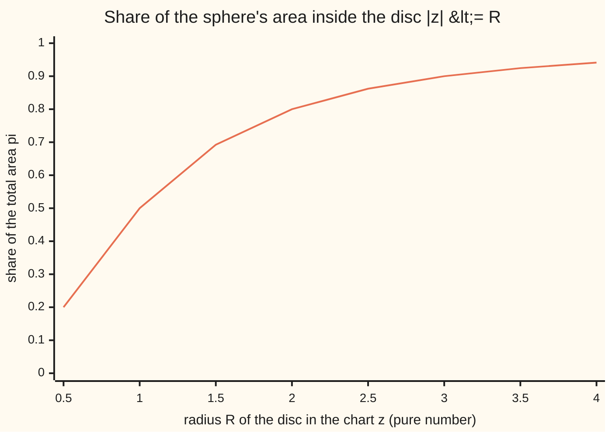

# Complex manifolds and Kahler forms: holomorphic charts and a metric that fits them

[Syllabus](../../../SYLLABUS.md) → [Algebraic geometry](../README.md) → [Cohomology and the Hodge Conjecture](../README.md#s05) → Complex manifolds and Kahler forms

---

## General Overview

The projective line over the complex numbers ℂ is the complex plane with one extra point, infinity. It closes up into a sphere, the Riemann sphere. One coordinate, z, covers every point except infinity. A second coordinate, w = 1/z, covers every point except 0.

Two questions decide its geometry. Do the two coordinates agree on which functions are holomorphic (complex-differentiable)? And can both coordinates accept one way of measuring lengths and areas? A yes to the first makes the sphere a **complex manifold**. A yes to the second, plus one condition, gives a **Kahler form**.

The answer to the second question is the **Fubini-Study form**. In the coordinate z it shrinks a short step at the point z by the factor 1/(1 + |z|²). A step at 0 keeps its length. A step at 1 + i shrinks to a third of its length, and a step at 10 to 1/101 of it.

That shrinking packs the whole infinite plane into a finite area: π, half of it inside the unit circle. Read in the coordinate w, the form gives the same lengths and areas as in z. The [Hodge decomposition](05-hodge-decomposition.md) needs exactly this: a Kahler form, and forms sorted by how many dz's and dz̄'s they contain (the complex step and its mirror image, defined in The formula).

**A complex manifold is a space covered by charts whose coordinate changes are holomorphic, so every form splits into a dz part and a dz̄ part the same way in every chart; a Kahler form is a positive, closed form built from one dz and one dz̄, and on the projective line the Fubini-Study form is one, with total area π.**

**What kind of fact this is:** definitions (complex manifold, dz and dz̄, Kahler form), and theorems proved on this card in Why it works: the split of df, that the projective line is a complex manifold, and that the Fubini-Study form is the same in both charts, positive, closed and of area π. The Kahler condition on the projective plane is proved in outline in a fold and checked at one point by the code.

### The picture: an infinite plane with a finite area



The line is the share $`R^2/(1 + R^2)`$ of the area π that lies inside the disc of radius R in the chart z. The unit disc holds exactly half. Every larger disc adds less and less, because the form shrinks distant steps. Everything outside the unit disc, infinity included, is the unit disc of the chart w.

---

## The formula

Reminders first, one line each.

- **Complex numbers.** A point of the plane is $`z = x + iy`$ with $`i^2 = -1`$ ([Complex numbers](../../07-Complex%20analysis/01-Complex%20Numbers%20and%20the%20Plane/01-complex-numbers.md)). Its **conjugate** is $`\bar z = x - iy`$, the mirror image. On earlier shelves a bar meant closure; here it means conjugation.
- **Charts.** A chart matches a patch of a space with a patch of flat space, and a **transition map** converts one chart's coordinates into another's where they overlap ([Topological manifold](../../17-Topology/03-Surfaces%20and%20Manifolds/01-topological-manifolds.md)).
- **Holomorphic.** A function is holomorphic when it has a complex derivative at every point, which forces the Cauchy-Riemann equations ([The complex derivative](../../07-Complex%20analysis/02-Holomorphic%20Functions/01-complex-derivative-and-cauchy-riemann.md)).
- **Differentials.** The tangent plane of a function f is $`df = f_x\,dx + f_y\,dy`$: the slope east times a step east, plus the slope north times a step north ([Tangent planes](../../06-Calculus%20and%20analysis/07-Several%20Variables/02-differentiability-and-tangent-planes.md)).
- **The projective line.** $`\mathbb{P}^1`$ is covered by the chart z, which misses infinity, and the chart w, which misses 0; on the overlap $`w = 1/z`$ ([Sheaves](01-sheaves-in-outline.md), there with t and $`s = 1/t`$).

Now the new notation, in words first. The **holomorphic differential** is $`dz = dx + i\,dy`$, and the **conjugate differential** is $`d\bar z = dx - i\,dy`$. The **Wirtinger derivatives** are $`\partial f/\partial z = \tfrac12(f_x - i f_y)`$ and $`\partial f/\partial \bar z = \tfrac12(f_x + i f_y)`$. With them, every differential splits into a dz part and a dz̄ part:

```math
df = \frac{\partial f}{\partial z}\,dz + \frac{\partial f}{\partial \bar z}\,d\bar z
```

**Read it aloud:** the change in f is its z-slope times dz plus its z-bar-slope times dz-bar.

A **complex manifold** of dimension n is a manifold with an atlas of charts into $`\mathbb{C}^n`$ whose transition maps are holomorphic. On $`\mathbb{P}^1`$ the transition map is $`w = 1/z`$.

The **wedge** $`\wedge`$ of [De Rham cohomology](02-de-rham-cohomology-of-varieties.md) multiplies two differentials into an area: $`dx \wedge dy`$ measures the signed area of a small parallelogram. Swapping the order flips the sign, and a differential wedged with itself is 0. So $`dz \wedge d\bar z = -2i\,dx \wedge dy`$. Forms of every degree belong to the differential geometry wing; this card needs only this one product.

The **Fubini-Study form** on $`\mathbb{P}^1`$, in the chart z, is

```math
\omega_{FS} = \frac{i}{2}\,\frac{dz \wedge d\bar z}{(1 + |z|^2)^2} = \frac{dx \wedge dy}{(1 + x^2 + y^2)^2}
```

**Read it aloud:** omega is i over 2 times dz wedge dz-bar, divided by one plus the squared size of z, squared; that is the ordinary area element, shrunk by the same amount.

Write its density as $`g(z) = 1/(1 + |z|^2)^2`$. In this geometry a short step at z has its length multiplied by $`\sqrt{g(z)} = 1/(1 + |z|^2)`$. The density comes from a **potential** $`\varphi = \log(1 + |z|^2)`$: $`g = \partial^2\varphi/\partial z\,\partial\bar z`$.

In n coordinates a form of the same type is $`\omega = \tfrac{i}{2}\sum_{j,k} g_{j\bar k}\,dz_j \wedge d\bar z_k`$, with $`g_{j\bar k}`$ a matrix that equals its own conjugate transpose. It is a **Kahler form** when the matrix is positive definite (every nonzero step has positive length) and the form is closed:

```math
\frac{\partial g_{j\bar k}}{\partial z_l} = \frac{\partial g_{l\bar k}}{\partial z_j} \quad \text{for all } j, k, l
```

**Read it aloud:** the z-l slope of entry j, k equals the z-j slope of entry l, k, for every choice of the three indices.

| Symbol | Plain meaning | In our example | Push it up and the answer… |
| --- | --- | --- | --- |
| $`z`$, $`x`$, $`y`$, $`\bar z`$ | the chart coordinate, its real and imaginary parts, its conjugate $`x - iy`$ | $`z = 1 + i`$, x = 1, y = 1, $`\bar z = 1 - i`$ | larger $`\lvert z\rvert`$: nearer infinity, steps shrink |
| $`w`$ | the second chart's coordinate, $`w = 1/z`$ | $`w = 1/(1+i)`$, $`\lvert w\rvert^2 = 1/2`$ | — |
| $`\mathbb{P}^1`$, $`\mathbb{P}^n`$, $`\mathbb{C}^n`$ | the projective line and n-space; n-dimensional complex space, a chart's target | $`\mathbb{P}^1`$; $`\mathbb{P}^2`$ in the fold | — |
| $`f`$, $`u`$, $`v`$ | a function on a chart; its real and imaginary parts | $`z^2`$, $`1/z`$, $`1/\bar z`$, $`\lvert z\rvert^2`$ | — |
| $`dx`$, $`dy`$, $`dz`$, $`d\bar z`$, $`\wedge`$ | the real differentials; the holomorphic and conjugate ones; the signed-area product | $`dw = 0.5i\,dz`$ at 1 + i; $`dz \wedge d\bar z = -2i\,dx \wedge dy`$ | — |
| $`\partial f/\partial z`$, $`\partial f/\partial \bar z`$; $`\partial`$, $`\bar\partial`$ | the dz part and the dz̄ part of df; the operators that take them | 2 + 2i and 0 for $`z^2`$ | a nonzero dz̄ part: not holomorphic |
| $`g(z)`$ | the density of the Fubini-Study form | 1/9 at 1 + i | falls as $`1/\lvert z\rvert^4`$ far out |
| $`\varphi`$ | the potential $`\log(1 + \lvert z\rvert^2)`$ | quarter of its Laplacian 0.111111 at 1 + i | — |
| $`\omega`$, $`\omega_{FS}`$ | a Kahler form; the Fubini-Study one | total area π | scale it by 4: area 4π |
| $`g_{j\bar k}`$; $`j`$, $`k`$, $`l`$; $`\delta_{jk}`$, $`N`$ | the metric's matrix in n coordinates, $`z_1`$ to $`z_n`$; indices from 1 to n; 1 when j = k, else 0; $`1 + \lvert z_1\rvert^2 + \lvert z_2\rvert^2`$ | on $`\mathbb{P}^2`$ at (1 + i, 2 − i): N = 8, $`g_{1\bar 1}`$ = 0.093750 | — |
| $`R`$; $`r`$, $`\theta`$ | the radius of a disc in the chart z; polar coordinates, $`z = re^{i\theta}`$ | R = 1 holds half the area | share $`R^2/(1 + R^2)`$ heads to 1 |
| $`h`$ | the hyperplane class from the previous card | $`\omega/\pi`$ integrates to 1, as h does | — |

### When it holds

- **The transition maps must be holomorphic.** The topology wing's polar charts of the sphere have transition $`1/\bar z`$ (Step 2), whose dz̄ part is −0.5i at 1 + i. Across that overlap dz and dz̄ swap roles.
- **The density must be positive.** A density that changes sign gives some regions negative area.
- **The form must be closed.** On the chart $`\mathbb{C}^2`$ of the projective plane the form with matrix diag$`(1 + |z_2|^2, 1)`$ is positive, yet its slopes mismatch by 2.236068 at the test point. It is a Hermitian metric (a positive form of this type) but not a Kahler form. In one complex dimension closedness holds automatically.
- **Change charts with the factor $`|dw/dz|^2`$.** Read in w without that factor, the density at 1 + i is 4/9; the true value is 1/9.
- **The field is ℂ.** Over the real numbers the projective line is a circle with one real coordinate, and there is no dz̄ to split off.

---

## Why it works

### Step 0: holomorphic maps never mix dz with dz̄

A holomorphic change of coordinates multiplies dz by a complex number and adds no dz̄. So the count of dz's and dz̄'s in a form is the same in every chart of a complex manifold. A Kahler form is a closed metric that respects that count.

### Step 1: split df into its dz part and dz̄ part

Solve $`dz = dx + i\,dy`$ and $`d\bar z = dx - i\,dy`$ for dx and dy: $`dx = \tfrac12(dz + d\bar z)`$ and $`dy = \tfrac{1}{2i}(dz - d\bar z)`$. Put these into $`df = f_x\,dx + f_y\,dy`$ and collect terms:

```math
df = \tfrac12(f_x - i f_y)\,dz + \tfrac12(f_x + i f_y)\,d\bar z
```

Write $`f = u + iv`$. Then $`f_x + i f_y = (u_x - v_y) + i(v_x + u_y)`$. That is zero exactly when $`u_x = v_y`$ and $`u_y = -v_x`$: the Cauchy-Riemann equations. So **holomorphic means the dz̄ part of df is zero**.

The code measures both parts at 1 + i from the slopes $`f_x`$ and $`f_y`$ alone:

| Function | dz part | dz̄ part | Holomorphic? |
| --- | --- | --- | --- |
| $`z^2`$ | 2 + 2i, which is 2z | 0 | yes |
| $`1/z`$ | 0.5i, which is $`-1/z^2`$ | 0 | yes |
| $`1/\bar z`$ | 0 | −0.5i | no: it is anti-holomorphic |
| $`\lvert z\rvert^2 = z\bar z`$ | 1 − i, which is $`\bar z`$ | 1 + i, which is z | no |

The last row shows why the Wirtinger rules work: treat z and z̄ as independent letters and differentiate.

### Step 2: the projective line is a complex manifold

The chart z covers everything but infinity; the chart w covers everything but 0. On the overlap, $`w = 1/z`$. Its dz̄ part is 0 and its dz part is $`-1/z^2`$, never zero there. The inverse, $`z = 1/w`$, is holomorphic too. So the two charts form a complex atlas.

The polar charts on [Topological manifold](../../17-Topology/03-Surfaces%20and%20Manifolds/01-topological-manifolds.md) have transition $`R^2 u/|u|^2`$. On a sphere of radius 1, in complex notation, that is $`z/|z|^2 = 1/\bar z`$: the third row of the table. Reading one chart through the mirror, $`z \mapsto \bar z`$, turns it into $`1/z`$.

### Step 3: the form reads the same in both charts

In the chart w the form is $`\tfrac{i}{2}\,dw \wedge d\bar w/(1 + |w|^2)^2`$. Substitute $`w = 1/z`$.

- The differential: $`dw = -dz/z^2`$, so $`dw \wedge d\bar w = dz \wedge d\bar z/|z|^4`$.
- The density: $`1 + |w|^2 = (|z|^2 + 1)/|z|^2`$, so $`(1 + |w|^2)^2 = (1 + |z|^2)^2/|z|^4`$.

The two factors of $`|z|^4`$ cancel, and the chart-w formula becomes the chart-z formula. At 1 + i the pieces are $`g_w = 4/9`$ and $`|dw/dz|^2 = 1/4`$, and 4/9 × 1/4 = 1/9, the chart-z density.

So one form is defined on the whole sphere, infinity included.

### Step 4: the Kahler condition

A Kahler form must be real, positive and closed.

1. **Real.** The conjugate of $`\tfrac{i}{2}\,dz \wedge d\bar z`$ is $`-\tfrac{i}{2}\,d\bar z \wedge dz`$, which is the same form, since swapping the wedge flips the sign.
2. **Positive.** The form equals $`g\,dx \wedge dy`$ with $`g > 0`$ everywhere, so every region has positive area.
3. **Closed.** Its exterior derivative d (met on [De Rham cohomology](02-de-rham-cohomology-of-varieties.md) for functions and 1-forms, and in general in the differential geometry wing) would have degree 3. On a surface of real dimension 2 every form of degree 3 is zero. So $`d\omega = 0`$ holds automatically.

The density also comes from its potential. A short computation gives $`\partial^2/\partial z\,\partial\bar z = \tfrac14(\partial_x^2 + \partial_y^2)`$, a quarter of the Laplacian (the east-east second slope plus the north-north one). The code measures a quarter of the Laplacian of $`\log(1 + |z|^2)`$ at 1 + i and gets 0.111111, the same as $`g(1 + i)`$ = 1/9.

That potential is what makes the higher-dimensional case work. On $`\mathbb{P}^n`$ the Fubini-Study form is $`\tfrac{i}{2}\,\partial\bar\partial\log(1 + |z_1|^2 + \dots + |z_n|^2)`$, where $`\partial`$ and $`\bar\partial`$ are the dz part and dz̄ part of the derivative. Any form of this shape is closed.

<details>
<summary>The projective plane: the matrix, its determinant, and why the slopes match</summary>

On the chart $`\mathbb{C}^2`$ of $`\mathbb{P}^2`$, write $`N = 1 + |z_1|^2 + |z_2|^2`$ and $`\varphi = \log N`$. Differentiating once in $`\bar z_k`$ and once in $`z_j`$ gives the matrix

$`\displaystyle g_{j\bar k} = \frac{\partial^2 \varphi}{\partial z_j\,\partial \bar z_k} = \frac{N\,\delta_{jk} - \bar z_j z_k}{N^2}`$

where $`\delta_{jk}`$ is 1 when j = k and 0 otherwise.

At $`(z_1, z_2) = (1 + i, 2 - i)`$: $`N = 1 + 2 + 5 = 8`$. So $`g_{1\bar 1} = 6/64 = 0.093750`$, $`g_{2\bar 2} = 3/64 = 0.046875`$, and $`g_{1\bar 2} = -(1 - i)(2 - i)/64 = -(1 - 3i)/64 = -0.015625 + 0.046875i`$. The determinant is $`(18 - 10)/4096 = 1/512`$, positive, and so is $`g_{1\bar 1}`$: the matrix is positive definite. In general the determinant is $`1/N^{3}`$.

Closed: $`\partial g_{j\bar k}/\partial z_l = \partial^3\varphi/\partial z_l\,\partial z_j\,\partial\bar z_k`$. Mixed partial derivatives of a smooth function do not depend on their order, so swapping l and j changes nothing. That is the Kahler condition. The code differentiates the matrix numerically and finds a largest mismatch of 0.000000.

The matrix diag$`(1 + |z_2|^2, 1)`$ has no potential. Its $`\partial g_{1\bar 1}/\partial z_2 = \bar z_2 = 2 + i`$, while $`\partial g_{2\bar 1}/\partial z_1 = 0`$. The mismatch is $`|2 + i| = \sqrt5 = 2.236068`$.

</details>

### Step 5: the area is π, and ω/π is the hyperplane class

In polar coordinates $`z = re^{i\theta}`$ the area element is $`r\,dr\,d\theta`$, so the area inside $`|z| \le R`$ is

```math
\int_0^{2\pi}\!\!\int_0^R \frac{r\,dr\,d\theta}{(1 + r^2)^2} = \pi\left(1 - \frac{1}{1 + R^2}\right) = \pi\,\frac{R^2}{1 + R^2}
```

**Read it aloud:** the area inside radius R is π times R squared over one plus R squared.

As R grows the area tends to π. A second road confirms the shape. The Fubini-Study form makes $`\mathbb{P}^1`$ a round sphere of radius 1/2, of area π. The disc $`|z| \le R`$ is a polar cap of it. Archimedes' hat-box theorem says a slice of a sphere between two parallel planes has area in proportion to its height. The cap's height share works out to $`R^2/(1 + R^2)`$ again.

So $`\omega/\pi`$ has total integral 1 over $`\mathbb{P}^1`$. On [Cohomology of projective space](03-cohomology-of-projective-space.md) the hyperplane class h is the class whose integral over a line is 1. So $`\omega/\pi`$ represents h: the Kahler form defines a cohomology class, not only a metric.

---

## Worked numbers, by hand

Take the point $`z = 1 + i`$ in the chart z.

| Step | Arithmetic | Value |
| --- | --- | --- |
| squared size | $`1^2 + 1^2`$ | $`\lvert z\rvert^2 = 2`$ |
| density | $`1/(1 + 2)^2`$ | 1/9 = 0.111111 |
| length of a unit step | $`1/(1 + 2)`$ | 0.333333 |
| the same point in chart w | $`\lvert w\rvert^2 = 1/\lvert z\rvert^2`$ | 1/2 |
| density read in w | $`1/(1 + 1/2)^2`$ | 4/9 |
| change-of-chart factor | $`\lvert dw/dz\rvert^2 = 1/\lvert z^2\rvert^2 = 1/\lvert 2i\rvert^2`$ | 1/4 |
| density carried back to z | 4/9 × 1/4 | **1/9: the same form** |
| area inside $`\lvert z\rvert \le 1`$ | π × 1/(1 + 1) | π/2 |
| whole sphere, one unit disc per chart | π/2 + π/2 | **π = 3.141593** |

The two charts describe one form, and its total area is π: finite, although the chart z alone runs over an infinite plane.

### What breaks if you drop a piece

| Mistake | Comes out at | What went wrong |
| --- | --- | --- |
| Polar charts as given, transition $`1/\bar z`$ | dz̄ part −0.5i at 1 + i | not holomorphic, so not a complex atlas |
| Density read in w without $`\lvert dw/dz\rvert^2`$ | 4/9 = 0.444444, not 1/9 | a form changes by the chart's stretch |
| The factor i/2 dropped | area −6.283185i, not π | $`dz \wedge d\bar z = -2i\,dx \wedge dy`$ is not an area; i/2 turns it into $`dx \wedge dy`$ |
| Positive matrix diag$`(1 + \lvert z_2\rvert^2, 1)`$ on the chart $`\mathbb{C}^2`$ of $`\mathbb{P}^2`$ | slope mismatch 2.236068 | positive but not closed: not Kahler |

The code prints all four.

---

## Code, from first principles, and it actually runs

The code takes independent roads to each answer. The dz and dz̄ parts come from east and north slopes and are checked against the rules worked by hand. The density comes from its formula and from the potential's Laplacian. Chart agreement is checked exactly, in fractions, at four points. The area shares come three ways: the closed form, Archimedes' zones and a midpoint-rule integral. A sphere distance is compared with a quantum angle, and the Kahler test runs on the projective plane beside a metric that fails it.

### Python

```python
# Complex manifolds and Kahler forms -- the check behind the card.  Standard
# library only.  The projective line P^1 has two charts: z, and w = 1/z where
# both work.  Its Fubini-Study form is omega = (i/2) g dz ^ dz-bar, with the
# density g1(z) = 1/(1 + |z|^2)^2, and that equals g dx ^ dy.  Chart agreement
# is checked exactly in fractions; derivatives and areas are floats, to 1e-6.
from fractions import Fraction as Q
import math

def fx(x):                                 # a float to 6 places, never "-0.000000"
    return f"{0.0 if abs(x) < 5e-7 else x:.6f}"

def cx(v):                                 # a complex number as "a + bi"
    return f"{fx(v.real)} {'-' if v.imag < -5e-7 else '+'} {fx(abs(v.imag))}i"

def split(f, z, d=1e-5):                   # road one: (df/dz, df/dz-bar) from x and y slopes
    fx_ = (f(z + d) - f(z - d)) / (2 * d)
    fy_ = (f(z + 1j * d) - f(z - 1j * d)) / (2 * d)
    return (fx_ - 1j * fy_) / 2, (fx_ + 1j * fy_) / 2

def g1(z):                                  # the Fubini-Study density in chart z
    return 1 / (1 + abs(z) ** 2) ** 2

def midpoint(f, a, b, n=20000):            # a plain midpoint-rule integral
    step = (b - a) / n
    return sum(f(a + (k + 0.5) * step) for k in range(n)) * step

z0 = 1 + 1j
tests = [("z^2", lambda z: z * z, 2 * z0, 0),         # road two: the rules by hand
         ("1/z", lambda z: 1 / z, -1 / z0 ** 2, 0),
         ("1/conj z", lambda z: 1 / z.conjugate(), 0, -1 / z0.conjugate() ** 2),
         ("|z|^2", lambda z: abs(z) ** 2, z0.conjugate(), z0)]
worst = 0.0
for name, f, dz_part, dzbar_part in tests:
    a, b = split(f, z0)
    worst = max(worst, abs(a - dz_part), abs(b - dzbar_part))
    print(f"d({name}) at 1 + i: dz part {cx(a)}, dz-bar part {cx(b)}")
d = 1e-3                                   # road two to g: a quarter of the Laplacian of log(1 + |z|^2)
phi = lambda z: math.log(1 + abs(z) ** 2)
lap = (phi(z0 + d) + phi(z0 - d) + phi(z0 + 1j * d) + phi(z0 - 1j * d) - 4 * phi(z0)) / d ** 2
print(f"g(1 + i) = 1/(1 + 2)^2 = {fx(g1(z0))}; quarter Laplacian of the potential {fx(lap / 4)}")
print(f"length per unit step, 1/(1 + |z|^2): at 0 {fx(math.sqrt(g1(0)))}, at 1 + i {fx(math.sqrt(g1(z0)))}, "
      f"at 10 {fx(math.sqrt(g1(10)))}")
agree = []
for x, y in [(Q(1), Q(1)), (Q(2), Q(0)), (Q(1, 2), Q(3, 4)), (Q(3), Q(-2))]:
    s = x * x + y * y                      # |z|^2, exact
    wx, wy = x / s, -y / s                 # w = 1/z, exact
    gw = 1 / (1 + wx * wx + wy * wy) ** 2
    zz = (x * x - y * y, 2 * x * y)        # z^2, so |dw/dz|^2 = 1/|z^2|^2
    factor = 1 / (zz[0] ** 2 + zz[1] ** 2)
    agree.append(gw * factor == 1 / (1 + s) ** 2)
    if (x, y) == (1, 1):
        print(f"exact at z = 1 + i: g_z = {1 / (1 + s) ** 2}, g_w(w) = {gw}, |dw/dz|^2 = {factor}, "
              f"g_w x |dw/dz|^2 = {gw * factor}")
print(f"chart agreement at 1 + i, 2, 1/2 + 3i/4, 3 - 2i: {sum(agree)} of 4 exact")
print("R, share of the area in |z| <= R: closed form, Archimedes zone, midpoint rule")
chart = []
for R in [Q(1, 2), Q(1), Q(3, 2), Q(2), Q(5, 2), Q(3), Q(7, 2), Q(4)]:
    closed = 1 - 1 / (1 + R * R)
    t = (R * R - 1) / (R * R + 1)          # height on the unit sphere above |z| = R
    zone = (t + 1) / 2                     # Archimedes: a zone's area is its height's share
    num = midpoint(lambda r: 2 * r * g1(r), 0, float(R))   # area / pi
    chart.append((closed, zone, num))
    print(f"figure, {float(R)}: {closed} = {zone}, {fx(float(zone))}, {fx(num)}")
total = 2 * midpoint(lambda r: 2 * math.pi * r * g1(r), 0, 1)
print(f"whole sphere: two unit discs, one per chart: {fx(total)}; pi = {fx(math.pi)}; "
      f"integral of omega/pi: {fx(total / math.pi)}")
dist = midpoint(lambda r: math.sqrt(g1(r)), 0, 1)
angle = math.acos(1 / math.sqrt(2))     # |<0|+>| = 1/sqrt 2 for the two qubit states
print(f"distance z = 0 to z = 1: {fx(dist)}; qubit angle between |0> and |+>: {fx(angle)}")

def g_fs(z1, z2):                          # Fubini-Study on the chart C^2 of P^2
    n = 1 + abs(z1) ** 2 + abs(z2) ** 2
    v = (z1, z2)
    return [[((n if j == k else 0) - v[j].conjugate() * v[k]) / n ** 2 for k in range(2)] for j in range(2)]

def g_bad(z1, z2):                         # positive, but not closed
    return [[1 + abs(z2) ** 2, 0], [0, 1]]

def asym(g, p, d=1e-5):                    # largest |d_l g_jk - d_j g_lk| over l, j, k
    def dl(l, j, k):
        e = [[d, 0], [0, d]][l]
        up = g(*[p[m] + e[m] for m in range(2)])[j][k] - g(*[p[m] - e[m] for m in range(2)])[j][k]
        vp = g(*[p[m] + 1j * e[m] for m in range(2)])[j][k] - g(*[p[m] - 1j * e[m] for m in range(2)])[j][k]
        return (up - 1j * vp) / (4 * d)
    return max(abs(dl(l, j, k) - dl(j, l, k)) for l in range(2) for j in range(2) for k in range(2))

p = (1 + 1j, 2 - 1j)
g = g_fs(*p)
det = (g[0][0] * g[1][1] - g[0][1] * g[1][0]).real
print(f"P^2 at (1 + i, 2 - i): g11 {fx(g[0][0].real)}, g22 {fx(g[1][1].real)}, g12 {cx(g[0][1])}, 1/det {fx(1 / det)}")
print(f"Kahler test, largest mismatch: Fubini-Study {fx(asym(g_fs, p))}; diag(1 + |z2|^2, 1) {fx(asym(g_bad, p))}")
print(f"torus C/Z[i], flat form (i/2) dz ^ dz-bar: area of one cell, Im(conj(1) x i) = {fx((1j * (1 + 0j).conjugate()).imag)}")
dz, dzb = (1, 1j), (1, -1j)                # the dx and dy parts of dz and dz-bar
wedge = dz[0] * dzb[1] - dz[1] * dzb[0]    # dz ^ dz-bar = wedge times dx ^ dy
print(f"mistake 1, the factor i/2 dropped: area {cx(wedge * total)}, not {fx((0.5j * wedge * total).real)}")
print(f"mistake 2, g_w(w) without |dw/dz|^2 at 1 + i: {fx(g1(1 / z0))}, not {fx(g1(z0))}")
print(f"mistake 3, unit-sphere form 4g as the class: integral/pi {fx(4 * total / math.pi)}, not 1")
assert worst < 1e-6                                          # slopes against the rules by hand
assert abs(lap / 4 - g1(z0)) < 1e-6                           # potential against density
assert all(agree)                                            # the two charts give one form
assert all(c == z for c, z, _ in chart) and all(abs(float(c) - n) < 1e-6 for c, _, n in chart)
assert abs(total - math.pi) < 1e-6 and abs(dist - angle) < 1e-6
assert abs(1 / det - 512) < 1e-6 and asym(g_fs, p) < 1e-6 and abs(asym(g_bad, p) - math.sqrt(5)) < 1e-6
print("ALL CHECKS PASS")
```

**Ran 2026-11-17 on macOS, Python 3.14.10, standard library only. All checks passed. Output, pasted from the run:**

```
d(z^2) at 1 + i: dz part 2.000000 + 2.000000i, dz-bar part 0.000000 + 0.000000i
d(1/z) at 1 + i: dz part 0.000000 + 0.500000i, dz-bar part 0.000000 + 0.000000i
d(1/conj z) at 1 + i: dz part 0.000000 + 0.000000i, dz-bar part 0.000000 - 0.500000i
d(|z|^2) at 1 + i: dz part 1.000000 - 1.000000i, dz-bar part 1.000000 + 1.000000i
g(1 + i) = 1/(1 + 2)^2 = 0.111111; quarter Laplacian of the potential 0.111111
length per unit step, 1/(1 + |z|^2): at 0 1.000000, at 1 + i 0.333333, at 10 0.009901
exact at z = 1 + i: g_z = 1/9, g_w(w) = 4/9, |dw/dz|^2 = 1/4, g_w x |dw/dz|^2 = 1/9
chart agreement at 1 + i, 2, 1/2 + 3i/4, 3 - 2i: 4 of 4 exact
R, share of the area in |z| <= R: closed form, Archimedes zone, midpoint rule
figure, 0.5: 1/5 = 1/5, 0.200000, 0.200000
figure, 1.0: 1/2 = 1/2, 0.500000, 0.500000
figure, 1.5: 9/13 = 9/13, 0.692308, 0.692308
figure, 2.0: 4/5 = 4/5, 0.800000, 0.800000
figure, 2.5: 25/29 = 25/29, 0.862069, 0.862069
figure, 3.0: 9/10 = 9/10, 0.900000, 0.900000
figure, 3.5: 49/53 = 49/53, 0.924528, 0.924528
figure, 4.0: 16/17 = 16/17, 0.941176, 0.941176
whole sphere: two unit discs, one per chart: 3.141593; pi = 3.141593; integral of omega/pi: 1.000000
distance z = 0 to z = 1: 0.785398; qubit angle between |0> and |+>: 0.785398
P^2 at (1 + i, 2 - i): g11 0.093750, g22 0.046875, g12 -0.015625 + 0.046875i, 1/det 512.000000
Kahler test, largest mismatch: Fubini-Study 0.000000; diag(1 + |z2|^2, 1) 2.236068
torus C/Z[i], flat form (i/2) dz ^ dz-bar: area of one cell, Im(conj(1) x i) = 1.000000
mistake 1, the factor i/2 dropped: area 0.000000 - 6.283185i, not 3.141593
mistake 2, g_w(w) without |dw/dz|^2 at 1 + i: 0.444444, not 0.111111
mistake 3, unit-sphere form 4g as the class: integral/pi 4.000000, not 1
ALL CHECKS PASS
```

### Rust

Same numbers, same labels, built with `rustc --edition 2021 -O`.

```rust
// Complex manifolds and Kahler forms -- the same check as the Python, in Rust.
// No crates.  The projective line P^1 has two charts: z, and w = 1/z where
// both work.  Its Fubini-Study form is omega = (i/2) g dz ^ dz-bar, with the
// density g1(z) = 1/(1 + |z|^2)^2, and that equals g dx ^ dy.  Chart agreement
// is checked exactly in fractions; derivatives and areas are floats, to 1e-6.
use std::f64::consts::PI;
use std::ops::{Add, Div, Mul, Sub};

#[derive(Clone, Copy)]
struct C { re: f64, im: f64 }              // a complex number, written out here
fn c(re: f64, im: f64) -> C { C { re, im } }
impl Add for C { type Output = C; fn add(self, o: C) -> C { c(self.re + o.re, self.im + o.im) } }
impl Sub for C { type Output = C; fn sub(self, o: C) -> C { c(self.re - o.re, self.im - o.im) } }
impl Mul for C { type Output = C; fn mul(self, o: C) -> C { c(self.re * o.re - self.im * o.im, self.re * o.im + self.im * o.re) } }
impl Div for C { type Output = C; fn div(self, o: C) -> C { let n = o.norm2(); let p = self * o.conj(); c(p.re / n, p.im / n) } }
impl C {
    fn conj(self) -> C { c(self.re, -self.im) }
    fn norm2(self) -> f64 { self.re * self.re + self.im * self.im }
    fn abs(self) -> f64 { self.norm2().sqrt() }
    fn s(self, k: f64) -> C { c(self.re * k, self.im * k) }
}
const I: C = C { re: 0.0, im: 1.0 };
const ONE: C = C { re: 1.0, im: 0.0 };

#[derive(Clone, Copy, PartialEq)]
struct Q { n: i128, d: i128 }              // an exact fraction; overflow stops the run
fn gcd(a: i128, b: i128) -> i128 { if b == 0 { a.abs() } else { gcd(b, a % b) } }
fn q(n: i128, d: i128) -> Q { let g = gcd(n, d) * d.signum(); Q { n: n / g, d: d / g } }
fn mulq(a: i128, b: i128) -> i128 { a.checked_mul(b).expect("overflow") }
impl Add for Q { type Output = Q; fn add(self, o: Q) -> Q { q(mulq(self.n, o.d) + mulq(o.n, self.d), mulq(self.d, o.d)) } }
impl Sub for Q { type Output = Q; fn sub(self, o: Q) -> Q { q(mulq(self.n, o.d) - mulq(o.n, self.d), mulq(self.d, o.d)) } }
impl Mul for Q { type Output = Q; fn mul(self, o: Q) -> Q { q(mulq(self.n, o.n), mulq(self.d, o.d)) } }
impl Div for Q { type Output = Q; fn div(self, o: Q) -> Q { q(mulq(self.n, o.d), mulq(self.d, o.n)) } }
impl std::fmt::Display for Q {
    fn fmt(&self, f: &mut std::fmt::Formatter) -> std::fmt::Result {
        if self.d == 1 { write!(f, "{}", self.n) } else { write!(f, "{}/{}", self.n, self.d) }
    }
}
fn qf(x: Q) -> f64 { x.n as f64 / x.d as f64 }

fn fx(x: f64) -> String { format!("{:.6}", if x.abs() < 5e-7 { 0.0 } else { x }) }
fn cx(v: C) -> String { format!("{} {} {}i", fx(v.re), if v.im < -5e-7 { "-" } else { "+" }, fx(v.im.abs())) }

fn split(f: &dyn Fn(C) -> C, z: C, d: f64) -> (C, C) { // road one: (df/dz, df/dz-bar)
    let fx_ = (f(z + c(d, 0.0)) - f(z - c(d, 0.0))).s(1.0 / (2.0 * d));
    let fy_ = (f(z + c(0.0, d)) - f(z - c(0.0, d))).s(1.0 / (2.0 * d));
    ((fx_ - I * fy_).s(0.5), (fx_ + I * fy_).s(0.5))
}
fn g1(z: C) -> f64 { 1.0 / (1.0 + z.norm2()).powi(2) }   // the Fubini-Study density
fn gr(r: f64) -> f64 { g1(c(r, 0.0)) }
fn midpoint(f: &dyn Fn(f64) -> f64, a: f64, b: f64) -> f64 {
    let n = 20000; let step = (b - a) / n as f64;
    (0..n).map(|k| f(a + (k as f64 + 0.5) * step)).sum::<f64>() * step
}
type G = [[C; 2]; 2];
fn g_fs(z: [C; 2]) -> G {                  // Fubini-Study on the chart C^2 of P^2
    let n = 1.0 + z[0].norm2() + z[1].norm2();
    let e = |j: usize, k: usize| (c(if j == k { n } else { 0.0 }, 0.0) - z[j].conj() * z[k]).s(1.0 / (n * n));
    [[e(0, 0), e(0, 1)], [e(1, 0), e(1, 1)]]
}
fn g_bad(z: [C; 2]) -> G {                 // positive, but not closed
    let zero = c(0.0, 0.0);
    [[c(1.0 + z[1].norm2(), 0.0), zero], [zero, ONE]]
}
fn asym(g: &dyn Fn([C; 2]) -> G, p: [C; 2]) -> f64 { // largest |d_l g_jk - d_j g_lk|
    let d = 1e-5;
    let dl = |l: usize, j: usize, k: usize| {
        let sh = |w: C| { let mut v = p; v[l] = v[l] + w; g(v)[j][k] };
        let up = sh(c(d, 0.0)) - sh(c(-d, 0.0));
        let vp = sh(c(0.0, d)) - sh(c(0.0, -d));
        (up - I * vp).s(1.0 / (4.0 * d))
    };
    let mut m: f64 = 0.0;
    for l in 0..2 { for j in 0..2 { for k in 0..2 { m = m.max((dl(l, j, k) - dl(j, l, k)).abs()) } } }
    m
}

fn main() {
    let z0 = c(1.0, 1.0);
    let tests: Vec<(&str, Box<dyn Fn(C) -> C>, C, C)> = vec![   // road two: the rules by hand
        ("z^2", Box::new(|z: C| z * z), z0.s(2.0), c(0.0, 0.0)),
        ("1/z", Box::new(|z: C| ONE / z), c(-1.0, 0.0) / (z0 * z0), c(0.0, 0.0)),
        ("1/conj z", Box::new(|z: C| ONE / z.conj()), c(0.0, 0.0), c(-1.0, 0.0) / (z0.conj() * z0.conj())),
        ("|z|^2", Box::new(|z: C| c(z.norm2(), 0.0)), z0.conj(), z0)];
    let mut worst: f64 = 0.0;
    for (name, f, dz, dzb) in &tests {
        let (a, b) = split(f.as_ref(), z0, 1e-5);
        worst = worst.max((a - *dz).abs()).max((b - *dzb).abs());
        println!("d({}) at 1 + i: dz part {}, dz-bar part {}", name, cx(a), cx(b));
    }
    let d = 1e-3;                          // road two to g: a quarter Laplacian of the potential
    let phi = |z: C| (1.0 + z.norm2()).ln();
    let lap = (phi(z0 + c(d, 0.0)) + phi(z0 - c(d, 0.0)) + phi(z0 + c(0.0, d)) + phi(z0 - c(0.0, d)) - 4.0 * phi(z0)) / (d * d);
    println!("g(1 + i) = 1/(1 + 2)^2 = {}; quarter Laplacian of the potential {}", fx(g1(z0)), fx(lap / 4.0));
    println!("length per unit step, 1/(1 + |z|^2): at 0 {}, at 1 + i {}, at 10 {}", fx(gr(0.0).sqrt()), fx(g1(z0).sqrt()), fx(gr(10.0).sqrt()));
    let mut agree = 0;
    for (x, y) in [(q(1, 1), q(1, 1)), (q(2, 1), q(0, 1)), (q(1, 2), q(3, 4)), (q(3, 1), q(-2, 1))] {
        let one = q(1, 1);
        let s = x * x + y * y;             // |z|^2, exact
        let (wx, wy) = (x / s, q(0, 1) - y / s);  // w = 1/z, exact
        let w2 = one + wx * wx + wy * wy;
        let gw = one / (w2 * w2);
        let zz = (x * x - y * y, q(2, 1) * x * y);  // z^2, so |dw/dz|^2 = 1/|z^2|^2
        let factor = one / (zz.0 * zz.0 + zz.1 * zz.1);
        let gz = one / ((one + s) * (one + s));
        if gw * factor == gz { agree += 1 }
        if x == one && y == one {
            println!("exact at z = 1 + i: g_z = {}, g_w(w) = {}, |dw/dz|^2 = {}, g_w x |dw/dz|^2 = {}", gz, gw, factor, gw * factor);
        }
    }
    println!("chart agreement at 1 + i, 2, 1/2 + 3i/4, 3 - 2i: {} of 4 exact", agree);
    println!("R, share of the area in |z| <= R: closed form, Archimedes zone, midpoint rule");
    let mut chart_ok = true;
    for r in [q(1, 2), q(1, 1), q(3, 2), q(2, 1), q(5, 2), q(3, 1), q(7, 2), q(4, 1)] {
        let one = q(1, 1);
        let closed = one - one / (one + r * r);
        let t = (r * r - one) / (r * r + one);    // height on the unit sphere above |z| = R
        let zone = (t + one) / q(2, 1);          // Archimedes: a zone's area is its height's share
        let num = midpoint(&|x: f64| 2.0 * x * gr(x), 0.0, qf(r));   // area / pi
        chart_ok &= closed == zone && (qf(closed) - num).abs() < 1e-6;
        println!("figure, {:.1}: {} = {}, {}, {}", qf(r), closed, zone, fx(qf(zone)), fx(num));
    }
    let total = 2.0 * midpoint(&|r: f64| 2.0 * PI * r * gr(r), 0.0, 1.0);
    println!("whole sphere: two unit discs, one per chart: {}; pi = {}; integral of omega/pi: {}", fx(total), fx(PI), fx(total / PI));
    let dist = midpoint(&|r: f64| gr(r).sqrt(), 0.0, 1.0);
    let angle = (1.0 / 2f64.sqrt()).acos();  // |<0|+>| = 1/sqrt 2 for the two qubit states
    println!("distance z = 0 to z = 1: {}; qubit angle between |0> and |+>: {}", fx(dist), fx(angle));
    let p = [c(1.0, 1.0), c(2.0, -1.0)];
    let g = g_fs(p);
    let det = (g[0][0] * g[1][1] - g[0][1] * g[1][0]).re;
    println!("P^2 at (1 + i, 2 - i): g11 {}, g22 {}, g12 {}, 1/det {}", fx(g[0][0].re), fx(g[1][1].re), cx(g[0][1]), fx(1.0 / det));
    let (a_fs, a_bad) = (asym(&g_fs, p), asym(&g_bad, p));
    println!("Kahler test, largest mismatch: Fubini-Study {}; diag(1 + |z2|^2, 1) {}", fx(a_fs), fx(a_bad));
    println!("torus C/Z[i], flat form (i/2) dz ^ dz-bar: area of one cell, Im(conj(1) x i) = {}", fx((I * ONE.conj()).im));
    let (dz, dzb) = ([ONE, I], [ONE, I.conj()]);  // the dx and dy parts of dz and dz-bar
    let wedge = dz[0] * dzb[1] - dz[1] * dzb[0];  // dz ^ dz-bar = wedge times dx ^ dy
    println!("mistake 1, the factor i/2 dropped: area {}, not {}", cx(wedge.s(total)), fx((c(0.0, 0.5) * wedge).s(total).re));
    println!("mistake 2, g_w(w) without |dw/dz|^2 at 1 + i: {}, not {}", fx(g1(ONE / z0)), fx(g1(z0)));
    println!("mistake 3, unit-sphere form 4g as the class: integral/pi {}, not 1", fx(4.0 * total / PI));
    assert!(worst < 1e-6);                                       // slopes against the rules by hand
    assert!((lap / 4.0 - g1(z0)).abs() < 1e-6);                   // potential against density
    assert!(agree == 4);                                         // the two charts give one form
    assert!(chart_ok);
    assert!((total - PI).abs() < 1e-6 && (dist - angle).abs() < 1e-6);
    assert!((1.0 / det - 512.0).abs() < 1e-6 && a_fs < 1e-6 && (a_bad - 5f64.sqrt()).abs() < 1e-6);
    println!("ALL CHECKS PASS");
}
```

**Ran 2026-11-17 on macOS, rustc 1.98.1, no crates. All checks passed. Output, pasted from the run:**

```
d(z^2) at 1 + i: dz part 2.000000 + 2.000000i, dz-bar part 0.000000 + 0.000000i
d(1/z) at 1 + i: dz part 0.000000 + 0.500000i, dz-bar part 0.000000 + 0.000000i
d(1/conj z) at 1 + i: dz part 0.000000 + 0.000000i, dz-bar part 0.000000 - 0.500000i
d(|z|^2) at 1 + i: dz part 1.000000 - 1.000000i, dz-bar part 1.000000 + 1.000000i
g(1 + i) = 1/(1 + 2)^2 = 0.111111; quarter Laplacian of the potential 0.111111
length per unit step, 1/(1 + |z|^2): at 0 1.000000, at 1 + i 0.333333, at 10 0.009901
exact at z = 1 + i: g_z = 1/9, g_w(w) = 4/9, |dw/dz|^2 = 1/4, g_w x |dw/dz|^2 = 1/9
chart agreement at 1 + i, 2, 1/2 + 3i/4, 3 - 2i: 4 of 4 exact
R, share of the area in |z| <= R: closed form, Archimedes zone, midpoint rule
figure, 0.5: 1/5 = 1/5, 0.200000, 0.200000
figure, 1.0: 1/2 = 1/2, 0.500000, 0.500000
figure, 1.5: 9/13 = 9/13, 0.692308, 0.692308
figure, 2.0: 4/5 = 4/5, 0.800000, 0.800000
figure, 2.5: 25/29 = 25/29, 0.862069, 0.862069
figure, 3.0: 9/10 = 9/10, 0.900000, 0.900000
figure, 3.5: 49/53 = 49/53, 0.924528, 0.924528
figure, 4.0: 16/17 = 16/17, 0.941176, 0.941176
whole sphere: two unit discs, one per chart: 3.141593; pi = 3.141593; integral of omega/pi: 1.000000
distance z = 0 to z = 1: 0.785398; qubit angle between |0> and |+>: 0.785398
P^2 at (1 + i, 2 - i): g11 0.093750, g22 0.046875, g12 -0.015625 + 0.046875i, 1/det 512.000000
Kahler test, largest mismatch: Fubini-Study 0.000000; diag(1 + |z2|^2, 1) 2.236068
torus C/Z[i], flat form (i/2) dz ^ dz-bar: area of one cell, Im(conj(1) x i) = 1.000000
mistake 1, the factor i/2 dropped: area 0.000000 - 6.283185i, not 3.141593
mistake 2, g_w(w) without |dw/dz|^2 at 1 + i: 0.444444, not 0.111111
mistake 3, unit-sphere form 4g as the class: integral/pi 4.000000, not 1
ALL CHECKS PASS
```

The two outputs match line for line.

### Lean

Lean proves the chart agreement, the dz split and the area formula on the projective line, and checks the worked numbers.

- Take a point $`z \ne 0`$, where the charts overlap. Then $`w = 1/z`$ is holomorphic there, with a nonzero derivative.
- Take the same point. Then the density read in w, times $`|dw/dz|^2`$, equals the density $`g(z)`$ of the chart z, and $`g(z) > 0`$.
- Take any function f on the chart z. Then df splits into its dz part and its dz̄ part, as in Step 1.
- Take f with a tangent plane at z. Then f is holomorphic at z exactly when its dz̄ part is zero there.
- Take a radius $`R \ge 0`$. Then the Fubini-Study form gives the disc $`|z| \le R`$ the area $`\pi R^2/(1 + R^2)`$.
- The whole chart z, the sphere less one point, has area π.
- At 1 + i the density is 1/9, the density read in w is 4/9, and the stretch factor is 1/4.
- At 1 + i the dz part of d(1/z) is i/2.
- The eight area shares in the figure are exact, and Archimedes' zone gives 9/13 at R = 3/2.
- On the projective plane at (1 + i, 2 − i), N = 8 and the determinant is 1/512.
- The squared slope mismatch of diag$`(1 + |z_2|^2, 1)`$ is $`|2 + i|^2 = 5`$.

The projective plane's Kahler test, the potential, the polar charts and all decimals are left to the Python and Rust checks.

```lean
-- Complex manifolds and Kahler forms: the chart change w = 1/z of the projective line is holomorphic and carries the Fubini-Study density 1/(1 + |z|^2)^2 to itself, holomorphic means the dz-bar part of df is zero, and the form has area pi R^2/(1 + R^2) inside |z| <= R and pi in all.
import Mathlib.Analysis.Complex.Conformal
import Mathlib.Analysis.Calculus.Deriv.Inv
import Mathlib.Analysis.SpecialFunctions.PolarCoord
import Mathlib.MeasureTheory.Measure.Lebesgue.Complex
import Mathlib.MeasureTheory.Constructions.HaarToSphere
import Mathlib.MeasureTheory.Measure.Lebesgue.VolumeOfBalls
import Mathlib.MeasureTheory.Integral.IntegralEqImproper

open Complex MeasureTheory

lemma fs_unit_ball_real : (volume : Measure ℂ).real (Metric.ball (0 : ℂ) 1) = Real.pi := by
  simp [Measure.real, Complex.volume_ball]

#print axioms fs_unit_ball_real

lemma fs_radial (g : ℝ → ℝ) :
    ∫ z : ℂ, g ‖z‖ = 2 * Real.pi * ∫ y in Set.Ioi (0 : ℝ), y * g y := by
  rw [integral_fun_norm_addHaar volume g, fs_unit_ball_real, Complex.finrank_real_complex]
  simp only [nsmul_eq_mul, smul_eq_mul, pow_one, Nat.add_one_sub_one]
  push_cast; ring

#print axioms fs_radial

lemma fs_hasDeriv (x : ℝ) :
    HasDerivAt (fun y : ℝ => -(1 / 2) / (1 + y ^ 2)) (x / (1 + x ^ 2) ^ 2) x := by
  have h1 : (1 + x ^ 2) ≠ 0 := by positivity
  have := ((hasDerivAt_pow 2 x).const_add 1).inv h1
  convert this.const_mul (-(1 / 2) : ℝ) using 1
  · funext y; simp [div_eq_mul_inv]
  · field_simp; push_cast; ring

#print axioms fs_hasDeriv

/-- The projective line with its two charts z and w = 1/z is a complex manifold carrying the
Fubini-Study form: on the overlap z ≠ 0 the transition map w = 1/z is holomorphic with nonzero
derivative, the density read in the chart w and multiplied by the stretch factor |dw/dz|^2
equals the density 1/(1 + |z|^2)^2 read in the chart z, and that density is positive. -/
theorem fubini_study_form_same_in_both_charts (z : ℂ) (hz : z ≠ 0) :
    DifferentiableAt ℂ (fun u : ℂ => u⁻¹) z ∧ deriv (fun u : ℂ => u⁻¹) z ≠ 0 ∧
      1 / (1 + ‖z⁻¹‖ ^ 2) ^ 2 * ‖deriv (fun u : ℂ => u⁻¹) z‖ ^ 2 = 1 / (1 + ‖z‖ ^ 2) ^ 2 ∧
      0 < 1 / (1 + ‖z‖ ^ 2) ^ 2 := by
  have hd : deriv (fun u : ℂ => u⁻¹) z = -(z ^ 2)⁻¹ := deriv_inv
  have hn : 0 < ‖z‖ := norm_pos_iff.mpr hz
  refine ⟨differentiableAt_inv hz, ?_, ?_, by positivity⟩
  · rw [hd]; simp [hz]
  · rw [hd, norm_neg, norm_inv, norm_inv, norm_pow]
    field_simp
    ring

/-- The split of df: for any f on ℂ, with slopes f_x = df(1) and f_y = df(i), the differential is
df(v) = (1/2)(f_x - i f_y) v + (1/2)(f_x + i f_y) conj(v), its dz part plus its dz-bar part; and
when f is real-differentiable at z, f is holomorphic at z exactly when the dz-bar part
(1/2)(f_x + i f_y) is zero (the Cauchy-Riemann equations). -/
theorem holomorphic_iff_dzbar_part_zero (f : ℂ → ℂ) (z : ℂ) :
    (∀ v : ℂ, fderiv ℝ f z v =
        (1 / 2 : ℂ) * (fderiv ℝ f z 1 - I * fderiv ℝ f z I) * v +
          (1 / 2 : ℂ) * (fderiv ℝ f z 1 + I * fderiv ℝ f z I) * (starRingEnd ℂ) v) ∧
      (DifferentiableAt ℝ f z →
        (DifferentiableAt ℂ f z ↔ (1 / 2 : ℂ) * (fderiv ℝ f z 1 + I * fderiv ℝ f z I) = 0)) := by
  set L := fderiv ℝ f z with hL
  have hsplit : ∀ v : ℂ, L v = (v.re : ℂ) * L 1 + (v.im : ℂ) * L I := by
    intro v
    have hv : v = v.re • (1 : ℂ) + v.im • I := by
      apply Complex.ext <;> simp
    conv_lhs => rw [hv]
    rw [map_add, map_smul, map_smul, Complex.real_smul, Complex.real_smul]
  refine ⟨fun v => ?_, fun hf => ?_⟩
  · rw [hsplit v]
    apply Complex.ext <;> simp [Complex.conj_re, Complex.conj_im] <;> ring
  · rw [differentiableAt_iff_restrictScalars ℝ hf, ← hL]
    have key : (1 / 2 : ℂ) * (L 1 + I * L I) = 0 ↔ L I = I * L 1 := by
      constructor
      · intro h
        have h2 : L 1 + I * L I = 0 := by simpa using h
        have : I * (L 1 + I * L I) = 0 := by rw [h2, mul_zero]
        linear_combination -this + L I * I_sq
      · intro h
        rw [h]; ring_nf; rw [I_sq]; ring
    rw [key]
    constructor
    · rintro ⟨g, hg⟩
      have h1 : L 1 = g 1 := by rw [← hg]; rfl
      have h2 : L I = g I := by rw [← hg]; rfl
      rw [h1, h2]
      have : g I = I • g 1 := by rw [← map_smul, smul_eq_mul, mul_one]
      rw [this, smul_eq_mul]
    · intro h
      refine ⟨ContinuousLinearMap.smulRight (1 : ℂ →L[ℂ] ℂ) (L 1), ?_⟩
      ext v
      · simp only [ContinuousLinearMap.coe_restrictScalars', ContinuousLinearMap.smulRight_apply,
          one_apply_eq_self, smul_eq_mul]
        rw [hsplit v, h]
        apply Complex.ext <;> simp; ring

/-- The Fubini-Study area: the disc |z| ≤ R of the chart z (R ≥ 0) has area
pi R^2/(1 + R^2), and the whole chart z, which is the whole sphere less one point, has area pi. -/
theorem fubini_study_area (R : ℝ) (hR : 0 ≤ R) :
    ∫ z in Metric.closedBall (0 : ℂ) R, 1 / (1 + ‖z‖ ^ 2) ^ 2 = Real.pi * R ^ 2 / (1 + R ^ 2) ∧
      ∫ z : ℂ, 1 / (1 + ‖z‖ ^ 2) ^ 2 = Real.pi := by
  constructor
  · rw [← integral_indicator Metric.isClosed_closedBall.measurableSet]
    have : (Metric.closedBall (0 : ℂ) R).indicator (fun z : ℂ => 1 / (1 + ‖z‖ ^ 2) ^ 2) =
        fun z => (Set.Iic R).indicator (fun y : ℝ => 1 / (1 + y ^ 2) ^ 2) ‖z‖ := by
      funext z
      simp [Set.indicator, Metric.mem_closedBall, dist_zero_right]
    rw [this, fs_radial]
    have h2 : ∫ y in Set.Ioi (0 : ℝ), y * (Set.Iic R).indicator (fun y : ℝ => 1 / (1 + y ^ 2) ^ 2) y
        = ∫ y in (0 : ℝ)..R, y / (1 + y ^ 2) ^ 2 := by
      rw [intervalIntegral.integral_of_le hR, ← Set.Ioi_inter_Iic, Set.inter_comm, ← Measure.restrict_restrict measurableSet_Iic,
        ← integral_indicator measurableSet_Iic]
      congr 1
      funext y
      simp only [Set.indicator]
      split_ifs <;> simp [div_eq_mul_inv]
    rw [h2, intervalIntegral.integral_eq_sub_of_hasDerivAt (fun x _ => fs_hasDeriv x)]
    · field_simp; ring
    · apply Continuous.intervalIntegrable
      apply Continuous.div continuous_id (by fun_prop)
      intro x; positivity
  · rw [fs_radial (fun y => 1 / (1 + y ^ 2) ^ 2)]
    have h2 : ∫ y in Set.Ioi (0 : ℝ), y * (1 / (1 + y ^ 2) ^ 2) = 1 / 2 := by
      have := integral_Ioi_of_hasDerivAt_of_nonneg' (a := 0) (l := 0)
        (fun x _ => fs_hasDeriv x) (fun x hx => by have : (0:ℝ) < x := hx; positivity) ?_
      · simp only [mul_one_div]; rw [this]; norm_num
      · have : Filter.Tendsto (fun y : ℝ => 1 + y ^ 2) Filter.atTop Filter.atTop :=
          Filter.tendsto_atTop_add_const_left _ _ (Filter.tendsto_pow_atTop two_ne_zero)
        have h3 := (this.inv_tendsto_atTop).const_mul (-(1 / 2) : ℝ)
        rw [mul_zero] at h3
        exact h3.congr (fun y => by simp only [Pi.inv_apply]; ring)
    rw [h2]; ring

-- The card's exact worked numbers at z = 1 + i, where |z|^2 = 2.
example : ‖(1 : ℂ) + I‖ ^ 2 = 2 := by
  rw [Complex.sq_norm, Complex.normSq_apply]; norm_num
-- density in chart z: 1/(1 + 2)^2 = 1/9
example : (1 : ℚ) / (1 + 2) ^ 2 = 1 / 9 := by norm_num
-- density read in chart w, where |w|^2 = 1/2: 1/(1 + 1/2)^2 = 4/9
example : (1 : ℚ) / (1 + 1 / 2) ^ 2 = 4 / 9 := by norm_num
-- stretch factor |dw/dz|^2 = 1/|z^2|^2 = 1/|2i|^2 = 1/4, and 4/9 × 1/4 = 1/9
example : (1 : ℚ) / (0 ^ 2 + 2 ^ 2) = 1 / 4 ∧ (4 / 9 : ℚ) * (1 / 4) = 1 / 9 := by norm_num
-- the dz part of d(1/z) at 1 + i is -1/z^2 = i/2
example : -1 / ((1 : ℂ) + I) ^ 2 = I / 2 := by
  have h : ((1 : ℂ) + I) ^ 2 = 2 * I := by ring_nf; rw [I_sq]; ring_nf
  rw [h]; field_simp; rw [I_sq]
-- area shares R^2/(1 + R^2) for R = 1/2, 1, 3/2, 2, 5/2, 3, 7/2, 4
example : ((1 / 2 : ℚ) ^ 2 / (1 + (1 / 2) ^ 2), (1 : ℚ) ^ 2 / (1 + 1 ^ 2),
    (3 / 2 : ℚ) ^ 2 / (1 + (3 / 2) ^ 2), (2 : ℚ) ^ 2 / (1 + 2 ^ 2),
    (5 / 2 : ℚ) ^ 2 / (1 + (5 / 2) ^ 2), (3 : ℚ) ^ 2 / (1 + 3 ^ 2),
    (7 / 2 : ℚ) ^ 2 / (1 + (7 / 2) ^ 2), (4 : ℚ) ^ 2 / (1 + 4 ^ 2)) =
    (1 / 5, 1 / 2, 9 / 13, 4 / 5, 25 / 29, 9 / 10, 49 / 53, 16 / 17) := by norm_num
-- Archimedes' zone: height t = (R^2 - 1)/(R^2 + 1), share (t + 1)/2, here at R = 3/2
example : (((3 / 2 : ℚ) ^ 2 - 1) / ((3 / 2) ^ 2 + 1) + 1) / 2 = 9 / 13 := by norm_num
-- P^2 at (1 + i, 2 - i): N = 8, g11 = 6/64, g22 = 3/64, |g12|^2 = 10/64^2, det = 1/512 = 1/N^3
example : (1 : ℚ) + 2 + 5 = 8 ∧ (6 / 64 : ℚ) * (3 / 64) - 10 / 64 ^ 2 = 1 / 512 ∧
    (1 : ℚ) / 8 ^ 3 = 1 / 512 := by norm_num
-- the potential-free metric's mismatch |2 + i|^2 = 5
example : ‖(2 : ℂ) + I‖ ^ 2 = 5 := by
  rw [Complex.sq_norm, Complex.normSq_apply]; norm_num

#print axioms fubini_study_form_same_in_both_charts
#print axioms holomorphic_iff_dzbar_part_zero
#print axioms fubini_study_area
```

**Checked 2026-11-17 on macOS, Lean 4.36.0-rc2, Mathlib v4.36.0-rc2. Every proof is complete and uses only Lean's standard axioms. Output, pasted from the run:**

```
'fs_unit_ball_real' depends on axioms: [propext, Classical.choice, Quot.sound]
'fs_radial' depends on axioms: [propext, Classical.choice, Quot.sound]
'fs_hasDeriv' depends on axioms: [propext, Classical.choice, Quot.sound]
'fubini_study_form_same_in_both_charts' depends on axioms: [propext, Classical.choice, Quot.sound]
'holomorphic_iff_dzbar_part_zero' depends on axioms: [propext, Classical.choice, Quot.sound]
'fubini_study_area' depends on axioms: [propext, Classical.choice, Quot.sound]
```

> [!TIP]
> **Try changing**
> Guess first, then run it.
> - **A different potential.** Change `phi` to `log(1 + 2|z|^2)`. Guess first: what is a quarter of its Laplacian at 1 + i? It is 0.080000, not 0.111111, and the second assert stops the run: this potential belongs to a different form.
> - **A metric that depends on the other coordinate.** In `g_bad`, put $`|z_1|^2`$ where $`|z_2|^2`$ is. Guess first: Kahler or not? Kahler: the mismatch is 0.000000, since now the entry varies only along its own coordinate. The last assert stops the run, because it expects the failing case.
> - **A coarse integral.** Set the midpoint rule's `n` to 20. Guess first: how far off is the whole-sphere area? It reads 3.143230 against 3.141593, and the area-share assert stops the run first.
> - **A bigger disc.** Add 10 to the list of radii. Guess first: what share of the area lies inside $`|z| \le 10`$? It is 100/101 = 0.990099, and every assert passes.

---

## The usual mistake

> [!warning]
> **Treating the coordinate plane as the geometry.** The chart z runs over an infinite plane, but the Fubini-Study form shrinks a step at z by 1/(1 + |z|²). At 10 a unit step has length 0.009901. The total area is π, and the unit disc already holds half of it.
>
> - **Changing charts without the stretch factor.** At 1 + i the density read in w is 4/9; multiplied by $`|dw/dz|^2 = 1/4`$ it gives the true 1/9.
> - **Reading $`dz \wedge d\bar z`$ as an area.** It equals $`-2i\,dx \wedge dy`$, so the area comes out −6.283185i, not π.
> - **Calling every positive form Kahler.** diag$`(1 + |z_2|^2, 1)`$ is positive everywhere on the chart $`\mathbb{C}^2`$, but its slopes mismatch by 2.236068: not closed.
> - **Using the unit-sphere form as the class.** The form $`4g\,dx \wedge dy`$ is the round sphere of radius 1. It is a Kahler form too, but its integral divided by π is 4, so it represents 4h, not h.

---

## Where you meet it in real life

- **Quantum computing.** The states of one qubit (a quantum bit) form the projective line $`\mathbb{P}^1`$, known in physics as the Bloch sphere; z is the ratio of a state's two amplitudes. The Fubini-Study distance from z = 0 to z = 1 is 0.785398, equal to the angle between the states written |0⟩ and |+⟩. It is the standard distance between quantum states.
- **The shelf's torus.** The torus $`\mathbb{C}/\mathbb{Z}[i]`$ of the square lattice inherits the flat form $`\tfrac{i}{2}\,dz \wedge d\bar z = dx \wedge dy`$, which is Kahler, with area 1 per cell.
- **The shelf's quartic surface.** A smooth surface of degree 4 in $`\mathbb{P}^3`$ inherits the Fubini-Study form of $`\mathbb{P}^3`$. Every smooth projective variety is Kahler this way, which is why the [Hodge decomposition](05-hodge-decomposition.md) applies to all of them.
- **String theory.** Its models of extra dimensions use Calabi-Yau manifolds, a special kind of Kahler manifold; the quartic surface is an example in two complex dimensions.

> **Say it back**
> A complex manifold is covered by charts whose coordinate changes are holomorphic. Then every differential splits the same way in every chart into a dz part and a dz̄ part, and holomorphic means the dz̄ part is zero. A Kahler form is a real, positive, closed form built from dz and dz̄. On the projective line the Fubini-Study form $`\tfrac{i}{2}\,dz \wedge d\bar z/(1 + |z|^2)^2`$ reads the same in both charts and has total area π. Divided by π, it is the hyperplane class.

---

## What this builds on

- [Cohomology of projective space](03-cohomology-of-projective-space.md): the hyperplane class h that $`\omega/\pi`$ represents.
- [Complex numbers](../../07-Complex%20analysis/01-Complex%20Numbers%20and%20the%20Plane/01-complex-numbers.md): z = x + iy, the conjugate and the size |z|.
- [Tangent planes](../../06-Calculus%20and%20analysis/07-Several%20Variables/02-differentiability-and-tangent-planes.md): the differential $`df = f_x\,dx + f_y\,dy`$ that this card splits.
- [Topological manifold](../../17-Topology/03-Surfaces%20and%20Manifolds/01-topological-manifolds.md): charts, atlases and transition maps, and the polar charts whose transition is $`1/\bar z`$.
- [The complex derivative](../../07-Complex%20analysis/02-Holomorphic%20Functions/01-complex-derivative-and-cauchy-riemann.md): the Cauchy-Riemann equations, which say the dz̄ part of df is zero.

## Where this goes next

- [Hodge decomposition](05-hodge-decomposition.md): the next card; on a compact Kahler manifold, cohomology splits by how many dz's and dz̄'s a form has.

Other cards on this shelf use these tools: [Sheaves](01-sheaves-in-outline.md), [De Rham cohomology](02-de-rham-cohomology-of-varieties.md), [Line bundles and divisors](06-line-bundles-and-divisor-classes.md), [Algebraic cycles](07-algebraic-cycles-and-cycle-classes.md) and [The Hodge conjecture](08-hodge-conjecture-statement-and-known-cases.md).

The question this card leaves open: the class of ω has one dz and one dz̄; what do the other kinds of classes on a Kahler manifold look like, and how are they counted?

---

## Sources

Verified 2026-11-17: every link below resolves to the publisher's page.

- Kähler, Erich. "Über eine bemerkenswerte Hermitesche Metrik." *Abhandlungen aus dem Mathematischen Seminar der Universität Hamburg* 9 (1933): 173–186. [doi:10.1007/BF02940642](https://doi.org/10.1007/BF02940642). The paper that introduced closed Hermitian metrics.
- Griffiths, Phillip, and Joseph Harris. *Principles of Algebraic Geometry*. Wiley, 1994. [doi:10.1002/9781118032527](https://doi.org/10.1002/9781118032527). Complex manifolds, dz and dz̄, and the Fubini-Study form, in Chapter 0.
- Voisin, Claire. *Hodge Theory and Complex Algebraic Geometry I*. Cambridge University Press, 2002. [doi:10.1017/CBO9780511615344](https://doi.org/10.1017/CBO9780511615344). Kahler forms, their potentials and projective space, leading to the Hodge decomposition.
- Wells, Raymond O. *Differential Analysis on Complex Manifolds*, 3rd ed. Springer, 2008. [doi:10.1007/978-0-387-73892-5](https://doi.org/10.1007/978-0-387-73892-5). The split of forms into types and the Kahler condition in coordinates.
- Bengtsson, Ingemar, and Karol Życzkowski. *Geometry of Quantum States*, 2nd ed. Cambridge University Press, 2017. [doi:10.1017/9781139207010](https://doi.org/10.1017/9781139207010). The Fubini-Study metric as the distance between quantum states, and the Bloch sphere.
