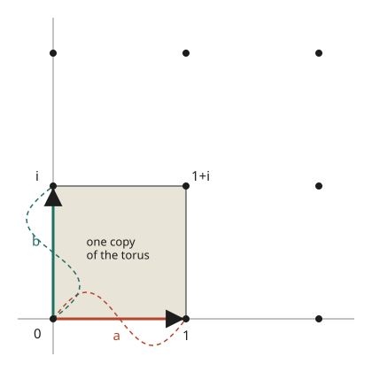

# Hodge decomposition: cohomology of a compact Kahler manifold splits by type

[Syllabus](../../../SYLLABUS.md) → [Algebraic geometry](../README.md) → [Cohomology and the Hodge Conjecture](../README.md#s05) → Hodge decomposition

---

## General Overview

Take the complex plane and glue opposite sides of the unit square: 0 to 1 along the bottom, 0 to i up the side. The result is a doughnut, the **complex torus of the square lattice**. It is also an elliptic curve: a smooth cubic curve in the projective plane, seen through its periods.

The doughnut has two independent loops. Loop a runs once along the bottom edge, from 0 to 1. Loop b runs once up the side, from 0 to i. De Rham cohomology ([De Rham cohomology](02-de-rham-cohomology-of-varieties.md)) counts the closed 1-forms that no potential explains, and here it finds two: the first Betti number (the count of independent loops) is 2. A closed form is read by its two loop integrals, its **periods**. The form $`3\,dx + 5\,dy`$ has period 3 round a and 5 round b.

The torus is a complex manifold, so it has a complex coordinate $`z = x + iy`$. That offers two natural 1-forms: $`dz = dx + i\,dy`$, which only involves z, and $`d\bar z = dx - i\,dy`$, which only involves its conjugate $`\bar z = x - iy`$. Both are closed, neither is exact, and together they span all of the first cohomology. So every class splits, once and for all, into a holomorphic part (a multiple of $`dz`$) and an antiholomorphic part (a multiple of $`d\bar z`$):

```math
3\,dx + 5\,dy = \Big(\tfrac{3}{2} - \tfrac{5}{2}i\Big)\,dz + \Big(\tfrac{3}{2} + \tfrac{5}{2}i\Big)\,d\bar z
```

The two coefficients are complex conjugates. That is no accident: a real class always splits into a piece and its mirror image.

The Hodge decomposition says the same split happens on every compact Kahler manifold (a complex manifold with a metric that fits its complex structure, such as any smooth projective variety), in every degree. A class of degree k breaks into pieces with p factors of $`dz`$ and q factors of $`d\bar z`$, with p + q = k. The piece of type (p, q) is the mirror of the piece of type (q, p). For the smooth quartic surface in space, the same rule turns 22 two-dimensional holes into 1 + 20 + 1.

**On a compact Kahler manifold, the k-th complex cohomology is the direct sum of pieces of type (p, q) with p + q = k, and conjugation swaps type (p, q) with type (q, p); on the square-lattice torus the first cohomology is one class of type (1, 0), spanned by $`dz`$, and one of type (0, 1), spanned by $`d\bar z`$.**

**What kind of fact this is:** a theorem, from W. V. D. Hodge's theory of harmonic forms (1941), whose analytic step was made fully rigorous later in the 1940s. This card proves it outright for the torus in Why it works, and states the general proof's key steps with sources. The quartic and quintic numbers are checked two ways in the code.

### The picture: the torus as a square of the lattice

<p align="center"></p>

Drawn to scale, 150 pixels per unit. The shaded square is one copy of the torus, with opposite sides glued. The arrows are the loops a and b; the dashed curves are wiggly loops in the same classes, which the code integrates along.

---

## The formula

Notation first, in words. X is a **compact Kahler manifold** of complex dimension n: a closed, bounded complex manifold carrying a Kahler form ω, a metric that fits its complex charts ([Complex manifolds and Kahler forms](04-complex-manifolds-and-kahler-forms.md)). Every smooth projective variety over ℂ is one. On it:

- $`H^k(X, \mathbb{C})`$ is the k-th de Rham cohomology with complex coefficients: closed k-forms modulo exact ones. Its dimension is the **Betti number** $`b_k`$.
- A form of **type (p, q)** is one built from p factors $`dz_j`$ and q factors $`d\bar z_j`$, with any smooth coefficient. For example $`dz \wedge d\bar z`$ has type (1, 1).
- $`H^{p,q}(X)`$ is the set of classes that have a closed representative of type (p, q). Its dimension is the **Hodge number** $`h^{p,q}`$.
- The bar over a class is complex conjugation: replace every coefficient by its conjugate, every $`dz`$ by $`d\bar z`$ and every $`d\bar z`$ by $`dz`$.
- $`\oplus`$ is a direct sum: every class is a unique sum of one piece from each part.

```math
H^k(X, \mathbb{C}) = \bigoplus_{p + q = k} H^{p,q}(X), \qquad \overline{H^{p,q}(X)} = H^{q,p}(X)
```

**Read it aloud:** the k-th cohomology is the direct sum of the type-(p, q) pieces with p plus q equal to k, and conjugating the (p, q) piece gives the (q, p) piece.

Counting dimensions gives the version the code checks:

```math
b_k = \sum_{p + q = k} h^{p,q}, \qquad h^{p,q} = h^{q,p}
```

**Read it aloud:** the k-th Betti number is the sum of the Hodge numbers on that row, and each Hodge number equals its mirror.

On the torus, with periods A round a and B round b, a closed real 1-form splits as

```math
A\,dx + B\,dy = c_1\,dz + c_2\,d\bar z, \qquad c_1 = \frac{A - iB}{2}, \qquad c_2 = \overline{c_1} = \frac{A + iB}{2}
```

**Read it aloud:** a closed 1-form with periods A and B is c-one times dz plus c-two times dz-bar, where c-one is A minus i B over 2 and c-two is its conjugate.

With A = 3 and B = 5 this gives $`c_1 = 3/2 - 5/2\,i`$ and $`c_2 = 3/2 + 5/2\,i`$.

| Symbol | Plain meaning | In our example | Push it up and the answer… |
| --- | --- | --- | --- |
| $`X`$, $`n`$; $`\omega`$, $`\bar\partial`$ | a compact Kahler manifold; its complex dimension; its Kahler form; the operator that tests whether a form is holomorphic | the torus, n = 1 | bigger n, more rows of Hodge numbers |
| $`k`$, $`b_k`$ | the degree of a form; the k-th Betti number | $`b_1 = 2`$ | — |
| $`H^k(X, \mathbb{C})`$ | closed k-forms modulo exact ones, complex coefficients | spanned by $`[dz]`$, $`[d\bar z]`$ for k = 1 | — |
| $`p`$, $`q`$ | how many $`dz`$'s and how many $`d\bar z`$'s a form has | (1, 0) and (0, 1) | p + q is always k |
| $`H^{p,q}`$, $`h^{p,q}`$, $`\oplus`$ | classes of type (p, q); their dimension; direct sum | $`h^{1,0} = h^{0,1} = 1`$ | — |
| $`z = x + iy`$, $`i`$ | the complex coordinate, real part x and imaginary part y; the square root of −1 | the lattice ℤ + ℤi | — |
| $`dz`$, $`d\bar z`$, $`\wedge`$ | the forms $`dx + i\,dy`$ and $`dx - i\,dy`$; the wedge, an oriented product of forms | $`dz \wedge d\bar z`$ has type (1, 1) | — |
| bar over a class | complex conjugation | turns $`dz`$ into $`d\bar z`$ | — |
| $`a`$, $`b`$; $`A`$, $`B`$ | the two loops; a form's periods round them | A = 3, B = 5 | bigger periods, bigger coefficients |
| $`c_1`$, $`c_2`$ | the (1, 0) and (0, 1) coefficients | 3/2 − 5/2 i and 3/2 + 5/2 i | B moves only the imaginary parts |
| $`d`$, $`x_j`$, $`R_m`$ | the degree of a hypersurface; its coordinates; the Jacobian ring's part of degree m (Step 4) | quartic: d = 4, $`R_4`$ has 19 monomials | higher d, bigger Hodge numbers |
| $`\chi`$, $`p_g`$, $`h`$, $`K`$ | Euler characteristic; geometric genus $`h^{2,0}`$; the hyperplane class; the canonical class | quartic: χ = 24, $`p_g = 1`$, $`K^2 = 0`$ | — |

### When it holds

- **Compact.** On the punctured line $`\mathbb{C}^\times`$ (the complex numbers without 0) the class of $`dz/z`$ ([De Rham cohomology](02-de-rham-cohomology-of-varieties.md)) has no conjugate partner: $`b_1 = 1`$ there. Non-compact varieties need Deligne's mixed Hodge theory instead.
- **Kahler.** The Hopf surface, a compact complex surface shaped like a circle times a 3-sphere, has $`b_1 = 1`$. An odd Betti number cannot be $`h^{1,0} + h^{0,1}`$ with the two equal, so the symmetry fails (What breaks, below).
- **Complex coefficients.** Over ℝ the pieces do not exist one by one: $`dz`$ alone is not a real form. Only the sum of a piece and its mirror is real, which is why the coefficients above come in conjugate pairs.
- **Smooth.** A singular variety, such as a surface with a node, needs a modified theory; the Betti and Hodge numbers above can change.

---

## Why it works

### Step 0: one best form in each class, and it respects type

Every class contains many forms: add any exact form and the class is unchanged. Hodge's idea was to pick one form per class, the **harmonic** one: the form killed by the Laplacian, the operator that measures how far a form is from "evenly spread". On a compact manifold with a metric, each class contains exactly one harmonic form.

On a Kahler manifold, the Laplacian does not mix types. So if a harmonic form is split into its (p, q) parts, each part is harmonic too, and therefore closed. That is the whole decomposition: the harmonic representative splits by type, and each piece is a class in its own right.

### Step 1: the torus, by hand

On the torus the harmonic forms are the forms with constant coefficients. In degree 1 they are $`c_1\,dz + c_2\,d\bar z`$. Integrate each basis form along the loops:

| Form | Round a (0 to 1) | Round b (0 to i) |
| --- | --- | --- |
| $`dz`$ | 1 | i |
| $`d\bar z`$ | 1 | −i |

The period determinant is $`1 \cdot (-i) - 1 \cdot i = -2i`$, which is not 0. So the periods of $`dz`$ and $`d\bar z`$ are independent, neither class is 0, and no combination of them is 0. They span a 2-dimensional space, which is all of $`H^1`$ since $`b_1 = 2`$. So $`h^{1,0} = 1`$ and $`h^{0,1} = 1`$.

To split a given class, solve for the coefficients from its periods. For $`3\,dx + 5\,dy`$, Cramer's rule on the table gives $`c_1 = 3/2 - 5/2\,i`$ and $`c_2 = 3/2 + 5/2\,i`$.

### Step 2: the same split by substitution

Since $`dz = dx + i\,dy`$ and $`d\bar z = dx - i\,dy`$, adding and subtracting gives

```math
dx = \frac{dz + d\bar z}{2}, \qquad dy = \frac{dz - d\bar z}{2i}
```

**Read it aloud:** dx is the average of dz and dz-bar, and dy is their difference over 2i.

Substituting into $`3\,dx + 5\,dy`$ collects $`3/2 + 5/(2i) = 3/2 - 5/2\,i`$ in front of $`dz`$ and its conjugate in front of $`d\bar z`$. This road uses no periods at all, and it agrees with Step 1 exactly.

### Step 3: why the pieces are mirror images

Conjugation sends $`dz`$ to $`d\bar z`$, so it sends a form of type (p, q) to one of type (q, p). It also commutes with the Laplacian, so it sends harmonic forms to harmonic forms. Hence it maps $`H^{p,q}`$ onto $`H^{q,p}`$, one to one, and $`h^{p,q} = h^{q,p}`$.

A real class equals its own conjugate. So its (1, 0) part and its (0, 1) part must be conjugates of each other: that is why $`c_2 = \overline{c_1}`$ above.

The first consequence is a topological test. On a compact Kahler manifold, every Betti number of odd degree, such as $`b_1`$ or $`b_3`$, is an even number, because it splits into mirror pairs.

### Step 4: higher dimensions and the quartic surface

On a complex torus of dimension n, a constant-coefficient k-form is a sum of wedges of p of the n $`dz_j`$'s and q of the n $`d\bar z_j`$'s. So $`h^{p,q}`$ is the number of ways to choose them: n choose p times n choose q. For n = 2 the code lists every wedge by type and finds the rows 1; 2 + 2; 1 + 4 + 1; 2 + 2; 1.

For a smooth hypersurface of degree d in projective space, Griffiths (1969) found the middle Hodge numbers by pure algebra. For the **Fermat** hypersurface $`x_0^d + \dots + x_{n+1}^d = 0`$, the **Jacobian ring** is the polynomials modulo $`x_0^{d-1}, \dots, x_{n+1}^{d-1}`$: its basis is the monomials whose exponents are all at most d − 2. Its part of degree m, written $`R_m`$, counts the primitive (p, q) classes. Every smooth hypersurface of the same degree and dimension has the same Hodge numbers, so the Fermat one stands for all of them; the code counts only the Fermat case.

```math
h^{n-q,\,q}_{\mathrm{prim}} = \dim R_{(q+1)d - n - 2}
```

**Read it aloud:** the number of primitive classes of type (n minus q, q) is the number of monomials of degree (q plus 1) times d minus n minus 2 in the Jacobian ring.

"Primitive" means: leave out the powers of the hyperplane class h, which add one class of type (1, 1) on a surface ([Cohomology of projective space](03-cohomology-of-projective-space.md)).

For the quartic surface, n = 2 and d = 4, so the degrees are 0, 4 and 8. The code counts 1, 19 and 1 monomials. Adding h back gives $`h^{2,0} = 1`$, $`h^{1,1} = 20`$, $`h^{0,2} = 1`$.

<details>
<summary>Second road for the quartic: topology and Noether's formula</summary>

The topological Euler characteristic of a smooth degree-d hypersurface of dimension n is a fixed polynomial in d. Expanding the tangent and normal bundles gives

$`\displaystyle \chi = d \sum_{j=0}^{n} \binom{n+2}{n-j}(-d)^j.`$

Here j counts from 0 to n, and the bracket is "n + 2 choose n − j", a binomial coefficient.

For n = 2 and d = 4 this is 24. A smooth hypersurface in projective 3-space, such as the quartic, has $`b_0 = b_4 = 1`$ and, by the Lefschetz hyperplane theorem, $`b_1 = b_3 = 0`$; a surface that is not a hypersurface, such as the square-lattice torus times itself, can have $`b_1 > 0`$. So $`b_2 = 24 - 2 = 22`$.

The holomorphic 2-forms on a degree-d surface correspond to polynomials of degree d − 4, so $`p_g = h^{2,0}`$ is 3 choose 3 = 1 for the quartic. Noether's formula checks it: with canonical class K = (d − 4)h, so $`K^2 = 0`$, it gives $`(K^2 + \chi)/12 = 2 = 1 + p_g`$. Then $`h^{1,1} = b_2 - 2p_g = 20`$, matching the Jacobian ring.

</details>

### Step 5: what the general proof needs

The torus proof above is complete. The general proof has three steps, each a chapter of Voisin's first volume:

1. **Hodge's theorem.** On a compact manifold with a metric, every class has exactly one harmonic form. This needs the analysis of elliptic operators, which belongs to the differential-geometry wing.
2. **The Kahler identities.** When the metric comes from a Kahler form ω, the full Laplacian is twice the Laplacian built from $`\bar\partial`$ alone. That Laplacian keeps type (p, q) fixed, so the harmonic parts split by type.
3. **Dolbeault's theorem.** $`H^{p,q}`$ equals the sheaf cohomology in degree q of the holomorphic p-forms ([Sheaves](01-sheaves-in-outline.md), [Sheaf cohomology](../08-Sheaf%20Cohomology%20and%20Differentials/05-sheaf-cohomology-as-a-derived-functor.md)). This makes the Hodge numbers algebraic invariants of a projective variety, which Griffiths' Jacobian ring computes.

The second of these, the Kahler identities, is where Kahler is used; the Hopf surface has no Kahler form, and the split fails there.

---

## Worked numbers, by hand

| Step | Arithmetic | Value |
| --- | --- | --- |
| periods of $`dz`$ | round a, round b | 1 and i |
| periods of $`d\bar z`$ | the conjugates | 1 and −i |
| period determinant | 1 · (−i) − 1 · i | −2i, not 0 |
| (1, 0) part of 3 dx + 5 dy | (3 − 5i)/2 | 3/2 − 5/2 i |
| (0, 1) part | its conjugate | 3/2 + 5/2 i |
| torus row k = 1 | $`h^{1,0} + h^{0,1}`$ | **2 = 1 + 1** |
| quartic surface, $`b_2`$ | χ − 2 = 24 − 2 | 22 |
| quartic surface, row k = 2 | $`h^{2,0} + h^{1,1} + h^{0,2}`$ | **22 = 1 + 20 + 1** |

The torus's two holes are one holomorphic direction and its mirror; the quartic's 22 two-dimensional holes are one holomorphic 2-form, its mirror and 20 classes of type (1, 1).

### What breaks if you drop a piece

| Mistake | Comes out at | What went wrong |
| --- | --- | --- |
| Count only holomorphic forms on the torus | $`b_1 = 1`$, not 2 | The (0, 1) piece is half of $`H^1`$ |
| Read $`h^{1,1}`$ of the quartic as $`b_2`$ | 22, not 20 | Types (2, 0) and (0, 2) hold one class each |
| Leave out the hyperplane class | $`h^{1,1}`$ = 19, not 20 | The Jacobian ring counts primitive classes only |
| Apply it to the Hopf surface, which is not Kahler | Betti numbers 1, 1, 0, 1, 1 | $`b_1 = 1`$ is odd, so it cannot split as $`h^{1,0} = h^{0,1}`$ |

The code prints all four.

---

## Code, from first principles, and it actually runs

The scripts work the torus three independent ways: Cramer's rule on the exact periods, substitution of dx and dy, and a numerical integral of the split form along wiggly loops, which must return the periods 3 and 5. They count the wedges on complex tori of dimension 1 and 2 against binomial coefficients. For the quartic surface and the quintic threefold they compare Griffiths' Jacobian-ring count with the Euler characteristic, and the quartic also with Noether's formula. Exact numbers are fractions and Gaussian integers; only the loop integral uses floats.

### Python

```python
# Hodge decomposition: the square-lattice torus, complex tori, the quartic surface, the quintic threefold
import math
from fractions import Fraction as Fr
from itertools import combinations, product

def fr(x):  # a fraction, printed in lowest terms
    return str(x.numerator) if x.denominator == 1 else f"{x.numerator}/{x.denominator}"
def cx(z):  # an exact complex number (re, im), printed as re + im i
    return f"{fr(Fr(z[0]))} {'-' if z[1] < 0 else '+'} {fr(abs(Fr(z[1])))} i"
def gmul(u, v):  # product of two Gaussian integers (re, im)
    return (u[0] * v[0] - u[1] * v[1], u[0] * v[1] + u[1] * v[0])
def gsub(u, v):
    return (u[0] - v[0], u[1] - v[1])
def gdiv(n, d):  # n / d as an exact complex fraction
    m = d[0] ** 2 + d[1] ** 2
    return (Fr(n[0] * d[0] + n[1] * d[1], m), Fr(n[1] * d[0] - n[0] * d[1], m))

# 1. The torus C / (Z + Zi). Periods round the loops a (0 to 1) and b (0 to i)
dz, dzb = [(1, 0), (0, 1)], [(1, 0), (0, -1)]  # [period on a, period on b]
print(f"periods of dz: a {cx(dz[0])}, b {cx(dz[1])}; of dz-bar: a {cx(dzb[0])}, b {cx(dzb[1])}")
det = gsub(gmul(dz[0], dzb[1]), gmul(dzb[0], dz[1]))
print(f"period determinant = {cx(det)}")
assert det != (0, 0)  # dz and dz-bar are independent classes, so h10 + h01 = 2 = b1
# Road 1: Cramer's rule on the periods (A, B) of the closed real form 3 dx + 5 dy
A, B = (3, 0), (5, 0)
c1 = gdiv(gsub(gmul(A, dzb[1]), gmul(dzb[0], B)), det)
c2 = gdiv(gsub(gmul(dz[0], B), gmul(A, dz[1])), det)
print(f"{A[0]} dx + {B[0]} dy = ({cx(c1)}) dz + ({cx(c2)}) dz-bar")
# Road 2: substitute dx = (dz + dz-bar)/2 and dy = (dz - dz-bar)/(2i), then collect the dz and dz-bar parts
dxc, dyc = [(Fr(1, 2), Fr(0))] * 2, [gdiv((1, 0), (0, 2)), gdiv((-1, 0), (0, 2))]
s1, s2 = [(A[0] * dxc[j][0] + B[0] * dyc[j][0], A[0] * dxc[j][1] + B[0] * dyc[j][1]) for j in (0, 1)]
assert (c1, c2) == (s1, s2)
assert c2 == (c1[0], -c1[1])  # Hodge symmetry: the (0,1) part is the conjugate of the (1,0) part
# Road 3: integrate c1 dz + c2 dz-bar along wiggly loops in the classes of a and b
def integral(velocity, n=4000):  # midpoint rule over t in [0, 1], in real arithmetic
    re = im = 0.0
    for k in range(n):
        vx, vy = velocity((k + 0.5) / n)  # dz reads vx + i vy, dz-bar reads vx - i vy
        re += (float(c1[0] + c2[0]) * vx - float(c1[1] - c2[1]) * vy) / n
        im += (float(c1[1] + c2[1]) * vx + float(c1[0] - c2[0]) * vy) / n
    return re, im
w = 0.2 * 2 * math.pi  # a(t) = t + 0.2 i sin(2 pi t), b(t) = i t + 0.2 sin(2 pi t)
ia = integral(lambda t: (1.0, w * math.cos(2 * math.pi * t)))
ib = integral(lambda t: (w * math.cos(2 * math.pi * t), 1.0))
print(f"wiggly loop a gives {ia[0]:.9f} {ia[1]:+.9f} i; wiggly loop b gives {ib[0]:.9f} {ib[1]:+.9f} i")
assert abs(ia[0] - A[0]) + abs(ia[1]) < 1e-9 and abs(ib[0] - B[0]) + abs(ib[1]) < 1e-9  # the loops return the periods

# 2. Complex n-torus: count wedges of dz's and dz-bars by type, against binomials
for n in (1, 2):
    syms = [("dz", i) for i in range(n)] + [("dzb", i) for i in range(n)]
    h = {}
    for k in range(2 * n + 1):
        for S in combinations(syms, k):
            p = sum(1 for s in S if s[0] == "dz")
            h[(p, k - p)] = h.get((p, k - p), 0) + 1
    for k in range(2 * n + 1):
        ps = range(max(0, k - n), min(k, n) + 1)
        row = [h[(p, k - p)] for p in ps]
        assert sum(row) == math.comb(2 * n, k) and row == row[::-1]
        assert row == [math.comb(n, p) * math.comb(n, k - p) for p in ps]
        print(f"torus dim {n}, k = {k}: b{k} = {math.comb(2 * n, k)} = " + " + ".join(map(str, row)))
    if n == 1:
        hol_only = h[(1, 0)]

# 3. Hypersurfaces in projective space, two roads
def jac_ring(nv, d, deg):  # monomials of degree deg with exponents <= d - 2 (Fermat Jacobian ring)
    return sum(1 for e in product(range(d - 1), repeat=nv) if sum(e) == deg)
def euler(n, d):  # topological Euler characteristic of a smooth degree-d hypersurface of dimension n
    return d * sum(math.comb(n + 2, n - j) * (-d) ** j for j in range(n + 1))
R = [jac_ring(4, 4, 4 * q) for q in range(3)]  # quartic surface: n = 2, d = 4
h20, h11, h02 = R[0], R[1] + 1, R[2]
print(f"quartic, Jacobian ring: h20 = {R[0]}, primitive h11 = {R[1]}, h02 = {R[2]}; with the hyperplane class h11 = {h11}")
chi = euler(2, 4)
b2, pg = chi - 2, math.comb(4 - 1, 3)
noether = Fr((4 - 4) ** 2 * 4 + chi, 12)  # (K^2 + Euler characteristic)/12, with K = (d - 4) h
print(f"quartic, topology: Euler characteristic {chi}, b2 = {b2}, p_g = {pg}, Noether (K^2 + 24)/12 = {fr(noether)}")
assert (h20, h02) == (pg, pg) and h11 == b2 - 2 * pg and noether == 1 + pg
print(f"quartic diamond rows: 1 | 0 0 | {h20} {h11} {h02} | 0 0 | 1")
Q = [jac_ring(5, 5, 5 * q) for q in range(4)]  # quintic threefold: n = 3, d = 5
chi3 = euler(3, 5)
b3 = 4 - chi3  # Euler characteristic = 1 - 0 + 1 - b3 + 1 - 0 + 1
print(f"quintic, Jacobian ring: h30, h21, h12, h03 = {Q[0]}, {Q[1]}, {Q[2]}, {Q[3]}")
print(f"quintic, topology: Euler characteristic {chi3}, b3 = {b3}")
assert sum(Q) == b3 and Q == Q[::-1]

# 4. What breaks
s1p, s3p = [1, 1], [1, 0, 0, 1]  # Poincare polynomials 1 + t and 1 + t^3
hopf = [sum(s1p[i] * s3p[k - i] for i in range(2) if 0 <= k - i < 4) for k in range(5)]
print(f"Hopf surface S1 x S3, Betti numbers {hopf}: b1 = {hopf[1]} is odd, so h10 = h01 is impossible")
assert hopf[1] % 2 == 1
print(f"mistakes: torus with holomorphic forms only, b1 = {hol_only}; quartic h11 read as b2 = {b2}; no hyperplane class, h11 = {R[1]}")
pts = [("0", (0, 0)), ("1", (1, 0)), ("i", (0, 1)), ("1+i", (1, 1))]
print("figure, 150 px per unit, " + ", ".join(f"{m} at ({60 + 150 * z[0]},{360 - 150 * z[1]})" for m, z in pts))
print("ALL CHECKS PASS")
```

**Ran 2026-11-17 on macOS, Python 3.14.10, standard library only. All checks passed. Output, pasted from the run:**

```
periods of dz: a 1 + 0 i, b 0 + 1 i; of dz-bar: a 1 + 0 i, b 0 - 1 i
period determinant = 0 - 2 i
3 dx + 5 dy = (3/2 - 5/2 i) dz + (3/2 + 5/2 i) dz-bar
wiggly loop a gives 3.000000000 +0.000000000 i; wiggly loop b gives 5.000000000 +0.000000000 i
torus dim 1, k = 0: b0 = 1 = 1
torus dim 1, k = 1: b1 = 2 = 1 + 1
torus dim 1, k = 2: b2 = 1 = 1
torus dim 2, k = 0: b0 = 1 = 1
torus dim 2, k = 1: b1 = 4 = 2 + 2
torus dim 2, k = 2: b2 = 6 = 1 + 4 + 1
torus dim 2, k = 3: b3 = 4 = 2 + 2
torus dim 2, k = 4: b4 = 1 = 1
quartic, Jacobian ring: h20 = 1, primitive h11 = 19, h02 = 1; with the hyperplane class h11 = 20
quartic, topology: Euler characteristic 24, b2 = 22, p_g = 1, Noether (K^2 + 24)/12 = 2
quartic diamond rows: 1 | 0 0 | 1 20 1 | 0 0 | 1
quintic, Jacobian ring: h30, h21, h12, h03 = 1, 101, 101, 1
quintic, topology: Euler characteristic -200, b3 = 204
Hopf surface S1 x S3, Betti numbers [1, 1, 0, 1, 1]: b1 = 1 is odd, so h10 = h01 is impossible
mistakes: torus with holomorphic forms only, b1 = 1; quartic h11 read as b2 = 22; no hyperplane class, h11 = 19
figure, 150 px per unit, 0 at (60,360), 1 at (210,360), i at (60,210), 1+i at (210,210)
ALL CHECKS PASS
```

### Rust

```rust
// Hodge decomposition: the square-lattice torus, complex tori, the quartic surface, the quintic threefold
use std::collections::HashMap;
use std::f64::consts::PI;

#[derive(Clone, Copy, PartialEq, Debug)]
struct Fr { n: i128, d: i128 } // a fraction in lowest terms, denominator positive
fn gcd(a: i128, b: i128) -> i128 { if b == 0 { a.abs() } else { gcd(b, a % b) } }
fn fr(n: i128, d: i128) -> Fr {
    let g = gcd(n, d).max(1);
    let s = if d < 0 { -1 } else { 1 };
    Fr { n: s * n / g, d: s * d / g }
}
fn mul(a: i128, b: i128) -> i128 { a.checked_mul(b).expect("overflow") }
fn fs(x: Fr) -> String { if x.d == 1 { format!("{}", x.n) } else { format!("{}/{}", x.n, x.d) } }
fn cx(z: (Fr, Fr)) -> String {
    let (s, a) = if z.1.n < 0 { ("-", fr(-z.1.n, z.1.d)) } else { ("+", z.1) };
    format!("{} {} {} i", fs(z.0), s, fs(a))
}
type G = (i128, i128); // a Gaussian integer (re, im)
fn gmul(u: G, v: G) -> G { (mul(u.0, v.0) - mul(u.1, v.1), mul(u.0, v.1) + mul(u.1, v.0)) }
fn gsub(u: G, v: G) -> G { (u.0 - v.0, u.1 - v.1) }
fn gdiv(n: G, d: G) -> (Fr, Fr) {
    let m = mul(d.0, d.0) + mul(d.1, d.1);
    (fr(mul(n.0, d.0) + mul(n.1, d.1), m), fr(mul(n.1, d.0) - mul(n.0, d.1), m))
}
fn lin(a: i128, x: Fr, b: i128, y: Fr) -> Fr { fr(mul(a, mul(x.n, y.d)) + mul(b, mul(y.n, x.d)), mul(x.d, y.d)) } // a x + b y
fn gq(z: G) -> (Fr, Fr) { (fr(z.0, 1), fr(z.1, 1)) }
fn comb(n: i64, k: i64) -> i64 {
    if k < 0 || k > n { return 0; }
    let mut r = 1;
    for i in 0..k { r = r * (n - i) / (i + 1); }
    r
}
fn jac_ring(nv: u32, d: i64, deg: i64) -> i64 { // monomials of degree deg with exponents <= d - 2
    let base = (d - 1) as usize;
    let mut count = 0;
    for code in 0..base.pow(nv) {
        let (mut c, mut s) = (code, 0);
        for _ in 0..nv { s += (c % base) as i64; c /= base; }
        if s == deg { count += 1; }
    }
    count
}
fn euler(n: i64, d: i64) -> i64 { d * (0..=n).map(|j| comb(n + 2, n - j) * (-d).pow(j as u32)).sum::<i64>() }
fn join(v: &[i64], sep: &str) -> String { v.iter().map(|x| x.to_string()).collect::<Vec<_>>().join(sep) }

fn main() {
    // 1. The torus C / (Z + Zi). Periods round the loops a (0 to 1) and b (0 to i)
    let dz: [G; 2] = [(1, 0), (0, 1)];
    let dzb: [G; 2] = [(1, 0), (0, -1)];
    println!("periods of dz: a {}, b {}; of dz-bar: a {}, b {}", cx(gq(dz[0])), cx(gq(dz[1])), cx(gq(dzb[0])), cx(gq(dzb[1])));
    let det = gsub(gmul(dz[0], dzb[1]), gmul(dzb[0], dz[1]));
    println!("period determinant = {}", cx(gq(det)));
    assert!(det != (0, 0));
    // Road 1: Cramer's rule on the periods (A, B) of the closed real form 3 dx + 5 dy
    let (a, b): (G, G) = ((3, 0), (5, 0));
    let c1 = gdiv(gsub(gmul(a, dzb[1]), gmul(dzb[0], b)), det);
    let c2 = gdiv(gsub(gmul(dz[0], b), gmul(a, dz[1])), det);
    println!("{} dx + {} dy = ({}) dz + ({}) dz-bar", a.0, b.0, cx(c1), cx(c2));
    // Road 2: substitute dx = (dz + dz-bar)/2 and dy = (dz - dz-bar)/(2i), then collect the dz and dz-bar parts
    let dxc = (fr(1, 2), fr(0, 1));
    let dyc = [gdiv((1, 0), (0, 2)), gdiv((-1, 0), (0, 2))];
    let s: Vec<(Fr, Fr)> = (0..2).map(|j| (lin(a.0, dxc.0, b.0, dyc[j].0), lin(a.0, dxc.1, b.0, dyc[j].1))).collect();
    assert!(c1 == s[0] && c2 == s[1]);
    assert!(c2 == (c1.0, fr(-c1.1.n, c1.1.d))); // Hodge symmetry
    // Road 3: integrate c1 dz + c2 dz-bar along wiggly loops in the classes of a and b
    let f = |x: Fr| x.n as f64 / x.d as f64;
    let (a1, b1, a2, b2) = (f(c1.0), f(c1.1), f(c2.0), f(c2.1));
    let integral = |vel: &dyn Fn(f64) -> (f64, f64)| {
        let n = 4000;
        let (mut re, mut im) = (0.0f64, 0.0f64);
        for k in 0..n {
            let (vx, vy) = vel((k as f64 + 0.5) / n as f64);
            re += ((a1 + a2) * vx - (b1 - b2) * vy) / n as f64;
            im += ((b1 + b2) * vx + (a1 - a2) * vy) / n as f64;
        }
        (re, im)
    };
    let w = 0.2 * 2.0 * PI;
    let ia = integral(&|t| (1.0, w * (2.0 * PI * t).cos()));
    let ib = integral(&|t| (w * (2.0 * PI * t).cos(), 1.0));
    println!("wiggly loop a gives {:.9} {:+.9} i; wiggly loop b gives {:.9} {:+.9} i", ia.0, ia.1, ib.0, ib.1);
    assert!((ia.0 - a.0 as f64).abs() + ia.1.abs() < 1e-9 && (ib.0 - b.0 as f64).abs() + ib.1.abs() < 1e-9); // the loops return the periods

    // 2. Complex n-torus: count wedges of dz's and dz-bars by type, against binomials
    let mut hol_only = 0;
    for n in 1..=2i64 {
        let mut h: HashMap<(i64, i64), i64> = HashMap::new();
        for mask in 0u32..(1 << (2 * n)) { // first n bits: dz's, last n bits: dz-bars
            let p = (mask & ((1 << n) - 1)).count_ones() as i64;
            let k = mask.count_ones() as i64;
            *h.entry((p, k - p)).or_insert(0) += 1;
        }
        for k in 0..=2 * n {
            let ps: Vec<i64> = ((k - n).max(0)..=k.min(n)).collect();
            let row: Vec<i64> = ps.iter().map(|&p| h[&(p, k - p)]).collect();
            let mut rev = row.clone();
            rev.reverse();
            assert!(row.iter().sum::<i64>() == comb(2 * n, k) && row == rev);
            assert!(row == ps.iter().map(|&p| comb(n, p) * comb(n, k - p)).collect::<Vec<_>>());
            println!("torus dim {}, k = {}: b{} = {} = {}", n, k, k, comb(2 * n, k), join(&row, " + "));
        }
        if n == 1 { hol_only = h[&(1, 0)]; }
    }

    // 3. Hypersurfaces in projective space, two roads
    let r: Vec<i64> = (0..3).map(|q| jac_ring(4, 4, 4 * q)).collect();
    let (h20, h11, h02) = (r[0], r[1] + 1, r[2]);
    println!("quartic, Jacobian ring: h20 = {}, primitive h11 = {}, h02 = {}; with the hyperplane class h11 = {}", r[0], r[1], r[2], h11);
    let chi = euler(2, 4);
    let (b2, pg) = (chi - 2, comb(4 - 1, 3));
    let noether = fr(((4 - 4) * (4 - 4) * 4 + chi) as i128, 12);
    println!("quartic, topology: Euler characteristic {}, b2 = {}, p_g = {}, Noether (K^2 + 24)/12 = {}", chi, b2, pg, fs(noether));
    assert!(h20 == pg && h02 == pg && h11 == b2 - 2 * pg && noether == fr(1 + pg as i128, 1));
    println!("quartic diamond rows: 1 | 0 0 | {} {} {} | 0 0 | 1", h20, h11, h02);
    let q: Vec<i64> = (0..4).map(|k| jac_ring(5, 5, 5 * k)).collect();
    let chi3 = euler(3, 5);
    let b3 = 4 - chi3;
    println!("quintic, Jacobian ring: h30, h21, h12, h03 = {}", join(&q, ", "));
    println!("quintic, topology: Euler characteristic {}, b3 = {}", chi3, b3);
    let mut qr = q.clone();
    qr.reverse();
    assert!(q.iter().sum::<i64>() == b3 && q == qr);

    // 4. What breaks
    let (s1p, s3p) = ([1i64, 1], [1i64, 0, 0, 1]);
    let hopf: Vec<i64> = (0..5i64).map(|k| (0..2i64).filter(|&i| k - i >= 0 && k - i < 4).map(|i| s1p[i as usize] * s3p[(k - i) as usize]).sum()).collect();
    println!("Hopf surface S1 x S3, Betti numbers [{}]: b1 = {} is odd, so h10 = h01 is impossible", join(&hopf, ", "), hopf[1]);
    assert!(hopf[1] % 2 == 1);
    println!("mistakes: torus with holomorphic forms only, b1 = {}; quartic h11 read as b2 = {}; no hyperplane class, h11 = {}", hol_only, b2, r[1]);
    let pts = [("0", (0, 0)), ("1", (1, 0)), ("i", (0, 1)), ("1+i", (1, 1))];
    let fig: Vec<String> = pts.iter().map(|(m, z)| format!("{} at ({},{})", m, 60 + 150 * z.0, 360 - 150 * z.1)).collect();
    println!("figure, 150 px per unit, {}", fig.join(", "));
    println!("ALL CHECKS PASS");
}
```

**Ran 2026-11-17 on macOS, rustc 1.98.1, no crates. All checks passed. Output, pasted from the run:**

```
periods of dz: a 1 + 0 i, b 0 + 1 i; of dz-bar: a 1 + 0 i, b 0 - 1 i
period determinant = 0 - 2 i
3 dx + 5 dy = (3/2 - 5/2 i) dz + (3/2 + 5/2 i) dz-bar
wiggly loop a gives 3.000000000 +0.000000000 i; wiggly loop b gives 5.000000000 +0.000000000 i
torus dim 1, k = 0: b0 = 1 = 1
torus dim 1, k = 1: b1 = 2 = 1 + 1
torus dim 1, k = 2: b2 = 1 = 1
torus dim 2, k = 0: b0 = 1 = 1
torus dim 2, k = 1: b1 = 4 = 2 + 2
torus dim 2, k = 2: b2 = 6 = 1 + 4 + 1
torus dim 2, k = 3: b3 = 4 = 2 + 2
torus dim 2, k = 4: b4 = 1 = 1
quartic, Jacobian ring: h20 = 1, primitive h11 = 19, h02 = 1; with the hyperplane class h11 = 20
quartic, topology: Euler characteristic 24, b2 = 22, p_g = 1, Noether (K^2 + 24)/12 = 2
quartic diamond rows: 1 | 0 0 | 1 20 1 | 0 0 | 1
quintic, Jacobian ring: h30, h21, h12, h03 = 1, 101, 101, 1
quintic, topology: Euler characteristic -200, b3 = 204
Hopf surface S1 x S3, Betti numbers [1, 1, 0, 1, 1]: b1 = 1 is odd, so h10 = h01 is impossible
mistakes: torus with holomorphic forms only, b1 = 1; quartic h11 read as b2 = 22; no hyperplane class, h11 = 19
figure, 150 px per unit, 0 at (60,360), 1 at (210,360), i at (60,210), 1+i at (210,210)
ALL CHECKS PASS
```

### Lean

Lean proves the split on the square-lattice torus, using constant-coefficient forms as in Step 1, and the Hodge numbers of every complex torus.

- Take real periods A round a and B round b. Then $`A\,dx + B\,dy = c_1\,dz + c_2\,d\bar z`$ for exactly one pair of complex numbers.
- That pair is $`c_1 = (A - iB)/2`$, and $`c_2`$ is the conjugate of $`c_1`$.
- The forms $`dz`$ and $`d\bar z`$ are independent, and together they span every constant-coefficient 1-form.
- So the first cohomology is one class of type (1, 0) plus one of type (0, 1).
- Conjugation turns $`dz`$ into $`d\bar z`$, and $`d\bar z`$ back into $`dz`$.
- Take a complex torus of dimension n, and set $`h^{p,q}`$ to n choose p times n choose q. Then each row adds up to $`b_k`$, which is 2n choose k.
- On the same torus, $`h^{p,q} = h^{q,p}`$ for every p and q.
- The form $`3\,dx + 5\,dy`$ splits with coefficients $`3/2 - 5/2\,i`$ and $`3/2 + 5/2\,i`$, and the period determinant is −2i.
- On the torus of dimension 2 the rows are 1; 2 + 2; 1 + 4 + 1; 2 + 2; 1.
- For the Fermat quartic, the Jacobian ring has 1, 19 and 1 monomials in degrees 0, 4 and 8.
- For the quartic surface, χ = 24, $`b_2 = 22 = 1 + 20 + 1`$ and $`p_g = 1`$, and Noether's formula gives 2.
- For the quintic threefold, χ = −200, so $`b_3 = 204`$, which is 1 + 101 + 101 + 1.

The wiggly-loop integrals, the Hopf surface and the quintic's Jacobian-ring count of 101 are left to the Python and Rust checks.

```lean
-- Hodge decomposition: on the square-lattice torus every closed 1-form A dx + B dy splits uniquely as c dz + conj(c) dz-bar with c = (A - B i)/2, and on a complex n-torus the Hodge numbers C(n,p) C(n,q) add up to the Betti numbers C(2n,k).
import Mathlib.Analysis.Complex.Basic
import Mathlib.LinearAlgebra.LinearIndependent.Lemmas
import Mathlib.LinearAlgebra.Span.Basic
import Mathlib.Data.Nat.Choose.Vandermonde
import Mathlib.Data.Fintype.Pi
import Mathlib.Tactic

open Complex ComplexConjugate

/-- A constant 1-form on the torus `ℂ / (ℤ + ℤ i)`, written by its coefficients on `dx` and `dy`
(which are also its periods round the loops `a`, from 0 to 1, and `b`, from 0 to i). -/
abbrev OneForm := Fin 2 → ℂ

/-- `dz = dx + i dy`, the form of type (1, 0). -/
def dz : OneForm := ![1, I]

/-- `dz̄ = dx - i dy`, the form of type (0, 1). -/
def dzbar : OneForm := ![1, -I]

/-- On the square-lattice torus, a closed real 1-form `A dx + B dy` is `c₁ dz + c₂ dz̄`
for exactly one pair of complex numbers: `c₁ = (A - B i)/2`, and `c₂` is the complex
conjugate of `c₁`. So the (1, 0) part and the (0, 1) part are mirror images. -/
theorem torus_one_form_splits_into_conjugate_types (A B : ℝ) (c₁ c₂ : ℂ) :
    c₁ • dz + c₂ • dzbar = ![(A : ℂ), (B : ℂ)] ↔
      c₁ = ((A : ℂ) - (B : ℂ) * I) / 2 ∧ c₂ = conj c₁ := by
  constructor
  · intro h
    have h0 := congrFun h 0
    have h1 := congrFun h 1
    simp [dz, dzbar] at h0 h1
    have e1 : c₁ = ((A : ℂ) - (B : ℂ) * I) / 2 := by
      linear_combination (1 / 2 : ℂ) * h0 - (I / 2) * h1 + (c₁ / 2 - c₂ / 2) * I_sq
    refine ⟨e1, ?_⟩
    rw [e1]
    simp only [map_div₀, map_sub, map_mul, conj_ofReal, conj_I, map_ofNat]
    linear_combination (1 / 2 : ℂ) * h0 + (I / 2) * h1 + (c₂ / 2 - c₁ / 2) * I_sq
  · rintro ⟨e1, e2⟩
    subst e2
    subst e1
    ext j
    fin_cases j
    · simp [dz, dzbar, map_div₀, conj_ofReal, map_ofNat]
      ring
    · simp [dz, dzbar, map_div₀, conj_ofReal, map_ofNat]
      linear_combination (-(B : ℂ)) * I_sq

/-- The first cohomology of the torus is the direct sum of one class of type (1, 0) and one of
type (0, 1): `dz` and `dz̄` are linearly independent and span all complex 1-forms (so
`b₁ = 2 = h^{1,0} + h^{0,1}`), and complex conjugation sends `dz` to `dz̄` and back. -/
theorem torus_first_cohomology_is_dz_plus_dzbar :
    LinearIndependent ℂ ![dz, dzbar] ∧
      Submodule.span ℂ (Set.range ![dz, dzbar]) = ⊤ ∧
      (fun j => conj (dz j)) = dzbar ∧ (fun j => conj (dzbar j)) = dz := by
  refine ⟨?_, ?_, ?_, ?_⟩
  · rw [LinearIndependent.pair_iff]
    intro s t h
    have h0 := congrFun h 0
    have h1 := congrFun h 1
    simp [dz, dzbar] at h0 h1
    have hs : s = 0 := by
      have : (2 : ℂ) * s = 0 := by
        linear_combination h0 - I * h1 + (s - t) * I_sq
      simpa using this
    refine ⟨hs, ?_⟩
    subst hs
    simpa using h0
  · rw [Matrix.range_cons_cons_empty, eq_top_iff]
    intro v _
    rw [Submodule.mem_span_pair]
    refine ⟨(v 0 - v 1 * I) / 2, (v 0 + v 1 * I) / 2, ?_⟩
    ext j
    fin_cases j
    · simp [dz, dzbar]
      ring
    · simp [dz, dzbar]
      linear_combination (-(v 1)) * I_sq
  · ext j
    fin_cases j <;> simp [dz, dzbar]
  · ext j
    fin_cases j <;> simp [dz, dzbar]

/-- On a complex torus of dimension `n` the type-(p, q) wedges number `h^{p,q} = C(n,p) C(n,q)`.
These satisfy Hodge symmetry `h^{p,q} = h^{q,p}`, and on each row they add up to the Betti
number: `b_k = C(2n, k) = ∑_{p + q = k} h^{p,q}`. -/
theorem complex_torus_hodge_numbers_sum_to_betti (n k : ℕ) :
    (∑ pq ∈ Finset.antidiagonal k, n.choose pq.1 * n.choose pq.2) = (2 * n).choose k ∧
      ∀ p q : ℕ, n.choose p * n.choose q = n.choose q * n.choose p := by
  refine ⟨?_, fun p q => Nat.mul_comm _ _⟩
  rw [two_mul, Nat.add_choose_eq]

-- The worked torus split: 3 dx + 5 dy = (3/2 - 5/2 i) dz + (3/2 + 5/2 i) dz-bar.
example : ((3 / 2 - 5 / 2 * I : ℂ)) • dz + ((3 / 2 + 5 / 2 * I : ℂ)) • dzbar = ![(3 : ℂ), 5] := by
  ext j; fin_cases j <;> simp [dz, dzbar, Complex.ext_iff]

-- The period determinant: 1 · (-i) - 1 · i = -2i.
example : (1 : ℂ) * (-I) - 1 * I = -2 * I := by ring

-- Torus of dimension 2: rows 1; 2 + 2; 1 + 4 + 1; 2 + 2; 1.
example : (List.range 5).map (fun k => ((List.range (k + 1)).filter (fun p => p ≤ 2 ∧ k - p ≤ 2)).map
    (fun p => Nat.choose 2 p * Nat.choose 2 (k - p))) = [[1], [2, 2], [1, 4, 1], [2, 2], [1]] := by
  decide

-- Quartic surface, Jacobian ring of the Fermat quartic: monomials in 4 variables with every
-- exponent at most 2, of degrees 0, 4 and 8, number 1, 19 and 1.
example : ((Finset.univ : Finset (Fin 4 → Fin 3)).filter (fun e => ∑ i, (e i : ℕ) = 0)).card = 1 := by
  decide
example : ((Finset.univ : Finset (Fin 4 → Fin 3)).filter (fun e => ∑ i, (e i : ℕ) = 4)).card = 19 := by
  decide
example : ((Finset.univ : Finset (Fin 4 → Fin 3)).filter (fun e => ∑ i, (e i : ℕ) = 8)).card = 1 := by
  decide

-- Quartic surface, topology: χ = 4 (C(4,2) - 4 C(4,1) + 16 C(4,0)) = 24, b₂ = 24 - 2 = 22 = 1 + 20 + 1,
-- p_g = C(3,3) = 1, and Noether: (K² + χ)/12 = (0 + 24)/12 = 2 = 1 + p_g.
example : (4 : ℤ) * ∑ j ∈ Finset.range 3, ((Nat.choose 4 (2 - j) : ℤ) * (-4) ^ j) = 24 := by decide
example : (24 - 2 : ℤ) = 1 + (19 + 1) + 1 ∧ Nat.choose 3 3 = 1 ∧ (0 + 24) / 12 = 1 + 1 := by decide

-- Quintic threefold: χ = 5 (C(5,3) - 5 C(5,2) + 25 C(5,1) - 125 C(5,0)) = -200, so b₃ = 4 - χ = 204.
example : (5 : ℤ) * ∑ j ∈ Finset.range 4, ((Nat.choose 5 (3 - j) : ℤ) * (-5) ^ j) = -200 := by decide
example : (4 : ℤ) - (-200) = 1 + 101 + 101 + 1 := by decide

#print axioms torus_one_form_splits_into_conjugate_types
#print axioms torus_first_cohomology_is_dz_plus_dzbar
#print axioms complex_torus_hodge_numbers_sum_to_betti
```

**Checked 2026-11-17 on macOS, Lean 4.36.0-rc2, Mathlib v4.36.0-rc2. Every proof is complete and uses only Lean's standard axioms. Output, pasted from the run:**

```
'torus_one_form_splits_into_conjugate_types' depends on axioms: [propext, Classical.choice, Quot.sound]
'torus_first_cohomology_is_dz_plus_dzbar' depends on axioms: [propext, Classical.choice, Quot.sound]
'complex_torus_hodge_numbers_sum_to_betti' depends on axioms: [propext, Classical.choice, Quot.sound]
```

> [!TIP]
> **Try changing**
> - Guess first: what are the coefficients of $`2\,dx + 7\,dy`$? Set `A, B = (2, 0), (7, 0)` (in the Rust, `((2, 0), (7, 0))`); every road reads A and B. The answer is $`1 - 7/2\,i`$ and $`1 + 7/2\,i`$, and the wiggly loops return 2 and 7.
> - Guess first: how does $`b_3`$ split on a complex torus of dimension 3? Change `(1, 2)` to `(1, 2, 3)`. The row is 20 = 1 + 9 + 9 + 1.
> - Guess first: what is $`h^{2,0}`$ for a quintic surface? With d = 5 the Jacobian-ring degrees are 1, 6 and 11. The counts are 4, 44 and 4, so $`h^{1,1} = 45`$.
> - Guess first: what happens if the Jacobian ring allows exponents up to d − 1? Change `range(d - 1)` to `range(d)`. The counts grow, the Euler-characteristic road disagrees, and an assert fails.

---

## The usual mistake

> [!warning]
> **Thinking the split is topological.** It is not. The Betti number $`b_k`$ depends only on the shape. The Hodge numbers stay fixed while the complex structure is deformed smoothly, but the pieces themselves move. Replace the square lattice by a slanted one, and the same real class $`3\,dx + 5\,dy`$ splits with different coefficients. That movement, the variation of the period, is what distinguishes one elliptic curve from another.
>
> Smaller traps:
> - **Holomorphic forms only.** Counting only $`dz`$ gives $`b_1 = 1`$ on the torus, half the answer.
> - **$`h^{1,1}`$ equals $`b_2`$.** On the quartic that gives 22, not 20: the (2, 0) and (0, 2) classes are missed.
> - **Forgetting the hyperplane class.** Griffiths' ring counts only primitive classes: 19 on the quartic, not 20.
> - **Using it without Kahler.** On the Hopf surface $`b_1 = 1`$; no symmetric split exists.

---

## Where you meet it in real life

- **String theory.** A Calabi–Yau threefold's Hodge numbers count the massless fields of the four-dimensional theory. For the quintic threefold, $`h^{2,1} = 101`$ and the middle Betti number is $`b_3 = 204 = 1 + 101 + 101 + 1`$, both printed by the code.
- **Mirror symmetry.** Candelas, de la Ossa, Green and Parkes (1991) used a mirror partner of the quintic, whose Hodge numbers are those of the quintic with (2, 1) and (1, 1) swapped, to count curves on the quintic.
- **Elliptic curves.** The torus's period ratio, i over 1 here, determines the curve; the j-invariant of the [Weierstrass form](../04-Elliptic%20Curves/02-weierstrass-forms-discriminant-and-j-invariant.md) is a function of it.
- **K3 surfaces.** A smooth quartic surface is a K3 surface: a compact surface with no 1-dimensional holes and a nowhere-zero holomorphic 2-form. The quartic's $`h^{1,1} = 20`$ caps how many independent curve classes it can carry. That bound is where the shelf's [The Hodge conjecture](08-hodge-conjecture-statement-and-known-cases.md) starts.
- **Topology tests.** An odd value of a Betti number of odd degree, such as $`b_1 = 1`$, proves a compact complex manifold has no Kahler metric, and so is not a smooth projective variety.

> **Say it back**
> On a compact Kahler manifold, every cohomology class splits into pieces of type (p, q): p factors of $`dz`$ and q of $`d\bar z`$. Conjugation swaps type (p, q) with type (q, p), so the Hodge numbers are symmetric. On the square-lattice torus, $`3\,dx + 5\,dy`$ splits as $`(3/2 - 5/2\,i)\,dz`$ plus its conjugate times $`d\bar z`$. On the quartic surface the 22 middle classes split 1 + 20 + 1. Without Kahler, as on the Hopf surface, the split can fail.

---

## What this builds on

- [Complex manifolds and Kahler forms](04-complex-manifolds-and-kahler-forms.md): the forms $`dz`$ and $`d\bar z`$, the operator $`\bar\partial`$ and the Kahler form ω, which make "type (p, q)" mean something.
- [De Rham cohomology](02-de-rham-cohomology-of-varieties.md): closed forms modulo exact ones, the groups this card splits.
- [Cohomology of projective space](03-cohomology-of-projective-space.md): the hyperplane class h, the one (1, 1) class Griffiths' ring leaves out.
- [Sheaves](01-sheaves-in-outline.md): the language of Dolbeault's theorem, which makes Hodge numbers algebraic.
- [Homology groups](../../17-Topology/05-Homology/02-homology-groups.md) and [Euler characteristic](../../17-Topology/03-Surfaces%20and%20Manifolds/04-euler-characteristic-and-triangulations.md): Betti numbers and their alternating sum, the topological side of the second road.

## Where this goes next

- [Line bundles and divisors](06-line-bundles-and-divisor-classes.md): a curve on a surface gives a class of type (1, 1); this is the next card on the shelf.
- [Hodge star](../../23-Differential%20geometry%20and%20Lie%20groups/04-Differential%20Forms/09-hodge-star-and-maxwell-in-forms.md): the operator that defines harmonic forms, and the full proof of Hodge's theorem.
- [The Hodge conjecture](08-hodge-conjecture-statement-and-known-cases.md): the statement on this shelf, asking which rational classes of type (p, p) come from subvarieties.
- [The Hodge conjecture](08-hodge-conjecture-statement-and-known-cases.md): the open problem's status and known cases, kept in the Frontier wing.
- [Sheaf cohomology](../08-Sheaf%20Cohomology%20and%20Differentials/05-sheaf-cohomology-as-a-derived-functor.md): global sections made exact, by injective resolutions.

The question this card leaves open: the quartic has 20 classes of type (1, 1), so how many of them are classes of actual curves on the surface?

---

## Sources

Verified 2026-11-17: every link below resolves to the publisher's page.

- Voisin, Claire. *Hodge Theory and Complex Algebraic Geometry I*. Cambridge University Press, 2002. [DOI 10.1017/CBO9780511615344](https://doi.org/10.1017/CBO9780511615344). Harmonic forms, the Kahler identities and the Hodge decomposition (chapters 5 and 6).
- Voisin, Claire. *Hodge Theory and Complex Algebraic Geometry II*. Cambridge University Press, 2003. [DOI 10.1017/CBO9780511615177](https://doi.org/10.1017/CBO9780511615177). The Hodge filtration of hypersurfaces and the Jacobian ring (chapter 6).
- Griffiths, Phillip, and Joseph Harris. *Principles of Algebraic Geometry*. Wiley, 1978; Wiley Classics Library, 1994. [DOI 10.1002/9781118032527](https://doi.org/10.1002/9781118032527). Complex tori, Dolbeault cohomology and the Hodge numbers of surfaces.
- Candelas, Philip, Xenia C. de la Ossa, Paul S. Green, and Linda Parkes. "A pair of Calabi-Yau manifolds as an exactly soluble superconformal theory." *Nuclear Physics B* 359 (1991), 21–74. [DOI 10.1016/0550-3213(91)90292-6](https://doi.org/10.1016/0550-3213(91)90292-6). The quintic threefold, its mirror, and the use of its Hodge numbers in physics.
