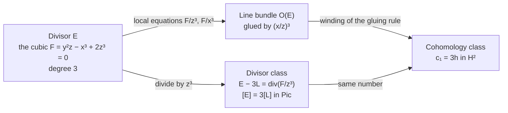
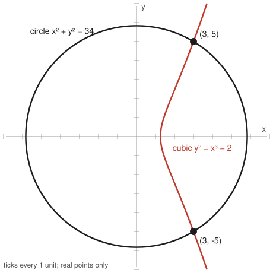

# Line bundles and divisors: a codimension-one shape as a cohomology class

[Syllabus](../../../SYLLABUS.md) → [Algebraic geometry](../README.md) → [Cohomology and the Hodge Conjecture](../README.md#s05) → Line bundles and divisors

---

## General Overview

The circle $`x^2 + y^2 = 34`$ and the cubic curve $`y^2 = x^3 - 2`$ both pass through the point (3, 5). On paper they cross twice, at (3, 5) and (3, −5). Count every meeting point, the complex ones included, and the answer is 6. Two lines meet once. A line meets the cubic 3 times.

Each count is a product of degrees: 2 × 3, 1 × 1, 1 × 3. The reason is a trade. Divide the cubic's equation by the cube of z, the equation of the line at infinity (the line of points added far out, where parallel lines meet). The result is a genuine function on the projective plane, so the cubic equals three copies of that line, up to the zeros and poles of one function. Such trades change no intersection count, so every curve of degree d counts as d lines.

The bookkeeping of these trades is the **Picard group**: curves added with whole-number weights, with two weighted lists counted as the same when they differ by the zeros and poles of one function. For the projective plane the Picard group is the whole numbers, and one line is its generator.

The trade has a second reading. A curve's equation, read chart by chart, glues into a **line bundle**: a family of one-dimensional spaces, one over each point. The cubic's gluing rule winds 3 times round a loop, and that winding is a class in the second cohomology: 3 times the class of a line.

**A codimension-one shape (a curve in a surface) gives a divisor, the divisor gives a line bundle by gluing its local equations, and the line bundle gives a class in the second cohomology; on the projective plane all three are counted by the degree, so the Picard group is the whole numbers, generated by a line.**

**What kind of fact this is:** definitions (divisor class, the line bundle of a divisor, the first Chern class), and a theorem proved on this card in Why it works: the Picard group of the projective plane is the whole numbers, generated by a line, and the class of a degree-d curve is d times the class of a line. The exponential-sequence facts in the Step 4 fold and in Step 5 are stated with sources, not proved.

### The picture: one curve, three readings



The top road is algebra. The bottom road is gluing, then topology. Both end at 3.

---

## The formula

Notation first, in words. The field is $`\mathbb{C}`$, the complex numbers, throughout. The **projective plane** $`\mathbb{P}^2`$ has points $`(x : y : z)`$, triples not all zero, with a triple and any nonzero multiple of it counted as one point ([Projective space](../02-Affine%20and%20Projective%20Varieties/03-projective-space-and-homogeneous-coordinates.md)). A **form** of degree d is a polynomial in x, y, z whose terms all have total degree d.

- A **divisor** D on a surface is a finite sum $`D = \sum n_i C_i`$: irreducible curves $`C_i`$ with whole-number weights $`n_i`$. On $`\mathbb{P}^2`$ its **degree** is $`\deg D = \sum n_i \deg C_i`$.
- For a ratio $`f = F/G`$ of two forms of the same degree, $`\mathrm{div}(f)`$ is the zero curves of F minus the zero curves of G, each counted with how often its factor divides.
- Two divisors are **linearly equivalent**, $`D \sim D'`$, when $`D - D' = \mathrm{div}(f)`$ for some such f. This ~ is not the "distributed as" of the probability wing.
- The **Picard group** $`\mathrm{Pic}(X)`$ is the divisors modulo linear equivalence. The class of D is written $`[D]`$.
- The **line bundle** $`\mathcal{O}(D)`$ is the sheaf whose sections are the functions f with $`\mathrm{div}(f) + D \ge 0`$: poles allowed only along D, up to its weights. Near each point it looks like the ordinary functions $`\mathcal{O}`$, divided by one local equation of D.
- The **first Chern class** $`c_1`$ sends a line bundle to a class in $`H^2(X, \mathbb{Z})`$, the second cohomology with whole-number coefficients. On $`\mathbb{P}^2`$ that group is $`\mathbb{Z}\,h`$, where h is the class of a line ([Cohomology of projective space](03-cohomology-of-projective-space.md)).

The card's result, in one line:

```math
\mathrm{Pic}(\mathbb{P}^2) = \mathbb{Z}\,[L], \qquad [D] = (\deg D)\,[L], \qquad \mathcal{O}(D) \cong \mathcal{O}(\deg D), \qquad c_1\big(\mathcal{O}(D)\big) = (\deg D)\,h
```

**Read it aloud:** the Picard group of the plane is the whole numbers times the class of a line; a divisor's class, its line bundle and its first Chern class are all fixed by its degree.

How the line bundle is built, and how its class is read on a test line M:

```math
g_{zx} = \frac{F/z^d}{F/x^d} = \Big(\frac{x}{z}\Big)^d, \qquad \int_M c_1\big(\mathcal{O}(D)\big) = \frac{1}{2\pi i}\oint \frac{dg_{zx}}{g_{zx}} = d
```

**Read it aloud:** the gluing rule between the z-chart and the x-chart is one local equation over the other, x over z to the d; the class, measured on a line, is how many times that rule winds round, d.

| Symbol | Plain meaning | In our example | Push it up and the answer… |
| --- | --- | --- | --- |
| $`\mathbb{P}^2`$, $`(x : y : z)`$, $`\mathbb{C}`$, $`\lambda`$ | the projective plane; its points; the complex numbers; a nonzero scaling of a point's coordinates | the plane holding the circle and the cubic | — |
| $`L`$, $`C`$, $`E`$ | the line $`z = 0`$ (the line at infinity); the circle $`x^2 + y^2 = 34z^2`$; the cubic $`y^2 z = x^3 - 2z^3`$ | degrees 1, 2, 3 | — |
| $`D = \sum n_i C_i`$, $`\deg D`$, $`d`$ | a divisor: curves $`C_i`$ with whole-number weights $`n_i`$; its weighted degree; the degree of one curve | $`D = E - C - L`$, degree 0 | more weight, more degree |
| $`f = F/G`$, $`V(F)`$, $`\mathrm{div}(f)`$ | a ratio of forms of equal degree; the curve where F is zero; zero curves minus pole curves | $`f = E/(C L)`$, value −65/903 at (1 : 2 : 3) | — |
| $`\sim`$, $`[D]`$, $`\mathrm{Pic}(X)`$ | differ by some $`\mathrm{div}(f)`$; the class of D; all classes on a variety X | $`[E] = 3[L]`$ | — |
| $`U_x`$, $`U_z`$, $`g_{zx}`$, $`u_{ij}`$ | the charts where x, or z, is not zero; the gluing rule between them; a logarithm of a gluing rule, in the fold | $`g_{zx} = (x/z)^3`$, 1/27 at (1 : 2 : 3) | the power grows with the degree |
| $`\mathcal{O}`$, $`\mathcal{O}(D)`$, $`\mathcal{O}(d)`$, $`\mathcal{O}^*`$ | functions; the line bundle of D; the twist by d; the nowhere-zero functions | $`\mathcal{O}(E) \cong \mathcal{O}(3)`$, 10 independent sections | each step up adds sections |
| $`c_1`$, $`H^2(X, \mathbb{Z})`$, $`h`$ | the first Chern class; second cohomology with whole numbers; the class of a line | $`c_1(\mathcal{O}(E)) = 3h`$ | — |
| $`M`$, $`t`$, $`\oint`$ | a test line; its parameter; an integral once round a loop | M through (1 : −1 : 2) and (1 : 2 : 1), loop $`\lvert t \rvert = 10`$ | a smaller loop catches fewer zeros |
| $`m`$ | the slope of a line through (3, 5), used to trace the circle | $`m = -3/5`$ gives (3, 5) | — |
| $`H^{p,q}`$, $`h^{p,q}`$, $`b_2`$ | the Hodge pieces and their dimensions; the second Betti number | $`b_2(\mathbb{P}^2) = 1 = 0 + 1 + 0`$ | — |
| $`y^2 = x^3 - x`$, O, P | the square-lattice torus as a cubic; its zero, the point at infinity (plain O, not the sheaf $`\mathcal{O}`$); the point (0, 0) | $`2P - 2O = \mathrm{div}(x)`$ | — |

### When it holds

- **A smooth surface.** On a smooth variety every curve is cut out locally by one equation, so a divisor has local equations and a line bundle. At a cone point this fails: a line through the vertex of a cone needs two equations there.
- **Ratios of equal degree.** A ratio of forms of unequal degree is not a function on $`\mathbb{P}^2`$: $`C/L`$ doubles when the point's coordinates double (What breaks, below).
- **A polynomial ring with unique factorisation.** Every curve in $`\mathbb{P}^2`$ is the zero set of one form because $`\mathbb{C}[x, y, z]`$ factors uniquely (wing 03). On the torus the analogue fails, and $`\mathrm{Pic}`$ is much bigger than $`\mathbb{Z}`$.
- **Complex numbers, for the class.** The divisor algebra works over any field. The intersection count 6 needs an algebraically closed field (one where every polynomial has a root), such as $`\mathbb{C}`$; the first Chern class, a class in $`H^2(X, \mathbb{Z})`$, needs $`\mathbb{C}`$ itself. Over $`\mathbb{R}`$ the circle and the cubic meet only twice.

---

## Why it works

### Step 0: a function on the plane has degree-zero divisor

A point of $`\mathbb{P}^2`$ is a triple up to scaling. A ratio $`F/G`$ gives one value per point only if scaling the triple by $`\lambda`$ changes nothing. Scaling multiplies F by $`\lambda^{\deg F}`$ and G by $`\lambda^{\deg G}`$, so the degrees must match.

Then the zero curves of F have total degree $`\deg F`$, and the pole curves total $`\deg G`$, the same number. So $`\deg \mathrm{div}(f) = 0`$ for every function f. Linearly equivalent divisors have equal degree, and the degree is a well-defined number on each class.

For $`f = E/(C L)`$: at (1 : 2 : 3), E = 65, C = −301 and L = 3, so f = 65/(−903) = −65/903. At (2 : 4 : 6) and at (−5 : −10 : −15) the code gets −65/903 again: f is a function.

### Step 1: every curve is a multiple of the line

Take a curve of degree d, the zeros of one form F. Then $`F/z^d`$ is a ratio of equal degrees, and its divisor is the curve minus d copies of L:

```math
\mathrm{div}\Big(\frac{F}{z^d}\Big) = V(F) - d\,L, \qquad \text{so} \qquad [V(F)] = d\,[L]
```

**Read it aloud:** the divisor of F over z to the d is the curve minus d times the line, so the curve's class is d times the line's class.

For the circle, $`[C] = 2[L]`$. For the cubic, $`[E] = 3[L]`$. The step needs every irreducible curve to be one form's zero set. That holds because $`\mathbb{C}[x, y, z]`$ factors uniquely, so every irreducible curve is $`V(F)`$ for one irreducible form F.

### Step 2: nothing else collapses

If $`k\,L = \mathrm{div}(f)`$ for a whole number k, Step 0 gives $`k = \deg \mathrm{div}(f) = 0`$. So no nonzero multiple of L is trivial, and the map $`k \mapsto k\,[L]`$ from $`\mathbb{Z}`$ to $`\mathrm{Pic}(\mathbb{P}^2)`$ is one-to-one. Step 1 shows it is onto: every class is $`(\deg D)\,[L]`$. So $`\mathrm{Pic}(\mathbb{P}^2) = \mathbb{Z}\,[L]`$, and the degree reads off the class.

<details>
<summary>Detailed proof: a degree-zero divisor on the plane is the divisor of a function</summary>

Let $`D = \sum n_i C_i`$ with $`\sum n_i d_i = 0`$, where $`C_i = V(F_i)`$ and $`F_i`$ is irreducible of degree $`d_i`$. Set

$`\displaystyle f = \prod_i F_i^{\,n_i}.`$

Collect the factors with $`n_i > 0`$ on top and those with $`n_i < 0`$ below. The top has degree $`\sum_{n_i > 0} n_i d_i`$ and the bottom $`\sum_{n_i < 0} (-n_i) d_i`$. These are equal because $`\sum n_i d_i = 0`$, so f is a function on $`\mathbb{P}^2`$. Each $`F_i`$ is irreducible, so it vanishes to order exactly 1 along $`C_i`$, and $`\mathrm{div}(f) = D`$. For $`D = E - C - L`$ this is the f of Step 0.

</details>

### Step 3: from a divisor to a line bundle

Cover $`\mathbb{P}^2`$ by three charts: $`U_x`$, $`U_y`$, $`U_z`$, where x, y or z is not zero. On $`U_z`$ the cubic is the zero set of $`F/z^3`$, a true function there. On $`U_x`$ it is the zero set of $`F/x^3`$. These are the **local equations** of E.

On the overlap, the two local equations differ by the ratio

```math
g_{zx} = \frac{F/z^3}{F/x^3} = \Big(\frac{x}{z}\Big)^3
```

**Read it aloud:** the gluing rule is the local equation on the z-chart over the local equation on the x-chart, and F cancels, leaving x over z cubed.

This ratio has no zeros and no poles on $`U_x \cap U_z`$. It glues the local copies of $`\mathcal{O}`$ into $`\mathcal{O}(E)`$. At (1 : 2 : 3) the local equations read 65/27 and 65, and their ratio is 1/27 = (1/3)³.

F cancels, so the gluing rule depends only on the degree. Three copies of L, with local equations $`z^3/z^3`$ and $`z^3/x^3`$, have the same rule, so $`\mathcal{O}(E) \cong \mathcal{O}(3L) = \mathcal{O}(3)`$: the twist of [Sheaves](01-sheaves-in-outline.md), glued by $`t^d`$ on the projective line.

The sections of $`\mathcal{O}(E)`$ are the functions $`G/F`$ with G any cubic form: 10 monomials, so 10 independent sections. The zero divisor of each nonzero section is a cubic curve in the class of E.

### Step 4: from a line bundle to a cohomology class

Restrict to a line M, a copy of the projective line. A line bundle there is two charts glued by one nowhere-zero function on their overlap. The overlap is the line minus two points, and it contains the loop $`\lvert x/z \rvert = 1`$. A change of charts cannot alter how many times the gluing rule winds round 0 along that circle. That whole number is the **degree** of the bundle on M.

For $`(x/z)^3`$ round $`\lvert x/z \rvert = 1`$ the winding is 3. By [The argument principle](../../07-Complex%20analysis/06-Real%20Integrals%20and%20Counting%20Zeros/06-the-argument-principle.md), the same number counts the zeros of a section along M. The code walks a loop $`\lvert t \rvert = 10`$ on the test line through (1 : −1 : 2) and (1 : 2 : 1), and counts 1, 2 and 3 zeros for L, C and E, and 0 for $`f = E/(CL)`$.

The first Chern class packages these windings. On $`\mathbb{P}^2`$ the class h measures 1 on a line, and a class is fixed by its value on a line. So $`c_1(\mathcal{O}(D)) = (\deg D)\,h`$.

<details>
<summary>In outline: the exponential sequence, where c₁ comes from</summary>

Every nowhere-zero function is locally $`e^{2\pi i u}`$ for a function u, and u is fixed up to adding a whole number. That is the **exponential sequence** of sheaves:

$`\displaystyle 0 \to \mathbb{Z} \to \mathcal{O} \xrightarrow{\;e^{2\pi i\,\cdot}\;} \mathcal{O}^* \to 0.`$

Line bundles, up to isomorphism, are gluing rules up to change of charts: the group $`H^1(X, \mathcal{O}^*)`$, and this group is $`\mathrm{Pic}(X)`$ for a smooth projective X. Take logarithms $`u_{ij}`$ of the gluing rules $`g_{ij}`$. On a triple overlap, $`u_{ij} + u_{jk} + u_{ki}`$ is a whole number, because the product $`g_{ij} g_{jk} g_{ki}`$ is 1. Those whole numbers form a class in $`H^2(X, \mathbb{Z})`$, and that class is $`c_1`$. On a curve it is the winding number of Step 4. The sequence gives an exact row:

$`\displaystyle H^1(X, \mathcal{O}) \to \mathrm{Pic}(X) \xrightarrow{\;c_1\;} H^2(X, \mathbb{Z}) \to H^2(X, \mathcal{O}).`$

Griffiths and Harris (Chapter 1, Section 1) and Voisin (Chapter 7) prove this.

</details>

### Step 5: a second road to the same answer

The exact row in the fold says: $`c_1`$ is one-to-one when $`H^1(X, \mathcal{O}) = 0`$, and its image is the classes that vanish in $`H^2(X, \mathcal{O})`$. By [Hodge decomposition](05-hodge-decomposition.md), these two groups are the Hodge pieces $`H^{0,1}`$ and $`H^{0,2}`$.

For $`\mathbb{P}^2`$ the second Betti number splits as $`b_2 = 1 = 0 + 1 + 0`$: $`h^{2,0} = h^{0,2} = 0`$, and $`h^{0,1} = 0`$ too. So $`c_1`$ is an isomorphism from $`\mathrm{Pic}(\mathbb{P}^2)`$ onto $`H^2(\mathbb{P}^2, \mathbb{Z}) = \mathbb{Z}`$. This is the same answer as Step 2, by cohomology instead of factorisation.

The general statement is the **Lefschetz (1,1) theorem**: on a smooth projective variety, the classes $`c_1(L)`$ are exactly the whole-number classes of Hodge type (1,1). For the smooth quartic surface, $`b_2 = 22 = 1 + 20 + 1`$, so the Picard group has rank at most 20, not 22. This is the codimension-one case of [The Hodge conjecture](08-hodge-conjecture-statement-and-known-cases.md), and it is proved.

### Step 6: what the class is for, Bezout's count

Two curves meet in as many points as the product of their classes. With $`h \cdot h = 1`$ (two lines meet once):

```math
C \cdot E = c_1(\mathcal{O}(C)) \cdot c_1(\mathcal{O}(E)) = (2h)(3h) = 6\,h^2 = 6
```

**Read it aloud:** the circle meets the cubic in two h times three h, which is six, counted with multiplicity over the complex numbers.

Bezout's theorem (planned, shelf 03) proves this count directly. The check by elimination: put $`y^2 = 34 - x^2`$ into $`y^2 = x^3 - 2`$.

```math
x^3 + x^2 - 36 = (x - 3)(x^2 + 4x + 12), \qquad x = 3 \ \text{or} \ x = -2 \pm 2\sqrt{2}\,i
```

**Read it aloud:** x cubed plus x squared minus 36 factors as x minus 3 times x squared plus 4x plus 12, so x is 3 or minus 2 plus or minus 2 root 2 i.

Each x gives two values of y, since $`y^2 = 34 - x^2`$ is never 0 there. That makes 6 points. At infinity the circle passes through $`(1 : \pm i : 0)`$ and the cubic only through (0 : 1 : 0), so no meeting point hides there. Only x = 3 is real: the two crossings in the picture.

<p align="center"></p>

Real points only, to scale: the circle of radius $`\sqrt{34}`$ = 5.830952 and the cubic, which starts at (1.259921, 0). The two crossings are 2 of the 6 meeting points.

A second road traces the circle by the lines through (3, 5) with slope m: each meets the circle again at $`(3m^2 - 10m - 3 : -5m^2 - 6m + 5 : m^2 + 1)`$. In the cubic this gives a polynomial of degree 5, not 6, so one root sits at $`m = \infty`$: the vertical line, giving (3, −5). The tangent slope m = −3/5 gives (3, 5), and the other four roots give the complex points. Again 6.

---

## Worked numbers, by hand

| Step | Arithmetic | Value |
| --- | --- | --- |
| degrees of L, C, E | count the total degree of each term | 1, 2, 3 |
| degree of $`D = E - C - L`$ | 3 − 2 − 1 | 0 |
| f at (1 : 2 : 3) | $`65 / ((-301) \times 3)`$ | −65/903 |
| f at (2 : 4 : 6) | top × 2³, bottom × 2² × 2 | −65/903 again: a function |
| gluing rule at (1 : 2 : 3) | (65/27) / 65 | 1/27 = (1/3)³ |
| sections of $`\mathcal{O}(3)`$ | cubic monomials, (3 + 1)(3 + 2)/2 | 10 |
| class of E | Step 1 and Step 4 | **[E] = 3[L], c₁ = 3h** |
| circle meets cubic | (2h)(3h) | **6**, of which 2 real |

The cubic is three lines' worth of curve: its class is 3, its bundle winds 3 times, and it meets the circle 2 × 3 = 6 times.

### What breaks if you drop a piece

| Mistake | Comes out at | What went wrong |
| --- | --- | --- |
| Treat $`C/L`$, degrees 2 and 1, as a function | its value at (2 : 4 : 6) is 2 times its value at (1 : 2 : 3) | unequal degrees: it is not a function on $`\mathbb{P}^2`$ |
| Count real points only | 2 of 6 | the count 6 is over $`\mathbb{C}`$ |
| Count distinct points of E on L | 1, the point (0 : 1 : 0), not 3 | there $`E = -x^3`$: L is tangent to the cubic at an inflection, multiplicity 3 |
| Expect $`\mathrm{Pic} = \mathbb{Z}`$ on the torus $`y^2 = x^3 - x`$ | pole orders 0, 2, 3, 4, …: gap at 1, so $`P - O`$ is not $`\mathrm{div}(f)`$; yet $`2P - 2O = \mathrm{div}(x)`$ | no unique factorisation, and $`h^{0,1} = 1`$: degree-zero classes survive |

On the last row: over $`\mathbb{C}`$, the square-lattice torus is the curve $`y^2 = x^3 - x`$, up to rescaling x and y. A function with $`\mathrm{div}(f) = P - O`$ would have one simple pole, at O. The functions with poles only at O combine $`x^a`$ and $`x^a y`$, with pole orders 2a and 2a + 3, never 1. So $`[P - O]`$ is not zero, though twice it is. On the torus the kernel of $`c_1`$ is the torus itself, which is how [The group law](../04-Elliptic%20Curves/01-elliptic-curves-and-the-group-law.md) sits inside $`\mathrm{Pic}`$.

---

## Code, from first principles, and it actually runs

The code takes three independent roads to one answer: the class of a degree-d curve is d. Road 1 is exact divisor algebra with fractions: degrees, and a degree-zero ratio checked to be a function. Road 2 is gluing: exact scaling at three points finds the only power of z, the cube, that turns E's equation into a function $`E/z^3`$, so $`\mathcal{O}(E)`$ glues by $`(x/z)^3`$, the same rule as for 3L; then winding numbers, counted by summing small phase steps round a loop, must give that power twice, for the gluing rule and for the zeros of E on a test line. Road 3 is Bezout's 6, reached by exact elimination and again by an exact parametrisation of the circle. It also prints every row of What breaks; the torus's pole orders 2 and 3 come from the degrees of $`y^2 = x^3 - x`$ in y and in x. The Hodge numbers on the exponential-sequence line are quoted from [Hodge decomposition](05-hodge-decomposition.md), not computed.

### Python

```python
# Line bundles and divisors on the projective plane -- the check behind the card.
# Standard library only.  Three roads to one answer, Pic(P^2) = Z, generated by a line L:
#   road 1: divisors by exact degree arithmetic; a degree-0 divisor is div of a ratio of forms
#   road 2: the gluing data of O(D), and its first Chern class as a winding number
#   road 3: Bezout, (2h)(3h) = 6, by elimination and by a parametrised circle, both exact
from fractions import Fraction as Fr
import cmath, math

L = {(0, 0, 1): 1}                                    # z: the line at infinity
C = {(2, 0, 0): 1, (0, 2, 0): 1, (0, 0, 2): -34}      # x^2 + y^2 - 34z^2: circle through (3, 5)
E = {(0, 2, 1): 1, (3, 0, 0): -1, (0, 0, 3): 2}       # y^2 z - x^3 + 2z^3: the cubic y^2 = x^3 - 2

def ev(F, p):
    return sum(c * p[0] ** a * p[1] ** b * p[2] ** e for (a, b, e), c in F.items())

def deg(F):
    ds = {sum(m) for m in F}
    assert len(ds) == 1                                # a form: every term has the same degree
    return ds.pop()

def pmul(p, q):                                       # one-variable polynomials, lowest power first
    r = [Fr(0)] * (len(p) + len(q) - 1)
    for i, a in enumerate(p):
        for j, b in enumerate(q):
            r[i + j] += a * b
    return r

def comp(F, X, Y, Z):                                 # F(X(m), Y(m), Z(m))
    out = [Fr(0)]
    for (a, b, e), c in F.items():
        t = [Fr(c)]
        for poly, k in ((X, a), (Y, b), (Z, e)):
            for _ in range(k):
                t = pmul(t, poly)
        n = max(len(out), len(t))
        out = [(out[i] if i < len(out) else 0) + (t[i] if i < len(t) else 0) for i in range(n)]
    while len(out) > 1 and out[-1] == 0:
        out.pop()
    return out

def divide(p, r):                                     # p / (m - r) by synthetic division
    q, acc = [], Fr(0)
    for c in reversed(p):
        acc = acc * r + c
        q.append(acc)
    return list(reversed(q[:-1])), q[-1]

def show(p, v):                                       # leading term first
    out = ""
    for k in range(len(p) - 1, -1, -1):
        c = p[k]
        if c == 0:
            continue
        s = ("-" if c < 0 else "+") if out else ("-" if c < 0 else "")
        a = abs(c)
        out += (" " + s + " " if out else s) + ("" if a == 1 and k else str(a)) + (v if k else "") + (f"^{k}" if k > 1 else "")
    return out or "0"

def winding(g, R, n=4000):                            # turns of g(t) as t goes once round |t| = R
    pts = [g(R * cmath.exp(2j * math.pi * k / n)) for k in range(n + 1)]
    return round(sum(cmath.phase(b / a) for a, b in zip(pts, pts[1:])) / (2 * math.pi))

print("road 1, divisors on P^2 by degree")
dL, dC, dE = deg(L), deg(C), deg(E)
print(f"deg L = {dL}, deg C = {dC}, deg E = {dE}: classes [L], {dC}[L], {dE}[L]; D = E - C - L has degree {dE - dC - dL}")
f = lambda p: Fr(ev(E, p), ev(C, p) * ev(L, p))
vals = [f((k, 2 * k, 3 * k)) for k in (1, 2, -5)]
print(f"f = E/(C L) at (1 : 2 : 3), scaled by 1, 2, -5: {', '.join(str(v) for v in vals)}")
sec = [sum(1 for a in range(d + 1) for b in range(d + 1 - a)) for d in (1, 2, 3)]
print(f"sections of O(d), d = 1, 2, 3: {sec[0]}, {sec[1]}, {sec[2]} monomials; (d + 1)(d + 2)/2 = 3, 6, 10")
print("road 2, gluing data and the first Chern class")
pts = [(1, 2, 3), (2, -1, 5), (7, 3, -2)]
local = lambda F, e, s=1: [Fr(ev(F, tuple(s * c for c in p)), (s * p[2]) ** e) for p in pts]   # F/z^e at 3 points, scaled by s
expo = lambda F: [e for e in range(7) if local(F, e) == local(F, e, 2)]   # the powers e that make F/z^e a function
eE, e3L = expo(E), expo({(0, 0, 3): 1})                # local equations of E and of 3L on the chart z != 0
p, ez = pts[0], eE[0]
lz, lx = Fr(ev(E, p), p[2] ** ez), Fr(ev(E, p), p[0] ** ez)
print(f"at (1 : 2 : 3): E = {ev(E, p)}, C = {ev(C, p)}, L = {ev(L, p)}; E/z^{ez} = {lz}, E/x^{ez} = {lx}, ratio {lz / lx}")
print(f"E/z^e is a function only for e in {eE}, and z^3/z^e for e in {e3L}: O(E) and O(3L) both glue by (x/z)^{ez}")
wt = winding(lambda t: t ** ez, 1)
print(f"winding of the transition (x/z)^{ez} once round |x/z| = 1: {wt}")
P, Q, R = (1, -1, 2), (1, 2, 1), 10
on = lambda F: (lambda t: ev(F, tuple(a + t * b for a, b in zip(P, Q))))
ws = [winding(on(F), R) for F in (L, C, E)]
wf = winding(lambda t: on(E)(t) / (on(C)(t) * on(L)(t)), R)
print(f"test line M through (1 : -1 : 2) and (1 : 2 : 1), |t| = {R}: zeros of L {ws[0]}, C {ws[1]}, E {ws[2]}, f {wf}")
print(f"windings at |t| = 0.5: L {winding(on(L), 0.5)}, C {winding(on(C), 0.5)}, E {winding(on(E), 0.5)}")
print("road 3, Bezout: C . E = (2h)(3h) = 6")
cub = [Fr(-36), Fr(0), Fr(1), Fr(1)]                   # 34 - x^2 = x^3 - 2, so x^3 + x^2 - 36 = 0
quad, rem = divide(cub, Fr(3))
print(f"eliminate y: {show(cub, 'x')} = (x - 3)({show(quad, 'x')}), remainder {rem}")
disc = quad[1] ** 2 - 4 * quad[2] * quad[0]
xs = [complex(3)] + [(-quad[1] + s * cmath.sqrt(disc)) / (2 * quad[2]) for s in (1, -1)]
sols = [(x, s * cmath.sqrt(34 - x * x)) for x in xs for s in (1, -1)]
nreal = sum(1 for x, y in sols if abs(x.imag) + abs(y.imag) < 1e-12)
print(f"x = 3, {xs[1].real:.6f} + {xs[1].imag:.6f}i, {xs[2].real:.6f} - {-xs[2].imag:.6f}i; y^2 = 34 - x^2 is never 0: {len(sols)} points, {nreal} real")
inf = [(a, b) for a, b in ((1, 1j), (1, -1j)) if ev(E, (a, b, 0)) == 0]
print(f"at infinity: C meets z = 0 at (1 : i : 0), (1 : -i : 0); E vanishes at neither: {len(inf)} common points")
X, Y, Z = [Fr(-3), Fr(-10), Fr(3)], [Fr(5), Fr(-6), Fr(-5)], [Fr(1), Fr(0), Fr(1)]
cphi, ephi = comp(C, X, Y, Z), comp(E, X, Y, Z)
print(f"circle by lines through (3, 5): x : y : z = {show(X, 'm')} : {show(Y, 'm')} : {show(Z, 'm')}; C = {show(cphi, 'm')}")
print(f"E on the circle: {show(ephi, 'm')}, degree {len(ephi) - 1} of 6: one root at m = infinity, the point (3, -5)")
quart, r0 = divide(ephi, Fr(-3, 5))
res = max(abs(sum(complex(c) * ((y - 5) / (x - 3)) ** k for k, c in enumerate(quart))) for x, y in sols[2:])
print(f"m = -3/5 is a root: {'yes' if r0 == 0 else 'no'}, the point (3, 5); the 4 complex points solve the rest: {'yes' if res < 1e-9 else 'no'}")
print("what breaks")
scale = Fr(ev(C, (2, 4, 6)), ev(L, (2, 4, 6))) / Fr(ev(C, (1, 2, 3)), ev(L, (1, 2, 3)))
print(f"mistake 1, C/L, degrees 2 and 1: the value at (2 : 4 : 6) is {scale} times the value at (1 : 2 : 3)")
print(f"mistake 2, real points only: {nreal} of {len(sols)}")
onL = [Fr(0)] * 4
for (a, b, e), c in E.items():
    if e == 0:
        onL[a] += c                                    # E(x, 1, 0), a polynomial in x
mL = next(k for k, c in enumerate(onL) if c != 0)
print(f"mistake 3, E on z = 0: {show(onL, 'x')}, so 1 distinct point, (0 : 1 : 0), multiplicity {mL}")
T = {(0, 2): 1, (3, 0): -1, (1, 0): 1}                # y^2 - x^3 + x, as {(power of x, power of y): coefficient}
ox, oy = max(b for a, b in T), max(a for a, b in T)   # pole orders at O: x takes each value at 2 points, y at 3
po = sorted({ox * a + oy * b for a in range(5) for b in range(ox) if ox * a + oy * b <= 8})
gaps = [k for k in range(9) if k not in po]
yq = [Fr(sum(c for (a, b), c in T.items() if a == 0 and b == j)) for j in range(3)]   # T at x = 0, in powers of y
mP = next(k for k, c in enumerate(yq) if c != 0)
print(f"mistake 4, torus y^2 = x^3 - x: pole orders at O of x^a y^b: {', '.join(map(str, po))}; gaps {', '.join(map(str, gaps))}; "
      f"div(x) = {mP}P - {po[1]}O, P = (0, 0)")
n, k = 255, 223
print(f"Reed-Solomon ({n}, {k}): a message is a section of O({k - 1}) on the line, at most {k - 1} zeros; distance {n - k + 1}, corrects {(n - k) // 2}")
print("exponential sequence: P^2 b2 1 = 0 + 1 + 0, Pic = Z; quartic b2 22 = 1 + 20 + 1, rank of Pic <= 20")
print(f"figure, circle radius {math.sqrt(34):.6f}; cubic from ({2 ** (1 / 3):.6f}, 0); real meeting points (3, 5), (3, -5)")
assert ws == [dL, dC, dE] and wf == dE - dC - dL and wt == ws[2]  # winding against degree and gluing
assert vals[0] == vals[1] == vals[2] == Fr(-65, 903) and eE == e3L == [dE]   # scaling against exponent count
assert sec == [(d + 1) * (d + 2) // 2 for d in (1, 2, 3)]
assert rem == 0 and pmul([Fr(-3), Fr(1)], quad) == cub and len(sols) == dC * dE and nreal == 2 and inf == [] and all(abs(y) > 1 for _, y in sols)
assert cphi == [0] and len(ephi) == dC * dE and r0 == 0 and res < 1e-9   # parametrisation against elimination
assert gaps == [1] and mP == po[1] == 2 and mL == dE and scale == 2 and winding(on(E), 0.5) == 0
print("ALL CHECKS PASS")
```

**Ran 2026-11-17 on macOS, Python 3.14.10, standard library only. All checks passed. Output, pasted from the run:**

```
road 1, divisors on P^2 by degree
deg L = 1, deg C = 2, deg E = 3: classes [L], 2[L], 3[L]; D = E - C - L has degree 0
f = E/(C L) at (1 : 2 : 3), scaled by 1, 2, -5: -65/903, -65/903, -65/903
sections of O(d), d = 1, 2, 3: 3, 6, 10 monomials; (d + 1)(d + 2)/2 = 3, 6, 10
road 2, gluing data and the first Chern class
at (1 : 2 : 3): E = 65, C = -301, L = 3; E/z^3 = 65/27, E/x^3 = 65, ratio 1/27
E/z^e is a function only for e in [3], and z^3/z^e for e in [3]: O(E) and O(3L) both glue by (x/z)^3
winding of the transition (x/z)^3 once round |x/z| = 1: 3
test line M through (1 : -1 : 2) and (1 : 2 : 1), |t| = 10: zeros of L 1, C 2, E 3, f 0
windings at |t| = 0.5: L 0, C 0, E 0
road 3, Bezout: C . E = (2h)(3h) = 6
eliminate y: x^3 + x^2 - 36 = (x - 3)(x^2 + 4x + 12), remainder 0
x = 3, -2.000000 + 2.828427i, -2.000000 - 2.828427i; y^2 = 34 - x^2 is never 0: 6 points, 2 real
at infinity: C meets z = 0 at (1 : i : 0), (1 : -i : 0); E vanishes at neither: 0 common points
circle by lines through (3, 5): x : y : z = 3m^2 - 10m - 3 : -5m^2 - 6m + 5 : m^2 + 1; C = 0
E on the circle: 330m^5 - 802m^4 + 460m^3 + 836m^2 + 210m + 54, degree 5 of 6: one root at m = infinity, the point (3, -5)
m = -3/5 is a root: yes, the point (3, 5); the 4 complex points solve the rest: yes
what breaks
mistake 1, C/L, degrees 2 and 1: the value at (2 : 4 : 6) is 2 times the value at (1 : 2 : 3)
mistake 2, real points only: 2 of 6
mistake 3, E on z = 0: -x^3, so 1 distinct point, (0 : 1 : 0), multiplicity 3
mistake 4, torus y^2 = x^3 - x: pole orders at O of x^a y^b: 0, 2, 3, 4, 5, 6, 7, 8; gaps 1; div(x) = 2P - 2O, P = (0, 0)
Reed-Solomon (255, 223): a message is a section of O(222) on the line, at most 222 zeros; distance 33, corrects 16
exponential sequence: P^2 b2 1 = 0 + 1 + 0, Pic = Z; quartic b2 22 = 1 + 20 + 1, rank of Pic <= 20
figure, circle radius 5.830952; cubic from (1.259921, 0); real meeting points (3, 5), (3, -5)
ALL CHECKS PASS
```

### Rust

Same numbers, same labels, built with `rustc --edition 2021 -O`.

```rust
// Line bundles and divisors on the projective plane -- the same check as the Python, in Rust.
// No crates.  Three roads to one answer, Pic(P^2) = Z, generated by a line L:
//   road 1: divisors by exact degree arithmetic; a degree-0 divisor is div of a ratio of forms
//   road 2: the gluing data of O(D), and its first Chern class as a winding number
//   road 3: Bezout, (2h)(3h) = 6, by elimination and by a parametrised circle, both exact
use std::f64::consts::PI;

#[derive(Clone, Copy, PartialEq, Debug)]
struct Fr { n: i128, d: i128 }                       // a fraction in lowest terms, d > 0
fn gcd(a: i128, b: i128) -> i128 { if b == 0 { a.abs() } else { gcd(b, a % b) } }
fn fr(n: i128, d: i128) -> Fr { let g = gcd(n, d).max(1); let s = if d < 0 { -1 } else { 1 }; Fr { n: s * n / g, d: s * d / g } }
fn add(a: Fr, b: Fr) -> Fr { fr(a.n.checked_mul(b.d).unwrap() + b.n.checked_mul(a.d).unwrap(), a.d.checked_mul(b.d).unwrap()) }
fn mul(a: Fr, b: Fr) -> Fr { fr(a.n.checked_mul(b.n).unwrap(), a.d.checked_mul(b.d).unwrap()) }
fn div(a: Fr, b: Fr) -> Fr { fr(a.n.checked_mul(b.d).unwrap(), a.d.checked_mul(b.n).unwrap()) }
fn fs(a: Fr) -> String { if a.d == 1 { format!("{}", a.n) } else { format!("{}/{}", a.n, a.d) } }
const Z0: Fr = Fr { n: 0, d: 1 };

#[derive(Clone, Copy)]
struct Cx { re: f64, im: f64 }
fn cm(a: Cx, b: Cx) -> Cx { Cx { re: a.re * b.re - a.im * b.im, im: a.re * b.im + a.im * b.re } }
fn cd(a: Cx, b: Cx) -> Cx { let m = b.re * b.re + b.im * b.im; Cx { re: (a.re * b.re + a.im * b.im) / m, im: (a.im * b.re - a.re * b.im) / m } }
fn ca(a: Cx, b: Cx) -> Cx { Cx { re: a.re + b.re, im: a.im + b.im } }
fn cr(x: f64) -> Cx { Cx { re: x, im: 0.0 } }
fn csqrt(a: Cx) -> Cx { let (r, t) = ((a.re * a.re + a.im * a.im).sqrt().sqrt(), a.im.atan2(a.re) / 2.0); Cx { re: r * t.cos(), im: r * t.sin() } }
fn cabs(a: Cx) -> f64 { (a.re * a.re + a.im * a.im).sqrt() }

type Form = Vec<((u32, u32, u32), i128)>;
fn ev(f: &Form, p: (i128, i128, i128)) -> i128 { f.iter().map(|&((a, b, e), c)| c * p.0.pow(a) * p.1.pow(b) * p.2.pow(e)).sum() }
fn evc(f: &Form, p: [Cx; 3]) -> Cx {
    f.iter().fold(cr(0.0), |s, &((a, b, e), c)| {
        let mut t = cr(c as f64);
        for (k, z) in [(a, p[0]), (b, p[1]), (e, p[2])] { for _ in 0..k { t = cm(t, z) } }
        ca(s, t) })
}
fn deg(f: &Form) -> u32 { let d = f[0].0.0 + f[0].0.1 + f[0].0.2; assert!(f.iter().all(|m| m.0.0 + m.0.1 + m.0.2 == d)); d }
fn pmul(p: &Vec<Fr>, q: &Vec<Fr>) -> Vec<Fr> {
    let mut r = vec![Z0; p.len() + q.len() - 1];
    for (i, &a) in p.iter().enumerate() { for (j, &b) in q.iter().enumerate() { r[i + j] = add(r[i + j], mul(a, b)) } }
    r
}
fn comp(f: &Form, xyz: [&Vec<Fr>; 3]) -> Vec<Fr> {
    let mut out = vec![Z0];
    for &((a, b, e), c) in f {
        let mut t = vec![fr(c, 1)];
        for (poly, k) in [(xyz[0], a), (xyz[1], b), (xyz[2], e)] { for _ in 0..k { t = pmul(&t, poly) } }
        let n = out.len().max(t.len());
        out = (0..n).map(|i| add(*out.get(i).unwrap_or(&Z0), *t.get(i).unwrap_or(&Z0))).collect();
    }
    while out.len() > 1 && *out.last().unwrap() == Z0 { out.pop(); }
    out
}
fn divide(p: &Vec<Fr>, r: Fr) -> (Vec<Fr>, Fr) {
    let mut q = vec![]; let mut acc = Z0;
    for &c in p.iter().rev() { acc = add(mul(acc, r), c); q.push(acc) }
    let rem = q.pop().unwrap(); q.reverse(); (q, rem)
}
fn show(p: &Vec<Fr>, v: &str) -> String {
    let mut out = String::new();
    for k in (0..p.len()).rev() {
        let c = p[k];
        if c == Z0 { continue }
        let s = if c.n < 0 { "-" } else if out.is_empty() { "" } else { "+" };
        out += &(if out.is_empty() { s.to_string() } else { format!(" {} ", s) });
        let a = Fr { n: c.n.abs(), d: c.d };
        if !(a == fr(1, 1) && k > 0) { out += &fs(a) }
        if k > 0 { out += v } if k > 1 { out += &format!("^{}", k) }
    }
    if out.is_empty() { "0".to_string() } else { out }
}
fn winding(g: &dyn Fn(Cx) -> Cx, r: f64) -> i64 {
    let n = 4000;
    let pts: Vec<Cx> = (0..=n).map(|k| { let a = 2.0 * PI * k as f64 / n as f64; g(Cx { re: r * a.cos(), im: r * a.sin() }) }).collect();
    let s: f64 = pts.windows(2).map(|w| { let q = cd(w[1], w[0]); q.im.atan2(q.re) }).sum();
    (s / (2.0 * PI)).round() as i64
}
fn yes(b: bool) -> &'static str { if b { "yes" } else { "no" } }

fn main() {
    let l: Form = vec![((0, 0, 1), 1)];
    let c: Form = vec![((2, 0, 0), 1), ((0, 2, 0), 1), ((0, 0, 2), -34)];
    let e: Form = vec![((0, 2, 1), 1), ((3, 0, 0), -1), ((0, 0, 3), 2)];
    println!("road 1, divisors on P^2 by degree");
    let (dl, dc, de) = (deg(&l), deg(&c), deg(&e));
    println!("deg L = {}, deg C = {}, deg E = {}: classes [L], {}[L], {}[L]; D = E - C - L has degree {}", dl, dc, de, dc, de, de as i64 - dc as i64 - dl as i64);
    let f = |p: (i128, i128, i128)| fr(ev(&e, p), ev(&c, p) * ev(&l, p));
    let vals: Vec<Fr> = [1, 2, -5].iter().map(|&k| f((k, 2 * k, 3 * k))).collect();
    println!("f = E/(C L) at (1 : 2 : 3), scaled by 1, 2, -5: {}", vals.iter().map(|&v| fs(v)).collect::<Vec<_>>().join(", "));
    let sec: Vec<usize> = [1, 2, 3].iter().map(|&d| (0..=d).map(|a| (0..=d - a).count()).sum()).collect();
    println!("sections of O(d), d = 1, 2, 3: {}, {}, {} monomials; (d + 1)(d + 2)/2 = 3, 6, 10", sec[0], sec[1], sec[2]);
    println!("road 2, gluing data and the first Chern class");
    let pts: [(i128, i128, i128); 3] = [(1, 2, 3), (2, -1, 5), (7, 3, -2)];
    let local = |f: &Form, ex: u32, s: i128| -> Vec<Fr> { pts.iter().map(|&p| fr(ev(f, (s * p.0, s * p.1, s * p.2)), (s * p.2).pow(ex))).collect() };
    let expo = |f: &Form| -> Vec<u32> { (0..7).filter(|&ex| local(f, ex, 1) == local(f, ex, 2)).collect() };  // the powers e that make F/z^e a function
    let (e_e, e_3l) = (expo(&e), expo(&vec![((0, 0, 3), 1)]));   // local equations of E and of 3L on the chart z != 0
    let (p, ez) = (pts[0], e_e[0]);
    let (lz, lx) = (fr(ev(&e, p), p.2.pow(ez)), fr(ev(&e, p), p.0.pow(ez)));
    println!("at (1 : 2 : 3): E = {}, C = {}, L = {}; E/z^{} = {}, E/x^{} = {}, ratio {}", ev(&e, p), ev(&c, p), ev(&l, p), ez, fs(lz), ez, fs(lx), fs(div(lz, lx)));
    println!("E/z^e is a function only for e in {:?}, and z^3/z^e for e in {:?}: O(E) and O(3L) both glue by (x/z)^{}", e_e, e_3l, ez);
    let wt = winding(&|t| (0..ez).fold(cr(1.0), |s, _| cm(s, t)), 1.0);
    println!("winding of the transition (x/z)^{} once round |x/z| = 1: {}", ez, wt);
    let (pp, qq, rr) = ([1.0, -1.0, 2.0], [1.0, 2.0, 1.0], 10.0);
    let at = |t: Cx| [0, 1, 2].map(|i| ca(cr(pp[i]), cm(t, cr(qq[i]))));
    let on = |f: &Form, t: Cx| evc(f, at(t));
    let ws: Vec<i64> = [&l, &c, &e].iter().map(|f| winding(&|t| on(f, t), rr)).collect();
    let wf = winding(&|t| cd(on(&e, t), cm(on(&c, t), on(&l, t))), rr);
    println!("test line M through (1 : -1 : 2) and (1 : 2 : 1), |t| = {}: zeros of L {}, C {}, E {}, f {}", rr, ws[0], ws[1], ws[2], wf);
    let w5: Vec<i64> = [&l, &c, &e].iter().map(|f| winding(&|t| on(f, t), 0.5)).collect();
    println!("windings at |t| = 0.5: L {}, C {}, E {}", w5[0], w5[1], w5[2]);
    println!("road 3, Bezout: C . E = (2h)(3h) = 6");
    let cub = vec![fr(-36, 1), Z0, fr(1, 1), fr(1, 1)];
    let (quad, rem) = divide(&cub, fr(3, 1));
    println!("eliminate y: {} = (x - 3)({}), remainder {}", show(&cub, "x"), show(&quad, "x"), fs(rem));
    let q = |i: usize| quad[i].n as f64 / quad[i].d as f64;
    let sd = csqrt(cr(q(1) * q(1) - 4.0 * q(2) * q(0)));
    let xs = [cr(3.0), cd(ca(cr(-q(1)), sd), cr(2.0 * q(2))), cd(Cx { re: -q(1) - sd.re, im: -sd.im }, cr(2.0 * q(2)))];
    let sols: Vec<(Cx, Cx)> = xs.iter().flat_map(|&x| { let y = csqrt(ca(cr(34.0), cm(cr(-1.0), cm(x, x)))); [(x, y), (x, cm(cr(-1.0), y))] }).collect();
    let nreal = sols.iter().filter(|(x, y)| x.im.abs() + y.im.abs() < 1e-12).count();
    println!("x = 3, {:.6} + {:.6}i, {:.6} - {:.6}i; y^2 = 34 - x^2 is never 0: {} points, {} real", xs[1].re, xs[1].im, xs[2].re, -xs[2].im, sols.len(), nreal);
    let inf: Vec<Cx> = [1.0, -1.0].iter().map(|&s| Cx { re: 0.0, im: s }).filter(|&b| cabs(evc(&e, [cr(1.0), b, cr(0.0)])) == 0.0).collect();
    println!("at infinity: C meets z = 0 at (1 : i : 0), (1 : -i : 0); E vanishes at neither: {} common points", inf.len());
    let (x, y, z) = (vec![fr(-3, 1), fr(-10, 1), fr(3, 1)], vec![fr(5, 1), fr(-6, 1), fr(-5, 1)], vec![fr(1, 1), Z0, fr(1, 1)]);
    let (cphi, ephi) = (comp(&c, [&x, &y, &z]), comp(&e, [&x, &y, &z]));
    println!("circle by lines through (3, 5): x : y : z = {} : {} : {}; C = {}", show(&x, "m"), show(&y, "m"), show(&z, "m"), show(&cphi, "m"));
    println!("E on the circle: {}, degree {} of 6: one root at m = infinity, the point (3, -5)", show(&ephi, "m"), ephi.len() - 1);
    let (quart, r0) = divide(&ephi, fr(-3, 5));
    let res = sols[2..].iter().map(|&(x, y)| { let m = cd(ca(y, cr(-5.0)), ca(x, cr(-3.0)));
        let mut pw = cr(1.0); let mut s = cr(0.0);
        for &k in quart.iter() { s = ca(s, cm(cr(k.n as f64 / k.d as f64), pw)); pw = cm(pw, m) }
        cabs(s) }).fold(0.0, f64::max);
    println!("m = -3/5 is a root: {}, the point (3, 5); the 4 complex points solve the rest: {}", yes(r0 == Z0), yes(res < 1e-9));
    println!("what breaks");
    let scale = div(fr(ev(&c, (2, 4, 6)), ev(&l, (2, 4, 6))), fr(ev(&c, (1, 2, 3)), ev(&l, (1, 2, 3))));
    println!("mistake 1, C/L, degrees 2 and 1: the value at (2 : 4 : 6) is {} times the value at (1 : 2 : 3)", fs(scale));
    println!("mistake 2, real points only: {} of {}", nreal, sols.len());
    let mut on_l = vec![Z0; 4];
    for &((a, _, ez), k) in &e { if ez == 0 { on_l[a as usize] = add(on_l[a as usize], fr(k, 1)) } }
    let ml = on_l.iter().position(|&k| k != Z0).unwrap();
    println!("mistake 3, E on z = 0: {}, so 1 distinct point, (0 : 1 : 0), multiplicity {}", show(&on_l, "x"), ml);
    let tc: Vec<((i64, i64), i64)> = vec![((0, 2), 1), ((3, 0), -1), ((1, 0), 1)];   // y^2 - x^3 + x, as ((power of x, power of y), coefficient)
    let (ox, oy) = (tc.iter().map(|m| m.0.1).max().unwrap(), tc.iter().map(|m| m.0.0).max().unwrap());  // pole orders at O: x takes each value at 2 points, y at 3
    let mut po: Vec<i64> = (0..5).flat_map(|a| (0..ox).map(move |b| ox * a + oy * b)).filter(|&k| k <= 8).collect();
    po.sort(); po.dedup();
    let gaps: Vec<i64> = (0..9).filter(|k| !po.contains(k)).collect();
    let yq: Vec<i64> = (0..3).map(|j| tc.iter().filter(|m| m.0 == (0, j)).map(|m| m.1).sum::<i64>()).collect();   // T at x = 0, in powers of y
    let mp = yq.iter().position(|&k| k != 0).unwrap() as i64;
    println!("mistake 4, torus y^2 = x^3 - x: pole orders at O of x^a y^b: {}; gaps {}; div(x) = {}P - {}O, P = (0, 0)",
             po.iter().map(|k| k.to_string()).collect::<Vec<_>>().join(", "), gaps.iter().map(|k| k.to_string()).collect::<Vec<_>>().join(", "), mp, po[1]);
    let (n, k) = (255, 223);
    println!("Reed-Solomon ({}, {}): a message is a section of O({}) on the line, at most {} zeros; distance {}, corrects {}", n, k, k - 1, k - 1, n - k + 1, (n - k) / 2);
    println!("exponential sequence: P^2 b2 1 = 0 + 1 + 0, Pic = Z; quartic b2 22 = 1 + 20 + 1, rank of Pic <= 20");
    println!("figure, circle radius {:.6}; cubic from ({:.6}, 0); real meeting points (3, 5), (3, -5)", 34f64.sqrt(), 2f64.powf(1.0 / 3.0));
    assert!(ws == vec![dl as i64, dc as i64, de as i64] && wf == de as i64 - dc as i64 - dl as i64 && wt == ws[2]);  // winding against degree and gluing
    assert!(vals.iter().all(|&v| v == fr(-65, 903)) && e_e == e_3l && e_e == vec![de]);   // scaling against exponent count
    assert!(sec == [1usize, 2, 3].iter().map(|d| (d + 1) * (d + 2) / 2).collect::<Vec<_>>());
    assert!(rem == Z0 && pmul(&vec![fr(-3, 1), fr(1, 1)], &quad) == cub && sols.len() == (dc * de) as usize && nreal == 2 && inf.is_empty() && sols.iter().all(|(_, y)| cabs(*y) > 1.0));
    assert!(cphi == vec![Z0] && ephi.len() == (dc * de) as usize && r0 == Z0 && res < 1e-9);
    assert!(gaps == vec![1] && mp == po[1] && po[1] == 2 && ml == de as usize && scale == fr(2, 1) && w5[2] == 0);
    println!("ALL CHECKS PASS");
}
```

**Ran 2026-11-17 on macOS, rustc 1.98.1, no crates. All checks passed. Output, pasted from the run:**

```
road 1, divisors on P^2 by degree
deg L = 1, deg C = 2, deg E = 3: classes [L], 2[L], 3[L]; D = E - C - L has degree 0
f = E/(C L) at (1 : 2 : 3), scaled by 1, 2, -5: -65/903, -65/903, -65/903
sections of O(d), d = 1, 2, 3: 3, 6, 10 monomials; (d + 1)(d + 2)/2 = 3, 6, 10
road 2, gluing data and the first Chern class
at (1 : 2 : 3): E = 65, C = -301, L = 3; E/z^3 = 65/27, E/x^3 = 65, ratio 1/27
E/z^e is a function only for e in [3], and z^3/z^e for e in [3]: O(E) and O(3L) both glue by (x/z)^3
winding of the transition (x/z)^3 once round |x/z| = 1: 3
test line M through (1 : -1 : 2) and (1 : 2 : 1), |t| = 10: zeros of L 1, C 2, E 3, f 0
windings at |t| = 0.5: L 0, C 0, E 0
road 3, Bezout: C . E = (2h)(3h) = 6
eliminate y: x^3 + x^2 - 36 = (x - 3)(x^2 + 4x + 12), remainder 0
x = 3, -2.000000 + 2.828427i, -2.000000 - 2.828427i; y^2 = 34 - x^2 is never 0: 6 points, 2 real
at infinity: C meets z = 0 at (1 : i : 0), (1 : -i : 0); E vanishes at neither: 0 common points
circle by lines through (3, 5): x : y : z = 3m^2 - 10m - 3 : -5m^2 - 6m + 5 : m^2 + 1; C = 0
E on the circle: 330m^5 - 802m^4 + 460m^3 + 836m^2 + 210m + 54, degree 5 of 6: one root at m = infinity, the point (3, -5)
m = -3/5 is a root: yes, the point (3, 5); the 4 complex points solve the rest: yes
what breaks
mistake 1, C/L, degrees 2 and 1: the value at (2 : 4 : 6) is 2 times the value at (1 : 2 : 3)
mistake 2, real points only: 2 of 6
mistake 3, E on z = 0: -x^3, so 1 distinct point, (0 : 1 : 0), multiplicity 3
mistake 4, torus y^2 = x^3 - x: pole orders at O of x^a y^b: 0, 2, 3, 4, 5, 6, 7, 8; gaps 1; div(x) = 2P - 2O, P = (0, 0)
Reed-Solomon (255, 223): a message is a section of O(222) on the line, at most 222 zeros; distance 33, corrects 16
exponential sequence: P^2 b2 1 = 0 + 1 + 0, Pic = Z; quartic b2 22 = 1 + 20 + 1, rank of Pic <= 20
figure, circle radius 5.830952; cubic from (1.259921, 0); real meeting points (3, 5), (3, -5)
ALL CHECKS PASS
```

The two outputs match line for line.

### Lean

Lean proves that the Picard group of the complex projective plane is the whole numbers, read by degree, and checks the worked numbers.

- Take two divisors D and D′ on $`\mathbb{P}^2`$, over $`\mathbb{C}`$. Then $`D \sim D'`$ exactly when $`\deg D = \deg D'`$.
- Take any divisor D on $`\mathbb{P}^2`$. Then $`[D] = (\deg D)\,[L]`$, with L the line z = 0.
- Take forms F and G of degrees m and n, and a nonzero scaling $`\lambda`$. Then scaling the point multiplies F/G by $`\lambda^{m - n}`$.
- f = E/(C L) reads −65/903 at (1 : 2 : 3), at (2 : 4 : 6) and at (−5 : −10 : −15).
- At (1 : 2 : 3), E = 65, C = −301 and L = 3, and the gluing rule is 1/27 = (1/3)³.
- The degree of D = E − C − L is 3 − 2 − 1 = 0.
- The value of C/L at (2 : 4 : 6) is 2 times its value at (1 : 2 : 3).
- The monomials of degree 1, 2 and 3 number 3, 6 and 10: the sections of $`\mathcal{O}(1)`$, $`\mathcal{O}(2)`$ and $`\mathcal{O}(3)`$.
- Elimination gives $`x^3 + x^2 - 36 = (x - 3)(x^2 + 4x + 12)`$, and 2 × 3 = 6.
- (3, 5) lies on both the circle and the cubic, and the slope m = −3/5 gives (3 : 5 : 1).
- On the torus, the pole orders 2a and 2a + 3 miss 1, for a from 0 to 4.
- Reed–Solomon (255, 223) has distance 33 and corrects 16 wrong symbols.
- The Hodge sums read $`b_2 = 1 = 0 + 1 + 0`$ for the plane and 22 = 1 + 20 + 1 for the quartic.

The line bundle, its first Chern class, the winding numbers and the six meeting points are left to the Python and Rust checks.

```lean
-- Line bundles and divisors: on the complex projective plane two divisors are linearly equivalent exactly when they have the same degree, so every divisor is its degree times the line z = 0, and a ratio of forms is a function only when the degrees match.
import Mathlib.RingTheory.MvPolynomial.Homogeneous
import Mathlib.Algebra.MvPolynomial.NoZeroDivisors
import Mathlib.Data.Complex.Basic
import Mathlib.Data.Finsupp.Basic
import Mathlib.Tactic.NormNum
import Mathlib.Tactic.Ring

open MvPolynomial

/-- A product of powers of nonzero forms is a nonzero form, of degree the weighted sum of
the degrees. -/
theorem lb_prod_homogeneous (E : MvPolynomial (Fin 3) ℂ →₀ ℤ)
    (hE : ∀ P ∈ E.support, P ≠ 0 ∧ P.IsHomogeneous P.totalDegree) (f : ℤ → ℕ) :
    (E.prod fun P k => P ^ f k).IsHomogeneous (E.sum fun P k => P.totalDegree * f k) ∧
      (E.prod fun P k => P ^ f k) ≠ 0 := by
  refine ⟨?_, ?_⟩
  · unfold Finsupp.prod Finsupp.sum
    exact IsHomogeneous.prod _ _ _ fun P hP => (hE P hP).2.pow _
  · unfold Finsupp.prod
    exact Finset.prod_ne_zero_iff.mpr fun P hP => pow_ne_zero _ (hE P hP).1

#print axioms lb_prod_homogeneous

/-- The integer degree splits into its positive and negative parts. -/
theorem lb_degree_split (E : MvPolynomial (Fin 3) ℂ →₀ ℤ) :
    (E.sum fun P k => k * (P.totalDegree : ℤ)) =
      ((E.sum fun P k => P.totalDegree * k.toNat : ℕ) : ℤ) -
        ((E.sum fun P k => P.totalDegree * (-k).toNat : ℕ) : ℤ) := by
  unfold Finsupp.sum
  push_cast
  rw [← Finset.sum_sub_distrib]
  refine Finset.sum_congr rfl fun P _ => ?_
  rw [← mul_sub, Int.toNat_sub_toNat_neg, mul_comm]

#print axioms lb_degree_split

/-- Linear equivalence to zero is degree zero, for any weighted sum of nonzero forms. -/
theorem lb_key (E : MvPolynomial (Fin 3) ℂ →₀ ℤ)
    (hE : ∀ P ∈ E.support, P ≠ 0 ∧ P.IsHomogeneous P.totalDegree) :
    (∃ (n : ℕ) (F G : MvPolynomial (Fin 3) ℂ), F ≠ 0 ∧ G ≠ 0 ∧
        F.IsHomogeneous n ∧ G.IsHomogeneous n ∧
        Associated (F * E.prod fun P k => P ^ (-k).toNat)
          (G * E.prod fun P k => P ^ k.toNat)) ↔
      (E.sum fun P k => k * (P.totalDegree : ℤ)) = 0 := by
  obtain ⟨hA, hA0⟩ := lb_prod_homogeneous E hE fun k => (-k).toNat
  obtain ⟨hB, hB0⟩ := lb_prod_homogeneous E hE fun k => k.toNat
  rw [lb_degree_split, sub_eq_zero, Int.natCast_inj]
  constructor
  · rintro ⟨n, F, G, hF0, hG0, hF, hG, u, hu⟩
    have hu0 : (u : MvPolynomial (Fin 3) ℂ) ≠ 0 := u.ne_zero
    have hui : (u⁻¹ : (MvPolynomial (Fin 3) ℂ)ˣ).val ≠ 0 := u⁻¹.ne_zero
    have hudeg : (u : MvPolynomial (Fin 3) ℂ).totalDegree = 0 := by
      have := congrArg totalDegree u.mul_inv
      rw [totalDegree_mul_of_isDomain hu0 hui, totalDegree_one] at this
      omega
    have h1 := congrArg totalDegree hu
    rw [totalDegree_mul_of_isDomain (mul_ne_zero hF0 hA0) hu0, hudeg, add_zero,
      totalDegree_mul_of_isDomain hF0 hA0, totalDegree_mul_of_isDomain hG0 hB0,
      hF.totalDegree hF0, hG.totalDegree hG0, hA.totalDegree hA0, hB.totalDegree hB0] at h1
    omega
  · intro h
    refine ⟨_, _, _, hB0, hA0, hB, h ▸ hA, ?_⟩
    rw [mul_comm]

#print axioms lb_key

/-- Scaling the point multiplies a form of degree m by c^m. -/
theorem lb_eval_smul {m : ℕ} (F : MvPolynomial (Fin 3) ℂ) (hF : F.IsHomogeneous m) (c : ℂ)
    (v : Fin 3 → ℂ) : eval (c • v) F = c ^ m * eval v F := by
  rw [eval_eq, eval_eq, Finset.mul_sum]
  refine Finset.sum_congr rfl fun d hd => ?_
  have hdeg : ∑ i ∈ d.support, d i = m := by
    have := hF (mem_support_iff.mp hd)
    rw [← Finsupp.degree_apply, Finsupp.degree_eq_weight_one]
    exact this
  simp only [Pi.smul_apply, smul_eq_mul, mul_pow, Finset.prod_mul_distrib, Finset.prod_pow_eq_pow_sum]
  rw [hdeg]
  ring

#print axioms lb_eval_smul

/-- The Picard group of the plane is the whole numbers, read by degree. Over ℂ, take two
divisors D and D' on the projective plane: finite sums of curves V(P) with whole-number
weights, each P an irreducible form (every term of the same total degree). D and D' are
linearly equivalent, D - D' = div(F/G) for two nonzero forms F and G of the same degree n,
exactly when they have the same degree Σ (weight × degree of the curve).
Here "div(F/G) = D - D'" is written without fractions: F times the curves D - D' carries with
negative weight equals G times the curves with positive weight, up to a nonzero constant. -/
theorem linearly_equivalent_iff_same_degree
    (D D' : MvPolynomial (Fin 3) ℂ →₀ ℤ)
    (hD : ∀ P ∈ D.support, Irreducible P ∧ P.IsHomogeneous P.totalDegree)
    (hD' : ∀ P ∈ D'.support, Irreducible P ∧ P.IsHomogeneous P.totalDegree) :
    (∃ (n : ℕ) (F G : MvPolynomial (Fin 3) ℂ), F ≠ 0 ∧ G ≠ 0 ∧
        F.IsHomogeneous n ∧ G.IsHomogeneous n ∧
        Associated (F * (D - D').prod fun P k => P ^ (-k).toNat)
          (G * (D - D').prod fun P k => P ^ k.toNat)) ↔
      (D.sum fun P k => k * (P.totalDegree : ℤ)) = D'.sum fun P k => k * (P.totalDegree : ℤ) := by
  have hE : ∀ P ∈ (D - D').support, P ≠ 0 ∧ P.IsHomogeneous P.totalDegree := by
    intro P hP
    rw [Finsupp.mem_support_iff, Finsupp.sub_apply] at hP
    by_cases h : D P = 0
    · have h' : P ∈ D'.support := by
        rw [Finsupp.mem_support_iff]; intro h'; rw [h, h', sub_zero] at hP; exact hP rfl
      exact ⟨(hD' P h').1.ne_zero, (hD' P h').2⟩
    · have h' : P ∈ D.support := Finsupp.mem_support_iff.mpr h
      exact ⟨(hD P h').1.ne_zero, (hD P h').2⟩
  rw [lb_key _ hE, Finsupp.sum_sub_index (fun _ _ _ => sub_mul _ _ _), sub_eq_zero]

/-- Every curve is a multiple of the line: on the complex projective plane each divisor D is
linearly equivalent to (deg D) copies of the line L = V(z), that is [D] = (deg D)[L]. -/
theorem divisor_class_eq_degree_times_line
    (D : MvPolynomial (Fin 3) ℂ →₀ ℤ)
    (hD : ∀ P ∈ D.support, Irreducible P ∧ P.IsHomogeneous P.totalDegree) :
    ∃ (n : ℕ) (F G : MvPolynomial (Fin 3) ℂ), F ≠ 0 ∧ G ≠ 0 ∧
      F.IsHomogeneous n ∧ G.IsHomogeneous n ∧
      Associated
        (F * (D - Finsupp.single (X 2) (D.sum fun P k => k * (P.totalDegree : ℤ))).prod
          fun P k => P ^ (-k).toNat)
        (G * (D - Finsupp.single (X 2) (D.sum fun P k => k * (P.totalDegree : ℤ))).prod
          fun P k => P ^ k.toNat) := by
  set d := D.sum fun P k => k * (P.totalDegree : ℤ) with hd
  have hE : ∀ P ∈ (D - Finsupp.single (X 2) d).support,
      P ≠ 0 ∧ P.IsHomogeneous P.totalDegree := by
    intro P hP
    by_cases h : D P = 0
    · rw [Finsupp.mem_support_iff, Finsupp.sub_apply, h, zero_sub, neg_ne_zero,
        Finsupp.single_apply_ne_zero] at hP
      obtain ⟨rfl, -⟩ := hP
      rw [totalDegree_X]
      exact ⟨X_ne_zero 2, isHomogeneous_X ℂ 2⟩
    · have h' : P ∈ D.support := Finsupp.mem_support_iff.mpr h
      exact ⟨(hD P h').1.ne_zero, (hD P h').2⟩
  refine (lb_key _ hE).mpr ?_
  rw [Finsupp.sum_sub_index (fun _ _ _ => sub_mul _ _ _),
    Finsupp.sum_single_index (zero_mul _), totalDegree_X, ← hd]
  simp

/-- A ratio of forms is a function on the plane only when the degrees match: scaling the
point's coordinates by a nonzero c multiplies F/G, with F of degree m and G of degree n, by
c^(m - n). Equal degrees give the same value at every representative of the point; C/L, of
degrees 2 and 1, doubles when the coordinates double. -/
theorem ratio_of_forms_scales {m n : ℕ} (F G : MvPolynomial (Fin 3) ℂ)
    (hF : F.IsHomogeneous m) (hG : G.IsHomogeneous n) (c : ℂ) (hc : c ≠ 0) (v : Fin 3 → ℂ) :
    eval (c • v) F / eval (c • v) G = c ^ ((m : ℤ) - n) * (eval v F / eval v G) := by
  rw [lb_eval_smul F hF, lb_eval_smul G hG, mul_div_mul_comm, zpow_sub₀ hc, zpow_natCast,
    zpow_natCast]

-- f = E/(C L) at (1 : 2 : 3), with E = y^2 z - x^3 + 2z^3, C = x^2 + y^2 - 34z^2, L = z: -65/903.
example : ((2 : ℚ) ^ 2 * 3 - 1 ^ 3 + 2 * 3 ^ 3) / ((1 ^ 2 + 2 ^ 2 - 34 * 3 ^ 2) * 3) = -65 / 903 := by
  norm_num
-- The same at (2 : 4 : 6) and at (-5 : -10 : -15): f is a function.
example : ((4 : ℚ) ^ 2 * 6 - 2 ^ 3 + 2 * 6 ^ 3) / ((2 ^ 2 + 4 ^ 2 - 34 * 6 ^ 2) * 6) = -65 / 903 := by
  norm_num
example : ((-10 : ℚ) ^ 2 * (-15) - (-5) ^ 3 + 2 * (-15) ^ 3) /
    (((-5) ^ 2 + (-10) ^ 2 - 34 * (-15) ^ 2) * (-15)) = -65 / 903 := by
  norm_num
-- Values E = 65, C = -301, L = 3 at (1 : 2 : 3), and the degree of D = E - C - L is 3 - 2 - 1 = 0.
example : (2 : ℤ) ^ 2 * 3 - 1 ^ 3 + 2 * 3 ^ 3 = 65 ∧ (1 : ℤ) ^ 2 + 2 ^ 2 - 34 * 3 ^ 2 = -301 ∧
    (3 : ℤ) - 2 - 1 = 0 := by
  norm_num
-- The gluing rule at (1 : 2 : 3): (E/z^3) / (E/x^3) = (65/27) / 65 = 1/27 = (1/3)^3.
example : ((65 : ℚ) / 27) / 65 = 1 / 27 ∧ ((1 : ℚ) / 3) ^ 3 = 1 / 27 := by norm_num
-- Mistake 1: C/L at (2 : 4 : 6) is 2 times C/L at (1 : 2 : 3).
example : ((2 : ℚ) ^ 2 + 4 ^ 2 - 34 * 6 ^ 2) / 6 = 2 * ((1 ^ 2 + 2 ^ 2 - 34 * 3 ^ 2) / 3) := by
  norm_num
-- Sections of O(d) for d = 1, 2, 3: the monomials x^a y^b z^e with a + b + e = d number 3, 6, 10.
example : ((Finset.univ : Finset (Fin 2 × Fin 2 × Fin 2)).filter
    (fun t => t.1.val + t.2.1.val + t.2.2.val = 1)).card = 3 := by decide
example : ((Finset.univ : Finset (Fin 3 × Fin 3 × Fin 3)).filter
    (fun t => t.1.val + t.2.1.val + t.2.2.val = 2)).card = 6 := by decide
example : ((Finset.univ : Finset (Fin 4 × Fin 4 × Fin 4)).filter
    (fun t => t.1.val + t.2.1.val + t.2.2.val = 3)).card = 10 := by decide
-- Bezout by elimination: x^3 + x^2 - 36 = (x - 3)(x^2 + 4x + 12), and (2h)(3h) = 6.
example (x : ℤ) : x ^ 3 + x ^ 2 - 36 = (x - 3) * (x ^ 2 + 4 * x + 12) := by ring
example : (2 : ℤ) * 3 = 6 := by norm_num
-- (3, 5) lies on both curves: 3^2 + 5^2 = 34 and 5^2 = 3^3 - 2.
example : (3 : ℤ) ^ 2 + 5 ^ 2 = 34 ∧ (5 : ℤ) ^ 2 = 3 ^ 3 - 2 := by norm_num
-- The slope m = -3/5 gives (3m^2 - 10m - 3 : -5m^2 - 6m + 5 : m^2 + 1) = (3 : 5 : 1).
example : (3 * (-3/5 : ℚ) ^ 2 - 10 * (-3/5) - 3) / ((-3/5 : ℚ) ^ 2 + 1) = 3 ∧
    (-5 * (-3/5 : ℚ) ^ 2 - 6 * (-3/5) + 5) / ((-3/5 : ℚ) ^ 2 + 1) = 5 := by
  norm_num
-- The torus y^2 = x^3 - x: pole orders 2a + 3b of x^a y^b (b = 0, 1) never equal 1.
example : ∀ a b : Fin 5, b.val < 2 → 2 * a.val + 3 * b.val ≠ 1 := by decide
-- Reed-Solomon (255, 223): distance 255 - 223 + 1 = 33, corrects (255 - 223)/2 = 16 errors.
example : 255 - 223 + 1 = 33 ∧ (255 - 223) / 2 = 16 := by norm_num
-- Hodge numbers: b2 of the plane is 0 + 1 + 0 = 1; of the quartic surface 1 + 20 + 1 = 22.
example : 0 + 1 + 0 = 1 ∧ 1 + 20 + 1 = 22 := by norm_num

#print axioms linearly_equivalent_iff_same_degree
#print axioms divisor_class_eq_degree_times_line
#print axioms ratio_of_forms_scales
```

**Checked 2026-11-17 on macOS, Lean 4.36.0-rc2, Mathlib v4.36.0-rc2. Every proof is complete and uses only Lean's standard axioms. Output, pasted from the run:**

```
'lb_prod_homogeneous' depends on axioms: [propext, Classical.choice, Quot.sound]
'lb_degree_split' depends on axioms: [propext, Classical.choice, Quot.sound]
'lb_key' depends on axioms: [propext, Classical.choice, Quot.sound]
'lb_eval_smul' depends on axioms: [propext, Classical.choice, Quot.sound]
'linearly_equivalent_iff_same_degree' depends on axioms: [propext, Classical.choice, Quot.sound]
'divisor_class_eq_degree_times_line' depends on axioms: [propext, Classical.choice, Quot.sound]
'ratio_of_forms_scales' depends on axioms: [propext, Classical.choice, Quot.sound]
```

> [!TIP]
> **Try changing**
> Guess first, then run it. The asserts are pinned to the card's numbers, so expect one to stop the program.
> - **A smaller loop on the test line.** In the line `P, Q, R = (1, -1, 2), (1, 2, 1), 10`, change the 10 to 1.5 (in the Rust, `10.0` to `1.5`). Guess first: which zeros lie inside? The answer: L 0, C 1, E 2, f 1. The loop sees only the zeros it encloses, so the winding-against-degree assert stops the run.
> - **Other scalings of the point.** Change `(1, 2, -5)` to `(1, 3, 7)` in the Python. Guess first: f still reads −65/903 every time, and nothing stops (the label still names the old scalings). Any nonzero scaling works, because f has degree 0.
> - **A curve of higher genus.** In the line that sets `T` (in the Rust, `tc`), change `(3, 0)` to `(5, 0)`, for the curve $`y^2 = x^5 - x`$. Guess first: the gaps become 1 and 3, two gaps for genus 2, and the gap assert stops the run.

---

## The usual mistake

> [!warning]
> **Counting curves instead of classes.** The circle and two copies of the line at infinity look nothing alike, but $`C - 2L = \mathrm{div}(C/z^2)`$, so $`[C] = 2[L]`$. On $`\mathbb{P}^2`$ there are infinitely many curves and only one class per degree. The Picard group is $`\mathbb{Z}`$, not a list of curves.
>
> - **Dividing forms of unequal degree.** $`C/L`$ is not a function: its value doubles when the coordinates double.
> - **Forgetting the complex points.** The circle and the cubic cross twice on paper; the class count is 6.
> - **Forgetting multiplicity.** The cubic meets the line at infinity at 1 point, (0 : 1 : 0), counted 3 times.
> - **Assuming every variety behaves like the plane.** On the torus $`y^2 = x^3 - x`$ the degree-zero divisor $`P - O`$ is not trivial: the pole orders available are 0, 2, 3, 4 and up, never 1.

---

## Where you meet it in real life

- **Ray tracing.** A ray is a line, and a surface of degree d restricts to it as a section of $`\mathcal{O}(d)`$. So the ray meets the surface at most d times, and a renderer solves one polynomial of degree d per ray: degree 4 for a doughnut-shaped surface.
- **Reed–Solomon codes.** A message of 223 symbols is a polynomial of degree at most 222: a section of $`\mathcal{O}(222)`$ on the projective line over the field with 256 elements. It has at most 222 zeros, so two codewords of length 255 differ in at least 33 places, and the code corrects 16 wrong symbols. Deep-space links, QR codes and optical discs use such codes.
- **Algebraic-geometry codes.** Goppa's codes replace the line by a curve and $`\mathcal{O}(222)`$ by $`\mathcal{O}(D)`$. The code's size is the number of sections, and its distance is at least the length minus the degree of D.
- **The Hodge conjecture.** The Lefschetz (1,1) theorem of Step 5 settles it for divisors. The open question is about smaller subvarieties.

> **Say it back**
> A divisor is curves with whole-number weights, and two divisors are equivalent when they differ by the zeros and poles of one function. A function on the projective plane is a ratio of forms of equal degree, so its divisor has degree 0, and every curve of degree d is equivalent to d lines. So the Picard group of the plane is the whole numbers, generated by a line. A divisor's local equations glue into a line bundle by a rule like $`(x/z)^d`$, and the winding of that rule is its first Chern class, d times the class of a line. Multiplying classes counts intersections: the circle and the cubic meet in 2 × 3 = 6 points over $`\mathbb{C}`$.

---

## What this builds on

- [Divisors and Riemann-Roch](../03-Plane%20Curves/07-divisors-and-riemann-roch.md): divisors, $`\mathrm{div}(f)`$, linear equivalence and the count of functions with prescribed poles, on curves; this card lifts them to the plane and adds the line bundle and its class.
- [Hodge decomposition](05-hodge-decomposition.md): the Hodge numbers $`h^{0,1}`$, $`h^{0,2}`$ and $`h^{1,1}`$ that decide, in Step 5, whether $`c_1`$ is one-to-one and what it can reach.
- [Sheaves](01-sheaves-in-outline.md): the twist $`\mathcal{O}(d)`$, glued by $`t^d`$, which Step 3 shows is the line bundle of any degree-d curve.
- [Cohomology of projective space](03-cohomology-of-projective-space.md): $`H^2(\mathbb{P}^2, \mathbb{Z}) = \mathbb{Z}\,h`$ and $`h^2 = 1`$, where $`c_1`$ lands.
- [The argument principle](../../07-Complex%20analysis/06-Real%20Integrals%20and%20Counting%20Zeros/06-the-argument-principle.md): winding round a loop counts zeros inside, the analytic face of the degree.

## Where this goes next

- [Algebraic cycles](07-algebraic-cycles-and-cycle-classes.md): divisors are the codimension-one cycles; that card adds points on a surface and subvarieties of every dimension, each with its cohomology class.
- [The Hodge conjecture](08-hodge-conjecture-statement-and-known-cases.md): Lefschetz (1,1) is its proved codimension-one case, and the card states the rest.
- [Quasi-coherent sheaves](../06-Schemes%20and%20Modern%20Language/11-quasi-coherent-and-coherent-sheaves.md): modules spread over a scheme, and the line bundles O(d) as shifted graded modules.
- [The canonical bundle and adjunction](../08-Sheaf%20Cohomology%20and%20Differentials/02-canonical-bundle-and-adjunction.md): top-degree differentials, and the genus of a curve inside a surface.
- [The Chow ring](../09-Intersection%20Theory%20and%20Surfaces/01-chow-rings-and-intersection-products.md): subvarieties up to deformation, multiplied by intersecting.
- [Chern classes and Hirzebruch-Riemann-Roch](../09-Intersection%20Theory%20and%20Surfaces/02-chern-classes-and-hirzebruch-riemann-roch.md): the Euler characteristic of a bundle from its classes.
- [Intersection numbers on a surface](../09-Intersection%20Theory%20and%20Surfaces/03-intersection-numbers-on-surfaces-and-blow-ups.md): blowing up a point makes a curve of self-intersection -1.

For divisors, the first Chern class reaches every whole-number class of type (1,1); whether the classes of type (p, p) in higher degrees all come from subvarieties is the open question the Hodge conjecture makes exact.

---

## Sources

Verified 2026-11-17: every link below resolves to the publisher's page.

- Hartshorne, Robin. *Algebraic Geometry*. Springer, 1977. [DOI 10.1007/978-1-4757-3849-0](https://doi.org/10.1007/978-1-4757-3849-0). Chapter II, Section 6: Weil and Cartier divisors, the line bundle of a divisor, and the proof that the class group of projective space is the whole numbers.
- Griffiths, Phillip, and Joseph Harris. *Principles of Algebraic Geometry*. Wiley, 1978; Wiley Classics Library, 1994. [DOI 10.1002/9781118032527](https://doi.org/10.1002/9781118032527). Line bundles by transition functions, the exponential sequence, the first Chern class and the Lefschetz (1,1) theorem.
- Voisin, Claire. *Hodge Theory and Complex Algebraic Geometry I*. Cambridge University Press, 2002. [DOI 10.1017/CBO9780511615344](https://doi.org/10.1017/CBO9780511615344). The exponential sequence, the Picard group of a Kahler manifold and the Lefschetz (1,1) theorem in Hodge-theoretic form.
- Reed, Irving S., and Gustave Solomon. "Polynomial codes over certain finite fields." *Journal of the Society for Industrial and Applied Mathematics* 8, no. 2 (1960): 300–304. [DOI 10.1137/0108018](https://doi.org/10.1137/0108018). The codes built from polynomials of bounded degree, whose distance is the zero count of a section of $`\mathcal{O}(k - 1)`$.
