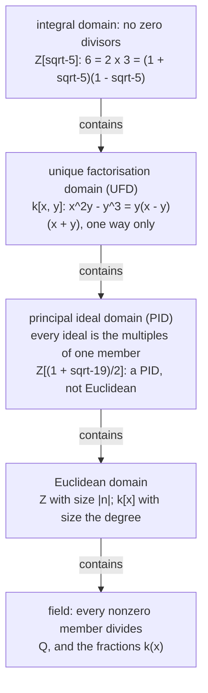

# Domains, principal ideals and unique factorisation: how the good rings nest

[Syllabus](../../../SYLLABUS.md) → [Algebraic geometry](../README.md) → [Schemes and Modern Language](../README.md#s06) → Domains, principal ideals and unique factorisation

---

## General Overview

A surveyor has two measuring rods, one 1071 mm long and one 462 mm long, the two numbers of the cable drums in [Euclid's algorithm](../../02-Number%20theory/02-Greatest%20Common%20Divisor%20and%20Euclid%27s%20Algorithm/03-euclidean-algorithm.md). Lay them end to end along a line, as many times as needed, each one forwards or backwards. Which distances from the start can be marked?

Euclid's algorithm answers it in three divisions: the greatest common divisor is 21, and 21 = 7 × 462 − 3 × 1071. Seven lengths of the short rod forwards, then three of the long rod back, mark 21 mm. Repeating that marks every multiple of 21, and nothing else can be marked, since 21 divides both rods. A whole infinite set of reachable distances is described by one number.

Now move to the plane, with coordinates x and y. The polynomials that are zero at the origin, the point (0, 0), are all combinations $`a\,x + b\,y`$, where a and b are any polynomials. The two axes, x = 0 and y = 0, share no factor. Yet no single polynomial describes this set the way 21 describes the distances: a point in the plane takes two equations.

This card sorts rings by how well they behave. The integers and polynomials in one letter are Euclidean: they divide with a smaller remainder, so every such set has one generator, a single member whose multiples make up the whole set. Polynomials in two letters lose both, but keep the property that matters most: every polynomial factors into irreducible pieces in exactly one way.

**Division with remainder gives every ideal one generator, one generator makes the gcd a combination, and that combination forces unique factorisation; polynomials in x and y lose the division and the single generator, but keep unique factorisation.**

**What kind of fact this is:** two theorems, Euclidean implies principal and principal implies unique factorisation, proved on this card in Why it works; the placement of the three rings is proved there too, and the converses are false, with named counterexamples.

### The picture: how the classes nest



Each box sits inside the one above it: every Euclidean domain is a PID, every PID is a UFD, every UFD is a domain. Each ring is placed in the smallest box it reaches.

---

## The formula

Notation first, in words. A **ring** adds, subtracts and multiplies ([Rings](../../03-Algebra/09-Rings%20and%20Fields/01-rings.md)). An **integral domain**, or domain, is a commutative ring with $`1 \ne 0`$ and no **zero divisors**: no two nonzero members multiply to 0. A **unit** is a member with a multiplicative undo, such as 1 and −1 in the integers. The letter $`k`$ is a field, a ring where every nonzero member is a unit; the examples use the fractions $`\mathbb{Q}`$.

An **ideal** is a set of members closed under adding and under multiplying by anything in the ring ([Ideals and quotient rings](../../03-Algebra/09-Rings%20and%20Fields/04-ideals-and-quotient-rings.md)). The ideal $`\langle f_1, \ldots, f_s\rangle`$ is every combination $`a_1 f_1 + \cdots + a_s f_s`$, with the multipliers $`a_i`$ any members of the ring ([Ideals and varieties](../01-Polynomial%20Systems/01-ideals-and-varieties.md)). The ideal $`(d)`$ is all multiples of one member $`d`$: a **principal ideal**.

An **irreducible** member is a nonzero non-unit that splits only as a unit times something: 3, or $`x - y`$. A **prime** member $`p`$ divides one factor whenever it divides a product. Two members are **associates** when one is a unit times the other, as $`x - 1`$ and $`12x - 12`$ are over $`\mathbb{Q}`$.

The three classes, each defined by one demand:

```math
\text{Euclidean: } a = q\,b + r \ \text{ with } r = 0 \text{ or } s(r) < s(b) \qquad \text{PID: } I = (d) \text{ for every ideal } I \qquad \text{UFD: } a = c\,p_1 p_2 \cdots p_n \text{, unique}
```

**Read it aloud:** a Euclidean domain divides with a remainder of smaller size; a principal ideal domain has every ideal made of one member's multiples; a unique factorisation domain writes every nonzero non-unit as a unit times irreducibles in one way, up to order and unit factors.

The card's two theorems are the arrows:

```math
\text{Euclidean} \;\Longrightarrow\; \text{PID} \;\Longrightarrow\; \text{UFD} \;\Longrightarrow\; \text{integral domain}
```

**Read it aloud:** division with a shrinking remainder gives one generator per ideal, and one generator per ideal gives unique factorisation.

Worked once on the rods: the ideal $`\langle 1071, 462\rangle`$ equals $`(21)`$, and $`21 = 7 \times 462 - 3 \times 1071`$.

| Symbol | Plain meaning | In our example | Push it up and the answer… |
| --- | --- | --- | --- |
| $`R`$ | an integral domain | $`\mathbb{Z}`$, $`k[x]`$, $`k[x, y]`$ (polynomials in the letters $`x`$, $`y`$) | more letters, fewer good properties |
| $`a`$, $`b`$; $`f`$, $`g`$ | members of $`R`$ | 1071 and 462; $`x^3 - 6x^2 + 11x - 6`$ and $`x^2 - 1`$ | — |
| $`c`$ | a unit: a member with a multiplicative undo | 1, −1; any nonzero constant in $`k[x]`$ | — |
| $`s(a)`$ | the size used for division | $`\lvert a\rvert`$ on $`\mathbb{Z}`$, the degree on $`k[x]`$ | — |
| $`q`$, $`r`$ | quotient and remainder | 2 and 147 in the first division | — |
| $`(d)`$, $`(h)`$ | all multiples of one member | $`(21)`$, $`(x - 1)`$ | a bigger $`d`$ gives a smaller ideal |
| $`\langle f_1, \ldots, f_s\rangle`$ | all combinations of the $`f_i`$ | $`\langle x, y\rangle`$ | more generators, bigger ideal |
| $`I`$ | an ideal | $`\langle 1071, 462\rangle`$ | — |
| $`u`$, $`v`$ | the multipliers in a combination | −3 and 7 | — |
| $`p`$ | an irreducible member | 3, $`x - y`$ | — |
| $`k`$ | a field of coefficients | $`\mathbb{Q}`$; $`\mathbb{F}_3`$ in the code | — |
| $`\mathrm{Frac}(R)`$ | the field of fractions of $`R`$ | $`\mathbb{Q}`$ from $`\mathbb{Z}`$, $`k(x)`$ from $`k[x]`$ | — |

### When it holds

- **A domain: no zero divisors.** On the 12-hour clock, 3 × 4 = 0, and 4 = 2 × 2 = 4 × 4 = 2 × 8. Factorisation stops meaning anything.
- **A size that strictly falls.** In $`k[x, y]`$ no size works: the smallest-degree member $`x`$ of $`\langle x, y\rangle`$ does not divide $`y`$, which is also in the ideal, and Step 5 rules out every other size.
- **One generator, for the gcd to be a combination.** In $`k[x, y]`$ the gcd of $`x`$ and $`y`$ is 1, but every combination $`a\,x + b\,y`$ is 0 at the origin, so none equals 1.
- **Coefficients from a field, for one letter to be Euclidean.** Polynomials with whole-number coefficients, $`\mathbb{Z}[x]`$, are a UFD but not a PID: $`\langle 2, x\rangle`$ has no single generator, as in Step 5, since every member has an even constant term and 1 is missing.
- **The arrows run one way only.** A PID need not be Euclidean (Motzkin, 1949, with the ring of $`a + b\,\tfrac{1 + \sqrt{-19}}{2}`$); a UFD need not be a PID ($`k[x, y]`$).

---

## Why it works

### Step 0: the idea, in four links

An ideal is everything reachable by combining its generators. Division with remainder pushes any member down to the smallest one, so the smallest member generates everything. One generator means the greatest common divisor is itself a combination. That combination is what proves Euclid's lemma, and Euclid's lemma is what makes factorisation unique.

So the chain is: division, one generator, gcd as a combination, unique factorisation. The integers and $`k[x]`$ have all four links. $`k[x, y]`$ breaks the first two, and keeps the fourth by a different road (Step 6).

### Step 1: Euclidean implies principal

Take a nonzero ideal $`I`$ and a nonzero member $`d`$ of smallest size. For any $`a`$ in $`I`$, divide: $`a = q\,d + r`$. Then $`r = a - q\,d`$ is in $`I`$, because ideals are closed under subtracting multiples.

The remainder is 0 or smaller than $`d`$. Nothing nonzero in $`I`$ is smaller than $`d`$, so $`r = 0`$, and $`a`$ is a multiple of $`d`$. So $`I = (d)`$.

On the rods: the smallest positive distance in $`\langle 1071, 462\rangle`$ is 21. Every other member, 1071 and 462 included, is a multiple of it. On the polynomials $`f = x^3 - 6x^2 + 11x - 6`$ and $`g = x^2 - 1`$, the lowest-degree member of $`\langle f, g\rangle`$ is $`x - 1`$, up to a constant ([Polynomials behave like integers](../../03-Algebra/09-Rings%20and%20Fields/03-polynomials-behave-like-integers.md) runs that division).

### Step 2: in a PID, the gcd is a combination, and irreducibles are prime

In a PID, $`\langle a, b\rangle = (d)`$ for some $`d`$. Since $`a`$ and $`b`$ are in $`(d)`$, $`d`$ divides both. Since $`d`$ is in $`\langle a, b\rangle`$, it is a combination $`d = u\,a + v\,b`$, so anything dividing $`a`$ and $`b`$ divides $`d`$. That makes $`d`$ a greatest common divisor, and it is a combination: Bezout's identity ([Bezout's identity](../../02-Number%20theory/02-Greatest%20Common%20Divisor%20and%20Euclid%27s%20Algorithm/04-bezouts-identity.md)).

Now let $`p`$ be irreducible, dividing $`a\,b`$ but not $`a`$. The generator of $`\langle p, a\rangle`$ divides $`p`$, so it is a unit or an associate of $`p`$. An associate of $`p`$ would divide $`a`$, so it is a unit, and $`1 = u\,p + v\,a`$. Multiply by $`b`$: $`b = u\,p\,b + v\,a\,b`$. Here $`p`$ divides both terms on the right, so $`p`$ divides $`b`$. This is Euclid's lemma ([Euclid's lemma](../../02-Number%20theory/02-Greatest%20Common%20Divisor%20and%20Euclid%27s%20Algorithm/06-euclids-lemma.md)): in a PID, irreducible means prime.

### Step 3: in a PID, every factorisation finishes

Split a non-unit into two non-units, then split those, and so on. Each split makes a strictly bigger principal ideal: if $`a = b\,c`$ with $`c`$ not a unit, then $`(a)`$ sits strictly inside $`(b)`$. In a PID such a chain cannot grow forever, so the splitting stops at irreducibles.

<details>
<summary>Detailed proof: a growing chain of ideals stops in a PID</summary>

Suppose $`(a_1) \subset (a_2) \subset (a_3) \subset \cdots`$, each inside the next. Their union $`U`$ is an ideal: two members of $`U`$ lie in a common $`(a_n)`$, so their sum does too, and a multiple of a member stays in the same $`(a_n)`$.

$`R`$ is a PID, so $`U = (d)`$ for some $`d`$. That $`d`$ lies in some $`(a_N)`$. Then every later ideal satisfies $`(a_n) \subseteq U = (d) \subseteq (a_N)`$, so the chain is constant from $`N`$ on.

If a splitting never stopped, it would give a chain that grows strictly at every step. So it stops. Rings in which every growing chain of ideals stops are called Noetherian ([Hilbert's basis theorem](../01-Polynomial%20Systems/08-hilbert-basis-theorem.md) proves $`k[x, y]`$ is one).

</details>

### Step 4: in a PID, every factorisation is the same

With irreducible meaning prime (Step 2), the proof of the fundamental theorem of arithmetic goes through word for word ([Why the factorisation is unique](../../02-Number%20theory/02-Greatest%20Common%20Divisor%20and%20Euclid%27s%20Algorithm/07-unique-factorisation.md)). Take two factorisations of one member. The first irreducible divides the product on the other side, so it divides one factor there, and is that factor's associate. Cancel the pair, and repeat.

Steps 3 and 4 together say every PID is a UFD. With Step 1, every Euclidean domain is a PID. So $`\mathbb{Z}`$, with size $`\lvert n\rvert`$, and $`k[x]`$, with size the degree, are in all three classes.

### Step 5: polynomials in x and y are not a PID

Suppose $`\langle x, y\rangle = (h)`$ for one polynomial $`h`$. Then $`h`$ divides both $`x`$ and $`y`$. Degrees add when polynomials multiply, so $`h`$ has degree 0 or 1. A degree-1 $`h`$ would be an associate of $`x`$ and of $`y`$ at once, and $`x`$ is not a constant times $`y`$. So $`h`$ is a nonzero constant: a unit.

Then $`(h)`$ is the whole ring and contains 1. But every combination $`a\,x + b\,y`$ is 0 at the origin, and 1 is not. Contradiction, so $`\langle x, y\rangle`$ has no single generator.

By Step 1, $`k[x, y]`$ has no Euclidean size either. This holds over every field $`k`$.

In geometry: over the complex numbers, one equation in two letters cuts out a curve, never a single point. Over the real numbers $`x^2 + y^2 = 0`$ is the origin alone, but its ideal misses $`x`$, whose degree is too low to be a multiple. The points agree; the ideals do not.

### Step 6: polynomials in x and y still factor uniquely

The **field of fractions** of a domain $`R`$, written $`\mathrm{Frac}(R)`$, is all fractions $`a/b`$ of members with $`b \ne 0`$, added and multiplied as fractions are. $`\mathrm{Frac}(\mathbb{Z}) = \mathbb{Q}`$, and $`\mathrm{Frac}(k[x]) = k(x)`$, the fractions of polynomials in $`x`$. ([Birational equivalence](../02-Affine%20and%20Projective%20Varieties/06-birational-equivalence-and-function-fields.md) builds the same field for a curve, in words.)

Read $`k[x, y]`$ as polynomials in $`y`$ whose coefficients lie in $`k[x]`$. Over the field $`k(x)`$ these are polynomials in one letter, a Euclidean domain, so they factor uniquely there. Gauss's lemma (multiply two polynomials whose coefficients share no common factor, and the product's coefficients share none either) carries that uniqueness back to $`k[x]`$ coefficients: clearing denominators never creates a new factorisation.

<details>
<summary>Detailed proof: Gauss's lemma, and why R UFD gives R[y] UFD</summary>

Let $`R`$ be a UFD. Call a polynomial in $`y`$ over $`R`$ **primitive** when no irreducible of $`R`$ divides all its coefficients.

**Gauss's lemma: a product of primitive polynomials is primitive.** Suppose an irreducible $`p`$ of $`R`$ divides every coefficient of $`F\,G`$. In a UFD $`p`$ is prime, so $`R/(p)`$ is a domain. Reduce $`F`$ and $`G`$ modulo $`p`$: neither becomes 0, since both are primitive. Polynomials over a domain have no zero divisors, since leading coefficients multiply, so the reduced product is not 0. That contradicts $`p`$ dividing every coefficient of $`F\,G`$.

**Existence.** Write any $`F`$ as its content, the gcd of its coefficients, times a primitive polynomial. Factor the content in $`R`$. Factor the primitive part by degree in $`y`$: degrees fall, so the splitting stops.

**Uniqueness.** Two factorisations of a primitive $`F`$ into primitive irreducibles are also factorisations over $`\mathrm{Frac}(R)`$, which is Euclidean in $`y`$. Each factor stays irreducible there: a split over $`\mathrm{Frac}(R)`$, with denominators cleared and contents removed, would by Gauss's lemma be a split of primitive polynomials in $`R[y]`$. There they agree up to order and nonzero fractions. If two primitive polynomials differ by a fraction $`m/n`$, then $`n\,F_1 = m\,F_2`$; comparing contents shows $`m`$ and $`n`$ are associates, so the fraction is a unit of $`R`$. The content factors uniquely in $`R`$ itself, so the whole factorisation of any $`F`$ is unique.

Apply this twice: $`k`$ is a UFD, so $`k[x]`$ is, so $`k[x][y] = k[x, y]`$ is. The same argument from $`\mathbb{Z}`$ gives $`\mathbb{Z}[x]`$.

</details>

On the example: $`x^2y - y^3`$, read in $`y`$, is $`-y^3 + x^2 y`$, with coefficients $`-1`$, 0, $`x^2`$ and 0. Its content is 1. It factors as $`y\,(x - y)(x + y)`$, three polynomials of degree 1, each irreducible. Gauss's lemma says no other factorisation exists, up to order and nonzero constant factors.

---

## Worked numbers, by hand

| Step | Arithmetic | Value |
| --- | --- | --- |
| Euclid on the rods | 1071 = 2 × 462 + 147; 462 = 3 × 147 + 21; 147 = 7 × 21 + 0 | gcd 21 |
| run it backwards | 21 = 462 − 3 × 147 = 462 − 3 × (1071 − 2 × 462) | **21 = 7 × 462 − 3 × 1071** |
| one variable over $`\mathbb{Q}`$ | $`f = (x - 6)\,g + (12x - 12)`$; $`g = (x + 1)(x - 1) + 0`$ | gcd $`x - 1`$ |
| as a combination | $`x - 1 = \tfrac{1}{12}(f - (x - 6)\,g)`$ | $`u = \tfrac{1}{12}`$, $`v = -\tfrac{1}{12}x + \tfrac{1}{2}`$ |
| shared roots | $`f`$ has roots 1, 2, 3; $`g`$ has −1, 1 | **only 1, matching $`x - 1`$** |
| two variables | any $`h`$ dividing $`x`$ and $`y`$ has degree 0 | a unit |
| the origin | $`a\,x + b\,y`$ at $`(0, 0)`$ | **always 0, never 1** |
| unique factors | $`y\,(x - y)(x + y) = y\,(x^2 - y^2)`$ | **$`x^2y - y^3`$** |

The rods and $`f`$, $`g`$ each have one generator that is a combination; $`\langle x, y\rangle`$ has none, yet $`x^2y - y^3`$ still splits into three lines through the origin in exactly one way.

### What breaks if you drop a piece

| Mistake | Comes out at | What went wrong |
| --- | --- | --- |
| Allowing zero divisors ($`\mathbb{Z}`$ mod 12) | 3 × 4 = 0; 4 = 2 × 2 = 4 × 4 = 2 × 8 | not a domain, so factors are not pinned |
| A domain that is not a UFD ($`\mathbb{Z}[\sqrt{-5}]`$) | 6 = 2 × 3 = $`(1 + \sqrt{-5})(1 - \sqrt{-5})`$; norms 4 × 9 = 36 = 6 × 6 | irreducible is not prime |
| Taking the least-degree member $`x`$ as generator of $`\langle x, y\rangle`$ | $`y`$ is not a multiple of $`x`$ | no division with remainder in two letters |
| Reading gcd 1 as $`1 = a\,x + b\,y`$ | 0 of 729 combinations equal 1 | Bezout needs a PID |

The norm of $`a + b\sqrt{-5}`$ is $`a^2 + 5b^2`$; [Norm, trace and discriminant](../../21-Algebraic%20and%20analytic%20number%20theory/06-Algebraic%20Numbers/02-norms-traces-and-discriminants.md) uses it to prove the four factors irreducible, and [Ideals factor uniquely even where numbers do not](../../21-Algebraic%20and%20analytic%20number%20theory/06-Algebraic%20Numbers/04-ideals-and-unique-factorisation-in-dedekind-domains.md) repairs the failure with ideals. The code prints all four rows.

---

## Code, from first principles, and it actually runs

Each claim is reached by two or three independent roads:

- **The rods:** extended Euclid, against a brute search of 3721 combinations for the smallest positive one.
- **$`f`$ and $`g`$:** Euclid over exact fractions, against their shared rational roots; the combination is multiplied back out.
- **Two letters:** searches over $`\mathbb{F}_3`$, the integers mod 3, a field with three members. Every polynomial of degree at most 1 is tried as a common divisor of $`x`$ and $`y`$, and 729 combinations are tested at the origin.
- **The factorisation:** expansion over $`\mathbb{Z}`$, a hunt for degree-1 divisors over $`\mathbb{F}_3`$, and a count of zeros on the 9 points of $`\mathbb{F}_3^2`$.

The $`\mathbb{F}_3`$ searches are evidence for one field; Steps 5 and 6 prove the claims for every field.

### Python

```python
# Domains, principal ideals and unique factorisation -- the check behind the card.
# Standard library only; Fraction is exact arithmetic, nothing more.  Three rings:
# the integers (Euclid on 1071 and 462), polynomials in x over Q (Euclid on f and
# g), and polynomials in x and y, where <x, y> has no single generator yet
# x^2y - y^3 still factors one way.  Two-letter searches run over F_3 (mod 3).
from fractions import Fraction as Q
from itertools import product

def yn(c): return "yes" if c else "no"

# ---- the integers: Euclid, then the same generator by brute force ----
print("integers: Euclid on 1071 and 462")
a, b = 1071, 462
while b:
    print(f"{a} = {a // b} x {b} + {a % b}"); a, b = b, a % b
gi, si, ti, r1, s1, t1 = 1071, 1, 0, 462, 0, 1          # extended Euclid
while r1:
    k = gi // r1; gi, si, ti, r1, s1, t1 = r1, s1, t1, gi - k * r1, si - k * s1, ti - k * t1
print(f"gcd {gi} = {ti} x 462 - {-si} x 1071")
combos = [i * 1071 + j * 462 for i in range(-30, 31) for j in range(-30, 31)]
least = min(c for c in combos if c > 0)
print(f"road 2: smallest positive a x 1071 + b x 462 with |a|, |b| <= 30: {least}")
print(f"every such combination a multiple of {least}: {yn(all(c % least == 0 for c in combos))} ({len(combos)} checked)")

# ---- polynomials in x over Q, coefficients highest power first ----
def trim(p):
    while len(p) > 1 and p[0] == 0: p = p[1:]
    return p
def sub(p, q):
    n = max(len(p), len(q)); p = [Q(0)] * (n - len(p)) + p; q = [Q(0)] * (n - len(q)) + q
    return trim([u - v for u, v in zip(p, q)])
def mul(p, q):
    out = [Q(0)] * (len(p) + len(q) - 1)
    for i, u in enumerate(p):
        for j, v in enumerate(q): out[i + j] += u * v
    return trim(out)
def divmod_(f, g):
    quo, r = [Q(0)] * max(1, len(f) - len(g) + 1), f
    while r != [0] and len(r) >= len(g):
        c, d = r[0] / g[0], len(r) - len(g)
        quo[len(quo) - 1 - d] = c; r = sub(r, mul([c] + [Q(0)] * d, g))
    return trim(quo), r
def show(p):
    s, n = "", len(p) - 1
    for i, c in enumerate(p):
        if c == 0: continue
        d, a = n - i, abs(c)
        cs = "" if a == 1 and d else (f"({a})" if a.denominator > 1 and d else str(a))
        t = cs + ("" if d == 0 else "x" if d == 1 else f"x^{d}")
        s += (("-" if c < 0 else "") + t) if not s else (" - " if c < 0 else " + ") + t
    return s or "0"
P = lambda *cs: [Q(c) for c in cs]
f, g = P(1, -6, 11, -6), P(1, 0, -1)
print(f"polynomials in x over Q: f = {show(f)}, g = {show(g)}")
q1, rem1 = divmod_(f, g); q2, rem2 = divmod_(g, P(1, -1))
print(f"f = ({show(q1)}) g + ({show(rem1)})")
print(f"g = ({show(q2)})(x - 1) + {show(rem2)}")
r0, s0, t0, r1, s1, t1 = f, P(1), P(0), g, P(0), P(1)    # extended Euclid again
while r1 != [0]:
    k, rr = divmod_(r0, r1)
    r0, s0, t0, r1, s1, t1 = r1, s1, t1, rr, sub(s0, mul(k, s1)), sub(t0, mul(k, t1))
lead = r0[0]; h, u, v = [c / lead for c in r0], [c / lead for c in s0], [c / lead for c in t0]
print(f"monic gcd: {show(h)}")
print(f"{show(h)} = u f + v g with u = {show(u)}, v = {show(v)}")
ev = lambda p, x: sum(c * x ** (len(p) - 1 - i) for i, c in enumerate(p))
rf = [x for x in range(-6, 7) if ev(f, x) == 0]; rg = [x for x in range(-1, 2) if ev(g, x) == 0]
print(f"road 2: rational roots of f {rf}, of g {rg}, shared {[x for x in rf if x in rg]}")

# ---- polynomials in x and y: dicts {(power of x, power of y): coefficient} ----
def tidy(out, m):                                     # reduce mod m (0: not at all), drop zeros
    return {key: (c % m if m else c) for key, c in out.items() if (c % m if m else c)}
def mul2(p, q, m=0):
    out = {}
    for (i, j), c in p.items():
        for (k, l), e in q.items(): out[(i + k, j + l)] = out.get((i + k, j + l), 0) + c * e
    return tidy(out, m)
def add2(p, q, m=0):
    out = dict(p)
    for key, c in q.items(): out[key] = out.get(key, 0) + c
    return tidy(out, m)
ev2 = lambda p, x, y: sum(c * x ** i * y ** j for (i, j), c in p.items())
def show2(p):
    s = ""
    for (i, j) in sorted(p, reverse=True):              # lex order, x > y
        c = p[(i, j)]; mono = ("x" if i else "") + (f"^{i}" if i > 1 else "") + ("y" if j else "") + (f"^{j}" if j > 1 else "")
        t = (str(abs(c)) if abs(c) != 1 or not mono else "") + mono
        s += (("-" if c < 0 else "") + t) if not s else (" - " if c < 0 else " + ") + t
    return s or "0"
def polys(deg):                                       # every polynomial over F_3 of degree <= deg
    monos = [(i, j) for i in range(deg + 1) for j in range(deg + 1 - i)]
    return [{m: c for m, c in zip(monos, cs) if c} for cs in product(range(3), repeat=len(monos))]
X, Y, ONE = {(1, 0): 1}, {(0, 1): 1}, {(0, 0): 1}
L1 = polys(1)
divides = lambda h, t, qs: any(mul2(h, q, 3) == t for q in qs)
common = [show2(h) for h in L1 if h and divides(h, X, L1) and divides(h, Y, L1)]
print("polynomials in x and y over F_3: the ideal <x, y>")
print(f"polynomials of degree <= 1 dividing both x and y: {common}")
cs2 = [add2(mul2(a, X), mul2(b, Y), 3) for a in L1 for b in L1]
print(f"combinations a x + b y, a and b of degree <= 1: {len(cs2)}, zero at (0, 0): {sum(ev2(p, 0, 0) == 0 for p in cs2)}")
F = {(2, 1): 1, (0, 3): -1}
fac = mul2(mul2(Y, {(1, 0): 1, (0, 1): -1}), {(1, 0): 1, (0, 1): 1})
print(f"unique factorisation in k[x, y]: {show2(F)} = y(x - y)(x + y), expanded: {show2(fac)}: {yn(fac == F)}")
F3, L2 = tidy(F, 3), polys(2)
linear = [show2(h) for h in L1 if h and (0, 0) not in h and h[max(h)] == 1 and divides(h, F3, L2)]
print(f"road 2: monic degree-1 divisors over F_3: {linear} (x - y is x + 2y mod 3)")
zeros = sum(ev2(F, x, y) % 3 == 0 for x in range(3) for y in range(3))
print(f"road 3: zeros of {show2(F)} on the 9 points of F_3^2: {zeros} = 3 lines x 3 points - 2 repeats of (0, 0)")

# ---- what breaks ----
print(f"mistake 1, Z mod 12 has zero divisors: 3 x 4 = {3 * 4 % 12}; 4 = 2 x 2 = 4 x 4 = 2 x 8: "
      f"{yn(2 * 2 % 12 == 4 * 4 % 12 == 2 * 8 % 12 == 4)}")
nm = lambda a, b: a * a + 5 * b * b
small = sorted({nm(a, b) for a in range(-3, 4) for b in range(-3, 4)} & {2, 3})
print(f"mistake 2, Z[sqrt-5]: norms 2 -> {nm(2, 0)}, 3 -> {nm(3, 0)}, 1 + sqrt-5 -> {nm(1, 1)}, "
      f"1 - sqrt-5 -> {nm(1, -1)}; {nm(2, 0)} x {nm(3, 0)} = {nm(2, 0) * nm(3, 0)} = {nm(1, 1)} x {nm(1, -1)}")
print(f"  elements of norm 2 or 3 (|a|, |b| <= 3): {small}, so {'all four are irreducible' if not small else 'irreducible not proved'}")
print(f"mistake 3, least-degree member x taken as generator of <x, y>: y a multiple of x: {yn(divides(X, Y, L1))}")
print(f"mistake 4, gcd(x, y) = 1 read as 1 = a x + b y: combinations equal to 1 found: {sum(p == ONE for p in cs2)}")
assert gi == least == 21 and all(c % 21 == 0 for c in combos)    # Euclid against brute force
assert ti * 462 + si * 1071 == 21                                 # Bezout, substituted back
assert show(h) == "x - 1" and [x for x in rf if x in rg] == [1]   # gcd against shared roots
assert sub(sub(h, mul(u, f)), mul(v, g)) == [0]                   # u f + v g, multiplied out
assert sorted(common) == ["1", "2"]                               # only units divide x and y
assert sum(p == ONE for p in cs2) == 0 and not divides(X, Y, L1)  # 1 and y out of reach
assert fac == F and sorted(linear) == ["x + 2y", "x + y", "y"] and zeros == 7  # three roads agree
assert small == []                                                # no element of norm 2 or 3
assert nm(2, 0) * nm(3, 0) == nm(1, 1) * nm(1, -1)                # the norm multiplies both ways
print("ALL CHECKS PASS")
```

**Ran 2026-11-17 on macOS, Python 3.14.10, standard library only. All checks passed. Output, pasted from the run:**

```
integers: Euclid on 1071 and 462
1071 = 2 x 462 + 147
462 = 3 x 147 + 21
147 = 7 x 21 + 0
gcd 21 = 7 x 462 - 3 x 1071
road 2: smallest positive a x 1071 + b x 462 with |a|, |b| <= 30: 21
every such combination a multiple of 21: yes (3721 checked)
polynomials in x over Q: f = x^3 - 6x^2 + 11x - 6, g = x^2 - 1
f = (x - 6) g + (12x - 12)
g = (x + 1)(x - 1) + 0
monic gcd: x - 1
x - 1 = u f + v g with u = 1/12, v = -(1/12)x + 1/2
road 2: rational roots of f [1, 2, 3], of g [-1, 1], shared [1]
polynomials in x and y over F_3: the ideal <x, y>
polynomials of degree <= 1 dividing both x and y: ['1', '2']
combinations a x + b y, a and b of degree <= 1: 729, zero at (0, 0): 729
unique factorisation in k[x, y]: x^2y - y^3 = y(x - y)(x + y), expanded: x^2y - y^3: yes
road 2: monic degree-1 divisors over F_3: ['y', 'x + y', 'x + 2y'] (x - y is x + 2y mod 3)
road 3: zeros of x^2y - y^3 on the 9 points of F_3^2: 7 = 3 lines x 3 points - 2 repeats of (0, 0)
mistake 1, Z mod 12 has zero divisors: 3 x 4 = 0; 4 = 2 x 2 = 4 x 4 = 2 x 8: yes
mistake 2, Z[sqrt-5]: norms 2 -> 4, 3 -> 9, 1 + sqrt-5 -> 6, 1 - sqrt-5 -> 6; 4 x 9 = 36 = 6 x 6
  elements of norm 2 or 3 (|a|, |b| <= 3): [], so all four are irreducible
mistake 3, least-degree member x taken as generator of <x, y>: y a multiple of x: no
mistake 4, gcd(x, y) = 1 read as 1 = a x + b y: combinations equal to 1 found: 0
ALL CHECKS PASS
```

### Rust

Same numbers, same labels, built with `rustc --edition 2021 -O`.

```rust
// Domains, principal ideals and unique factorisation -- the same check as the Python,
// in Rust.  No crates.  Fractions are an i128 pair with checked_mul, so overflow
// stops the run.  Three rings: the integers, polynomials in x over Q, and
// polynomials in x and y, where the two-letter searches run over F_3 (mod 3).
use std::collections::BTreeMap;

fn m(a: i128, b: i128) -> i128 { a.checked_mul(b).expect("overflow") }
fn gcd(a: i128, b: i128) -> i128 { if b == 0 { a.abs() } else { gcd(b, a % b) } }
#[derive(Clone, Copy, PartialEq)]
struct Q { n: i128, d: i128 }
fn q(n: i128, d: i128) -> Q { let g = gcd(n, d).max(1) * d.signum(); Q { n: n / g, d: d / g } }
fn add(a: Q, b: Q) -> Q { q(m(a.n, b.d).checked_add(m(b.n, a.d)).expect("overflow"), m(a.d, b.d)) }
fn mulq(a: Q, b: Q) -> Q { q(m(a.n, b.n), m(a.d, b.d)) }
fn divq(a: Q, b: Q) -> Q { q(m(a.n, b.d), m(a.d, b.n)) }
fn qs(a: Q) -> String { if a.d == 1 { format!("{}", a.n) } else { format!("{}/{}", a.n, a.d) } }
fn yn(c: bool) -> &'static str { if c { "yes" } else { "no" } }
type P = Vec<Q>;                                     // highest power first
fn pp(cs: &[i128]) -> P { cs.iter().map(|&c| q(c, 1)).collect() }
fn trim(mut p: P) -> P { while p.len() > 1 && p[0].n == 0 { p.remove(0); } p }
fn sub(a: &P, b: &P) -> P {
    let n = a.len().max(b.len());
    let at = |p: &P, i: usize| if i + p.len() >= n { p[i + p.len() - n] } else { q(0, 1) };
    trim((0..n).map(|i| add(at(a, i), Q { n: -at(b, i).n, d: at(b, i).d })).collect())
}
fn mul(a: &P, b: &P) -> P {
    let mut out = vec![q(0, 1); a.len() + b.len() - 1];
    for (i, &u) in a.iter().enumerate() { for (j, &v) in b.iter().enumerate() { out[i + j] = add(out[i + j], mulq(u, v)); } }
    trim(out)
}
fn is0(p: &P) -> bool { p.len() == 1 && p[0].n == 0 }
fn divmod(f: &P, g: &P) -> (P, P) {
    let mut quo = vec![q(0, 1); (f.len() as i64 - g.len() as i64 + 1).max(1) as usize];
    let mut r = f.clone();
    while !is0(&r) && r.len() >= g.len() {
        let (c, d) = (divq(r[0], g[0]), r.len() - g.len());
        let k = quo.len() - 1 - d; quo[k] = c;
        let mut t = vec![c]; t.extend(vec![q(0, 1); d]);
        r = sub(&r, &mul(&t, g));
    }
    (trim(quo), r)
}
fn join(s: &mut String, neg: bool, t: String) {
    if s.is_empty() { s.push_str(&format!("{}{}", if neg { "-" } else { "" }, t)) }
    else { s.push_str(&format!("{}{}", if neg { " - " } else { " + " }, t)) }
}
fn show(p: &P) -> String {
    let (mut s, n) = (String::new(), p.len() - 1);
    for (i, &c) in p.iter().enumerate() {
        if c.n == 0 { continue }
        let (d, a) = (n - i, Q { n: c.n.abs(), d: c.d });
        let cs = if a.n == 1 && a.d == 1 && d > 0 { String::new() } else if a.d > 1 && d > 0 { format!("({})", qs(a)) } else { qs(a) };
        let v = if d == 0 { String::new() } else if d == 1 { "x".to_string() } else { format!("x^{}", d) };
        join(&mut s, c.n < 0, cs + &v);
    }
    if s.is_empty() { "0".into() } else { s }
}
fn ev(p: &P, x: i128) -> Q { p.iter().fold(q(0, 1), |acc, &c| add(mulq(acc, q(x, 1)), c)) }
type B = BTreeMap<(u32, u32), i64>;                  // {(power of x, power of y): coefficient}
fn tidy(out: B, md: i64) -> B {
    out.into_iter().map(|(k, c)| (k, if md > 0 { c.rem_euclid(md) } else { c })).filter(|&(_, c)| c != 0).collect()
}
fn mul2(a: &B, b: &B, md: i64) -> B {
    let mut out = B::new();
    for (&(i, j), &c) in a { for (&(k, l), &e) in b { *out.entry((i + k, j + l)).or_insert(0) += c * e; } }
    tidy(out, md)
}
fn add2(a: &B, b: &B, md: i64) -> B {
    let mut out = a.clone();
    for (&k, &c) in b { *out.entry(k).or_insert(0) += c; }
    tidy(out, md)
}
fn ev2(p: &B, x: i64, y: i64) -> i64 { p.iter().map(|(&(i, j), &c)| c * x.pow(i) * y.pow(j)).sum() }
fn show2(p: &B) -> String {
    let mut s = String::new();
    for (&(i, j), &c) in p.iter().rev() {                 // lex order, x > y
        let mut mono = String::new();
        if i > 0 { mono += "x" } if i > 1 { mono += &format!("^{}", i) }
        if j > 0 { mono += "y" } if j > 1 { mono += &format!("^{}", j) }
        let t = if c.abs() != 1 || mono.is_empty() { format!("{}{}", c.abs(), mono) } else { mono };
        join(&mut s, c < 0, t);
    }
    if s.is_empty() { "0".into() } else { s }
}
fn polys(deg: u32) -> Vec<B> {                        // every polynomial over F_3 of degree <= deg
    let monos: Vec<(u32, u32)> = (0..=deg).flat_map(|i| (0..=deg - i).map(move |j| (i, j))).collect();
    let n = monos.len() as u32;
    (0..3i64.pow(n)).map(|idx| {
        let mut p = B::new();
        for (t, &mo) in monos.iter().enumerate() {
            let c = idx / 3i64.pow(n - 1 - t as u32) % 3;
            if c != 0 { p.insert(mo, c); }
        }
        p
    }).collect()
}
fn divides(h: &B, t: &B, qs_: &[B]) -> bool { qs_.iter().any(|g| mul2(h, g, 3) == *t) }
fn strs(v: &[String]) -> String { format!("[{}]", v.iter().map(|s| format!("'{}'", s)).collect::<Vec<_>>().join(", ")) }
fn b(pairs: &[((u32, u32), i64)]) -> B { pairs.iter().cloned().collect() }
fn main() {
    println!("integers: Euclid on 1071 and 462");
    let (mut a, mut bb) = (1071i64, 462i64);
    while bb != 0 { println!("{} = {} x {} + {}", a, a / bb, bb, a % bb); (a, bb) = (bb, a % bb); }
    let (mut gi, mut si, mut ti, mut r1, mut s1, mut t1) = (1071i64, 1i64, 0i64, 462i64, 0i64, 1i64);
    while r1 != 0 { let k = gi / r1; (gi, si, ti, r1, s1, t1) = (r1, s1, t1, gi - k * r1, si - k * s1, ti - k * t1); }
    println!("gcd {} = {} x 462 - {} x 1071", gi, ti, -si);
    let combos: Vec<i64> = (-30..31).flat_map(|i| (-30..31).map(move |j| i * 1071 + j * 462)).collect();
    let least = *combos.iter().filter(|&&c| c > 0).min().unwrap();
    println!("road 2: smallest positive a x 1071 + b x 462 with |a|, |b| <= 30: {}", least);
    println!("every such combination a multiple of {}: {} ({} checked)", least, yn(combos.iter().all(|c| c % least == 0)), combos.len());
    let (f, g) = (pp(&[1, -6, 11, -6]), pp(&[1, 0, -1]));
    println!("polynomials in x over Q: f = {}, g = {}", show(&f), show(&g));
    let (q1, rem1) = divmod(&f, &g); let (q2, rem2) = divmod(&g, &pp(&[1, -1]));
    println!("f = ({}) g + ({})", show(&q1), show(&rem1));
    println!("g = ({})(x - 1) + {}", show(&q2), show(&rem2));
    let (mut r0, mut s0, mut t0, mut r1, mut s1, mut t1) = (f.clone(), pp(&[1]), pp(&[0]), g.clone(), pp(&[0]), pp(&[1]));
    while !is0(&r1) {
        let (k, rr) = divmod(&r0, &r1);
        let (ns, nt) = (sub(&s0, &mul(&k, &s1)), sub(&t0, &mul(&k, &t1)));
        (r0, s0, t0, r1, s1, t1) = (r1, s1, t1, rr, ns, nt);
    }
    let lead = r0[0];
    let sc = |p: &P| -> P { p.iter().map(|&c| divq(c, lead)).collect() };
    let (h, u, v) = (sc(&r0), sc(&s0), sc(&t0));
    println!("monic gcd: {}", show(&h));
    println!("{} = u f + v g with u = {}, v = {}", show(&h), show(&u), show(&v));
    let rf: Vec<i128> = (-6..7).filter(|&x| ev(&f, x).n == 0).collect();
    let rg: Vec<i128> = (-1..2).filter(|&x| ev(&g, x).n == 0).collect();
    let shared: Vec<i128> = rf.iter().filter(|x| rg.contains(x)).cloned().collect();
    println!("road 2: rational roots of f {:?}, of g {:?}, shared {:?}", rf, rg, shared);
    let (x, y, one) = (b(&[((1, 0), 1)]), b(&[((0, 1), 1)]), b(&[((0, 0), 1)]));
    let l1 = polys(1);
    let common: Vec<String> = l1.iter().filter(|h| !h.is_empty() && divides(h, &x, &l1) && divides(h, &y, &l1)).map(show2).collect();
    println!("polynomials in x and y over F_3: the ideal <x, y>");
    println!("polynomials of degree <= 1 dividing both x and y: {}", strs(&common));
    let cs2: Vec<B> = l1.iter().flat_map(|a| l1.iter().map(|bq| add2(&mul2(a, &x, 0), &mul2(bq, &y, 0), 3)).collect::<Vec<_>>()).collect();
    println!("combinations a x + b y, a and b of degree <= 1: {}, zero at (0, 0): {}", cs2.len(), cs2.iter().filter(|p| ev2(p, 0, 0) == 0).count());
    let ff = b(&[((2, 1), 1), ((0, 3), -1)]);
    let fac = mul2(&mul2(&y, &b(&[((1, 0), 1), ((0, 1), -1)]), 0), &b(&[((1, 0), 1), ((0, 1), 1)]), 0);
    println!("unique factorisation in k[x, y]: {} = y(x - y)(x + y), expanded: {}: {}", show2(&ff), show2(&fac), yn(fac == ff));
    let (f3, l2) = (tidy(ff.clone(), 3), polys(2));
    let linear: Vec<String> = l1.iter().filter(|h| !h.is_empty() && !h.contains_key(&(0, 0))
        && *h.iter().next_back().unwrap().1 == 1 && divides(h, &f3, &l2)).map(show2).collect();
    println!("road 2: monic degree-1 divisors over F_3: {} (x - y is x + 2y mod 3)", strs(&linear));
    let zeros = (0..3).flat_map(|xx| (0..3).map(move |yy| (xx, yy))).filter(|&(xx, yy)| ev2(&ff, xx, yy) % 3 == 0).count();
    println!("road 3: zeros of {} on the 9 points of F_3^2: {} = 3 lines x 3 points - 2 repeats of (0, 0)", show2(&ff), zeros);
    println!("mistake 1, Z mod 12 has zero divisors: 3 x 4 = {}; 4 = 2 x 2 = 4 x 4 = 2 x 8: {}", 3 * 4 % 12,
             yn(2 * 2 % 12 == 4 && 4 * 4 % 12 == 4 && 2 * 8 % 12 == 4));
    let nm = |a: i64, b: i64| a * a + 5 * b * b;
    let mut small: Vec<i64> = (-3..4).flat_map(|a| (-3..4).map(move |b| nm(a, b))).filter(|n| *n == 2 || *n == 3).collect();
    small.sort(); small.dedup();
    println!("mistake 2, Z[sqrt-5]: norms 2 -> {}, 3 -> {}, 1 + sqrt-5 -> {}, 1 - sqrt-5 -> {}; {} x {} = {} = {} x {}",
             nm(2, 0), nm(3, 0), nm(1, 1), nm(1, -1), nm(2, 0), nm(3, 0), nm(2, 0) * nm(3, 0), nm(1, 1), nm(1, -1));
    println!("  elements of norm 2 or 3 (|a|, |b| <= 3): {:?}, so {}", small, if small.is_empty() { "all four are irreducible" } else { "irreducible not proved" });
    println!("mistake 3, least-degree member x taken as generator of <x, y>: y a multiple of x: {}", yn(divides(&x, &y, &l1)));
    let hits = cs2.iter().filter(|p| **p == one).count();
    println!("mistake 4, gcd(x, y) = 1 read as 1 = a x + b y: combinations equal to 1 found: {}", hits);
    assert!(gi == least && least == 21 && combos.iter().all(|c| c % 21 == 0));   // Euclid against brute force
    assert!(ti * 462 + si * 1071 == 21);                                         // Bezout, substituted back
    assert!(show(&h) == "x - 1" && shared == vec![1]);                           // gcd against shared roots
    assert!(is0(&sub(&sub(&h, &mul(&u, &f)), &mul(&v, &g))));                    // u f + v g, multiplied out
    let mut cm = common.clone(); cm.sort(); assert!(cm == ["1", "2"]);           // only units divide x and y
    assert!(hits == 0 && !divides(&x, &y, &l1));                                 // 1 and y out of reach
    let mut ln = linear.clone(); ln.sort();
    assert!(fac == ff && ln == ["x + 2y", "x + y", "y"] && zeros == 7);          // three roads agree
    assert!(small.is_empty());                                                   // no element of norm 2 or 3
    assert!(nm(2, 0) * nm(3, 0) == nm(1, 1) * nm(1, -1));                        // the norm multiplies both ways
    println!("ALL CHECKS PASS");
}
```

**Ran 2026-11-17 on macOS, rustc 1.98.1, no crates. All checks passed. Output, pasted from the run:**

```
integers: Euclid on 1071 and 462
1071 = 2 x 462 + 147
462 = 3 x 147 + 21
147 = 7 x 21 + 0
gcd 21 = 7 x 462 - 3 x 1071
road 2: smallest positive a x 1071 + b x 462 with |a|, |b| <= 30: 21
every such combination a multiple of 21: yes (3721 checked)
polynomials in x over Q: f = x^3 - 6x^2 + 11x - 6, g = x^2 - 1
f = (x - 6) g + (12x - 12)
g = (x + 1)(x - 1) + 0
monic gcd: x - 1
x - 1 = u f + v g with u = 1/12, v = -(1/12)x + 1/2
road 2: rational roots of f [1, 2, 3], of g [-1, 1], shared [1]
polynomials in x and y over F_3: the ideal <x, y>
polynomials of degree <= 1 dividing both x and y: ['1', '2']
combinations a x + b y, a and b of degree <= 1: 729, zero at (0, 0): 729
unique factorisation in k[x, y]: x^2y - y^3 = y(x - y)(x + y), expanded: x^2y - y^3: yes
road 2: monic degree-1 divisors over F_3: ['y', 'x + y', 'x + 2y'] (x - y is x + 2y mod 3)
road 3: zeros of x^2y - y^3 on the 9 points of F_3^2: 7 = 3 lines x 3 points - 2 repeats of (0, 0)
mistake 1, Z mod 12 has zero divisors: 3 x 4 = 0; 4 = 2 x 2 = 4 x 4 = 2 x 8: yes
mistake 2, Z[sqrt-5]: norms 2 -> 4, 3 -> 9, 1 + sqrt-5 -> 6, 1 - sqrt-5 -> 6; 4 x 9 = 36 = 6 x 6
  elements of norm 2 or 3 (|a|, |b| <= 3): [], so all four are irreducible
mistake 3, least-degree member x taken as generator of <x, y>: y a multiple of x: no
mistake 4, gcd(x, y) = 1 read as 1 = a x + b y: combinations equal to 1 found: 0
ALL CHECKS PASS
```

The two outputs match line for line.

### Lean

Lean proves the two arrows for every domain, places $`k[x, y]`$ over every field, and checks the worked numbers exactly.

- Take a domain with a whole-number size $`s`$, where dividing by any nonzero $`b`$ leaves $`r = 0`$ or $`s(r) < s(b)`$. Then it is a PID, and so a UFD.
- Take a PID and two members $`a`$ and $`b`$. Then they have a gcd $`d = u\,a + v\,b`$ that every common divisor divides.
- In a PID, every irreducible is prime: Euclid's lemma.
- Take any field $`k`$. Then $`k[x, y]`$ is a UFD, but $`\langle x, y\rangle`$ has no single generator.
- So $`k[x, y]`$ is not a PID, and no size makes it Euclidean.
- Take the rods, 1071 mm and 462 mm. Then Euclid takes three divisions, the gcd is 21, and $`21 = 7 \times 462 - 3 \times 1071`$.
- Take $`f`$ and $`g`$ over $`\mathbb{Q}`$. Then $`f = (x - 6)\,g + (12x - 12)`$, and $`x - 1 = u\,f + v\,g`$ with the hand-worked $`u`$ and $`v`$.
- Take two letters over $`\mathbb{Q}`$. Then $`x^2y - y^3 = y\,(x - y)(x + y)`$.
- On the 12-hour clock, 3 × 4 = 0, and 4 = 2 × 2 = 4 × 4 = 2 × 8.
- Take $`\mathbb{Z}[\sqrt{-5}]`$. Then 6 = 2 × 3 = $`(1 + \sqrt{-5})(1 - \sqrt{-5})`$, and the four norms are 4, 9, 6 and 6.

The $`\mathbb{F}_3`$ searches, the search for 21, the shared roots and the irreducible factors of 6 are left to Python and Rust.

```lean
-- Domains, principal ideals and unique factorisation: every Euclidean domain is a principal ideal domain and every principal ideal domain factors uniquely, while polynomials in x and y factor uniquely but have no single generator for ⟨x, y⟩ and no Euclidean size.
import Mathlib.RingTheory.PrincipalIdealDomain
import Mathlib.RingTheory.Polynomial.UniqueFactorization
import Mathlib.NumberTheory.Zsqrtd.Basic
import Mathlib.Data.ZMod.Basic
import Mathlib.Tactic.Ring
import Mathlib.Algebra.MvPolynomial.Division
import Mathlib.Tactic.NormNum
import Mathlib.Tactic.LinearCombination

open MvPolynomial

/-- Euclidean implies principal implies unique factorisation: if a domain has a size
`s` with division by any nonzero `b` leaving a remainder that is 0 or of smaller size,
then every ideal is the multiples of one member, and every nonzero non-unit is a unit
times irreducibles in exactly one way, up to order and unit factors. -/
theorem euclidean_implies_pid_implies_ufd {R : Type*} [CommRing R] [IsDomain R]
    (s : R → ℕ)
    (hdiv : ∀ a b : R, b ≠ 0 → ∃ q r : R, a = q * b + r ∧ (r = 0 ∨ s r < s b)) :
    IsPrincipalIdealRing R ∧ UniqueFactorizationMonoid R := by
  have hpid : IsPrincipalIdealRing R := by
    refine ⟨fun I => ?_⟩
    classical
    by_cases hI : ∃ x ∈ I, x ≠ 0
    · have hex : ∃ n : ℕ, ∃ x ∈ I, x ≠ 0 ∧ s x = n := by
        obtain ⟨x, hx, hx0⟩ := hI
        exact ⟨s x, x, hx, hx0, rfl⟩
      obtain ⟨b, hb, hb0, hbs⟩ := Nat.find_spec hex
      refine ⟨⟨b, ?_⟩⟩
      apply le_antisymm
      · intro a ha
        obtain ⟨q, r, hqr, hr⟩ := hdiv a b hb0
        have hrI : r ∈ I := by
          have : r = a - q * b := by rw [hqr]; ring
          rw [this]
          exact I.sub_mem ha (I.mul_mem_left q hb)
        by_cases hr0 : r = 0
        · rw [Ideal.submodule_span_eq, Ideal.mem_span_singleton]
          exact ⟨q, by rw [hqr, hr0]; ring⟩
        · exfalso
          rcases hr with hr | hr
          · exact hr0 hr
          · have := Nat.find_min' hex ⟨r, hrI, hr0, rfl⟩
            omega
      · rw [Ideal.submodule_span_eq, Ideal.span_le]
        simpa using hb
    · push Not at hI
      refine ⟨⟨0, ?_⟩⟩
      rw [Ideal.submodule_span_eq, Ideal.span_singleton_eq_bot.mpr rfl]
      exact (Submodule.eq_bot_iff I).mpr hI
  exact ⟨hpid, inferInstance⟩

/-- In a principal ideal domain the gcd is a combination and irreducible means prime:
any two members have a common divisor `d = u a + v b` that every common divisor divides,
and an irreducible dividing a product divides one factor (Euclid's lemma). -/
theorem pid_gcd_is_combination_and_irreducible_is_prime {R : Type*} [CommRing R] [IsDomain R]
    [IsPrincipalIdealRing R] :
    (∀ a b : R, ∃ d u v : R, d ∣ a ∧ d ∣ b ∧ (∀ e : R, e ∣ a → e ∣ b → e ∣ d) ∧
      d = u * a + v * b) ∧
    (∀ p : R, Irreducible p → Prime p) := by
  refine ⟨fun a b => ?_, fun p hp => ?_⟩
  · obtain ⟨d, hd⟩ := (IsPrincipalIdealRing.principal (Ideal.span {a, b})).principal
    have hd' : Ideal.span {a, b} = Ideal.span {d} := hd
    have ha : a ∈ Ideal.span {d} := hd' ▸ Ideal.subset_span (by simp)
    have hb : b ∈ Ideal.span {d} := hd' ▸ Ideal.subset_span (by simp)
    have hdm : d ∈ Ideal.span {a, b} := hd' ▸ Ideal.mem_span_singleton_self d
    obtain ⟨u, v, huv⟩ := Ideal.mem_span_pair.mp hdm
    refine ⟨d, u, v, Ideal.mem_span_singleton.mp ha, Ideal.mem_span_singleton.mp hb, ?_, huv.symm⟩
    intro e hea heb
    rw [← huv]
    exact dvd_add (dvd_mul_of_dvd_right hea u) (dvd_mul_of_dvd_right heb v)
  · exact UniqueFactorizationMonoid.irreducible_iff_prime.mp hp

/-- Polynomials in x and y over any field `k` are a unique factorisation domain, yet the
ideal ⟨x, y⟩ of polynomials vanishing at the origin has no single generator, so `k[x, y]`
is not a principal ideal domain and has no Euclidean size. -/
theorem polynomials_in_x_and_y_ufd_not_pid (k : Type*) [Field k] :
    UniqueFactorizationMonoid (MvPolynomial (Fin 2) k) ∧
    ¬ (Ideal.span {X 0, X 1} : Ideal (MvPolynomial (Fin 2) k)).IsPrincipal ∧
    ¬ IsPrincipalIdealRing (MvPolynomial (Fin 2) k) ∧
    ¬ ∃ s : MvPolynomial (Fin 2) k → ℕ, ∀ a b : MvPolynomial (Fin 2) k, b ≠ 0 →
      ∃ q r : MvPolynomial (Fin 2) k, a = q * b + r ∧ (r = 0 ∨ s r < s b) := by
  have hnp : ¬ (Ideal.span {X 0, X 1} : Ideal (MvPolynomial (Fin 2) k)).IsPrincipal := by
    rintro ⟨f, hf⟩
    have hf' : (Ideal.span {X 0, X 1} : Ideal (MvPolynomial (Fin 2) k)) = Ideal.span {f} := hf
    have h0 : (X 0 : MvPolynomial (Fin 2) k) ∈ Ideal.span {f} := hf' ▸ Ideal.subset_span (by simp)
    have h1 : (X 1 : MvPolynomial (Fin 2) k) ∈ Ideal.span {f} := hf' ▸ Ideal.subset_span (by simp)
    rw [Ideal.mem_span_singleton] at h0 h1
    have hirr : Irreducible (X 0 : MvPolynomial (Fin 2) k) := (MvPolynomial.prime_X).irreducible
    obtain ⟨g, hg⟩ := h0
    rcases hirr.isUnit_or_isUnit hg with hu | hu
    · have hfm : f ∈ Ideal.span {X 0, X 1} := hf' ▸ Ideal.mem_span_singleton_self f
      have htop : (Ideal.span {X 0, X 1} : Ideal (MvPolynomial (Fin 2) k)) = ⊤ :=
        Ideal.eq_top_of_isUnit_mem _ hfm hu
      have h1m : (1 : MvPolynomial (Fin 2) k) ∈ Ideal.span {X 0, X 1} := htop ▸ Submodule.mem_top
      obtain ⟨a, b, hab⟩ := Ideal.mem_span_pair.mp h1m
      have := congrArg (MvPolynomial.constantCoeff (R := k) (σ := Fin 2)) hab
      simp at this
    · have hassoc : Associated f (X 0 : MvPolynomial (Fin 2) k) := ⟨hu.unit, by rw [hg, IsUnit.unit_spec]⟩
      have : (X 0 : MvPolynomial (Fin 2) k) ∣ X 1 := hassoc.symm.dvd.trans h1
      rw [MvPolynomial.X_dvd_X] at this
      exact absurd this (by decide)
  have hnpid : ¬ IsPrincipalIdealRing (MvPolynomial (Fin 2) k) := by
    intro h
    exact hnp (h.principal _)
  refine ⟨inferInstance, hnp, hnpid, ?_⟩
  rintro ⟨s, hs⟩
  exact hnpid (euclidean_implies_pid_implies_ufd s hs).1

-- Euclid on the rods 1071 mm and 462 mm: three divisions, gcd 21, and 21 = 7 × 462 − 3 × 1071.
example : (1071 : ℤ) = 2 * 462 + 147 ∧ (462 : ℤ) = 3 * 147 + 21 ∧ (147 : ℤ) = 7 * 21 + 0 := by
  norm_num
example : Int.gcd 1071 462 = 21 := by decide
example : (21 : ℤ) = 7 * 462 - 3 * 1071 := by norm_num

-- One letter over ℚ: f = (x − 6) g + (12x − 12), g = (x + 1)(x − 1), and x − 1 = u f + v g.
example : (Polynomial.X ^ 3 - 6 * Polynomial.X ^ 2 + 11 * Polynomial.X - 6 : Polynomial ℚ) =
    (Polynomial.X - 6) * (Polynomial.X ^ 2 - 1) + (12 * Polynomial.X - 12) := by ring
example : (Polynomial.X ^ 2 - 1 : Polynomial ℚ) = (Polynomial.X + 1) * (Polynomial.X - 1) := by
  ring
example : Polynomial.C (1 / 12 : ℚ) * (Polynomial.X ^ 3 - 6 * Polynomial.X ^ 2 + 11 * Polynomial.X - 6)
    + (Polynomial.C (-1 / 12 : ℚ) * Polynomial.X + Polynomial.C (1 / 2 : ℚ)) * (Polynomial.X ^ 2 - 1)
    = Polynomial.X - 1 := by
  have h1 : Polynomial.C (-1 / 12 : ℚ) = - Polynomial.C (1 / 12) := by
    rw [← Polynomial.C_neg]; norm_num
  have h2 : Polynomial.C (1 / 2 : ℚ) = 6 * Polynomial.C (1 / 12) := by
    rw [← map_ofNat Polynomial.C 6, ← Polynomial.C_mul]; norm_num
  have h3 : Polynomial.C (1 / 12 : ℚ) * 12 = 1 := by
    rw [← map_ofNat Polynomial.C 12, ← Polynomial.C_mul]; norm_num
  rw [h1, h2]
  linear_combination (Polynomial.X - 1 : Polynomial ℚ) * h3

-- Two letters: x²y − y³ = y (x − y)(x + y).
example : (X 0 ^ 2 * X 1 - X 1 ^ 3 : MvPolynomial (Fin 2) ℚ) =
    X 1 * (X 0 - X 1) * (X 0 + X 1) := by ring

-- Zero divisors on the 12-hour clock: 3 × 4 = 0, and 4 = 2 × 2 = 4 × 4 = 2 × 8.
example : (3 * 4 : ZMod 12) = 0 := by decide
example : (2 * 2 : ZMod 12) = 4 ∧ (4 * 4 : ZMod 12) = 4 ∧ (2 * 8 : ZMod 12) = 4 := by decide

-- ℤ[√−5]: 6 = 2 × 3 = (1 + √−5)(1 − √−5), with norms 4 × 9 = 36 = 6 × 6.
example : (⟨2, 0⟩ * ⟨3, 0⟩ : ℤ√(-5)) = 6 ∧ (⟨1, 1⟩ * ⟨1, -1⟩ : ℤ√(-5)) = 6 := by decide
example : Zsqrtd.norm (⟨2, 0⟩ : ℤ√(-5)) = 4 ∧ Zsqrtd.norm (⟨3, 0⟩ : ℤ√(-5)) = 9 ∧
    Zsqrtd.norm (⟨1, 1⟩ : ℤ√(-5)) = 6 ∧ Zsqrtd.norm (⟨1, -1⟩ : ℤ√(-5)) = 6 := by decide

#print axioms euclidean_implies_pid_implies_ufd
#print axioms pid_gcd_is_combination_and_irreducible_is_prime
#print axioms polynomials_in_x_and_y_ufd_not_pid
```

**Checked 2026-11-17 on macOS, Lean 4.36.0-rc2, Mathlib v4.36.0-rc2. Every proof is complete and uses only Lean's standard axioms. Output, pasted from the run:**

```
'euclidean_implies_pid_implies_ufd' depends on axioms: [propext, Classical.choice, Quot.sound]
'pid_gcd_is_combination_and_irreducible_is_prime' depends on axioms: [propext, Classical.choice, Quot.sound]
'polynomials_in_x_and_y_ufd_not_pid' depends on axioms: [propext, Classical.choice, Quot.sound]
```

> [!TIP]
> **Try changing**
> Guess first, then run it. The asserts are pinned to the card's numbers, so expect one to stop the program.
> - **Guess first: does $`x^2y + y^3`$ split into three lines over $`\mathbb{F}_3`$?** Set `F` to `{(2, 1): 1, (0, 3): 1}`. Only `['y']` is found, and 3 zeros, not 7: $`x^2 + y^2`$ has no line factor mod 3, because −1 is not a square mod 3. Irreducible depends on the field.
> - **Guess first: does a small search still find 21?** Change both `range(-30, 31)` to `range(-2, 3)`. The smallest positive combination found is 147: the multipliers −3 and 7 are out of reach.
> - **Guess first: what happens with norm $`a^2 + b^2`$?** Change the 5 in `nm` to 1. That is the Gaussian integers $`a + bi`$, a Euclidean domain, and a member of norm 2 appears, $`1 + i`$, so 2 is no longer irreducible.

---

## The usual mistake

> [!warning]
> **Reading "no common factor" as "some combination equals 1".** That step holds in a PID and fails in $`k[x, y]`$. The gcd of $`x`$ and $`y`$ is 1, yet every combination $`a\,x + b\,y`$ is 0 at the origin, so 1 is never reached: the code finds 0 of 729.
>
> - **Thinking unique factorisation needs principal ideals.** It does not: $`k[x, y]`$ is a UFD without being a PID, and $`x^2y - y^3 = y\,(x - y)(x + y)`$ in one way only.
> - **Running Euclid's algorithm on two letters.** The smallest-degree member $`x`$ of $`\langle x, y\rangle`$ leaves $`y`$ undivided. Two letters need Gröbner bases instead ([Grobner bases](../01-Polynomial%20Systems/03-grobner-bases-and-buchberger.md)).
> - **Calling every irreducible prime.** In $`\mathbb{Z}[\sqrt{-5}]`$ the irreducible 2 divides $`(1 + \sqrt{-5})(1 - \sqrt{-5}) = 6`$ but neither factor; the norms are 4, 6 and 6.
> - **Forgetting the domain condition.** On the 12-hour clock 4 = 2 × 2 = 4 × 4, since 3 × 4 = 0 lets products collapse.

---

## Where you meet it in real life

- **Public-key cryptography.** RSA's private key is a modular inverse, computed once when the keys are made: the Bezout multiplier of Step 2, found by running Euclid backwards ([The modular inverse](../../02-Number%20theory/03-Clock%20Arithmetic/04-modular-inverse.md)).
- **Error-correcting codes.** Reed-Solomon decoding, used on QR codes and discs, runs Euclid's algorithm in $`k[x]`$ over a finite field ([Finite fields](../../03-Algebra/09-Rings%20and%20Fields/05-finite-fields.md)). It works because $`k[x]`$ is Euclidean.
- **Computer algebra.** In one letter, testing whether a polynomial lies in an ideal is one division by the gcd. In two or more letters there is no single generator, which is why algebra systems compute Gröbner bases ([Grobner bases](../01-Polynomial%20Systems/03-grobner-bases-and-buchberger.md)).
- **Matrices over the integers.** Integer matrices reduce to a diagonal form because $`\mathbb{Z}`$ is a PID ([Smith normal form](06-smith-normal-form-and-canonical-forms.md)); the same reduction computes the homology of a shape, as the topology wing's [Smith normal form](../../17-Topology/05-Homology/03-computing-homology-by-smith-normal-form.md) shows.

> **Say it back**
> A domain is a ring with no zero divisors. If it divides with a remainder of smaller size, it is Euclidean, and then every ideal is the multiples of its smallest member. With one generator per ideal, the gcd is a combination, irreducibles are prime, and factorisation is unique. The integers and $`k[x]`$ have all of this, while $`\langle x, y\rangle`$ in $`k[x, y]`$ has no single generator, since every combination is 0 at the origin. Gauss's lemma still gives $`k[x, y]`$ unique factorisation, through the fraction field $`k(x)`$.

---

## What this builds on

- [Ideals and varieties](../01-Polynomial%20Systems/01-ideals-and-varieties.md): the ideal $`\langle f_1, \ldots, f_s\rangle`$ and the points where it vanishes, used here for $`\langle x, y\rangle`$ and the origin.
- [Rings](../../03-Algebra/09-Rings%20and%20Fields/01-rings.md): units, zero divisors and integral domains, with the 12-hour clock where 3 × 4 = 0.
- [Polynomials behave like integers](../../03-Algebra/09-Rings%20and%20Fields/03-polynomials-behave-like-integers.md): division, Euclid and unique factorisation in $`k[x]`$, and the chain of classes named without proof.
- [Euclid's algorithm](../../02-Number%20theory/02-Greatest%20Common%20Divisor%20and%20Euclid%27s%20Algorithm/03-euclidean-algorithm.md): Euclid's run on 1071 and 462 (cable drums there, measuring rods here), and the gcd 21.
- [Ideals factor uniquely even where numbers do not](../../21-Algebraic%20and%20analytic%20number%20theory/06-Algebraic%20Numbers/04-ideals-and-unique-factorisation-in-dedekind-domains.md): $`\mathbb{Z}[\sqrt{-5}]`$, the standard domain that is not a UFD.
- [Why the factorisation is unique](../../02-Number%20theory/02-Greatest%20Common%20Divisor%20and%20Euclid%27s%20Algorithm/07-unique-factorisation.md): the integer proof that Step 4 repeats in any PID.

## Where this goes next

- [The spectrum of a ring](02-spectrum-of-a-ring-and-schemes.md): the prime ideals of a ring as the points of a space, starting from the primes of $`\mathbb{Z}`$.
- [Modules](05-modules-and-the-structure-theorem.md): over a PID every finitely generated module splits into simple pieces, and this card's PID property is what makes that work.

The question this card leaves open: if a ring's points are its prime ideals, what space do $`\mathbb{Z}`$ and $`k[x, y]`$ become?

---

## Sources

Verified 2026-11-17: every link below resolves to the publisher's page.

- Judson, Thomas W. *Abstract Algebra: Theory and Applications*, section 18.2, "Factorization in Integral Domains". [Judson Books edition](https://judsonbooks.org/aata-files/aata-html/domains-section-factorization-domains.html). Free; proves Euclidean implies PID and PID implies UFD (Theorems 18.2.14 and 18.2.8).
- Dummit, David S., and Richard M. Foote. *Abstract Algebra*, 3rd ed. Wiley, 2003. [Publisher page](https://www.wiley.com/en-us/Abstract+Algebra%2C+3rd+Edition-p-9780471433347). Chapters 8 and 9: the three classes, Gauss's lemma, and polynomial rings over a UFD.
- Artin, Michael. *Algebra*, Classic Version, 2nd ed. Pearson. [Publisher page](https://www.pearson.com/en-us/subject-catalog/p/Artin-Algebra-Classic-Version-2nd-Edition/P200000006078/9780137980994). Chapter 12: factoring in rings, and Gauss's lemma.
- Motzkin, Theodore. "The Euclidean algorithm." *Bulletin of the American Mathematical Society* 55 (1949): 1142–1146. [doi:10.1090/S0002-9904-1949-09344-8](https://doi.org/10.1090/S0002-9904-1949-09344-8). The first proof that a PID can lack any Euclidean size.
- Cox, David A., John Little, and Donal O'Shea. *Ideals, Varieties, and Algorithms*, 4th ed. Springer, 2015. [doi:10.1007/978-3-319-16721-3](https://doi.org/10.1007/978-3-319-16721-3). Why ideals in several letters need Gröbner bases instead of one gcd.
