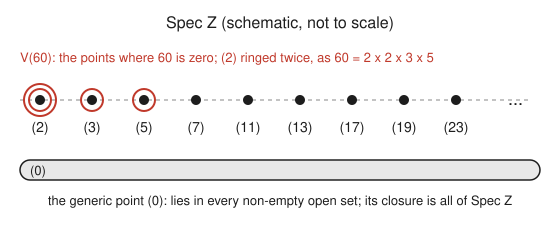

# The spectrum of a ring: prime ideals as points, so every ring becomes a space

[Syllabus](../../../SYLLABUS.md) → [Algebraic geometry](../README.md) → [Schemes and Modern Language](../README.md#s06) → The spectrum of a ring

---

## General Overview

Take the whole number 60 and read it at each prime. At 2 it leaves remainder 0. At 3 and at 5 it also leaves 0. At 7 it leaves 4, at 11 it leaves 5, at 13 it leaves 8.

Read this way, 60 behaves like a function on a space whose points are the primes. It is zero at the points 2, 3 and 5, and nonzero everywhere else. Factoring 60 = 2 × 2 × 3 × 5 is finding where this "function" vanishes, and the repeated 2 says it vanishes there twice.

This card builds that space for any ring (a set with addition, subtraction and multiplication, [Rings](../../03-Algebra/09-Rings%20and%20Fields/01-rings.md)). Its points are the **prime ideals** of the ring. For the whole numbers $`\mathbb{Z}`$ they are the multiples of each prime, plus one extra point: the ideal $`(0)`$, called the **generic point**. It lies "everywhere at once": every open set that is not empty contains it.

The space is called the **spectrum** of the ring. Shelf 02 drew shapes from equations over a field. The spectrum works for any ring, so whole numbers, polynomials with whole-number coefficients and rings with nilpotents (nonzero elements whose square or higher power is zero) all become spaces.

**The spectrum of a ring is the set of its prime ideals, made into a space by calling "the points where some elements all vanish" closed; for the whole numbers it is one point for each prime plus a generic point lying in every non-empty open set, and a scheme is this space together with the ring of functions on each open part.**

**What kind of fact this is:** definitions (the spectrum, its Zariski topology, the generic point, an affine scheme, a scheme), and theorems proved on this card in Why it works: the lists of points for $`\mathbb{Z}`$ and $`k[x]`$, the closed-set rules, and "vanishes at every point exactly when nilpotent". That a scheme gives its ring back is stated with sources, not proved.

### The picture: Spec Z

<p align="center"></p>

The figure is schematic, not to scale. Each dot is a closed point, one per prime. The red rings mark where 60 vanishes; the double ring at 2 records that 2 divides 60 twice. The band underneath is the generic point $`(0)`$: it is not at any one place, and every open set contains it.

---

## The formula

Notation first, in words. $`R`$ is a commutative ring with 1 (multiplication order does not matter). A **prime ideal** $`\mathfrak{p}`$ (fraktur p) is an ideal that is not all of $`R`$, such that a product $`ab`$ lands in $`\mathfrak{p}`$ only when $`a`$ or $`b`$ does ([Ideals and quotient rings](../../03-Algebra/09-Rings%20and%20Fields/04-ideals-and-quotient-rings.md)). The new notation is $`\mathrm{Spec}\, R`$, read "spec of R":

```math
\mathrm{Spec}\, R = \{\, \mathfrak{p} \subset R : \mathfrak{p} \text{ is a prime ideal} \,\}, \qquad V(I) = \{\, \mathfrak{p} \in \mathrm{Spec}\, R : I \subseteq \mathfrak{p} \,\}
```

**Read it aloud:** the spectrum of R is the set of all prime ideals of R, and the closed set V(I) is the set of primes that contain the ideal I.

An element $`f`$ has a **value** at each point: its class $`f \bmod \mathfrak{p}`$ in the ring $`R/\mathfrak{p}`$. So "$`f`$ vanishes at $`\mathfrak{p}`$" means $`f \in \mathfrak{p}`$, and $`V(I)`$ is the set where every element of $`I`$ vanishes. The complement of $`V(f)`$ is the **basic open set** $`D(f)`$: the points where $`f`$ is not zero.

For the whole numbers, with $`(n)`$ meaning the multiples of $`n`$:

```math
\mathrm{Spec}\, \mathbb{Z} = \{\, (0), (2), (3), (5), (7), (11), \dots \,\}, \qquad V(60) = \{\, (2), (3), (5) \,\}
```

**Read it aloud:** the points of spec Z are the zero ideal and the multiples of each prime; 60 vanishes at the points 2, 3 and 5.

| Symbol | Plain meaning | In our example | Push it up and the answer… |
| --- | --- | --- | --- |
| $`R`$, $`A`$, $`B`$; $`I`$, $`J`$, $`I_j`$, $`IJ`$ | commutative rings with 1; ideals, and the ideal of sums of products | $`\mathbb{Z}`$; $`(12)`$, $`(10)`$, $`(120)`$ | bigger ideal, smaller $`V`$ |
| $`\mathfrak{p}`$, $`\mathfrak{q}`$, $`\mathfrak{m}`$ | prime ideals (points); a maximal ideal (a closed point) | $`(7)`$ | — |
| $`\mathrm{Spec}\, R`$ | the spectrum: all prime ideals of $`R`$ | $`(0), (2), (3), (5), \dots`$ | — |
| $`(n)`$, $`(0)`$ | the multiples of $`n`$; the zero ideal, the generic point | $`(60)`$; $`(0)`$ | more prime factors, more points in $`V(n)`$ |
| $`V(I)`$, $`V(n)`$ | the closed set: primes containing $`I`$, or dividing $`n`$ | $`V(60) = \{(2), (3), (5)\}`$ | — |
| $`D(f)`$ | the open set where $`f`$ is not zero | $`D(6)`$: all but $`(2)`$, $`(3)`$ | more factors, smaller $`D(f)`$ |
| $`f \bmod \mathfrak{p}`$ | the value of $`f`$ at the point $`\mathfrak{p}`$ | $`60 \bmod 7 = 4`$ | — |
| $`\mathbb{Z}/n`$ | the whole numbers mod $`n`$ | $`\mathbb{Z}/60`$: 12 ideals, 3 prime | — |
| $`k`$, $`\mathbb{F}_2`$, $`\mathbb{Q}`$, $`\mathbb{R}`$, $`\mathbb{C}`$ | a field; the field {0, 1}; the rationals, reals and complex numbers | $`\mathbb{F}_2[x]`$, polynomials with coefficients 0 and 1 | — |
| $`N_d`$, $`\mu`$ | the number of points of degree $`d`$ in $`\mathrm{Spec}\, \mathbb{F}_2[x]`$; the Möbius function | $`N_8 = 30`$ | grows about like $`2^d/d`$ |
| $`\mathcal{O}`$, $`\Gamma`$, $`R_f`$; $`\varphi`$ | the structure sheaf; global sections; $`R`$ with $`f`$ made invertible; a ring map | on $`D(6)`$: fractions with a power of 6 below | — |
| $`n`$, $`p`$, $`a`$, $`b`$, $`f`$, $`g`$, $`d`$, $`e`$, $`m`$, $`x`$, $`y`$, $`t`$, $`P`$, $`i`$; $`q_1`$, $`q_2`$, $`r`$, $`r'`$, $`s`$ | whole numbers, a prime, ring elements and polynomials, degrees and powers, variables, a point of a curve, the square root of −1; letters inside one proof | $`p = 7`$ | — |

### When it holds

- **The ring is commutative with a 1.** Every ring on this card is. Without commutativity, "a product lands in the ideal" depends on the order, and the theory changes.
- **Points are prime ideals, not only maximal ones.** Keep only maximal ideals and $`(0)`$ disappears from $`\mathrm{Spec}\, \mathbb{Z}`$. Then the inclusion of $`\mathbb{Z}`$ in $`\mathbb{Q}`$ has no map of spaces: $`\mathbb{Q}`$'s one prime $`(0)`$ pulls back to $`(0)`$ in $`\mathbb{Z}`$, which is not maximal.
- **The whole ring is never a point.** $`(1)`$ contains every element, so it is excluded. That makes $`V(1)`$ empty, and the zero ring has an empty spectrum.
- **Points see only up to roots.** $`V(60) = V(30)`$, because 60 and 30 have the same prime factors. The ideal of the set $`\{(2), (3), (5)\}`$ is $`(30)`$, not $`(60)`$. The ring, not the space, remembers the repeated 2.
- **The field matters for polynomials.** In $`\mathbb{R}[x]`$ the roots $`i`$ and $`-i`$ of $`x^2 + 1`$ are one point, $`(x^2 + 1)`$. In $`\mathbb{C}[x]`$ they are two points.

---

## Why it works

### Step 0: a point is a place where every function has a value

On a curve, a point $`P`$ gives a way to evaluate: send each polynomial $`f`$ to the number $`f(P)`$. That evaluation is a ring map to a field ([Affine varieties](../02-Affine%20and%20Projective%20Varieties/01-affine-varieties-and-coordinate-rings.md)), and what it sends to 0 is a maximal ideal, the one [The Zariski topology](../02-Affine%20and%20Projective%20Varieties/02-zariski-topology-and-irreducibility.md) matches with the point.

For a general ring, use the same idea, but allow the target to be any integral domain (a ring where a product of nonzero elements is nonzero). The **kernel** (all that is sent to 0) of such a map is a prime ideal. If $`ab`$ goes to 0, then the image of $`a`$ times the image of $`b`$ is 0, so one of the images is 0, so $`a`$ or $`b`$ is in the kernel.

So prime ideals are exactly "the places where elements can be evaluated." Primes are chosen over maximal ideals for one more reason: if $`\varphi : A \to B`$ is a ring map and $`\mathfrak{p}`$ is prime in $`B`$, the elements of $`A`$ that $`\varphi`$ sends into $`\mathfrak{p}`$ form a prime of $`A`$. The same is false for maximal ideals, as $`\mathbb{Z} \to \mathbb{Q}`$ shows. So ring maps give maps of spectra, running the other way.

### Step 1: the points of Spec Z

Every ideal of $`\mathbb{Z}`$ is the multiples $`(n)`$ of one $`n \geq 0`$ ([Ideals and quotient rings](../../03-Algebra/09-Rings%20and%20Fields/04-ideals-and-quotient-rings.md)). Which of them are prime?

- **$`(0)`$ is prime.** A product of two whole numbers is 0 only when one of them is 0.
- **$`(p)`$ is prime for a prime $`p`$.** If $`p`$ divides $`ab`$, it divides $`a`$ or $`b`$: Euclid's lemma, proved on [Domains, principal ideals and unique factorisation](01-integral-domains-pids-and-unique-factorisation.md). It is even maximal, since $`\mathbb{Z}/p`$ is a field.
- **$`(n)`$ is not prime for composite $`n = ab`$** with $`1 < a, b < n`$: $`ab`$ is in $`(n)`$, but $`a`$ and $`b`$ are not. And $`(1)`$ is the whole ring.

So $`\mathrm{Spec}\, \mathbb{Z}`$ has one **closed point** $`(p)`$ for each prime (a maximal ideal), and one more point, $`(0)`$. The code finds the 15 primes up to 50 two ways: trial division, and a search for zero divisors in $`\mathbb{Z}/n`$, since $`(n)`$ is prime exactly when $`\mathbb{Z}/n`$ has none.

### Step 2: the points of a polynomial ring

For a field $`k`$, the ring $`k[x]`$ is also a principal ideal domain (every ideal is the multiples of one element), with the same proof as for $`\mathbb{Z}`$. Its points are $`(0)`$ and $`(f)`$ for each irreducible $`f`$ (a polynomial with no factor of smaller positive degree), taken with leading coefficient 1.

| Ring | Closed points | Example |
| --- | --- | --- |
| $`\mathbb{C}[x]`$ | $`(x - a)`$, one for each complex number $`a`$ | $`(x - 3)`$ |
| $`\mathbb{R}[x]`$ | $`(x - a)`$ and $`(x^2 + bx + c)`$ with no real root | $`(x^2 + 1)`$: $`i`$ and $`-i`$ as one point |
| $`\mathbb{F}_2[x]`$ | the irreducible polynomials, each with a **degree** | x; x + 1; x^2 + x + 1; x^3 + x + 1; x^3 + x^2 + 1 |

Over $`\mathbb{F}_2`$ the points can be counted by degree. The field with $`2^d`$ elements sorts its members by the irreducible each is a root of: every irreducible whose degree $`e`$ divides $`d`$ appears exactly once, with its $`e`$ roots ([Finite fields](../../21-Algebraic%20and%20analytic%20number%20theory/05-Fields%20and%20Galois%20Theory/09-finite-fields-and-frobenius.md) proves this). Adding up gives Gauss's identity, which the Möbius function $`\mu`$ inverts ($`\mu(m)`$ is 0 if a square divides $`m`$, otherwise $`(-1)`$ to the number of prime factors of $`m`$):

```math
\sum_{e \mid d} e\, N_e = 2^d, \qquad N_d = \frac{1}{d} \sum_{e \mid d} \mu(d/e)\, 2^e
```

**Read it aloud:** adding e times the number of points of degree e, over every e dividing d, gives 2 to the d; turned around, the number of points of degree d is a signed sum of powers of 2, divided by d.

For degrees 1 to 8 this gives 2, 1, 2, 3, 6, 9, 18, 30 points. The code also finds them by trial division.

More variables give more kinds of point. In $`\mathbb{C}[x, y]`$ the points are $`(0)`$; one point $`(f)`$ for each irreducible curve $`f = 0`$; and the closed points $`(x - a, y - b)`$, one for each point of the plane (by [The Nullstellensatz](../01-Polynomial%20Systems/09-nullstellensatz.md)). In $`\mathbb{Z}[x]`$ the points are $`(0)`$; $`(p)`$; $`(f)`$ for irreducible $`f`$; and closed points $`(p, g)`$ with $`g`$ irreducible mod $`p`$.

Take the curve $`x^2 + 1`$ inside $`\mathrm{Spec}\, \mathbb{Z}[x]`$. Above the prime 5 it meets two closed points, $`(5, x - 2)`$ and $`(5, x - 3)`$, because 2 and 3 are the roots of $`x^2 + 1`$ mod 5. Above 3 and 7 there is no root, so $`(3, x^2 + 1)`$ is one closed point of degree 2. Above 2 there is one point, $`(2, x + 1)`$, met twice since $`x^2 + 1 = (x + 1)^2`$ mod 2. For odd primes, two points appear exactly when $`p`$ leaves remainder 1 on division by 4; the code checks this for every prime up to 50.

### Step 3: the Zariski topology on the primes

Call every $`V(I)`$ closed. A **topology** is such a rule saying which sets of points are closed. This is the topology of [The Zariski topology](../02-Affine%20and%20Projective%20Varieties/02-zariski-topology-and-irreducibility.md), moved from points of space to prime ideals. The closed-set rules hold:

- **Empty and whole.** $`V(1)`$ is empty, since no prime contains 1. $`V(0)`$ is everything.
- **Any intersection.** A prime contains every $`I_j`$ exactly when it contains their sum, so the overlap of the $`V(I_j)`$ is $`V`$ of the sum.
- **A union of two.** $`V(I) \cup V(J) = V(IJ)`$, where $`IJ`$ is the ideal of sums of products. If $`\mathfrak{p}`$ contains $`IJ`$ but not $`I`$, pick $`a`$ in $`I`$ outside $`\mathfrak{p}`$. For every $`b`$ in $`J`$, $`ab`$ is in $`\mathfrak{p}`$, so $`b`$ is. That is where primeness is used.

On $`\mathrm{Spec}\, \mathbb{Z}`$, multiplying numbers joins closed sets, and taking the greatest common divisor overlaps them:

```math
V(12) \cup V(10) = V(120) = \{(2), (3), (5)\}, \qquad V(12) \cap V(10) = V(2) = \{(2)\}
```

The code checks both rules for every pair of numbers from 1 to 120. Since every ideal of $`\mathbb{Z}`$ is some $`(n)`$, the closed sets of $`\mathrm{Spec}\, \mathbb{Z}`$ are $`V(0)`$, the whole space, and $`V(n)`$ for $`n \neq 0`$, a finite set of closed points (empty for $`n = 1`$). The open set $`D(6)`$ holds every point except $`(2)`$ and $`(3)`$, including $`(0)`$.

### Step 4: the generic point

The **closure** of a point is the smallest closed set containing it. For a prime $`\mathfrak{p}`$ it is $`V(\mathfrak{p})`$: every prime that contains $`\mathfrak{p}`$.

- The closure of $`(7)`$ is just $`(7)`$, since no prime other than $`(7)`$ contains 7. Closed points are exactly the maximal ideals.
- The closure of $`(0)`$ is everything, since every ideal contains 0. A point whose closure is the whole space is a **generic point**.

So $`(0)`$ lies in every non-empty open set $`D(n)`$ with $`n \neq 0`$. Its values live in $`\mathbb{Z}/(0) = \mathbb{Z}`$, where 60 is just 60, and their fractions form its field of values, $`\mathbb{Q}`$; at $`(p)`$ that field is $`\mathbb{Z}/p`$ itself. In $`\mathrm{Spec}\, \mathbb{C}[x, y]`$ the point $`(y - x)`$ has closure the whole line $`y = x`$: it is that line's generic point. Every irreducible closed set has exactly one generic point. The dictionary of shelf 02, "irreducible pieces match prime ideals", becomes "irreducible pieces match points".

### Step 5: what vanishes at every point is nilpotent

In $`\mathbb{Z}/60`$ the ideals are $`(d)`$ for the 12 divisors $`d`$ of 60. A brute-force prime test finds 3 of them prime: $`(2)`$, $`(3)`$, $`(5)`$. So $`\mathrm{Spec}\, \mathbb{Z}/60`$ is the closed set $`V(60)`$ of $`\mathrm{Spec}\, \mathbb{Z}`$, three points.

The class 30 is not 0 in $`\mathbb{Z}/60`$. Yet it vanishes at all three points, since 2, 3 and 5 divide it. It is **nilpotent**: $`30^2 = 900 = 15 \times 60`$, which is 0 mod 60. This is a theorem for every commutative ring: an element vanishes at every point exactly when some power of it is 0. The nilpotent elements form the **nilradical**.

```math
\{\, f \in R : f^m = 0 \text{ for some } m \,\} = \bigcap_{\mathfrak{p} \in \mathrm{Spec}\, R} \mathfrak{p}
```

**Read it aloud:** the elements with a zero power are exactly those lying in every prime ideal.

The code checks it for $`\mathbb{Z}/n`$ with $`n`$ from 2 to 100: powering on one side, testing every prime factor on the other.

<details>
<summary>Detailed proof: vanishing everywhere means nilpotent</summary>

**Nilpotent implies in every prime.** If $`f^m = 0`$, then $`f \cdot f^{m-1}`$ is in every prime $`\mathfrak{p}`$. Primeness puts $`f`$ or $`f^{m-1}`$ in $`\mathfrak{p}`$; repeat until $`f`$ itself is in.

**Not nilpotent implies outside some prime.** Suppose no power of $`f`$ is 0. Among the ideals that contain no power of $`f`$ ($`(0)`$ is one), take a maximal one, $`\mathfrak{q}`$: no larger ideal of this kind exists. There may be several, none inside another. Zorn's lemma (equivalent to the axiom of choice: if every chain has an upper bound, a maximal member exists) supplies one; for $`\mathbb{Z}/n`$ there are finitely many ideals, so no choice principle is needed.

Say $`ab \in \mathfrak{q}`$ with $`a, b \notin \mathfrak{q}`$. The larger ideals $`\mathfrak{q} + (a)`$ and $`\mathfrak{q} + (b)`$ each contain a power of $`f`$:

$`\displaystyle f^s = q_1 + ra, \qquad f^t = q_2 + r'b.`$

Multiplying, $`f^{s+t} = q_1 q_2 + q_1 r'b + q_2 ra + rr'ab`$, and every term is in $`\mathfrak{q}`$. That contradicts the choice of $`\mathfrak{q}`$. So $`\mathfrak{q}`$ is prime, and $`f`$ is not in it.

</details>

### Step 6: what a scheme adds

The space alone forgets things. $`\mathrm{Spec}\, \mathbb{Z}/60`$ and $`\mathrm{Spec}\, \mathbb{Z}/30`$ are the same three points. But $`\mathbb{Z}/60`$ has the nilpotent 30 and $`\mathbb{Z}/30`$ has no nonzero nilpotent. Likewise every field has a one-point spectrum.

A **scheme** keeps the ring. Recall from [Sheaves](../05-Cohomology%20and%20the%20Hodge%20Conjecture/01-sheaves-in-outline.md) that a sheaf hands out data on each open set, and $`\Gamma`$ means its global sections (the data on the whole space).

1. On each basic open set $`D(f)`$, put the ring $`R_f`$: fractions whose denominators are powers of $`f`$. On $`D(6) \subset \mathrm{Spec}\, \mathbb{Z}`$ that is the fractions whose denominator is a power of 6. [Localisation](03-localisation-and-local-rings.md) builds these rings.
2. These rings glue into a sheaf of rings $`\mathcal{O}`$, the **structure sheaf**. The pair $`(\mathrm{Spec}\, R, \mathcal{O})`$ is an **affine scheme**.
3. Its global functions give the ring back: $`\Gamma(\mathrm{Spec}\, R, \mathcal{O}) = R`$. So $`\mathbb{Z}/60`$ and $`\mathbb{Z}/30`$ give different affine schemes on the same three points.
4. A **scheme** is a space with a sheaf of rings that is covered by open sets, each an affine scheme. Projective space is the first example. The projective line is glued from two copies of the line, $`\mathrm{Spec}\, k[t]`$ and $`\mathrm{Spec}\, k[1/t]`$, and is not affine: its global functions are only the constants.
5. Maps of affine schemes are ring maps read backwards ([Morphisms of schemes](04-morphisms-and-fibre-products-in-outline.md)).

So a scheme is "space plus functions", where the functions may have nilpotents and may take values in different fields at different points.

---

## Worked numbers, by hand

| Step | Arithmetic | Value |
| --- | --- | --- |
| 60 at the point $`(7)`$ | 60 = 8 × 7 + 4 | 4 |
| where 60 vanishes | 60 = 2 × 2 × 3 × 5 | $`V(60) = \{(2), (3), (5)\}`$ |
| join two closed sets | $`V(12) \cup V(10) = V(12 \times 10)`$ | $`\{(2), (3), (5)\}`$ |
| overlap them | gcd(12, 10) = 2 | $`\{(2)\}`$ |
| ideals of $`\mathbb{Z}/60`$ | one per divisor of 60 | 12 |
| prime ideals of $`\mathbb{Z}/60`$ | the prime divisors | 3 |
| the nonzero nilpotent | $`30^2 = 900 = 15 \times 60`$ | 30 |
| points of $`\mathrm{Spec}\, \mathbb{F}_2[x]`$ up to degree 4 | 2 + 1 + 2 + 3 | 8 |

**$`\mathrm{Spec}\, \mathbb{Z}/60`$ is three points, $`(2)`$, $`(3)`$ and $`(5)`$, carrying the one nonzero nilpotent 30.** The points say where 60 vanishes; the nilpotent says that it vanishes twice at 2.

### What breaks if you drop a piece

| Mistake | Comes out at | What went wrong |
| --- | --- | --- |
| Keep maximal ideals only | the map from $`\mathrm{Spec}\, \mathbb{Q}`$ has no point to land on | $`\mathbb{Q}`$'s prime $`(0)`$ pulls back to $`(0)`$, which is not maximal |
| Call every ideal a point | $`\mathbb{Z}/60`$ gets 12 points, not 3 | $`(6)`$ holds 2 × 3 but neither 2 nor 3 |
| Keep the space, drop the ring | $`\mathbb{Z}/60`$ and $`\mathbb{Z}/30`$ both 3 points; nonzero nilpotents 1 and 0 | only the ring remembers that 2 divides 60 twice |
| Read the ideal off the set | the ideal of $`V(60)`$ is $`(30)`$, not $`(60)`$ | points see an ideal only up to roots |

---

## Code, from first principles, and it actually runs

Nothing is imported, and every number is an exact integer. The code takes four pairs of independent roads. It finds the primes of $`\mathbb{Z}`$ by trial division and by a zero-divisor search. It finds the points of $`\mathbb{Z}/n`$ by testing every ideal for primeness, against the prime factors of $`n`$. It finds the nilpotents by powering, against "in every prime". It counts the points of $`\mathrm{Spec}\, \mathbb{F}_2[x]`$ by trial division, against Gauss's formula. It also checks the closed-set rules on every pair of numbers up to 120, and the root counts of $`x^2 + 1`$ against remainders mod 4.

### Python

```python
# The spectrum of a ring -- the check behind the card.  Nothing is imported and
# every number is an exact integer.  The points of Spec R are the prime ideals
# of R.  Roads: trial division against a zero-divisor search; a brute-force
# prime-ideal test on Z/n against prime factors; powering against "in every
# prime"; trial division in F_2[x] against Gauss's counting formula.
def is_prime(n):                              # road one: trial division
    d = 2
    while d * d <= n:
        if n % d == 0:
            return False
        d += 1
    return n > 1
def domain(n):                                # road two: Z/n has no zero divisors
    return n > 1 and all(a * b % n for a in range(1, n) for b in range(1, n))
def V(n):                                     # the closed set V(n): prime factors of n != 0
    out, d, n = [], 2, abs(n)
    while d * d <= n:
        if n % d == 0:
            out.append(d)
            while n % d == 0:
                n //= d
        d += 1
    return out + ([n] if n > 1 else [])
def gcd(a, b):
    while b:
        a, b = b, a % b
    return a
def pts(s):
    return "{" + ", ".join(f"({p})" for p in s) + "}"
def spec_mod(n):                              # every ideal of Z/n, then the brute-force prime test
    ideals = {frozenset(a * r % n for r in range(n)) for a in range(n)}
    primes = [I for I in ideals if len(I) < n and
              all(a in I or b in I for a in range(n) for b in range(n) if a * b % n in I)]
    return len(ideals), sorted(min((x for x in I if x), default=n) for I in primes)
def nilpotent(n):                             # road one: some power is 0 (a^n is enough)
    out = []
    for a in range(n):
        x = 1
        for _ in range(n):
            x = x * a % n
        if x == 0:
            out.append(a)
    return out
def in_every_prime(n):                        # road two: zero at every point of Spec Z/n
    return [a for a in range(n) if all(a % p == 0 for p in V(n))]
def pmod(a, b):                               # remainder in F_2[x]; bit i holds the x^i coefficient
    while a and a.bit_length() >= b.bit_length():
        a ^= b << (a.bit_length() - b.bit_length())
    return a
def irreducible(f):                           # no factor of degree up to half
    return f > 1 and all(pmod(f, g) for g in range(2, f) if 2 * (g.bit_length() - 1) <= f.bit_length() - 1)
def mobius(m):
    f = V(m)
    sq = 1
    for p in f:
        sq *= p
    return 0 if sq != m else (-1) ** len(f)
def show(f):
    t = [("x^" + str(i) if i > 1 else "x" if i == 1 else "1") for i in range(f.bit_length() - 1, -1, -1) if f >> i & 1]
    return " + ".join(t)

print("== Spec Z: the points ==")
sieve = [p for p in range(2, 51) if is_prime(p)]
assert sieve == [n for n in range(2, 51) if domain(n)]           # (n) is prime exactly when Z/n is a domain
assert all(all(any(a * b % p == 1 for b in range(p)) for a in range(1, p)) for p in sieve)  # Z/p is a field
print("closed points (p), p <= 50:", " ".join(map(str, sieve)), f"({len(sieve)} of them)")
bigger = lambda n: [m for m in range(2, 51) if n % m == 0 and m != n]   # (n) inside (m), and (m) is not all of Z
assert all(bigger(p) == [] for p in sieve) and bigger(0)[0] == 2         # maximal: no (m) between (p) and Z
print(f"generic point (0): prime, as Z has no zero divisors; inside ({bigger(0)[0]}), so not maximal")
val = lambda f, p: f % p if p else f                                     # the value of f at (p); at (0) it is f itself
print("60 read at each point:", ", ".join(f"({p}) -> {val(60, p)}" for p in [2, 3, 5, 7, 11, 13, 0]))
print("== the Zariski topology on Spec Z ==")
for a in range(1, 121):
    for b in range(1, 121):
        assert sorted(set(V(a)) | set(V(b))) == V(a * b)            # union of closed sets: multiply
        assert sorted(set(V(a)) & set(V(b))) == V(gcd(a, b))        # overlap: add the ideals, gcd
print("V(60) =", pts(V(60)), " V(12) =", pts(V(12)), " V(10) =", pts(V(10)))
print("V(12) union V(10) = V(120) =", pts(V(120)), " V(12) meet V(10) = V(2) =", pts(V(gcd(12, 10))))
print("open D(6) = all points but", pts([p for p in sieve if val(6, p) == 0]) + "; up to 50 it holds", pts([p for p in sieve + [0] if val(6, p)]))
print("closure of (7) =", pts([p for p in sieve + [0] if val(7, p) == 0]), f" closure of (0) = all {sum(val(0, p) == 0 for p in sieve + [0])} points up to 50")
print("== Spec Z/60: the closed set V(60) as a space of its own ==")
for n in range(2, 41):
    k, gens = spec_mod(n)
    assert gens == V(n) and k == sum(1 for d in range(1, n + 1) if n % d == 0)
k60, g60 = spec_mod(60)
k30, g30 = spec_mod(30)
assert g60 == V(60) == g30
print(f"Z/60: {k60} ideals, {len(g60)} prime: {pts(g60)}")
print(f"Z/30: {k30} ideals, {len(g30)} prime: {pts(g30)}")
for n in range(2, 101):
    assert nilpotent(n) == in_every_prime(n)                      # nilradical = overlap of the primes
print("zero at every point of Spec Z/60:", in_every_prime(60), " nilpotent:", nilpotent(60), " 30^2 =", 30 * 30, "=", 30 * 30 // 60, "x 60")
print("zero at every point of Spec Z/30:", in_every_prime(30), " nilpotent:", nilpotent(30))
print("== Spec F_2[x]: closed points are irreducible polynomials ==")
count = [0] * 9
for f in range(2, 512):
    if irreducible(f):
        count[f.bit_length() - 1] += 1
for d in range(1, 9):
    gauss = sum(mobius(d // e) * 2 ** e for e in range(1, d + 1) if d % e == 0)
    assert gauss % d == 0 and count[d] == gauss // d                # Gauss's formula, a second road
    assert sum(e * count[e] for e in range(1, d + 1) if d % e == 0) == 2 ** d
print("degree 1 to 3:", "; ".join(show(f) for f in range(2, 16) if irreducible(f)))
print("closed points of degree 1..8:", " ".join(map(str, count[1:])), " up to degree 4:", sum(count[1:5]))
assert irreducible(0x11B)
print("x^8 + x^4 + x^3 + x + 1 (the AES byte field) is a point of degree 8:", irreducible(0x11B))
print("== Spec Z[x]: the curve x^2 + 1 above each prime ==")
above = {}
for p in sieve:
    roots = [x for x in range(p) if (x * x + 1) % p == 0]
    above[p] = len(roots) if roots else 1                         # no root: x^2 + 1 stays one point
    if p > 2:
        assert (len(roots) == 2) == (p % 4 == 1)                  # Fermat: two roots exactly when p = 1 mod 4
    if p <= 13:
        print(f"above ({p}): roots of x^2 + 1 mod {p}: {roots}; points: {above[p]}")
print("== the curve y^2 = x^3 - 2 as a scheme over Spec Z ==")
fibre7 = [(x, y) for x in range(7) for y in range(7) if (y * y - x ** 3 + 2) % 7 == 0]
assert len(fibre7) == 6 and (3 % 7, 5 % 7) in fibre7              # (3, 5) reduces into the fibre
print("over (0): holds (3, 5); over (7):", " ".join(f"({x}, {y})" for x, y in fibre7), f"-> {len(fibre7)} points")
print("== what breaks ==")
back = [n for n in range(-50, 51) if n == 0]                             # Z -> Q pulls back Q's one prime (0)
print(f"maximal ideals only: Spec Q -> Spec Z sends (0) to ({back[0]}), inside ({bigger(back[0])[0]}), not maximal: no point to land on")
print(f"every ideal a point: Z/60 gets {k60} points, not {len(g60)}")
print(f"space without the ring: Z/60 and Z/30 both {len(g60)} points; nonzero nilpotents {len(nilpotent(60)) - 1} and {len(nilpotent(30)) - 1}")
least = min(n for n in range(1, 61) if all(n % p == 0 for p in V(60)))
assert least == 30
print(f"ideal of the set V(60): generated by {least}, not 60")
print("== try changing ==")
for n in [360, 64]:
    print(f"Z/{n}: points {pts(V(n))}; nilpotents {len(nilpotent(n))}, the multiples of {nilpotent(n)[1]}")
two = [p for p in sieve if p <= 13 and sum(1 for x in range(p) if (x * x + 2) % p == 0) == 2]
deg9 = sum(1 for f in range(512, 1024) if irreducible(f))
assert deg9 * 9 == 2 ** 9 - count[1] - 3 * count[3]                     # degrees 1, 3, 9 divide 9
print("x^2 + 2 splits into two points above:", pts(two), " degree-9 points of Spec F_2[x]:", deg9)
xs = [40 + 52 * i for i in range(9)]
print("figure, closed points x:", " ".join(f"{p}@{x}" for p, x in zip([2, 3, 5, 7, 11, 13, 17, 19, 23], xs)), "y=100; generic band y=170")
print("ALL CHECKS PASS")
```

**Ran 2026-11-17 on macOS, Python 3.14.10, standard library only. All checks passed. Output, pasted from the run:**

```
== Spec Z: the points ==
closed points (p), p <= 50: 2 3 5 7 11 13 17 19 23 29 31 37 41 43 47 (15 of them)
generic point (0): prime, as Z has no zero divisors; inside (2), so not maximal
60 read at each point: (2) -> 0, (3) -> 0, (5) -> 0, (7) -> 4, (11) -> 5, (13) -> 8, (0) -> 60
== the Zariski topology on Spec Z ==
V(60) = {(2), (3), (5)}  V(12) = {(2), (3)}  V(10) = {(2), (5)}
V(12) union V(10) = V(120) = {(2), (3), (5)}  V(12) meet V(10) = V(2) = {(2)}
open D(6) = all points but {(2), (3)}; up to 50 it holds {(5), (7), (11), (13), (17), (19), (23), (29), (31), (37), (41), (43), (47), (0)}
closure of (7) = {(7)}  closure of (0) = all 16 points up to 50
== Spec Z/60: the closed set V(60) as a space of its own ==
Z/60: 12 ideals, 3 prime: {(2), (3), (5)}
Z/30: 8 ideals, 3 prime: {(2), (3), (5)}
zero at every point of Spec Z/60: [0, 30]  nilpotent: [0, 30]  30^2 = 900 = 15 x 60
zero at every point of Spec Z/30: [0]  nilpotent: [0]
== Spec F_2[x]: closed points are irreducible polynomials ==
degree 1 to 3: x; x + 1; x^2 + x + 1; x^3 + x + 1; x^3 + x^2 + 1
closed points of degree 1..8: 2 1 2 3 6 9 18 30  up to degree 4: 8
x^8 + x^4 + x^3 + x + 1 (the AES byte field) is a point of degree 8: True
== Spec Z[x]: the curve x^2 + 1 above each prime ==
above (2): roots of x^2 + 1 mod 2: [1]; points: 1
above (3): roots of x^2 + 1 mod 3: []; points: 1
above (5): roots of x^2 + 1 mod 5: [2, 3]; points: 2
above (7): roots of x^2 + 1 mod 7: []; points: 1
above (11): roots of x^2 + 1 mod 11: []; points: 1
above (13): roots of x^2 + 1 mod 13: [5, 8]; points: 2
== the curve y^2 = x^3 - 2 as a scheme over Spec Z ==
over (0): holds (3, 5); over (7): (3, 2) (3, 5) (5, 2) (5, 5) (6, 2) (6, 5) -> 6 points
== what breaks ==
maximal ideals only: Spec Q -> Spec Z sends (0) to (0), inside (2), not maximal: no point to land on
every ideal a point: Z/60 gets 12 points, not 3
space without the ring: Z/60 and Z/30 both 3 points; nonzero nilpotents 1 and 0
ideal of the set V(60): generated by 30, not 60
== try changing ==
Z/360: points {(2), (3), (5)}; nilpotents 12, the multiples of 30
Z/64: points {(2)}; nilpotents 32, the multiples of 2
x^2 + 2 splits into two points above: {(3), (11)}  degree-9 points of Spec F_2[x]: 56
figure, closed points x: 2@40 3@92 5@144 7@196 11@248 13@300 17@352 19@404 23@456 y=100; generic band y=170
ALL CHECKS PASS
```

### Rust

```rust
// The spectrum of a ring -- the same check as spectrum_of_a_ring_and_schemes_check.py,
// in Rust.  Standard library only, no crates; every number is an exact integer.
use std::collections::BTreeSet;
fn is_prime(n: u64) -> bool { // road one: trial division
    let mut d = 2;
    while d * d <= n { if n % d == 0 { return false; } d += 1; }
    n > 1
}
fn domain(n: u64) -> bool { // road two: Z/n has no zero divisors
    n > 1 && (1..n).all(|a| (1..n).all(|b| a * b % n != 0))
}
fn vset(n: u64) -> Vec<u64> { // the closed set V(n): prime factors of n != 0
    let (mut out, mut d, mut n) = (vec![], 2, n);
    while d * d <= n {
        if n % d == 0 { out.push(d); while n % d == 0 { n /= d; } }
        d += 1;
    }
    if n > 1 { out.push(n); }
    out
}
fn gcd(a: u64, b: u64) -> u64 { if b == 0 { a } else { gcd(b, a % b) } }
fn pts(s: &[u64]) -> String {
    format!("{{{}}}", s.iter().map(|p| format!("({})", p)).collect::<Vec<_>>().join(", "))
}
fn list(s: &[u64]) -> String {
    format!("[{}]", s.iter().map(|x| x.to_string()).collect::<Vec<_>>().join(", "))
}
fn spec_mod(n: u64) -> (usize, Vec<u64>) { // every ideal of Z/n, then the brute-force prime test
    let ideals: BTreeSet<BTreeSet<u64>> = (0..n).map(|a| (0..n).map(|r| a * r % n).collect()).collect();
    let mut gens: Vec<u64> = ideals.iter()
        .filter(|i| (i.len() as u64) < n && (0..n).all(|a| (0..n).all(|b| !i.contains(&(a * b % n)) || i.contains(&a) || i.contains(&b))))
        .map(|i| i.iter().copied().filter(|&x| x != 0).min().unwrap_or(n)).collect();
    gens.sort();
    (ideals.len(), gens)
}
fn nilpotent(n: u64) -> Vec<u64> { // road one: some power is 0 (a^n is enough)
    (0..n).filter(|&a| { let mut x = 1; for _ in 0..n { x = x * a % n; } x == 0 }).collect()
}
fn in_every_prime(n: u64) -> Vec<u64> { // road two: zero at every point of Spec Z/n
    (0..n).filter(|&a| vset(n).iter().all(|p| a % p == 0)).collect()
}
fn bits(a: u64) -> u32 { 64 - a.leading_zeros() }
fn pmod(mut a: u64, b: u64) -> u64 { // remainder in F_2[x]; bit i holds the x^i coefficient
    while a != 0 && bits(a) >= bits(b) { a ^= b << (bits(a) - bits(b)); }
    a
}
fn irreducible(f: u64) -> bool { // no factor of degree up to half
    f > 1 && (2..f).filter(|&g| 2 * (bits(g) - 1) <= bits(f) - 1).all(|g| pmod(f, g) != 0)
}
fn mobius(m: u64) -> i64 {
    let f = vset(m);
    if f.iter().product::<u64>() != m { 0 } else if f.len() % 2 == 0 { 1 } else { -1 }
}
fn show(f: u64) -> String {
    let t: Vec<String> = (0..bits(f)).rev().filter(|i| f >> i & 1 == 1)
        .map(|i| if i > 1 { format!("x^{}", i) } else if i == 1 { "x".to_string() } else { "1".to_string() }).collect();
    t.join(" + ")
}
fn main() {
    println!("== Spec Z: the points ==");
    let sieve: Vec<u64> = (2..51).filter(|&p| is_prime(p)).collect();
    assert!(sieve == (2..51).filter(|&n| domain(n)).collect::<Vec<u64>>());
    assert!(sieve.iter().all(|&p| (1..p).all(|a| (0..p).any(|b| a * b % p == 1))));
    println!("closed points (p), p <= 50: {} ({} of them)", sieve.iter().map(|p| p.to_string()).collect::<Vec<_>>().join(" "), sieve.len());
    let bigger = |n: u64| -> Vec<u64> { (2..51u64).filter(|&m| n % m == 0 && m != n).collect() }; // (n) inside (m), and (m) is not all of Z
    assert!(sieve.iter().all(|&p| bigger(p).is_empty()) && bigger(0)[0] == 2); // maximal: no (m) between (p) and Z
    println!("generic point (0): prime, as Z has no zero divisors; inside ({}), so not maximal", bigger(0)[0]);
    let val = |f: u64, p: u64| if p == 0 { f } else { f % p }; // the value of f at (p); at (0) it is f itself
    let all: Vec<u64> = sieve.iter().copied().chain([0u64]).collect(); // the points up to 50, the generic point last
    let r: Vec<String> = [2u64, 3, 5, 7, 11, 13, 0].iter().map(|&p| format!("({}) -> {}", p, val(60, p))).collect();
    println!("60 read at each point: {}", r.join(", "));
    println!("== the Zariski topology on Spec Z ==");
    for a in 1..121u64 {
        for b in 1..121u64 {
            let (sa, sb): (BTreeSet<u64>, BTreeSet<u64>) = (vset(a).into_iter().collect(), vset(b).into_iter().collect());
            assert!(sa.union(&sb).copied().collect::<Vec<u64>>() == vset(a * b));
            assert!(sa.intersection(&sb).copied().collect::<Vec<u64>>() == vset(gcd(a, b)));
        }
    }
    println!("V(60) = {}  V(12) = {}  V(10) = {}", pts(&vset(60)), pts(&vset(12)), pts(&vset(10)));
    println!("V(12) union V(10) = V(120) = {}  V(12) meet V(10) = V(2) = {}", pts(&vset(120)), pts(&vset(gcd(12, 10))));
    let (gone6, in6): (Vec<u64>, Vec<u64>) = (sieve.iter().copied().filter(|&p| val(6, p) == 0).collect(), all.iter().copied().filter(|&p| val(6, p) != 0).collect());
    println!("open D(6) = all points but {}; up to 50 it holds {}", pts(&gone6), pts(&in6));
    let cl7: Vec<u64> = all.iter().copied().filter(|&p| val(7, p) == 0).collect();
    println!("closure of (7) = {}  closure of (0) = all {} points up to 50", pts(&cl7), all.iter().filter(|&&p| val(0, p) == 0).count());
    println!("== Spec Z/60: the closed set V(60) as a space of its own ==");
    for n in 2..41u64 {
        let (k, gens) = spec_mod(n);
        assert!(gens == vset(n) && k == (1..n + 1).filter(|d| n % d == 0).count());
    }
    let ((k60, g60), (k30, g30)) = (spec_mod(60), spec_mod(30));
    assert!(g60 == vset(60) && g30 == vset(60));
    println!("Z/60: {} ideals, {} prime: {}", k60, g60.len(), pts(&g60));
    println!("Z/30: {} ideals, {} prime: {}", k30, g30.len(), pts(&g30));
    for n in 2..101u64 { assert!(nilpotent(n) == in_every_prime(n)); }
    println!("zero at every point of Spec Z/60: {}  nilpotent: {}  30^2 = {} = {} x 60", list(&in_every_prime(60)), list(&nilpotent(60)), 30 * 30, 30 * 30 / 60);
    println!("zero at every point of Spec Z/30: {}  nilpotent: {}", list(&in_every_prime(30)), list(&nilpotent(30)));
    println!("== Spec F_2[x]: closed points are irreducible polynomials ==");
    let mut count = [0i64; 9];
    for f in 2..512u64 { if irreducible(f) { count[(bits(f) - 1) as usize] += 1; } }
    for d in 1..9i64 {
        let gauss: i64 = (1..d + 1).filter(|e| d % e == 0).map(|e| mobius((d / e) as u64) * (1i64 << e)).sum();
        assert!(gauss % d == 0 && count[d as usize] == gauss / d);
        assert!((1..d + 1).filter(|e| d % e == 0).map(|e| e * count[e as usize]).sum::<i64>() == 1i64 << d);
    }
    println!("degree 1 to 3: {}", (2..16u64).filter(|&f| irreducible(f)).map(show).collect::<Vec<_>>().join("; "));
    println!("closed points of degree 1..8: {}  up to degree 4: {}", count[1..].iter().map(|c| c.to_string()).collect::<Vec<_>>().join(" "), count[1..5].iter().sum::<i64>());
    assert!(irreducible(0x11B));
    println!("x^8 + x^4 + x^3 + x + 1 (the AES byte field) is a point of degree 8: {}", if irreducible(0x11B) { "True" } else { "False" });
    println!("== Spec Z[x]: the curve x^2 + 1 above each prime ==");
    for &p in &sieve {
        let roots: Vec<u64> = (0..p).filter(|x| (x * x + 1) % p == 0).collect();
        let above = if roots.is_empty() { 1 } else { roots.len() }; // no root: x^2 + 1 stays one point
        if p > 2 { assert!((roots.len() == 2) == (p % 4 == 1)); } // Fermat: two roots exactly when p = 1 mod 4
        if p <= 13 { println!("above ({}): roots of x^2 + 1 mod {}: {}; points: {}", p, p, list(&roots), above); }
    }
    println!("== the curve y^2 = x^3 - 2 as a scheme over Spec Z ==");
    let fibre7: Vec<(i64, i64)> = (0..7i64).flat_map(|x| (0..7i64).map(move |y| (x, y))).filter(|(x, y)| (y * y - x * x * x + 2).rem_euclid(7) == 0).collect();
    assert!(fibre7.len() == 6 && fibre7.contains(&(3 % 7, 5 % 7))); // (3, 5) reduces into the fibre
    println!("over (0): holds (3, 5); over (7): {} -> {} points", fibre7.iter().map(|(x, y)| format!("({}, {})", x, y)).collect::<Vec<_>>().join(" "), fibre7.len());
    println!("== what breaks ==");
    let back: Vec<i64> = (-50..51i64).filter(|&n| n == 0).collect(); // Z -> Q pulls back Q's one prime (0)
    println!("maximal ideals only: Spec Q -> Spec Z sends (0) to ({}), inside ({}), not maximal: no point to land on", back[0], bigger(back[0] as u64)[0]);
    println!("every ideal a point: Z/60 gets {} points, not {}", k60, g60.len());
    println!("space without the ring: Z/60 and Z/30 both {} points; nonzero nilpotents {} and {}", g60.len(), nilpotent(60).len() - 1, nilpotent(30).len() - 1);
    let least = (1..61u64).find(|n| vset(60).iter().all(|p| n % p == 0)).unwrap();
    assert!(least == 30);
    println!("ideal of the set V(60): generated by {}, not 60", least);
    println!("== try changing ==");
    for n in [360u64, 64] {
        println!("Z/{}: points {}; nilpotents {}, the multiples of {}", n, pts(&vset(n)), nilpotent(n).len(), nilpotent(n)[1]);
    }
    let two: Vec<u64> = sieve.iter().copied().filter(|&p| p <= 13 && (0..p).filter(|x| (x * x + 2) % p == 0).count() == 2).collect();
    let deg9 = (512..1024u64).filter(|&f| irreducible(f)).count();
    assert!(deg9 as i64 * 9 == (1i64 << 9) - count[1] - 3 * count[3]); // degrees 1, 3, 9 divide 9
    println!("x^2 + 2 splits into two points above: {}  degree-9 points of Spec F_2[x]: {}", pts(&two), deg9);
    let xs: Vec<String> = [2, 3, 5, 7, 11, 13, 17, 19, 23].iter().enumerate().map(|(i, p)| format!("{}@{}", p, 40 + 52 * i)).collect();
    println!("figure, closed points x: {} y=100; generic band y=170", xs.join(" "));
    println!("ALL CHECKS PASS");
}
```

**Ran 2026-11-17 on macOS, rustc 1.98.1, no crates. All checks passed. Output, pasted from the run:**

```
== Spec Z: the points ==
closed points (p), p <= 50: 2 3 5 7 11 13 17 19 23 29 31 37 41 43 47 (15 of them)
generic point (0): prime, as Z has no zero divisors; inside (2), so not maximal
60 read at each point: (2) -> 0, (3) -> 0, (5) -> 0, (7) -> 4, (11) -> 5, (13) -> 8, (0) -> 60
== the Zariski topology on Spec Z ==
V(60) = {(2), (3), (5)}  V(12) = {(2), (3)}  V(10) = {(2), (5)}
V(12) union V(10) = V(120) = {(2), (3), (5)}  V(12) meet V(10) = V(2) = {(2)}
open D(6) = all points but {(2), (3)}; up to 50 it holds {(5), (7), (11), (13), (17), (19), (23), (29), (31), (37), (41), (43), (47), (0)}
closure of (7) = {(7)}  closure of (0) = all 16 points up to 50
== Spec Z/60: the closed set V(60) as a space of its own ==
Z/60: 12 ideals, 3 prime: {(2), (3), (5)}
Z/30: 8 ideals, 3 prime: {(2), (3), (5)}
zero at every point of Spec Z/60: [0, 30]  nilpotent: [0, 30]  30^2 = 900 = 15 x 60
zero at every point of Spec Z/30: [0]  nilpotent: [0]
== Spec F_2[x]: closed points are irreducible polynomials ==
degree 1 to 3: x; x + 1; x^2 + x + 1; x^3 + x + 1; x^3 + x^2 + 1
closed points of degree 1..8: 2 1 2 3 6 9 18 30  up to degree 4: 8
x^8 + x^4 + x^3 + x + 1 (the AES byte field) is a point of degree 8: True
== Spec Z[x]: the curve x^2 + 1 above each prime ==
above (2): roots of x^2 + 1 mod 2: [1]; points: 1
above (3): roots of x^2 + 1 mod 3: []; points: 1
above (5): roots of x^2 + 1 mod 5: [2, 3]; points: 2
above (7): roots of x^2 + 1 mod 7: []; points: 1
above (11): roots of x^2 + 1 mod 11: []; points: 1
above (13): roots of x^2 + 1 mod 13: [5, 8]; points: 2
== the curve y^2 = x^3 - 2 as a scheme over Spec Z ==
over (0): holds (3, 5); over (7): (3, 2) (3, 5) (5, 2) (5, 5) (6, 2) (6, 5) -> 6 points
== what breaks ==
maximal ideals only: Spec Q -> Spec Z sends (0) to (0), inside (2), not maximal: no point to land on
every ideal a point: Z/60 gets 12 points, not 3
space without the ring: Z/60 and Z/30 both 3 points; nonzero nilpotents 1 and 0
ideal of the set V(60): generated by 30, not 60
== try changing ==
Z/360: points {(2), (3), (5)}; nilpotents 12, the multiples of 30
Z/64: points {(2)}; nilpotents 32, the multiples of 2
x^2 + 2 splits into two points above: {(3), (11)}  degree-9 points of Spec F_2[x]: 56
figure, closed points x: 2@40 3@92 5@144 7@196 11@248 13@300 17@352 19@404 23@456 y=100; generic band y=170
ALL CHECKS PASS
```

### Lean

Lean proves the card's theorems on $`\mathrm{Spec}\, \mathbb{Z}`$ and on every commutative ring with 1, and checks its printed numbers.

- Take a point of $`\mathrm{Spec}\, \mathbb{Z}`$. Then it is $`(0)`$ or $`(p)`$ for a prime $`p`$, and each $`(p)`$ is a closed point.
- The generic point $`(0)`$ has the whole space as its closure. So it lies in every non-empty open set.
- Take any commutative ring with 1. Then the closed sets of its spectrum are exactly the sets $`V(I)`$, with $`V(1)`$ empty and $`V(0)`$ everything.
- Take any family of ideals $`I_j`$. Then the overlap of the sets $`V(I_j)`$ is $`V`$ of their sum.
- Take two ideals $`I`$ and $`J`$. Then $`V(I) \cup V(J) = V(IJ)`$.
- Take an element $`f`$ of a commutative ring with 1. Then $`f`$ vanishes at every point exactly when some power of $`f`$ is 0.
- At 2, 3, 5, 7, 11 and 13, the number 60 leaves remainders 0, 0, 0, 4, 5 and 8. So $`V(60) = \{(2), (3), (5)\}`$.
- Take the primes up to 120. Then $`V(12) \cup V(10) = V(120)`$ and $`V(12) \cap V(10) = V(2) = \{(2)\}`$.
- 60 has 12 divisors, and 3 of them are prime.
- Take $`\mathbb{Z}/60`$. Then 30 is not 0, but $`30^2`$ is 0.
- In $`\mathbb{Z}/60`$ the classes vanishing at $`(2)`$, $`(3)`$ and $`(5)`$ are 0 and 30. So are the classes whose square is 0.
- In $`\mathbb{Z}/30`$ the only class whose 30th power is 0 is 0 itself.
- The least positive number divisible by 2, 3 and 5 is 30. That is why the ideal of $`V(60)`$ is $`(30)`$.
- Take the counts 2, 1, 2, 3, 6, 9, 18, 30 of points of degree 1 to 8 in $`\mathrm{Spec}\, \mathbb{F}_2[x]`$. Then they obey Gauss's identity at d = 4, 6 and 8.
- The first four of those counts add up to 8.
- Take $`x^2 + 1`$. Then its roots mod 5 are 2 and 3, and it has no root mod 3 or mod 7.
- Take the curve $`y^2 = x^3 - 2`$. Then (3, 5) lies on it, and mod 7 it has 6 points besides the point at infinity.

The points of $`\mathbb{F}_2[x]`$, the searches by trial division and the scheme steps are left to the Python and Rust checks.

```lean
-- The spectrum of a ring: the points of Spec Z are (0) and one closed point (p) for each prime p, with (0) a generic point in every non-empty open set; the closed sets are the sets V(I) and obey the closed-set rules; and an element vanishes at every point exactly when it is nilpotent.
import Mathlib.RingTheory.Spectrum.Prime.Topology
import Mathlib.RingTheory.Nilpotent.Lemmas
import Mathlib.RingTheory.Int.Basic
import Mathlib.Data.ZMod.Basic
import Mathlib.NumberTheory.Divisors

open PrimeSpectrum

/-- The spectrum of the whole numbers: every prime ideal of ℤ is (0) or the multiples (p) of a
prime p; each (p) is a point that is closed; and (0) is a point whose closure is the whole space,
so it lies in every non-empty open set (the generic point). -/
theorem spec_int_closed_points_and_generic_point :
    (∀ x : PrimeSpectrum ℤ, x.asIdeal = ⊥ ∨ ∃ p : ℕ, p.Prime ∧ x.asIdeal = Ideal.span {(p : ℤ)}) ∧
    (∀ p : ℕ, p.Prime → ∃ x : PrimeSpectrum ℤ,
      x.asIdeal = Ideal.span {(p : ℤ)} ∧ IsClosed ({x} : Set (PrimeSpectrum ℤ))) ∧
    (∃ η : PrimeSpectrum ℤ, η.asIdeal = ⊥ ∧ closure ({η} : Set (PrimeSpectrum ℤ)) = Set.univ ∧
      ∀ U : Set (PrimeSpectrum ℤ), IsOpen U → U.Nonempty → η ∈ U) := by
  refine ⟨?_, ?_, ?_⟩
  · intro x
    obtain ⟨n, hn⟩ := (inferInstance : Submodule.IsPrincipal x.asIdeal)
    have hn' : x.asIdeal = Ideal.span {n} := by simpa using hn
    by_cases h0 : n = 0
    · left; rw [hn', h0, Ideal.span_singleton_eq_bot.mpr rfl]
    · right
      refine ⟨n.natAbs, ?_, ?_⟩
      · have hp : (Ideal.span ({n} : Set ℤ)).IsPrime := hn' ▸ x.2
        exact Int.prime_iff_natAbs_prime.mp ((Ideal.span_singleton_prime h0).mp hp)
      · rw [hn', Int.span_natAbs]
  · intro p hp
    have hpr : Prime (p : ℤ) := Int.prime_iff_natAbs_prime.mpr (by simpa using hp)
    have hmax : (Ideal.span ({(p : ℤ)} : Set ℤ)).IsMaximal :=
      PrincipalIdealRing.isMaximal_of_irreducible hpr.irreducible
    refine ⟨⟨_, hmax.isPrime⟩, rfl, ?_⟩
    exact (PrimeSpectrum.isClosed_singleton_iff_isMaximal _).mpr hmax
  · refine ⟨⟨⊥, Ideal.isPrime_bot⟩, rfl, ?_, ?_⟩
    · rw [PrimeSpectrum.closure_singleton]; exact zeroLocus_bot
    · intro U hU ⟨y, hy⟩
      have hcl : y ∈ closure ({⟨⊥, Ideal.isPrime_bot⟩} : Set (PrimeSpectrum ℤ)) := by
        rw [PrimeSpectrum.closure_singleton]; simp
      obtain ⟨z, hzU, hz⟩ := mem_closure_iff.mp hcl U hU hy
      rw [Set.mem_singleton_iff] at hz
      exact hz ▸ hzU

/-- The Zariski topology on Spec R, for a commutative ring R with 1: the closed sets are exactly
the sets V(I) of primes containing an ideal I; V(1) is empty and V(0) is everything; an
intersection of closed sets is V of the sum of the ideals; and V(I) ∪ V(J) = V(IJ). -/
theorem zariski_closed_sets_rules {R : Type*} [CommRing R] (I J : Ideal R)
    {ι : Type*} (K : ι → Ideal R) :
    (∀ Z : Set (PrimeSpectrum R), IsClosed Z ↔ ∃ L : Ideal R, Z = zeroLocus (L : Set R)) ∧
    zeroLocus ((⊤ : Ideal R) : Set R) = ∅ ∧
    zeroLocus ((⊥ : Ideal R) : Set R) = Set.univ ∧
    (⋂ j, zeroLocus (K j : Set R)) = zeroLocus ((⨆ j, K j : Ideal R) : Set R) ∧
    zeroLocus (I : Set R) ∪ zeroLocus (J : Set R) = zeroLocus ((I * J : Ideal R) : Set R) := by
  refine ⟨fun Z => isClosed_iff_zeroLocus_ideal Z, ?_, zeroLocus_bot, ?_, ?_⟩
  · exact zeroLocus_empty_of_one_mem (by simp)
  · exact (zeroLocus_iSup K).symm
  · exact (zeroLocus_mul I J).symm

/-- In a commutative ring with 1, an element vanishes at every point of the spectrum (lies in
every prime ideal) exactly when some power of it is zero. -/
theorem vanishes_at_every_point_iff_nilpotent {R : Type*} [CommRing R] (f : R) :
    (∀ x : PrimeSpectrum R, f ∈ x.asIdeal) ↔ IsNilpotent f := by
  rw [nilpotent_iff_mem_prime]
  exact ⟨fun h J hJ => h ⟨J, hJ⟩, fun h x => h x.asIdeal x.2⟩

-- 60 read at the points (2), (3), (5), (7), (11), (13): its remainders.
example : (60 % 2, 60 % 3, 60 % 5, 60 % 7, 60 % 11, 60 % 13) = (0, 0, 0, 4, 5, 8) := by decide

-- V(60) = {(2), (3), (5)}: the primes up to 60 that divide 60.
example : (Finset.range 61).filter (fun p => p.Prime ∧ p ∣ 60) = {2, 3, 5} := by decide

-- V(12) ∪ V(10) = V(120) and V(12) ∩ V(10) = V(gcd(12, 10)) = V(2), on the primes up to 120.
example : (Finset.range 121).filter (fun p => p.Prime ∧ (p ∣ 12 ∨ p ∣ 10)) =
    (Finset.range 121).filter (fun p => p.Prime ∧ p ∣ 120) := by decide
example : Nat.gcd 12 10 = 2 ∧ (Finset.range 121).filter (fun p => p.Prime ∧ p ∣ 12 ∧ p ∣ 10) = {2} := by
  decide

-- Z/60 has 12 ideals, one per divisor of 60, and 3 of them are prime.
example : (Nat.divisors 60).card = 12 ∧ ((Nat.divisors 60).filter Nat.Prime).card = 3 := by decide

-- In Z/60 the class 30 is not 0 but 30^2 = 900 = 15 × 60 is; the classes vanishing at
-- (2), (3), (5) are 0 and 30, and so are the classes whose square is 0.
example : (30 : ZMod 60) ≠ 0 ∧ (30 : ZMod 60) ^ 2 = 0 := by decide
example : (Finset.range 60).filter (fun a => 2 ∣ a ∧ 3 ∣ a ∧ 5 ∣ a) = {0, 30} := by decide
example : (Finset.range 60).filter (fun a => a ^ 2 % 60 = 0) = {0, 30} := by decide

-- In Z/30 the only class with a zero power is 0.
example : (Finset.range 30).filter (fun a => a ^ 30 % 30 = 0) = {0} := by decide

-- The ideal of the set V(60) is (30): the least positive n divisible by 2, 3 and 5 is 30.
example : (Finset.range 61).filter (fun n => 0 < n ∧ 2 ∣ n ∧ 3 ∣ n ∧ 5 ∣ n) = {30, 60} := by decide

-- Spec F_2[x]: points of degree 1 to 8 number 2, 1, 2, 3, 6, 9, 18, 30, and they satisfy
-- Gauss's identity: the sum of e × N_e over e dividing d is 2^d (shown for d = 4, 6, 8).
example : 1 * 2 + 2 * 1 + 4 * 3 = 2 ^ 4 ∧ 1 * 2 + 2 * 1 + 3 * 2 + 6 * 9 = 2 ^ 6 ∧
    1 * 2 + 2 * 1 + 4 * 3 + 8 * 30 = 2 ^ 8 ∧ 2 + 1 + 2 + 3 = 8 := by norm_num

-- The curve x^2 + 1 above (5): roots 2 and 3; above (3) and (7): no root.
example : (Finset.range 5).filter (fun x => (x * x + 1) % 5 = 0) = {2, 3} := by decide
example : (Finset.range 3).filter (fun x => (x * x + 1) % 3 = 0) = ∅ ∧
    (Finset.range 7).filter (fun x => (x * x + 1) % 7 = 0) = ∅ := by decide

-- The curve y^2 = x^3 - 2: it holds (3, 5), and over (7) it has 6 affine points.
example : (5 : ℤ) ^ 2 = 3 ^ 3 - 2 := by norm_num
example : ((Finset.range 7 ×ˢ Finset.range 7).filter
    (fun q : ℕ × ℕ => (q.2 ^ 2 + 2) % 7 = q.1 ^ 3 % 7)).card = 6 := by decide

#print axioms spec_int_closed_points_and_generic_point
#print axioms zariski_closed_sets_rules
#print axioms vanishes_at_every_point_iff_nilpotent
```

**Checked 2026-11-17 on macOS, Lean 4.36.0-rc2, Mathlib v4.36.0-rc2. Every proof is complete and uses only Lean's standard axioms. Output, pasted from the run:**

```
'spec_int_closed_points_and_generic_point' depends on axioms: [propext, Classical.choice, Quot.sound]
'zariski_closed_sets_rules' depends on axioms: [propext, Classical.choice, Quot.sound]
'vanishes_at_every_point_iff_nilpotent' depends on axioms: [propext, Classical.choice, Quot.sound]
```

> [!TIP]
> **Try changing**
> - Guess first: how many points and nilpotents does $`\mathbb{Z}/360`$ have, with 360 = 2 × 2 × 2 × 3 × 3 × 5? Print `V(360)` and `nilpotent(360)`. Answer: the same 3 points, but 12 nilpotents, the multiples of 30.
> - Guess first: $`\mathbb{Z}/64`$, a single prime factor repeated. Print `V(64)` and `nilpotent(64)`. Answer: one point, $`(2)`$, and 32 nilpotents, every even class.
> - Guess first: above which primes up to 13 does $`x^2 + 2`$ split into two points? For each prime up to 13, list the `x` in `range(p)` with `(x * x + 2) % p == 0`. Answer: above $`(3)`$ and $`(11)`$.
> - Guess first: how many points of degree 9 does $`\mathrm{Spec}\, \mathbb{F}_2[x]`$ have? Count the irreducible `f` in `range(512, 1024)`. Answer: 56, since 512 = 1 × 2 + 3 × 2 + 9 × 56.

---

## The usual mistake

> [!warning]
> **Treating a scheme as only its points.** $`\mathrm{Spec}\, \mathbb{Z}/60`$ and $`\mathrm{Spec}\, \mathbb{Z}/30`$ are the same three points, yet the rings differ: 30 is a nonzero nilpotent in the first. The scheme carries the ring of functions, and the ring keeps the multiplicity that the points cannot see.
>
> - **Forgetting the generic point.** $`\mathrm{Spec}\, \mathbb{Z}`$ is not just the primes. Without $`(0)`$, the inclusion $`\mathbb{Z} \to \mathbb{Q}`$ gives no map of spaces, and no point sees 60 as the number 60.
> - **Counting every ideal.** $`\mathbb{Z}/60`$ has 12 ideals, but only 3 points.
> - **Splitting a point by its roots.** In $`\mathrm{Spec}\, \mathbb{R}[x]`$, $`i`$ and $`-i`$ are one point $`(x^2 + 1)`$. Above $`(3)`$ in $`\mathrm{Spec}\, \mathbb{Z}[x]`$, $`x^2 + 1`$ gives 1 point, not 2.
> - **Reading $`V(60)`$ back as $`(60)`$.** The ideal of the set is $`(30)`$.

---

## Where you meet it in real life

- **Encryption.** AES (the Advanced Encryption Standard, the cipher behind most web traffic) computes with bytes as polynomials mod $`x^8 + x^4 + x^3 + x + 1`$ over $`\mathbb{F}_2`$. That polynomial is irreducible: one of the 30 closed points of degree 8 in $`\mathrm{Spec}\, \mathbb{F}_2[x]`$.
- **Curves over the whole numbers.** The curve $`y^2 = x^3 - 2`$ with whole-number coefficients is a scheme over $`\mathrm{Spec}\, \mathbb{Z}`$. Over the generic point it is the curve over $`\mathbb{Q}`$, through (3, 5). Over the point $`(7)`$ it is the curve mod 7, with 6 points besides the point at infinity ([The curve mod p](../04-Elliptic%20Curves/05-reduction-mod-p-and-hasse.md)). One object holds every prime's version.
- **Number theory.** $`\mathbb{Z}[x]/(x^2 + 1)`$ is the Gaussian integers, whole numbers with $`i`$ added. Its spectrum lies over $`\mathrm{Spec}\, \mathbb{Z}`$ with two points above 5, one above 3 and one, met twice, above 2. That is the picture behind which primes are sums of two squares.
- **Computer algebra.** Systems such as Macaulay2 and Singular work with ideals that are not radical (the quotient ring has nonzero nilpotents). Those nilpotents record multiplicity: a tangent line meets a curve twice at one point.

> **Say it back**
> The spectrum of a ring is the set of its prime ideals. For the whole numbers that is one closed point for each prime, plus the generic point $`(0)`$, which lies in every non-empty open set. A number vanishes at the primes dividing it, and the closed sets are the sets where some elements vanish. An element vanishing at every point is nilpotent, as 30 is in $`\mathbb{Z}/60`$. A scheme is this space together with its rings of functions, so it remembers what the points alone forget.

---

## What this builds on

- [Domains, principal ideals and unique factorisation](01-integral-domains-pids-and-unique-factorisation.md): Euclid's lemma and principal ideals, which list the points of $`\mathbb{Z}`$ and $`k[x]`$.
- [The Zariski topology](../02-Affine%20and%20Projective%20Varieties/02-zariski-topology-and-irreducibility.md): closed sets as zero sets, and irreducible pieces matched with prime ideals; here the primes become the points.
- [Ideals and quotient rings](../../03-Algebra/09-Rings%20and%20Fields/04-ideals-and-quotient-rings.md): the ideals of $`\mathbb{Z}`$ are the multiples of one number, and a prime's multiples give a field.

## Where this goes next

- [Localisation](03-localisation-and-local-rings.md): the rings $`R_f`$ on open sets and the local ring at a point, the pieces of the structure sheaf.
- [Moduli spaces](07-moduli-spaces-in-outline.md): schemes whose points are themselves shapes, such as all lines in space.
- [Proj](10-proj-of-a-graded-ring.md): building projective schemes from graded rings, the way Spec builds affine ones.

This card puts a ring of functions on each open set but does not yet zoom into a single point. What do functions near one point look like, and what does the ring remember there?

---

## Sources

Verified 2026-11-17: every link below resolves to the publisher's page.

- Grothendieck, Alexander. "Éléments de géométrie algébrique: I. Le langage des schémas." *Publications Mathématiques de l'IHÉS* 4 (1960): 5–228. [doi:10.1007/BF02684778](https://doi.org/10.1007/BF02684778). The founding text: the prime spectrum, its structure sheaf and schemes.
- Mumford, David. *The Red Book of Varieties and Schemes*, 2nd ed. Springer, Lecture Notes in Mathematics 1358, 1999. [doi:10.1007/b62130](https://doi.org/10.1007/b62130). Chapter II: Spec of $`\mathbb{Z}`$ and $`\mathbb{Z}[x]`$ drawn as pictures, generic points and nilpotents.
- Eisenbud, David, and Joe Harris. *The Geometry of Schemes*. Springer, Graduate Texts in Mathematics 197, 2000. [doi:10.1007/b97680](https://doi.org/10.1007/b97680). Chapter I: affine schemes with many worked examples, including the spectra on this card.
- Hartshorne, Robin. *Algebraic Geometry*. Springer, 1977. [doi:10.1007/978-1-4757-3849-0](https://doi.org/10.1007/978-1-4757-3849-0). Section II.2: the structure sheaf and the theorem that its global sections give the ring back.
- Atiyah, Michael F., and Ian G. Macdonald. *Introduction to Commutative Algebra*. CRC Press, 2018 reissue of the 1969 text. [doi:10.1201/9780429493638](https://doi.org/10.1201/9780429493638). Chapter 1: prime ideals, the nilradical as the intersection of the primes, and the Zariski topology on Spec in the exercises.
