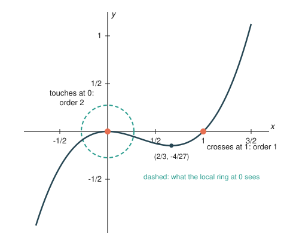

# Localisation: inverting chosen functions to zoom in on one point

[Syllabus](../../../SYLLABUS.md) → [Algebraic geometry](../README.md) → [Schemes and Modern Language](../README.md#s06) → Localisation

---

## General Overview

Take the polynomial $`f = x^3 - x^2`$ on the line, with rational coefficients. It factors as $`x^2 (x - 1)`$, so it is zero at two places: at 0, where the graph touches the axis, and at 1, where it crosses.

Counted with multiplicity (how many times a root repeats), $`f`$ has three roots, its degree. How many of the three sit at the origin? The answer is 2. This card builds the tool that sees that 2 without looking at 1 at all.

The trick is division. Near 0 the factor $`x - 1`$ is never zero: its value at 0 is −1. So near 0 it behaves like a nonzero constant, and a nonzero constant can be divided by. Allow fractions $`g/h`$ whose bottom $`h`$ is not zero at 0. Then $`x - 1`$ has the inverse $`1/(x - 1)`$, and $`f`$ becomes $`x^2`$ times something invertible. What is left is the part of $`f`$ that lives at the origin: $`x^2`$, order 2.

That is **localisation**: choose some elements of a ring, and make them invertible by allowing fractions with them on the bottom. Choose every polynomial that is nonzero at a point, and the result is the **local ring** at that point. In it, everything nonzero at the point is invertible. What is left over, the things that vanish at the point, forms one single ideal. Counting how tightly curves touch at a point, and studying one point of a shape on its own, both start here.

**Localisation inverts a chosen set of elements by allowing fractions over them; inverting everything that is nonzero at a point gives a local ring, with exactly one maximal ideal, which sees only that point and the shapes passing through it, so $`x^3 - x^2`$ there is $`x^2`$ times a unit and has order 2.**

**What kind of fact this is:** a construction (a definition) and three theorems, proved on this card in Why it works: the fraction rule is an equivalence relation, the ring at a prime ideal has exactly one maximal ideal, and the prime ideals of the new ring are the old ones that avoid the inverted set.

<p align="center"></p>

The figure is drawn to scale and shows real points only. The dashed circle is a picture of "near 0", not a literal disc. In this algebra a neighbourhood of 0 is the line with finitely many points removed, and the local ring keeps every such neighbourhood at once.

---

## The formula

Notation first, in words.

- $`R`$ is a commutative ring with 1: here $`\mathbb{Q}[x]`$, the polynomials in $`x`$ with rational coefficients. The field throughout is $`\mathbb{Q}`$, the rational numbers.
- $`S`$ is a **multiplicative set**: a subset of $`R`$ that holds 1 and holds every product of its members.
- $`S^{-1}R`$, read "S-inverse R", is the new ring of fractions. This card introduces that notation.

```math
S^{-1}R = \left\{ \tfrac{r}{s} : r \in R,\ s \in S \right\}, \qquad \tfrac{r}{s} = \tfrac{r'}{s'} \iff u\,(r s' - r' s) = 0 \text{ for some } u \in S
```

**Read it aloud:** the new ring holds every fraction with a top from R and a bottom from S, and two fractions are equal when their cross-multiples agree after multiplying by one more member of S.

Fractions add and multiply by the school rules: $`\tfrac{r}{s} + \tfrac{r'}{s'} = \tfrac{r s' + r' s}{s s'}`$ and $`\tfrac{r}{s} \cdot \tfrac{r'}{s'} = \tfrac{r r'}{s s'}`$.

The most used case inverts everything outside a prime ideal $`\mathfrak{p}`$ (an ideal such that, if a product is in it, a factor is). That gives $`R_{\mathfrak{p}}`$, the **local ring at** $`\mathfrak{p}`$, also new on this card:

```math
R_{\mathfrak{p}} = (R \setminus \mathfrak{p})^{-1} R, \qquad \text{its one maximal ideal is } \mathfrak{p} R_{\mathfrak{p}} = \left\{ \tfrac{a}{s} : a \in \mathfrak{p} \right\}
```

**Read it aloud:** invert everything that is not in the prime ideal; the fractions with a top in the prime ideal form the only maximal ideal, and every other fraction is invertible.

For the line at the origin, $`\mathfrak{p}`$ is $`\mathfrak{m} = \langle x \rangle`$, the polynomials with value 0 at 0. With one generator, $`\langle x \rangle`$ is the ideal the spectrum card writes $`(x)`$: all multiples of $`x`$. Then

```math
\mathbb{Q}[x]_{\mathfrak{m}} = \left\{ \tfrac{g}{h} : h(0) \neq 0 \right\}, \qquad \tfrac{g}{h} \text{ is a unit} \iff g(0) \neq 0, \qquad \dim_{\mathbb{Q}} \mathbb{Q}[x]_{\mathfrak{m}} / \langle f \rangle = \mathrm{ord}_0 f = 2
```

**Read it aloud:** the local ring at 0 holds every fraction whose bottom is nonzero at 0; a fraction is invertible exactly when its top is nonzero at 0; and dividing out by $`f`$ leaves a space of dimension 2, the order of $`f`$ at 0.

A **unit** is an element with an inverse in the ring. $`\mathrm{ord}_0 f`$, the **order** of $`f`$ at 0, is the number of times $`x`$ divides $`f`$.

| Symbol | Plain meaning | In our example | Push it up and the answer… |
| --- | --- | --- | --- |
| $`R`$ | the ring we start from | $`\mathbb{Q}[x]`$; finite copies $`\mathbb{F}_3[x]/\langle f \rangle`$ and $`\mathbb{Z}/12`$ | — |
| $`S`$ | the multiplicative set to invert | all $`h`$ with $`h(0) \neq 0`$ | bigger $`S`$, fewer points survive |
| $`r, r', r'', a`$; $`s, s', s'', u, v`$ | tops of fractions; members of $`S`$ | $`x`$; $`x + 1`$ | — |
| $`S^{-1}R`$, $`\tfrac{r}{s}`$ | the ring of fractions; one fraction | $`\tfrac{x^2 - x}{x^2 - 1} = \tfrac{x}{x + 1}`$ | — |
| $`\mathfrak{p}`$, $`\mathfrak{q}`$, $`\mathfrak{m}`$, $`I`$ | prime ideals; the maximal ideal of a point; any ideal | $`\mathfrak{m} = \langle x \rangle`$; $`I = \langle f \rangle`$ | — |
| $`R_{\mathfrak{p}}`$, $`\mathfrak{p}R_{\mathfrak{p}}`$ | the local ring at $`\mathfrak{p}`$; its one maximal ideal | $`\mathbb{Q}[x]_{\mathfrak{m}}`$; fractions with top zero at 0 | — |
| $`f`$, $`g`$, $`h`$ | polynomials | $`f = x^3 - x^2`$ | — |
| $`\mathrm{ord}_0 f`$, $`n`$ | the order of $`f`$ at 0 | 2 | more repeated roots at 0 |
| $`\mathbb{Q}`$, $`\mathbb{F}_3`$, $`k`$ | the rationals; whole numbers mod 3; any field | $`\mathbb{Q}`$ | — |
| $`\mathrm{Spec}\, R`$; $`D(h)`$, $`R_h`$ | the prime ideals of $`R`$, as points; the open set where $`h`$ is not zero, and its ring of fractions over powers of $`h`$ | two points for $`\mathbb{Q}[x]_{\mathfrak{m}}`$; $`R_x = \mathbb{Q}[x, 1/x]`$ | — |
| $`\mathcal{O}_{V,P}`$; $`\mathbb{Z}_{(2)}`$; $`\mathbb{Z}[1/10]`$ | the local ring of a variety $`V`$ at a point $`P`$; fractions with odd bottoms; finite decimals | $`\mathcal{O}_{V,P} = \mathbb{Q}[x]_{\mathfrak{m}}`$ for the line at 0 | — |
| $`\langle \dots \rangle`$, $`\dim`$ | the ideal generated; dimension as a vector space | $`\langle x^2 \rangle`$; 2 | — |

### When it holds

- **S holds 1 and is closed under products.** Fractions multiply by multiplying bottoms, so the product of two bottoms must be a bottom. The complement of $`\langle x(x - 1) \rangle`$ fails: it holds $`x`$ and $`x - 1`$ but not their product.
- **S must not hold 0.** If it does, take $`u = 0`$: then $`0 \cdot (1 \cdot 1 - 0 \cdot 1) = 0`$, so $`\tfrac{1}{1} = \tfrac{0}{1}`$ and the ring collapses to one element.
- **The extra factor u matters when R has zero divisors** (nonzero elements whose product is 0). In $`\mathbb{Z}/12`$, plain cross-multiplication is not transitive. In a domain such as $`\mathbb{Q}[x]`$ it is enough.
- **The ideal must be prime for $`R_{\mathfrak{p}}`$.** Primality is exactly what makes $`R \setminus \mathfrak{p}`$ closed under products.
- **The ring is commutative.** Without that, left and right fractions differ, and the construction needs extra conditions.

---

## Why it works

### Step 0: a fraction is a pair, and equality is a rule on pairs

A fraction $`\tfrac{r}{s}`$ is a pair $`(r, s)`$. Many pairs name one fraction: $`\tfrac{x^2 - x}{x^2 - 1}`$ and $`\tfrac{x}{x + 1}`$ are the same, because the common factor $`x - 1`$ cancels, and $`x - 1`$ is nonzero at 0. Cross-multiplying confirms it: both cross products are $`x^3 - x`$.

The fields card builds the rationals this way, inverting every nonzero element ([Fields](../../03-Algebra/09-Rings%20and%20Fields/02-fields.md)). Localisation inverts only a chosen set. "Same fraction" must be a sameness rule that is reflexive, symmetric and transitive, so the pairs fall into blocks ([Equivalence relations and partitions](../../01-Foundations/08-Relations%20and%20Functions/06-equivalence-relations-and-partitions.md)). Each block is one element of $`S^{-1}R`$.

### Step 1: the rule with u is transitive, and the rule without it is not

Reflexive and symmetric are immediate. Transitive needs the extra $`u`$.

Suppose $`\tfrac{r}{s} = \tfrac{r'}{s'}`$ by $`u`$, and $`\tfrac{r'}{s'} = \tfrac{r''}{s''}`$ by $`v`$. Multiply the first equation by $`v s''`$ and the second by $`u s`$, then add. The $`r'`$ terms cancel, and what is left says $`\tfrac{r}{s} = \tfrac{r''}{s''}`$ with the factor $`u v s'`$. That factor is in $`S`$ because $`S`$ is closed under products.

<details>
<summary>Detailed proof: the three lines of algebra</summary>

The two hypotheses are

$`\displaystyle u\,(r s' - r' s) = 0 \quad\text{and}\quad v\,(r' s'' - r'' s') = 0.`$

Multiply the first by $`v s''`$ and the second by $`u s`$:

$`\displaystyle u v s'' r s' - u v s'' r' s = 0 \quad\text{and}\quad u v s r' s'' - u v s r'' s' = 0.`$

Add them. The middle terms are equal and opposite, so

$`\displaystyle u v s' \,(r s'' - r'' s) = 0.`$

Since $`u`$, $`v`$ and $`s'`$ are in $`S`$, so is $`u v s'`$, and this is the rule for $`\tfrac{r}{s} = \tfrac{r''}{s''}`$. Without the extra factor, the last step needs to cancel $`s'`$, which is only allowed when $`s'`$ is no zero divisor.

</details>

The failure is concrete. In $`\mathbb{Z}/12`$ (whole numbers mod 12), invert the odd numbers. Plain cross-multiplication links $`(4, 1)`$ to $`(0, 3)`$, since $`4 \cdot 3 = 12 \equiv 0`$. It links $`(0, 3)`$ to $`(0, 1)`$. But it does not link $`(4, 1)`$ to $`(0, 1)`$, since $`4 \neq 0`$. With $`u = 3`$, the full rule does: $`3 \cdot 4 = 0`$, so $`\tfrac{4}{1} = 0`$ in the new ring.

### Step 2: the new ring makes every member of S a unit, and is the smallest ring that does

Each $`s`$ in $`S`$ becomes $`\tfrac{s}{1}`$, with inverse $`\tfrac{1}{s}`$. Each $`r`$ in $`R`$ becomes $`\tfrac{r}{1}`$. That map sends $`r`$ to 0 exactly when $`u r = 0`$ for some $`u`$ in $`S`$. In a domain such as $`\mathbb{Q}[x]`$, only 0 is sent to 0.

$`S^{-1}R`$ is the smallest ring that does this. Any ring map out of $`R`$ that makes every member of $`S`$ a unit factors through $`S^{-1}R`$ in exactly one way, by sending $`\tfrac{r}{s}`$ to the image of $`r`$ times the inverse of the image of $`s`$.

### Step 3: at a prime ideal, there is exactly one maximal ideal

A ring with exactly one maximal ideal is called a **local ring**. $`R_{\mathfrak{p}}`$ is one, and the proof is two lines.

1. Take $`\tfrac{a}{s}`$ with $`a`$ not in $`\mathfrak{p}`$. Then $`a`$ is in $`S = R \setminus \mathfrak{p}`$, so $`\tfrac{s}{a}`$ is a fraction too, and $`\tfrac{a}{s} \cdot \tfrac{s}{a} = 1`$. Everything outside $`\mathfrak{p}R_{\mathfrak{p}}`$ is a unit.
2. A proper ideal (one that is not the whole ring) holds no unit. So every proper ideal lies inside $`\mathfrak{p}R_{\mathfrak{p}}`$, and $`\mathfrak{p}R_{\mathfrak{p}}`$ itself is proper, since $`\tfrac{1}{1}`$ is not in it.

On the line at 0: $`\tfrac{x + 2}{x - 1}`$ has value −2 at 0, so it is a unit, with inverse $`\tfrac{x - 1}{x + 2}`$. $`\tfrac{x}{x + 1}`$ has value 0 at 0, so it is in the maximal ideal $`\mathfrak{m}\mathbb{Q}[x]_{\mathfrak{m}}`$ and has no inverse. Evaluation at 0 sends $`\mathbb{Q}[x]_{\mathfrak{m}}`$ onto $`\mathbb{Q}`$, and $`\mathfrak{m}\mathbb{Q}[x]_{\mathfrak{m}}`$ is exactly what it sends to 0.

An equivalent test: a ring is local exactly when its non-units are closed under addition. $`\mathbb{Q}[x]`$ itself fails: $`x`$ and $`1 - x`$ are non-units, and their sum is 1.

### Step 4: which geometry the local ring sees

The prime ideals of $`S^{-1}R`$ match, one for one, the prime ideals of $`R`$ that contain no member of $`S`$. A prime $`\mathfrak{q}`$ of $`R`$ goes to $`\mathfrak{q} S^{-1}R`$. If $`\mathfrak{q}`$ holds some $`s`$ in $`S`$, it goes to the whole ring, because $`\tfrac{s}{1}`$ is then a unit inside it. In the language of [The spectrum of a ring](02-spectrum-of-a-ring-and-schemes.md), where prime ideals are points, $`\mathrm{Spec}\, S^{-1}R`$ is the part of $`\mathrm{Spec}\, R`$ that avoids $`S`$. The fold proves the match.

<details>
<summary>Detailed proof: the primes of the new ring are the old primes that miss S</summary>

Let $`\mathfrak{q}`$ be a prime of $`R`$ that holds no member of $`S`$. First, a test for membership: $`\tfrac{r}{s}`$ lies in $`\mathfrak{q} S^{-1}R`$ exactly when $`u r \in \mathfrak{q}`$ for some $`u`$ in $`S`$. If $`\tfrac{r}{s} = \tfrac{a}{s'}`$ with $`a`$ in $`\mathfrak{q}`$, the rule gives $`v\,(r s' - a s) = 0`$, so $`v s' r = v s a`$ is in $`\mathfrak{q}`$; take $`u = v s'`$. The other way, $`\tfrac{r}{s} = \tfrac{u r}{u s}`$, whose top is in $`\mathfrak{q}`$. Since $`u`$ is not in $`\mathfrak{q}`$ and $`\mathfrak{q}`$ is prime, the test says simply that $`r`$ is in $`\mathfrak{q}`$.

Three facts follow. $`\tfrac{1}{1}`$ is not in $`\mathfrak{q} S^{-1}R`$, since 1 is not in $`\mathfrak{q}`$, so the ideal is proper. If $`\tfrac{r}{s} \cdot \tfrac{r'}{s'} = \tfrac{r r'}{s s'}`$ is in it, then $`r r'`$ is in $`\mathfrak{q}`$, so $`r`$ or $`r'`$ is, and the ideal is prime. And $`\tfrac{r}{1}`$ is in it exactly when $`r`$ is in $`\mathfrak{q}`$, so pulling back returns $`\mathfrak{q}`$.

The other way, take any prime $`\mathfrak{p}`$ of $`S^{-1}R`$, and let $`\mathfrak{q}`$ be its pull-back: the $`r`$ with $`\tfrac{r}{1}`$ in $`\mathfrak{p}`$. That is a prime of $`R`$ (Step 0 of [The spectrum of a ring](02-spectrum-of-a-ring-and-schemes.md)), and it holds no $`s`$ in $`S`$, because $`\tfrac{s}{1}`$ is a unit. And $`\mathfrak{p} = \mathfrak{q} S^{-1}R`$: $`\tfrac{r}{s}`$ is in $`\mathfrak{p}`$ exactly when $`\tfrac{r}{1} = \tfrac{s}{1} \cdot \tfrac{r}{s}`$ is, that is, when $`r`$ is in $`\mathfrak{q}`$, which by the test is when $`\tfrac{r}{s}`$ is in $`\mathfrak{q} S^{-1}R`$. So every prime of $`S^{-1}R`$ comes from exactly one prime of $`R`$ that misses $`S`$.

</details>

For $`\mathbb{Q}[x]`$ at the origin, the surviving primes are those inside $`\langle x \rangle`$. There are two.

| Prime of $`\mathbb{Q}[x]`$ | Holds an element nonzero at 0? | In $`\mathbb{Q}[x]_{\mathfrak{m}}`$ |
| --- | --- | --- |
| $`\langle x \rangle`$, the origin | no | survives: the one closed point |
| $`\langle 0 \rangle`$, the whole line | no | survives: the generic point |
| $`\langle x - 1 \rangle`$, the point 1 | yes: $`x - 1`$ itself, value −1 | gone |
| $`\langle x^2 - 2 \rangle`$, the points $`\pm\sqrt{2}`$ | yes: value −2 | gone |
| $`\langle x^2 + 1 \rangle`$, no real points | yes: value 1 | gone |

So the local ring sees the origin and the line passing through it, and nothing else. Over $`\mathbb{Q}`$ the gone points include ones with no rational coordinate, such as $`\pm\sqrt{2}`$.

Inverting a single element works the other way round. The spectrum card puts the ring $`R_h`$, the fractions over powers of $`h`$, on the open set $`D(h)`$ where $`h`$ is not zero. (A subscript element means powers of that element; a subscript prime ideal means everything outside it.) For $`h = x`$ that ring is $`\mathbb{Q}[x, 1/x]`$. It keeps every point except the origin: it is the line with 0 removed, an open set. The local ring inverts far more, so it removes every closed point except the origin. Its elements are the functions defined on some open set around 0, with two counted equal when they agree on a smaller open set around 0.

[Smooth and singular points](../02-Affine%20and%20Projective%20Varieties/08-smooth-and-singular-points.md) defines $`\mathcal{O}_{V,P}`$ as the rational functions defined at $`P`$. For the line at the origin, that ring is $`\mathbb{Q}[x]_{\mathfrak{m}}`$, and this card's construction gives the same ring for any prime of any ring.

### Step 5: every ideal is a power of x, and the order counts the multiplicity

Every nonzero $`g`$ in $`\mathbb{Q}[x]`$ factors as $`x^n g_1`$ with $`g_1(0) \neq 0`$. In the local ring $`g_1`$ is a unit. So every nonzero element of $`\mathbb{Q}[x]_{\mathfrak{m}}`$ is $`x^n`$ times a unit, and every nonzero ideal is $`\langle x^n \rangle`$ for one $`n`$.

For $`f = x^2(x - 1)`$, the ideal is $`\langle f \rangle = \langle x^2 \rangle`$, since $`x^2 = f \cdot \tfrac{1}{x - 1}`$ in the local ring. Dividing out by it leaves the classes of 1 and $`x`$: a space of dimension 2. That number is the **local multiplicity** of the root 0.

The code reaches the order two ways:

- **By shifting.** Expand $`f(x + a)`$ by the binomial theorem and count the zero coefficients at the bottom. At $`a = 1`$: $`f(x + 1) = x^3 + 2x^2 + x`$, order 1.
- **By dividing.** Divide by $`x - a`$ with synthetic division, again and again, while the remainder is 0.

The local pieces add up to the global count. The Chinese remainder theorem splits $`\mathbb{Q}[x]/\langle f \rangle`$ as $`\mathbb{Q}[x]/\langle x^2 \rangle \times \mathbb{Q}[x]/\langle x - 1 \rangle`$, so $`2 + 1 = 3`$, the degree of $`f`$.

<details>
<summary>Saturation: pulling the local ideal back to polynomials</summary>

Which polynomials become multiples of $`f`$ in the local ring? Exactly those $`g`$ with $`s g \in \langle f \rangle`$ for some $`s`$ with $`s(0) \neq 0`$. This set is called the **saturation** of $`\langle f \rangle`$ at the origin.

Here it is $`\langle x^2 \rangle`$: the factor $`x - 1`$, nonzero at 0, has been thrown away. In general

$`\displaystyle I\, S^{-1}R \cap R = \{ g \in R : s g \in I \text{ for some } s \in S \}.`$

The polynomial $`x`$ is not in it, since its order at 0 is 1, less than 2. Computer algebra uses this to strip a component away from an ideal.

</details>

### Step 6: a finite copy, counted pair by pair

Over $`\mathbb{F}_3`$ (whole numbers mod 3), the ring $`\mathbb{F}_3[x]/\langle f \rangle`$ has $`3^3 = 27`$ elements, so the construction can be run by brute force.

- At 0, invert the 18 elements with nonzero value at 0. The 486 pairs fall into 9 classes: $`3^2`$, the local ring $`\mathbb{F}_3[x]/\langle x^2 \rangle`$.
- At 1, invert the 18 elements with nonzero value at 1. The pairs fall into 3 classes: $`3^1`$.
- $`9 \times 3 = 27`$: the two local rings rebuild the whole.
- The whole ring has 12 units out of 27, and its non-units are not closed under addition: it is not local. Each localisation is local: 6 units of 9 at 0, 2 of 3 at 1.

$`\mathbb{Z}/12`$ is the same story in arithmetic. Since $`12 = 2^2 \cdot 3`$, inverting the odd numbers keeps the prime 2 and its square: 4 classes, 2 of them units, and the ring is local.

---

## Worked numbers, by hand

| Step | Arithmetic | Value |
| --- | --- | --- |
| factor $`f`$ | $`x^3 - x^2 = x^2 (x - 1)`$ | roots 0 and 1 |
| is $`x - 1`$ a unit at 0? | value at 0 | −1, so yes |
| order at 0 | $`x`$ divides $`f`$ twice, not three times | 2 |
| order at 1 | $`f(x + 1) = x^3 + 2x^2 + x`$ | 1 |
| local orders against the degree | $`2 + 1`$ | 3 = degree |
| a fraction equality | $`(x^2 - x)(x + 1)`$ and $`x (x^2 - 1)`$ | both $`x^3 - x`$ |
| $`\tfrac{x + 2}{x - 1}`$ at 0 | $`2 / (-1)`$ | −2: a unit |
| $`\tfrac{x}{x + 1}`$ at 0 | $`0 / 1`$ | 0: in $`\mathfrak{m}\mathbb{Q}[x]_{\mathfrak{m}}`$ |
| over $`\mathbb{F}_3`$, classes at 0 | 486 pairs sorted | 9 = $`3^2`$ |
| local multiplicity of 0 | $`\dim \mathbb{Q}[x]_{\mathfrak{m}}/\langle f \rangle`$ | **2** |

In the local ring at the origin, $`f`$ is $`x^2`$ times a unit, so the origin carries 2 of the 3 roots, and the root at 1 is invisible there.

### What breaks if you drop a piece

| Mistake | Comes out at | What went wrong |
| --- | --- | --- |
| Cross-multiplying without the extra $`u`$, in $`\mathbb{Z}/12`$ | $`(4, 1) \sim (0, 3) \sim (0, 1)`$, but $`(4, 1) \not\sim (0, 1)`$ | not transitive, so no ring; with $`u = 3`$, $`\tfrac{4}{1} = 0`$ |
| Inverting a set that holds 0 | 1 class | every fraction equals 0: the zero ring |
| Counting the whole ring, not the local ring | 27 = $`3^3`$ elements, not 9 = $`3^2`$ | the root at 1 is counted too |
| Inverting the complement of $`\langle x(x - 1) \rangle`$ | $`x`$ and $`x - 1`$ in it, $`x(x - 1)`$ not | the ideal is not prime, so the set is not closed under products |

The code prints all four.

---

## Code, from first principles, and it actually runs

Nothing is imported, and every number is an exact integer. The code takes three roads to the local multiplicity. It finds the order of $`f`$ at each root by a binomial shift and by synthetic division, which share no arithmetic. It checks that the local orders add up to the degree. It then builds the finite copies over $`\mathbb{F}_3`$ and in $`\mathbb{Z}/12`$ from addition and multiplication tables, sorts every pair $`(a, s)`$ into classes by the rule with $`u`$, and counts classes, units and non-units.

### Python

```python
# Localisation and local rings -- the check behind the card.  Nothing is
# imported; every number is an exact integer.  The field is Q, the rational
# numbers.  R = Q[x], f = x^3 - x^2, and we invert every g with g(0) != 0.
# Roads: orders of vanishing by a binomial shift and by synthetic division;
# their sum against the degree; and finite copies over F_3 and in Z/12, where
# every fraction a/s is sorted into classes by brute force.
F = [0, 0, -1, 1]                        # x^3 - x^2, constant term first

def show(p):                             # leading term first, as on the card
    out = ""
    for k in range(len(p) - 1, -1, -1):
        c = p[k]
        if c == 0:
            continue
        sign = " - " if c < 0 else " + "
        body = ("" if abs(c) == 1 and k > 0 else str(abs(c))) + ("x" if k > 0 else "") + (f"^{k}" if k > 1 else "")
        out += (("-" if c < 0 else "") if out == "" else sign) + body
    return out or "0"

def mul(p, q):
    out = [0] * (len(p) + len(q) - 1)
    for i, a in enumerate(p):
        for j, b in enumerate(q):
            out[i + j] += a * b
    return out

def value(p, a):
    return sum(c * a ** k for k, c in enumerate(p))

def choose(n, k):
    out = 1
    for i in range(k):
        out = out * (n - i) // (i + 1)
    return out

def order_by_shift(p, a):                # road one: expand f(x + a), count the zero coefficients at the bottom
    shifted = [sum(p[j] * choose(j, k) * a ** (j - k) for j in range(k, len(p))) for k in range(len(p))]
    n = 0
    while shifted[n] == 0:
        n += 1
    return n

def order_by_division(p, a):             # road two: divide by (x - a) while the remainder is 0
    n, p = 0, p[:]
    while len(p) > 1:
        q, carry = [0] * (len(p) - 1), 0
        for k in range(len(p) - 1, 0, -1):
            carry = p[k] + a * carry
            q[k - 1] = carry
        if p[0] + a * carry != 0:
            break
        n, p = n + 1, q
    return n

def ring_classes(n, add, mul_t, neg, S):  # road three: sort every pair (a, s) by u(a t - b s) = 0
    def same(a, s, b, t):
        d = add[mul_t[a][t]][neg[mul_t[b][s]]]
        return any(mul_t[u][d] == 0 for u in S)
    reps = []
    for a in range(n):
        for s in S:
            if not any(same(a, s, b, t) for b, t in reps):
                reps.append((a, s))
    units = [a for a in range(n) if any(same(mul_t[a][b], 1, 1, 1) for b in range(n))]
    non = [a for a in range(n) if a not in units]
    unit_classes = sum(1 for b, t in reps if b in units)
    local = all(add[a][b] in non for a in non for b in non)
    return reps, unit_classes, local, same

def tables_z(m):
    return ([[(a + b) % m for b in range(m)] for a in range(m)],
            [[a * b % m for b in range(m)] for a in range(m)], [(-a) % m for a in range(m)])

def tables_f3():                         # F_3[x] / <x^3 - x^2>: index c0 + 3 c1 + 9 c2; x^3 = x^2 there
    co = [(i % 3, i // 3 % 3, i // 9) for i in range(27)]
    ix = lambda c: c[0] % 3 + 3 * (c[1] % 3) + 9 * (c[2] % 3)
    add = [[ix([co[a][k] + co[b][k] for k in range(3)]) for b in range(27)] for a in range(27)]
    def m(a, b):
        d = mul(list(co[a]), list(co[b]))
        return ix([d[0], d[1], d[2] + d[3] + d[4]])
    return co, add, [[m(a, b) for b in range(27)] for a in range(27)], [ix([-c for c in co[a]]) for a in range(27)]

ok = lambda claim: "yes" if claim else "no"
o0 = (order_by_shift(F, 0), order_by_division(F, 0))
o1 = (order_by_shift(F, 1), order_by_division(F, 1))
others = [order_by_division(F, a) for a in (-1, 2)]
print(f"field Q; R = Q[x]; f = {show(F)}; S = all g with g(0) != 0")
print(f"f = x^2 * ({show([-1, 1])}); the factor {show([-1, 1])} has value {value([-1, 1], 0)} at 0, so it is a unit")
print(f"order of f at 0: by shifting {o0[0]}, by dividing {o0[1]}")
print(f"order of f at 1: by shifting {o1[0]}, by dividing {o1[1]}")
print(f"order of f at -1 and at 2: {others[0]} and {others[1]}")
print(f"local orders {o0[0]} + {o1[0]} = {o0[0] + o1[0]}; degree of f = {len(F) - 1}")
print(f"f(x + 1) = {show([sum(F[j] * choose(j, k) for j in range(k, 4)) for k in range(4)])}; values at 0 of "
      f"x - 1, x^2 - 2, x^2 + 1: {value([-1, 1], 0)}, {value([-2, 0, 1], 0)}, {value([1, 0, 1], 0)}, so those points leave")
print(f"in Z_(2), 1/3 reads {[b for b in range(2) if 3 * b % 2 == 1][0]} mod 2; in Z[1/10], 4.95 = {495}/{10 ** 2}")
lhs, rhs = mul([0, -1, 1], [1, 1]), mul([0, 1], [-1, 0, 1])
print(f"(x^2 - x)/(x^2 - 1) against x/(x + 1): cross products {show(lhs)} and {show(rhs)}")
print(f"(x + 2)/(x - 1) has value {value([2, 1], 0) // value([-1, 1], 0)} at 0: a unit; times (x - 1)/(x + 2) gives "
      f"{show(mul([2, 1], [-1, 1]))} over {show(mul([-1, 1], [2, 1]))}")
print(f"x/(x + 1) has value {value([0, 1], 0)} at 0: in the maximal ideal, no inverse")
print(f"x^2 = f/(x - 1) in R_m, since x^2 * (x - 1) = {show(mul([0, 0, 1], [-1, 1]))}; x has order {order_by_division([0, 1], 0)} < 2, so x is not a multiple of f there")
co, add, mt, neg = tables_f3()
S0 = [a for a in range(27) if co[a][0] != 0]
S1 = [a for a in range(27) if sum(co[a]) % 3 != 0]
reps0, u0, loc0, _ = ring_classes(27, add, mt, neg, S0)
reps1, u1, loc1, _ = ring_classes(27, add, mt, neg, S1)
_, uR, locR, _ = ring_classes(27, add, mt, neg, [1])
print(f"finite copy F_3[x]/<f>: 27 elements; at 0: {len(S0)} denominators, {27 * len(S0)} pairs, {len(reps0)} classes")
print(f"at 1: {len(S1)} denominators, {len(reps1)} classes; {len(reps0)} x {len(reps1)} = {len(reps0) * len(reps1)}")
print(f"units: R {uR} of 27, at 0 {u0} of {len(reps0)}, at 1 {u1} of {len(reps1)}")
print(f"non-units closed under addition (local): R {ok(locR)}, at 0 {ok(loc0)}, at 1 {ok(loc1)}")
zadd, zmul, zneg = tables_z(12)
odd = [1, 3, 5, 7, 9, 11]
repz, uz, locz, samez = ring_classes(12, zadd, zmul, zneg, odd)
print(f"Z/12 with the odd numbers inverted: {len(repz)} classes, {uz} unit classes, local {ok(locz)}")
cross = lambda a, s, b, t: (a * t - b * s) % 12 == 0
bad = [(a, s, b, t) for a in range(12) for s in odd for b in range(12) for t in odd
       if cross(a, s, b, t) and cross(b, t, 0, 1) and not cross(a, s, 0, 1)]
print(f"mistake 1, cross-multiplying only: ({bad[0][0]}, {bad[0][1]}) ~ ({bad[0][2]}, {bad[0][3]}) ~ (0, 1) "
      f"but ({bad[0][0]}, {bad[0][1]}) is not ~ (0, 1); the u-test: {ok(samez(bad[0][0], bad[0][1], 0, 1))}")
print(f"mistake 2, inverting a set that holds 0: {len(ring_classes(12, zadd, zmul, zneg, [0, 1])[0])} class")
print(f"mistake 3, counting the whole ring: 27 elements = 3^3, against {len(reps0)} = 3^2 at the origin")
in_s = lambda p: value(p, 0) != 0 or value(p, 1) != 0   # outside <x(x - 1)>
print(f"mistake 4, complement of <x(x - 1)>: x in it {ok(in_s([0, 1]))}, x - 1 in it {ok(in_s([-1, 1]))}, "
      f"x(x - 1) in it {ok(in_s(mul([0, 1], [-1, 1])))}")
def at(p, q):                             # f(p/q) = (p^3 - p^2 q)/q^3, in lowest terms
    a, b = p ** 3 - p * p * q, q ** 3
    g, h = abs(a), b
    while h:
        g, h = h, g % h
    return f"({p}/{q}, {a // g}/{b // g})" if q > 1 else f"({p}, {a // g})"
print(f"figure, y = x^3 - x^2 from {at(-3, 4)} to {at(3, 2)}; touches {at(0, 1)}; crosses {at(1, 1)}; dips to {at(2, 3)}")
assert o0 == (2, 2) and o1 == (1, 1) and others == [0, 0]          # two roads to each order
assert o0[0] + o1[0] == len(F) - 1                                  # local orders add up to the degree
assert lhs == rhs and mul([0, 0, 1], [-1, 1]) == F
assert len(reps0) == 9 and len(reps1) == 3 and len(reps0) * len(reps1) == 27   # brute force against x^2 and x - 1
assert (uR, u0, u1, locR, loc0, loc1) == (12, 6, 2, False, True, True)
assert (len(repz), uz, locz) == (4, 2, True) and samez(4, 1, 0, 1) and bad[0] == (4, 1, 0, 3)
print("ALL CHECKS PASS")
```

**Ran 2026-11-17 on macOS, Python 3.14.10, standard library only. All checks passed. Output, pasted from the run:**

```
field Q; R = Q[x]; f = x^3 - x^2; S = all g with g(0) != 0
f = x^2 * (x - 1); the factor x - 1 has value -1 at 0, so it is a unit
order of f at 0: by shifting 2, by dividing 2
order of f at 1: by shifting 1, by dividing 1
order of f at -1 and at 2: 0 and 0
local orders 2 + 1 = 3; degree of f = 3
f(x + 1) = x^3 + 2x^2 + x; values at 0 of x - 1, x^2 - 2, x^2 + 1: -1, -2, 1, so those points leave
in Z_(2), 1/3 reads 1 mod 2; in Z[1/10], 4.95 = 495/100
(x^2 - x)/(x^2 - 1) against x/(x + 1): cross products x^3 - x and x^3 - x
(x + 2)/(x - 1) has value -2 at 0: a unit; times (x - 1)/(x + 2) gives x^2 + x - 2 over x^2 + x - 2
x/(x + 1) has value 0 at 0: in the maximal ideal, no inverse
x^2 = f/(x - 1) in R_m, since x^2 * (x - 1) = x^3 - x^2; x has order 1 < 2, so x is not a multiple of f there
finite copy F_3[x]/<f>: 27 elements; at 0: 18 denominators, 486 pairs, 9 classes
at 1: 18 denominators, 3 classes; 9 x 3 = 27
units: R 12 of 27, at 0 6 of 9, at 1 2 of 3
non-units closed under addition (local): R no, at 0 yes, at 1 yes
Z/12 with the odd numbers inverted: 4 classes, 2 unit classes, local yes
mistake 1, cross-multiplying only: (4, 1) ~ (0, 3) ~ (0, 1) but (4, 1) is not ~ (0, 1); the u-test: yes
mistake 2, inverting a set that holds 0: 1 class
mistake 3, counting the whole ring: 27 elements = 3^3, against 9 = 3^2 at the origin
mistake 4, complement of <x(x - 1)>: x in it yes, x - 1 in it yes, x(x - 1) in it no
figure, y = x^3 - x^2 from (-3/4, -63/64) to (3/2, 9/8); touches (0, 0); crosses (1, 0); dips to (2/3, -4/27)
ALL CHECKS PASS
```

### Rust

Same numbers, same labels, built with `rustc --edition 2021 -O`.

```rust
// Localisation and local rings -- the same check as the Python, in Rust.  No
// crates; every number is an exact integer.  The field is Q, the rational
// numbers.  R = Q[x], f = x^3 - x^2, and we invert every g with g(0) != 0.
// Roads: orders of vanishing by a binomial shift and by synthetic division;
// their sum against the degree; and finite copies over F_3 and in Z/12, where
// every fraction a/s is sorted into classes by brute force.
type Table = Vec<Vec<usize>>;

fn show(p: &[i64]) -> String {                 // leading term first, as on the card
    let mut out = String::new();
    for k in (0..p.len()).rev() {
        let c = p[k];
        if c == 0 { continue }
        let mut body = if c.abs() == 1 && k > 0 { String::new() } else { c.abs().to_string() };
        if k > 0 { body.push('x') }
        if k > 1 { body += &format!("^{}", k) }
        let sign = if out.is_empty() { if c < 0 { "-" } else { "" } } else if c < 0 { " - " } else { " + " };
        out += sign;
        out += &body;
    }
    if out.is_empty() { "0".to_string() } else { out }
}

fn mul(p: &[i64], q: &[i64]) -> Vec<i64> {
    let mut out = vec![0; p.len() + q.len() - 1];
    for (i, a) in p.iter().enumerate() { for (j, b) in q.iter().enumerate() { out[i + j] += a * b } }
    out
}

fn value(p: &[i64], a: i64) -> i64 { p.iter().enumerate().map(|(k, c)| c * a.pow(k as u32)).sum() }

fn choose(n: i64, k: i64) -> i64 { let mut out = 1; for i in 0..k { out = out * (n - i) / (i + 1) } out }

fn order_by_shift(p: &[i64], a: i64) -> usize {  // road one: expand f(x + a), count the zero coefficients at the bottom
    let shifted: Vec<i64> = (0..p.len()).map(|k| (k..p.len())
        .map(|j| p[j] * choose(j as i64, k as i64) * a.pow((j - k) as u32)).sum()).collect();
    let mut n = 0;
    while shifted[n] == 0 { n += 1 }
    n
}

fn order_by_division(p: &[i64], a: i64) -> usize {  // road two: divide by (x - a) while the remainder is 0
    let (mut n, mut p) = (0, p.to_vec());
    while p.len() > 1 {
        let (mut q, mut carry) = (vec![0; p.len() - 1], 0);
        for k in (1..p.len()).rev() { carry = p[k] + a * carry; q[k - 1] = carry }
        if p[0] + a * carry != 0 { break }
        n += 1;
        p = q;
    }
    n
}

struct Ring { n: usize, add: Table, mul: Table, neg: Vec<usize> }

impl Ring {
    fn same(&self, s_set: &[usize], a: usize, s: usize, b: usize, t: usize) -> bool {
        let d = self.add[self.mul[a][t]][self.neg[self.mul[b][s]]];
        s_set.iter().any(|&u| self.mul[u][d] == 0)
    }
    // road three: sort every pair (a, s) by u(a t - b s) = 0
    fn classes(&self, s_set: &[usize]) -> (Vec<(usize, usize)>, usize, bool) {
        let mut reps: Vec<(usize, usize)> = Vec::new();
        for a in 0..self.n { for &s in s_set {
            if !reps.iter().any(|&(b, t)| self.same(s_set, a, s, b, t)) { reps.push((a, s)) }
        } }
        let units: Vec<usize> = (0..self.n).filter(|&a| (0..self.n).any(|b| self.same(s_set, self.mul[a][b], 1, 1, 1))).collect();
        let non: Vec<usize> = (0..self.n).filter(|a| !units.contains(a)).collect();
        let unit_classes = reps.iter().filter(|(b, _)| units.contains(b)).count();
        let local = non.iter().all(|&a| non.iter().all(|&b| non.contains(&self.add[a][b])));
        (reps, unit_classes, local)
    }
}

fn ring_z(m: usize) -> Ring {
    Ring { n: m, add: (0..m).map(|a| (0..m).map(|b| (a + b) % m).collect()).collect(),
           mul: (0..m).map(|a| (0..m).map(|b| a * b % m).collect()).collect(), neg: (0..m).map(|a| (m - a) % m).collect() }
}

fn ix(c: &[i64]) -> usize { (c[0].rem_euclid(3) + 3 * c[1].rem_euclid(3) + 9 * c[2].rem_euclid(3)) as usize }

fn ring_f3() -> (Vec<[i64; 3]>, Ring) {         // F_3[x] / <x^3 - x^2>: index c0 + 3 c1 + 9 c2; x^3 = x^2 there
    let co: Vec<[i64; 3]> = (0..27).map(|i| [i % 3, i / 3 % 3, i / 9]).collect();
    let add = (0..27).map(|a| (0..27).map(|b| ix(&[co[a][0] + co[b][0], co[a][1] + co[b][1], co[a][2] + co[b][2]])).collect()).collect();
    let mt = (0..27).map(|a| (0..27).map(|b| { let d = mul(&co[a], &co[b]); ix(&[d[0], d[1], d[2] + d[3] + d[4]]) }).collect()).collect();
    let neg = (0..27).map(|a| ix(&[-co[a][0], -co[a][1], -co[a][2]])).collect();
    (co, Ring { n: 27, add, mul: mt, neg })
}

fn ok(claim: bool) -> &'static str { if claim { "yes" } else { "no" } }

fn at(p: i64, q: i64) -> String {               // f(p/q) = (p^3 - p^2 q)/q^3, in lowest terms
    let (a, b) = (p.pow(3) - p * p * q, q.pow(3));
    let (mut g, mut h) = (a.abs(), b);
    while h != 0 { (g, h) = (h, g % h) }
    if q > 1 { format!("({}/{}, {}/{})", p, q, a / g, b / g) } else { format!("({}, {})", p, a / g) }
}

fn main() {
    let f: Vec<i64> = vec![0, 0, -1, 1];
    let o0 = (order_by_shift(&f, 0), order_by_division(&f, 0));
    let o1 = (order_by_shift(&f, 1), order_by_division(&f, 1));
    let others: Vec<usize> = [-1, 2].iter().map(|&a| order_by_division(&f, a)).collect();
    println!("field Q; R = Q[x]; f = {}; S = all g with g(0) != 0", show(&f));
    println!("f = x^2 * ({}); the factor {} has value {} at 0, so it is a unit", show(&[-1, 1]), show(&[-1, 1]), value(&[-1, 1], 0));
    println!("order of f at 0: by shifting {}, by dividing {}", o0.0, o0.1);
    println!("order of f at 1: by shifting {}, by dividing {}", o1.0, o1.1);
    println!("order of f at -1 and at 2: {} and {}", others[0], others[1]);
    println!("local orders {} + {} = {}; degree of f = {}", o0.0, o1.0, o0.0 + o1.0, f.len() - 1);
    let shift1: Vec<i64> = (0..4).map(|k| (k..4).map(|j| f[j] * choose(j as i64, k as i64)).sum()).collect();
    println!("f(x + 1) = {}; values at 0 of x - 1, x^2 - 2, x^2 + 1: {}, {}, {}, so those points leave",
             show(&shift1), value(&[-1, 1], 0), value(&[-2, 0, 1], 0), value(&[1, 0, 1], 0));
    println!("in Z_(2), 1/3 reads {} mod 2; in Z[1/10], 4.95 = {}/{}", (0..2).find(|b| 3 * b % 2 == 1).unwrap(), 495, 10i64.pow(2));
    let (lhs, rhs) = (mul(&[0, -1, 1], &[1, 1]), mul(&[0, 1], &[-1, 0, 1]));
    println!("(x^2 - x)/(x^2 - 1) against x/(x + 1): cross products {} and {}", show(&lhs), show(&rhs));
    println!("(x + 2)/(x - 1) has value {} at 0: a unit; times (x - 1)/(x + 2) gives {} over {}",
             value(&[2, 1], 0) / value(&[-1, 1], 0), show(&mul(&[2, 1], &[-1, 1])), show(&mul(&[-1, 1], &[2, 1])));
    println!("x/(x + 1) has value {} at 0: in the maximal ideal, no inverse", value(&[0, 1], 0));
    println!("x^2 = f/(x - 1) in R_m, since x^2 * (x - 1) = {}; x has order {} < 2, so x is not a multiple of f there",
             show(&mul(&[0, 0, 1], &[-1, 1])), order_by_division(&[0, 1], 0));
    let (co, r) = ring_f3();
    let s0: Vec<usize> = (0..27).filter(|&a| co[a][0] != 0).collect();
    let s1: Vec<usize> = (0..27).filter(|&a| (co[a][0] + co[a][1] + co[a][2]) % 3 != 0).collect();
    let (reps0, u0, loc0) = r.classes(&s0);
    let (reps1, u1, loc1) = r.classes(&s1);
    let (_, ur, locr) = r.classes(&[1]);
    println!("finite copy F_3[x]/<f>: 27 elements; at 0: {} denominators, {} pairs, {} classes", s0.len(), 27 * s0.len(), reps0.len());
    println!("at 1: {} denominators, {} classes; {} x {} = {}", s1.len(), reps1.len(), reps0.len(), reps1.len(), reps0.len() * reps1.len());
    println!("units: R {} of 27, at 0 {} of {}, at 1 {} of {}", ur, u0, reps0.len(), u1, reps1.len());
    println!("non-units closed under addition (local): R {}, at 0 {}, at 1 {}", ok(locr), ok(loc0), ok(loc1));
    let z = ring_z(12);
    let odd = [1, 3, 5, 7, 9, 11];
    let (repz, uz, locz) = z.classes(&odd);
    println!("Z/12 with the odd numbers inverted: {} classes, {} unit classes, local {}", repz.len(), uz, ok(locz));
    let cross = |a: usize, s: usize, b: usize, t: usize| (a * t + 144 - b * s % 12) % 12 == 0;
    let mut bad: Vec<(usize, usize, usize, usize)> = Vec::new();
    for a in 0..12 { for &s in &odd { for b in 0..12 { for &t in &odd {
        if cross(a, s, b, t) && cross(b, t, 0, 1) && !cross(a, s, 0, 1) { bad.push((a, s, b, t)) }
    } } } }
    let (a, s, b, t) = bad[0];
    println!("mistake 1, cross-multiplying only: ({}, {}) ~ ({}, {}) ~ (0, 1) but ({}, {}) is not ~ (0, 1); the u-test: {}",
             a, s, b, t, a, s, ok(z.same(&odd, a, s, 0, 1)));
    println!("mistake 2, inverting a set that holds 0: {} class", z.classes(&[0, 1]).0.len());
    println!("mistake 3, counting the whole ring: 27 elements = 3^3, against {} = 3^2 at the origin", reps0.len());
    let in_s = |p: &[i64]| value(p, 0) != 0 || value(p, 1) != 0;   // outside <x(x - 1)>
    println!("mistake 4, complement of <x(x - 1)>: x in it {}, x - 1 in it {}, x(x - 1) in it {}",
             ok(in_s(&[0, 1])), ok(in_s(&[-1, 1])), ok(in_s(&mul(&[0, 1], &[-1, 1]))));
    println!("figure, y = x^3 - x^2 from {} to {}; touches {}; crosses {}; dips to {}", at(-3, 4), at(3, 2), at(0, 1), at(1, 1), at(2, 3));
    assert!(o0 == (2, 2) && o1 == (1, 1) && others == vec![0, 0]);       // two roads to each order
    assert!(o0.0 + o1.0 == f.len() - 1);                                 // local orders add up to the degree
    assert!(lhs == rhs && mul(&[0, 0, 1], &[-1, 1]) == f);
    assert!(reps0.len() == 9 && reps1.len() == 3 && reps0.len() * reps1.len() == 27);  // brute force against x^2 and x - 1
    assert!((ur, u0, u1, locr, loc0, loc1) == (12, 6, 2, false, true, true));
    assert!((repz.len(), uz, locz) == (4, 2, true) && z.same(&odd, 4, 1, 0, 1) && bad[0] == (4, 1, 0, 3));
    println!("ALL CHECKS PASS");
}
```

**Ran 2026-11-17 on macOS, rustc 1.98.1, no crates. All checks passed. Output, pasted from the run:**

```
field Q; R = Q[x]; f = x^3 - x^2; S = all g with g(0) != 0
f = x^2 * (x - 1); the factor x - 1 has value -1 at 0, so it is a unit
order of f at 0: by shifting 2, by dividing 2
order of f at 1: by shifting 1, by dividing 1
order of f at -1 and at 2: 0 and 0
local orders 2 + 1 = 3; degree of f = 3
f(x + 1) = x^3 + 2x^2 + x; values at 0 of x - 1, x^2 - 2, x^2 + 1: -1, -2, 1, so those points leave
in Z_(2), 1/3 reads 1 mod 2; in Z[1/10], 4.95 = 495/100
(x^2 - x)/(x^2 - 1) against x/(x + 1): cross products x^3 - x and x^3 - x
(x + 2)/(x - 1) has value -2 at 0: a unit; times (x - 1)/(x + 2) gives x^2 + x - 2 over x^2 + x - 2
x/(x + 1) has value 0 at 0: in the maximal ideal, no inverse
x^2 = f/(x - 1) in R_m, since x^2 * (x - 1) = x^3 - x^2; x has order 1 < 2, so x is not a multiple of f there
finite copy F_3[x]/<f>: 27 elements; at 0: 18 denominators, 486 pairs, 9 classes
at 1: 18 denominators, 3 classes; 9 x 3 = 27
units: R 12 of 27, at 0 6 of 9, at 1 2 of 3
non-units closed under addition (local): R no, at 0 yes, at 1 yes
Z/12 with the odd numbers inverted: 4 classes, 2 unit classes, local yes
mistake 1, cross-multiplying only: (4, 1) ~ (0, 3) ~ (0, 1) but (4, 1) is not ~ (0, 1); the u-test: yes
mistake 2, inverting a set that holds 0: 1 class
mistake 3, counting the whole ring: 27 elements = 3^3, against 9 = 3^2 at the origin
mistake 4, complement of <x(x - 1)>: x in it yes, x - 1 in it yes, x(x - 1) in it no
figure, y = x^3 - x^2 from (-3/4, -63/64) to (3/2, 9/8); touches (0, 0); crosses (1, 0); dips to (2/3, -4/27)
ALL CHECKS PASS
```

The two outputs match line for line.

### Lean

Lean proves Steps 1, 3 and 4 of Why it works, for every commutative ring, and checks the worked numbers.

- Take a multiplicative set $`S`$. Then the rule with $`u`$ is reflexive, symmetric and transitive, and it is exactly equality in $`S^{-1}R`$.
- Take a prime ideal $`\mathfrak{p}`$ of $`R`$. Then $`\mathfrak{p}R_{\mathfrak{p}}`$ is the only maximal ideal of $`R_{\mathfrak{p}}`$, and every fraction outside it is a unit.
- Take a multiplicative set $`S`$. Then the primes of $`S^{-1}R`$ match, one for one, the primes of $`R`$ that hold no member of $`S`$. A prime goes to its pull-back, and $`\mathfrak{q}`$ goes back to $`\mathfrak{q} S^{-1}R`$.
- Take $`f = x^3 - x^2`$. Then $`f = x^2 (x - 1)`$, and $`x - 1`$ has value −1 at 0.
- Take the same $`f`$, shifted by 1. Then $`f(x + 1) = x^3 + 2x^2 + x`$, so the order of $`f`$ at 1 is 1.
- Take $`\tfrac{x^2 - x}{x^2 - 1}`$ and $`\tfrac{x}{x + 1}`$. Then both cross products are $`x^3 - x`$.
- Take $`\tfrac{x + 2}{x - 1}`$ at 0. Then its value is −2.
- Take $`\mathbb{Z}/12`$ with the odd numbers inverted. Then $`(4, 1)`$ matches $`(0, 3)`$ without $`u`$, but not $`(0, 1)`$; $`u = 3`$ gives $`\tfrac{4}{1} = 0`$.
- Take the figure's three points. Then $`f(-3/4) = -63/64`$, $`f(2/3) = -4/27`$ and $`f(3/2) = 9/8`$.
- Take the finite copy $`\mathbb{F}_3[x]/\langle f \rangle`$. Then $`3^3 = 27`$ equals $`3^2 \cdot 3^1`$, the product of the counts at 0 and 1.

Steps 2 and 5, and the brute-force class and unit counts, are left to the Python and Rust checks.

```lean
-- Localisation: the fraction rule is an equivalence that gives Mathlib's ring of fractions, the ring at a prime ideal has exactly one maximal ideal, and its primes are the old primes that miss the inverted set.
import Mathlib.RingTheory.Localization.AtPrime.Basic
import Mathlib.RingTheory.Localization.Ideal
import Mathlib.Algebra.Polynomial.Eval.Defs
import Mathlib.Data.ZMod.Basic
import Mathlib.Tactic.Ring
import Mathlib.Tactic.NormNum
import Mathlib.Tactic.LinearCombination

open Polynomial

/-- The local ring at a prime ideal `p` of a commutative ring `R`: after inverting everything
outside `p`, an ideal is maximal exactly when it is `p R_p`, the fractions with a top in `p`;
so `R_p` has exactly one maximal ideal, and every fraction outside it is a unit. -/
theorem localization_at_prime_has_exactly_one_maximal_ideal
    {R : Type*} [CommRing R] (p : Ideal R) [p.IsPrime] :
    (∀ M : Ideal (Localization.AtPrime p),
        M.IsMaximal ↔ M = p.map (algebraMap R (Localization.AtPrime p))) ∧
      ∀ x : Localization.AtPrime p,
        x ∉ p.map (algebraMap R (Localization.AtPrime p)) → IsUnit x := by
  have hm := IsLocalization.AtPrime.map_eq_maximalIdeal p (Localization.AtPrime p)
  rw [hm]
  refine ⟨fun M => ⟨fun h => IsLocalRing.eq_maximalIdeal h, fun h => h ▸ IsLocalRing.maximalIdeal.isMaximal _⟩,
    fun x hx => IsLocalRing.notMem_maximalIdeal.mp hx⟩

/-- The fraction rule: for a multiplicative set `S` (holding 1, closed under products),
`r/s = r'/s'` when `u (r s' - r' s) = 0` for some `u` in `S`. This rule is reflexive,
symmetric and transitive, and it is exactly equality in the ring of fractions `S⁻¹R`. -/
theorem fraction_rule_is_equivalence_and_defines_ring_of_fractions
    {R : Type*} [CommRing R] (S : Submonoid R) :
    Equivalence (fun (a b : R × S) => ∃ u ∈ S, u * (a.1 * b.2 - b.1 * a.2) = 0) ∧
      ∀ (r r' : R) (s s' : S),
        Localization.mk r s = Localization.mk r' s' ↔ ∃ u ∈ S, u * (r * s' - r' * s) = 0 := by
  have key : ∀ a b : R × S, (∃ u ∈ S, u * (a.1 * b.2 - b.1 * a.2) = 0) ↔ Localization.r S a b := by
    intro a b
    rw [Localization.r_iff_exists]
    constructor
    · rintro ⟨u, hu, h⟩
      refine ⟨⟨u, hu⟩, ?_⟩
      simp only
      linear_combination h
    · rintro ⟨c, h⟩
      refine ⟨c, c.2, ?_⟩
      linear_combination h
  refine ⟨?_, fun r r' s s' => by rw [Localization.mk_eq_mk_iff]; exact (key (r, s) (r', s')).symm⟩
  have he := (Localization.r S).iseqv
  exact ⟨fun a => (key a a).2 (he.refl a), fun h => (key _ _).2 (he.symm ((key _ _).1 h)),
    fun h1 h2 => (key _ _).2 (he.trans ((key _ _).1 h1) ((key _ _).1 h2))⟩

/-- The prime ideals of `S⁻¹R` match, one for one, the prime ideals of `R` that hold no member
of `S`: a prime of `S⁻¹R` goes to its pull-back, and a prime `q` of `R` missing `S` goes to
`q S⁻¹R`. -/
theorem primes_of_localization_are_primes_missing_S
    {R : Type*} [CommRing R] (S : Submonoid R) :
    ∃ e : {P : Ideal (Localization S) // P.IsPrime} ≃
        {q : Ideal R // q.IsPrime ∧ Disjoint (S : Set R) q},
      (∀ P, (e P).1 = P.1.comap (algebraMap R (Localization S))) ∧
        ∀ q, (e.symm q).1 = q.1.map (algebraMap R (Localization S)) := by
  refine ⟨(IsLocalization.orderIsoOfPrime S (Localization S)).toEquiv, fun P => rfl, fun q => rfl⟩

-- f = x^3 - x^2 factors as x^2 (x - 1), and x - 1 has value -1 at 0, so it is a unit near 0.
example : (X ^ 3 - X ^ 2 : ℚ[X]) = X ^ 2 * (X - 1) := by ring
example : (X - 1 : ℚ[X]).eval 0 = -1 := by norm_num
-- f(x + 1) = x^3 + 2x^2 + x, so the order of f at 1 is 1.
example : ((X + 1) ^ 3 - (X + 1) ^ 2 : ℚ[X]) = X ^ 3 + 2 * X ^ 2 + X := by ring
-- (x^2 - x)/(x^2 - 1) = x/(x + 1): both cross products are x^3 - x.
example : ((X ^ 2 - X) * (X + 1) : ℚ[X]) = X ^ 3 - X ∧ (X * (X ^ 2 - 1) : ℚ[X]) = X ^ 3 - X := by
  constructor <;> ring
-- (x + 2)/(x - 1) has value -2 at 0; x^2 (x - 1) = f, so x^2 = f / (x - 1) in the local ring.
example : (X + 2 : ℚ[X]).eval 0 / (X - 1 : ℚ[X]).eval 0 = -2 := by norm_num
-- Z/12 with the odd numbers inverted: (4, 1) ~ (0, 3) by plain cross-multiplication, but 4 ≠ 0,
-- and with u = 3 the full rule gives 4/1 = 0/1.
example : (4 : ZMod 12) * 3 = 0 * 1 ∧ (4 : ZMod 12) * 1 ≠ 0 * 1 ∧ (3 : ZMod 12) * (4 * 1 - 0 * 1) = 0 := by
  decide
-- Points on the figure: f(-3/4) = -63/64, f(2/3) = -4/27, f(3/2) = 9/8.
example : ((-3/4 : ℚ) ^ 3 - (-3/4) ^ 2, (2/3 : ℚ) ^ 3 - (2/3) ^ 2, (3/2 : ℚ) ^ 3 - (3/2) ^ 2)
    = (-63/64, -4/27, 9/8) := by norm_num
-- The finite copy F_3[x]/<f>: 3^3 = 27 elements, against 3^2 = 9 at the origin and 3 at 1.
example : (3 : ℕ) ^ 3 = 27 ∧ (3 : ℕ) ^ 2 * 3 ^ 1 = 27 := by norm_num

#print axioms localization_at_prime_has_exactly_one_maximal_ideal
#print axioms fraction_rule_is_equivalence_and_defines_ring_of_fractions
#print axioms primes_of_localization_are_primes_missing_S
```

**Checked 2026-11-17 on macOS, Lean 4.36.0-rc2, Mathlib v4.36.0-rc2. Every proof is complete and uses only Lean's standard axioms. Output, pasted from the run:**

```
'localization_at_prime_has_exactly_one_maximal_ideal' depends on axioms: [propext, Classical.choice, Quot.sound]
'fraction_rule_is_equivalence_and_defines_ring_of_fractions' depends on axioms: [propext, Quot.sound]
'primes_of_localization_are_primes_missing_S' depends on axioms: [propext, Classical.choice, Quot.sound]
```

> [!TIP]
> **Try changing**
> Guess first, then run it. The asserts are pinned to $`f = x^3 - x^2`$, so expect one to stop the program.
> - **A triple root.** Set `F = [0, 0, 0, 1]`, which is $`x^3`$. Guess the order at 0, then at 1. Answer: 3 and 0, still adding up to the degree 3; the first assert stops the run.
> - **Forget the extra u.** In `same`, return `d == 0` instead of testing every `u`. Guess the class count at 0. Answer: 36 classes instead of 9, and 16 in $`\mathbb{Z}/12`$ instead of 4, because the sorting is no longer an equivalence; an assert stops the run.
> - **Localise Z/12 at 3 instead of 2.** Set `odd = [1, 2, 4, 5, 7, 8, 10, 11]`, the numbers prime to 3. Guess the class count. Answer: 3 classes, 2 of them units, the ring $`\mathbb{Z}/3`$; the zero-divisor trap moves to $`(3, 1) \sim (0, 4) \sim (0, 1)`$.

---

## The usual mistake

> [!warning]
> **Cross-multiplying without the extra factor u.** In a domain, $`r s' = r' s`$ is enough. With zero divisors it is not even transitive: in $`\mathbb{Z}/12`$ with the odd numbers inverted, $`(4, 1)`$ matches $`(0, 3)`$ and $`(0, 3)`$ matches $`(0, 1)`$, but $`(4, 1)`$ does not match $`(0, 1)`$. The factor $`u = 3`$ repairs it and shows $`\tfrac{4}{1} = 0`$.
>
> - **Inverting a set that holds 0.** Everything becomes 0: the run finds 1 class.
> - **Reading the global count as the local one.** $`\mathbb{F}_3[x]/\langle f \rangle`$ has 27 elements; the part at the origin has 9. Over $`\mathbb{Q}`$: 3 against 2.
> - **Localising at an ideal that is not prime.** Outside $`\langle x(x - 1) \rangle`$ lie $`x`$ and $`x - 1`$, but not their product, so fractions cannot be multiplied.
> - **Thinking the local ring sees only the point.** It keeps two primes, $`\langle x \rangle`$ and $`\langle 0 \rangle`$: the origin and the whole line through it.

---

## Where you meet it in real life

- **Decimal prices.** Inverting 10 and its powers in the integers gives $`\mathbb{Z}[1/10]`$, the finite decimals: 4.95 is $`\tfrac{495}{100}`$. One third is not in it, because 3 was never inverted.
- **Counting how curves touch.** [Intersection multiplicity](../03-Plane%20Curves/02-intersection-multiplicity-and-tangency.md) is the dimension of a local ring divided by two curves' equations, the same count as the 2 on this card.
- **Computer algebra.** Programs that find the multiplicity of a solution work in the local ring at that point, with orderings built for it, as in Cox, Little and O'Shea's chapter on local rings.
- **Number theory.** $`\mathbb{Z}_{(2)}`$, the fractions with odd bottoms, is a local ring. In it $`\tfrac{1}{3}`$ makes sense mod 2: it is 1, since $`3 \equiv 1`$.
- **Sheaves.** The ring of functions near one point of a variety, called the stalk, is a local ring of this kind ([Sheaves](../05-Cohomology%20and%20the%20Hodge%20Conjecture/01-sheaves-in-outline.md)).

> **Say it back**
> Localisation picks a set S that holds 1 and is closed under products, and allows fractions with bottoms in S. Two fractions are equal when their cross-multiples agree after one more factor from S; that extra factor keeps the rule transitive when there are zero divisors. Inverting everything outside a prime ideal gives a local ring, whose non-units form one maximal ideal. At the origin of the line, $`x^3 - x^2`$ becomes $`x^2`$ times a unit, so the origin carries 2 of the 3 roots. The local ring keeps only the primes that avoid S: the point and the shapes through it.

---

## What this builds on

- [The spectrum of a ring](02-spectrum-of-a-ring-and-schemes.md): prime ideals as points, so "the primes that avoid S" is a part of a space.
- [Equivalence relations and partitions](../../01-Foundations/08-Relations%20and%20Functions/06-equivalence-relations-and-partitions.md): why "the same fraction" sorts the pairs into blocks.
- [Fields](../../03-Algebra/09-Rings%20and%20Fields/02-fields.md): the field of fractions, which inverts every nonzero element at once.

## Where this goes next

- [Morphisms of schemes](04-morphisms-and-fibre-products-in-outline.md): the map $`R \to S^{-1}R`$ read backwards is the inclusion of a piece of $`\mathrm{Spec}\, R`$.
- [Modules](05-modules-and-the-structure-theorem.md): the same fractions over a module, which pick out the part of a module that lives at one prime.

Every nonzero ideal of $`\mathbb{Q}[x]_{\mathfrak{m}}`$ is a power of one element; which local rings of curves and surfaces keep that property, and which fail at a singular point, is the question this card leaves open.

---

## Sources

Verified 2026-11-17: every link below resolves to the publisher's page.

- Krull, Wolfgang. "Dimensionstheorie in Stellenringen." *Journal für die reine und angewandte Mathematik* 179 (1938): 204–226. [doi:10.1515/crll.1938.179.204](https://doi.org/10.1515/crll.1938.179.204). The paper that named local rings ("Stellenringe", rings at a place) and began their theory.
- Atiyah, Michael F., and Ian G. Macdonald. *Introduction to Commutative Algebra*. CRC Press, 2018 reissue. [doi:10.1201/9780429493638](https://doi.org/10.1201/9780429493638). Chapter 3: rings of fractions, the rule with the extra factor, and the match of prime ideals.
- Eisenbud, David. *Commutative Algebra with a View Toward Algebraic Geometry*. Springer, 1995. [doi:10.1007/978-1-4612-5350-1](https://doi.org/10.1007/978-1-4612-5350-1). Chapter 2: localisation, with its geometric meaning.
- Cox, David A., John Little, and Donal O'Shea. "Computation in Local Rings." In *Using Algebraic Geometry*. Springer, 1998. [doi:10.1007/978-1-4757-6911-1_4](https://doi.org/10.1007/978-1-4757-6911-1_4). Local multiplicity as a dimension, and how to compute in local rings.
- Hartshorne, Robin. *Algebraic Geometry*. Springer, 1977. [doi:10.1007/978-1-4757-3849-0](https://doi.org/10.1007/978-1-4757-3849-0). Section II.2: the spectrum of a localisation and the local ring at a point of a scheme.
