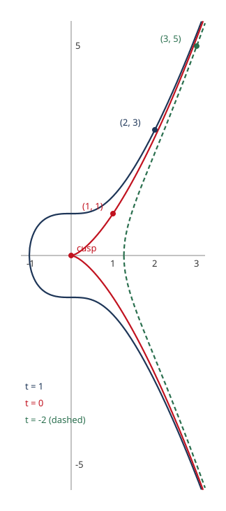
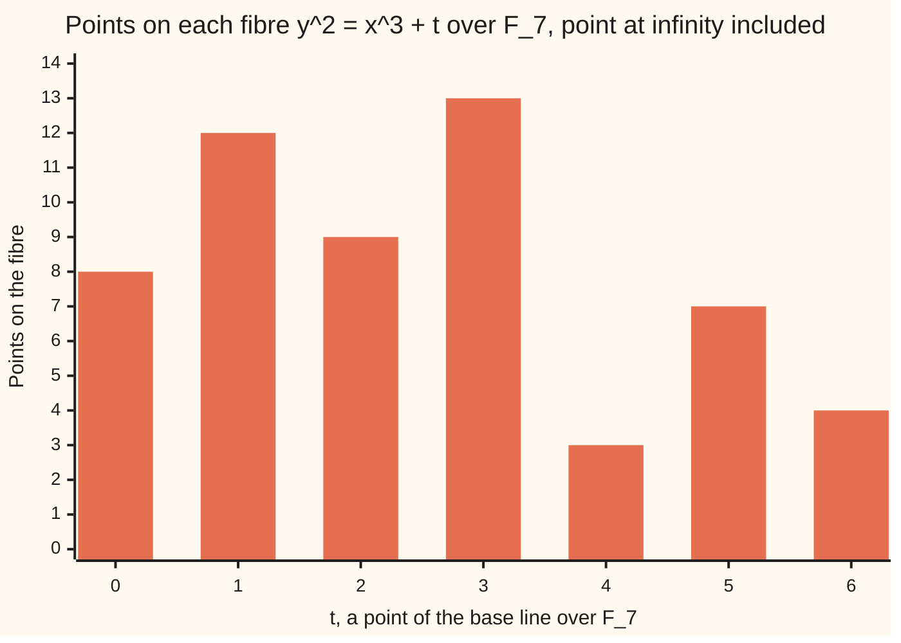

# Morphisms of schemes: ring maps read backwards, and fibres as products

[Syllabus](../../../SYLLABUS.md) → [Algebraic geometry](../README.md) → [Schemes and Modern Language](../README.md#s06) → Morphisms of schemes

---

## General Overview

Take the curves y² = x³ + t, one for each number t. At t = −2 the curve is the house curve of the elliptic-curves shelf, and it passes through (3, 5), since 25 = 27 − 2. At t = 1 it passes through (2, 3). At t = 0 it becomes y² = x³, which has a sharp point, a **cusp**, at the origin.

Stack all these curves into one surface X in (x, y, t)-space, and send each point to its t. That is a map from X to the t-line. The curve over one value of t is the **fibre** over that point. So the whole family is one map, and "watch the curves change" means "look at the fibres one by one".

The modern language describes such a map by its rings. A function f(t) on the line gives the function f(y² − x³) on the surface. So the map of spaces runs from X to the line, while the map of rings runs from the line's ring to X's ring: backwards. A fibre then comes out as a **fibre product**: join the two systems of equations and add the equations that say both land on the same point.

Every question about the family then becomes exact algebra. The fibres are smooth for every t except 0. Over the integers mod 7, the seven fibres hold 7, 11, 8, 12, 2, 6 and 3 points.

**A map of spaces is a ring map read backwards: points go forward because prime ideals pull back, and the fibre over a point is the fibre product, built by joining the two systems of equations and adding the equations that make the two maps agree.**

**What kind of fact this is:** two definitions (the map of spectra and the fibre product) and one theorem proved in Why it works: the pulled-back ideal of a prime is prime. That only the fibre over 0 is singular is also proved there. The fibre product's universal property is stated in words, illustrated by counting pairs over $`\mathbb{F}_7`$, and proved in the sources.

### The picture: three fibres of one family

<p align="center"></p>

To scale, real points only, x from −1.2 to 3.2 and y from −5.6 to 5.6. As t falls from 1 to 0, the round nose at (−1, 0) shrinks into the cusp at the origin. Below 0 the curve pulls away to the right again, smooth.

---

## The formula

Reminders first, each in one line.

- **Field.** The field k is ℚ, the rational numbers, for points and polynomials. Point counts use $`\mathbb{F}_7`$, the integers mod 7. Statements about shapes are over ℂ.
- **Ring map.** A **ring homomorphism** $`\varphi: A \to B`$ is a map that keeps sums, products and 1. Its **kernel** is what goes to 0 ([Ideals and quotient rings](../../03-Algebra/09-Rings%20and%20Fields/04-ideals-and-quotient-rings.md)).
- **Coordinate ring.** $`k[V]`$ is the ring of polynomial functions on a variety V ([Affine varieties](../02-Affine%20and%20Projective%20Varieties/01-affine-varieties-and-coordinate-rings.md)). For the t-line, $`k[S] = k[t]`$.
- **Spectrum.** $`\mathrm{Spec}\, R`$ is the set of prime ideals of a ring R, read as points ([The spectrum of a ring](02-spectrum-of-a-ring-and-schemes.md)). The point (3, 5) is the maximal ideal $`\langle x - 3, y - 5\rangle`$.
- **Pullback.** For a map π, the ring map $`\pi^*`$ sends a function f to $`f \circ \pi`$: first move, then measure. [Maps between varieties](../02-Affine%20and%20Projective%20Varieties/05-regular-and-rational-maps.md) introduced it; here it is written $`\varphi`$, and phi* in the code.

Our surface is X, cut out of (x, y, t)-space by $`y^2 = x^3 + t`$. That equation solves for t, so $`k[X]`$ is $`k[x, y]`$: the kernel of $`k[x, y, t] \to k[x, y]`$, $`t \mapsto y^2 - x^3`$, is $`\langle t - y^2 + x^3\rangle`$. The map to the line is $`\pi(x, y) = y^2 - x^3`$, and its ring map is

```math
\varphi: k[t] \to k[x, y], \qquad \varphi(f) = f(y^2 - x^3)
```

**Read it aloud:** a function of t becomes a function on the surface by putting y² − x³ in place of t.

The rule that ties the two directions together:

```math
\varphi(f)(P) = f(\pi(P))
```

**Read it aloud:** measuring the pulled-back function at a point P gives the same number as moving P down to the line first and measuring there.

Points go the other way, by pulling back prime ideals:

```math
\mathrm{Spec}\, k[x, y] \to \mathrm{Spec}\, k[t], \qquad \mathfrak{p} \mapsto \varphi^{-1}(\mathfrak{p}) = \{ f : \varphi(f) \in \mathfrak{p} \}
```

**Read it aloud:** a point of the surface goes to the set of functions on the line whose pullbacks vanish there.

The pulled-back ideal $`\varphi^{-1}(\mathfrak{p})`$ is also called the **contraction** of $`\mathfrak{p}`$, and the point is said to contract to it.

For (3, 5): $`\varphi(t + 2) = y^2 - x^3 + 2`$ lies in $`\langle x - 3, y - 5\rangle`$, so the point goes to $`\langle t + 2\rangle`$, the point t = −2.

Now the new notation. For maps $`\pi: X \to S`$ and $`\psi: Y \to S`$, the **fibre product** $`X \times_S Y`$ is X and Y joined so that the two maps agree. For affine varieties, build it by joining variables and equations, then adding the equations that make the maps agree (Step 3). Its points with coordinates in k (here ℚ or $`\mathbb{F}_7`$) are the agreeing pairs, where X(k) means the points of X with coordinates in k:

```math
(X \times_S Y)(k) = \{ (P, Q) \in X(k) \times Y(k) : \pi(P) = \psi(Q) \}
```

**Read it aloud:** take a point of X and a point of Y, both with coordinates in k, and keep the pair only when both map to the same point of S.

The **fibre** over a point c of S is the special case where Y is that one point:

```math
X_c = X \times_S \{c\} = V(y^2 - x^3 - t,\ t - c) \cong V(y^2 - x^3 - c)
```

**Read it aloud:** the fibre over c is the surface's equation with one more equation, t = c, added.

Here V(…) is the set where all the listed polynomials vanish, and $`\cong`$ means "the same variety after renaming coordinates". Whether a fibre is smooth is read from the **discriminant** of $`y^2 = x^3 + ax + b`$, $`\Delta = -16(4a^3 + 27b^2)`$ ([Weierstrass form](../04-Elliptic%20Curves/02-weierstrass-forms-discriminant-and-j-invariant.md)). With a = 0 and b = t:

```math
\Delta(t) = -432\, t^2
```

**Read it aloud:** the family's discriminant is −432 times t squared, zero only at t = 0.

| Symbol | Plain meaning | In our example | Push it up and the answer… |
| --- | --- | --- | --- |
| $`k`$, $`X(k)`$ | the field the numbers come from; the points of X with coordinates in k | ℚ; $`\mathbb{F}_7`$ for counts | a finite field gives counts |
| $`X`$, $`S`$ | the total space, a surface; the base, a line | $`y^2 = x^3 + t`$; the t-line | — |
| $`t`$, $`c`$ | the coordinate on S; one value of it | c = −2, 1 or 0 | — |
| $`\pi`$ | the map of spaces, X to S | $`(x, y) \mapsto y^2 - x^3`$ | — |
| $`\varphi`$ | the ring map, $`k[S]`$ to $`k[X]`$ | $`t \mapsto y^2 - x^3`$ | — |
| $`f`$, $`P`$ | a function on S; a point of X | $`f = t^2 - 4`$; P = (3, 5) | — |
| $`\mathfrak{p}`$, $`\varphi^{-1}(\mathfrak{p})`$, $`\mathrm{Spec}`$ | a prime ideal of $`k[X]`$; its pullback; the set of all primes | $`\langle x - 3, y - 5\rangle \mapsto \langle t + 2\rangle`$ | — |
| $`Y`$, $`\psi`$, $`u`$ | a second space over S, its map, and its coordinate | the u-line, $`t = u^6`$ | — |
| $`X \times_S Y`$, $`\otimes`$ | the fibre product: its points over k are the pairs that agree in S; its ring, the tensor product | 73 points over $`\mathbb{F}_7`$ | — |
| $`\tilde{x}`$, $`\tilde{y}`$ | renamed coordinates after the base change | $`x = u^2 \tilde{x}`$, $`y = u^3 \tilde{y}`$ | — |
| $`X_c`$ | the fibre over c | $`y^2 = x^3 - 2`$ at c = −2 | — |
| $`\Delta(t)`$, $`j`$ | the discriminant: zero exactly at singular fibres; the j-invariant, which tells smooth cubics apart over ℂ | −1728 at t = −2; j = 0 | grows as $`t^2`$ |

### When it holds

- **Ring maps must keep 1.** The zero map pulls every prime back to the whole ring, which is no point.
- **Pull back, never push forward.** The image of an ideal need not be an ideal. Along $`\mathbb{Z} \to \mathbb{Q}`$, the image of $`2\mathbb{Z}`$ holds 2 but not $`\tfrac12 \times 2 = 1`$.
- **The agreement equations are what make it a fibre product.** Leave out t = c and the "fibre" over 0 is all 49 points of X over $`\mathbb{F}_7`$, not 7.
- **Characteristic not 2 or 3.** The smoothness test divides by 2 and 3. Over $`\mathbb{F}_3`$ and $`\mathbb{F}_2`$, every fibre is singular, and −432 is 0 there.
- **Smooth total space does not mean smooth fibres.** X itself has no singular point, because its slope in t is −1. The fibre over 0 still has one.

---

## Why it works

### Step 0: functions travel backwards for free

A map of spaces sends points forward, and functions come back by composing: move first, then measure. The modern view takes the ring map as the definition: a map $`\mathrm{Spec}\, B \to \mathrm{Spec}\, A`$ is a ring map $`A \to B`$, read backwards. The work is to show that points still go forward.

### Step 1: the pullback of a prime is prime

Let $`\mathfrak{p}`$ be a prime ideal of B. Suppose a product ab lies in $`\varphi^{-1}(\mathfrak{p})`$. Then $`\varphi(a)\varphi(b) = \varphi(ab)`$ lies in $`\mathfrak{p}`$. Since $`\mathfrak{p}`$ is prime, one of $`\varphi(a)`$, $`\varphi(b)`$ lies in it. So a or b lies in $`\varphi^{-1}(\mathfrak{p})`$.

It is an ideal, since sums and multiples pull back to sums and multiples. It misses 1, because $`\varphi(1) = 1`$ is not in $`\mathfrak{p}`$. So every point has a definite image.

### Step 2: the image of (3, 5) is t = −2

The point (3, 5) is the maximal ideal $`\langle x - 3, y - 5\rangle`$. Its pullback holds t + 2, because two cofactors write $`\varphi(t + 2)`$ inside it:

```math
y^2 - x^3 + 2 = (y + 5)(y - 5) - (x^2 + 3x + 9)(x - 3)
```

**Read it aloud:** the pulled-back function is a combination of x − 3 and y − 5, so it vanishes at (3, 5).

The ideal $`\langle t + 2\rangle`$ is maximal in $`k[t]`$, so the pullback is exactly that: the point t = −2. Evaluation agrees: $`5^2 - 3^3 = -2`$.

Primes that are not maximal travel too. Take the line x = 3, the prime $`\langle x - 3\rangle`$. Setting x = 3 turns $`\varphi(f)`$ into $`f(y^2 - 27)`$, a nonzero polynomial in y whenever f is nonzero; for f = t + 2 it is $`y^2 - 25`$. So no nonzero f(t) pulls back into that prime, and the line goes to $`\langle 0\rangle`$: the **generic point**, which sits on no single value of t. The line runs through every fibre.

### Step 3: build the fibre product by joining equations

Take X in (x, y, t)-space and the u-line Y, mapped to S by $`t = u^6`$. Join the variables: (x, y, t, u). Join the equations: $`y^2 = x^3 + t`$ from X, nothing from Y. Add the agreement equation $`t = u^6`$. The result is $`X \times_S Y`$, and eliminating t leaves one equation:

```math
y^2 = x^3 + u^6
```

**Read it aloud:** the family, pulled back along t = u⁶, is the curve y² = x³ + u⁶ over the u-line.

Its ring, $`k[x, y, t, u]`$ modulo both equations, is the **tensor product** $`k[X] \otimes_{k[t]} k[Y]`$. That is the standard name for the ring this construction builds; Hartshorne (II.3) builds fibre products from it, and Eisenbud's *Commutative Algebra* defines it.

For u ≠ 0, rename $`x = u^2 \tilde{x}`$ and $`y = u^3 \tilde{y}`$. Then $`u^6 \tilde{y}^2 = u^6 \tilde{x}^3 + u^6`$, which is $`\tilde{y}^2 = \tilde{x}^3 + 1`$. Every fibre away from u = 0 is one fixed curve. Over ℂ, the family only seemed to vary: all its smooth fibres are the same curve, with j-invariant 0 (j is the number that tells smooth cubics apart over ℂ).

### Step 4: the universal property, in words

Suppose two maps from some space T, one to X and one to Y, agree once pushed down to S. Then they come from exactly one map T → X ×_S Y.

When T is a single point with coordinates in k, this says the points of $`X \times_S Y`$ with coordinates in k are exactly the pairs that agree. Over $`\mathbb{F}_7`$ that is a count, done three ways in the code. As a scheme, $`X \times_S Y`$ has the prime ideals of the tensor product as its points, and there can be more of them than agreeing pairs. The category language is in Pullbacks and pushouts (planned, wing 24).

### Step 5: only the fibre over 0 degenerates

A point of a fibre is singular when the equation and both its slopes vanish: $`y^2 = x^3 + t`$, $`-3x^2 = 0`$ and $`2y = 0`$. When 2 and 3 are not zero, the slopes force x = y = 0, and then the equation forces t = 0. So the fibre over 0 has one singular point, the cusp, and every other fibre is smooth. The discriminant $`-432t^2`$ says the same.

Watch it happen over ℝ. The leftmost real point of the fibre is $`x = -t^{1/3}`$:

| t | leftmost real point | $`\Delta = -432t^2`$ |
| --- | --- | --- |
| 1 | −1.0000 | −432 |
| 1/10 | −0.4642 | −108/25 |
| 1/100 | −0.2154 | −27/625 |
| 1/1000 | −0.1000 | −27/62500 |

The nose slides into the origin while the discriminant falls to 0. At t = 0 the nose becomes the cusp.

The surface X itself has slopes $`-3x^2`$, $`2y`$ and $`-1`$, and the last is never zero, so X has no singular point. The cusp belongs to how X sits over the line, not to X.

---

## Worked numbers, by hand

| Step | Arithmetic | Value |
| --- | --- | --- |
| image of (3, 5) | $`5^2 - 3^3`$ | t = −2 |
| image of (2, 3) | $`3^2 - 2^3`$ | t = 1 |
| pull back $`t^2 - 4`$ | $`(y^2 - x^3)^2 - 4`$ | $`y^4 - 2x^3y^2 + x^6 - 4`$ |
| check at (3, 5) | $`(-2)^2 - 4`$ | 0 |
| contraction of (3, 5) | cofactors (y + 5) and −(x² + 3x + 9) | $`\langle t + 2\rangle`$ |
| fibre sizes over $`\mathbb{F}_7`$, t = 0 to 6 | count (x, y) with y² = x³ + t | 7, 11, 8, 12, 2, 6, 3 |
| all fibres together | 7 + 11 + 8 + 12 + 2 + 6 + 3 | 49 = 7² |
| u with u⁶ = t, over $`\mathbb{F}_7`$ | u⁶ = 1 for u ≠ 0 | 1 at t = 0, 6 at t = 1, else 0 |
| $`X \times_S Y`$ over $`\mathbb{F}_7`$ | 7 × 1 + 11 × 6 | **73** |

The fibre product holds 73 points: the cusp fibre once, and the fibre over t = 1 six times, once per u with u⁶ = 1.

The counts with the point at infinity added are 8, 12, 9, 13, 3, 7, 4. Each smooth one lies inside Hasse's window $`8 \pm 5.29`$ ([The curve mod p](../04-Elliptic%20Curves/05-reduction-mod-p-and-hasse.md)). The six smooth counts all differ, so over $`\mathbb{F}_7`$ the six smooth fibres are six different curves, although over ℂ they are one.



Bars: each fibre's point count, point at infinity included. The bar at t = 0 is the cusp fibre.

### What breaks if you drop a piece

| Mistake | Comes out at | What went wrong |
| --- | --- | --- |
| Plain product X × Y, no agreement equation | 49 × 7 = 343 points, not 73 | pairs that land on different points of S are kept |
| Fibre over 0 without the equation t = 0 | 49 points, not 7 | that is all of X, not one fibre |
| Smoothness tested on the total space | 0 singular points, but the fibre over 0 has 1 | X's slope −1 in t hides the cusp |
| Pushing the ideal 2ℤ forward to ℚ | holds 2 but not 1 = ½ × 2 | images of ideals need not be ideals |

The code prints all four.

---

## Code, from first principles, and it actually runs

Nothing is imported. Polynomials are small dictionaries of coefficients, multiplied out by hand. The code takes three independent roads. It expands the pullback and the cofactor identity exactly and puts points back in. It counts every fibre over $`\mathbb{F}_7`$ by brute force and again by a character sum, which uses Euler's test for squares and never lists pairs. It builds $`X \times_S Y`$ three ways: from the joined equations, as a sum over fibres, and with t eliminated.

### Python

```python
# Morphisms and fibre products -- the check behind the card.  Nothing is
# imported.  The family is y^2 = x^3 + t over the t-line: the ring map
# t -> y^2 - x^3 read backwards as the map (x, y) -> t.  A polynomial in x, y
# is a dict {(i, j): coeff} for x^i y^j.  Roads: expand polynomials exactly;
# put points back in; count over F_7 by brute force against a character sum;
# build a fibre product from joined equations against a sum over fibres.
def mul(a, b):
    out = {}
    for (i, j), c in a.items():
        for (k, l), d in b.items():
            out[(i + k, j + l)] = out.get((i + k, j + l), 0) + c * d
    return {m: c for m, c in out.items() if c}

def add(a, b, s=1):
    out = dict(a)
    for m, c in b.items():
        out[m] = out.get(m, 0) + s * c
    return {m: c for m, c in out.items() if c}

def ev(g, x, y):
    return sum(c * x ** i * y ** j for (i, j), c in g.items())

def gcd(a, b):
    while b:
        a, b = b, a % b
    return abs(a)

def yn(claim):
    return "yes" if claim else "no"

pi = lambda x, y: y * y - x ** 3              # the map to the t-line, (x, y) -> t
phi_t = {(0, 2): 1, (3, 0): -1}               # phi*(t) = y^2 - x^3, as a polynomial
print("ring map phi*: Q[t] -> Q[x, y], t -> y^2 - x^3; field Q, counts over F_7")
print(f"(3, 5) lies over t = 25 - 27 = {pi(3, 5)}; (2, 3) lies over t = 9 - 8 = {pi(2, 3)}")
pull = add(mul(phi_t, phi_t), {(0, 0): 4}, -1)            # phi*(t^2 - 4), expanded
grid = [(x, y) for x in range(-5, 6) for y in range(-5, 6)]
rule = all(ev(pull, x, y) == pi(x, y) ** 2 - 4 for x, y in grid)
print(f"phi*(t^2 - 4) = y^4 - 2x^3y^2 + x^6 - 4: {yn(pull == {(0, 4): 1, (3, 2): -2, (6, 0): 1, (0, 0): -4})}")
print(f"(phi* f)(P) = f(pi(P)) at all {len(grid)} points of the grid -5..5: {yn(rule)}; at (3, 5): {ev(pull, 3, 5)}")
lhs = add(mul({(0, 1): 1, (0, 0): 5}, {(0, 1): 1, (0, 0): -5}),
          mul({(2, 0): 1, (1, 0): 3, (0, 0): 9}, {(1, 0): 1, (0, 0): -3}), -1)
target = {(0, 2): 1, (3, 0): -1, (0, 0): 2}               # y^2 - x^3 + 2, typed in
print(f"(y + 5)(y - 5) - (x^2 + 3x + 9)(x - 3) = y^2 - x^3 + 2: {yn(lhs == target)}")
print(f"so phi*(t + 2) lies in <x - 3, y - 5>, and the point contracts to <t + 2>")
print(f"on the line x = 3, phi*(t + 2) = y^2 - 25, not 0: the line contracts to <0>")
num, den = 1 * 2, 2 * 1                       # (1/2) x 2 as a fraction, then in lowest terms
g = gcd(num, den); num, den = num // g, den // g
print(f"forward along Z -> Q: 2 is in 2Z, (1/2) x 2 = {num} is not: {yn(2 % 2 == 0 and den == 1 and num % 2 != 0)}, no ideal")

p = 7
brute = [sum(1 for x in range(p) for y in range(p) if (y * y - x ** 3 - t) % p == 0) for t in range(p)]
def chi(a):                                   # Euler's criterion: square, non-square, zero
    r = pow(a % p, (p - 1) // 2, p)
    return -1 if r == p - 1 else r
charsum = [sum(1 + chi(x ** 3 + t) for x in range(p)) for t in range(p)]
print(f"fibre sizes over F_{p}, t = 0..{p - 1}, brute force: {brute}")
print(f"the same by the character sum over x: {charsum}; total {sum(brute)} = {p}^2")
proj = [n + 1 for n in brute]
print(f"with the point at infinity: {proj}; Hasse window for t != 0: {p + 1} +- {2 * p ** 0.5:.2f}")
in_window = all((n - p - 1) ** 2 <= 4 * p for n in proj[1:])
print(f"every smooth fibre inside the window: {yn(in_window)}; six different counts: {yn(len(set(proj[1:])) == 6)}")

def singular(q, F, grads, slots):             # points where F and every listed slope vanish
    return sum(1 for pt in slots if F(*pt) % q == 0 and all(g(*pt) % q == 0 for g in grads))
for q in (7, 3, 2):
    sing = [singular(q, lambda x, y, t=t: y * y - x ** 3 - t, [lambda x, y: -3 * x * x, lambda x, y: 2 * y],
                     [(x, y) for x in range(q) for y in range(q)]) for t in range(q)]
    disc = [(-432 * t * t) % q for t in range(q)]
    print(f"over F_{q}: singular points per fibre {sing}; Delta = -432t^2 mod {q}: {disc}")
    assert [s > 0 for s in sing] == [d == 0 for d in disc]  # brute force against Delta
total = singular(7, lambda x, y, t: y * y - x ** 3 - t,
                 [lambda x, y, t: -3 * x * x, lambda x, y, t: 2 * y, lambda x, y, t: -1],
                 [(x, y, t) for x in range(7) for y in range(7) for t in range(7)])
print(f"total space y^2 - x^3 - t over F_7: {total} singular points; fibre over 0: 1")

roots = [sum(1 for u in range(p) if pow(u, 6, p) == t) for t in range(p)]
joined = sum(1 for x in range(p) for y in range(p) for t in range(p) for u in range(p)
             if (y * y - x ** 3 - t) % p == 0 and (t - u ** 6) % p == 0)
by_fibre = sum(brute[t] * roots[t] for t in range(p))
no_t = sum(1 for x in range(p) for y in range(p) for u in range(p) if (y * y - x ** 3 - u ** 6) % p == 0)
print(f"base change t = u^6: solutions u per t {roots}")
print(f"X x_S Y over F_{p}: joined equations {joined}; sum over fibres {by_fibre}; t eliminated {no_t}")
print(f"u != 0 fibres all copy t = 1: 7 + 6 x {brute[1]} = {7 + 6 * brute[1]}")
plain = sum(1 for x in range(p) for y in range(p) for t in range(p) for u in range(p) if (y * y - x ** 3 - t) % p == 0)
print(f"mistake 1, plain product X x Y: {sum(brute)} x {p} = {plain}, not {joined}")
print(f"mistake 2, fibre over 0 without t = 0: {p * p} points of X, not {brute[0]}")
print(f"mistake 3, smoothness of the total space: {total} singular points, fibre over 0 has 1")

print("degeneration over R: t, leftmost real point x = -t^(1/3), Delta = -432t^2")
for k in range(4):
    num, den = -432, 10 ** (2 * k)
    g = gcd(num, den)
    d = f"{num // g}" if den == g else f"{num // g}/{den // g}"
    print(f"  t = {1 if k == 0 else f'1/{10 ** k}'}: x = {-(10.0 ** -k) ** (1 / 3):.4f}, Delta = {d}")
print(f"figure, t=1 from (-1, 0) through (2, 3); t=0 cusp (0, 0) through (1, 1); "
      f"t=-2 from ({2 ** (1 / 3):.4f}, 0) through (3, 5); box x -1.2..3.2, y -5.6..5.6")
assert pull == {(0, 4): 1, (3, 2): -2, (6, 0): 1, (0, 0): -4} and rule  # expansion vs evaluation
assert lhs == target and pi(3, 5) == -2                    # cofactors certify the contraction
assert brute == charsum and sum(brute) == p * p and in_window   # two counts of each fibre
assert joined == by_fibre == no_t == 7 + 6 * brute[1]      # three roads to X x_S Y
assert total == 0 and brute[0] == p                        # smooth total space, cusp fibre
print("ALL CHECKS PASS")
```

**Ran 2026-11-17 on macOS, Python 3.14.10, standard library only. All checks passed. Output, pasted from the run:**

```
ring map phi*: Q[t] -> Q[x, y], t -> y^2 - x^3; field Q, counts over F_7
(3, 5) lies over t = 25 - 27 = -2; (2, 3) lies over t = 9 - 8 = 1
phi*(t^2 - 4) = y^4 - 2x^3y^2 + x^6 - 4: yes
(phi* f)(P) = f(pi(P)) at all 121 points of the grid -5..5: yes; at (3, 5): 0
(y + 5)(y - 5) - (x^2 + 3x + 9)(x - 3) = y^2 - x^3 + 2: yes
so phi*(t + 2) lies in <x - 3, y - 5>, and the point contracts to <t + 2>
on the line x = 3, phi*(t + 2) = y^2 - 25, not 0: the line contracts to <0>
forward along Z -> Q: 2 is in 2Z, (1/2) x 2 = 1 is not: yes, no ideal
fibre sizes over F_7, t = 0..6, brute force: [7, 11, 8, 12, 2, 6, 3]
the same by the character sum over x: [7, 11, 8, 12, 2, 6, 3]; total 49 = 7^2
with the point at infinity: [8, 12, 9, 13, 3, 7, 4]; Hasse window for t != 0: 8 +- 5.29
every smooth fibre inside the window: yes; six different counts: yes
over F_7: singular points per fibre [1, 0, 0, 0, 0, 0, 0]; Delta = -432t^2 mod 7: [0, 2, 1, 4, 4, 1, 2]
over F_3: singular points per fibre [1, 1, 1]; Delta = -432t^2 mod 3: [0, 0, 0]
over F_2: singular points per fibre [1, 1]; Delta = -432t^2 mod 2: [0, 0]
total space y^2 - x^3 - t over F_7: 0 singular points; fibre over 0: 1
base change t = u^6: solutions u per t [1, 6, 0, 0, 0, 0, 0]
X x_S Y over F_7: joined equations 73; sum over fibres 73; t eliminated 73
u != 0 fibres all copy t = 1: 7 + 6 x 11 = 73
mistake 1, plain product X x Y: 49 x 7 = 343, not 73
mistake 2, fibre over 0 without t = 0: 49 points of X, not 7
mistake 3, smoothness of the total space: 0 singular points, fibre over 0 has 1
degeneration over R: t, leftmost real point x = -t^(1/3), Delta = -432t^2
  t = 1: x = -1.0000, Delta = -432
  t = 1/10: x = -0.4642, Delta = -108/25
  t = 1/100: x = -0.2154, Delta = -27/625
  t = 1/1000: x = -0.1000, Delta = -27/62500
figure, t=1 from (-1, 0) through (2, 3); t=0 cusp (0, 0) through (1, 1); t=-2 from (1.2599, 0) through (3, 5); box x -1.2..3.2, y -5.6..5.6
ALL CHECKS PASS
```

### Rust

Same numbers, same labels, built with `rustc --edition 2021 -O`.

```rust
// Morphisms and fibre products -- the same check as the Python, in Rust.  No
// crates.  The family is y^2 = x^3 + t over the t-line: the ring map
// t -> y^2 - x^3 read backwards as the map (x, y) -> t.  A polynomial in x, y
// is a map {(i, j): coeff} for x^i y^j.  Roads: expand polynomials exactly;
// put points back in; count over F_7 by brute force against a character sum;
// build a fibre product from joined equations against a sum over fibres.
use std::collections::BTreeMap;
type Poly = BTreeMap<(u32, u32), i64>;

fn poly(terms: &[((u32, u32), i64)]) -> Poly { terms.iter().cloned().collect() }

fn mul(a: &Poly, b: &Poly) -> Poly {
    let mut out = Poly::new();
    for (&(i, j), &c) in a { for (&(k, l), &d) in b { *out.entry((i + k, j + l)).or_insert(0) += c * d } }
    out.retain(|_, c| *c != 0);
    out
}

fn add(a: &Poly, b: &Poly, s: i64) -> Poly {
    let mut out = a.clone();
    for (&m, &c) in b { *out.entry(m).or_insert(0) += s * c }
    out.retain(|_, c| *c != 0);
    out
}

fn ev(g: &Poly, x: i64, y: i64) -> i64 { g.iter().map(|(&(i, j), &c)| c * x.pow(i) * y.pow(j)).sum() }
fn gcd(mut a: i64, mut b: i64) -> i64 { while b != 0 { (a, b) = (b, a % b) } a.abs() }
fn yn(claim: bool) -> &'static str { if claim { "yes" } else { "no" } }
fn pi(x: i64, y: i64) -> i64 { y * y - x * x * x }          // the map to the t-line
fn md(a: i64, q: i64) -> i64 { a.rem_euclid(q) }
fn powm(a: i64, e: i64, q: i64) -> i64 { let mut r = 1; for _ in 0..e { r = r * md(a, q) % q } r }

fn main() {
    let p: i64 = 7;
    let phi_t = poly(&[((0, 2), 1), ((3, 0), -1)]);          // phi*(t) = y^2 - x^3
    println!("ring map phi*: Q[t] -> Q[x, y], t -> y^2 - x^3; field Q, counts over F_7");
    println!("(3, 5) lies over t = 25 - 27 = {}; (2, 3) lies over t = 9 - 8 = {}", pi(3, 5), pi(2, 3));
    let pull = add(&mul(&phi_t, &phi_t), &poly(&[((0, 0), 4)]), -1);
    let expect = poly(&[((0, 4), 1), ((3, 2), -2), ((6, 0), 1), ((0, 0), -4)]);
    let grid: Vec<(i64, i64)> = (-5..6).flat_map(|x| (-5..6).map(move |y| (x, y))).collect();
    let rule = grid.iter().all(|&(x, y)| ev(&pull, x, y) == pi(x, y).pow(2) - 4);
    println!("phi*(t^2 - 4) = y^4 - 2x^3y^2 + x^6 - 4: {}", yn(pull == expect));
    println!("(phi* f)(P) = f(pi(P)) at all {} points of the grid -5..5: {}; at (3, 5): {}", grid.len(), yn(rule), ev(&pull, 3, 5));
    let lhs = add(&mul(&poly(&[((0, 1), 1), ((0, 0), 5)]), &poly(&[((0, 1), 1), ((0, 0), -5)])),
                  &mul(&poly(&[((2, 0), 1), ((1, 0), 3), ((0, 0), 9)]), &poly(&[((1, 0), 1), ((0, 0), -3)])), -1);
    let target = poly(&[((0, 2), 1), ((3, 0), -1), ((0, 0), 2)]);   // y^2 - x^3 + 2, typed in
    println!("(y + 5)(y - 5) - (x^2 + 3x + 9)(x - 3) = y^2 - x^3 + 2: {}", yn(lhs == target));
    println!("so phi*(t + 2) lies in <x - 3, y - 5>, and the point contracts to <t + 2>");
    println!("on the line x = 3, phi*(t + 2) = y^2 - 25, not 0: the line contracts to <0>");
    let (mut num, mut den): (i64, i64) = (1 * 2, 2 * 1);   // (1/2) x 2 as a fraction, then in lowest terms
    let g = gcd(num, den); num /= g; den /= g;
    println!("forward along Z -> Q: 2 is in 2Z, (1/2) x 2 = {} is not: {}, no ideal", num, yn(2 % 2 == 0 && den == 1 && num % 2 != 0));

    let brute: Vec<i64> = (0..p).map(|t| (0..p).flat_map(|x| (0..p).map(move |y| (x, y)))
        .filter(|&(x, y)| md(y * y - x * x * x - t, p) == 0).count() as i64).collect();
    let chi = |a: i64| { let r = powm(a, (p - 1) / 2, p); if r == p - 1 { -1 } else { r } };
    let charsum: Vec<i64> = (0..p).map(|t| (0..p).map(|x| 1 + chi(x * x * x + t)).sum()).collect();
    println!("fibre sizes over F_{}, t = 0..{}, brute force: {:?}", p, p - 1, brute);
    println!("the same by the character sum over x: {:?}; total {} = {}^2", charsum, brute.iter().sum::<i64>(), p);
    let proj: Vec<i64> = brute.iter().map(|n| n + 1).collect();
    println!("with the point at infinity: {:?}; Hasse window for t != 0: {} +- {:.2}", proj, p + 1, 2.0 * (p as f64).sqrt());
    let in_window = proj[1..].iter().all(|n| (n - p - 1).pow(2) <= 4 * p);
    let mut distinct = proj[1..].to_vec();
    distinct.sort();
    distinct.dedup();
    println!("every smooth fibre inside the window: {}; six different counts: {}", yn(in_window), yn(distinct.len() == 6));

    for q in [7i64, 3, 2] {                                   // points where F and both slopes vanish
        let sing: Vec<i64> = (0..q).map(|t| (0..q).flat_map(|x| (0..q).map(move |y| (x, y)))
            .filter(|&(x, y)| md(y * y - x * x * x - t, q) == 0 && md(-3 * x * x, q) == 0 && md(2 * y, q) == 0)
            .count() as i64).collect();
        let disc: Vec<i64> = (0..q).map(|t| md(-432 * t * t, q)).collect();
        println!("over F_{}: singular points per fibre {:?}; Delta = -432t^2 mod {}: {:?}", q, sing, q, disc);
        assert!(sing.iter().map(|&s| s > 0).eq(disc.iter().map(|&d| d == 0)));   // brute force against Delta
    }
    let mut total = 0;                                       // slopes -3x^2, 2y and -1 for the t-slot
    for x in 0..7 { for y in 0..7 { for t in 0..7 {
        if md(y * y - x * x * x - t, 7) == 0 && md(-3 * x * x, 7) == 0 && md(2 * y, 7) == 0 && md(-1, 7) == 0 { total += 1 }
    } } }
    println!("total space y^2 - x^3 - t over F_7: {} singular points; fibre over 0: 1", total);

    let roots: Vec<i64> = (0..p).map(|t| (0..p).filter(|&u| powm(u, 6, p) == t).count() as i64).collect();
    let mut joined = 0;
    let mut no_t = 0;
    let mut plain = 0;
    for x in 0..p { for y in 0..p { for u in 0..p {
        for t in 0..p { if md(y * y - x * x * x - t, p) == 0 { plain += 1; if md(t - u.pow(6), p) == 0 { joined += 1 } } }
        if md(y * y - x * x * x - u.pow(6), p) == 0 { no_t += 1 }
    } } }
    let by_fibre: i64 = (0..p as usize).map(|t| brute[t] * roots[t]).sum();
    println!("base change t = u^6: solutions u per t {:?}", roots);
    println!("X x_S Y over F_{}: joined equations {}; sum over fibres {}; t eliminated {}", p, joined, by_fibre, no_t);
    println!("u != 0 fibres all copy t = 1: 7 + 6 x {} = {}", brute[1], 7 + 6 * brute[1]);
    println!("mistake 1, plain product X x Y: {} x {} = {}, not {}", brute.iter().sum::<i64>(), p, plain, joined);
    println!("mistake 2, fibre over 0 without t = 0: {} points of X, not {}", p * p, brute[0]);
    println!("mistake 3, smoothness of the total space: {} singular points, fibre over 0 has 1", total);

    println!("degeneration over R: t, leftmost real point x = -t^(1/3), Delta = -432t^2");
    for k in 0..4u32 {
        let (num, den) = (-432i64, 10i64.pow(2 * k));
        let g = gcd(num, den);
        let d = if den == g { format!("{}", num / g) } else { format!("{}/{}", num / g, den / g) };
        let tt = if k == 0 { "1".to_string() } else { format!("1/{}", 10i64.pow(k)) };
        println!("  t = {}: x = {:.4}, Delta = {}", tt, -(10f64.powi(-(k as i32))).powf(1.0 / 3.0), d);
    }
    println!("figure, t=1 from (-1, 0) through (2, 3); t=0 cusp (0, 0) through (1, 1); t=-2 from ({:.4}, 0) through (3, 5); box x -1.2..3.2, y -5.6..5.6",
             2f64.powf(1.0 / 3.0));
    assert!(pull == expect && rule);                          // expansion vs evaluation
    assert!(lhs == target && pi(3, 5) == -2);                 // cofactors certify the contraction
    assert!(brute == charsum && brute.iter().sum::<i64>() == p * p && in_window);
    assert!(joined == by_fibre && by_fibre == no_t && no_t == 7 + 6 * brute[1]);   // three roads
    assert!(total == 0 && brute[0] == p);                     // smooth total space, cusp fibre
    println!("ALL CHECKS PASS");
}
```

**Ran 2026-11-17 on macOS, rustc 1.98.1, no crates. All checks passed. Output, pasted from the run:**

```
ring map phi*: Q[t] -> Q[x, y], t -> y^2 - x^3; field Q, counts over F_7
(3, 5) lies over t = 25 - 27 = -2; (2, 3) lies over t = 9 - 8 = 1
phi*(t^2 - 4) = y^4 - 2x^3y^2 + x^6 - 4: yes
(phi* f)(P) = f(pi(P)) at all 121 points of the grid -5..5: yes; at (3, 5): 0
(y + 5)(y - 5) - (x^2 + 3x + 9)(x - 3) = y^2 - x^3 + 2: yes
so phi*(t + 2) lies in <x - 3, y - 5>, and the point contracts to <t + 2>
on the line x = 3, phi*(t + 2) = y^2 - 25, not 0: the line contracts to <0>
forward along Z -> Q: 2 is in 2Z, (1/2) x 2 = 1 is not: yes, no ideal
fibre sizes over F_7, t = 0..6, brute force: [7, 11, 8, 12, 2, 6, 3]
the same by the character sum over x: [7, 11, 8, 12, 2, 6, 3]; total 49 = 7^2
with the point at infinity: [8, 12, 9, 13, 3, 7, 4]; Hasse window for t != 0: 8 +- 5.29
every smooth fibre inside the window: yes; six different counts: yes
over F_7: singular points per fibre [1, 0, 0, 0, 0, 0, 0]; Delta = -432t^2 mod 7: [0, 2, 1, 4, 4, 1, 2]
over F_3: singular points per fibre [1, 1, 1]; Delta = -432t^2 mod 3: [0, 0, 0]
over F_2: singular points per fibre [1, 1]; Delta = -432t^2 mod 2: [0, 0]
total space y^2 - x^3 - t over F_7: 0 singular points; fibre over 0: 1
base change t = u^6: solutions u per t [1, 6, 0, 0, 0, 0, 0]
X x_S Y over F_7: joined equations 73; sum over fibres 73; t eliminated 73
u != 0 fibres all copy t = 1: 7 + 6 x 11 = 73
mistake 1, plain product X x Y: 49 x 7 = 343, not 73
mistake 2, fibre over 0 without t = 0: 49 points of X, not 7
mistake 3, smoothness of the total space: 0 singular points, fibre over 0 has 1
degeneration over R: t, leftmost real point x = -t^(1/3), Delta = -432t^2
  t = 1: x = -1.0000, Delta = -432
  t = 1/10: x = -0.4642, Delta = -108/25
  t = 1/100: x = -0.2154, Delta = -27/625
  t = 1/1000: x = -0.1000, Delta = -27/62500
figure, t=1 from (-1, 0) through (2, 3); t=0 cusp (0, 0) through (1, 1); t=-2 from (1.2599, 0) through (3, 5); box x -1.2..3.2, y -5.6..5.6
ALL CHECKS PASS
```

The two outputs match line for line.

### Lean

Lean proves the card's three main claims and checks the worked numbers exactly.

- Take a ring map $`\varphi`$ and a prime ideal $`\mathfrak{p}`$. Then $`\varphi^{-1}(\mathfrak{p})`$ is prime, so every point has a definite image.
- Over ℚ, the pullback of $`\langle x - 3, y - 5\rangle`$ is exactly $`\langle t + 2\rangle`$. So (3, 5) lies over t = −2.
- Suppose 2 and 3 are not zero in the field. Then the fibre $`y^2 = x^3 + t`$ has a singular point exactly when t = 0.
- The point (2, 3) lies over t = 1. The pullback of $`t^2 - 4`$ vanishes at (3, 5).
- The cofactor identity $`y^2 - x^3 + 2 = (y + 5)(y - 5) - (x^2 + 3x + 9)(x - 3)`$ holds.
- Over $`\mathbb{F}_7`$ the fibres hold 7, 11, 8, 12, 2, 6 and 3 points, 49 in all.
- Take $`t = u^6`$ over $`\mathbb{F}_7`$. Then $`y^2 = x^3 + u^6`$ has 73 points, which is 7 × 1 + 11 × 6.
- The plain product, without the agreement equation, has 49 × 7 = 343 points.
- Over $`\mathbb{F}_7`$ the fibre over 0 has exactly one singular point.
- At t = −2 the discriminant is −1728, which is $`-432 \times (-2)^2`$.

The character sum, the Hasse window, the smooth total space, the degeneration over ℝ and the figure are left to the Python and Rust checks.

```lean
-- Morphisms of schemes: a ring map pulls prime ideals back to prime ideals, the point (3, 5) of y² = x³ + t goes to t = -2, and only the fibre over t = 0 is singular.
import Mathlib.RingTheory.Ideal.Maps
import Mathlib.RingTheory.Polynomial.Ideal
import Mathlib.Algebra.MvPolynomial.Basic
import Mathlib.Algebra.Polynomial.AlgebraMap
import Mathlib.Data.ZMod.Basic
import Mathlib.Data.Fintype.Prod
import Mathlib.Tactic.Ring
import Mathlib.Tactic.NormNum
import Mathlib.Algebra.Polynomial.Div
import Mathlib.Algebra.MvPolynomial.Polynomial

open MvPolynomial

/-- Points go forward because prime ideals pull back: for a ring map
`φ : A → B` that keeps sums, products and 1, the pullback
`φ⁻¹(𝔭) = {f : φ(f) ∈ 𝔭}` of a prime ideal `𝔭` of `B` is a prime ideal of `A`.
So every point of `Spec B` has a definite image in `Spec A`. -/
theorem pullback_of_prime_is_prime {A B : Type*} [CommRing A] [CommRing B]
    (φ : A →+* B) (𝔭 : Ideal B) (h𝔭 : 𝔭.IsPrime) : (𝔭.comap φ).IsPrime := by
  exact Ideal.comap_isPrime φ 𝔭

/-- The point (3, 5), the maximal ideal `⟨x - 3, y - 5⟩` of `ℚ[x, y]`, contracts
along the ring map `φ : ℚ[t] → ℚ[x, y]`, `t ↦ y² - x³`, to the ideal `⟨t + 2⟩`:
the point t = -2. Here `X 0` is x and `X 1` is y. -/
theorem contraction_of_three_five :
    Ideal.comap (Polynomial.aeval (X 1 ^ 2 - X 0 ^ 3 : MvPolynomial (Fin 2) ℚ))
        (Ideal.span {X 0 - C 3, X 1 - C 5}) =
      Ideal.span {Polynomial.X + Polynomial.C (2 : ℚ)} := by
  apply le_antisymm
  · intro p hp
    rw [Ideal.mem_comap] at hp
    let e : MvPolynomial (Fin 2) ℚ →ₐ[ℚ] ℚ := MvPolynomial.aeval ![(3 : ℚ), 5]
    have hle : Ideal.span {X 0 - C 3, X 1 - C 5} ≤ RingHom.ker e := by
      rw [Ideal.span_le]
      intro q hq
      simp only [Set.mem_insert_iff, Set.mem_singleton_iff] at hq
      rcases hq with rfl | rfl <;> simp [e]
    have h0 : e (Polynomial.aeval (X 1 ^ 2 - X 0 ^ 3 : MvPolynomial (Fin 2) ℚ) p) = 0 :=
      (RingHom.mem_ker).1 (hle hp)
    rw [← Polynomial.aeval_algHom_apply] at h0
    have he : e (X 1 ^ 2 - X 0 ^ 3 : MvPolynomial (Fin 2) ℚ) = -2 := by
      simp [e]; norm_num
    rw [he, Polynomial.coe_aeval_eq_eval] at h0
    have hX : (Polynomial.X + Polynomial.C (2 : ℚ)) = Polynomial.X - Polynomial.C (-2) := by
      simp [sub_eq_add_neg]
    rw [Ideal.mem_span_singleton, hX, Polynomial.dvd_iff_isRoot]
    exact h0
  · rw [Ideal.span_le, Set.singleton_subset_iff, SetLike.mem_coe, Ideal.mem_comap]
    have hm : Polynomial.aeval (X 1 ^ 2 - X 0 ^ 3 : MvPolynomial (Fin 2) ℚ)
        (Polynomial.X + Polynomial.C (2 : ℚ)) =
        (X 1 + C 5) * (X 1 - C 5) - (X 0 ^ 2 + C 3 * X 0 + C 9) * (X 0 - C 3) := by
      simp only [map_add, Polynomial.aeval_X, Polynomial.aeval_C, MvPolynomial.algebraMap_eq]
      rw [show (C 2 : MvPolynomial (Fin 2) ℚ) = 2 from map_ofNat C 2,
        show (C 3 : MvPolynomial (Fin 2) ℚ) = 3 from map_ofNat C 3,
        show (C 5 : MvPolynomial (Fin 2) ℚ) = 5 from map_ofNat C 5,
        show (C 9 : MvPolynomial (Fin 2) ℚ) = 9 from map_ofNat C 9]
      ring
    rw [hm]
    apply sub_mem
    · exact Ideal.mul_mem_left _ _ (Ideal.subset_span (by simp))
    · exact Ideal.mul_mem_left _ _ (Ideal.subset_span (by simp))

/-- Only the fibre over 0 degenerates: over a field where 2 and 3 are not zero,
the fibre `y² = x³ + t` has a singular point (the equation and both slopes
`-3x²` and `2y` vanish) exactly when `t = 0`. -/
theorem fibre_singular_iff_t_eq_zero {K : Type*} [Field K]
    (h2 : (2 : K) ≠ 0) (h3 : (3 : K) ≠ 0) (t : K) :
    (∃ x y : K, y ^ 2 = x ^ 3 + t ∧ -3 * x ^ 2 = 0 ∧ 2 * y = 0) ↔ t = 0 := by
  constructor
  · rintro ⟨x, y, h, hx, hy⟩
    have hx0 : x = 0 := by
      have : x ^ 2 = 0 := by
        have h3' : (-3 : K) ≠ 0 := neg_ne_zero.mpr h3
        exact (mul_eq_zero.mp hx).resolve_left h3'
      exact pow_eq_zero_iff (two_ne_zero) |>.mp this
    have hy0 : y = 0 := (mul_eq_zero.mp hy).resolve_left h2
    subst hx0; subst hy0
    simpa using h.symm
  · rintro rfl
    exact ⟨0, 0, by ring, by ring, by ring⟩

-- Images of (3, 5) and (2, 3) under (x, y) ↦ y² - x³.
example : (5 : ℤ) ^ 2 - 3 ^ 3 = -2 := by norm_num
example : (3 : ℤ) ^ 2 - 2 ^ 3 = 1 := by norm_num

-- The pullback of t² - 4, checked at (3, 5).
example : ((5 : ℤ) ^ 2 - 3 ^ 3) ^ 2 - 4 = 0 := by norm_num

-- The cofactor identity that puts φ(t + 2) inside ⟨x - 3, y - 5⟩.
example (x y : ℤ) :
    (y + 5) * (y - 5) - (x ^ 2 + 3 * x + 9) * (x - 3) = y ^ 2 - x ^ 3 + 2 := by ring

-- Fibre sizes over F_7 for t = 0, ..., 6: 7, 11, 8, 12, 2, 6, 3.
example : ((Finset.univ : Finset (ZMod 7 × ZMod 7)).filter
    (fun p => p.2 ^ 2 = p.1 ^ 3 + 0)).card = 7 := by decide
example : ((Finset.univ : Finset (ZMod 7 × ZMod 7)).filter
    (fun p => p.2 ^ 2 = p.1 ^ 3 + 1)).card = 11 := by decide
example : ((Finset.univ : Finset (ZMod 7 × ZMod 7)).filter
    (fun p => p.2 ^ 2 = p.1 ^ 3 + 2)).card = 8 := by decide
example : ((Finset.univ : Finset (ZMod 7 × ZMod 7)).filter
    (fun p => p.2 ^ 2 = p.1 ^ 3 + 3)).card = 12 := by decide
example : ((Finset.univ : Finset (ZMod 7 × ZMod 7)).filter
    (fun p => p.2 ^ 2 = p.1 ^ 3 + 4)).card = 2 := by decide
example : ((Finset.univ : Finset (ZMod 7 × ZMod 7)).filter
    (fun p => p.2 ^ 2 = p.1 ^ 3 + 5)).card = 6 := by decide
example : ((Finset.univ : Finset (ZMod 7 × ZMod 7)).filter
    (fun p => p.2 ^ 2 = p.1 ^ 3 + 6)).card = 3 := by decide
example : 7 + 11 + 8 + 12 + 2 + 6 + 3 = 7 ^ 2 := by norm_num

-- X ×_S Y over F_7 with t eliminated: y² = x³ + u⁶ has 73 points, 7 × 1 + 11 × 6.
example : ((Finset.univ : Finset (ZMod 7 × ZMod 7 × ZMod 7)).filter
    (fun p => p.2.1 ^ 2 = p.1 ^ 3 + p.2.2 ^ 6)).card = 73 := by decide
example : 7 * 1 + 11 * 6 = 73 := by norm_num
-- The plain product without the agreement equation: 49 × 7 = 343.
example : 49 * 7 = 343 := by norm_num

-- The fibre over 0 over F_7 has exactly one singular point.
example : ((Finset.univ : Finset (ZMod 7 × ZMod 7)).filter
    (fun p => p.2 ^ 2 = p.1 ^ 3 ∧ -3 * p.1 ^ 2 = 0 ∧ 2 * p.2 = 0)).card = 1 := by decide

-- The discriminant -16(4a³ + 27b²) at a = 0, b = -2 is -1728 = -432 × (-2)².
example : (-16 : ℤ) * (4 * 0 ^ 3 + 27 * (-2) ^ 2) = -1728 := by norm_num
example : (-432 : ℤ) * (-2) ^ 2 = -1728 := by norm_num

#print axioms pullback_of_prime_is_prime
#print axioms contraction_of_three_five
#print axioms fibre_singular_iff_t_eq_zero
```

**Checked 2026-11-17 on macOS, Lean 4.36.0-rc2, Mathlib v4.36.0-rc2. Every proof is complete and uses only Lean's standard axioms. Output, pasted from the run:**

```
'pullback_of_prime_is_prime' depends on axioms: [propext, Quot.sound]
'contraction_of_three_five' depends on axioms: [propext, Classical.choice, Quot.sound]
'fibre_singular_iff_t_eq_zero' depends on axioms: [propext, Classical.choice, Quot.sound]
```

> [!TIP]
> **Try changing**
> Guess first, then run it.
> - **Another prime.** Set `p = 13`. Guess first: do the fibre sizes still add to p²? They do, 169, since every point of X lies over one t. The asserts pinned to 7 stop the run.
> - **A gentler base change.** Replace the sixth powers of u by squares: `pow(u, 2, p)`, and `u ** 2` twice. Guess first: how many points does the fibre product hold now? 49, as many as X itself and fewer than 73: squares hit 1, 2 and 4, so it holds 7 + 2 × (11 + 8 + 2) = 49 points. The fourth assert, pinned to the u⁶ answer 73, stops it.
> - **Drop the slope in t.** Delete `lambda x, y, t: -1` from the total-space test. Guess first: the cusp at (0, 0, 0) now counts, `total` reads 1, and the last assert stops the run.
> - **A field of characteristic 3.** The loop already prints it: every fibre over $`\mathbb{F}_3`$ has one singular point, because −432 is 0 mod 3.

---

## The usual mistake

> [!warning]
> **Reading the ring map forwards.** The map of spaces goes X → S, but the ring map goes $`k[t] \to k[x, y]`$. Trying to push a point's ideal forward fails: the image of an ideal need not be an ideal, as $`2\mathbb{Z}`$ inside ℚ holds 2 but not 1. Points move by pulling back primes.
>
> - **Forgetting the agreement equation.** The plain product of X and the u-line has 343 points over $`\mathbb{F}_7`$; the fibre product has 73.
> - **Taking X itself for a fibre.** Without t = 0, the "fibre over 0" has 49 points, not 7.
> - **Testing smoothness on the total space.** X has 0 singular points, yet its fibre over 0 has the cusp.
> - **Trusting Δ in small characteristic.** Over $`\mathbb{F}_2`$ and $`\mathbb{F}_3`$, −432 is 0 and every fibre is singular.

---

## Where you meet it in real life

- **Reduction mod p.** Over $`\mathbb{Z}`$, the curve $`y^2 = x^3 - 2`$ maps to $`\mathrm{Spec}\, \mathbb{Z}`$. Its fibre over the prime 7 is the curve mod 7, which [The curve mod p](../04-Elliptic%20Curves/05-reduction-mod-p-and-hasse.md) counts. Bad primes are the singular fibres.
- **Mordell's equations.** The curves $`y^2 = x^3 + t`$ with whole-number t are studied as one family in number theory. The base change $`t = u^6`$ shows they are all twists of one curve: equal over ℂ, different over ℚ or $`\mathbb{F}_7`$.
- **Moduli.** A space whose points are curves is built so that families are maps to it ([Moduli spaces](07-moduli-spaces-in-outline.md)). Away from t = 0, this family maps to the single point j = 0.

> **Say it back**
> A map of spaces X → S is a ring map k[S] → k[X], read backwards. Points travel forward because the pullback of a prime ideal is prime. The fibre product X ×_S Y joins both systems of equations and adds the equations that make the two maps agree. A fibre is the fibre product with one point. For y² = x³ + t, the fibre over c is y² = x³ + c, smooth except at c = 0, where it becomes a cusp.

---

## What this builds on

- [Localisation](03-localisation-and-local-rings.md): inverting functions to look near one point. The fibre over the generic point of the t-line is the family over $`k(t)`$, the localisation that inverts every nonzero polynomial in t.
- [The spectrum of a ring](02-spectrum-of-a-ring-and-schemes.md): prime ideals as points, the spaces this card maps between.
- [Affine varieties](../02-Affine%20and%20Projective%20Varieties/01-affine-varieties-and-coordinate-rings.md): the coordinate ring, a variety's functions.
- [Weierstrass form](../04-Elliptic%20Curves/02-weierstrass-forms-discriminant-and-j-invariant.md): the discriminant and the j-invariant used to read each fibre.

## Where this goes next

- [Modules](05-modules-and-the-structure-theorem.md): a module is a vector space over a ring, as $`k[x, y]`$ is over $`k[t]`$ through $`\varphi`$; over a PID such as $`k[t]`$, every finitely generated module splits into free and cyclic pieces.
- [Moduli spaces](07-moduli-spaces-in-outline.md): spaces built so that every family is a map to them.
- Pullbacks and pushouts (planned, wing 24): the fibre product as a universal property in any category.

The question this card leaves open: which families hold together, so that degree and arithmetic genus stay constant even where one fibre turns singular? That is the question of flat families (Hartshorne III.9). This family is flat, yet its fibre over 0 is a cusp and its counts over $`\mathbb{F}_7`$ vary.

---

## Sources

Verified 2026-11-17: every link below resolves to the publisher's page.

- Hartshorne, Robin. *Algebraic Geometry*. Springer, 1977. [doi:10.1007/978-1-4757-3849-0](https://doi.org/10.1007/978-1-4757-3849-0). Chapter II.2 to II.3: morphisms of schemes, fibre products built from tensor products, and fibres.
- Eisenbud, David, and Joe Harris. *The Geometry of Schemes*. Springer, 2000. [doi:10.1007/b97680](https://doi.org/10.1007/b97680). Families, fibres and degenerations, with many pictures.
- Eisenbud, David. *Commutative Algebra with a View Toward Algebraic Geometry*. Springer, 1995. [doi:10.1007/978-1-4612-5350-1](https://doi.org/10.1007/978-1-4612-5350-1). Tensor products of rings, prime ideals, and the ring side of fibres.
- Mumford, David. *The Red Book of Varieties and Schemes*, 2nd ed. Springer, 1999. [doi:10.1007/b62130](https://doi.org/10.1007/b62130). Spec as a functor and the meaning of the generic point.
- Silverman, Joseph H. *The Arithmetic of Elliptic Curves*, 2nd ed. Springer, 2009. [doi:10.1007/978-0-387-09494-6](https://doi.org/10.1007/978-0-387-09494-6). The discriminant and j-invariant of y² = x³ + b, and twists of j = 0 curves.
