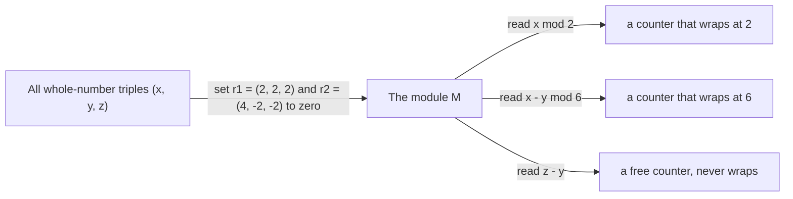

# Modules: vector spaces over a ring, and the classification when the ring is a PID

[Syllabus](../../../SYLLABUS.md) → [Algebraic geometry](../README.md) → [Schemes and Modern Language](../README.md#s06) → Modules

---

## General Overview

Two steps in space, $`r_1 = (2, 2, 2)`$ and $`r_2 = (4, -2, -2)`$, may each be taken any whole number of times, forwards or backwards. Which whole-number targets (x, y, z) can they reach from (0, 0, 0)? That is three equations, 2a + 4b = x, 2a − 2b = y and 2a − 2b = z, in two whole-number unknowns a and b: the kind of system the Smith normal form was invented for in 1861.

The answer is short. A target is reachable exactly when x is even, x − y is a multiple of 6, and z equals y. So three readings say how far any target is from reachable, and a target is reachable when all three read 0:

- x mod 2, a counter that wraps at 2;
- x − y mod 6, a counter that wraps at 6;
- z − y, a whole number that never wraps.

The target (3, 3, 3) is out of reach, but twice it is reachable: (6, 6, 6) = $`3r_1`$. The target (1, 0, 0) needs six copies. The target (0, 0, 1) is never reached, however many copies are taken.

Now add triples coordinate by coordinate, multiply them by whole numbers, and treat every reachable triple as zero. What is left is a **module**: a set of things that add, multiplied by members of a ring instead of a field. A ring is a number system that adds, subtracts and multiplies, but may not divide, such as the whole numbers ℤ. This card proves that over a ring with no zero divisors (no two nonzero members multiply to 0) in which every ideal has one generator, every module built from finitely many generators splits like the example: some free counters, plus counters that wrap. Here that is one free counter and counters that wrap at 2 and at 6: the three tests a target must pass.

Algebraic geometry meets such objects everywhere: homology groups, class groups and the rational points of an elliptic curve all arrive as generators and relations over ℤ. The theorem gives each one's whole shape.

**A finitely generated module over a principal ideal domain is a number of free counters plus a list of wrap-around counters, each wrap size dividing the next, and the list is found by diagonalising the relations with moves the ring can undo.**

**What kind of fact this is:** module, submodule and quotient are definitions; the structure theorem is a theorem, proved on this card in Why it works, with the uniqueness half in a fold.

### The picture: from triples to three counters



The three readings come from new coordinates on the triples, (x, x − y, z − y). Why it works shows how they are found.

---

## The formula

Notation first, in words.

- A **ring** R here adds, subtracts and multiplies, with a + b = b + a, ab = ba and a member 1. Its members are called **scalars**, written a, b.
- A **module** M over R is a set whose members, written u, v, add like a group in which order does not matter, and can be multiplied by scalars. The rules are those of a vector space ([Vector spaces and subspaces](../../03-Algebra/03-Vectors/02-vector-spaces-and-subspaces.md)), with R in place of the field:

```math
a(u + v) = au + av, \quad (a + b)u = au + bu, \quad (ab)u = a(bu), \quad 1u = u
```

- A **submodule** N is a subset that is a module under the same rules. The **quotient** M/N is M with every member of N treated as zero. It is built like a quotient group ([Normal subgroups and quotient groups](../../03-Algebra/08-Groups/06-normal-subgroups-and-quotient-groups.md)); no normality test is needed, since addition here never depends on order.
- $`R^n`$ is the **free module** of lists of n scalars. Its **basis** $`e_1, \dots, e_n`$ is the lists with one 1 and the rest 0. M is **finitely generated** when finitely many members build every member by scalar mixes.
- $`R/(d)`$ is the **cyclic module** R modulo the multiples of d. Over ℤ it is $`\mathbb{Z}/d`$, the counter that wraps at d.
- $`\oplus`$ is the **direct sum**: modules side by side, each part added on its own, as in [Direct products](../../03-Algebra/08-Groups/07-direct-products.md). It is a second name for the direct product of finitely many pieces. (On the tropical card later in this wing, ⊕ means min instead.)
- A **principal ideal domain**, PID, is a ring with no zero divisors in which every ideal is the multiples of one member: ℤ, and k[x] for a field k ([Domains, principal ideals and unique factorisation](01-integral-domains-pids-and-unique-factorisation.md)).

The structure theorem says that every finitely generated module over a PID R has this shape:

```math
M \cong R^{m} \oplus R/(d_1) \oplus R/(d_2) \oplus \dots \oplus R/(d_s), \qquad d_1 \mid d_2 \mid \dots \mid d_s
```

**Read it aloud:** M is the same module as m free copies of the ring, plus s cyclic pieces, each wrap size dividing the next.

Each $`d_i`$ is a nonzero scalar with no inverse, so no piece is zero. The number m and the list of $`d_i`$ are fixed by M, up to unit factors such as −1. The $`d_i`$ are the **invariant factors**.

The recipe that finds them starts from a **relation matrix** A. Its columns are the relations, written in the generators. Moves on rows and columns that the ring can undo turn A into a diagonal:

```math
S\,A\,T = D = \mathrm{diag}(d_1, \dots, d_s, 0, \dots, 0), \qquad M \cong R^{n} / (\text{column mixes of } A)
```

**Read it aloud:** after renaming the generators with S and the relations with T, each relation involves one generator only, times $`d_i`$.

In the example, R = ℤ, n = 3 generators and two relations give

```math
\mathbb{Z}^3 / (\mathbb{Z} r_1 + \mathbb{Z} r_2) \cong \mathbb{Z} \oplus \mathbb{Z}/2 \oplus \mathbb{Z}/6
```

| Symbol | Plain meaning | In our example | Push it up and the answer… |
| --- | --- | --- | --- |
| $`R`$, $`k`$, Frac(R) | the ring of scalars, here a PID; a field; the fractions of R | ℤ; ℚ; ℚ | — |
| $`M`$, $`N`$, $`M/N`$, $`K`$ | a module; a submodule; the quotient that treats N as zero; the relations | $`\mathbb{Z}^3`$; the mixes of $`r_1, r_2`$; the leftover; K = N | a bigger N leaves less |
| $`a, b, c`$; $`u, v, u_i, w, w_0`$ | scalars; members of a module, generators among them | 2 and 6, the copies that kill (3, 3, 3) and (1, 0, 0) | — |
| $`R^n`$, $`e_i`$, $`n`$ | the free module of n-entry lists; its basis; the number of generators | $`\mathbb{Z}^3`$; (1, 0, 0), (0, 1, 0), (0, 0, 1); 3 | more generators |
| $`r_1, r_2`$, $`A`$ | the relations; the matrix with them as columns | `[[2, 4], [2, -2], [2, -2]]` | more relations, smaller M |
| $`S`$, $`T`$, $`D`$ | invertible row moves; invertible column moves; the diagonal reached | $`S`$ = `[[1, 0, 0], [1, -1, 0], [0, -1, 1]]`, $`T`$ = `[[1, -2], [0, 1]]`; diag(2, 6) | — |
| $`s, t, g`$ | in Step 2, Bezout's coefficients and the gcd they give, $`g = sa + tb`$; in the formula, s also counts the cyclic pieces | Bezout not needed: 2 divides every entry of A; s = 2 pieces | — |
| $`d_i`$, $`\mid`$, $`m`$ | invariant factors; "divides"; the free rank, counters that never wrap | 2 and 6, and 2 divides 6; m = 1 | larger wrap sizes |
| $`R/(d)`$, $`\oplus`$, $`\cong`$ | a cyclic piece; side by side; "is the same module as" | $`\mathbb{Z}/6`$ | — |
| $`M_{\mathrm{tors}}`$, $`\varphi`$ | the torsion submodule: members some nonzero scalar sends to zero; the map reading off the counters | $`\mathbb{Z}/2 \oplus \mathbb{Z}/6`$, 12 members; (x, y, z) ↦ (x mod 2, x − y mod 6, z − y) | — |
| $`q`$, $`p`$, $`e`$, $`j`$, $`g_i`$ | a modulus; a prime; an exponent; the exact power of p in a factor; gcd of the i-by-i minors of A | q = 1 to 12; p = 2, 3; $`g_1 = 2`$, $`g_2 = 12`$ | — |
| $`V`$, $`L`$, $`f`$ | a vector space; a linear map on it; a polynomial | Step 6 only | — |

### When it holds

- **The ring is a PID.** In ℤ[x] the ideal of polynomials with even constant term, generated by 2 and x, is a submodule of the free module ℤ[x]. Any two members a, b of an ideal obey b · a − a · b = 0, so a free ideal has a single generator. This one needs both 2 and x, so it is not free, and it fits no list of the theorem's shape.
- **Finitely generated.** The fractions ℚ, as a ℤ-module, have no member of finite order except 0, yet ℚ is not ℤ to any power: any finite list of fractions misses 1/(2D), where D is their common denominator.
- **The ring stays the same.** Computed over ℚ instead of ℤ, the same relations reduce to diagonal 1, 1, and the answer reads ℚ: the twists ℤ/2 and ℤ/6 are gone. Over a field every module is free, since every nonzero scalar is a unit.
- **The divisibility chain.** Without $`d_1 \mid d_2`$ the list is not unique: ℤ/2 ⊕ ℤ/3 and ℤ/6 are the same module, by [Direct products](../../03-Algebra/08-Groups/07-direct-products.md).

---

## Why it works

### Step 0: rename until each relation touches one generator

A finitely generated module is generators modulo relations, and neither list has a preferred form. Rename the generators, and swap relations for equivalent ones, until each relation says "$`d_i`$ times one generator is zero". Then the module splits into counters on sight.

The work is showing the renaming exists over any PID, and that the answer does not depend on the route.

### Step 1: every finitely generated module is a quotient of a free one

Pick generators $`u_1, \dots, u_n`$ of M. The map sending $`e_i`$ to $`u_i`$ takes $`R^n`$ onto M. The members of $`R^n`$ that it sends to zero form a submodule K, the **relations**. By the first isomorphism theorem, proved for groups on the quotient-groups card and unchanged for modules, $`M \cong R^n / K`$.

For the recipe, K must have finitely many generators too. Over a PID it is better: K is free, of rank at most n.

<details>
<summary>Detailed proof: over a PID, a submodule of a free module of rank n is free of rank at most n</summary>

Induct on n. For n = 1, a submodule of R is an ideal, so it is the multiples of one scalar a. If a = 0 it is zero. Otherwise it is free on a, since $`ba = 0`$ forces $`b = 0`$ in a domain.

For larger n, let K sit in $`R^n`$ and look at the last coordinates of its members. They form an ideal, the multiples of some a. If a = 0, K lies in $`R^{n-1}`$ and induction finishes. Otherwise pick $`w_0`$ in K with last coordinate a.

Any w in K has last coordinate ca for some scalar c. Then $`w - c\,w_0`$ has last coordinate 0, so it lies in $`K \cap R^{n-1}`$, which is free of rank at most n − 1 by induction. The sum is direct: a multiple of $`w_0`$ with last coordinate 0 is $`0 \cdot w_0`$. So

$`\displaystyle K = R\,w_0 \oplus (K \cap R^{n-1})`$

is free of rank at most n.

</details>

In the example, M is $`\mathbb{Z}^3`$ modulo K, and K is free on $`r_1`$ and $`r_2`$.

### Step 2: moves the ring can undo, and Bezout's move

Write the relations as the columns of A. Renaming generators is an invertible row move. Replacing relations by equivalent ones is an invertible column move. Over ℤ the moves are those of the [Smith normal form](../../17-Topology/05-Homology/03-computing-homology-by-smith-normal-form.md) card in the topology wing: swap, flip a sign, add a multiple. That card proves the case of a quotient of $`\mathbb{Z}^n`$; this card owns the theorem over any PID.

Some PIDs have no division with remainder (the domains card names one), so Euclid's algorithm is not always available. One more move replaces it. If the pivot a does not divide an entry b below it, the ideal of their mixes is the multiples of a single g, so $`g = sa + tb`$ for some scalars s and t. Apply

```math
\begin{pmatrix} s & t \\ -b/g & a/g \end{pmatrix} \begin{pmatrix} a \\ b \end{pmatrix} = \begin{pmatrix} g \\ 0 \end{pmatrix}, \qquad \det = \frac{sa + tb}{g} = 1
```

**Read it aloud:** Bezout's move puts the gcd in the pivot and a zero below it, and its determinant is 1, so the ring can undo it.

### Step 3: the recipe stops, with each entry dividing the next

1. Pick a nonzero pivot and move it to the corner. Over ℤ the code takes the smallest entry.
2. Clear its column with row moves, and its row with column moves: plain subtraction where the pivot divides, Bezout's move where it does not.
3. If a column move refilled the column, go back to step 2.
4. If the pivot fails to divide some entry further in, add that entry's row to the pivot row and go back to step 2.
5. Otherwise set the pivot's row and column aside and repeat on the rest.

Each Bezout move replaces the pivot by a proper divisor. In a PID every nonzero non-unit factors into finitely many primes ([Domains, principal ideals and unique factorisation](01-integral-domains-pids-and-unique-factorisation.md)). Each proper divisor has fewer prime factors, so the pivot can shrink only finitely often. Step 4 forces a shrink, so it too runs finitely often. When a pivot is accepted it divides everything left, and later moves only mix those entries, so each diagonal entry divides the next.

### Step 4: a diagonal reads off at once

If $`D = \mathrm{diag}(d_1, \dots, d_s, 0, \dots)`$ with n rows, the relations say $`d_i e_i = 0`$ and nothing more. So

```math
R^n / (\text{column mixes of } D) = R/(d_1) \oplus \dots \oplus R/(d_s) \oplus R^{\,n-s}
```

Renaming does not change the module, only its coordinates; the proof is the one on the topology wing's Smith card, with R in place of ℤ. In the example, S turns (x, y, z) into (x, x − y, z − y), and the relations become $`2e_1 = 0`$ and $`6e_2 = 0`$. That is the map $`\varphi`$ of the overview. A diagonal 1 would be a counter that wraps at 1, which is zero, so such entries drop out of the answer.

### Step 5: the answer does not depend on the route

Two tests read the same list from M itself.

- **The free rank** m is the number of free counters. Allowing fractions turns every $`R/(d)`$ into zero, so m is the dimension left over the field of fractions Frac(R), all a/b with b ≠ 0 (the domains card). In the example, A has rank 2 over ℚ, so m = 3 − 2 = 1.
- **The invariant factors** are fixed by counting $`M/qM`$, the module with every multiple of q treated as zero. Over ℤ each free counter contributes q members, and each $`\mathbb{Z}/d`$ contributes gcd(q, d). So $`\lvert M/qM\rvert = q \cdot \gcd(q, 2) \cdot \gcd(q, 6)`$ in the example, and the code confirms all twelve values from q = 1 to 12 by listing.

A third road gives the factors from A alone. Let $`g_i`$ be the gcd of all i-by-i minors (determinants of i rows and i columns). The moves do not change it, so $`d_1 \cdots d_i = g_i`$. Here $`g_1 = 2`$ and $`g_2 = 12`$, so $`d_1 = 2`$ and $`d_2 = 12 / 2 = 6`$.

<details>
<summary>Detailed proof: the counts recover m and every invariant factor</summary>

Fix a prime p of R. For a free piece R, the quotient $`p^{e-1}R / p^e R`$ is one copy of the field R/(p) for every e ≥ 1. For a piece R/(d) where $`p^j`$ is the exact power of p dividing d, the same quotient is one copy of R/(p) when e ≤ j and zero when e > j.

So the dimension of $`p^{e-1}M / p^e M`$ over R/(p) is m plus the number of $`d_i`$ divisible by $`p^e`$. These dimensions depend on M alone. For e large they equal m, so m is fixed. Then for each p and e the number of $`d_i`$ divisible by $`p^e`$ is fixed.

That determines the list: the largest factor $`d_s`$ takes the highest power of each prime present, $`d_{s-1}`$ the next highest, and so on. Divisibility $`d_1 \mid \dots \mid d_s`$ forces this order.

</details>

The same counts give the second standard form, the **elementary divisors**: the prime powers inside the $`d_i`$. Here $`\lvert M/2M\rvert = 8 = 2^3`$, so three counters see the prime 2: the free one, ℤ/2, and the 2 inside ℤ/6. And $`\lvert M/3M\rvert = 9 = 3^2`$, so two counters see 3. These two counts alone cannot tell ℤ/2 from ℤ/4. Going on, $`\lvert M/4M\rvert = 16`$ and $`\lvert M/9M\rvert = 27`$ hold only one more factor of 2, and of 3, than $`\lvert M/2M\rvert`$ and $`\lvert M/3M\rvert`$: the free counter's. So no piece wraps at 4 or at 9. Thus $`M \cong \mathbb{Z} \oplus \mathbb{Z}/2 \oplus \mathbb{Z}/2 \oplus \mathbb{Z}/3`$, the same module split one prime at a time.

### Step 6: the same theorem over k[x]

A finite-dimensional vector space V over a field k, with one linear map L acting on it, is a module over k[x]: the polynomial f(x) acts as f(L). The ring k[x] is a PID, so V splits into cyclic pieces $`k[x]/(d_i)`$, each $`d_i`$ dividing the next. There is no free part: a free piece k[x] has infinite dimension over k.

Each piece is a block of a matrix for L. That block form is the rational canonical form. With all roots in k, splitting each piece by eigenvalue gives the Jordan form. The next card, [Smith normal form](06-smith-normal-form-and-canonical-forms.md), builds both.

---

## Worked numbers, by hand

| Step | Arithmetic | Value |
| --- | --- | --- |
| relation matrix A | columns $`r_1`$, $`r_2`$ | `[[2, 4], [2, -2], [2, -2]]` |
| first pivot | smallest entry, already in the corner | 2 |
| clear its column | row 2 − row 1; row 3 − row 1 | `[[2, 4], [0, -6], [0, -6]]` |
| clear its row | column 2 − 2 × column 1 | `[[2, 0], [0, -6], [0, -6]]` |
| second pivot | row 3 − row 2 | `[[2, 0], [0, -6], [0, 0]]` |
| fix the sign | row 2 × (−1) | `[[2, 0], [0, 6], [0, 0]]` |
| the moves, recorded | rows; columns | S = `[[1, 0, 0], [1, -1, 0], [0, -1, 1]]`, det −1; T = `[[1, -2], [0, 1]]`, det 1 |
| new coordinates | S times (x, y, z) | (x, x − y, z − y) |
| check by minors | $`g_1 = 2`$, $`g_2 = 12`$ | $`d_1 = 2`$, $`d_2 = 6`$ |
| free rank | 3 rows − 2 nonzero entries | 1 |
| the module | read the diagonal | **$`\mathbb{Z} \oplus \mathbb{Z}/2 \oplus \mathbb{Z}/6`$** |
| orders | (3, 3, 3), (1, 0, 0), (0, 1, 1), (0, 0, 1) | 2, 6, 6, never |
| torsion part | 2 values of x mod 2 × 6 values of x − y mod 6 | 12 members, largest order 6 |

The leftover of the triples is one free direction, read as z − y, plus a 12-member twist: the triples with z = y, counted by x mod 2 and x − y mod 6.

### What breaks if you drop a piece

| Mistake | Comes out at | What went wrong |
| --- | --- | --- |
| Smith form over ℚ, not ℤ | diagonal 1, 1; M reads as ℚ | Over a field 2 and 6 are units, so ℤ/2 ⊕ ℤ/6 is lost |
| Torsion read as ℤ/12, since 2 × 6 = 12 | an order-12 member; and ℤ ⊕ ℤ/12 gives $`\lvert M/2M\rvert`$ = 4, not 8 | ℤ/2 ⊕ ℤ/6 has largest order 6: 2 and 6 share a factor |
| Free rank = generators − relations | 3 − 2 = 1, but with $`r_2`$ = (4, 4, 4) the free rank is 2 | (4, 4, 4) is twice $`r_1`$: the relations are dependent, diagonal 2 only |

The code prints all three.

---

## Code, from first principles, and it actually runs

Nothing is imported. Three independent roads reach the decomposition: the recipe with Bezout's move (road 1), gcds of minors (road 2), and a count of $`M/qM`$ for q = 1 to 12 by listing every mix of the relations (road 3). Then the answer is put back in: S A T is multiplied out, $`\varphi`$ is tested against brute-force membership on every triple in a box, and orders are found by trying multiples. Three more relation pairs test roads 1 and 2 where Bezout's move fires.

### Python

```python
# Modules and the structure theorem -- the check behind the card.  Nothing is imported.
# M is Z^3 modulo two relations.  Road 1: Smith form by moves whole numbers undo (Bezout's
# 2-by-2 move where an entry fails to divide).  Road 2: gcds of minors.  Road 3: the size of
# M/qM, by listing every mix of the relations mod q.  Then put the answer back in.
R1, R2 = (2, 2, 2), (4, -2, -2)

def bezout(a, b):                        # s, t, g with s*a + t*b = g = gcd(a, b)
    s0, s1, t0, t1 = 1, 0, 0, 1
    while b:
        q = a // b
        a, b, s0, s1, t0, t1 = b, a - q * b, s1, s0 - q * s1, t1, t0 - q * t1
    return (s0, t0, a) if a > 0 else (-s0, -t0, -a)

def gcd(a, b):
    return bezout(a, b)[2]

def move(a, b):                          # a 2-by-2 move of determinant 1: (a, b) -> (g, 0)
    if b % a == 0:
        return 1, 0, -(b // a), 1        # plain subtraction
    s, t, g = bezout(a, b)               # Bezout's move: the pivot shrinks to g
    return s, t, -b // g, a // g

def rows(M, i, j, s, t, u, v):           # rows i, j -> s*i + t*j, u*i + v*j
    M[i], M[j] = ([s * x + t * y for x, y in zip(M[i], M[j])],
                  [u * x + v * y for x, y in zip(M[i], M[j])])

def cols(M, i, j, s, t, u, v):           # the same move on columns
    for r in M:
        r[i], r[j] = s * r[i] + t * r[j], u * r[i] + v * r[j]

def smith(A):                            # returns S, D, T with S A T = D
    m, n = len(A), len(A[0])
    D = [r[:] for r in A]
    S = [[int(i == j) for j in range(m)] for i in range(m)]
    T = [[int(i == j) for j in range(n)] for i in range(n)]
    for k in range(min(m, n)):
        while True:
            live = [(abs(D[i][j]), i, j) for i in range(k, m) for j in range(k, n) if D[i][j]]
            if not live:
                return S, D, T
            _, p, q = min(live)          # smallest entry becomes the pivot
            rows(D, k, p, 0, 1, 1, 0); rows(S, k, p, 0, 1, 1, 0)
            cols(D, k, q, 0, 1, 1, 0); cols(T, k, q, 0, 1, 1, 0)
            for i in range(k + 1, m):    # clear the pivot's column
                mv = move(D[k][k], D[i][k])
                rows(D, k, i, *mv); rows(S, k, i, *mv)
            for j in range(k + 1, n):    # clear the pivot's row
                mv = move(D[k][k], D[k][j])
                cols(D, k, j, *mv); cols(T, k, j, *mv)
            if any(D[i][k] for i in range(k + 1, m)):
                continue                 # a Bezout column move refilled the column
            bad = [i for i in range(k + 1, m) for j in range(k + 1, n) if D[i][j] % D[k][k]]
            if not bad:
                break                    # else fold the offending row into the pivot row
            rows(D, k, bad[0], 1, 1, 0, 1); rows(S, k, bad[0], 1, 1, 0, 1)
        if D[k][k] < 0:                  # flip the sign: -1 is a unit
            rows(D, k, k, -1, 0, -1, 0); rows(S, k, k, -1, 0, -1, 0)
    return S, D, T

def mul(A, B): return [[sum(a * b for a, b in zip(r, c)) for c in zip(*B)] for r in A]

def det(M):
    return M[0][0] if len(M) == 1 else sum((-1) ** j * M[0][j] * det([r[:j] + r[j + 1:] for r in M[1:]]) for j in range(len(M)))

def subsets(N, k):
    return [[]] if k == 0 else [p + [x] for x in range(N) for p in subsets(x, k - 1)]

def invariants(A):                       # road 2: d_k = g_k / g_(k-1), g_k = gcd of k-by-k minors
    out, prev = [], 1
    for k in range(1, min(len(A), len(A[0])) + 1):
        g = 0
        for rs in subsets(len(A), k):
            for cs in subsets(len(A[0]), k):
                g = gcd(g, det([[A[r][c] for c in cs] for r in rs]))
        if g == 0:
            break
        out.append(g // prev); prev = g
    return out

def size_mod(rels, n):                   # road 3: |(Z/n)^3 / span of the relations|, by listing
    span = {tuple((a * x + b * y) % n for x, y in zip(*rels)) for a in range(n) for b in range(n)}
    return n ** 3 // len(span)

def in_span(v, lim=12):                  # is v a whole-number mix of r1 and r2?
    return any(all(a * x + b * y == w for x, y, w in zip(R1, R2, v))
               for a in range(-lim, lim + 1) for b in range(-lim, lim + 1))

def order(v):                            # smallest k with k*v a mix; 0 means none up to 30
    return next((k for k in range(1, 31) if in_span([k * x for x in v])), 0)

A = [[R1[i], R2[i]] for i in range(3)]   # the relations as columns
S, D, T = smith(A)
d = [D[i][i] for i in range(2) if D[i][i]]
phi = lambda v: (v[0] % 2, (v[0] - v[1]) % 6, v[2] - v[1])   # the decomposition, read off S
print(f"relations r1 = {R1}, r2 = {R2}; relation matrix A = {A}")
print(f"S = {S}, det {det(S)}; T = {T}, det {det(T)}")
print(f"S A T = {mul(mul(S, A), T)}; diagonal {d}; free rank {3 - len(d)}")
print(f"road 2, minors: invariant factors {invariants(A)}; g1 = {invariants(A)[0]}, g2 = {invariants(A)[0] * invariants(A)[1]}")
print("M = Z (+) Z/2 (+) Z/6 = Z (+) Z/2 (+) Z/2 (+) Z/3, through (x, y, z) -> (x mod 2, (x - y) mod 6, z - y)")
sizes = [size_mod((R1, R2), n) for n in range(1, 13)]
pred = [n * gcd(n, 2) * gcd(n, 6) for n in range(1, 13)]
print(f"road 3, |M/qM| for q = 1..12 by listing: {sizes}")
print(f"predicted q * gcd(q, 2) * gcd(q, 6):      {pred}")
box = [(x, y, z) for x in range(-6, 7) for y in range(-6, 7) for z in range(-6, 7)]
zero_mix = [v for v in box if in_span(v)]
zero_phi = [v for v in box if phi(v) == (0, 0, 0)]
print(f"triples in the box -6..6 that are mixes: {len(zero_mix)}; sent to zero: {len(zero_phi)}")
print(f"phi(r1) = {phi(R1)}, phi(r2) = {phi(R2)}; phi(e1), phi(e2), phi(e3) = "
      f"{phi((1, 0, 0))}, {phi((0, 1, 0))}, {phi((0, 0, 1))}")
tests = [(1, 0, 0), (3, 3, 3), (0, 1, 1), (0, 0, 1)]
for v in tests:
    print(f"order of {v}: {order(v) or 'infinite (none up to 30)'}")
tors = sorted({phi((x, y, y))[:2] for x in range(12) for y in range(12)})
orders = [next(k for k in range(1, 13) if (k * a % 2, k * b % 6) == (0, 0)) for a, b in tors]
print(f"torsion part: {len(tors)} members, largest order {max(orders)}")
W, qrank = [r[:] for r in A], 0          # rank over Q, by fraction-free elimination
for c in range(2):
    p = next((r for r in range(qrank, 3) if W[r][c]), None)
    if p is not None:
        W[qrank], W[p] = W[p], W[qrank]
        for r in range(qrank + 1, 3):
            W[r] = [W[qrank][c] * a - W[r][c] * b for a, b in zip(W[r], W[qrank])]
        qrank += 1
print(f"mistake 1, Smith over Q: rank {qrank}, diagonal {[1] * qrank}; M reads Q^{3 - qrank}, torsion lost")
print(f"mistake 2, torsion read as Z/12: Z/12 has order 12, M only {max(orders)}; "
      f"|M/2M| = {sizes[1]}, Z (+) Z/12 gives {2 * gcd(2, 12)}")
dd = invariants([[2, 4], [2, 4], [2, 4]])
print(f"mistake 3, free rank 3 - 2 = 1: r2 = (4, 4, 4) gives diagonal {dd}, free rank {3 - len(dd)}")
for r2 in [(2, 4, -2), (6, 3, 0), (3, 5, 7)]:
    B = [[R1[i], r2[i]] for i in range(3)]
    E = smith(B)[1]
    road1 = [E[i][i] for i in range(2) if E[i][i]]
    print(f"r2 = {r2}: Smith diagonal {road1}, minors {invariants(B)}, |M/2M| = {size_mod((R1, r2), 2)}")
    assert road1 == invariants(B)                               # road 1 = road 2
assert mul(mul(S, A), T) == D and abs(det(S)) == 1 == abs(det(T))  # substitution
assert d == invariants(A) == [2, 6]                             # road 1 = road 2
assert sizes == pred                                            # road 3, the count
assert zero_mix == zero_phi and len(zero_mix) > 1               # mixes = what phi kills
assert [order(v) for v in tests] == [6, 2, 6, 0]
print("ALL CHECKS PASS")
```

**Ran 2026-11-17 on macOS, Python 3.14.10, standard library only. All checks passed. Output, pasted from the run:**

```
relations r1 = (2, 2, 2), r2 = (4, -2, -2); relation matrix A = [[2, 4], [2, -2], [2, -2]]
S = [[1, 0, 0], [1, -1, 0], [0, -1, 1]], det -1; T = [[1, -2], [0, 1]], det 1
S A T = [[2, 0], [0, 6], [0, 0]]; diagonal [2, 6]; free rank 1
road 2, minors: invariant factors [2, 6]; g1 = 2, g2 = 12
M = Z (+) Z/2 (+) Z/6 = Z (+) Z/2 (+) Z/2 (+) Z/3, through (x, y, z) -> (x mod 2, (x - y) mod 6, z - y)
road 3, |M/qM| for q = 1..12 by listing: [1, 8, 9, 16, 5, 72, 7, 32, 27, 40, 11, 144]
predicted q * gcd(q, 2) * gcd(q, 6):      [1, 8, 9, 16, 5, 72, 7, 32, 27, 40, 11, 144]
triples in the box -6..6 that are mixes: 17; sent to zero: 17
phi(r1) = (0, 0, 0), phi(r2) = (0, 0, 0); phi(e1), phi(e2), phi(e3) = (1, 1, 0), (0, 5, -1), (0, 0, 1)
order of (1, 0, 0): 6
order of (3, 3, 3): 2
order of (0, 1, 1): 6
order of (0, 0, 1): infinite (none up to 30)
torsion part: 12 members, largest order 6
mistake 1, Smith over Q: rank 2, diagonal [1, 1]; M reads Q^1, torsion lost
mistake 2, torsion read as Z/12: Z/12 has order 12, M only 6; |M/2M| = 8, Z (+) Z/12 gives 4
mistake 3, free rank 3 - 2 = 1: r2 = (4, 4, 4) gives diagonal [2], free rank 2
r2 = (2, 4, -2): Smith diagonal [2, 2], minors [2, 2], |M/2M| = 8
r2 = (6, 3, 0): Smith diagonal [1, 6], minors [1, 6], |M/2M| = 4
r2 = (3, 5, 7): Smith diagonal [1, 4], minors [1, 4], |M/2M| = 4
ALL CHECKS PASS
```

### Rust

Same numbers, same labels, built with `rustc --edition 2021 -O`.

```rust
// Modules and the structure theorem -- the same check as the Python, in Rust.  No crates.
// M is Z^3 modulo two relations.  Road 1: Smith form by moves whole numbers undo (Bezout's
// 2-by-2 move where an entry fails to divide).  Road 2: gcds of minors.  Road 3: the size of
// M/qM, by listing every mix of the relations mod q.  Then put the answer back in.
type Mat = Vec<Vec<i64>>;
const R1: [i64; 3] = [2, 2, 2];
const R2: [i64; 3] = [4, -2, -2];

fn fdiv(a: i64, b: i64) -> i64 { a.div_euclid(b) - if b < 0 && a % b != 0 { 1 } else { 0 } }   // Python's //

fn bezout(mut a: i64, mut b: i64) -> (i64, i64, i64) {   // s*a + t*b = g = gcd(a, b)
    let (mut s0, mut s1, mut t0, mut t1) = (1, 0, 0, 1);
    while b != 0 {
        let q = fdiv(a, b);
        (a, b, s0, s1, t0, t1) = (b, a - q * b, s1, s0 - q * s1, t1, t0 - q * t1);
    }
    if a > 0 { (s0, t0, a) } else { (-s0, -t0, -a) }
}

fn gcd(a: i64, b: i64) -> i64 { bezout(a, b).2 }

fn mv(a: i64, b: i64) -> [i64; 4] {                // a 2-by-2 move of determinant 1: (a, b) -> (g, 0)
    if b % a == 0 { return [1, 0, -(b / a), 1]; }  // plain subtraction
    let (s, t, g) = bezout(a, b);                  // Bezout's move: the pivot shrinks to g
    [s, t, -b / g, a / g]
}

fn rows(m: &mut Mat, i: usize, j: usize, c: [i64; 4]) {  // rows i, j -> s*i + t*j, u*i + v*j
    let (ri, rj) = (m[i].clone(), m[j].clone());
    m[i] = ri.iter().zip(&rj).map(|(x, y)| c[0] * x + c[1] * y).collect();
    m[j] = ri.iter().zip(&rj).map(|(x, y)| c[2] * x + c[3] * y).collect();
}

fn cols(m: &mut Mat, i: usize, j: usize, c: [i64; 4]) {  // the same move on columns
    for r in m.iter_mut() { (r[i], r[j]) = (c[0] * r[i] + c[1] * r[j], c[2] * r[i] + c[3] * r[j]) }
}

fn eye(n: usize) -> Mat { (0..n).map(|i| (0..n).map(|j| (i == j) as i64).collect()).collect() }

fn smith(a: &Mat) -> (Mat, Mat, Mat) {             // returns S, D, T with S A T = D
    let (m, n) = (a.len(), a[0].len());
    let (mut d, mut s, mut t) = (a.clone(), eye(m), eye(n));
    for k in 0..m.min(n) {
        loop {
            let mut best: Option<(i64, usize, usize)> = None;
            for i in k..m { for j in k..n {
                if d[i][j] != 0 && best.map_or(true, |b| d[i][j].abs() < b.0) { best = Some((d[i][j].abs(), i, j)) }
            } }
            let Some((_, p, q)) = best else { return (s, d, t) };   // smallest entry is the pivot
            rows(&mut d, k, p, [0, 1, 1, 0]); rows(&mut s, k, p, [0, 1, 1, 0]);
            cols(&mut d, k, q, [0, 1, 1, 0]); cols(&mut t, k, q, [0, 1, 1, 0]);
            for i in k + 1..m { let c = mv(d[k][k], d[i][k]); rows(&mut d, k, i, c); rows(&mut s, k, i, c); }
            for j in k + 1..n { let c = mv(d[k][k], d[k][j]); cols(&mut d, k, j, c); cols(&mut t, k, j, c); }
            if (k + 1..m).any(|i| d[i][k] != 0) { continue }   // a Bezout column move refilled it
            let bad: Vec<usize> = (k + 1..m).filter(|&i| (k + 1..n).any(|j| d[i][j] % d[k][k] != 0)).collect();
            if bad.is_empty() { break }            // else fold the offending row into the pivot row
            rows(&mut d, k, bad[0], [1, 1, 0, 1]); rows(&mut s, k, bad[0], [1, 1, 0, 1]);
        }
        if d[k][k] < 0 { rows(&mut d, k, k, [-1, 0, -1, 0]); rows(&mut s, k, k, [-1, 0, -1, 0]); }   // -1 is a unit
    }
    (s, d, t)
}

fn mul(a: &Mat, b: &Mat) -> Mat { a.iter().map(|r| (0..b[0].len()).map(|j| r.iter().zip(b).map(|(x, br)| x * br[j]).sum()).collect()).collect() }

fn det(m: &Mat) -> i64 {
    if m.len() == 1 { return m[0][0] }
    (0..m.len()).map(|j| {
        let minor: Mat = m[1..].iter().map(|r| [&r[..j], &r[j + 1..]].concat()).collect();
        (if j % 2 == 0 { 1 } else { -1 }) * m[0][j] * det(&minor)
    }).sum()
}

fn subsets(n: usize, k: usize) -> Vec<Vec<usize>> {
    if k == 0 { return vec![vec![]] }
    (0..n).flat_map(|x| subsets(x, k - 1).into_iter().map(move |mut p| { p.push(x); p })).collect()
}

fn invariants(a: &Mat) -> Vec<i64> {               // road 2: d_k = g_k / g_(k-1), g_k = gcd of k-by-k minors
    let (mut out, mut prev) = (vec![], 1);
    for k in 1..=a.len().min(a[0].len()) {
        let mut g = 0;
        for rs in subsets(a.len(), k) { for cs in subsets(a[0].len(), k) {
            g = gcd(g, det(&rs.iter().map(|&r| cs.iter().map(|&c| a[r][c]).collect()).collect()));
        } }
        if g == 0 { break }
        out.push(g / prev); prev = g;
    }
    out
}

fn size_mod(r1: [i64; 3], r2: [i64; 3], n: i64) -> i64 {   // road 3: |(Z/n)^3 / span|, by listing
    let mut span: Vec<Vec<i64>> = vec![];
    for a in 0..n { for b in 0..n {
        let v: Vec<i64> = (0..3).map(|i| (a * r1[i] + b * r2[i]).rem_euclid(n)).collect();
        if !span.contains(&v) { span.push(v) }
    } }
    n.pow(3) / span.len() as i64
}

fn in_span(v: [i64; 3]) -> bool { (-12..=12).any(|a: i64| (-12..=12).any(|b: i64| (0..3).all(|i| a * R1[i] + b * R2[i] == v[i]))) }   // a whole-number mix?

fn order(v: [i64; 3]) -> i64 { (1..31).find(|&k| in_span([k * v[0], k * v[1], k * v[2]])).unwrap_or(0) }   // 0: none up to 30

fn phi(v: [i64; 3]) -> (i64, i64, i64) { (v[0].rem_euclid(2), (v[0] - v[1]).rem_euclid(6), v[2] - v[1]) }

fn diag(d: &Mat) -> Vec<i64> { (0..2).map(|i| d[i][i]).filter(|&x| x != 0).collect() }

fn main() {
    let a: Mat = (0..3).map(|i| vec![R1[i], R2[i]]).collect();   // the relations as columns
    let (s, d, t) = smith(&a);
    let dg = diag(&d);
    println!("relations r1 = ({}, {}, {}), r2 = ({}, {}, {}); relation matrix A = {:?}", R1[0], R1[1], R1[2], R2[0], R2[1], R2[2], a);
    println!("S = {:?}, det {}; T = {:?}, det {}", s, det(&s), t, det(&t));
    println!("S A T = {:?}; diagonal {:?}; free rank {}", mul(&mul(&s, &a), &t), dg, 3 - dg.len());
    let inv = invariants(&a);
    println!("road 2, minors: invariant factors {:?}; g1 = {}, g2 = {}", inv, inv[0], inv[0] * inv[1]);
    println!("M = Z (+) Z/2 (+) Z/6 = Z (+) Z/2 (+) Z/2 (+) Z/3, through (x, y, z) -> (x mod 2, (x - y) mod 6, z - y)");
    let sizes: Vec<i64> = (1..13).map(|n| size_mod(R1, R2, n)).collect();
    let pred: Vec<i64> = (1..13).map(|n| n * gcd(n, 2) * gcd(n, 6)).collect();
    println!("road 3, |M/qM| for q = 1..12 by listing: {:?}", sizes);
    println!("predicted q * gcd(q, 2) * gcd(q, 6):      {:?}", pred);
    let boxed: Vec<[i64; 3]> = (0..2197).map(|c| [c / 169 - 6, c / 13 % 13 - 6, c % 13 - 6]).collect();
    let zero_mix: Vec<[i64; 3]> = boxed.iter().copied().filter(|&v| in_span(v)).collect();
    let zero_phi: Vec<[i64; 3]> = boxed.iter().copied().filter(|&v| phi(v) == (0, 0, 0)).collect();
    println!("triples in the box -6..6 that are mixes: {}; sent to zero: {}", zero_mix.len(), zero_phi.len());
    println!("phi(r1) = {:?}, phi(r2) = {:?}; phi(e1), phi(e2), phi(e3) = {:?}, {:?}, {:?}",
             phi(R1), phi(R2), phi([1, 0, 0]), phi([0, 1, 0]), phi([0, 0, 1]));
    let tests = [[1, 0, 0], [3, 3, 3], [0, 1, 1], [0, 0, 1]];
    for v in tests {
        let o = order(v);
        let shown = if o == 0 { "infinite (none up to 30)".to_string() } else { o.to_string() };
        println!("order of ({}, {}, {}): {}", v[0], v[1], v[2], shown);
    }
    let mut tors: Vec<(i64, i64)> = vec![];
    for x in 0..12 { for y in 0..12 { let p = phi([x, y, y]); if !tors.contains(&(p.0, p.1)) { tors.push((p.0, p.1)) } } }
    let orders: Vec<i64> = tors.iter().map(|&(a, b)| (1..13).find(|k| k * a % 2 == 0 && k * b % 6 == 0).unwrap()).collect();
    let maxo = *orders.iter().max().unwrap();
    println!("torsion part: {} members, largest order {}", tors.len(), maxo);
    let (mut w, mut qrank) = (a.clone(), 0);       // rank over Q, by fraction-free elimination
    for c in 0..2 {
        if let Some(p) = (qrank..3).find(|&r| w[r][c] != 0) {
            w.swap(qrank, p);
            for r in qrank + 1..3 {
                let (top, low) = (w[qrank].clone(), w[r].clone());
                w[r] = low.iter().zip(&top).map(|(x, y)| top[c] * x - low[c] * y).collect();
            }
            qrank += 1;
        }
    }
    println!("mistake 1, Smith over Q: rank {}, diagonal {:?}; M reads Q^{}, torsion lost", qrank, vec![1; qrank], 3 - qrank);
    println!("mistake 2, torsion read as Z/12: Z/12 has order 12, M only {}; |M/2M| = {}, Z (+) Z/12 gives {}",
             maxo, sizes[1], 2 * gcd(2, 12));
    let dd = invariants(&vec![vec![2, 4], vec![2, 4], vec![2, 4]]);
    println!("mistake 3, free rank 3 - 2 = 1: r2 = (4, 4, 4) gives diagonal {:?}, free rank {}", dd, 3 - dd.len());
    for r2 in [[2, 4, -2], [6, 3, 0], [3, 5, 7]] {
        let b: Mat = (0..3).map(|i| vec![R1[i], r2[i]]).collect();
        let road1 = diag(&smith(&b).1);
        println!("r2 = ({}, {}, {}): Smith diagonal {:?}, minors {:?}, |M/2M| = {}",
                 r2[0], r2[1], r2[2], road1, invariants(&b), size_mod(R1, r2, 2));
        assert!(road1 == invariants(&b));                          // road 1 = road 2
    }
    assert!(mul(&mul(&s, &a), &t) == d && det(&s).abs() == 1 && det(&t).abs() == 1);   // substitution
    assert!(dg == invariants(&a) && dg == vec![2, 6]);             // road 1 = road 2
    assert!(sizes == pred);                                        // road 3, the count
    assert!(zero_mix == zero_phi && zero_mix.len() > 1);           // mixes = what phi kills
    assert!(tests.iter().map(|&v| order(v)).collect::<Vec<i64>>() == vec![6, 2, 6, 0]);
    println!("ALL CHECKS PASS");
}
```

**Ran 2026-11-17 on macOS, rustc 1.98.1, no crates. All checks passed. Output, pasted from the run:**

```
relations r1 = (2, 2, 2), r2 = (4, -2, -2); relation matrix A = [[2, 4], [2, -2], [2, -2]]
S = [[1, 0, 0], [1, -1, 0], [0, -1, 1]], det -1; T = [[1, -2], [0, 1]], det 1
S A T = [[2, 0], [0, 6], [0, 0]]; diagonal [2, 6]; free rank 1
road 2, minors: invariant factors [2, 6]; g1 = 2, g2 = 12
M = Z (+) Z/2 (+) Z/6 = Z (+) Z/2 (+) Z/2 (+) Z/3, through (x, y, z) -> (x mod 2, (x - y) mod 6, z - y)
road 3, |M/qM| for q = 1..12 by listing: [1, 8, 9, 16, 5, 72, 7, 32, 27, 40, 11, 144]
predicted q * gcd(q, 2) * gcd(q, 6):      [1, 8, 9, 16, 5, 72, 7, 32, 27, 40, 11, 144]
triples in the box -6..6 that are mixes: 17; sent to zero: 17
phi(r1) = (0, 0, 0), phi(r2) = (0, 0, 0); phi(e1), phi(e2), phi(e3) = (1, 1, 0), (0, 5, -1), (0, 0, 1)
order of (1, 0, 0): 6
order of (3, 3, 3): 2
order of (0, 1, 1): 6
order of (0, 0, 1): infinite (none up to 30)
torsion part: 12 members, largest order 6
mistake 1, Smith over Q: rank 2, diagonal [1, 1]; M reads Q^1, torsion lost
mistake 2, torsion read as Z/12: Z/12 has order 12, M only 6; |M/2M| = 8, Z (+) Z/12 gives 4
mistake 3, free rank 3 - 2 = 1: r2 = (4, 4, 4) gives diagonal [2], free rank 2
r2 = (2, 4, -2): Smith diagonal [2, 2], minors [2, 2], |M/2M| = 8
r2 = (6, 3, 0): Smith diagonal [1, 6], minors [1, 6], |M/2M| = 4
r2 = (3, 5, 7): Smith diagonal [1, 4], minors [1, 4], |M/2M| = 4
ALL CHECKS PASS
```

The two outputs match line for line.

### Lean

Lean proves the structure theorem's existence half for every PID, Step 1's free-submodule fact, and the example, and checks the worked numbers.

- Take a PID R and a finitely generated module M over it. Then $`M \cong R^m \oplus R/(d_1) \oplus \dots \oplus R/(d_s)`$ for some m and s. Each $`d_i`$ is nonzero, has no inverse, and divides the next.
- Take a PID R and a submodule K of $`R^n`$. Then K is free, with a basis of at most n members.
- Take the whole-number triples modulo $`r_1`$ and $`r_2`$. Then they form $`\mathbb{Z} \oplus \mathbb{Z}/2 \oplus \mathbb{Z}/6`$.
- Take the recorded moves S and T. Then $`S\,A\,T = D`$, with $`\det S = -1`$ and $`\det T = 1`$.
- Take (1, 0, 0), (3, 3, 3) and (0, 1, 1). Then 6, 2 and 6 copies of them are whole-number mixes of $`r_1`$ and $`r_2`$.
- Take the torsion part $`\mathbb{Z}/2 \oplus \mathbb{Z}/6`$. Then it has 12 members, and 6 times any member is zero.
- Take the minors of A. Then $`g_1 = 2`$ and $`g_2 = 12`$.
- Take q from 1 to 12. Then $`q \cdot \gcd(q, 2) \cdot \gcd(q, 6)`$ gives the twelve values the code lists for $`\lvert M/qM\rvert`$.
- Take the relation (4, 4, 4). Then it equals $`2r_1`$, so it repeats the first relation.

Uniqueness of the list, the recipe itself, and the box and order searches are left to the Python and Rust checks.

```lean
-- Modules: a finitely generated module over a principal ideal domain is free copies of the ring plus cyclic pieces R/(d_i) with each d_i dividing the next, and the card's example is Z ⊕ Z/2 ⊕ Z/6.
import Mathlib.Algebra.Module.PID
import Mathlib.LinearAlgebra.FreeModule.PID
import Mathlib.LinearAlgebra.Matrix.Determinant.Basic
import Mathlib.Data.ZMod.Basic
import Mathlib.LinearAlgebra.Matrix.Notation

open DirectSum

universe u v

lemma mulQ_exists {R : Type u} [CommRing R] (I J : Ideal R) (c : R) (h : ∀ x ∈ I, c * x ∈ J) :
    ∃ f : (R ⧸ I) →ₗ[R] (R ⧸ J), ∀ x : R, f (Ideal.Quotient.mk I x) = Ideal.Quotient.mk J (c * x) :=
  ⟨Submodule.mapQ I J (c • LinearMap.id) (fun x hx => by simpa using h x hx), fun x => rfl⟩

lemma pair_equiv {R : Type u} [CommRing R] (g a' b' u v : R) (h1 : u * a' + v * b' = 1) :
    Nonempty (((R ⧸ Ideal.span {g * a'}) × (R ⧸ Ideal.span {g * b'})) ≃ₗ[R]
      ((R ⧸ Ideal.span {g}) × (R ⧸ Ideal.span {g * a' * b'}))) := by
  have mem : ∀ (x y : R), y ∣ x → x ∈ Ideal.span {y} := fun x y h => Ideal.mem_span_singleton.mpr h
  -- forward pieces
  obtain ⟨f11, hf11⟩ := mulQ_exists (Ideal.span {g * a'}) (Ideal.span {g}) u (fun x hx => by
    obtain ⟨t, rfl⟩ := Ideal.mem_span_singleton.mp hx
    exact mem _ _ ⟨u * a' * t, by ring⟩)
  obtain ⟨f12, hf12⟩ := mulQ_exists (Ideal.span {g * b'}) (Ideal.span {g}) v (fun x hx => by
    obtain ⟨t, rfl⟩ := Ideal.mem_span_singleton.mp hx
    exact mem _ _ ⟨v * b' * t, by ring⟩)
  obtain ⟨f21, hf21⟩ := mulQ_exists (Ideal.span {g * a'}) (Ideal.span {g * a' * b'}) (-b')
    (fun x hx => by
    obtain ⟨t, rfl⟩ := Ideal.mem_span_singleton.mp hx
    exact mem _ _ ⟨-t, by ring⟩)
  obtain ⟨f22, hf22⟩ := mulQ_exists (Ideal.span {g * b'}) (Ideal.span {g * a' * b'}) a'
    (fun x hx => by
    obtain ⟨t, rfl⟩ := Ideal.mem_span_singleton.mp hx
    exact mem _ _ ⟨t, by ring⟩)
  -- backward pieces
  obtain ⟨g11, hg11⟩ := mulQ_exists (Ideal.span {g}) (Ideal.span {g * a'}) a' (fun x hx => by
    obtain ⟨t, rfl⟩ := Ideal.mem_span_singleton.mp hx
    exact mem _ _ ⟨t, by ring⟩)
  obtain ⟨g12, hg12⟩ := mulQ_exists (Ideal.span {g * a' * b'}) (Ideal.span {g * a'}) (-v)
    (fun x hx => by
    obtain ⟨t, rfl⟩ := Ideal.mem_span_singleton.mp hx
    exact mem _ _ ⟨-v * b' * t, by ring⟩)
  obtain ⟨g21, hg21⟩ := mulQ_exists (Ideal.span {g}) (Ideal.span {g * b'}) b' (fun x hx => by
    obtain ⟨t, rfl⟩ := Ideal.mem_span_singleton.mp hx
    exact mem _ _ ⟨t, by ring⟩)
  obtain ⟨g22, hg22⟩ := mulQ_exists (Ideal.span {g * a' * b'}) (Ideal.span {g * b'}) u
    (fun x hx => by
    obtain ⟨t, rfl⟩ := Ideal.mem_span_singleton.mp hx
    exact mem _ _ ⟨u * a' * t, by ring⟩)
  let F := (f11 ∘ₗ LinearMap.fst R _ _ + f12 ∘ₗ LinearMap.snd R _ _).prod
    (f21 ∘ₗ LinearMap.fst R _ _ + f22 ∘ₗ LinearMap.snd R _ _)
  let G := (g11 ∘ₗ LinearMap.fst R _ _ + g12 ∘ₗ LinearMap.snd R _ _).prod
    (g21 ∘ₗ LinearMap.fst R _ _ + g22 ∘ₗ LinearMap.snd R _ _)
  have hF : ∀ x y : R, F (Ideal.Quotient.mk _ x, Ideal.Quotient.mk _ y) =
      (Ideal.Quotient.mk _ (u * x + v * y), Ideal.Quotient.mk _ (-b' * x + a' * y)) := by
    intro x y; simp [F, hf11, hf12, hf21, hf22]
  have hG : ∀ x y : R, G (Ideal.Quotient.mk _ x, Ideal.Quotient.mk _ y) =
      (Ideal.Quotient.mk _ (a' * x + -v * y), Ideal.Quotient.mk _ (b' * x + u * y)) := by
    intro x y; simp [G, hg11, hg12, hg21, hg22]
  refine ⟨LinearEquiv.ofLinearMap F G ?_ ?_⟩
  · refine LinearMap.ext fun ⟨p, q⟩ => ?_
    obtain ⟨x, rfl⟩ := Ideal.Quotient.mk_surjective p
    obtain ⟨y, rfl⟩ := Ideal.Quotient.mk_surjective q
    simp only [LinearMap.comp_apply, LinearMap.id_apply, hG, hF, Prod.mk.injEq]
    constructor <;> congr 1
    · linear_combination x * h1
    · linear_combination y * h1
  · refine LinearMap.ext fun ⟨p, q⟩ => ?_
    obtain ⟨x, rfl⟩ := Ideal.Quotient.mk_surjective p
    obtain ⟨y, rfl⟩ := Ideal.Quotient.mk_surjective q
    simp only [LinearMap.comp_apply, LinearMap.id_apply, hG, hF, Prod.mk.injEq]
    constructor <;> congr 1
    · linear_combination x * h1
    · linear_combination y * h1

lemma pair_equiv' {R : Type u} [CommRing R] (a b g a' b' u v : R) (ha : a = g * a')
    (hb : b = g * b') (h1 : u * a' + v * b' = 1) :
    Nonempty (((R ⧸ Ideal.span {a}) × (R ⧸ Ideal.span {b})) ≃ₗ[R]
      ((R ⧸ Ideal.span {g}) × (R ⧸ Ideal.span {g * a' * b'}))) := by
  subst ha hb; exact pair_equiv g a' b' u v h1

lemma bezout_split {R : Type u} [CommRing R] [IsDomain R] [IsPrincipalIdealRing R]
    (a b : R) (ha : a ≠ 0) :
    ∃ g a' b' u v : R, a = g * a' ∧ b = g * b' ∧ u * a' + v * b' = 1 ∧ g ≠ 0 := by
  obtain ⟨g, hg⟩ := (Submodule.IsPrincipal.principal (Ideal.span {a, b} : Ideal R))
  have hg' : Ideal.span {a, b} = Ideal.span {g} := hg
  have hga : g ∣ a := Ideal.mem_span_singleton.mp (hg' ▸ Ideal.subset_span (by simp))
  have hgb : g ∣ b := Ideal.mem_span_singleton.mp (hg' ▸ Ideal.subset_span (by simp))
  obtain ⟨a', rfl⟩ := hga
  obtain ⟨b', rfl⟩ := hgb
  have hmem : g ∈ Ideal.span {g * a', g * b'} := hg' ▸ Ideal.mem_span_singleton_self g
  obtain ⟨u, v, huv⟩ := Ideal.mem_span_pair.mp hmem
  have g0 : g ≠ 0 := left_ne_zero_of_mul ha
  refine ⟨g, a', b', u, v, rfl, rfl, ?_, g0⟩
  apply mul_left_cancel₀ g0
  linear_combination huv

lemma insert_chain {R : Type u} [CommRing R] [IsDomain R] [IsPrincipalIdealRing R] :
    ∀ (s : ℕ) (d : Fin s → R) (b : R), (∀ i, d i ≠ 0) → (∀ i j : Fin s, i ≤ j → d i ∣ d j) →
      b ≠ 0 →
      ∃ e : Fin (s + 1) → R, (∀ i, e i ≠ 0) ∧ (∀ i j : Fin (s + 1), i ≤ j → e i ∣ e j) ∧
        (∀ c, c ∣ b → (∀ i, c ∣ d i) → ∀ i, c ∣ e i) ∧
        Nonempty (((R ⧸ Ideal.span {b}) × Π i, R ⧸ Ideal.span {d i}) ≃ₗ[R]
          Π i, R ⧸ Ideal.span {e i}) := by
  intro s
  induction s with
  | zero =>
    intro d b _ _ hb
    refine ⟨fun _ => b, fun _ => hb, fun _ _ _ => dvd_rfl, fun c hc _ _ => hc, ?_⟩
    exact ⟨(LinearEquiv.prodCongr (LinearEquiv.refl R _)
      (LinearEquiv.piCongrRight (fun i => i.elim0))).trans
      (Fin.consLinearEquiv R (fun _ : Fin 1 => R ⧸ Ideal.span {b}))⟩
  | succ s ih =>
    intro d b hd hch hb
    obtain ⟨g, a', b', u, v, ha, hbb, h1, g0⟩ := bezout_split (d 0) b (hd 0)
    have a0 : a' ≠ 0 := by rintro rfl; exact hd 0 (by simp [ha])
    have b0 : b' ≠ 0 := by rintro rfl; exact hb (by simp [hbb])
    have l0 : g * a' * b' ≠ 0 := mul_ne_zero (mul_ne_zero g0 a0) b0
    obtain ⟨e', he0, hech, hinv, ⟨E⟩⟩ := ih (fun i => d i.succ) (g * a' * b') (fun i => hd _)
      (fun i j hij => hch _ _ (Fin.succ_le_succ_iff.mpr hij)) l0
    obtain ⟨P⟩ := pair_equiv' (d 0) b g a' b' u v ha hbb h1
    have g_d : ∀ i, g ∣ d i := fun i => (Dvd.intro a' ha.symm).trans (hch 0 i (Fin.zero_le _))
    have g_l : g ∣ g * a' * b' := ⟨a' * b', by ring⟩
    refine ⟨Fin.cons g e', ?_, ?_, ?_, ?_⟩
    · intro i
      refine Fin.cases ?_ (fun i => ?_) i
      · simpa using g0
      · simpa using he0 i
    · intro i j hij
      induction i using Fin.cases with
      | zero =>
        induction j using Fin.cases with
        | zero => exact dvd_rfl
        | succ j =>
          simp only [Fin.cons_zero, Fin.cons_succ]
          exact hinv g g_l (fun i => g_d _) j
      | succ i =>
        induction j using Fin.cases with
        | zero => exact absurd hij (by simp)
        | succ j =>
          simp only [Fin.cons_succ]
          exact hech i j (Fin.succ_le_succ_iff.mp hij)
    · intro c hcb hcd i
      induction i using Fin.cases with
      | zero =>
        simp only [Fin.cons_zero]
        have : g = u * d 0 + v * b := by rw [ha, hbb]; linear_combination (-g) * h1
        rw [this]
        exact dvd_add (dvd_mul_of_dvd_right (hcd 0) _) (dvd_mul_of_dvd_right hcb _)
      | succ i =>
        simp only [Fin.cons_succ]
        exact hinv c (hcb.trans ⟨a', by rw [hbb]; ring⟩) (fun i => hcd _) i
    · exact ⟨LinearEquiv.prodCongr (LinearEquiv.refl R _)
          (Fin.consLinearEquiv R (fun i => R ⧸ Ideal.span {d i})).symm ≪≫ₗ
        (LinearEquiv.prodAssoc R _ _ _).symm ≪≫ₗ
        LinearEquiv.prodCongr (LinearEquiv.prodComm R _ _) (LinearEquiv.refl R _) ≪≫ₗ
        LinearEquiv.prodCongr P (LinearEquiv.refl R _) ≪≫ₗ
        LinearEquiv.prodAssoc R _ _ _ ≪≫ₗ
        LinearEquiv.prodCongr (LinearEquiv.refl R _) E ≪≫ₗ
        Fin.consLinearEquiv R (fun i => R ⧸ Ideal.span {(Fin.cons g e' : Fin (s + 2) → R) i})⟩

lemma chain_of_family {R : Type u} [CommRing R] [IsDomain R] [IsPrincipalIdealRing R] :
    ∀ (k : ℕ) (q : Fin k → R), (∀ j, q j ≠ 0) →
      ∃ (s : ℕ) (d : Fin s → R), (∀ i, d i ≠ 0) ∧ (∀ i j : Fin s, i ≤ j → d i ∣ d j) ∧
        Nonempty ((Π j, R ⧸ Ideal.span {q j}) ≃ₗ[R] Π i, R ⧸ Ideal.span {d i}) := by
  intro k
  induction k with
  | zero =>
    intro q _
    exact ⟨0, fun i => i.elim0, fun i => i.elim0, fun i => i.elim0,
      ⟨LinearEquiv.piCongrRight (fun i => i.elim0)⟩⟩
  | succ k ih =>
    intro q hq
    obtain ⟨s, d, hd, hch, ⟨E⟩⟩ := ih (fun j => q j.succ) (fun j => hq _)
    obtain ⟨e, he, hech, -, ⟨F⟩⟩ := insert_chain s d (q 0) hd hch (hq 0)
    exact ⟨s + 1, e, he, hech, ⟨(Fin.consLinearEquiv R (fun j => R ⧸ Ideal.span {q j})).symm ≪≫ₗ
      LinearEquiv.prodCongr (LinearEquiv.refl R _) E ≪≫ₗ F⟩⟩

lemma drop_units {R : Type u} [CommRing R] [IsDomain R] [IsPrincipalIdealRing R] :
    ∀ (n : ℕ) (e : Fin n → R), (∀ i, e i ≠ 0) → (∀ i j : Fin n, i ≤ j → e i ∣ e j) →
      ∃ (m : ℕ) (d : Fin m → R), (∀ i, d i ≠ 0 ∧ ¬ IsUnit (d i)) ∧
        (∀ i j : Fin m, i ≤ j → d i ∣ d j) ∧
        Nonempty ((Π j, R ⧸ Ideal.span {e j}) ≃ₗ[R] Π i, R ⧸ Ideal.span {d i}) := by
  intro n
  induction n with
  | zero =>
    intro e _ _
    exact ⟨0, fun i => i.elim0, fun i => i.elim0, fun i => i.elim0,
      ⟨LinearEquiv.piCongrRight (fun i => i.elim0)⟩⟩
  | succ n ih =>
    intro e he hch
    by_cases hu : IsUnit (e 0)
    · obtain ⟨m, d, hd, hdch, ⟨E⟩⟩ := ih (fun i => e i.succ) (fun i => he _)
        (fun i j hij => hch _ _ (Fin.succ_le_succ_iff.mpr hij))
      have htop : Ideal.span {e 0} = ⊤ := Ideal.span_singleton_eq_top.mpr hu
      have : Subsingleton (R ⧸ Ideal.span {e 0}) := Ideal.Quotient.subsingleton_iff.mpr htop
      have : Unique (R ⧸ Ideal.span {e 0}) := uniqueOfSubsingleton 0
      exact ⟨m, d, hd, hdch, ⟨(Fin.consLinearEquiv R (fun j => R ⧸ Ideal.span {e j})).symm ≪≫ₗ
        LinearEquiv.uniqueProd ≪≫ₗ E⟩⟩
    · refine ⟨n + 1, e, fun i => ⟨he i, fun hi => hu ?_⟩, hch, ⟨LinearEquiv.refl R _⟩⟩
      exact isUnit_of_dvd_unit (hch 0 i (Fin.zero_le _)) hi

#print axioms mulQ_exists
#print axioms pair_equiv
#print axioms pair_equiv'
#print axioms bezout_split
#print axioms insert_chain
#print axioms chain_of_family
#print axioms drop_units

/-- **Structure theorem, invariant-factor form.** Over a principal ideal domain R, every
finitely generated module M is the same module as m free copies of R plus s cyclic pieces
R/(d_1), ..., R/(d_s), where each d_i is a nonzero scalar with no inverse and each d_i
divides the next. -/
theorem structure_theorem_pid
    (R : Type u) [CommRing R] [IsDomain R] [IsPrincipalIdealRing R]
    (M : Type v) [AddCommGroup M] [Module R M] [Module.Finite R M] :
    ∃ (m s : ℕ) (d : Fin s → R),
      (∀ i, d i ≠ 0 ∧ ¬ IsUnit (d i)) ∧
      (∀ i j : Fin s, i ≤ j → d i ∣ d j) ∧
      Nonempty (M ≃ₗ[R] (Fin m → R) × ⨁ i : Fin s, R ⧸ Ideal.span {d i}) := by
  obtain ⟨n, ι, fι, p, hp, e, ⟨φ⟩⟩ := Module.equiv_free_prod_directSum R M
  let σ := Fintype.equivFin ι
  obtain ⟨s0, d0, hd0, hch0, ⟨E1⟩⟩ := chain_of_family (Fintype.card ι)
    (fun j => p (σ.symm j) ^ e (σ.symm j)) (fun j => pow_ne_zero _ (hp _).ne_zero)
  obtain ⟨s, d, hd, hch, ⟨E2⟩⟩ := drop_units s0 d0 hd0 hch0
  exact ⟨n, s, d, hd, hch, ⟨φ ≪≫ₗ LinearEquiv.prodCongr
    (Finsupp.linearEquivFunOnFinite R R (Fin n))
    (DirectSum.linearEquivFunOnFintype R ι (fun i => R ⧸ R ∙ p i ^ e i) ≪≫ₗ
      LinearEquiv.piCongrLeft' R (fun i => R ⧸ R ∙ p i ^ e i) σ ≪≫ₗ E1 ≪≫ₗ E2 ≪≫ₗ
      (DirectSum.linearEquivFunOnFintype R (Fin s) (fun i => R ⧸ Ideal.span {d i})).symm)⟩⟩

/-- **Step 1.** Over a principal ideal domain, every submodule K of the free module R^n
is free, of rank at most n: it has a basis of k members for some k ≤ n. -/
theorem submodule_of_free_is_free_rank_le
    (R : Type u) [CommRing R] [IsDomain R] [IsPrincipalIdealRing R]
    (n : ℕ) (K : Submodule R (Fin n → R)) :
    ∃ k ≤ n, Nonempty (Module.Basis (Fin k) R K) := by
  obtain ⟨k, b⟩ := Submodule.basisOfPid (Pi.basisFun R (Fin n)) K
  refine ⟨k, ?_, ⟨b⟩⟩
  have h := Submodule.finrank_le K
  rwa [Module.finrank_eq_card_basis b, Module.finrank_fin_fun, Fintype.card_fin] at h

/-- **The card's example.** The whole-number triples modulo the relations
r₁ = (2, 2, 2) and r₂ = (4, -2, -2) form the ℤ-module ℤ ⊕ ℤ/2 ⊕ ℤ/6. -/
theorem triples_mod_relations_equiv :
    Nonempty (((Fin 3 → ℤ) ⧸ Submodule.span ℤ {![2, 2, 2], ![4, -2, -2]})
      ≃ₗ[ℤ] ℤ × ZMod 2 × ZMod 6) := by
  let f : (Fin 3 → ℤ) →ₗ[ℤ] ℤ × ZMod 2 × ZMod 6 :=
    { toFun := fun v => (v 2 - v 1, ((v 0 : ℤ) : ZMod 2), ((v 0 - v 1 : ℤ) : ZMod 6))
      map_add' := by
        intro x y
        simp only [Pi.add_apply, Int.cast_add, Int.cast_sub, Prod.mk_add_mk, Prod.mk.injEq]
        refine ⟨by ring, trivial, by ring⟩
      map_smul' := by
        intro c x
        simp only [Pi.smul_apply, smul_eq_mul, Int.cast_mul, Int.cast_sub, RingHom.id_apply,
          Prod.smul_mk, zsmul_eq_mul, Prod.mk.injEq]
        refine ⟨by ring, trivial, by ring⟩ }
  have hf : ∀ v : Fin 3 → ℤ,
      f v = (v 2 - v 1, ((v 0 : ℤ) : ZMod 2), ((v 0 - v 1 : ℤ) : ZMod 6)) := fun v => rfl
  have hsurj : Function.Surjective f := by
    rintro ⟨n, a, b⟩
    obtain ⟨a', rfl⟩ := ZMod.intCast_surjective a
    obtain ⟨b', rfl⟩ := ZMod.intCast_surjective b
    refine ⟨![3 * a', 3 * a' - b', n + 3 * a' - b'], ?_⟩
    rw [hf]
    simp only [Matrix.cons_val, Prod.mk.injEq]
    refine ⟨by ring, ?_, by congr 1; ring⟩
    rw [ZMod.intCast_eq_intCast_iff_dvd_sub]
    exact ⟨-a', by push_cast; ring⟩
  have hker : LinearMap.ker f = Submodule.span ℤ {![2, 2, 2], ![4, -2, -2]} := by
    apply le_antisymm
    · intro v hv
      rw [LinearMap.mem_ker, hf, Prod.mk_eq_zero, Prod.mk_eq_zero] at hv
      obtain ⟨h2, h0, h01⟩ := hv
      obtain ⟨m, hm⟩ := (ZMod.intCast_zmod_eq_zero_iff_dvd (v 0) 2).mp h0
      obtain ⟨t, ht⟩ := (ZMod.intCast_zmod_eq_zero_iff_dvd (v 0 - v 1) 6).mp h01
      rw [Submodule.mem_span_pair]
      refine ⟨m - 2 * t, t, ?_⟩
      funext i
      fin_cases i <;> simp <;> push_cast at hm ht <;> linarith
    · rw [Submodule.span_le, Set.insert_subset_iff, Set.singleton_subset_iff]
      refine ⟨?_, ?_⟩ <;> simp only [SetLike.mem_coe, LinearMap.mem_ker, hf] <;> decide
  exact ⟨Submodule.quotEquivOfEq _ _ hker.symm ≪≫ₗ f.quotKerEquivOfSurjective hsurj⟩

-- S A T = D: the recorded row and column moves diagonalise the relation matrix.
example : !![(1 : ℤ), 0, 0; 1, -1, 0; 0, -1, 1] * !![(2 : ℤ), 4; 2, -2; 2, -2]
    * !![(1 : ℤ), -2; 0, 1] = !![(2 : ℤ), 0; 0, 6; 0, 0] := by decide

-- The moves can be undone: det S = -1 and det T = 1.
example : Matrix.det !![(1 : ℤ), 0, 0; 1, -1, 0; 0, -1, 1] = -1 := by
  simp [Matrix.det_fin_three]
example : Matrix.det !![(1 : ℤ), -2; 0, 1] = 1 := by
  simp [Matrix.det_fin_two]

-- The map (x, y, z) ↦ (x mod 2, x - y mod 6, z - y) sends both relations to zero.
example : (2 : ℤ) % 2 = 0 ∧ (2 - 2 : ℤ) % 6 = 0 ∧ (2 - 2 : ℤ) = 0 := by decide
example : (4 : ℤ) % 2 = 0 ∧ (4 - (-2) : ℤ) % 6 = 0 ∧ (-2 - (-2) : ℤ) = 0 := by decide

-- Orders: 6 · (1, 0, 0), 2 · (3, 3, 3) and 6 · (0, 1, 1) are whole-number mixes of r₁, r₂.
example : ((6 : ℤ) • ![1, 0, 0] : Fin 3 → ℤ) = (1 : ℤ) • ![2, 2, 2] + (1 : ℤ) • ![4, -2, -2] := by
  decide
example : ((2 : ℤ) • ![3, 3, 3] : Fin 3 → ℤ) = (3 : ℤ) • ![2, 2, 2] + (0 : ℤ) • ![4, -2, -2] := by
  decide
example : ((6 : ℤ) • ![0, 1, 1] : Fin 3 → ℤ) = (2 : ℤ) • ![2, 2, 2] + (-1 : ℤ) • ![4, -2, -2] := by
  decide

-- The torsion part ℤ/2 ⊕ ℤ/6 has 12 members, and 6 kills every one: no member of order 12.
example : Fintype.card (ZMod 2 × ZMod 6) = 12 := by decide
example : ∀ v : ZMod 2 × ZMod 6, 6 • v = 0 := by decide

-- Gcds of minors: g₁ = 2 and g₂ = 12, so d₁ = 2 and d₂ = 12 / 2 = 6.
example : Int.gcd (Int.gcd (Int.gcd 2 4) (Int.gcd 2 (-2))) (Int.gcd 2 (-2)) = 2 := by decide
example : Int.gcd (Int.gcd (2 * (-2) - 4 * 2) (2 * (-2) - 4 * 2)) (2 * (-2) - (-2) * 2) = 12 := by
  decide

-- |M/qM| = q · gcd(q, 2) · gcd(q, 6) for q = 1, ..., 12, as the card's listing prints.
example : (List.range 12).map (fun i => (i + 1) * Nat.gcd (i + 1) 2 * Nat.gcd (i + 1) 6)
    = [1, 8, 9, 16, 5, 72, 7, 32, 27, 40, 11, 144] := by decide

-- Mistake 3: (4, 4, 4) is twice r₁, so the two relations are dependent.
example : (![4, 4, 4] : Fin 3 → ℤ) = (2 : ℤ) • ![2, 2, 2] := by decide

#print axioms structure_theorem_pid
#print axioms submodule_of_free_is_free_rank_le
#print axioms triples_mod_relations_equiv
```

**Checked 2026-11-17 on macOS, Lean 4.36.0-rc2, Mathlib v4.36.0-rc2. Every proof is complete and uses only Lean's standard axioms. Output, pasted from the run:**

```
'mulQ_exists' depends on axioms: [propext, Classical.choice, Quot.sound]
'pair_equiv' depends on axioms: [propext, Classical.choice, Quot.sound]
'pair_equiv'' depends on axioms: [propext, Classical.choice, Quot.sound]
'bezout_split' depends on axioms: [propext, Classical.choice, Quot.sound]
'insert_chain' depends on axioms: [propext, Classical.choice, Quot.sound]
'chain_of_family' depends on axioms: [propext, Classical.choice, Quot.sound]
'drop_units' depends on axioms: [propext, Classical.choice, Quot.sound]
'structure_theorem_pid' depends on axioms: [propext, Classical.choice, Quot.sound]
'submodule_of_free_is_free_rank_le' depends on axioms: [propext, Classical.choice, Quot.sound]
'triples_mod_relations_equiv' depends on axioms: [propext, Classical.choice, Quot.sound]
```

> [!TIP]
> **Try changing**
> Guess first, then run it. The asserts are pinned to the example, so expect one to stop the program.
> - **A milder second relation.** Set `R2` to `(2, 4, -2)`. Guess the diagonal first. It is 2, 2, so M is ℤ ⊕ ℤ/2 ⊕ ℤ/2, and $`\lvert M/2M\rvert`$ is still 8; the assert pinned to [2, 6] stops the run.
> - **Make Bezout's move fire.** Set `R2` to `(6, 3, 0)`. Here no entry divides all the others at the start. The diagonal is 1, 6: M is ℤ ⊕ ℤ/6, and $`\lvert M/2M\rvert`$ = 4.
> - **An odd relation.** Set `R2` to `(3, 5, 7)`. The diagonal is 1, 4: M is ℤ ⊕ ℤ/4, a single counter that wraps at 4.
> - **Read the wrong wrap size.** In `phi`, change `% 6` to `% 12`. The map no longer sends $`r_2`$ to zero, and the box test stops the run.

---

## The usual mistake

> [!warning]
> **Computing over a field and calling it the answer.** Rank over ℚ, or any floating-point routine, divides freely. Every nonzero diagonal entry becomes 1, and the example reads diagonal 1, 1: one free counter and nothing else. The twists ℤ/2 ⊕ ℤ/6 vanish. Only moves the ring itself can undo keep them.
>
> - **Multiplying the factors into one cycle.** ℤ/2 ⊕ ℤ/6 has 12 members but no member of order 12; its largest order is 6. ℤ ⊕ ℤ/12 would give $`\lvert M/2M\rvert`$ = 4, and the example gives 8.
> - **Counting generators minus relations.** With $`r_2`$ = (4, 4, 4) this predicts free rank 3 − 2 = 1. The true free rank is 2, because the second relation repeats the first.
> - **Treating the free part as fixed.** The torsion members form a submodule, $`M_{\mathrm{tors}}`$. The free counter does not: z − y is one choice of coordinate, and other triples with z − y = 1 generate other free complements of the same size.

---

## Where you meet it in real life

- **Homology of spaces.** The hole groups of a surface are finitely generated ℤ-modules, read off boundary matrices exactly as here; the Klein bottle's twist is worked on the topology wing's [Smith normal form](../../17-Topology/05-Homology/03-computing-homology-by-smith-normal-form.md) card.
- **Rational points on elliptic curves.** The Mordell-Weil theorem says the rational points of an elliptic curve form a finitely generated abelian group. The structure theorem then writes them as some free copies of ℤ plus a finite torsion part, and the number of free copies is the curve's rank.
- **Whole-number equations.** Smith built the diagonal in 1861 to solve linear systems in whole numbers. In the new coordinates the system splits into single equations, each saying $`d_i`$ times one unknown equals a known whole number. It is solvable exactly when each $`d_i`$ divides its right side and every right side past the last $`d_i`$ is 0. In the example the new right sides are x, x − y and z − y, so the tests are the overview's: x even, x − y a multiple of 6, and z − y = 0.
- **Linear algebra.** Over k[x], the theorem is the rational canonical form and the Jordan form of a matrix, the subject of the next card, [Smith normal form](06-smith-normal-form-and-canonical-forms.md).

> **Say it back**
> A module is a vector space whose scalars come from a ring, so it can have members that some nonzero scalar sends to zero. A finitely generated module is generators modulo relations, and over a PID the relations can be renamed, with moves the ring can undo, until each touches one generator. The diagonal then gives the module: free counters, plus counters that wrap at $`d_1, d_2, \dots`$, each dividing the next, and the list is unique. The triples modulo (2, 2, 2) and (4, −2, −2) give ℤ ⊕ ℤ/2 ⊕ ℤ/6, read off as z − y, x mod 2 and x − y mod 6. Over ℚ the twists vanish, and multiplying 2 by 6 into ℤ/12 is wrong.

---

## What this builds on

- [Domains, principal ideals and unique factorisation](01-integral-domains-pids-and-unique-factorisation.md): what a PID is, Bezout's identity there, and the finite prime factorisations that make the recipe stop.
- [Vector spaces and subspaces](../../03-Algebra/03-Vectors/02-vector-spaces-and-subspaces.md): the rules a module keeps, with a field in place of the ring.
- [Normal subgroups and quotient groups](../../03-Algebra/08-Groups/06-normal-subgroups-and-quotient-groups.md): the quotient construction and the first isomorphism theorem, used here for modules.
- [Direct products](../../03-Algebra/08-Groups/07-direct-products.md): ℤ/3 × ℤ/5 is ℤ/15 while ℤ/2 × ℤ/2 is not ℤ/4, which is why the divisibility chain matters.
- [Smith normal form](../../17-Topology/05-Homology/03-computing-homology-by-smith-normal-form.md): the whole-number reduction for a quotient of $`\mathbb{Z}^n`$, which this card extends to any PID.

## Where this goes next

- [Smith normal form](06-smith-normal-form-and-canonical-forms.md): the diagonal over k[x], giving invariant factors of a matrix and its canonical forms.

Over ℤ[x] or k[x, y] ideals need several generators, and the theorem fails, as the ideal generated by 2 and x showed; what describes a finitely generated module over such a ring is the question this card leaves open.

---

## Sources

Verified 2026-11-17: every link below resolves to the publisher's page, and every DOI was checked against Crossref.

- Dummit, David S., and Richard M. Foote. *Abstract Algebra*, 3rd ed. Wiley, 2003. [Publisher page](https://www.wiley.com/en-us/Abstract+Algebra%2C+3rd+Edition-p-9780471433347). Chapters 10 and 12: modules, quotients, and the structure theorem over a PID with both forms.
- Lang, Serge. *Algebra*, revised 3rd ed. Springer, 2002. [doi:10.1007/978-1-4613-0041-0](https://doi.org/10.1007/978-1-4613-0041-0). Chapter III proves that submodules of free modules over a PID are free and derives the structure theorem.
- Smith, Henry John Stephen. "On Systems of Linear Indeterminate Equations and Congruences." *Philosophical Transactions of the Royal Society of London* 151 (1861): 293–326. [doi:10.1098/rstl.1861.0016](https://doi.org/10.1098/rstl.1861.0016). The diagonal form and the gcd-of-minors invariants, built to solve whole-number equations.
- Judson, Thomas W. *Abstract Algebra: Theory and Applications*, 2020. [Publisher page and full text](https://scholarworks.sfasu.edu/ebooks/23/). Free and complete; the structure of finite abelian groups, the ℤ case of this card, with worked examples.
