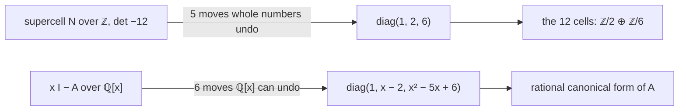

# Smith normal form: reducing an integer matrix until the module is readable off it

[Syllabus](../../../SYLLABUS.md) → [Algebraic geometry](../README.md) → [Schemes and Modern Language](../README.md#s06) → Smith normal form

---

## General Overview

A crystal simulation often works in a **supercell**: a bigger box built from copies of the crystal's smallest repeating box, the unit cell. Here the supercell's three edges, counted in unit-cell steps, are the columns of

```math
N = \begin{pmatrix} 1 & 0 & 2 \\ 0 & 2 & 2 \\ 2 & 2 & 0 \end{pmatrix}
```

Its determinant is −12, so the supercell holds 12 unit cells. The determinant does not say how those 12 cells relate. Moving one unit cell along an axis shuffles them. Which shuffles are possible, and does one step ever visit all 12 cells before it comes back?

The answer comes from five moves on N, each of which whole numbers can undo. They turn N into the diagonal 1, 2, 6. So each of the 12 cells carries a two-part label: one counter that wraps at 2 and one that wraps at 6. A step along any axis returns after at most 6 moves, never 12. The group of shuffles is $`\mathbb{Z}/2 \oplus \mathbb{Z}/6`$ (a counter wrapping at 2 beside one wrapping at 6), not $`\mathbb{Z}/12`$ (one counter wrapping at 12). The cell positions, added and subtracted with whole-number steps, form a **module**: a vector space whose scalars come from a ring such as ℤ instead of a field.

The same moves work when the entries are polynomials in x, the ring k[x] with coefficients in a field k, here the fractions ℚ. Applied to the matrix $`xI - A`$ of a square matrix A, they give A's **invariant factors**: the list of polynomials that decides whether two matrices are the same map written in different coordinates (**similar** matrices). Eigenvalues alone cannot decide that. From the list comes a standard matrix for A, the **rational canonical form**.

**Reduce a matrix over ℤ or over k[x] by row and column moves the ring can undo until it is diagonal, each entry dividing the next; the diagonal is the module's list of wrap-around counters, and for $`xI - A`$ it is the complete fingerprint of A up to change of coordinates.**

**What kind of fact this is:** a method with theorems behind it. That the routine stops with a unique diagonal is proved for ℤ on the topology wing's [Smith normal form](../../17-Topology/05-Homology/03-computing-homology-by-smith-normal-form.md) card and for any PID (principal ideal domain: a ring with no zero divisors where every ideal is the multiples of one member, such as ℤ and k[x]) on [Modules](05-modules-and-the-structure-theorem.md). This card proves, in Why it works, that a square matrix is a module over k[x] with $`xI - A`$ as its relation matrix, and that its invariant factors give its rational canonical form and decide similarity.

### The picture: one routine, two rings



The top row is the crystal; the bottom row is a 3 by 3 matrix A, worked below.

---

## The formula

Notation first, in words.

- A **ring** R adds, subtracts and multiplies. A **unit** is a member with an inverse in R: ±1 in ℤ, any nonzero number in k[x], the polynomials in x with coefficients in a field k. Here k is ℚ, the fractions.
- R/(d) is the **cyclic module**: R with every multiple of d treated as zero. Over ℤ it is $`\mathbb{Z}/d`$, a counter that wraps at d. ⊕ puts modules side by side; ≅ means "is the same module as".
- A move the ring can undo is a swap of two rows, a row times a unit, or a row plus any multiple of another row; the same for columns.

The reduction, over ℤ or over k[x]:

```math
S\,N\,T = D = \mathrm{diag}(d_1, \dots, d_r, 0, \dots, 0), \quad d_1 \mid d_2 \mid \dots \mid d_r, \qquad R^n / N R^n \;\cong\; R/(d_1) \oplus \dots \oplus R/(d_r) \oplus R^{\,n-r}
```

**Read it aloud:** row moves S and column moves T turn N into a diagonal whose entries each divide the next, and the lists of n scalars modulo N's columns form one wrap-around counter per diagonal entry plus one free counter per missing entry.

The $`d_i`$ are the **invariant factors**. They are the same along every route, up to units, because $`d_1 d_2 \cdots d_k = g_k`$, the gcd of all k by k minors (determinants of k rows and k columns of N). For the supercell, $`g = 1, 2, 12`$ gives $`d = 1, 2, 6`$, and

```math
\mathbb{Z}^3 / N\mathbb{Z}^3 \;\cong\; \mathbb{Z}/1 \oplus \mathbb{Z}/2 \oplus \mathbb{Z}/6 \;=\; \mathbb{Z}/2 \oplus \mathbb{Z}/6
```

Over k[x] the same reduction acts on the **characteristic matrix** $`xI - A`$ of an n by n matrix A. Its diagonal is 1s followed by monic polynomials (leading coefficient 1) $`f_1 \mid \dots \mid f_s`$, the invariant factors of A. Each gives a **companion matrix**:

```math
C(x^m + c_{m-1}x^{m-1} + \dots + c_0) = \begin{pmatrix} 0 & & & -c_0 \\ 1 & 0 & & -c_1 \\ & \ddots & \ddots & \vdots \\ & & 1 & -c_{m-1} \end{pmatrix}, \qquad P^{-1} A P = C(f_1) \oplus \dots \oplus C(f_s)
```

**Read it aloud:** in the right coordinates P, A becomes a chain of companion blocks, one per invariant factor, each with 1s below the diagonal and the polynomial's coefficients, signs flipped, down its last column.

That block matrix is the **rational canonical form**. It needs only arithmetic in k, never a root. The product $`f_1 \cdots f_s`$ is the characteristic polynomial $`\chi_A = \det(xI - A)`$, and the last one, $`f_s`$, is the **minimal polynomial** $`m_A`$: the lowest-degree monic polynomial with $`m_A(A) = 0`$. (The [Every root at once](../../16-Numerical%20analysis/02-Root%20Finding%20and%20Fixed%20Points/08-polynomial-roots-and-companion-matrices.md) card puts the coefficients along the top row instead. Numbered in reverse, that layout is the transpose of this one; transposing $`xI - C`$ leaves its minors unchanged, so both have the same invariant factors and are similar.)

For $`A`$ = `[[2, 0, 0], [0, 2, 1], [0, 0, 3]]` the invariant factors are $`x - 2`$ and $`x^2 - 5x + 6`$, so

```math
P_A^{-1} A P_A = C(x - 2) \oplus C(x^2 - 5x + 6) = \begin{pmatrix} 2 & 0 & 0 \\ 0 & 0 & -6 \\ 0 & 1 & 5 \end{pmatrix}
```

| Symbol | Plain meaning | In our example | Push it up and the answer… |
| --- | --- | --- | --- |
| $`R`$, $`k`$, $`k[x]`$ | the ring of scalars; a field; polynomials in x over k | ℤ and ℚ[x]; k = ℚ | — |
| $`N`$, $`n`$, $`R^n`$ | the relation matrix, its columns the relations; number of rows; lists of n scalars | the supercell's edges; n = 3; $`\mathbb{Z}^3`$ | a bigger determinant, more cells |
| $`S`$, $`T`$, $`D`$ | row moves and column moves, as matrices with inverses in R; the diagonal reached | S = `[[1, 0, 0], [0, 1, 0], [2, 1, -1]]`, T = `[[1, 0, -2], [0, 1, -1], [0, 0, 1]]`; diag(1, 2, 6) | — |
| $`d_i`$, $`\mid`$, $`r`$, $`g_k`$ | invariant factors; "divides"; how many are nonzero; gcd of all k by k minors | 1, 2, 6, and 1 ∣ 2 ∣ 6; r = 3; g = 1, 2, 12 | bigger factors, longer cycles |
| $`R/(d)`$, $`\oplus`$, $`\cong`$ | a counter that wraps at d; side by side; "is the same module as" | $`\mathbb{Z}/2 \oplus \mathbb{Z}/6`$ | — |
| $`V`$, $`V_A`$, $`e_j`$, $`w`$, $`v_t`$ | the space A acts on; that space as a k[x]-module, x acting as A; its basis vectors; a vector that spans a block with Aw; the state at step t; in the fold, p and q are lists of polynomials and of numbers | $`\mathbb{Q}^3`$; w = (1, 1, 1) | — |
| $`A`$, $`B`$, $`I`$ | two 3 by 3 matrices compared; the identity matrix | A = `[[2, 0, 0], [0, 2, 1], [0, 0, 3]]`, B = `[[2, 1, 0], [0, 2, 1], [0, 0, 3]]` | — |
| $`xI - A`$ | the characteristic matrix, a relation matrix over k[x] | `[[x - 2, 0, 0], [0, x - 2, -1], [0, 0, x - 3]]` | — |
| $`f_i`$, $`s`$ | invariant factors of A, monic; how many are not 1 | x − 2 and x² − 5x + 6; s = 2 | more factors, more blocks |
| $`C(f)`$, $`c_j`$, $`m`$ | companion matrix of f; f's coefficients; f's degree | C(x² − 5x + 6) has last column −6, 5 | — |
| $`P`$, $`\lambda`$ | the new coordinates, as columns; an eigenvalue | $`P_A`$ = `[[0, 1, 2], [1, 1, 3], [0, 1, 3]]`; λ = 2 or 3 | — |
| $`\chi_A`$, $`m_A`$ | characteristic polynomial $`\det(xI - A)`$; minimal polynomial | x³ − 7x² + 16x − 12; x² − 5x + 6 | — |

### When it holds

- **Division with remainder, by a size that shrinks.** ℤ shrinks by absolute value and k[x] by degree, so the routine stops. A PID without division with remainder needs the extra Bezout move of [Modules](05-modules-and-the-structure-theorem.md) (a 2 by 2 move that puts the gcd of two entries in the pivot).
- **Only units as scale factors.** Over ℤ a row may be multiplied by −1 only. Allowing a row times 2, undone only by ½, is computing over ℚ: every nonzero entry becomes 1, and the supercell's $`\mathbb{Z}/2 \oplus \mathbb{Z}/6`$ vanishes.
- **The divisibility chain.** Without $`d_i \mid d_{i+1}`$ the list is not unique: a plain 2 by 2 by 3 box reads (2, 2, 3), the supercell reads (1, 2, 6), and both are the same module.
- **A square matrix over one field.** The canonical form compares A and B over k. Similarity over ℚ and over ℂ agree, because the reduction of $`xI - A`$ never leaves ℚ[x].
- **Not the Jordan form.** The rational canonical form exists without roots. The Jordan form, which splits each block further by eigenvalue, needs every root of $`\chi_A`$ in k.

---

## Why it works

### Step 0: change coordinates until each relation touches one generator

A module given by generators and relations does not care what the generators are called. Rename them (row moves) and swap relations for equivalent ones (column moves) until each relation reads "$`d_i`$ times one generator is zero". Then the module splits into counters on sight.

The topology wing's [Smith normal form](../../17-Topology/05-Homology/03-computing-homology-by-smith-normal-form.md) card proves that this routine stops over ℤ, that the diagonal does not depend on the route, and that the moves leave the quotient unchanged. [Modules](05-modules-and-the-structure-theorem.md) proves the structure theorem over every PID. This card spends its steps on what changes when the scalars are polynomials, and on what the diagonal says about a matrix.

### Step 1: the same routine, with degree in place of size

The routine needs one thing from the ring: division with remainder by a size that cannot shrink forever ([Domains, principal ideals and unique factorisation](01-integral-domains-pids-and-unique-factorisation.md)).

| | ℤ | k[x] |
| --- | --- | --- |
| size | absolute value | degree |
| units, the allowed scale factors | 1 and −1 | every nonzero number |
| a pivot that divides | 2 divides −6 | x − 2 divides x² − 5x + 6 |
| the first quotient used on the card | 2, from 2 ÷ 1 | −x + 3, from (x − 3) ÷ (−1) |

[Gaussian elimination](../../03-Algebra/05-Solving%20Systems/02-gaussian-elimination.md) over a field may divide by any nonzero pivot. Over k[x] only nonzero numbers can be divided by. So the pivot is the entry of lowest degree, and clearing its column leaves remainders of lower degree. Each round lowers a degree or finishes a pivot, so the routine stops.

The code keeps whole-number coefficients. Before dividing by a pivot with leading coefficient c, it multiplies the row by a power of c. That is a unit of ℚ[x], so the move can still be undone.

### Step 2: a square matrix is a module over k[x]

Let A act on $`V = k^n`$. Make V a k[x]-module by letting x act as A, so a polynomial f acts as f(A). This module is generated by the basis vectors $`e_1, \dots, e_n`$, and its relations are the columns of $`xI - A`$:

```math
V_A \;\cong\; k[x]^n \,/\, (xI - A)\,k[x]^n
```

**Read it aloud:** the space with A acting is all lists of n polynomials, modulo the columns of the characteristic matrix.

Column j of $`xI - A`$ says "x times $`e_j`$ equals $`A e_j`$", which is exactly how x acts. The fold shows that nothing else is needed.

<details>
<summary>Detailed proof: the columns of xI − A are all the relations</summary>

Send a list of polynomials $`(p_1, \dots, p_n)`$ to $`p_1(A)e_1 + \dots + p_n(A)e_n`$ in V. Column j of $`xI - A`$ goes to $`Ae_j - \sum_i A_{ij}e_i = Ae_j - Ae_j = 0`$. So every column mix goes to zero.

For the reverse, take any list p that goes to zero. In p, replace each $`x^{t}e_j`$ by $`x^{t-1}`$ times $`\sum_i A_{ij}e_i`$. Each replacement subtracts a multiple of column j, and it lowers the degree. Repeat until only numbers are left: a list of numbers q with the same image as p, so q goes to zero.

A list of numbers goes to $`q_1e_1 + \dots + q_ne_n`$, which is zero only when q = 0. So p was a column mix all along.

</details>

Reduce $`xI - A`$ and Step 0 gives $`V_A \cong k[x]/(f_1) \oplus \dots \oplus k[x]/(f_s)`$. The diagonal 1s are counters that wrap at 1, so they drop out. No zeros appear, because $`\det(xI - A) = \chi_A`$ is not the zero polynomial.

### Step 3: each piece is a companion block

Take one piece $`k[x]/(f)`$ with f monic of degree m. Its members are the remainders on division by f, so $`1, x, \dots, x^{m-1}`$ is a basis over k. Multiplying by x moves each basis member to the next. The last one, $`x^{m-1}`$, goes to $`x^m`$, which modulo f is $`-c_0 - c_1x - \dots - c_{m-1}x^{m-1}`$.

Written as a matrix, that is $`C(f)`$: 1s below the diagonal, and the flipped coefficients in the last column. Joining the pieces gives the block form, and P lists the new basis as columns.

For A, the piece $`k[x]/(x - 2)`$ is spanned by $`e_2`$, since $`Ae_2 = 2e_2`$. The piece $`k[x]/((x - 2)(x - 3))`$ is spanned by w = (1, 1, 1) and Aw = (2, 3, 3). So $`P_A`$ has columns $`e_2`$, w, Aw, and $`AP_A = P_AC_A`$.

### Step 4: the invariant factors decide similarity

Two matrices A and B are **similar** when $`B = P^{-1}AP`$ for some P with an inverse: the same map in other coordinates. Similar matrices give the same module, renamed by P. A module has one list of invariant factors (Step 0). So similar matrices have the same invariant factors.

The converse holds too. If A and B have the same list, both are similar to the same block matrix, so to each other. The list is a complete test.

### Step 5: what the list says about A

Three readings come straight off the factors.

1. **The characteristic polynomial is the product.** $`\det(xI - A) = \det(S^{-1}DT^{-1})`$, and S and T have nonzero number determinants. Both sides are monic, so $`\chi_A = f_1 \cdots f_s`$.
2. **The minimal polynomial is the last factor.** $`f_s`$ kills every piece, since each $`f_i`$ divides it, and no lower-degree polynomial kills the last piece.
3. **Eigenvectors count factors.** On a piece $`k[x]/(f)`$, the vectors that $`A - \lambda I`$ sends to zero form one dimension if $`x - \lambda`$ divides f, and none otherwise. So the kernel of $`A - \lambda I`$ has dimension equal to the number of $`f_i`$ with root λ.

Reading 3 is road 3 in the code. A has kernel sizes 2 and 1 at λ = 2 and 3, and two of its factors have root 2. B has kernel sizes 1 and 1, and only one factor.

### Step 6: why the characteristic polynomial is not enough

A and B have the same characteristic polynomial, $`(x - 2)^2(x - 3)`$, so the same eigenvalues 2, 2, 3 ([Eigenvalues and eigenvectors](../../03-Algebra/07-Eigenvalues%20and%20Symmetric%20Matrices/02-eigenvalues-and-eigenvectors.md)). But A's factors are x − 2 and (x − 2)(x − 3), while B's single factor is the whole $`(x - 2)^2(x - 3)`$. So they are not similar.

The difference shows in their powers. As update rules $`v_{t+1} = Av_t`$, A only multiplies by 2 or by 3 along its eigenvectors ([Diagonalisation](../../03-Algebra/07-Eigenvalues%20and%20Symmetric%20Matrices/03-diagonalisation-and-matrix-powers.md)). In B the second state feeds the first, so the first row of $`B^5`$ is (32, 80, 131), with 80 = 5 × 2⁴. A never shows such a factor of t.

---

## Worked numbers, by hand

The supercell, over ℤ:

| Step | Arithmetic | Value |
| --- | --- | --- |
| N | columns are the supercell's edges | `[[1, 0, 2], [0, 2, 2], [2, 2, 0]]`, det −12 |
| pivot 1 | already in the corner | 1 |
| clear its column | row 3 − 2 × row 1 | `[[1, 0, 2], [0, 2, 2], [0, 2, -4]]` |
| clear its row | column 3 − 2 × column 1 | `[[1, 0, 0], [0, 2, 2], [0, 2, -4]]` |
| pivot 2 | row 3 − row 2 | `[[1, 0, 0], [0, 2, 2], [0, 0, -6]]` |
| clear its row | column 3 − column 2 | `[[1, 0, 0], [0, 2, 0], [0, 0, -6]]` |
| fix the sign | row 3 × (−1) | `[[1, 0, 0], [0, 2, 0], [0, 0, 6]]` |
| the moves | S, det −1; T, det 1 | S N T = diag(1, 2, 6) |
| check by minors | $`g_1, g_2, g_3`$ = 1, 2, 12 | d = 1, 2/1, 12/2 = 1, 2, 6 |
| a cell's label | rows 2 and 3 of S applied to a position (a, b, c) | (b mod 2, 2a + b − c mod 6) |
| one step along each axis | returns after | 3, 6 and 6 steps |
| the shuffles | read the diagonal | **$`\mathbb{Z}/2 \oplus \mathbb{Z}/6`$** |

The 12 cells form a 2 by 6 grid of labels, and no step along an axis visits all 12.

The matrix A, over ℚ[x]:

| Step | Arithmetic | Value |
| --- | --- | --- |
| $`xI - A`$ | x on the diagonal, minus A | `[[x - 2, 0, 0], [0, x - 2, -1], [0, 0, x - 3]]` |
| pivot −1, degree 0 | swap rows 1, 2; swap columns 1, 3 | `[[-1, x - 2, 0], [0, 0, x - 2], [x - 3, 0, 0]]` |
| clear its column | row 3 + (x − 3) × row 1 | `[[-1, x - 2, 0], [0, 0, x - 2], [0, x^2 - 5x + 6, 0]]` |
| clear its row | column 2 + (x − 2) × column 1 | `[[-1, 0, 0], [0, 0, x - 2], [0, x^2 - 5x + 6, 0]]` |
| fix the sign, then pivot x − 2 | row 1 × (−1); swap columns 2, 3 | `[[1, 0, 0], [0, x - 2, 0], [0, 0, x^2 - 5x + 6]]` |
| check by minors | $`g_1, g_2, g_3`$ | 1, x − 2, x³ − 7x² + 16x − 12 |
| rational canonical form | C(x − 2) ⊕ C(x² − 5x + 6) | `[[2, 0, 0], [0, 0, -6], [0, 1, 5]]` |
| put it back | $`AP_A`$ and $`P_AC_A`$, with $`\det P_A = -1`$ | both `[[0, 2, 4], [2, 3, 9], [0, 3, 9]]` |
| minimal polynomial | (A − 2I)(A − 3I) | the zero matrix |
| B, for contrast | invariant factors 1, 1, x³ − 7x² + 16x − 12 | C_B = `[[0, 0, 12], [1, 0, -16], [0, 1, 7]]` |
| B's test | (B − 2I)(B − 3I) | `[[0, -1, 1], [0, 0, 0], [0, 0, 0]]`, not zero |
| the answer | A's invariant factors | **x − 2 and x² − 5x + 6** |

A is the map "times 2 on a plane, times 3 on a line". B has the same eigenvalues but only one line for 2, so the two are different maps in any coordinates.

### What breaks if you drop a piece

| Mistake | Comes out at | What went wrong |
| --- | --- | --- |
| Smith form over ℚ, not ℤ | N has rank 3, diagonal 1, 1, 1; the quotient is 0 | Over a field 2 and 6 are units, so $`\mathbb{Z}/2 \oplus \mathbb{Z}/6`$ is lost |
| det 12 read as $`\mathbb{Z}/12`$ | an order-12 shuffle; brute force finds largest order 6 | 12 = 2 × 6, and 2 and 6 share a factor |
| Same characteristic polynomial read as similar | A and B both $`(x - 2)^2(x - 3)`$; kernel sizes of A − 2I and B − 2I are 2 and 1 | The polynomial is the product of the factors and forgets how they split |
| Divisibility chain dropped | the 2 × 2 × 3 box reads (2, 2, 3), N reads (1, 2, 6); Smith gives [1, 2, 6] for both | Without the chain one module has many diagonals |

The code prints all four.

---

## Code, from first principles, and it actually runs

Nothing is imported. One Smith routine runs over two rings: ℤ, with absolute value as size, and ℚ[x], with degree as size and polynomials stored as lists of whole-number coefficients. It records every move. Four roads then meet:

1. **The moves**, put back in: S N T = D is multiplied out, with det S and det T equal to ±1.
2. **Gcds of minors**, over ℤ and over ℚ[x], against the products of the diagonal.
3. **Brute force**: every position in a 12 by 12 by 12 box is tested for membership in the supercell's lattice, and the order of each of the 12 cells is counted. For A and B, kernel sizes of A − λI and the minimal polynomial are found from ranks and matrix products, with no Smith form.
4. **Substitution**: the rational canonical forms built from the factors satisfy $`AP_A = P_AC_A`$ and $`BP_B = P_BC_B`$ exactly.

All arithmetic is exact, so for these matrices the checks are proofs, not samples.

### Python

```python
# Smith normal form and canonical forms -- the check behind the card.  Nothing is imported.
# One routine diagonalises over Z (a 12-cell supercell N -> 1, 2, 6) and over Q[x] (x I - A ->
# A's invariant factors and rational canonical form), with moves the ring can undo.  Other roads:
# gcds of minors; orders by brute force; kernel sizes and minimal polynomials; A P = P C multiplied out.
class P:                                   # a polynomial, integer coefficients, lowest first
    def __init__(s, c):
        s.c = list(c)
        while s.c and s.c[-1] == 0: s.c.pop()
    def __add__(s, o): n = max(len(s.c), len(o.c)); return P((s.c + [0] * n)[i] + (o.c + [0] * n)[i] for i in range(n))
    def __mul__(s, o):
        if isinstance(o, int): return P(o * x for x in s.c)
        r = [0] * (len(s.c) + len(o.c))
        for i, x in enumerate(s.c):
            for j, y in enumerate(o.c): r[i + j] += x * y
        return P(r)
    __rmul__ = __mul__
    def __sub__(s, o): return s + o * -1
    def __eq__(s, o): return s.c == o.c
    def __bool__(s): return bool(s.c)
    def __repr__(s):
        out = ""
        for k in range(len(s.c) - 1, -1, -1):
            a = s.c[k]
            if a:
                w = (str(abs(a)) if abs(a) != 1 or k == 0 else "") + ("x" if k else "") + (f"^{k}" if k > 1 else "")
                out += (" - " if a < 0 else " + ") + w if out else ("-" if a < 0 else "") + w
        return out or "0"
X = P([0, 1])
def zdiv(a, p): return 1, (a - a % abs(p)) // p              # unit u, quotient q: |a - q p| < |p|
def pdiv(a, p):                                              # pseudo-division: u is a constant, a unit of Q[x]
    c, r, q = p.c[-1], a, P([])
    u = c ** max(len(a.c) - len(p.c) + 1, 0); r = r * u
    while r and len(r.c) >= len(p.c):
        m = P([0] * (len(r.c) - len(p.c)) + [r.c[-1] // c]); q, r = q + m, r - m * p
    return u, q
ZR = (abs, zdiv, lambda a: -1 if a < 0 else 1, 1)            # size, divide, sign fix, one
QX = (lambda a: len(a.c), pdiv, lambda a: -1 if a.c[-1] < 0 else 1, P([1]))
def show(M): return "[" + ", ".join("[" + ", ".join(map(str, r)) + "]" for r in M) + "]"
def smith(M, ring, log=None):                                # returns S, D, T with S M T = D
    size, div, fix, one = ring
    m, n, D = len(M), len(M[0]), [r[:] for r in M]
    S = [[one if i == j else one - one for j in range(m)] for i in range(m)]
    T = [[one if i == j else one - one for j in range(n)] for i in range(n)]
    def note(w):
        if log is not None: log.append(f"{w} -> {show(D)}")
    def row(i, k, u, q):                                     # row i := u row i - q row k
        for A in (D, S): A[i] = [u * x - q * y for x, y in zip(A[i], A[k])]
    def col(j, k, u, q):
        for A in (D, T):
            for r in A: r[j] = u * r[j] - q * r[k]
    t = 0
    while t < min(m, n):
        live = [(size(D[i][j]), i, j) for i in range(t, m) for j in range(t, n) if D[i][j]]
        if not live: break
        _, i, j = min(live)
        if i != t: D[t], D[i], S[t], S[i] = D[i], D[t], S[i], S[t]; note(f"swap rows {t + 1}, {i + 1}")
        if j != t:
            for r in D + T: r[t], r[j] = r[j], r[t]
            note(f"swap columns {t + 1}, {j + 1}")
        for i in range(t + 1, m):
            if D[i][t]: u, q = div(D[i][t], D[t][t]); row(i, t, u, q); note(f"row {i + 1} := {u} row {i + 1} - ({q}) row {t + 1}")
        for j in range(t + 1, n):
            if D[t][j]: u, q = div(D[t][j], D[t][t]); col(j, t, u, q); note(f"col {j + 1} := {u} col {j + 1} - ({q}) col {t + 1}")
        if any(D[i][t] for i in range(t + 1, m)) or any(D[t][t + 1:]): continue
        bad = [i for i in range(t + 1, m) if any(div(x, D[t][t])[0] * x - div(x, D[t][t])[1] * D[t][t] for x in D[i][t + 1:])]
        if bad: row(t, bad[0], 1, -1); note(f"row {t + 1} += row {bad[0] + 1}"); continue
        if fix(D[t][t]) < 0: row(t, t, -1, 0); note(f"row {t + 1} := -1 row {t + 1}")
        t += 1
    return S, D, T
def mul(A, B): return [[sum((a * b for a, b in zip(r, c)), start=r[0] * 0) for c in zip(*B)] for r in A]
def det(M): return M[0][0] if len(M) == 1 else sum(((-1) ** j * M[0][j] * det([r[:j] + r[j + 1:] for r in M[1:]]) for j in range(len(M))), start=M[0][0] * 0)
def subsets(N, k): return [[]] if k == 0 else [s + [x] for x in range(N) for s in subsets(x, k - 1)]
def minors(M, k): return [det([[M[r][c] for c in cs] for r in rs]) for rs in subsets(len(M), k) for cs in subsets(len(M[0]), k)]
def gcd(a, b, ring):
    while b: u, q = ring[1](a, b); a, b = b, u * a - q * b
    return a
def gcdl(L, ring): return L[0] if len(L) == 1 else gcd(L[0], gcdl(L[1:], ring), ring)
def prim(f): g = abs(gcdl(f.c, ZR)) * (1 if f.c[-1] > 0 else -1); return P([x // g for x in f.c])   # content out, lc > 0
def gk(M, k, ring, norm): return norm(gcdl(minors(M, k), ring))
N = [[1, 0, 2], [0, 2, 2], [2, 2, 0]]                        # supercell edges, as columns, in unit-cell steps
print(f"supercell N = {N}, det {det(N)}: {abs(det(N))} unit cells")
log = []; S, D, T = smith(N, ZR, log)
print("\n".join("Z  " + w for w in log))
d = [D[k][k] for k in range(3)]
print(f"S = {S}, det {det(S)}; T = {T}, det {det(T)}; S N T = {mul(mul(S, N), T)}")
g = [gk(N, k, ZR, abs) for k in (1, 2, 3)]
print(f"road 2, gcd of k-by-k minors: g = {g}; d = {[g[0], g[1] // g[0], g[2] // g[1]]}")
adj = [[(-1) ** (i + j) * det([r[:i] + r[i + 1:] for k, r in enumerate(N) if k != j]) for j in range(3)] for i in range(3)]
inL = lambda v: all(sum(a * x for a, x in zip(r, v)) % 12 == 0 for r in adj)   # v in the lattice of N?
order = lambda v: next(k for k in range(1, 13) if inL([k * x for x in v]))
box = [order((a, b, c)) for a in range(12) for b in range(12) for c in range(12)]
tally = lambda L: {k: L.count(k) for k in sorted(set(L))}
hist = {k: c // 144 for k, c in tally(box).items()}            # each class meets the box 12^3 / 12 = 144 times
def tuples(ds): return [[]] if not ds else [[a] + t for a in range(ds[0]) for t in tuples(ds[1:])]
def ghist(ds): return tally([next(k for k in range(1, 13) if all(k * a % e == 0 for a, e in zip(t, ds))) for t in tuples(ds)])
print(f"road 3, orders of the 12 classes by brute force: {hist}; Z/2 + Z/6 predicts {ghist([2, 6])}; Z/12 has {ghist([12])}")
print(f"orders of e1, e2, e3: {order((1, 0, 0))}, {order((0, 1, 0))}, {order((0, 0, 1))}")
A = [[2, 0, 0], [0, 2, 1], [0, 0, 3]]; B = [[2, 1, 0], [0, 2, 1], [0, 0, 3]]
sub = lambda M, L: [[M[i][j] - L * (i == j) for j in range(3)] for i in range(3)]
rank = lambda M: max(k for k in range(4) if k == 0 or any(minors(M, k)))
xI = lambda M: [[X * int(i == j) - P([M[i][j]]) for j in range(3)] for i in range(3)]
res = {}
for name, M in (("A", A), ("B", B)):
    log = []; D2 = smith(xI(M), QX, log)[1]
    if name == "A": print("\n".join("Q[x] " + w for w in log))
    f = [prim(D2[k][k]) for k in range(3)]
    g2 = [gk(xI(M), k, QX, prim) for k in (1, 2, 3)]
    lam = [3 - rank(sub(M, L)) for L in (2, 3)]                # kernel size = factors divisible by x - L
    C, at = [[0] * 3 for _ in range(3)], 0
    for h in [h for h in f if len(h.c) > 1]:
        n = len(h.c) - 1
        for i in range(n): C[at + i][at + n - 1] = -h.c[i]; C[at + i][at + i - 1] += int(i > 0)
        at += n
    res[name] = (f, g2, lam, C)
    print(f"{name} = {M}: invariant factors {f}, product {f[0] * f[1] * f[2]}; gcd of k-by-k minors of x I - {name}: {g2}")
    print(f"{name}: kernel sizes of {name} - 2I, {name} - 3I: {lam}; rational canonical form C = {C}")
mA, mB = mul(sub(A, 2), sub(A, 3)), mul(sub(B, 2), sub(B, 3))
print(f"minimal polynomial test (M - 2I)(M - 3I): A gives {mA}; B gives {mB}; (B - 2I)^2 (B - 3I) = {mul(sub(B, 2), mB)}")
PA, PB = [[0, 1, 2], [1, 1, 3], [0, 1, 3]], [[0, 0, 1], [0, 1, 5], [1, 3, 9]]   # columns: e2, w, Aw and e3, Be3, B^2 e3
print(f"P_A = {PA}, det {det(PA)}; A P_A = {mul(A, PA)} = P_A C_A = {mul(PA, res['A'][3])}")
print(f"P_B = {PB}, det {det(PB)}; B P_B = {mul(B, PB)} = P_B C_B = {mul(PB, res['B'][3])}")
B5 = mul(mul(mul(mul(B, B), B), B), B)
print(f"B^5 row 1 = {B5[0]}: middle entry 5 x 2^4 = {5 * 2 ** 4}; A^5 row 1 = {mul(mul(mul(mul(A, A), A), A), A)[0]}")
print(f"mistake 1, Smith over Q: N has rank {rank(N)}, diagonal {[1] * rank(N)}, quotient Q^3 / Q^{rank(N)} = {'0' if rank(N) == 3 else f'Q^{3 - rank(N)}'}; the 12 cells' Z/2 + Z/6 is lost")
print(f"mistake 2, det 12 read as Z/12: needs an order-12 class, brute force finds largest order {max(hist)}")
print(f"mistake 3, same char poly read as similar: A, B both {res['A'][1][2]}, kernel sizes {res['A'][2][0]} and {res['B'][2][0]}")
box3 = smith([[2, 0, 0], [0, 2, 0], [0, 0, 3]], ZR)[1]
print(f"mistake 4, chain dropped: 2 x 2 x 3 box reads (2, 2, 3), N reads (1, 2, 6); Smith gives {[box3[k][k] for k in range(3)]} and {d}")
assert mul(mul(S, N), T) == D and abs(det(S)) == 1 == abs(det(T))                   # substitution
assert g == [d[0], d[0] * d[1], d[0] * d[1] * d[2]]                               # road 1 = road 2
assert hist == ghist(d[1:]) != ghist([12])                                       # road 3, brute force
assert rank(N) == len([x for x in d if x])                                       # rank over Q by minors = nonzero Smith entries
assert res["A"][0] == [P([1]), X - P([2]), (X - P([2])) * (X - P([3]))] and res["B"][0][1] == P([1]) and d == [1, 2, 6]
for f, g2, lam, C in res.values():
    assert g2 == [f[0], prim(f[0] * f[1]), prim(f[0] * f[1] * f[2])]           # minors meet the moves
    assert lam == [sum(1 for h in f if sum(c * L ** k for k, c in enumerate(h.c)) == 0) for L in (2, 3)]   # roots
assert mul(A, PA) == mul(PA, res["A"][3]) and mul(B, PB) == mul(PB, res["B"][3]) and det(PA) * det(PB) != 0
assert [box3[k][k] for k in range(3)] == d and mA == [[0] * 3] * 3 != mB and mul(sub(B, 2), mB) == [[0] * 3] * 3
print("ALL CHECKS PASS")
```

**Ran 2026-11-17 on macOS, Python 3.14.10, standard library only. All checks passed. Output, pasted from the run:**

```
supercell N = [[1, 0, 2], [0, 2, 2], [2, 2, 0]], det -12: 12 unit cells
Z  row 3 := 1 row 3 - (2) row 1 -> [[1, 0, 2], [0, 2, 2], [0, 2, -4]]
Z  col 3 := 1 col 3 - (2) col 1 -> [[1, 0, 0], [0, 2, 2], [0, 2, -4]]
Z  row 3 := 1 row 3 - (1) row 2 -> [[1, 0, 0], [0, 2, 2], [0, 0, -6]]
Z  col 3 := 1 col 3 - (1) col 2 -> [[1, 0, 0], [0, 2, 0], [0, 0, -6]]
Z  row 3 := -1 row 3 -> [[1, 0, 0], [0, 2, 0], [0, 0, 6]]
S = [[1, 0, 0], [0, 1, 0], [2, 1, -1]], det -1; T = [[1, 0, -2], [0, 1, -1], [0, 0, 1]], det 1; S N T = [[1, 0, 0], [0, 2, 0], [0, 0, 6]]
road 2, gcd of k-by-k minors: g = [1, 2, 12]; d = [1, 2, 6]
road 3, orders of the 12 classes by brute force: {1: 1, 2: 3, 3: 2, 6: 6}; Z/2 + Z/6 predicts {1: 1, 2: 3, 3: 2, 6: 6}; Z/12 has {1: 1, 2: 1, 3: 2, 4: 2, 6: 2, 12: 4}
orders of e1, e2, e3: 3, 6, 6
Q[x] swap rows 1, 2 -> [[0, x - 2, -1], [x - 2, 0, 0], [0, 0, x - 3]]
Q[x] swap columns 1, 3 -> [[-1, x - 2, 0], [0, 0, x - 2], [x - 3, 0, 0]]
Q[x] row 3 := 1 row 3 - (-x + 3) row 1 -> [[-1, x - 2, 0], [0, 0, x - 2], [0, x^2 - 5x + 6, 0]]
Q[x] col 2 := 1 col 2 - (-x + 2) col 1 -> [[-1, 0, 0], [0, 0, x - 2], [0, x^2 - 5x + 6, 0]]
Q[x] row 1 := -1 row 1 -> [[1, 0, 0], [0, 0, x - 2], [0, x^2 - 5x + 6, 0]]
Q[x] swap columns 2, 3 -> [[1, 0, 0], [0, x - 2, 0], [0, 0, x^2 - 5x + 6]]
A = [[2, 0, 0], [0, 2, 1], [0, 0, 3]]: invariant factors [1, x - 2, x^2 - 5x + 6], product x^3 - 7x^2 + 16x - 12; gcd of k-by-k minors of x I - A: [1, x - 2, x^3 - 7x^2 + 16x - 12]
A: kernel sizes of A - 2I, A - 3I: [2, 1]; rational canonical form C = [[2, 0, 0], [0, 0, -6], [0, 1, 5]]
B = [[2, 1, 0], [0, 2, 1], [0, 0, 3]]: invariant factors [1, 1, x^3 - 7x^2 + 16x - 12], product x^3 - 7x^2 + 16x - 12; gcd of k-by-k minors of x I - B: [1, 1, x^3 - 7x^2 + 16x - 12]
B: kernel sizes of B - 2I, B - 3I: [1, 1]; rational canonical form C = [[0, 0, 12], [1, 0, -16], [0, 1, 7]]
minimal polynomial test (M - 2I)(M - 3I): A gives [[0, 0, 0], [0, 0, 0], [0, 0, 0]]; B gives [[0, -1, 1], [0, 0, 0], [0, 0, 0]]; (B - 2I)^2 (B - 3I) = [[0, 0, 0], [0, 0, 0], [0, 0, 0]]
P_A = [[0, 1, 2], [1, 1, 3], [0, 1, 3]], det -1; A P_A = [[0, 2, 4], [2, 3, 9], [0, 3, 9]] = P_A C_A = [[0, 2, 4], [2, 3, 9], [0, 3, 9]]
P_B = [[0, 0, 1], [0, 1, 5], [1, 3, 9]], det -1; B P_B = [[0, 1, 7], [1, 5, 19], [3, 9, 27]] = P_B C_B = [[0, 1, 7], [1, 5, 19], [3, 9, 27]]
B^5 row 1 = [32, 80, 131]: middle entry 5 x 2^4 = 80; A^5 row 1 = [32, 0, 0]
mistake 1, Smith over Q: N has rank 3, diagonal [1, 1, 1], quotient Q^3 / Q^3 = 0; the 12 cells' Z/2 + Z/6 is lost
mistake 2, det 12 read as Z/12: needs an order-12 class, brute force finds largest order 6
mistake 3, same char poly read as similar: A, B both x^3 - 7x^2 + 16x - 12, kernel sizes 2 and 1
mistake 4, chain dropped: 2 x 2 x 3 box reads (2, 2, 3), N reads (1, 2, 6); Smith gives [1, 2, 6] and [1, 2, 6]
ALL CHECKS PASS
```

### Rust

Same numbers, same labels, built with `rustc --edition 2021 -O`.

```rust
// Smith normal form and canonical forms -- the same check as the Python, in Rust.  No crates.
// One routine diagonalises over Z (a 12-cell supercell N -> 1, 2, 6) and over Q[x] (x I - A ->
// A's invariant factors and rational canonical form), with moves the ring can undo.  Other roads:
// gcds of minors; orders by brute force; kernel sizes and minimal polynomials; A P = P C multiplied out.
use std::collections::BTreeMap;
type P = Vec<i64>;                         // a polynomial, integer coefficients, lowest first
type M = Vec<Vec<P>>;
fn tr(mut a: P) -> P { while a.last() == Some(&0) { a.pop(); } a }
fn c(k: i64) -> P { tr(vec![k]) }
fn add(a: &P, b: &P) -> P { tr((0..a.len().max(b.len())).map(|i| a.get(i).unwrap_or(&0) + b.get(i).unwrap_or(&0)).collect()) }
fn sc(a: &P, k: i64) -> P { tr(a.iter().map(|x| x.checked_mul(k).unwrap()).collect()) }
fn sub(a: &P, b: &P) -> P { add(a, &sc(b, -1)) }
fn pm(a: &P, b: &P) -> P { tr((0..a.len() + b.len()).map(|k| (0..a.len()).filter(|&i| k >= i && k - i < b.len()).map(|i| a[i].checked_mul(b[k - i]).unwrap()).sum()).collect()) }
fn fp(a: &P) -> String {
    let mut out = String::new();
    for k in (0..a.len()).rev().filter(|&k| a[k] != 0) {
        let v = a[k];
        let w = format!("{}{}{}", if v.abs() != 1 || k == 0 { v.abs().to_string() } else { String::new() },
            if k > 0 { "x" } else { "" }, if k > 1 { format!("^{}", k) } else { String::new() });
        out += &if out.is_empty() { format!("{}{}", if v < 0 { "-" } else { "" }, w) } else { format!(" {} {}", if v < 0 { "-" } else { "+" }, w) };
    }
    if out.is_empty() { "0".into() } else { out }
}
fn fl(v: &[P]) -> String { format!("[{}]", v.iter().map(fp).collect::<Vec<_>>().join(", ")) }
fn show(m: &M) -> String { format!("[{}]", m.iter().map(|r| fl(r)).collect::<Vec<_>>().join(", ")) }
fn mk(a: &[[i64; 3]]) -> M { a.iter().map(|r| r.iter().map(|&x| c(x)).collect()).collect() }
fn size(a: &P, z: bool) -> i64 { if z { a.first().unwrap_or(&0).abs() } else { a.len() as i64 } }
fn div(a: &P, p: &P, z: bool) -> (i64, P) {   // unit u, quotient q: u a - q p is smaller than p
    if z { let (x, y) = (*a.first().unwrap_or(&0), p[0]); return (1, c((x - x.rem_euclid(y.abs())) / y)); }
    let cc = *p.last().unwrap();
    let u = cc.pow((a.len() as i64 - p.len() as i64 + 1).max(0) as u32);
    let (mut r, mut q) = (sc(a, u), P::new());
    while !r.is_empty() && r.len() >= p.len() {
        let mut m = vec![0; r.len() - p.len()]; m.push(r.last().unwrap() / cc);
        q = add(&q, &m); r = sub(&r, &pm(&m, p));
    }
    (u, q)
}
fn rem(a: &P, p: &P, z: bool) -> P { let (u, q) = div(a, p, z); sub(&sc(a, u), &pm(&q, p)) }
fn ident(n: usize) -> M { (0..n).map(|i| (0..n).map(|j| c((i == j) as i64)).collect()).collect() }
fn smith(m0: &M, z: bool, log: &mut Vec<String>) -> (M, M, M) {   // S, D, T with S M T = D
    let (m, n) = (m0.len(), m0[0].len());
    let (mut d, mut s, mut t) = (m0.clone(), ident(m), ident(n));
    let mut k = 0;
    while k < m.min(n) {
        let mut live = vec![];
        for i in k..m { for j in k..n { if !d[i][j].is_empty() { live.push((size(&d[i][j], z), i, j)); } } }
        if live.is_empty() { break; }
        let (_, i, j) = *live.iter().min().unwrap();
        if i != k { d.swap(k, i); s.swap(k, i); log.push(format!("swap rows {}, {} -> {}", k + 1, i + 1, show(&d))); }
        if j != k { for r in d.iter_mut().chain(t.iter_mut()) { r.swap(k, j); } log.push(format!("swap columns {}, {} -> {}", k + 1, j + 1, show(&d))); }
        for i in k + 1..m {
            if d[i][k].is_empty() { continue; }
            let (u, q) = div(&d[i][k], &d[k][k], z);
            for a in [&mut d, &mut s] { let rk = a[k].clone(); for (x, y) in a[i].iter_mut().zip(rk.iter()) { *x = sub(&sc(x, u), &pm(&q, y)); } }
            log.push(format!("row {} := {} row {} - ({}) row {} -> {}", i + 1, u, i + 1, fp(&q), k + 1, show(&d)));
        }
        for j in k + 1..n {
            if d[k][j].is_empty() { continue; }
            let (u, q) = div(&d[k][j], &d[k][k], z);
            for a in [&mut d, &mut t] { for r in a.iter_mut() { r[j] = sub(&sc(&r[j], u), &pm(&q, &r[k])); } }
            log.push(format!("col {} := {} col {} - ({}) col {} -> {}", j + 1, u, j + 1, fp(&q), k + 1, show(&d)));
        }
        if (k + 1..m).any(|i| !d[i][k].is_empty()) || (k + 1..n).any(|j| !d[k][j].is_empty()) { continue; }
        if let Some(b) = (k + 1..m).find(|&i| (k + 1..n).any(|j| !rem(&d[i][j], &d[k][k], z).is_empty())) {
            for a in [&mut d, &mut s] { let rb = a[b].clone(); for (x, y) in a[k].iter_mut().zip(rb.iter()) { *x = add(x, y); } }
            log.push(format!("row {} += row {} -> {}", k + 1, b + 1, show(&d)));
            continue;
        }
        if (if z { d[k][k][0] } else { *d[k][k].last().unwrap() }) < 0 {
            for a in [&mut d, &mut s] { for x in a[k].iter_mut() { *x = sc(x, -1); } }
            log.push(format!("row {} := -1 row {} -> {}", k + 1, k + 1, show(&d)));
        }
        k += 1;
    }
    (s, d, t)
}
fn mul(a: &M, b: &M) -> M {
    a.iter().map(|r| (0..b[0].len()).map(|j| r.iter().zip(b.iter()).fold(P::new(), |acc, (x, br)| add(&acc, &pm(x, &br[j])))).collect()).collect()
}
fn drop(m: &M, i: usize, j: usize) -> M { m.iter().enumerate().filter(|&(k, _)| k != i).map(|(_, r)| r.iter().enumerate().filter(|&(q, _)| q != j).map(|(_, x)| x.clone()).collect()).collect() }
fn det(m: &M) -> P { if m.len() == 1 { m[0][0].clone() } else { (0..m.len()).fold(P::new(), |acc, j| add(&acc, &sc(&pm(&m[0][j], &det(&drop(m, 0, j))), 1 - 2 * (j % 2) as i64))) } }
fn subsets(n: usize, k: usize) -> Vec<Vec<usize>> { if k == 0 { vec![vec![]] } else { (0..n).flat_map(|x| subsets(x, k - 1).into_iter().map(move |mut s| { s.push(x); s })).collect() } }
fn minors(m: &M, k: usize) -> Vec<P> {
    subsets(m.len(), k).iter().flat_map(|rs| subsets(m[0].len(), k).into_iter().map(move |cs| det(&rs.iter().map(|&r| cs.iter().map(|&q| m[r][q].clone()).collect()).collect()))).collect()
}
fn gcd(a: &P, b: &P, z: bool) -> P { if b.is_empty() { a.clone() } else { gcd(b, &rem(a, b, z), z) } }
fn gcdl(l: &[P], z: bool) -> P { if l.len() == 1 { l[0].clone() } else { gcd(&l[0], &gcdl(&l[1..], z), z) } }
fn prim(f: &P) -> P { let g = gcdl(&f.iter().map(|&x| c(x)).collect::<Vec<_>>(), true)[0].abs() * f.last().unwrap().signum(); f.iter().map(|x| x / g).collect() }
fn gk(m: &M, k: usize, z: bool) -> P { let g = gcdl(&minors(m, k), z); if z { c(g[0].abs()) } else { prim(&g) } }
fn tally(l: &[i64], per: i64) -> BTreeMap<i64, i64> { let mut t = BTreeMap::new(); for &x in l { *t.entry(x).or_insert(0) += 1; } t.values_mut().for_each(|v| *v /= per); t }
fn fh(t: &BTreeMap<i64, i64>) -> String { format!("{{{}}}", t.iter().map(|(k, v)| format!("{}: {}", k, v)).collect::<Vec<_>>().join(", ")) }
fn ghist(ds: &[i64]) -> BTreeMap<i64, i64> {   // orders in Z/d1 + Z/d2 + ..., from the list
    let total: i64 = ds.iter().product();
    let ords: Vec<i64> = (0..total).map(|mut x| { let t: Vec<i64> = ds.iter().map(|&e| { let a = x % e; x /= e; a }).collect();
        (1..13).find(|k| t.iter().zip(ds).all(|(a, e)| k * a % e == 0)).unwrap() }).collect();
    tally(&ords, 1)
}
fn diag(d: &M) -> Vec<P> { (0..3).map(|k| d[k][k].clone()).collect() }
fn subl(m: &M, l: i64) -> M { (0..3).map(|i| (0..3).map(|j| sub(&m[i][j], &c(if i == j { l } else { 0 }))).collect()).collect() }
fn rank(m: &M) -> usize { (0..4).filter(|&k| k == 0 || minors(m, k).iter().any(|x| !x.is_empty())).max().unwrap() }
fn zero(m: &M) -> bool { m.iter().all(|r| r.iter().all(|x| x.is_empty())) }
fn main() {
    let n = mk(&[[1, 0, 2], [0, 2, 2], [2, 2, 0]]);   // supercell edges, as columns, in unit-cell steps
    println!("supercell N = {}, det {}: {} unit cells", show(&n), fp(&det(&n)), det(&n)[0].abs());
    let mut log = vec![]; let (s, d, t) = smith(&n, true, &mut log);
    for w in &log { println!("Z  {}", w); }
    let dv = diag(&d);
    println!("S = {}, det {}; T = {}, det {}; S N T = {}", show(&s), fp(&det(&s)), show(&t), fp(&det(&t)), show(&mul(&mul(&s, &n), &t)));
    let g: Vec<i64> = (1..4).map(|k| gk(&n, k, true)[0]).collect();
    println!("road 2, gcd of k-by-k minors: g = {:?}; d = {:?}", g, [g[0], g[1] / g[0], g[2] / g[1]]);
    let adj: Vec<Vec<i64>> = (0..3).map(|i| (0..3).map(|j| (1 - 2 * ((i + j) % 2) as i64) * det(&drop(&n, j, i)).first().unwrap_or(&0)).collect()).collect();
    let in_l = |v: &[i64]| adj.iter().all(|r| r.iter().zip(v).map(|(a, x)| a * x).sum::<i64>().rem_euclid(12) == 0);   // v in the lattice of N?
    let order = |v: [i64; 3]| (1..13).find(|&k| in_l(&v.map(|x| k * x))).unwrap();
    let bx: Vec<i64> = (0..1728).map(|x| order([x / 144, x / 12 % 12, x % 12])).collect();
    let hist = tally(&bx, 144);   // each class meets the box 12^3 / 12 = 144 times
    println!("road 3, orders of the 12 classes by brute force: {}; Z/2 + Z/6 predicts {}; Z/12 has {}", fh(&hist), fh(&ghist(&[2, 6])), fh(&ghist(&[12])));
    println!("orders of e1, e2, e3: {}, {}, {}", order([1, 0, 0]), order([0, 1, 0]), order([0, 0, 1]));
    let (a, b) = (mk(&[[2, 0, 0], [0, 2, 1], [0, 0, 3]]), mk(&[[2, 1, 0], [0, 2, 1], [0, 0, 3]]));
    let xi = |m: &M| -> M { (0..3).map(|i| (0..3).map(|j| sub(&if i == j { vec![0, 1] } else { P::new() }, &m[i][j])).collect()).collect() };
    let mut res = vec![];
    for (name, m) in [("A", &a), ("B", &b)] {
        let mut log = vec![]; let d2 = smith(&xi(m), false, &mut log).1;
        if name == "A" { for w in &log { println!("Q[x] {}", w); } }
        let f: Vec<P> = diag(&d2).iter().map(prim).collect();
        let g2: Vec<P> = (1..4).map(|k| gk(&xi(m), k, false)).collect();
        let lam: Vec<usize> = [2, 3].iter().map(|&l| 3 - rank(&subl(m, l))).collect();   // kernel size = factors divisible by x - L
        let (mut cm, mut at) = (vec![vec![0i64; 3]; 3], 0);
        for h in f.iter().filter(|h| h.len() > 1) {
            let nn = h.len() - 1;
            for i in 0..nn { cm[at + i][at + nn - 1] = -h[i]; if i > 0 { cm[at + i][at + i - 1] = 1; } } at += nn;
        }
        let cm: M = cm.iter().map(|r| r.iter().map(|&x| c(x)).collect()).collect();
        println!("{} = {}: invariant factors {}, product {}; gcd of k-by-k minors of x I - {}: {}", name, show(m), fl(&f), fp(&pm(&pm(&f[0], &f[1]), &f[2])), name, fl(&g2));
        println!("{}: kernel sizes of {} - 2I, {} - 3I: {:?}; rational canonical form C = {}", name, name, name, lam, show(&cm));
        res.push((f, g2, lam, cm));
    }
    let (ma, mb) = (mul(&subl(&a, 2), &subl(&a, 3)), mul(&subl(&b, 2), &subl(&b, 3)));
    println!("minimal polynomial test (M - 2I)(M - 3I): A gives {}; B gives {}; (B - 2I)^2 (B - 3I) = {}", show(&ma), show(&mb), show(&mul(&subl(&b, 2), &mb)));
    let (pa, pb) = (mk(&[[0, 1, 2], [1, 1, 3], [0, 1, 3]]), mk(&[[0, 0, 1], [0, 1, 5], [1, 3, 9]]));   // columns: e2, w, Aw and e3, Be3, B^2 e3
    println!("P_A = {}, det {}; A P_A = {} = P_A C_A = {}", show(&pa), fp(&det(&pa)), show(&mul(&a, &pa)), show(&mul(&pa, &res[0].3)));
    println!("P_B = {}, det {}; B P_B = {} = P_B C_B = {}", show(&pb), fp(&det(&pb)), show(&mul(&b, &pb)), show(&mul(&pb, &res[1].3)));
    let (b5, a5) = ((0..4).fold(b.clone(), |acc, _| mul(&acc, &b)), (0..4).fold(a.clone(), |acc, _| mul(&acc, &a)));
    println!("B^5 row 1 = {}: middle entry 5 x 2^4 = {}; A^5 row 1 = {}", fl(&b5[0]), 5 * 2i64.pow(4), fl(&a5[0]));
    let rk = rank(&n);
    println!("mistake 1, Smith over Q: N has rank {}, diagonal {:?}, quotient Q^3 / Q^{} = {}; the 12 cells' Z/2 + Z/6 is lost",
             rk, vec![1; rk], rk, if rk == 3 { "0".to_string() } else { format!("Q^{}", 3 - rk) });
    println!("mistake 2, det 12 read as Z/12: needs an order-12 class, brute force finds largest order {}", hist.keys().max().unwrap());
    println!("mistake 3, same char poly read as similar: A, B both {}, kernel sizes {} and {}", fp(&res[0].1[2]), res[0].2[0], res[1].2[0]);
    let box3 = diag(&smith(&mk(&[[2, 0, 0], [0, 2, 0], [0, 0, 3]]), true, &mut vec![]).1);
    println!("mistake 4, chain dropped: 2 x 2 x 3 box reads (2, 2, 3), N reads (1, 2, 6); Smith gives {} and {}", fl(&box3), fl(&dv));
    assert!(mul(&mul(&s, &n), &t) == d && det(&s)[0].abs() == 1 && det(&t)[0].abs() == 1);           // substitution
    assert!(g == vec![dv[0][0], dv[0][0] * dv[1][0], dv[0][0] * dv[1][0] * dv[2][0]]);                 // road 1 = road 2
    assert!(hist == ghist(&[dv[1][0], dv[2][0]]) && hist != ghist(&[12]));                              // road 3, brute force
    assert!(rk == dv.iter().filter(|x| !x.is_empty()).count());                                         // rank over Q by minors = nonzero Smith entries
    assert!(res[0].0 == vec![c(1), vec![-2, 1], vec![6, -5, 1]] && res[1].0[1] == c(1) && dv == vec![c(1), c(2), c(6)]);
    for (f, g2, lam, _) in &res {
        assert!(*g2 == vec![f[0].clone(), prim(&pm(&f[0], &f[1])), prim(&pm(&pm(&f[0], &f[1]), &f[2]))]);   // minors meet the moves
        assert!(*lam == [2i64, 3].iter().map(|&l| f.iter().filter(|h| h.iter().enumerate().map(|(k, x)| x * l.pow(k as u32)).sum::<i64>() == 0).count()).collect::<Vec<_>>());
    }
    assert!(mul(&a, &pa) == mul(&pa, &res[0].3) && mul(&b, &pb) == mul(&pb, &res[1].3) && !pm(&det(&pa), &det(&pb)).is_empty());
    assert!(box3 == dv && zero(&ma) && !zero(&mb) && zero(&mul(&subl(&b, 2), &mb)));
    println!("ALL CHECKS PASS");
}
```

**Ran 2026-11-17 on macOS, rustc 1.98.1, no crates. All checks passed. Output, pasted from the run:**

```
supercell N = [[1, 0, 2], [0, 2, 2], [2, 2, 0]], det -12: 12 unit cells
Z  row 3 := 1 row 3 - (2) row 1 -> [[1, 0, 2], [0, 2, 2], [0, 2, -4]]
Z  col 3 := 1 col 3 - (2) col 1 -> [[1, 0, 0], [0, 2, 2], [0, 2, -4]]
Z  row 3 := 1 row 3 - (1) row 2 -> [[1, 0, 0], [0, 2, 2], [0, 0, -6]]
Z  col 3 := 1 col 3 - (1) col 2 -> [[1, 0, 0], [0, 2, 0], [0, 0, -6]]
Z  row 3 := -1 row 3 -> [[1, 0, 0], [0, 2, 0], [0, 0, 6]]
S = [[1, 0, 0], [0, 1, 0], [2, 1, -1]], det -1; T = [[1, 0, -2], [0, 1, -1], [0, 0, 1]], det 1; S N T = [[1, 0, 0], [0, 2, 0], [0, 0, 6]]
road 2, gcd of k-by-k minors: g = [1, 2, 12]; d = [1, 2, 6]
road 3, orders of the 12 classes by brute force: {1: 1, 2: 3, 3: 2, 6: 6}; Z/2 + Z/6 predicts {1: 1, 2: 3, 3: 2, 6: 6}; Z/12 has {1: 1, 2: 1, 3: 2, 4: 2, 6: 2, 12: 4}
orders of e1, e2, e3: 3, 6, 6
Q[x] swap rows 1, 2 -> [[0, x - 2, -1], [x - 2, 0, 0], [0, 0, x - 3]]
Q[x] swap columns 1, 3 -> [[-1, x - 2, 0], [0, 0, x - 2], [x - 3, 0, 0]]
Q[x] row 3 := 1 row 3 - (-x + 3) row 1 -> [[-1, x - 2, 0], [0, 0, x - 2], [0, x^2 - 5x + 6, 0]]
Q[x] col 2 := 1 col 2 - (-x + 2) col 1 -> [[-1, 0, 0], [0, 0, x - 2], [0, x^2 - 5x + 6, 0]]
Q[x] row 1 := -1 row 1 -> [[1, 0, 0], [0, 0, x - 2], [0, x^2 - 5x + 6, 0]]
Q[x] swap columns 2, 3 -> [[1, 0, 0], [0, x - 2, 0], [0, 0, x^2 - 5x + 6]]
A = [[2, 0, 0], [0, 2, 1], [0, 0, 3]]: invariant factors [1, x - 2, x^2 - 5x + 6], product x^3 - 7x^2 + 16x - 12; gcd of k-by-k minors of x I - A: [1, x - 2, x^3 - 7x^2 + 16x - 12]
A: kernel sizes of A - 2I, A - 3I: [2, 1]; rational canonical form C = [[2, 0, 0], [0, 0, -6], [0, 1, 5]]
B = [[2, 1, 0], [0, 2, 1], [0, 0, 3]]: invariant factors [1, 1, x^3 - 7x^2 + 16x - 12], product x^3 - 7x^2 + 16x - 12; gcd of k-by-k minors of x I - B: [1, 1, x^3 - 7x^2 + 16x - 12]
B: kernel sizes of B - 2I, B - 3I: [1, 1]; rational canonical form C = [[0, 0, 12], [1, 0, -16], [0, 1, 7]]
minimal polynomial test (M - 2I)(M - 3I): A gives [[0, 0, 0], [0, 0, 0], [0, 0, 0]]; B gives [[0, -1, 1], [0, 0, 0], [0, 0, 0]]; (B - 2I)^2 (B - 3I) = [[0, 0, 0], [0, 0, 0], [0, 0, 0]]
P_A = [[0, 1, 2], [1, 1, 3], [0, 1, 3]], det -1; A P_A = [[0, 2, 4], [2, 3, 9], [0, 3, 9]] = P_A C_A = [[0, 2, 4], [2, 3, 9], [0, 3, 9]]
P_B = [[0, 0, 1], [0, 1, 5], [1, 3, 9]], det -1; B P_B = [[0, 1, 7], [1, 5, 19], [3, 9, 27]] = P_B C_B = [[0, 1, 7], [1, 5, 19], [3, 9, 27]]
B^5 row 1 = [32, 80, 131]: middle entry 5 x 2^4 = 80; A^5 row 1 = [32, 0, 0]
mistake 1, Smith over Q: N has rank 3, diagonal [1, 1, 1], quotient Q^3 / Q^3 = 0; the 12 cells' Z/2 + Z/6 is lost
mistake 2, det 12 read as Z/12: needs an order-12 class, brute force finds largest order 6
mistake 3, same char poly read as similar: A, B both x^3 - 7x^2 + 16x - 12, kernel sizes 2 and 1
mistake 4, chain dropped: 2 x 2 x 3 box reads (2, 2, 3), N reads (1, 2, 6); Smith gives [1, 2, 6] and [1, 2, 6]
ALL CHECKS PASS
```

### Lean

Lean proves the reduction over any ring with division with remainder, the canonical-form facts over any field, and the card's worked numbers.

- Take any matrix N over a ring with division with remainder, such as ℤ or k[x]. Then moves the ring can undo turn N into a diagonal, each entry dividing the next, with any zeros last.
- Keep the same N. Then the lists of scalars modulo N's columns form one counter per diagonal entry, wrapping at that entry. A zero entry gives a free counter.
- Take n by n matrices A and B over one field. Then A and B are similar exactly when they have the same invariant factors.
- Take an n by n matrix A over a field. Then the product of A's invariant factors is $`\chi_A = \det(xI - A)`$.
- Keep the same A. Then some P with an inverse gives $`AP = PC`$, where C is A's rational canonical form.
- The supercell N has determinant −12. The card's S and T, with determinants −1 and 1, give $`SNT = \mathrm{diag}(1, 2, 6)`$.
- Six steps bring every label in $`\mathbb{Z}/2 \oplus \mathbb{Z}/6`$ back, but the step 1 in $`\mathbb{Z}/12`$ needs more than six.
- The plain 2 by 2 by 3 box also reduces to diag(1, 2, 6).
- The card's $`P_A`$ and $`P_B`$ have determinant −1. They give $`AP_A = P_AC_A`$ and $`BP_B = P_BC_B`$.
- The product $`(A - 2I)(A - 3I)`$ is zero. For B it is not, but $`(B - 2I)^2(B - 3I)`$ is zero.
- The first row of $`B^5`$ is (32, 80, 131).

The ℚ[x] reduction, uniqueness by minors, the minimal-polynomial reading, brute-force orders and the four mistakes are left to the Python and Rust checks.

```lean
-- Smith normal form: every matrix over a ring with division with remainder (such as ℤ or k[x]) is brought by moves the ring can undo to a diagonal whose entries each divide the next, its module splits into one counter per entry, and for x I − A the monic diagonal gives A's rational canonical form and decides similarity.
import Mathlib.LinearAlgebra.Matrix.Charpoly.Basic
import Mathlib.LinearAlgebra.Matrix.NonsingularInverse
import Mathlib.LinearAlgebra.Matrix.ToLin
import Mathlib.Data.Matrix.Block
import Mathlib.Algebra.EuclideanDomain.Basic
import Mathlib.RingTheory.Ideal.Quotient.Basic
import Mathlib.Data.ZMod.Basic
import Mathlib.Tactic.NormNum
import Mathlib.Tactic.FinCases
import Mathlib.RingTheory.AdjoinRoot
import Mathlib.Algebra.Polynomial.Module.AEval
import Mathlib.LinearAlgebra.Quotient.Pi
import Mathlib.LinearAlgebra.Matrix.Transvection
import Mathlib.LinearAlgebra.Matrix.Block
import Mathlib.RingTheory.PrincipalIdealDomain
import Mathlib.Algebra.Polynomial.FieldDivision
import Mathlib.LinearAlgebra.Matrix.Basis
import Mathlib.LinearAlgebra.Dimension.Constructions
import Mathlib.LinearAlgebra.Matrix.Charpoly.Coeff

open Matrix Polynomial

/-- The companion matrix C(f) of f = x^m + c_{m-1}x^{m-1} + ⋯ + c_0, as on the card:
1s just below the diagonal and −c_0, …, −c_{m-1} down the last column. -/
noncomputable def companion {K : Type*} [Field K] (f : K[X]) :
    Matrix (Fin f.natDegree) (Fin f.natDegree) K :=
  fun i j => (if (i : ℕ) = (j : ℕ) + 1 then 1 else 0) -
    (if (j : ℕ) + 1 = f.natDegree then f.coeff i else 0)

section PartA

/-- The matrix with `a` in the top left corner, zeros in the rest of the first row and column,
and `M` in the lower right block. -/
def cornerBlock {R : Type*} [Zero R] {m n : ℕ} (a : R) (M : Matrix (Fin m) (Fin n) R) :
    Matrix (Fin (m + 1)) (Fin (n + 1)) R :=
  Matrix.of fun i j => Fin.cases (Fin.cases a (fun _ => 0) j) (fun i' => Fin.cases 0 (fun j' => M i' j') j) i

lemma cornerBlock_mul {R : Type*} [CommRing R] {l m n : ℕ} (a b : R) (M : Matrix (Fin l) (Fin m) R)
    (N : Matrix (Fin m) (Fin n) R) :
    cornerBlock a M * cornerBlock b N = cornerBlock (a * b) (M * N) := by
  ext i j
  refine Fin.cases ?_ (fun i => ?_) i <;> refine Fin.cases ?_ (fun j => ?_) j <;>
    simp [cornerBlock, Matrix.mul_apply, Fin.sum_univ_succ]
#print axioms cornerBlock_mul

lemma det_cornerBlock_one {R : Type*} [CommRing R] {m : ℕ} (M : Matrix (Fin m) (Fin m) R) :
    (cornerBlock 1 M).det = M.det := by
  rw [Matrix.det_succ_row_zero, Fin.sum_univ_succ]
  simp only [cornerBlock, Fin.succAbove_zero]
  simp
  congr 1
#print axioms det_cornerBlock_one

lemma one_submatrix_mul_apply' {R : Type*} [CommRing R] {m n : ℕ} (σ : Equiv.Perm (Fin m))
    (M : Matrix (Fin m) (Fin n) R) (a : Fin m) (b : Fin n) :
    ((1 : Matrix (Fin m) (Fin m) R).submatrix σ id * M) a b = M (σ a) b := by
  simp [Matrix.mul_apply, Matrix.one_apply]
#print axioms one_submatrix_mul_apply'

lemma mul_one_submatrix_apply' {R : Type*} [CommRing R] {m n : ℕ} (σ : Equiv.Perm (Fin n))
    (M : Matrix (Fin m) (Fin n) R) (a : Fin m) (b : Fin n) :
    (M * (1 : Matrix (Fin n) (Fin n) R).submatrix id σ) a b = M a (σ b) := by
  simp [Matrix.mul_apply, Matrix.one_apply]
#print axioms mul_one_submatrix_apply'

lemma isUnit_det_one_submatrix_left {R : Type*} [CommRing R] {m : ℕ} (σ : Equiv.Perm (Fin m)) :
    IsUnit ((1 : Matrix (Fin m) (Fin m) R).submatrix σ id).det := by
  rw [Matrix.det_permute]
  rcases Int.units_eq_one_or (Equiv.Perm.sign σ) with h | h <;> simp [h]
#print axioms isUnit_det_one_submatrix_left

lemma isUnit_det_one_submatrix_right {R : Type*} [CommRing R] {m : ℕ} (σ : Equiv.Perm (Fin m)) :
    IsUnit ((1 : Matrix (Fin m) (Fin m) R).submatrix id σ).det := by
  rw [Matrix.det_permute']
  rcases Int.units_eq_one_or (Equiv.Perm.sign σ) with h | h <;> simp [h]
#print axioms isUnit_det_one_submatrix_right

/-- If the corner of `S N T` is a nonzero entry that is minimal for the Euclidean order among all
such corners, it divides every entry of the first row. -/
lemma corner_dvd_row {R : Type*} [EuclideanDomain R] {m n : ℕ} (N : Matrix (Fin (m + 1)) (Fin (n + 1)) R)
    (c : R) (hc0 : c ≠ 0)
    (hmin : ∀ (S : Matrix (Fin (m + 1)) (Fin (m + 1)) R) (T : Matrix (Fin (n + 1)) (Fin (n + 1)) R),
      IsUnit S.det → IsUnit T.det → (S * N * T) 0 0 ≠ 0 → ¬ EuclideanDomain.r ((S * N * T) 0 0) c)
    (S : Matrix (Fin (m + 1)) (Fin (m + 1)) R) (T : Matrix (Fin (n + 1)) (Fin (n + 1)) R)
    (hS : IsUnit S.det) (hT : IsUnit T.det) (h0 : (S * N * T) 0 0 = c) (j : Fin (n + 1)) :
    c ∣ (S * N * T) 0 j := by
  by_contra hdvd
  have hj : j ≠ 0 := by rintro rfl; exact hdvd (h0 ▸ dvd_refl _)
  set x := (S * N * T) 0 j
  have hx : x % c ≠ 0 := fun h => hdvd (EuclideanDomain.mod_eq_zero.mp h)
  let T' := T * transvection 0 j (-(x / c)) * (1 : Matrix (Fin (n + 1)) (Fin (n + 1)) R).submatrix id
    (Equiv.swap 0 j)
  have hT' : IsUnit T'.det := by
    simp only [T', Matrix.det_mul, det_transvection_of_ne 0 j hj.symm, mul_one]
    exact hT.mul (isUnit_det_one_submatrix_right _)
  have hval : (S * N * T') 0 0 = x % c := by
    have : S * N * T' = (S * N * T) * transvection 0 j (-(x / c)) *
        (1 : Matrix (Fin (n + 1)) (Fin (n + 1)) R).submatrix id (Equiv.swap 0 j) := by
      simp only [T', Matrix.mul_assoc]
    rw [this, mul_one_submatrix_apply', Equiv.swap_apply_left, mul_transvection_apply_same, h0,
      EuclideanDomain.mod_eq_sub_mul_div]
    ring
  exact hmin S T' hS hT' (hval ▸ hx) (hval ▸ EuclideanDomain.mod_lt x hc0)
#print axioms corner_dvd_row

lemma corner_dvd_col {R : Type*} [EuclideanDomain R] {m n : ℕ} (N : Matrix (Fin (m + 1)) (Fin (n + 1)) R)
    (c : R) (hc0 : c ≠ 0)
    (hmin : ∀ (S : Matrix (Fin (m + 1)) (Fin (m + 1)) R) (T : Matrix (Fin (n + 1)) (Fin (n + 1)) R),
      IsUnit S.det → IsUnit T.det → (S * N * T) 0 0 ≠ 0 → ¬ EuclideanDomain.r ((S * N * T) 0 0) c)
    (S : Matrix (Fin (m + 1)) (Fin (m + 1)) R) (T : Matrix (Fin (n + 1)) (Fin (n + 1)) R)
    (hS : IsUnit S.det) (hT : IsUnit T.det) (h0 : (S * N * T) 0 0 = c) (i : Fin (m + 1)) :
    c ∣ (S * N * T) i 0 := by
  by_contra hdvd
  have hi : i ≠ 0 := by rintro rfl; exact hdvd (h0 ▸ dvd_refl _)
  set x := (S * N * T) i 0
  have hx : x % c ≠ 0 := fun h => hdvd (EuclideanDomain.mod_eq_zero.mp h)
  let S' := (1 : Matrix (Fin (m + 1)) (Fin (m + 1)) R).submatrix (Equiv.swap 0 i) id *
    transvection i 0 (-(x / c)) * S
  have hS' : IsUnit S'.det := by
    simp only [S', Matrix.det_mul, det_transvection_of_ne i 0 hi, mul_one]
    exact (isUnit_det_one_submatrix_left _).mul hS
  have hval : (S' * N * T) 0 0 = x % c := by
    have : S' * N * T = (1 : Matrix (Fin (m + 1)) (Fin (m + 1)) R).submatrix (Equiv.swap 0 i) id *
        (transvection i 0 (-(x / c)) * (S * N * T)) := by
      simp only [S', Matrix.mul_assoc]
    rw [this, one_submatrix_mul_apply', Equiv.swap_apply_left, transvection_mul_apply_same, h0,
      EuclideanDomain.mod_eq_sub_mul_div]
    ring
  exact hmin S' T hS' hT (hval ▸ hx) (hval ▸ EuclideanDomain.mod_lt x hc0)
#print axioms corner_dvd_col

lemma corner_reduce {R : Type*} [EuclideanDomain R] {m n : ℕ}
    (N : Matrix (Fin (m + 1)) (Fin (n + 1)) R) :
    ∃ (S : Matrix (Fin (m + 1)) (Fin (m + 1)) R) (T : Matrix (Fin (n + 1)) (Fin (n + 1)) R) (a : R)
      (M : Matrix (Fin m) (Fin n) R),
      IsUnit S.det ∧ IsUnit T.det ∧ (∀ i j, a ∣ M i j) ∧ S * N * T = cornerBlock a M := by
  classical
  by_cases hN : N = 0
  · refine ⟨1, 1, 0, 0, by simp, by simp, fun _ _ => dvd_refl _, ?_⟩
    subst hN
    ext i j
    refine Fin.cases ?_ (fun i => ?_) i <;> refine Fin.cases ?_ (fun j => ?_) j <;> simp [cornerBlock]
  obtain ⟨i0, j0, hij⟩ : ∃ i j, N i j ≠ 0 := by
    by_contra h; push Not at h; exact hN (Matrix.ext h)
  let s : Set R := {c | c ≠ 0 ∧ ∃ (S : Matrix (Fin (m + 1)) (Fin (m + 1)) R)
      (T : Matrix (Fin (n + 1)) (Fin (n + 1)) R), IsUnit S.det ∧ IsUnit T.det ∧ (S * N * T) 0 0 = c}
  have hs : s.Nonempty := by
    refine ⟨N i0 j0, hij, (1 : Matrix _ _ R).submatrix (Equiv.swap 0 i0) id,
      (1 : Matrix _ _ R).submatrix id (Equiv.swap 0 j0), isUnit_det_one_submatrix_left _,
      isUnit_det_one_submatrix_right _, ?_⟩
    rw [mul_one_submatrix_apply', one_submatrix_mul_apply']
    simp
  obtain ⟨c, ⟨hc0, S1, T1, hS1, hT1, hc⟩, hmin⟩ := EuclideanDomain.r_wellFounded.has_min s hs
  have hmin' : ∀ (S : Matrix (Fin (m + 1)) (Fin (m + 1)) R) (T : Matrix (Fin (n + 1)) (Fin (n + 1)) R),
      IsUnit S.det → IsUnit T.det → (S * N * T) 0 0 ≠ 0 → ¬ EuclideanDomain.r ((S * N * T) 0 0) c :=
    fun S T hS hT h0 => hmin _ ⟨h0, S, T, hS, hT, rfl⟩
  have hrow1 := corner_dvd_row N c hc0 hmin' S1 T1 hS1 hT1 hc
  have hcol1 := corner_dvd_col N c hc0 hmin' S1 T1 hS1 hT1 hc
  set M1 := S1 * N * T1 with hM1
  let S2 : Matrix (Fin (m + 1)) (Fin (m + 1)) R :=
    Matrix.of fun i k => if i = k then 1 else if k = 0 then -(M1 i 0 / c) else 0
  let T2 : Matrix (Fin (n + 1)) (Fin (n + 1)) R :=
    Matrix.of fun k j => if k = j then 1 else if k = 0 then -(M1 0 j / c) else 0
  have hS2 : S2.det = 1 := by
    rw [Matrix.det_of_isLowerTriangular]
    · simp [S2]
    · intro i k hik
      have hik' : i < k := hik
      have h1 : i ≠ k := ne_of_lt hik'
      have h2 : k ≠ 0 := by
        rintro rfl; exact absurd hik' (Fin.not_lt_zero _)
      simp [S2, h1, h2]
  have hT2 : T2.det = 1 := by
    rw [Matrix.det_of_isUpperTriangular]
    · simp [T2]
    · intro k j hjk
      have hjk' : j < k := hjk
      have h1 : k ≠ j := (ne_of_lt hjk').symm
      have h2 : k ≠ 0 := by
        rintro rfl; exact absurd hjk' (Fin.not_lt_zero _)
      simp [T2, h1, h2]
  have hrow : ∀ i l, (S2 * M1) i l = M1 i l - (if i = 0 then 0 else (M1 i 0 / c) * M1 0 l) := by
    intro i l
    by_cases hi : i = 0
    · subst hi
      have : ∀ k, S2 0 k = if 0 = k then 1 else 0 := by
        intro k; by_cases hk : k = 0 <;> simp [S2, hk, eq_comm]
      simp [Matrix.mul_apply, this]
    · have : ∀ k, S2 i k = (if i = k then 1 else 0) + (if k = 0 then -(M1 i 0 / c) else 0) := by
        intro k
        by_cases hk : k = 0
        · subst hk; simp [S2, hi]
        · simp [S2, hk]
      simp [Matrix.mul_apply, this, add_mul, Finset.sum_add_distrib, hi]
      ring
  have hcol : ∀ (P : Matrix (Fin (m + 1)) (Fin (n + 1)) R) a b,
      (P * T2) a b = P a b - (if b = 0 then 0 else P a 0 * (M1 0 b / c)) := by
    intro P a b
    by_cases hb : b = 0
    · subst hb
      have : ∀ k, T2 k 0 = if k = 0 then 1 else 0 := by
        intro k; by_cases hk : k = 0 <;> simp [T2, hk]
      simp [Matrix.mul_apply, this]
    · have : ∀ k, T2 k b = (if k = b then 1 else 0) + (if k = 0 then -(M1 0 b / c) else 0) := by
        intro k
        by_cases hk : k = 0
        · subst hk; simp [T2, Ne.symm hb]
        · simp [T2, hk]
      simp [Matrix.mul_apply, this, mul_add, Finset.sum_add_distrib, hb]
      ring
  set M2 := S2 * M1 * T2 with hM2
  have hM2_00 : M2 0 0 = c := by
    rw [hM2, hcol, hrow]; simp [hc]
  have hM2_i0 : ∀ i : Fin m, M2 i.succ 0 = 0 := by
    intro i
    rw [hM2, hcol, hrow]
    simp only [Fin.succ_ne_zero, ite_false, ite_true, hc]
    rw [mul_comm, EuclideanDomain.mul_div_cancel' hc0 (hcol1 _)]
    simp
  have hM2_0j : ∀ j : Fin n, M2 0 j.succ = 0 := by
    intro j
    rw [hM2, hcol, hrow, hrow]
    simp only [Fin.succ_ne_zero, ite_false, ite_true, hc, sub_zero]
    rw [EuclideanDomain.mul_div_cancel' hc0 (hrow1 _)]
    simp
  have hM2eq : M2 = S2 * S1 * N * (T1 * T2) := by
    simp only [hM2, hM1, Matrix.mul_assoc]
  have hrest : ∀ (i : Fin m) (j : Fin n), c ∣ M2 i.succ j.succ := by
    intro i j
    have hne : (0 : Fin (m + 1)) ≠ i.succ := (Fin.succ_ne_zero i).symm
    have hS3 : IsUnit (transvection 0 i.succ (1 : R) * (S2 * S1)).det := by
      rw [Matrix.det_mul, Matrix.det_mul, det_transvection_of_ne _ _ hne, hS2]; simpa using hS1
    have hT3 : IsUnit (T1 * T2).det := by
      rw [Matrix.det_mul, hT2]; simpa using hT1
    have heq : transvection 0 i.succ (1 : R) * (S2 * S1) * N * (T1 * T2) =
        transvection 0 i.succ (1 : R) * M2 := by
      rw [hM2eq]; simp only [Matrix.mul_assoc]
    have h0 : (transvection 0 i.succ (1 : R) * (S2 * S1) * N * (T1 * T2)) 0 0 = c := by
      rw [heq, transvection_mul_apply_same, hM2_00, hM2_i0]; simp
    have := corner_dvd_row N c hc0 hmin' _ _ hS3 hT3 h0 j.succ
    rwa [heq, transvection_mul_apply_same, hM2_0j, one_mul, zero_add] at this
  refine ⟨S2 * S1, T1 * T2, c, Matrix.of fun i j => M2 i.succ j.succ, ?_, ?_, fun i j => hrest i j, ?_⟩
  · rw [Matrix.det_mul, hS2]; simpa using hS1
  · rw [Matrix.det_mul, hT2]; simpa using hT1
  · rw [← hM2eq]
    ext i j
    refine Fin.cases ?_ (fun i => ?_) i <;> refine Fin.cases ?_ (fun j => ?_) j <;>
      simp [cornerBlock, hM2_00, hM2_i0, hM2_0j]
#print axioms corner_reduce

lemma snf_aux {R : Type*} [EuclideanDomain R] : ∀ (m n : ℕ) (N : Matrix (Fin m) (Fin n) R),
    ∃ (S : Matrix (Fin m) (Fin m) R) (T : Matrix (Fin n) (Fin n) R) (d : ℕ → R),
      IsUnit S.det ∧ IsUnit T.det ∧
      (∀ i j, i ≤ j → d i ∣ d j) ∧ (∀ i, n ≤ i → d i = 0) ∧ (∀ i, m ≤ i → d i = 0) ∧
      S * N * T = Matrix.of (fun (i : Fin m) (j : Fin n) => if (i : ℕ) = (j : ℕ) then d i else 0)
  | 0, n, N => ⟨1, 1, 0, by simp, by simp, by simp, by simp, by simp, by ext i; exact i.elim0⟩
  | m + 1, 0, N => ⟨1, 1, 0, by simp, by simp, by simp, by simp, by simp, by ext i j; exact j.elim0⟩
  | m + 1, n + 1, N => by
    obtain ⟨S0, T0, a, M, hS0, hT0, hdvd, hN⟩ := corner_reduce N
    obtain ⟨S', T', d', hS', hT', hd'dvd, hd'n, hd'm, hM⟩ := snf_aux m n M
    have ha : ∀ k, a ∣ d' k := by
      intro k
      by_cases hk : k < m ∧ k < n
      · have := congrFun (congrFun hM ⟨k, hk.1⟩) ⟨k, hk.2⟩
        simp only [Matrix.of_apply, ite_true] at this
        rw [← this]
        simp only [Matrix.mul_apply]
        exact Finset.dvd_sum fun b _ =>
          Dvd.dvd.mul_right (Finset.dvd_sum fun c _ => Dvd.dvd.mul_left (hdvd _ _) _) _
      · rw [not_and_or, not_lt, not_lt] at hk
        rcases hk with hk | hk
        · rw [hd'm k hk]; exact dvd_zero _
        · rw [hd'n k hk]; exact dvd_zero _
    let d : ℕ → R := fun k => match k with
      | 0 => a
      | k + 1 => d' k
    refine ⟨cornerBlock 1 S' * S0, T0 * cornerBlock 1 T', d, ?_, ?_, ?_, ?_, ?_, ?_⟩
    · rw [Matrix.det_mul, det_cornerBlock_one]; exact hS'.mul hS0
    · rw [Matrix.det_mul, det_cornerBlock_one]; exact hT0.mul hT'
    · intro i j hij
      cases i with
      | zero => cases j with
        | zero => exact dvd_refl _
        | succ j => exact ha j
      | succ i => cases j with
        | zero => omega
        | succ j => exact hd'dvd i j (by omega)
    · intro i hi
      cases i with
      | zero => omega
      | succ i => exact hd'n i (by omega)
    · intro i hi
      cases i with
      | zero => omega
      | succ i => exact hd'm i (by omega)
    · have : cornerBlock 1 S' * S0 * N * (T0 * cornerBlock 1 T') =
          cornerBlock 1 S' * (S0 * N * T0) * cornerBlock 1 T' := by
        simp only [Matrix.mul_assoc]
      rw [this, hN, cornerBlock_mul, cornerBlock_mul, hM]
      ext i j
      refine Fin.cases ?_ (fun i => ?_) i <;> refine Fin.cases ?_ (fun j => ?_) j <;>
        simp [cornerBlock, d]
#print axioms snf_aux

/-- Moves with inverses do not change the module: `R^m / N R^n ≅ R^m / (S N T) R^n`. -/
lemma range_mul_mul_eq {R : Type*} [CommRing R] {m n : ℕ} (S : Matrix (Fin m) (Fin m) R)
    (N : Matrix (Fin m) (Fin n) R) (T : Matrix (Fin n) (Fin n) R) (hT : IsUnit T.det) :
    LinearMap.range (S * N * T).mulVecLin = (LinearMap.range N.mulVecLin).map S.mulVecLin := by
  have hT' : LinearMap.range T.mulVecLin = ⊤ := by
    rw [LinearMap.range_eq_top]
    intro v
    refine ⟨T⁻¹.mulVec v, ?_⟩
    simp [Matrix.mulVec_mulVec, Matrix.mul_nonsing_inv _ hT]
  rw [Matrix.mulVecLin_mul, Matrix.mulVecLin_mul, LinearMap.range_comp, hT', Submodule.map_top,
    LinearMap.range_comp]
#print axioms range_mul_mul_eq

noncomputable def quotEquivOfMoves {R : Type*} [CommRing R] {m n : ℕ} (S : Matrix (Fin m) (Fin m) R)
    (N : Matrix (Fin m) (Fin n) R) (T : Matrix (Fin n) (Fin n) R) (hS : IsUnit S.det) (hT : IsUnit T.det) :
    ((Fin m → R) ⧸ LinearMap.range N.mulVecLin) ≃ₗ[R] ((Fin m → R) ⧸ LinearMap.range (S * N * T).mulVecLin) :=
  Submodule.Quotient.equiv _ _ (LinearEquiv.ofLinearMap S.mulVecLin S⁻¹.mulVecLin
    (LinearMap.ext fun v => by simp [Matrix.mulVec_mulVec, Matrix.mul_nonsing_inv _ hS])
    (LinearMap.ext fun v => by simp [Matrix.mulVec_mulVec, Matrix.nonsing_inv_mul _ hS]))
    (range_mul_mul_eq S N T hT).symm

lemma range_diag_eq_pi {R : Type*} [CommRing R] {m n : ℕ} (d : ℕ → R) (hd : ∀ i, n ≤ i → d i = 0) :
    LinearMap.range (Matrix.of (fun (i : Fin m) (j : Fin n) => if (i : ℕ) = (j : ℕ) then d i else 0)).mulVecLin
      = Submodule.pi Set.univ (fun i : Fin m => (Ideal.span {d i} : Submodule R R)) := by
  ext w
  simp only [LinearMap.mem_range, Matrix.mulVecLin_apply, Submodule.mem_pi, Set.mem_univ, true_implies,
    Ideal.mem_span_singleton]
  constructor
  · rintro ⟨v, rfl⟩ i
    simp only [Matrix.mulVec, dotProduct, Matrix.of_apply]
    exact Finset.dvd_sum fun j _ => by split_ifs <;> simp
  · intro h
    choose u hu using h
    refine ⟨fun j => if hj : (j : ℕ) < m then u ⟨j, hj⟩ else 0, ?_⟩
    ext i
    simp only [Matrix.mulVec, dotProduct, Matrix.of_apply]
    by_cases hi : (i : ℕ) < n
    · rw [Finset.sum_eq_single ⟨i, hi⟩]
      · simp [hu i]
      · intro j _ hj
        have : (i : ℕ) ≠ j := fun h => hj (Fin.ext h.symm)
        simp [this]
      · simp
    · have h0 : d i = 0 := hd i (not_lt.mp hi)
      rw [hu i, h0]
      simp
#print axioms range_diag_eq_pi

end PartA

section PartB


variable {K : Type*} [Field K] {n : ℕ}

lemma charmatrix_mulVec_C (A : Matrix (Fin n) (Fin n) K) (v : Fin n → K) :
    (charmatrix A).mulVec (fun i => C (v i)) = (X : K[X]) • (fun i => C (v i)) - (fun i => C ((A.mulVec v) i)) := by
  ext i
  simp [charmatrix_apply, Matrix.mulVec, dotProduct, sub_mul, Finset.sum_sub_distrib, Matrix.diagonal_apply,
    ite_mul, map_sum]
#print axioms charmatrix_mulVec_C

/-- The map sending a constant vector of polynomials to its class modulo the columns of `x I − A`. -/
noncomputable def constToQuot (A : Matrix (Fin n) (Fin n) K) :
    (Fin n → K) →ₗ[K] ((Fin n → K[X]) ⧸ LinearMap.range (charmatrix A).mulVecLin) where
  toFun v := Submodule.Quotient.mk (fun i => C (v i))
  map_add' v w := by
    rw [← Submodule.Quotient.mk_add]; congr 1; ext i; simp
  map_smul' k v := by
    rw [← Submodule.Quotient.mk_smul]; congr 1; ext i; simp [Polynomial.smul_eq_C_mul]

noncomputable def aevalToQuot (A : Matrix (Fin n) (Fin n) K) :
    Module.AEval' (Matrix.toLin' A) →ₗ[K[X]] ((Fin n → K[X]) ⧸ LinearMap.range (charmatrix A).mulVecLin) :=
  LinearMap.ofAEval _ (constToQuot A) (fun v => by
    simp only [constToQuot, LinearMap.coe_mk, AddHom.coe_mk]
    rw [← Submodule.Quotient.mk_smul, Submodule.Quotient.eq]
    refine ⟨-(fun i => C (v i)), ?_⟩
    rw [Matrix.mulVecLin_apply, Matrix.mulVec_neg, charmatrix_mulVec_C]
    ext i
    simp [Module.End.smul_def])

noncomputable def vecToAEval (A : Matrix (Fin n) (Fin n) K) :
    (Fin n → K[X]) →ₗ[K[X]] Module.AEval' (Matrix.toLin' A) :=
  Fintype.linearCombination K[X] (fun i => Module.AEval'.of (Matrix.toLin' A) (Pi.single i 1))

lemma vecToAEval_const (A : Matrix (Fin n) (Fin n) K) (v : Fin n → K) :
    vecToAEval A (fun i => C (v i)) = Module.AEval'.of (Matrix.toLin' A) v := by
  simp only [vecToAEval, Fintype.linearCombination_apply, Module.AEval.C_smul]
  simp only [← LinearEquiv.map_smul, ← map_sum]
  congr 1
  ext j
  simp [Finset.sum_apply, Pi.single_apply]
#print axioms vecToAEval_const

lemma range_le_ker_vecToAEval (A : Matrix (Fin n) (Fin n) K) :
    LinearMap.range (charmatrix A).mulVecLin ≤ LinearMap.ker (vecToAEval A) := by
  rintro _ ⟨q, rfl⟩
  rw [LinearMap.mem_ker]
  have : (vecToAEval A) ∘ₗ (charmatrix A).mulVecLin = 0 := by
    ext j : 2
    simp only [LinearMap.comp_apply, LinearMap.coe_single, Matrix.mulVecLin_apply, Matrix.mulVec_single_one,
      LinearMap.zero_apply]
    simp only [vecToAEval, Fintype.linearCombination_apply, Matrix.col_apply, charmatrix_apply, sub_smul,
      Finset.sum_sub_distrib, Module.AEval.C_smul, Matrix.diagonal_apply, ite_smul, zero_smul,
      Finset.sum_ite_eq', Finset.mem_univ, ite_true]
    rw [Module.AEval'.X_smul_of, sub_eq_zero]
    simp only [← LinearEquiv.map_smul, ← map_sum]
    congr 1
    ext i
    simp [Finset.sum_apply, Pi.single_apply, Matrix.toLin'_apply]
  exact LinearMap.congr_fun this q
#print axioms range_le_ker_vecToAEval

noncomputable def quotToAEval (A : Matrix (Fin n) (Fin n) K) :
    ((Fin n → K[X]) ⧸ LinearMap.range (charmatrix A).mulVecLin) →ₗ[K[X]] Module.AEval' (Matrix.toLin' A) :=
  (LinearMap.range (charmatrix A).mulVecLin).liftQ (vecToAEval A) (range_le_ker_vecToAEval A)

/-- The presentation: `k^n`, with `x` acting as `A`, is `k[x]^n` modulo the columns of `x I − A`. -/
noncomputable def aevalEquivQuot (A : Matrix (Fin n) (Fin n) K) :
    Module.AEval' (Matrix.toLin' A) ≃ₗ[K[X]] ((Fin n → K[X]) ⧸ LinearMap.range (charmatrix A).mulVecLin) :=
  LinearEquiv.ofLinearMap (aevalToQuot A) (quotToAEval A)
    (by
      ext j : 3
      simp only [LinearMap.comp_apply, Submodule.mkQ_apply, LinearMap.coe_single, LinearMap.id_apply,
        quotToAEval, Submodule.liftQ_apply]
      have : (Pi.single j (1 : K[X]) : Fin n → K[X]) = fun i => C ((Pi.single j (1 : K) : Fin n → K) i) := by
        ext i; simp [Pi.single_apply]
      rw [this, vecToAEval_const]
      simp [aevalToQuot, LinearMap.ofAEval, constToQuot])
    (by
      ext v
      obtain ⟨w, rfl⟩ := (Module.AEval'.of (Matrix.toLin' A)).surjective v
      simp [aevalToQuot, LinearMap.ofAEval, constToQuot, quotToAEval, vecToAEval_const])

end PartB

section PartC

variable {K : Type*} [Field K]

lemma natDegree_gcd_le [DecidableEq K] (f h : K[X]) (hh : h ≠ 0) : (gcd f h).natDegree ≤ h.natDegree :=
  natDegree_le_of_dvd (gcd_dvd_right f h) hh
#print axioms natDegree_gcd_le

lemma dvd_of_natDegree_gcd_eq [DecidableEq K] (f h : K[X]) (hf : f ≠ 0) (hh : h.Monic)
    (heq : (gcd f h).natDegree = h.natDegree) : h ∣ f := by
  have hg : (gcd f h).Monic := by
    rw [← normalize_gcd]; exact Polynomial.monic_normalize (gcd_ne_zero_of_left hf)
  have := eq_of_monic_of_dvd_of_natDegree_le hg hh (gcd_dvd_right f h) heq.ge
  rw [this]; exact gcd_dvd_left f h
#print axioms dvd_of_natDegree_gcd_eq

lemma natDegree_gcd_of_dvd [DecidableEq K] (f h : K[X]) (hh : h.Monic) (hd : h ∣ f) :
    (gcd f h).natDegree = h.natDegree := by
  have : gcd f h = h := by
    rw [gcd_eq_normalize (gcd_dvd_right f h) (dvd_gcd hd dvd_rfl), hh.normalize_eq_self]
  rw [this]
#print axioms natDegree_gcd_of_dvd

lemma first_dvd_of_sum_eq [DecidableEq K] {n : ℕ} (f g : Fin (n + 1) → K[X]) (hf : ∀ i, (f i).Monic)
    (hfd : ∀ i j, i ≤ j → f i ∣ f j) (hg : ∀ i, (g i).Monic)
    (hsum : ∀ h : K[X], h.Monic → ∑ i, (gcd (f i) h).natDegree = ∑ i, (gcd (g i) h).natDegree) :
    f 0 ∣ g 0 := by
  have h1 : ∑ i, (gcd (f i) (f 0)).natDegree = ∑ _i : Fin (n + 1), (f 0).natDegree :=
    Finset.sum_congr rfl (fun i _ => natDegree_gcd_of_dvd (f i) (f 0) (hf 0) (hfd 0 i (Fin.zero_le _)))
  rw [hsum (f 0) (hf 0)] at h1
  by_contra hnd
  have hlt : (gcd (g 0) (f 0)).natDegree < (f 0).natDegree :=
    lt_of_le_of_ne (natDegree_gcd_le _ _ (hf 0).ne_zero)
      (fun heq => hnd (dvd_of_natDegree_gcd_eq _ _ (hg 0).ne_zero (hf 0) heq))
  have : ∑ i, (gcd (g i) (f 0)).natDegree < ∑ _i : Fin (n + 1), (f 0).natDegree :=
    Finset.sum_lt_sum (fun i _ => natDegree_gcd_le _ _ (hf 0).ne_zero) ⟨0, Finset.mem_univ _, hlt⟩
  omega
#print axioms first_dvd_of_sum_eq

lemma chain_eq_of_sum_eq [DecidableEq K] : ∀ (n : ℕ) (f g : Fin n → K[X]), (∀ i, (f i).Monic) →
    (∀ i j, i ≤ j → f i ∣ f j) → (∀ i, (g i).Monic) → (∀ i j, i ≤ j → g i ∣ g j) →
    (∀ h : K[X], h.Monic → ∑ i, (gcd (f i) h).natDegree = ∑ i, (gcd (g i) h).natDegree) → f = g
  | 0, f, g, _, _, _, _, _ => funext fun i => i.elim0
  | n + 1, f, g, hf, hfd, hg, hgd, hsum => by
    have h0 : f 0 = g 0 := eq_of_monic_of_associated (hf 0) (hg 0)
      (associated_of_dvd_dvd (first_dvd_of_sum_eq f g hf hfd hg hsum)
        (first_dvd_of_sum_eq g f hg hgd hf (fun h hh => (hsum h hh).symm)))
    have htail := chain_eq_of_sum_eq n (fun i => f i.succ) (fun i => g i.succ) (fun i => hf _)
      (fun i j hij => hfd _ _ (Fin.succ_le_succ_iff.mpr hij)) (fun i => hg _)
      (fun i j hij => hgd _ _ (Fin.succ_le_succ_iff.mpr hij))
      (fun h hh => by
        have := hsum h hh
        rw [Fin.sum_univ_succ, Fin.sum_univ_succ, h0] at this
        omega)
    funext i
    exact Fin.cases h0 (fun i => congrFun htail i) i
#print axioms chain_eq_of_sum_eq

/-- The number `dim_k (M / h M)`. -/
noncomputable def quotDim (h : K[X]) (M : Type*) [AddCommGroup M] [Module K[X] M] [Module K M]
    [IsScalarTower K K[X] M] : ℕ :=
  Module.finrank K (M ⧸ LinearMap.range (h • LinearMap.id : M →ₗ[K[X]] M))

lemma quotDim_congr (h : K[X]) {M N : Type*} [AddCommGroup M] [Module K[X] M] [Module K M]
    [IsScalarTower K K[X] M] [AddCommGroup N] [Module K[X] N] [Module K N] [IsScalarTower K K[X] N]
    (e : M ≃ₗ[K[X]] N) : quotDim h M = quotDim h N := by
  unfold quotDim
  refine ((Submodule.Quotient.equiv _ _ e ?_).restrictScalars K).finrank_eq
  rw [← LinearMap.range_comp]
  have : (e : M →ₗ[K[X]] N) ∘ₗ (h • LinearMap.id) = (h • LinearMap.id) ∘ₗ (e : M →ₗ[K[X]] N) := by
    ext x; simp
  rw [this, LinearMap.range_comp_of_range_eq_top]
  exact LinearMap.range_eq_top.mpr e.surjective
#print axioms quotDim_congr

lemma quotDim_pi (h : K[X]) {n : ℕ} (Q : Fin n → Type*) [∀ i, AddCommGroup (Q i)] [∀ i, Module K[X] (Q i)]
    [∀ i, Module K (Q i)] [∀ i, IsScalarTower K K[X] (Q i)] [∀ i, Module.Finite K (Q i)] :
    quotDim h ((i : Fin n) → Q i) = ∑ i, quotDim h (Q i) := by
  unfold quotDim
  have hr : LinearMap.range (h • LinearMap.id : ((i : Fin n) → Q i) →ₗ[K[X]] ((i : Fin n) → Q i)) =
      Submodule.pi Set.univ (fun i => LinearMap.range (h • LinearMap.id : Q i →ₗ[K[X]] Q i)) := by
    ext x
    simp only [LinearMap.mem_range, LinearMap.smul_apply, LinearMap.id_apply, Submodule.mem_pi,
      Set.mem_univ, true_implies]
    constructor
    · rintro ⟨y, rfl⟩ i; exact ⟨y i, rfl⟩
    · intro hx
      choose y hy using hx
      exact ⟨y, funext hy⟩
  have e := ((Submodule.quotEquivOfEq _ _ hr).trans (Submodule.quotientPi _)).restrictScalars K
  rw [e.finrank_eq]
  have : ∀ i, Module.Finite K (Q i ⧸ LinearMap.range (h • LinearMap.id : Q i →ₗ[K[X]] Q i)) := fun i =>
    Module.Finite.of_surjective ((Submodule.mkQ _).restrictScalars K) (Submodule.mkQ_surjective _)
  exact Module.finrank_pi_fintype K
#print axioms quotDim_pi

lemma quotDim_adjoin [DecidableEq K] (f h : K[X]) :
    quotDim h (K[X] ⧸ Ideal.span {f}) = (gcd f h).natDegree := by
  unfold quotDim
  have hr : LinearMap.range (h • LinearMap.id : (K[X] ⧸ Ideal.span {f}) →ₗ[K[X]] (K[X] ⧸ Ideal.span {f})) =
      Submodule.map (Ideal.span {f} : Submodule K[X] K[X]).mkQ (Ideal.span {h}) := by
    ext x
    simp only [LinearMap.mem_range, LinearMap.smul_apply, LinearMap.id_apply, Submodule.mem_map,
      Submodule.mkQ_apply]
    constructor
    · rintro ⟨y, rfl⟩
      obtain ⟨p, rfl⟩ := Submodule.Quotient.mk_surjective _ y
      exact ⟨h * p, Ideal.mul_mem_right _ _ (Ideal.mem_span_singleton_self h), by
        rw [← Submodule.Quotient.mk_smul, smul_eq_mul]⟩
    · rintro ⟨q, hq, rfl⟩
      obtain ⟨p, rfl⟩ := Ideal.mem_span_singleton'.mp hq
      exact ⟨Submodule.Quotient.mk p, by rw [← Submodule.Quotient.mk_smul, smul_eq_mul, mul_comm]⟩
  have e := ((Submodule.quotEquivOfEq _ _ hr).trans
    (Submodule.quotientQuotientEquivQuotientSup _ _)).restrictScalars K
  rw [e.finrank_eq]
  have hs : (Ideal.span {f} : Submodule K[X] K[X]) ⊔ Ideal.span {h} = Ideal.span {gcd f h} := by
    rw [span_gcd, Ideal.span_insert]
  rw [← finrank_quotient_span_eq_natDegree]
  exact ((Submodule.quotEquivOfEq _ _ hs).restrictScalars K).finrank_eq
#print axioms quotDim_adjoin

end PartC

section PartD

variable {K : Type*} [Field K]

lemma range_diagonal_eq_pi {R : Type*} [CommRing R] {n : ℕ} (f : Fin n → R) :
    LinearMap.range (diagonal f).mulVecLin =
      Submodule.pi Set.univ (fun i => (Ideal.span {f i} : Submodule R R)) := by
  ext w
  simp only [LinearMap.mem_range, Matrix.mulVecLin_apply, Submodule.mem_pi, Set.mem_univ, true_implies,
    Ideal.mem_span_singleton]
  constructor
  · rintro ⟨v, rfl⟩ i
    rw [Matrix.mulVec_diagonal]
    exact dvd_mul_right _ _
  · intro h
    choose u hu using h
    exact ⟨u, funext fun i => by rw [Matrix.mulVec_diagonal, hu i]⟩
#print axioms range_diagonal_eq_pi

/-- `k^n` with `x` acting as `A` splits as `k[x]/(f_1) ⊕ ⋯ ⊕ k[x]/(f_n)`. -/
noncomputable def aevalEquivPi {n : ℕ} (A : Matrix (Fin n) (Fin n) K) (S T : Matrix (Fin n) (Fin n) K[X])
    (f : Fin n → K[X]) (hS : IsUnit S.det) (hT : IsUnit T.det) (hA : S * charmatrix A * T = diagonal f) :
    Module.AEval' (Matrix.toLin' A) ≃ₗ[K[X]] ((i : Fin n) → K[X] ⧸ Ideal.span {f i}) :=
  (aevalEquivQuot A).trans ((quotEquivOfMoves S _ T hS hT).trans
    ((Submodule.quotEquivOfEq _ _ (by rw [hA, range_diagonal_eq_pi])).trans (Submodule.quotientPi _)))

/-- The basis `1, x, …, x^{m-1}` of `k[x]/(f)` over `k`. -/
noncomputable def quotBasis {f : K[X]} (hf : f.Monic) : Module.Basis (Fin f.natDegree) K (K[X] ⧸ Ideal.span {f}) :=
  AdjoinRoot.powerBasisAux' hf

/-- Multiplication by `x` on `k[x]/(f)`, in the basis `1, x, …, x^{m-1}`, is the companion matrix. -/
lemma quotBasis_repr_X_smul {f : K[X]} (hf : f.Monic) (a b : Fin f.natDegree) :
    (quotBasis hf).repr ((X : K[X]) • quotBasis hf b) a = companion f a b := by
  have hb : (X : K[X]) • quotBasis hf b = Submodule.Quotient.mk (X ^ ((b : ℕ) + 1)) := by
    have : quotBasis hf b = Submodule.Quotient.mk (X ^ (b : ℕ)) := by
      apply (quotBasis hf).repr.injective
      ext i
      rw [Module.Basis.repr_self]
      show _ = (AdjoinRoot.powerBasisAux' hf).repr (AdjoinRoot.mk f (X ^ (b : ℕ))) i
      rw [AdjoinRoot.powerBasisAux'_repr_apply_to_fun, AdjoinRoot.modByMonicHom_mk,
        (modByMonic_eq_self_iff hf).mpr (by
          rw [degree_X_pow, degree_eq_natDegree hf.ne_zero]; exact_mod_cast b.isLt),
        coeff_X_pow, Finsupp.single_apply]
      simp [Fin.ext_iff, eq_comm]
    rw [this, ← Submodule.Quotient.mk_smul, smul_eq_mul, pow_succ']
  rw [hb]
  show (AdjoinRoot.powerBasisAux' hf).repr (AdjoinRoot.mk f _) a = _
  rw [AdjoinRoot.powerBasisAux'_repr_apply_to_fun, AdjoinRoot.modByMonicHom_mk]
  have hdeg : f.degree = (f.natDegree : WithBot ℕ) := degree_eq_natDegree hf.ne_zero
  have ha := a.isLt
  have hbl := b.isLt
  by_cases hlt : (b : ℕ) + 1 < f.natDegree
  · rw [(modByMonic_eq_self_iff hf).mpr (by rw [degree_X_pow, hdeg]; exact_mod_cast hlt)]
    simp only [companion, coeff_X_pow]
    have : (b : ℕ) + 1 ≠ f.natDegree := ne_of_lt hlt
    simp [this]
  · have heq : (b : ℕ) + 1 = f.natDegree := by omega
    have hmod : X ^ ((b : ℕ) + 1) %ₘ f = X ^ ((b : ℕ) + 1) - f := by
      refine (div_modByMonic_unique 1 _ hf ⟨by ring, ?_⟩).2
      rw [← neg_sub, degree_neg, heq]
      refine degree_sub_lt_left ?_ hf.ne_zero ?_
      · rw [degree_X_pow, hdeg]
      · rw [hf.leadingCoeff, leadingCoeff_X_pow]
    rw [hmod]
    simp only [companion, coeff_sub, coeff_X_pow]
    have h1 : (a : ℕ) ≠ (b : ℕ) + 1 := by omega
    have h2 : (a : ℕ) ≠ f.natDegree := by omega
    simp [h2, heq]
#print axioms quotBasis_repr_X_smul

end PartD

/-- Smith normal form, and the module read off it. Over a ring with division with remainder
by a size that shrinks (a Euclidean domain, such as ℤ or k[x]), every m by n relation matrix N
is turned by row moves S and column moves T, both with inverses in the ring (unit determinant),
into a diagonal d_1, d_2, … with each entry dividing the next (any zeros come last). The lists
of m scalars modulo the columns of N then form one counter wrapping at d_i for each i, a free
counter R/(0) = R for each zero: R^m / N R^n ≅ R/(d_1) ⊕ ⋯ ⊕ R/(d_m). -/
theorem smith_normal_form_and_module_splits {R : Type*} [EuclideanDomain R] {m n : ℕ}
    (N : Matrix (Fin m) (Fin n) R) :
    ∃ (S : Matrix (Fin m) (Fin m) R) (T : Matrix (Fin n) (Fin n) R) (d : ℕ → R),
      IsUnit S.det ∧ IsUnit T.det ∧
      (∀ i j, i ≤ j → d i ∣ d j) ∧ (∀ i, n ≤ i → d i = 0) ∧
      S * N * T = Matrix.of (fun (i : Fin m) (j : Fin n) => if (i : ℕ) = (j : ℕ) then d i else 0) ∧
      Nonempty (((Fin m → R) ⧸ LinearMap.range N.mulVecLin) ≃ₗ[R]
        ((i : Fin m) → R ⧸ Ideal.span {d i})) := by
  obtain ⟨S, T, d, hS, hT, hdvd, hn, -, hSNT⟩ := snf_aux m n N
  refine ⟨S, T, d, hS, hT, hdvd, hn, hSNT, ⟨?_⟩⟩
  exact (quotEquivOfMoves S N T hS hT).trans
    ((Submodule.quotEquivOfEq _ _ (by rw [hSNT, range_diag_eq_pi d hn])).trans
      (Submodule.quotientPi _))

/-- The invariant factors decide similarity. Let A and B be n by n matrices over one field k.
Reduce x I − A and x I − B over k[x] by moves k[x] can undo to diagonals f and g of monic
polynomials, each dividing the next. Then A and B are similar (B = P⁻¹ A P for some P with
an inverse) exactly when the two lists are the same. -/
theorem similar_iff_same_invariant_factors {K : Type*} [Field K] {n : ℕ}
    (A B : Matrix (Fin n) (Fin n) K)
    (SA TA SB TB : Matrix (Fin n) (Fin n) K[X]) (f g : Fin n → K[X])
    (hSA : IsUnit SA.det) (hTA : IsUnit TA.det) (hA : SA * charmatrix A * TA = diagonal f)
    (hf : ∀ i, (f i).Monic) (hfd : ∀ i j, i ≤ j → f i ∣ f j)
    (hSB : IsUnit SB.det) (hTB : IsUnit TB.det) (hB : SB * charmatrix B * TB = diagonal g)
    (hg : ∀ i, (g i).Monic) (hgd : ∀ i j, i ≤ j → g i ∣ g j) :
    (∃ P : Matrix (Fin n) (Fin n) K, IsUnit P.det ∧ P⁻¹ * A * P = B) ↔ f = g := by
  classical
  have hfin : ∀ (p : Fin n → K[X]), (∀ i, (p i).Monic) → ∀ i, Module.Finite K (K[X] ⧸ Ideal.span {p i}) :=
    fun p hp i => Module.Finite.of_basis (quotBasis (hp i))
  constructor
  · rintro ⟨P, hP, hPAB⟩
    -- `v ↦ P⁻¹ v` carries `x` acting as `A` to `x` acting as `B`.
    let L : (Fin n → K) ≃ₗ[K] (Fin n → K) := LinearEquiv.ofLinearMap (Matrix.toLin' P⁻¹) (Matrix.toLin' P)
      (by
        apply LinearMap.ext; intro v
        simp [Matrix.mulVec_mulVec, Matrix.nonsing_inv_mul _ hP])
      (by
        apply LinearMap.ext; intro v
        simp [Matrix.mulVec_mulVec, Matrix.mul_nonsing_inv _ hP])
    have hBP : B * P⁻¹ = P⁻¹ * A := by
      rw [← hPAB, Matrix.mul_assoc, Matrix.mul_assoc, Matrix.mul_nonsing_inv _ hP, Matrix.mul_one]
    let ψ : Module.AEval' (Matrix.toLin' A) ≃ₗ[K[X]] Module.AEval' (Matrix.toLin' B) :=
      LinearEquiv.ofAEval _ (L.trans (Module.AEval'.of (Matrix.toLin' B))) (fun v => by
        simp only [LinearEquiv.trans_apply, Module.AEval'.X_smul_of]
        congr 1
        simp [L, Module.End.smul_def, Matrix.mulVec_mulVec, hBP])
    let E := (aevalEquivPi A SA TA f hSA hTA hA).symm.trans (ψ.trans (aevalEquivPi B SB TB g hSB hTB hB))
    refine chain_eq_of_sum_eq n f g hf hfd hg hgd (fun h _ => ?_)
    have := hfin f hf
    have := hfin g hg
    have hE := quotDim_congr h E
    rw [quotDim_pi, quotDim_pi] at hE
    simpa only [quotDim_adjoin] using hE
  · rintro rfl
    let E := (aevalEquivPi A SA TA f hSA hTA hA).trans (aevalEquivPi B SB TB f hSB hTB hB).symm
    let L : (Fin n → K) ≃ₗ[K] (Fin n → K) := (Module.AEval'.of (Matrix.toLin' A)).trans
      ((E.restrictScalars K).trans (Module.AEval'.of (Matrix.toLin' B)).symm)
    have hL : ∀ v, L (A.mulVec v) = B.mulVec (L v) := by
      intro v
      simp only [L, LinearEquiv.trans_apply, LinearEquiv.restrictScalars_apply]
      rw [← Matrix.toLin'_apply A v, ← Module.AEval'.X_smul_of, map_smul, Module.AEval'.of_symm_X_smul,
        Matrix.toLin'_apply]
    let Q := LinearMap.toMatrix' (L : (Fin n → K) →ₗ[K] (Fin n → K))
    let P := LinearMap.toMatrix' (L.symm : (Fin n → K) →ₗ[K] (Fin n → K))
    have hQP : Q * P = 1 := by
      simp only [Q, P, ← LinearMap.toMatrix'_comp]
      rw [← LinearMap.toMatrix'_id]
      congr 1
      apply LinearMap.ext; intro v; simp
    have hQA : Q * A = B * Q := by
      have : (L : (Fin n → K) →ₗ[K] (Fin n → K)) ∘ₗ Matrix.toLin' A =
          Matrix.toLin' B ∘ₗ (L : (Fin n → K) →ₗ[K] (Fin n → K)) := by
        apply LinearMap.ext; intro v; simp [hL]
      have h2 := congrArg LinearMap.toMatrix' this
      rw [LinearMap.toMatrix'_comp, LinearMap.toMatrix'_comp] at h2
      simpa only [LinearMap.toMatrix'_toLin'] using h2
    refine ⟨P, Matrix.isUnit_det_of_left_inverse hQP, ?_⟩
    rw [Matrix.inv_eq_left_inv hQP, hQA, Matrix.mul_assoc, hQP, Matrix.mul_one]

/-- The rational canonical form. If x I − A reduces over k[x] to the monic diagonal
f_1 ∣ f_2 ∣ ⋯ ∣ f_n (the invariant factors of A, with 1s first), then the product
f_1 ⋯ f_n is the characteristic polynomial det(x I − A), and in new coordinates P
(columns a basis, P invertible) A becomes the chain of companion blocks
C(f_1) ⊕ ⋯ ⊕ C(f_n): A P = P C. A factor equal to 1 gives an empty block. -/
theorem rational_canonical_form_of_invariant_factors {K : Type*} [Field K] {n : ℕ}
    (A : Matrix (Fin n) (Fin n) K)
    (S T : Matrix (Fin n) (Fin n) K[X]) (f : Fin n → K[X])
    (hS : IsUnit S.det) (hT : IsUnit T.det) (hA : S * charmatrix A * T = diagonal f)
    (hf : ∀ i, (f i).Monic) (hfd : ∀ i j, i ≤ j → f i ∣ f j) :
    (∏ i, f i) = A.charpoly ∧
    ∃ (e : (Σ i : Fin n, Fin (f i).natDegree) ≃ Fin n) (P : Matrix (Fin n) (Fin n) K),
      IsUnit P.det ∧
      A * P = P * (blockDiagonal' (fun i => companion (f i))).reindex e e := by
  classical
  constructor
  · have hdet := congrArg Matrix.det hA
    rw [Matrix.det_mul, Matrix.det_mul, Matrix.det_diagonal] at hdet
    obtain ⟨u, -, hSu⟩ := Polynomial.isUnit_iff.mp hS
    obtain ⟨v, -, hTv⟩ := Polynomial.isUnit_iff.mp hT
    have hmon : (∏ i, f i).Monic := monic_prod_of_monic _ _ (fun i _ => hf i)
    have hcp : A.charpoly.Monic := Matrix.charpoly_monic A
    have h1 : C (u * v) * A.charpoly = ∏ i, f i := by
      rw [← hdet, ← hSu, ← hTv, Matrix.charpoly, C_mul]; ring
    have hlc := congrArg leadingCoeff h1
    rw [leadingCoeff_mul, leadingCoeff_C, hcp.leadingCoeff, hmon.leadingCoeff, mul_one] at hlc
    rw [← h1, hlc, C_1, one_mul]
  · let Φ := aevalEquivPi A S T f hS hT hA
    let B0 : Module.Basis (Σ i : Fin n, Fin (f i).natDegree) K ((i : Fin n) → K[X] ⧸ Ideal.span {f i}) :=
      Pi.basis fun i => quotBasis (hf i)
    let b := (B0.map (Φ.restrictScalars K).symm).map (Module.AEval'.of (Matrix.toLin' A)).symm
    have hcard : Fintype.card (Σ i : Fin n, Fin (f i).natDegree) = Fintype.card (Fin n) := by
      rw [← Module.finrank_eq_card_basis b, Module.finrank_fin_fun, Fintype.card_fin]
    let e := Fintype.equivOfCardEq hcard
    let b' := b.reindex e
    let std := Pi.basisFun K (Fin n)
    have key : LinearMap.toMatrix b' b' (Matrix.toLin' A) =
        (blockDiagonal' (fun i => companion (f i))).reindex e e := by
      ext k l
      rw [LinearMap.toMatrix_apply, Matrix.reindex_apply, Matrix.submatrix_apply, Module.Basis.reindex_apply,
        Module.Basis.repr_reindex_apply]
      generalize e.symm k = p
      generalize e.symm l = q
      have h1 : Matrix.toLin' A (b q) =
          (Module.AEval'.of (Matrix.toLin' A)).symm (Φ.symm ((X : K[X]) • B0 q)) := by
        simp only [b, Module.Basis.map_apply]
        rw [map_smul, Module.AEval'.of_symm_X_smul]
        rfl
      rw [h1]
      simp only [b, Module.Basis.map_repr, LinearEquiv.trans_apply, LinearEquiv.symm_symm,
        LinearEquiv.apply_symm_apply, LinearEquiv.restrictScalars_apply]
      rw [Pi.basis_repr, Pi.basis_apply, ← Pi.single_smul]
      obtain ⟨i, a⟩ := p
      obtain ⟨j, c⟩ := q
      rw [Matrix.blockDiagonal'_apply]
      by_cases hij : j = i
      · subst hij
        simp [quotBasis_repr_X_smul]
      · simp [Ne.symm hij]
    refine ⟨e, std.toMatrix b', ?_, ?_⟩
    · have := std.invertibleToMatrix b'
      exact isUnit_det_of_invertible _
    · have hP := basis_toMatrix_mul_linearMap_toMatrix_mul_basis_toMatrix std b' std b' (Matrix.toLin' A)
      rw [LinearMap.toMatrix_eq_toMatrix', LinearMap.toMatrix'_toLin', key] at hP
      conv_lhs => rw [← hP]
      rw [Matrix.mul_assoc, Module.Basis.toMatrix_mul_toMatrix_flip, Matrix.mul_one]

/-! The card's worked numbers, checked exactly. -/

-- The supercell N holds 12 unit cells: det N = −12.
example : (!![1, 0, 2; 0, 2, 2; 2, 2, 0] : Matrix (Fin 3) (Fin 3) ℤ).det = -12 := by
  norm_num [Matrix.det_fin_three]

-- The card's moves: S N T = diag(1, 2, 6), with det S = −1 and det T = 1.
example : (!![1, 0, 0; 0, 1, 0; 2, 1, -1] : Matrix (Fin 3) (Fin 3) ℤ) *
    !![1, 0, 2; 0, 2, 2; 2, 2, 0] * !![1, 0, -2; 0, 1, -1; 0, 0, 1] = !![1, 0, 0; 0, 2, 0; 0, 0, 6] := by
  decide
example : (!![1, 0, 0; 0, 1, 0; 2, 1, -1] : Matrix (Fin 3) (Fin 3) ℤ).det = -1 := by
  norm_num [Matrix.det_fin_three]
example : (!![1, 0, -2; 0, 1, -1; 0, 0, 1] : Matrix (Fin 3) (Fin 3) ℤ).det = 1 := by
  norm_num [Matrix.det_fin_three]

-- Z/2 ⊕ Z/6 has no shuffle of order 12: six steps bring every cell back.
example : ∀ x : ZMod 2 × ZMod 6, 6 • x = 0 := by decide
-- Z/12 does: one step needs 12 moves to come back.
example : (6 • (1 : ZMod 12)) ≠ 0 := by decide

-- The plain 2 × 2 × 3 box is the same module: diag(2, 2, 3) also reduces to diag(1, 2, 6).
example : (!![-1, 0, -1; 0, 1, 0; -3, 0, -2] : Matrix (Fin 3) (Fin 3) ℤ) *
    !![2, 0, 0; 0, 2, 0; 0, 0, 3] * !![1, 0, -3; 0, 1, 0; -1, 0, 2] = !![1, 0, 0; 0, 2, 0; 0, 0, 6] := by
  decide

-- A P_A = P_A C_A, with C_A = C(x − 2) ⊕ C(x^2 − 5x + 6) and det P_A = −1.
example : (!![2, 0, 0; 0, 2, 1; 0, 0, 3] : Matrix (Fin 3) (Fin 3) ℤ) * !![0, 1, 2; 1, 1, 3; 0, 1, 3] =
    !![0, 1, 2; 1, 1, 3; 0, 1, 3] * !![2, 0, 0; 0, 0, -6; 0, 1, 5] := by
  decide
example : (!![0, 1, 2; 1, 1, 3; 0, 1, 3] : Matrix (Fin 3) (Fin 3) ℤ).det = -1 := by
  norm_num [Matrix.det_fin_three]

-- B P_B = P_B C_B, with C_B = C(x^3 − 7x^2 + 16x − 12) and det P_B = −1.
example : (!![2, 1, 0; 0, 2, 1; 0, 0, 3] : Matrix (Fin 3) (Fin 3) ℤ) * !![0, 0, 1; 0, 1, 5; 1, 3, 9] =
    !![0, 0, 1; 0, 1, 5; 1, 3, 9] * !![0, 0, 12; 1, 0, -16; 0, 1, 7] := by
  decide
example : (!![0, 0, 1; 0, 1, 5; 1, 3, 9] : Matrix (Fin 3) (Fin 3) ℤ).det = -1 := by
  norm_num [Matrix.det_fin_three]

-- Minimal polynomials: (A − 2I)(A − 3I) = 0, but (B − 2I)(B − 3I) ≠ 0 and (B − 2I)^2 (B − 3I) = 0.
example : ((!![2, 0, 0; 0, 2, 1; 0, 0, 3] : Matrix (Fin 3) (Fin 3) ℤ) - 2) *
    (!![2, 0, 0; 0, 2, 1; 0, 0, 3] - 3) = 0 := by
  decide
example : ((!![2, 1, 0; 0, 2, 1; 0, 0, 3] : Matrix (Fin 3) (Fin 3) ℤ) - 2) *
    (!![2, 1, 0; 0, 2, 1; 0, 0, 3] - 3) = !![0, -1, 1; 0, 0, 0; 0, 0, 0] := by
  decide
example : ((!![2, 1, 0; 0, 2, 1; 0, 0, 3] : Matrix (Fin 3) (Fin 3) ℤ) - 2) ^ 2 *
    (!![2, 1, 0; 0, 2, 1; 0, 0, 3] - 3) = 0 := by
  decide

-- The first row of B^5 is (32, 80, 131), with 80 = 5 × 2^4.
example : ((!![2, 1, 0; 0, 2, 1; 0, 0, 3] : Matrix (Fin 3) (Fin 3) ℤ) ^ 5) 0 = ![32, 80, 131] := by
  decide

#print axioms smith_normal_form_and_module_splits
#print axioms similar_iff_same_invariant_factors
#print axioms rational_canonical_form_of_invariant_factors
```

**Checked 2026-11-17 on macOS, Lean 4.36.0-rc2, Mathlib v4.36.0-rc2. Every proof is complete and uses only Lean's standard axioms. Output, pasted from the run:**

```
'cornerBlock_mul' depends on axioms: [propext, Classical.choice, Quot.sound]
'det_cornerBlock_one' depends on axioms: [propext, Classical.choice, Quot.sound]
'one_submatrix_mul_apply'' depends on axioms: [propext, Classical.choice, Quot.sound]
'mul_one_submatrix_apply'' depends on axioms: [propext, Classical.choice, Quot.sound]
'isUnit_det_one_submatrix_left' depends on axioms: [propext, Classical.choice, Quot.sound]
'isUnit_det_one_submatrix_right' depends on axioms: [propext, Classical.choice, Quot.sound]
'corner_dvd_row' depends on axioms: [propext, Classical.choice, Quot.sound]
'corner_dvd_col' depends on axioms: [propext, Classical.choice, Quot.sound]
'corner_reduce' depends on axioms: [propext, Classical.choice, Quot.sound]
'snf_aux' depends on axioms: [propext, Classical.choice, Quot.sound]
'range_mul_mul_eq' depends on axioms: [propext, Classical.choice, Quot.sound]
'range_diag_eq_pi' depends on axioms: [propext, Classical.choice, Quot.sound]
'charmatrix_mulVec_C' depends on axioms: [propext, Classical.choice, Quot.sound]
'vecToAEval_const' depends on axioms: [propext, Classical.choice, Quot.sound]
'range_le_ker_vecToAEval' depends on axioms: [propext, Classical.choice, Quot.sound]
'natDegree_gcd_le' depends on axioms: [propext, Classical.choice, Quot.sound]
'dvd_of_natDegree_gcd_eq' depends on axioms: [propext, Classical.choice, Quot.sound]
'natDegree_gcd_of_dvd' depends on axioms: [propext, Classical.choice, Quot.sound]
'first_dvd_of_sum_eq' depends on axioms: [propext, Classical.choice, Quot.sound]
'chain_eq_of_sum_eq' depends on axioms: [propext, Classical.choice, Quot.sound]
'quotDim_congr' depends on axioms: [propext, Classical.choice, Quot.sound]
'quotDim_pi' depends on axioms: [propext, Classical.choice, Quot.sound]
'quotDim_adjoin' depends on axioms: [propext, Classical.choice, Quot.sound]
'range_diagonal_eq_pi' depends on axioms: [propext, Classical.choice, Quot.sound]
'quotBasis_repr_X_smul' depends on axioms: [propext, Classical.choice, Quot.sound]
'smith_normal_form_and_module_splits' depends on axioms: [propext, Classical.choice, Quot.sound]
'similar_iff_same_invariant_factors' depends on axioms: [propext, Classical.choice, Quot.sound]
'rational_canonical_form_of_invariant_factors' depends on axioms: [propext, Classical.choice, Quot.sound]
```

> [!TIP]
> **Try changing**
> Guess first, then run it. The printed lines show the new answer; the final asserts pin this card's own numbers, so they stop the run.
> - **Guess first: a plain 1 by 3 by 4 box.** Set `N = [[1, 0, 0], [0, 3, 0], [0, 0, 4]]`. Smith gives 1, 1, 12, and brute force now finds four cells of order 12: this box's 12 cells form one cycle, $`\mathbb{Z}/3 \oplus \mathbb{Z}/4 \cong \mathbb{Z}/12`$.
> - **Guess first: delete A's off-diagonal 1.** Set A to diag(2, 2, 3). The invariant factors stay x − 2 and x² − 5x + 6. A was already similar to a diagonal matrix.
> - **Guess first: delete B's 1 in row 2.** Set `B = [[2, 1, 0], [0, 2, 0], [0, 0, 3]]`. The single factor x³ − 7x² + 16x − 12 stays, and the 80 in $`B^5`$ stays: the coupling that matters is the one feeding state 1 from state 2.
> - **Guess first: make A's 3 a 2.** Set `A = [[2, 0, 0], [0, 2, 1], [0, 0, 2]]`. The factors become x − 2 and x² − 4x + 4, and the canonical form's last column reads −4, 4.

---

## The usual mistake

> [!warning]
> **Reading the module, or the matrix, off one number.** The determinant 12 says how many cells the supercell holds, not how they cycle; brute force finds no shuffle of order 12, because the diagonal is 1, 2, 6. In the same way, the characteristic polynomial $`(x - 2)^2(x - 3)`$ fits both A and B, yet they are different maps. Only the whole list of invariant factors decides.
>
> - **Reducing over ℚ.** Fractions scale every diagonal entry to 1. The supercell then reads diagonal 1, 1, 1 and a zero quotient: the 12 cells vanish.
> - **Stopping at any diagonal.** The 2 by 2 by 3 box gives (2, 2, 3) and N gives (1, 2, 6). They look different and are the same module; the chain $`d_1 \mid d_2 \mid d_3`$ makes the answer unique.
> - **Treating B like A.** B has one eigenvector direction for 2, not two, so $`(B - 2I)(B - 3I)`$ is not zero and its powers carry the extra 80 = 5 × 2⁴.

---

## Where you meet it in real life

- **Crystal supercells.** Programs that list the possible orderings of atoms in an alloy put each supercell matrix into Smith form. The diagonal gives each cell a label, as (b mod 2, 2a + b − c mod 6) does here.
- **Whole-number equations.** Smith built the diagonal in 1861 for linear equations in whole numbers. In the new coordinates each equation involves one unknown, and it is solvable exactly when $`d_i`$ divides its new right side.
- **Homology of shapes.** Boundary matrices reduce the same way, and each diagonal entry above 1 is a twist; the topology wing's [Smith normal form](../../17-Topology/05-Homology/03-computing-homology-by-smith-normal-form.md) card works the Klein bottle.
- **Linear update rules.** A recurrence or a sampled control system $`v_{t+1} = Av_t`$ is classified by A up to change of coordinates. The invariant factors say whether terms like t × 2ᵗ appear; the companion block is the standard form of a recurrence ([A recurrence is a matrix](../../04-Combinatorics%20and%20graphs/05-Recurrences/06-recurrences-as-matrix-powers.md)).
- **Computer algebra.** Exact Smith form is a standard routine. Run naively, its numbers can grow fast; Kannan and Bachem gave a method with a polynomial bound on that growth.

> **Say it back**
> Smith normal form reduces a matrix over ℤ or over k[x], using only moves the ring can undo, to a diagonal whose entries each divide the next. The diagonal reads the module: the supercell's 12 cells form $`\mathbb{Z}/2 \oplus \mathbb{Z}/6`$, so no step visits all of them. A square matrix A is a module over k[x] with relation matrix $`xI - A`$, and its diagonal is A's invariant factors. Each factor gives a companion block, and the blocks form the rational canonical form. Two matrices are similar exactly when their invariant factors agree, which the characteristic polynomial alone cannot tell.

---

## What this builds on

- [Modules](05-modules-and-the-structure-theorem.md): modules, invariant factors and the structure theorem over every PID, which this card applies to k[x].
- [Gaussian elimination](../../03-Algebra/05-Solving%20Systems/02-gaussian-elimination.md): row moves to a triangle over a field; this card forbids most divisions and adds column moves.
- [Eigenvalues and eigenvectors](../../03-Algebra/07-Eigenvalues%20and%20Symmetric%20Matrices/02-eigenvalues-and-eigenvectors.md): eigenvalues as roots of $`\det(A - \lambda I)`$, which up to sign is $`\det(xI - A)`$ at x = λ, the polynomial the invariant factors multiply to.
- [Smith normal form](../../17-Topology/05-Homology/03-computing-homology-by-smith-normal-form.md): the routine over ℤ, with its stopping proof, its uniqueness through gcds of minors, and the proof that the moves keep the quotient.

## Where this goes next

- [Moduli spaces](07-moduli-spaces-in-outline.md): sorting objects up to equivalence. Matrices up to similarity, sorted here by their invariant factors, are a first case of that question.
- [Tropical geometry and computation](09-tropical-and-computational-geometry-in-outline.md): what exact algorithms such as this one cost, and what computation can decide.

Two commuting matrices at once make a module over k[x, y], where ideals need several generators and no diagonal exists; how to classify such pairs is the question this card leaves open.

---

## Sources

Verified 2026-11-17: every link below resolves to the publisher's page, and every DOI was checked against Crossref.

- Smith, Henry John Stephen. "On Systems of Linear Indeterminate Equations and Congruences." *Philosophical Transactions of the Royal Society of London* 151 (1861): 293–326. [doi:10.1098/rstl.1861.0016](https://doi.org/10.1098/rstl.1861.0016). The diagonal form and the gcd-of-minors invariants, built for whole-number equations.
- Dummit, David S., and Richard M. Foote. *Abstract Algebra*, 3rd ed. Wiley, 2003. [Publisher page](https://www.wiley.com/en-us/Abstract+Algebra%2C+3rd+Edition-p-9780471433347). Chapter 12: the module of a matrix over F[x], invariant factors, and the rational canonical form computed from $`xI - A`$.
- Kannan, Ravindran, and Achim Bachem. "Polynomial Algorithms for Computing the Smith and Hermite Normal Forms of an Integer Matrix." *SIAM Journal on Computing* 8, no. 4 (1979): 499–507. [doi:10.1137/0208040](https://doi.org/10.1137/0208040). Why the naive routine's numbers can blow up, and a method with a polynomial bound.
- Hart, Gus L. W., and Rodney W. Forcade. "Algorithm for Generating Derivative Structures." *Physical Review B* 77 (2008): 224115. [doi:10.1103/PhysRevB.77.224115](https://doi.org/10.1103/PhysRevB.77.224115). Supercells put into Smith form to label their cells, the setting of this card's example.
