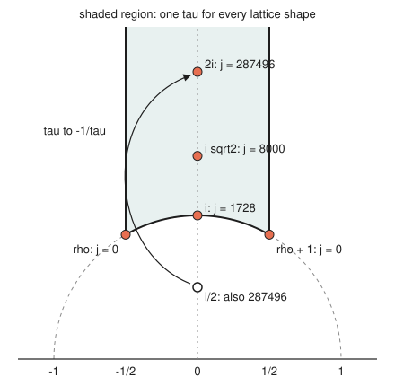

# Moduli spaces: a space whose points are the shapes of a given kind

[Syllabus](../../../SYLLABUS.md) → [Algebraic geometry](../README.md) → [Schemes and Modern Language](../README.md#s06) → Moduli spaces

---

## General Overview

Take two elliptic curves over the complex numbers ℂ: $`y^2 = x^3 - 11x + 14`$, and the torus made by gluing the opposite edges of a 1 by 2 rectangle. They look nothing alike. One is an equation, the other a doughnut. Yet they are the same curve, and one number proves it: both have **j = 287496**.

That number is the j-invariant from [Weierstrass form](../04-Elliptic%20Curves/02-weierstrass-forms-discriminant-and-j-invariant.md). Equal j means the same curve over ℂ, and every complex number is the j of some curve. So the complex curves, counted once each, line up one for one with the points of a line. That line is the **j-line**.

A **moduli space** is a space built this way: each of its points stands for one shape of a given kind, counted up to the sameness that matters. "Moduli" is an old word for the numbers that pin a shape down. The j-line is the moduli space of elliptic curves.

The space is more than a list: a family of curves traces a path on it. Lines in 3-space form a moduli space too, the **Grassmannian** $`G(2, 4)`$. There, "which lines meet four given lines?" becomes four equations, with two lines as the answer.

**A moduli space is a space whose points are the shapes of one kind, one point for each shape: over ℂ the j-invariant makes the elliptic curves into the line of numbers j, and six Plücker coordinates make the lines in 3-space into a four-dimensional quadric.**

**What kind of fact this is:** a definition (moduli space) and two theorems. The j-line is proved on this card from two facts on the Weierstrass form card. The lattice picture of the j-line (every complex elliptic curve is a torus) is stated with a source. The Grassmannian facts are proved in outline, and the count of two lines is checked on one instance.

### The picture: the j-line as lattice shapes

<p align="center"></p>

Drawn to scale. Each point τ (tau) stands for the lattice built on 1 and τ; the overview's torus is glued from the one at $`2i`$. The shaded region, the part of the strip between real parts −1/2 and 1/2 that lies above the unit circle, holds one τ per lattice shape. The point $`i/2`$, outside it, moves to $`2i`$ by $`\tau \mapsto -1/\tau`$. The corners ρ (rho) and ρ + 1 are one shape, $`j = 0`$.

---

## The formula

Notation first, in words. Over ℂ, two elliptic curves are **isomorphic**, written $`E \cong E'`$, when a rescaling $`x = u^2X`$, $`y = u^3Y`$ with $`u \ne 0`$ turns one equation into the other. This card introduces $`G(2, 4)`$ and Plücker coordinates.

The j-line in one display. The map j is a one-for-one match, and the family $`E_j`$ shows that every value j is reached:

```math
j:\ \{\text{elliptic curves over } \mathbb{C}\}/\!\cong\ \longrightarrow\ \mathbb{C}, \qquad E_j:\ y^2 = x^3 + 3j(1728 - j)\,x + 2j(1728 - j)^2
```

**Read it aloud:** j sends each complex elliptic curve, counted once up to rescaling, to one complex number, with nothing missed and nothing doubled; the curve $`E_j`$ has j-invariant exactly j.

For $`j = 8000`$: $`E_j`$ is $`y^2 = x^3 - 150528000x + 629407744000`$. Rescaling with $`u^2 = 2240`$ turns it into $`y^2 = x^3 - 30x + 56`$, a smaller curve with the same j.

Lines in 3-space. A line in projective 3-space $`\mathbb{P}^3`$ runs through two points $`u = (u_1 : u_2 : u_3 : u_4)`$ and $`v`$. (This u is a point, not the rescaling factor above.) An ordinary point $`(x, y, z)`$ has coordinates $`(x : y : z : 1)`$. The line's six **Plücker coordinates** are the 2 by 2 minors of the matrix with rows u and v:

```math
p_{il} = u_i v_l - u_l v_i \ (1 \le i < l \le 4), \qquad p_{12}p_{34} - p_{13}p_{24} + p_{14}p_{23} = 0
```

**Read it aloud:** each Plücker coordinate is a cross-difference of two coordinates of the two points; together they satisfy one quadratic equation, the Plücker relation.

The line A through (1, 0, 0) and (0, 0, 1) has $`(p_{12}, p_{13}, p_{14}, p_{23}, p_{24}, p_{34}) = (0, 1, 1, 0, 0, -1)`$, and the relation reads $`0 \cdot (-1) - 1 \cdot 0 + 1 \cdot 0 = 0`$. The Grassmannian $`G(2, 4)`$ is the set of points of $`\mathbb{P}^5`$ that satisfy the relation. The name counts 2-dimensional subspaces of 4-space, which are the lines of $`\mathbb{P}^3`$.

| Symbol | Plain meaning | In our example | Push it up and the answer… |
| --- | --- | --- | --- |
| $`E`$, $`a`$, $`b`$ | an elliptic curve $`y^2 = x^3 + ax + b`$ and its two coefficients | $`a = -11`$, $`b = 14`$ | — |
| $`j`$ | the j-invariant, $`1728 \cdot 4a^3/(4a^3 + 27b^2)`$; also a point of the j-line | 287496 | — |
| $`\cong`$, $`u`$ | isomorphic over ℂ; the rescaling factor in $`x = u^2X`$, $`y = u^3Y`$ | $`u^2 = 2240`$ at $`j = 8000`$ | the new $`a`$ shrinks by $`u^4`$, $`b`$ by $`u^6`$; j stays |
| $`E_j`$, $`k`$ | the family $`y^2 = x^3 + 3jkx + 2jk^2`$, with $`k = 1728 - j`$ | at $`j = 8000`$: $`a = -150528000`$ | — |
| $`t`$ | a family's parameter | $`y^2 = x^3 + tx + t`$ at $`t = 1`$: $`j = 6912/31`$ | j moves along $`6912t/(4t + 27)`$ |
| $`\Lambda`$, $`\tau`$, ρ | a lattice (all whole-number combinations of 1 and τ, with τ above the real line); ρ is $`-1/2 + (\sqrt{3}/2)i`$ | $`\tau = 2i`$: the 1 by 2 rectangle | the rectangle stretches; j grows |
| $`q`$, $`E_4`$, $`E_6`$, $`\sigma_3`$, $`\sigma_5`$ | $`q = e^{2\pi i\tau}`$; two series in q; sums of cubes and fifth powers of divisors | $`q = 3.4873423562 \times 10^{-6}`$ at 2i | j grows like $`1/q`$ |
| $`\mathbb{P}^3`$, $`u`$, $`v`$ | projective 3-space; two points that fix a line | (1, 0, 0) and (0, 0, 1) | — |
| $`p_{il}`$ | the six Plücker coordinates of a line | $`(0, 1, 1, 0, 0, -1)`$ for A | other points scale all six together |
| $`G(2, 4)`$ | the Grassmannian: points of $`\mathbb{P}^5`$ on the Plücker relation | 806 lines over $`\mathbb{F}_5`$ | — |
| $`\mathrm{meet}(p, p')`$ | the meeting form of two lines' coordinates: zero exactly when they meet | A against each $`L_i`$: 0 | — |
| $`L_1, \dots, L_4`$ | the four given lines in the four-lines problem | the x-axis, and three more | — |

### When it holds

- **Over ℂ, or any field where every number has all its roots and 2, 3 are not zero.** Over ℚ, equal j does not mean the same curve. The curves $`y^2 = x^3 - 30x \pm 56`$ both have $`j = 8000`$, yet mod 11 one has 18 points and the other 6.
- **Smooth curves only.** A cubic with a repeated root has no j. For the node $`y^2 = x^3 - 3x + 2`$, $`4a^3 + 27b^2 = 0`$, and the formula divides by zero.
- **A coarse space, not a fine one.** Every curve has the symmetry $`y \mapsto -y`$, so the j-line cannot carry one curve over each point that works in every family. The fix is extra data or a stack (a space that remembers symmetries), named here and not built.
- **Four lines in general position** (no special coincidence, such as two of them meeting or all four lying on one quadric surface). The count of two lines is projective, over ℂ, for general lines. Over ℝ it can be zero. If the four lines lie on one quadric surface, infinitely many lines meet them.

---

## Why it works

### Step 0: three demands on an invariant

To turn a set of shapes into a space, find a number with three properties.

1. Isomorphic shapes get the same number.
2. Different shapes get different numbers.
3. Every number belongs to some shape.

Then the shapes are the numbers, and their space is the space of numbers. The j-invariant meets all three over ℂ.

### Step 1: same curve, same j, and back again

[Weierstrass form](../04-Elliptic%20Curves/02-weierstrass-forms-discriminant-and-j-invariant.md) proves both directions. A rescaling multiplies $`4a^3`$ and $`27b^2`$ by the same factor $`u^{-12}`$, so their ratio, and j, stays put. Conversely, equal j forces $`a/a' = u^4`$ and $`b/b' = u^6`$ for one complex u, which exists because complex numbers have all their roots.

### Step 2: every j is reached

Write $`k = 1728 - j`$ and take $`a = 3jk`$, $`b = 2jk^2`$, the family $`E_j`$. Then

```math
4a^3 = 108\,j^3k^3, \qquad 27b^2 = 108\,j^2k^4, \qquad 4a^3 + 27b^2 = 108\,j^2k^3(j + k) = 108 \cdot 1728\,j^2k^3
```

**Read it aloud:** both pieces share the factor $`108\,j^2k^3`$, and what remains adds to $`j + k = 1728`$.

So $`1728 \cdot 4a^3/(4a^3 + 27b^2) = 1728 \cdot 108\,j^3k^3/(108 \cdot 1728\,j^2k^3) = j`$. The sum is not zero when j is neither 0 nor 1728, so $`E_j`$ is smooth. The two left-over values have their own curves: $`y^2 = x^3 - 2`$ has $`j = 0`$ and $`y^2 = x^3 - x`$ has $`j = 1728`$. The code checks the family at five values of j, and prints the case $`j = 8000`$.

With Step 1, this proves the theorem: over ℂ, curves up to isomorphism match the complex numbers one for one.

### Step 3: the same line, seen as lattice shapes

Over ℂ every elliptic curve is a torus $`\mathbb{C}/\Lambda`$: the plane folded up along a lattice $`\Lambda`$. That theorem (uniformisation) is stated here with its source (Silverman, chapter VI). [Riemann surfaces](../03-Plane%20Curves/08-riemann-surfaces-and-the-weierstrass-p-function.md) builds the curve from the lattice.

Scaling and turning the plane changes nothing, so put one lattice vector at 1 and call the other τ. A lattice has many bases. Two moves generate the changes:

- $`\tau \mapsto \tau + 1`$: swap the second vector for the diagonal;
- $`\tau \mapsto -1/\tau`$: swap the two vectors, then rescale.

Repeating them moves every τ into the shaded region of the picture, and the region's τ values are distinct shapes, apart from matching edges. The j-invariant of the lattice is a function of τ unchanged by both moves, given by the series

```math
E_4 = 1 + 240\sum_{n \ge 1}\sigma_3(n)\,q^n, \qquad E_6 = 1 - 504\sum_{n \ge 1}\sigma_5(n)\,q^n, \qquad j(\tau) = \frac{1728\,E_4^3}{E_4^3 - E_6^2}
```

**Read it aloud:** two power series in $`q = e^{2\pi i\tau}`$, whose coefficients sum the cubes and the fifth powers of the divisors of n, combine into j.

Here $`\sigma_3(n)`$ is the sum of the cubes of the divisors of n, and $`\sigma_5(n)`$ the sum of their fifth powers. Since q depends on $`\tau + 1`$ the same way as on τ, the first move is visible at once. The second needs a proof (Serre, chapter VII).

The curve's j and the lattice's j agree:

| Lattice τ | Shape | Curve | j |
| --- | --- | --- | --- |
| ρ | hexagonal | $`y^2 = x^3 - 2`$ | 0 |
| i | square | $`y^2 = x^3 - x`$ | 1728 |
| $`i\sqrt{2}`$ | 1 by 1.414214 rectangle | $`y^2 = x^3 - 30x + 56`$ | 8000 |
| 2i | 1 by 2 rectangle | $`y^2 = x^3 - 11x + 14`$ | 287496 |
| i/2 | the same rectangle, other basis | the same curve | 287496 |

The lattice values are $`12^3`$, $`20^3`$ and $`66^3`$: whole cubes. That these special shapes give whole numbers is the theory of complex multiplication, beyond this card; see [Complex multiplication](../04-Elliptic%20Curves/12-complex-multiplication.md).

### Step 4: families become maps

Nearby shapes should sit at nearby points. Take the family $`y^2 = x^3 + tx + t`$. Its j is a formula in t:

```math
j(t) = 1728 \cdot \frac{4t^3}{4t^3 + 27t^2} = \frac{6912\,t}{4t + 27}
```

**Read it aloud:** as t moves, the curve's point on the j-line moves along a ratio of two polynomials in t.

At $`t = 1, 2, 5`$ that gives $`6912/31`$, $`13824/35`$ and $`34560/47`$, each matching j computed straight from a and b. Where $`4t + 27`$ vanishes, j runs off to infinity and the family leaves the j-line. At $`t = 0`$ the curve is the cusp $`y^2 = x^3`$, yet $`j(t)`$ tends to 0: the map extends even though the curve breaks.

That is the defining job of a moduli space: a family of shapes over a base is the same as a map from the base into the space. The j-line does this only up to twists (see When it holds), which is why it is called coarse.

### Step 5: lines in space have six coordinates and one relation

Three facts make $`G(2, 4)`$ the moduli space of lines in $`\mathbb{P}^3`$.

1. **The coordinates belong to the line, not the points.** Replace u and v by two other points of the line. Each new point is a combination of the old two, and every 2 by 2 minor is multiplied by the same number, the determinant of that change. Through (2, 0, −1) and (−1, 0, 2), line A gets $`(0, 3, 3, 0, 0, -3)`$, three times the old list. In $`\mathbb{P}^5`$ that is the same point.
2. **The relation holds.** Write the 4 by 4 matrix with rows u, v, u, v. Its determinant is zero, because two rows repeat. Expanding it along the first two rows gives twice the Plücker relation.
3. **The coordinates fix the line.** Set $`p_{li} = -p_{il}`$ and $`p_{ll} = 0`$, making a 4 by 4 table. Then each column of the table that is not all zero is a point of the line (Harris, lecture 6). For A, column 3 is $`(p_{13}, p_{23}, p_{33}, p_{43}) = (1 : 0 : 0 : 1)`$, the point (1, 0, 0). Over $`\mathbb{F}_5`$ the code confirms the match: 806 subspaces, 806 points on the relation, none left over.

Lines in space need four numbers: a general line crosses the plane $`z = 0`$ at one point and the plane $`z = 1`$ at another, and each crossing point has two free coordinates, x and y. Six coordinates, minus one for scaling and one for the relation, also leave four. So $`G(2, 4)`$ has dimension 4.

Unlike the j-line, the Grassmannian is fine: a line has no symmetry that the space forgets, and over each point sits that line itself.

### Step 6: using the space to answer a question about shapes

Two lines with coordinates p and p′ meet exactly when their four spanning points lie in one plane. That is when the 4 by 4 determinant of u, v, u′, v′ is zero. Expanded, it is linear in each list:

```math
\mathrm{meet}(p, p') = p_{12}p'_{34} - p_{13}p'_{24} + p_{14}p'_{23} + p_{23}p'_{14} - p_{24}p'_{13} + p_{34}p'_{12}
```

**Read it aloud:** two lines meet exactly when this sum of six cross-products of their Plücker coordinates is zero.

"Meets $`L_1`$" is then one linear equation in the unknown line's six coordinates. Four given lines give four linear equations, which cut $`\mathbb{P}^5`$ down to a line. The Plücker relation is quadratic, so it meets that line in two points: two lines meet all four. This is projective, over ℂ, for lines in general position.

<details>
<summary>The four lines, and why the two answers fit</summary>

The given lines are the x-axis $`L_1`$; $`L_2`$ through (0, 0, 1) and (0, 1, 1); $`L_3`$ through (−1, −1, 0) and (2, 1, 1); $`L_4`$ through (−1, 0, 2) and (0, 1, −1). Their pairwise meeting values are 1, 1, 2, 2, 2 and 12, none zero, so no two of them meet.

Line A is $`y = 0`$, $`x + z = 1`$. It meets $`L_1`$ at (1, 0, 0) and $`L_2`$ at (0, 0, 1). Point $`(-1, 0, 2)`$ lies on both A and $`L_4`$. $`L_3`$ crosses the plane $`y = 0`$ at a point with $`x + z = 1`$, so on A.

Line B is $`x = 0`$, $`y + z = 0`$. It meets $`L_1`$ at the origin and $`L_2`$ at (0, −1, 1). $`L_4`$ and $`L_3`$ each cross the plane $`x = 0`$ at a point with $`y + z = 0`$, so on B. The code confirms all eight meetings with the meeting form above.

</details>

<details>
<summary>Where the spectrum of a ring comes in</summary>

A scheme is built from pieces $`\mathrm{Spec}\, R`$, the prime ideals of a ring R ([The spectrum of a ring](02-spectrum-of-a-ring-and-schemes.md)). Written as schemes, the j-line is $`\mathrm{Spec}\, \mathbb{Z}[j]`$ and $`G(2, 4)`$ is cut out of $`\mathbb{P}^5`$ over $`\mathbb{Z}`$. One object then serves every field at once: put in ℂ for curves and tori, ℚ for rational curves, $`\mathbb{F}_5`$ for the count of 806 lines. That is why moduli spaces are now defined as schemes, or as stacks when shapes have symmetries.

</details>

---

## Worked numbers, by hand

The main example: the curve $`y^2 = x^3 - 11x + 14`$ and the 1 by 2 rectangle lattice, $`\tau = 2i`$.

| Step | Arithmetic | Value |
| --- | --- | --- |
| cube term | $`4a^3 = 4 \times (-1331)`$ | −5324 |
| square term | $`27b^2 = 27 \times 196`$ | 5292 |
| their sum | $`-5324 + 5292`$ | −32 |
| curve's j | $`1728 \times (-5324)/(-32)`$ | **287496** |
| as a cube | $`66^3`$ | 287496 |
| lattice's q | $`e^{-4\pi}`$ | $`3.4873423562 \times 10^{-6}`$ |
| leading term | $`1/q`$ | 286751.31 |
| three terms | $`1/q + 744 + 196884q`$ | **287496.000** |
| other basis, i/2 | the q-series again | 287496.000000 |

The equation and the rectangle land on the same point of the j-line, so over ℂ they are one curve. At $`\tau = 2i`$, q is so small that the first three terms of j's q-expansion already give it to three decimals.

Lines meeting four lines, in the same spirit: A is $`(0, 1, 1, 0, 0, -1)`$ and B is $`(0, 0, 0, 0, 1, -1)`$. Both satisfy the relation, and the meeting form against $`L_1`$ to $`L_4`$ is 0, 0, 0, 0 for each. A search through all 806 lines over $`\mathbb{F}_5`$ finds exactly two that meet all four: A and B.

### What breaks if you drop a piece

| Mistake | Comes out at | What went wrong |
| --- | --- | --- |
| Equal j read as the same curve over ℚ | $`y^2 = x^3 - 30x \pm 56`$, both $`j = 8000`$: 18 and 6 points mod 11 | The rescaling needs $`u = i`$, which is not rational; the two are twists |
| Plücker relation dropped | 3906 points of $`\mathbb{P}^5`$ over $`\mathbb{F}_5`$, not 806 lines | Most points of $`\mathbb{P}^5`$ come from no line |
| A singular cubic given a j | node $`y^2 = x^3 - 3x + 2`$: $`4a^3 + 27b^2 = 0`$ | Division by zero: the node sits at $`j = \infty`$, off the j-line |
| A lattice basis taken as its shape | $`\tau = i/2`$ and $`\tau = 2i`$ as two points | Both give 287496: one rectangle, two bases |

The code prints all four.

---

## Code, from first principles, and it actually runs

The j-line is reached by three roads: exact j from a and b in fractions, the q-series, and a direct sum over every lattice point within distance 400 of the origin. The last shares no formula with the q-series and agrees within two parts in a million. The family $`E_j`$ is substituted back exactly. $`G(2, 4)`$ takes two roads: lines over $`\mathbb{F}_5`$ counted as subspaces and as points on the quadric, and the two answer lines checked by substitution and found again by searching all 806 lines mod 5.

### Python

```python
# Moduli spaces in outline -- the check behind the card.  Standard library only.
# The j-line: exact j of four curves, against the j of four lattice shapes by a
# q-series and by a direct lattice sum; every j reached by one family; a twist
# with equal j but a different point count.  The Grassmannian G(2, 4): lines in
# 3-space counted over F_5 as subspaces and as points of the Plucker quadric,
# and the two lines meeting four given lines, by substitution and by search.
from fractions import Fraction as Fr
import math

def j_ab(a, b):                                    # j of y^2 = x^3 + ax + b, exact
    a, b = Fr(a), Fr(b)
    return 1728 * 4 * a**3 / (4 * a**3 + 27 * b**2)

def family(j):                                     # a curve with j-invariant j
    return 3 * j * (1728 - j), 2 * j * (1728 - j)**2

def count(p, a, b):                                # points mod p, O included
    return 1 + sum((y * y - x**3 - a * x - b) % p == 0 for x in range(p) for y in range(p))

def cmul(z, w): return (z[0] * w[0] - z[1] * w[1], z[0] * w[1] + z[1] * w[0])
def cadd(z, w): return (z[0] + w[0], z[1] + w[1])
def cdiv(z, w):
    d = w[0] * w[0] + w[1] * w[1]
    return ((z[0] * w[0] + z[1] * w[1]) / d, (z[1] * w[0] - z[0] * w[1]) / d)
def j_from(e4, e6, k):                             # k e4^3 / (e4^3 - e6^2), complex
    c = cmul(e4, cmul(e4, e4))
    return cdiv(cmul((k, 0.0), c), cadd(c, cmul((-1.0, 0.0), cmul(e6, e6))))

def j_qseries(t, terms=30):                        # road 1: Eisenstein q-series
    r = math.exp(-2 * math.pi * t[1])
    q = (r * math.cos(2 * math.pi * t[0]), r * math.sin(2 * math.pi * t[0]))
    e4, e6, qn = (1.0, 0.0), (1.0, 0.0), (1.0, 0.0)
    for n in range(1, terms):
        qn = cmul(qn, q)
        s3 = sum(d**3 for d in range(1, n + 1) if n % d == 0)
        s5 = sum(d**5 for d in range(1, n + 1) if n % d == 0)
        e4 = cadd(e4, (240.0 * s3 * qn[0], 240.0 * s3 * qn[1]))
        e6 = cadd(e6, (-504.0 * s5 * qn[0], -504.0 * s5 * qn[1]))
    return j_from(e4, e6, 1728.0)

def j_lattice(t, R=400):                           # road 2: sum over lattice points
    g4, g6, top = (0.0, 0.0), (0.0, 0.0), int(R / t[1]) + 1
    for m in range(-R, R + 1):
        for n in range(-top, top + 1):
            w = (m + n * t[0], n * t[1])
            if (m == 0 and n == 0) or w[0] * w[0] + w[1] * w[1] > R * R:
                continue
            w2 = cmul(w, w); w4 = cmul(w2, w2)
            g4 = cadd(g4, cdiv((1.0, 0.0), w4)); g6 = cadd(g6, cdiv((1.0, 0.0), cmul(w4, w2)))
    g2, g3 = (60 * g4[0], 60 * g4[1]), (140 * g6[0], 140 * g6[1])
    return j_from(g2, (math.sqrt(27) * g3[0], math.sqrt(27) * g3[1]), 1728.0)

IDX = [(0, 1), (0, 2), (0, 3), (1, 2), (1, 3), (2, 3)]
def plucker(u, v, p=0):                            # six 2 x 2 minors, mod p if p
    out = [u[i] * v[k] - u[k] * v[i] for i, k in IDX]
    return [x % p for x in out] if p else out
def meet(P, Q):                                    # zero exactly when the lines meet
    return P[0]*Q[5] - P[1]*Q[4] + P[2]*Q[3] + P[3]*Q[2] - P[4]*Q[1] + P[5]*Q[0]
def quad(P): return P[0] * P[5] - P[1] * P[4] + P[2] * P[3]
def normal(P, p):                                  # scale so the first nonzero is 1
    lead = next(x for x in P if x)
    inv = pow(lead, p - 2, p)
    return tuple(x * inv % p for x in P)

curves = [("x^3 - 2", 0, -2, (-0.5, math.sqrt(3) / 2), "rho"), ("x^3 - x", -1, 0, (0.0, 1.0), "i"),
          ("x^3 - 30x + 56", -30, 56, (0.0, math.sqrt(2)), "i sqrt2"),
          ("x^3 - 11x + 14", -11, 14, (0.0, 2.0), "2i"), ("x^3 - 11x + 14", -11, 14, (0.0, 0.5), "i/2")]
for name, a, b, t, tn in curves:
    jq, jl = j_qseries(t), j_lattice(t)
    print(f"y^2 = {name}: j = {j_ab(a, b)}; tau = {tn}: q-series {jq[0]:.6f}, lattice sum {jl[0]:.2f}")
    assert abs(jq[0] - j_ab(a, b)) < 1e-6 * (1 + abs(j_ab(a, b))) and abs(jq[1]) < 1e-6
    assert abs(jl[0] - j_ab(a, b)) < 2e-6 * (1 + abs(j_ab(a, b)))
q = math.exp(-4 * math.pi)
print(f"by hand: 4a^3 = 4 x {(-11)**3} = {4 * (-11)**3}; 27b^2 = 27 x {14**2} = {27 * 14**2}; sum {4 * (-11)**3 + 27 * 14**2}")
print(f"tau = 2i: q = e^(-4 pi) = {q * 1e6:.10f} x 10^-6; 1/q = {1 / q:.2f}; 1/q + 744 + 196884 q = {1 / q + 744 + 196884 * q:.3f}")
print(f"1728 = 12^3 = {12**3}; 8000 = 20^3 = {20**3}; 287496 = 66^3 = {66**3}")
for j in [Fr(1), Fr(8000), Fr(287496), Fr(-3375), Fr(6912, 31)]:
    a, b = family(j)
    assert j_ab(a, b) == j                         # every j is reached
print(f"family at j = 8000: a = {family(8000)[0]}, b = {family(8000)[1]}; j back = {j_ab(*family(8000))}")
print(f"rescale to x^3 - 30x + 56: u^4 = {Fr(family(8000)[0], -30)}, u^6 = {Fr(family(8000)[1], 56)}, u^2 = 2240, 2240^3 = {2240**3}")
fam = [(t, Fr(6912 * t, 4 * t + 27), j_ab(t, t)) for t in (1, 2, 5)]
print("family y^2 = x^3 + tx + t: " + "; ".join(f"t = {t}: 6912t/(4t+27) = {f}, direct {d}" for t, f, d in fam))
assert all(f == d for _, f, d in fam)
print(f"family at t = 0: the cusp y^2 = x^3, 4t^3 + 27t^2 = {4 * 0**3 + 27 * 0**2}, yet 6912t/(4t+27) = {Fr(6912 * 0, 4 * 0 + 27)}")
c1, c2 = count(11, -30, 56), count(11, -30, -56)
print(f"twist: x^3 - 30x + 56 and x^3 - 30x - 56 both j = {j_ab(-30, -56)}; points mod 11: {c1} and {c2}, sum {c1 + c2} = 2 x 11 + 2")
assert c1 != c2 and c1 + c2 == 24
p = 5
vecs = [(a, b, c, d) for a in range(p) for b in range(p) for c in range(p) for d in range(p)]
subspaces = {normal(plucker(u, v, p), p) for u in vecs for v in vecs if any(plucker(u, v, p))}
pts = [P for P in (normal(list(v6), p) for v6 in __import__("itertools").product(range(p), repeat=6) if any(v6)) if quad(P) % p == 0]
pts = sorted(set(pts))
print(f"G(2, 4) over F_5: planes in F_5^4 = {len(subspaces)}; points on the Plucker quadric = {len(pts)}; (p^2 + 1)(p^2 + p + 1) = {(p*p + 1) * (p*p + p + 1)}")
print(f"all of P^5 over F_5, relation dropped = {(p**6 - 1) // (p - 1)}")
assert len(subspaces) == len(pts) == 806 and set(pts) == subspaces
L = [((0, 0, 0, 1), (1, 0, 0, 1)), ((0, 0, 1, 1), (0, 1, 1, 1)), ((-1, -1, 0, 1), (2, 1, 1, 1)), ((-1, 0, 2, 1), (0, 1, -1, 1))]
PL = [plucker(u, v) for u, v in L]
A, B = plucker((1, 0, 0, 1), (0, 0, 1, 1)), plucker((0, 0, 0, 1), (0, -1, 1, 1))
skew = [meet(PL[i], PL[k]) for i in range(4) for k in range(i + 1, 4)]
print(f"four lines, Plucker: {PL}; pairwise meet values {skew}, none 0, so no two meet")
assert all(skew)
A2 = plucker((2, 0, -1, 1), (-1, 0, 2, 1))
print(f"line A through (2,0,-1), (-1,0,2) instead: {A2} = {Fr(A2[1], A[1])} x A")
assert all(x * A2[1] == y * A[1] for x, y in zip(A, A2))
print(f"line A through (1,0,0), (0,0,1): {A}; relation {quad(A)}; meets L1..L4: {[meet(A, P) for P in PL]}")
print(f"line B through (0,0,0), (0,-1,1): {B}; relation {quad(B)}; meets L1..L4: {[meet(B, P) for P in PL]}")
assert quad(A) == quad(B) == 0 and all(meet(X, P) == 0 for X in (A, B) for P in PL)
col = [A[1], A[3], 0, -A[5]]                       # column 3 of the table: p13, p23, p33 = 0, p43 = -p34
print(f"line A, column 3 (p13, p23, p33, p43) = {tuple(col)}: the point (1, 0, 0)")
assert any(col) and all(meet(A, plucker(col, e)) == 0 for e in [(1, 0, 0, 0), (0, 1, 0, 0), (0, 0, 1, 0), (0, 0, 0, 1)])
found = [P for P in pts if all(meet(P, [x % p for x in Q]) % p == 0 for Q in PL)]
print(f"search over all 806 lines mod 5 meeting all four: {len(found)}; A, B mod 5 = {[normal([x % p for x in X], p) for X in (A, B)]}")
assert sorted(found) == sorted(normal([x % p for x in X], p) for X in (A, B))
print(f"mistake, node y^2 = x^3 - 3x + 2: 4a^3 + 27b^2 = {4 * (-3)**3 + 27 * 2**2}, so j has no value")
print(f"figure, rho (-0.5, {math.sqrt(3) / 2:.6f}); i (0, 1); i sqrt2 (0, {math.sqrt(2):.6f}); 2i (0, 2); i/2 (0, 0.5)")
print("ALL CHECKS PASS")
```

**Ran 2026-11-17 on macOS, Python 3.14.10, standard library only. All checks passed. Output, pasted from the run:**

```
y^2 = x^3 - 2: j = 0; tau = rho: q-series 0.000000, lattice sum 0.00
y^2 = x^3 - x: j = 1728; tau = i: q-series 1728.000000, lattice sum 1728.00
y^2 = x^3 - 30x + 56: j = 8000; tau = i sqrt2: q-series 8000.000000, lattice sum 8000.00
y^2 = x^3 - 11x + 14: j = 287496; tau = 2i: q-series 287496.000000, lattice sum 287496.11
y^2 = x^3 - 11x + 14: j = 287496; tau = i/2: q-series 287496.000000, lattice sum 287496.01
by hand: 4a^3 = 4 x -1331 = -5324; 27b^2 = 27 x 196 = 5292; sum -32
tau = 2i: q = e^(-4 pi) = 3.4873423562 x 10^-6; 1/q = 286751.31; 1/q + 744 + 196884 q = 287496.000
1728 = 12^3 = 1728; 8000 = 20^3 = 8000; 287496 = 66^3 = 287496
family at j = 8000: a = -150528000, b = 629407744000; j back = 8000
rescale to x^3 - 30x + 56: u^4 = 5017600, u^6 = 11239424000, u^2 = 2240, 2240^3 = 11239424000
family y^2 = x^3 + tx + t: t = 1: 6912t/(4t+27) = 6912/31, direct 6912/31; t = 2: 6912t/(4t+27) = 13824/35, direct 13824/35; t = 5: 6912t/(4t+27) = 34560/47, direct 34560/47
family at t = 0: the cusp y^2 = x^3, 4t^3 + 27t^2 = 0, yet 6912t/(4t+27) = 0
twist: x^3 - 30x + 56 and x^3 - 30x - 56 both j = 8000; points mod 11: 18 and 6, sum 24 = 2 x 11 + 2
G(2, 4) over F_5: planes in F_5^4 = 806; points on the Plucker quadric = 806; (p^2 + 1)(p^2 + p + 1) = 806
all of P^5 over F_5, relation dropped = 3906
four lines, Plucker: [[0, 0, -1, 0, 0, 0], [0, 0, 0, -1, -1, 0], [1, -1, -3, -1, -2, -1], [-1, 1, -1, -2, -1, 3]]; pairwise meet values [1, 1, 2, 2, 2, 12], none 0, so no two meet
line A through (2,0,-1), (-1,0,2) instead: [0, 3, 3, 0, 0, -3] = 3 x A
line A through (1,0,0), (0,0,1): [0, 1, 1, 0, 0, -1]; relation 0; meets L1..L4: [0, 0, 0, 0]
line B through (0,0,0), (0,-1,1): [0, 0, 0, 0, 1, -1]; relation 0; meets L1..L4: [0, 0, 0, 0]
line A, column 3 (p13, p23, p33, p43) = (1, 0, 0, 1): the point (1, 0, 0)
search over all 806 lines mod 5 meeting all four: 2; A, B mod 5 = [(0, 1, 1, 0, 0, 4), (0, 0, 0, 0, 1, 4)]
mistake, node y^2 = x^3 - 3x + 2: 4a^3 + 27b^2 = 0, so j has no value
figure, rho (-0.5, 0.866025); i (0, 1); i sqrt2 (0, 1.414214); 2i (0, 2); i/2 (0, 0.5)
ALL CHECKS PASS
```

### Rust

Same numbers, same labels, built with `rustc --edition 2021 -O`. Fractions are an i128 struct with checked multiplication, so an overflow stops the run.

```rust
// Moduli spaces in outline -- the same check as the Python, in Rust.  No crates.
// The j-line: exact j of four curves, against the j of four lattice shapes by a
// q-series and by a direct lattice sum; every j reached by one family; a twist
// with equal j but a different point count.  The Grassmannian G(2, 4): lines in
// 3-space counted over F_5 as subspaces and as points of the Plucker quadric,
// and the two lines meeting four given lines, by substitution and by search.
use std::collections::BTreeSet;
#[derive(Clone, Copy, PartialEq, Debug)]
struct Q { n: i128, d: i128 }
fn gcd(a: i128, b: i128) -> i128 { if b == 0 { a.abs() } else { gcd(b, a % b) } }
fn q(n: i128, d: i128) -> Q { let g = gcd(n, d).max(1) * d.signum(); Q { n: n / g, d: d / g } }
fn z(n: i128) -> Q { q(n, 1) }
fn mul(a: Q, b: Q) -> Q {                          // cancel across first, then multiply
    let (g, h) = (gcd(a.n, b.d).max(1), gcd(b.n, a.d).max(1));
    q((a.n / g).checked_mul(b.n / h).unwrap(), (a.d / h).checked_mul(b.d / g).unwrap())
}
fn add(a: Q, b: Q) -> Q { q(a.n.checked_mul(b.d).unwrap() + b.n.checked_mul(a.d).unwrap(), a.d.checked_mul(b.d).unwrap()) }
fn div(a: Q, b: Q) -> Q { mul(a, q(b.d, b.n)) }
fn s(a: Q) -> String { if a.d == 1 { format!("{}", a.n) } else { format!("{}/{}", a.n, a.d) } }
fn j_ab(a: Q, b: Q) -> Q {                         // j of y^2 = x^3 + ax + b, exact
    let a3 = mul(z(4), mul(a, mul(a, a)));
    div(mul(z(1728), a3), add(a3, mul(z(27), mul(b, b))))
}
fn family(j: Q) -> (Q, Q) {                        // a curve with j-invariant j
    let k = add(z(1728), mul(z(-1), j));
    (mul(z(3), mul(j, k)), mul(z(2), mul(j, mul(k, k))))
}
fn count(p: i64, a: i64, b: i64) -> i64 {          // points mod p, O included
    let mut n = 1;
    for x in 0..p { for y in 0..p { if (y * y - x * x * x - a * x - b).rem_euclid(p) == 0 { n += 1 } } }
    n
}
type C = (f64, f64);
fn cmul(z: C, w: C) -> C { (z.0 * w.0 - z.1 * w.1, z.0 * w.1 + z.1 * w.0) }
fn cadd(z: C, w: C) -> C { (z.0 + w.0, z.1 + w.1) }
fn cdiv(z: C, w: C) -> C {
    let d = w.0 * w.0 + w.1 * w.1;
    ((z.0 * w.0 + z.1 * w.1) / d, (z.1 * w.0 - z.0 * w.1) / d)
}
fn j_from(e4: C, e6: C, k: f64) -> C {             // k e4^3 / (e4^3 - e6^2), complex
    let c = cmul(e4, cmul(e4, e4));
    cdiv(cmul((k, 0.0), c), cadd(c, cmul((-1.0, 0.0), cmul(e6, e6))))
}
fn j_qseries(t: C) -> C {                          // road 1: Eisenstein q-series
    let pi = std::f64::consts::PI;
    let r = (-2.0 * pi * t.1).exp();
    let qq = (r * (2.0 * pi * t.0).cos(), r * (2.0 * pi * t.0).sin());
    let (mut e4, mut e6, mut qn) = ((1.0, 0.0), (1.0, 0.0), (1.0, 0.0));
    for n in 1..30i64 {
        qn = cmul(qn, qq);
        let s3: i64 = (1..=n).filter(|d| n % d == 0).map(|d| d.pow(3)).sum();
        let s5: i64 = (1..=n).filter(|d| n % d == 0).map(|d| d.pow(5)).sum();
        e4 = cadd(e4, (240.0 * s3 as f64 * qn.0, 240.0 * s3 as f64 * qn.1));
        e6 = cadd(e6, (-504.0 * s5 as f64 * qn.0, -504.0 * s5 as f64 * qn.1));
    }
    j_from(e4, e6, 1728.0)
}
fn j_lattice(t: C, r: i64) -> C {                  // road 2: sum over lattice points
    let (mut g4, mut g6, top) = ((0.0, 0.0), (0.0, 0.0), (r as f64 / t.1) as i64 + 1);
    for m in -r..=r { for n in -top..=top {
        let w = (m as f64 + n as f64 * t.0, n as f64 * t.1);
        if (m == 0 && n == 0) || w.0 * w.0 + w.1 * w.1 > (r * r) as f64 { continue }
        let w2 = cmul(w, w); let w4 = cmul(w2, w2);
        g4 = cadd(g4, cdiv((1.0, 0.0), w4)); g6 = cadd(g6, cdiv((1.0, 0.0), cmul(w4, w2)));
    } }
    let (g2, g3) = ((60.0 * g4.0, 60.0 * g4.1), (140.0 * g6.0, 140.0 * g6.1));
    j_from(g2, (27f64.sqrt() * g3.0, 27f64.sqrt() * g3.1), 1728.0)
}
const IDX: [(usize, usize); 6] = [(0, 1), (0, 2), (0, 3), (1, 2), (1, 3), (2, 3)];
fn plucker(u: [i64; 4], v: [i64; 4], p: i64) -> Vec<i64> {   // six 2 x 2 minors, mod p if p
    IDX.iter().map(|&(i, k)| { let x = u[i] * v[k] - u[k] * v[i]; if p > 0 { x.rem_euclid(p) } else { x } }).collect()
}
fn meet(a: &[i64], b: &[i64]) -> i64 {             // zero exactly when the lines meet
    a[0]*b[5] - a[1]*b[4] + a[2]*b[3] + a[3]*b[2] - a[4]*b[1] + a[5]*b[0]
}
fn quad(a: &[i64]) -> i64 { a[0] * a[5] - a[1] * a[4] + a[2] * a[3] }
fn normal(v: &[i64], p: i64) -> Vec<i64> {         // scale so the first nonzero is 1
    let lead = *v.iter().find(|&&x| x != 0).unwrap();
    let mut inv = 1; for _ in 0..p - 2 { inv = inv * lead % p }
    v.iter().map(|x| x * inv % p).collect()
}
fn tup(v: &[i64]) -> String { format!("({})", v.iter().map(|x| x.to_string()).collect::<Vec<_>>().join(", ")) }
fn main() {
    let r3 = 3f64.sqrt() / 2.0;
    let curves = [("x^3 - 2", 0, -2, (-0.5, r3), "rho"), ("x^3 - x", -1, 0, (0.0, 1.0), "i"),
        ("x^3 - 30x + 56", -30, 56, (0.0, 2f64.sqrt()), "i sqrt2"),
        ("x^3 - 11x + 14", -11, 14, (0.0, 2.0), "2i"), ("x^3 - 11x + 14", -11, 14, (0.0, 0.5), "i/2")];
    for (name, a, b, t, tn) in curves {
        let (jq, jl, je) = (j_qseries(t), j_lattice(t, 400), j_ab(z(a), z(b)));
        println!("y^2 = {}: j = {}; tau = {}: q-series {:.6}, lattice sum {:.2}", name, s(je), tn, jq.0, jl.0);
        let jf = je.n as f64 / je.d as f64;
        assert!((jq.0 - jf).abs() < 1e-6 * (1.0 + jf.abs()) && jq.1.abs() < 1e-6);
        assert!((jl.0 - jf).abs() < 2e-6 * (1.0 + jf.abs()));
    }
    let qv = (-4.0 * std::f64::consts::PI).exp();
    println!("by hand: 4a^3 = 4 x {} = {}; 27b^2 = 27 x {} = {}; sum {}", (-11i64).pow(3), 4 * (-11i64).pow(3), 14 * 14, 27 * 14 * 14, 4 * (-11i64).pow(3) + 27 * 14 * 14);
    println!("tau = 2i: q = e^(-4 pi) = {:.10} x 10^-6; 1/q = {:.2}; 1/q + 744 + 196884 q = {:.3}", qv * 1e6, 1.0 / qv, 1.0 / qv + 744.0 + 196884.0 * qv);
    println!("1728 = 12^3 = {}; 8000 = 20^3 = {}; 287496 = 66^3 = {}", 12i64.pow(3), 20i64.pow(3), 66i64.pow(3));
    for j in [z(1), z(8000), z(287496), z(-3375), q(6912, 31)] {
        let (a, b) = family(j);
        assert!(j_ab(a, b) == j);                  // every j is reached
    }
    let (fa, fb) = family(z(8000));
    println!("family at j = 8000: a = {}, b = {}; j back = {}", s(fa), s(fb), s(j_ab(fa, fb)));
    println!("rescale to x^3 - 30x + 56: u^4 = {}, u^6 = {}, u^2 = 2240, 2240^3 = {}", s(div(fa, z(-30))), s(div(fb, z(56))), 2240i128.pow(3));
    let fam: Vec<(i128, Q, Q)> = [1, 2, 5].iter().map(|&t| (t, q(6912 * t, 4 * t + 27), j_ab(z(t), z(t)))).collect();
    println!("family y^2 = x^3 + tx + t: {}", fam.iter().map(|(t, f, d)| format!("t = {}: 6912t/(4t+27) = {}, direct {}", t, s(*f), s(*d))).collect::<Vec<_>>().join("; "));
    assert!(fam.iter().all(|(_, f, d)| f == d));
    println!("family at t = 0: the cusp y^2 = x^3, 4t^3 + 27t^2 = {}, yet 6912t/(4t+27) = {}", 4 * 0i64.pow(3) + 27 * 0i64.pow(2), s(q(6912 * 0, 4 * 0 + 27)));
    let (c1, c2) = (count(11, -30, 56), count(11, -30, -56));
    println!("twist: x^3 - 30x + 56 and x^3 - 30x - 56 both j = {}; points mod 11: {} and {}, sum {} = 2 x 11 + 2", s(j_ab(z(-30), z(-56))), c1, c2, c1 + c2);
    assert!(c1 != c2 && c1 + c2 == 24);
    let p = 5i64;
    let vecs: Vec<[i64; 4]> = (0..p.pow(4)).map(|n| [n / 125, n / 25 % 5, n / 5 % 5, n % 5]).collect();
    let mut subspaces = BTreeSet::new();
    for u in &vecs { for v in &vecs { let w = plucker(*u, *v, p); if w.iter().any(|&x| x != 0) { subspaces.insert(normal(&w, p)); } } }
    let mut pts = BTreeSet::new();
    for n in 1..p.pow(6) {
        let v: Vec<i64> = (0..6).map(|k| n / p.pow(5 - k) % p).collect();
        let w = normal(&v, p); if quad(&w) % p == 0 { pts.insert(w); }
    }
    println!("G(2, 4) over F_5: planes in F_5^4 = {}; points on the Plucker quadric = {}; (p^2 + 1)(p^2 + p + 1) = {}", subspaces.len(), pts.len(), (p * p + 1) * (p * p + p + 1));
    println!("all of P^5 over F_5, relation dropped = {}", (p.pow(6) - 1) / (p - 1));
    assert!(subspaces.len() == 806 && pts.len() == 806 && pts == subspaces);
    let l = [([0, 0, 0, 1], [1, 0, 0, 1]), ([0, 0, 1, 1], [0, 1, 1, 1]), ([-1, -1, 0, 1], [2, 1, 1, 1]), ([-1, 0, 2, 1], [0, 1, -1, 1])];
    let pl: Vec<Vec<i64>> = l.iter().map(|(u, v)| plucker(*u, *v, 0)).collect();
    let skew: Vec<i64> = (0..4).flat_map(|i| (i + 1..4).map(move |k| (i, k))).map(|(i, k)| meet(&pl[i], &pl[k])).collect();
    println!("four lines, Plucker: {:?}; pairwise meet values {:?}, none 0, so no two meet", pl, skew);
    assert!(skew.iter().all(|&x| x != 0));
    let (a, b) = (plucker([1, 0, 0, 1], [0, 0, 1, 1], 0), plucker([0, 0, 0, 1], [0, -1, 1, 1], 0));
    let a2 = plucker([2, 0, -1, 1], [-1, 0, 2, 1], 0);
    println!("line A through (2,0,-1), (-1,0,2) instead: {:?} = {} x A", a2, s(q(a2[1] as i128, a[1] as i128)));
    assert!(a.iter().zip(&a2).all(|(x, y)| x * a2[1] == y * a[1]));
    for (nm, x, pts_) in [("A", &a, "(1,0,0), (0,0,1)"), ("B", &b, "(0,0,0), (0,-1,1)")] {
        println!("line {} through {}: {:?}; relation {}; meets L1..L4: {:?}", nm, pts_, x, quad(x), pl.iter().map(|y| meet(x, y)).collect::<Vec<_>>());
        assert!(quad(x) == 0 && pl.iter().all(|y| meet(x, y) == 0));
    }
    let col = [a[1], a[3], 0, -a[5]];                 // column 3 of the table: p13, p23, p33 = 0, p43 = -p34
    println!("line A, column 3 (p13, p23, p33, p43) = {}: the point (1, 0, 0)", tup(&col));
    assert!(col.iter().any(|&x| x != 0) && (0..4).all(|k| { let mut e = [0i64; 4]; e[k] = 1; meet(&a, &plucker(col, e, 0)) == 0 }));
    let plp: Vec<Vec<i64>> = pl.iter().map(|y| y.iter().map(|v| v.rem_euclid(p)).collect()).collect();
    let found: Vec<&Vec<i64>> = pts.iter().filter(|w| plp.iter().all(|y| meet(w, y).rem_euclid(p) == 0)).collect();
    let ab: Vec<Vec<i64>> = [&a, &b].iter().map(|x| normal(&x.iter().map(|v| v.rem_euclid(p)).collect::<Vec<_>>(), p)).collect();
    println!("search over all 806 lines mod 5 meeting all four: {}; A, B mod 5 = [{}]", found.len(), ab.iter().map(|v| tup(v)).collect::<Vec<_>>().join(", "));
    assert!(found.len() == 2 && found.iter().all(|w| ab.contains(w)));
    println!("mistake, node y^2 = x^3 - 3x + 2: 4a^3 + 27b^2 = {}, so j has no value", 4 * (-3i64).pow(3) + 27 * 2i64.pow(2));
    println!("figure, rho (-0.5, {:.6}); i (0, 1); i sqrt2 (0, {:.6}); 2i (0, 2); i/2 (0, 0.5)", r3, 2f64.sqrt());
    println!("ALL CHECKS PASS");
}
```

**Ran 2026-11-17 on macOS, rustc 1.98.1, no crates. All checks passed. Output, pasted from the run:**

```
y^2 = x^3 - 2: j = 0; tau = rho: q-series 0.000000, lattice sum 0.00
y^2 = x^3 - x: j = 1728; tau = i: q-series 1728.000000, lattice sum 1728.00
y^2 = x^3 - 30x + 56: j = 8000; tau = i sqrt2: q-series 8000.000000, lattice sum 8000.00
y^2 = x^3 - 11x + 14: j = 287496; tau = 2i: q-series 287496.000000, lattice sum 287496.11
y^2 = x^3 - 11x + 14: j = 287496; tau = i/2: q-series 287496.000000, lattice sum 287496.01
by hand: 4a^3 = 4 x -1331 = -5324; 27b^2 = 27 x 196 = 5292; sum -32
tau = 2i: q = e^(-4 pi) = 3.4873423562 x 10^-6; 1/q = 286751.31; 1/q + 744 + 196884 q = 287496.000
1728 = 12^3 = 1728; 8000 = 20^3 = 8000; 287496 = 66^3 = 287496
family at j = 8000: a = -150528000, b = 629407744000; j back = 8000
rescale to x^3 - 30x + 56: u^4 = 5017600, u^6 = 11239424000, u^2 = 2240, 2240^3 = 11239424000
family y^2 = x^3 + tx + t: t = 1: 6912t/(4t+27) = 6912/31, direct 6912/31; t = 2: 6912t/(4t+27) = 13824/35, direct 13824/35; t = 5: 6912t/(4t+27) = 34560/47, direct 34560/47
family at t = 0: the cusp y^2 = x^3, 4t^3 + 27t^2 = 0, yet 6912t/(4t+27) = 0
twist: x^3 - 30x + 56 and x^3 - 30x - 56 both j = 8000; points mod 11: 18 and 6, sum 24 = 2 x 11 + 2
G(2, 4) over F_5: planes in F_5^4 = 806; points on the Plucker quadric = 806; (p^2 + 1)(p^2 + p + 1) = 806
all of P^5 over F_5, relation dropped = 3906
four lines, Plucker: [[0, 0, -1, 0, 0, 0], [0, 0, 0, -1, -1, 0], [1, -1, -3, -1, -2, -1], [-1, 1, -1, -2, -1, 3]]; pairwise meet values [1, 1, 2, 2, 2, 12], none 0, so no two meet
line A through (2,0,-1), (-1,0,2) instead: [0, 3, 3, 0, 0, -3] = 3 x A
line A through (1,0,0), (0,0,1): [0, 1, 1, 0, 0, -1]; relation 0; meets L1..L4: [0, 0, 0, 0]
line B through (0,0,0), (0,-1,1): [0, 0, 0, 0, 1, -1]; relation 0; meets L1..L4: [0, 0, 0, 0]
line A, column 3 (p13, p23, p33, p43) = (1, 0, 0, 1): the point (1, 0, 0)
search over all 806 lines mod 5 meeting all four: 2; A, B mod 5 = [(0, 1, 1, 0, 0, 4), (0, 0, 0, 0, 1, 4)]
mistake, node y^2 = x^3 - 3x + 2: 4a^3 + 27b^2 = 0, so j has no value
figure, rho (-0.5, 0.866025); i (0, 1); i sqrt2 (0, 1.414214); 2i (0, 2); i/2 (0, 0.5)
ALL CHECKS PASS
```

The two outputs match line for line.

### Lean

Lean proves the j-line theorem and both Plücker facts in general, and checks the worked numbers exactly.

- Take a field where every number has all its roots, and 2 and 3 are not zero. Then two smooth curves have the same j exactly when a rescaling turns one into the other.
- Over that field, every number is the j of some smooth curve.
- The Plücker coordinates of every line satisfy the Plücker relation.
- Two lines meet exactly when the meeting form of their Plücker coordinates is zero. On the way, Lean shows that form is the 4 by 4 determinant of u, v, u′, v′.
- The main curve $`y^2 = x^3 - 11x + 14`$ has $`j = 287496 = 66^3`$.
- The table's three other curves have j equal to 0, 1728 and 8000.
- Take $`E_j`$ at $`j = 8000`$. Then rescaling with $`u^2 = 2240`$ turns it into $`y^2 = x^3 - 30x + 56`$.
- Take the family $`y^2 = x^3 + tx + t`$ at t = 1, 2 and 5. Then j is 6912/31, 13824/35 and 34560/47.
- Take the node $`y^2 = x^3 - 3x + 2`$. Then $`4a^3 + 27b^2 = 0`$.
- Mod 11 the twists $`y^2 = x^3 - 30x \pm 56`$ have 18 and 6 points.
- Lines A and B have the card's Plücker coordinates, and both meet all four given lines.
- The four given lines have pairwise meeting values 1, 1, 2, 2, 2 and 12.

The lattice values of j, the count of lines mod 5 and the search for A and B are left to Python and Rust.

```lean
-- Moduli spaces in outline: over an algebraically closed field with 2 and 3 not zero, the j-invariant matches smooth curves y^2 = x^3 + ax + b up to rescaling one for one with the field's numbers, and the Plücker coordinates of a line satisfy the Plücker relation and their meeting form vanishes exactly when two lines meet.
import Mathlib.FieldTheory.IsAlgClosed.Basic
import Mathlib.LinearAlgebra.LinearIndependent.Basic
import Mathlib.LinearAlgebra.LinearIndependent.Lemmas
import Mathlib.LinearAlgebra.Matrix.ToLinearEquiv
import Mathlib.LinearAlgebra.Span.Basic
import Mathlib.Data.ZMod.Basic
import Mathlib.Tactic.NormNum

/-- The j-invariant of y^2 = x^3 + ax + b, as on the card: 1728 · 4a^3 / (4a^3 + 27b^2).
(For a short Weierstrass curve this is Mathlib's `WeierstrassCurve.j`, which is c₄^3/Δ.) -/
def jInv {K : Type*} [Field K] (a b : K) : K :=
  1728 * (4 * a ^ 3) / (4 * a ^ 3 + 27 * b ^ 2)

/-- The six Plücker coordinates (p₁₂, p₁₃, p₁₄, p₂₃, p₂₄, p₃₄) of the line through the points
u and v of projective 3-space: p_il = u_i v_l - u_l v_i. -/
def plucker {R : Type*} [CommRing R] (u v : Fin 4 → R) : Fin 6 → R :=
  ![u 0 * v 1 - u 1 * v 0, u 0 * v 2 - u 2 * v 0, u 0 * v 3 - u 3 * v 0,
    u 1 * v 2 - u 2 * v 1, u 1 * v 3 - u 3 * v 1, u 2 * v 3 - u 3 * v 2]

/-- The meeting form of two lists of Plücker coordinates:
p₁₂p'₃₄ - p₁₃p'₂₄ + p₁₄p'₂₃ + p₂₃p'₁₄ - p₂₄p'₁₃ + p₃₄p'₁₂. -/
def meet {R : Type*} [CommRing R] (p p' : Fin 6 → R) : R :=
  p 0 * p' 5 - p 1 * p' 4 + p 2 * p' 3 + p 3 * p' 2 - p 4 * p' 1 + p 5 * p' 0

/-- Helper: the meeting form of two Plücker lists is the 4 × 4 determinant with rows u, v, u', v'. -/
theorem meet_plucker_eq_det {R : Type*} [CommRing R] (u v u' v' : Fin 4 → R) :
    meet (plucker u v) (plucker u' v') = Matrix.det (Matrix.of ![u, v, u', v']) := by
  have e1 : Fin.succAbove (1 : Fin 4) 2 = 3 := rfl
  have e2 : Fin.succAbove (2 : Fin 4) 2 = 3 := rfl
  have e3 : Fin.succAbove (3 : Fin 4) 2 = 2 := rfl
  rw [Matrix.det_succ_row_zero]
  simp [Fin.sum_univ_succ, Matrix.det_fin_three, Matrix.submatrix, meet, plucker, e1, e2, e3]
  ring

#print axioms meet_plucker_eq_det

/-- The j-line. Over a field where every polynomial has a root (like ℂ) and 2, 3 are not
zero: two smooth curves y^2 = x^3 + ax + b and y^2 = x^3 + a'x + b' (smooth meaning
4a^3 + 27b^2 ≠ 0) have the same j exactly when a rescaling x = u^2 X, y = u^3 Y with u ≠ 0
turns one into the other, that is a' = a/u^4 and b' = b/u^6; and every number j is the
j-invariant of some smooth curve. So j matches the curves, counted once up to rescaling,
one for one with the numbers. -/
theorem j_line_classifies_elliptic_curves {K : Type*} [Field K] [IsAlgClosed K]
    (h2 : (2 : K) ≠ 0) (h3 : (3 : K) ≠ 0) :
    (∀ a b a' b' : K, 4 * a ^ 3 + 27 * b ^ 2 ≠ 0 → 4 * a' ^ 3 + 27 * b' ^ 2 ≠ 0 →
      (jInv a b = jInv a' b' ↔ ∃ u : K, u ≠ 0 ∧ a' = a / u ^ 4 ∧ b' = b / u ^ 6)) ∧
    (∀ j : K, ∃ a b : K, 4 * a ^ 3 + 27 * b ^ 2 ≠ 0 ∧ jInv a b = j) := by
  have h1728 : (1728 : K) ≠ 0 := by
    have : (1728 : K) = 2 ^ 6 * 3 ^ 3 := by norm_num
    rw [this]; exact mul_ne_zero (pow_ne_zero _ h2) (pow_ne_zero _ h3)
  have h4 : (4 : K) ≠ 0 := by
    have : (4 : K) = 2 ^ 2 := by norm_num
    rw [this]; exact pow_ne_zero _ h2
  have h27 : (27 : K) ≠ 0 := by
    have : (27 : K) = 3 ^ 3 := by norm_num
    rw [this]; exact pow_ne_zero _ h3
  refine ⟨fun a b a' b' hD hD' => ?_, fun j => ?_⟩
  · constructor
    · intro hj
      unfold jInv at hj
      rw [div_eq_div_iff hD hD'] at hj
      have key : a ^ 3 * b' ^ 2 = a' ^ 3 * b ^ 2 := by
        have h0 : (1728 * 4 * 27 : K) * (a ^ 3 * b' ^ 2 - a' ^ 3 * b ^ 2) = 0 := by
          linear_combination hj
        have hne : (1728 * 4 * 27 : K) ≠ 0 := mul_ne_zero (mul_ne_zero h1728 h4) h27
        linear_combination (mul_eq_zero.1 h0).resolve_left hne
      by_cases ha : a = 0
      · have hb : b ≠ 0 := by rintro rfl; apply hD; simp [ha]
        have ha' : a' = 0 := by
          have e : a' ^ 3 * b ^ 2 = 0 := by rw [← key, ha]; ring
          exact pow_eq_zero_iff (n := 3) (by norm_num) |>.mp
            ((mul_eq_zero.1 e).resolve_right (pow_ne_zero _ hb))
        have hb' : b' ≠ 0 := by rintro rfl; apply hD'; simp [ha']
        obtain ⟨u, hu⟩ := IsAlgClosed.exists_pow_nat_eq (b / b') (by norm_num : 0 < 6)
        have hu0 : u ≠ 0 := by
          rintro rfl; rw [zero_pow (by norm_num)] at hu; exact div_ne_zero hb hb' hu.symm
        refine ⟨u, hu0, by simp [ha, ha'], ?_⟩
        rw [hu]; field_simp
      by_cases hb : b = 0
      · have hb' : b' = 0 := by
          have e : a ^ 3 * b' ^ 2 = 0 := by rw [key, hb]; ring
          exact pow_eq_zero_iff (n := 2) (by norm_num) |>.mp
            ((mul_eq_zero.1 e).resolve_left (pow_ne_zero _ ha))
        have ha' : a' ≠ 0 := by rintro rfl; apply hD'; simp [hb']
        obtain ⟨u, hu⟩ := IsAlgClosed.exists_pow_nat_eq (a / a') (by norm_num : 0 < 4)
        have hu0 : u ≠ 0 := by
          rintro rfl; rw [zero_pow (by norm_num)] at hu; exact div_ne_zero ha ha' hu.symm
        refine ⟨u, hu0, ?_, by simp [hb, hb']⟩
        rw [hu]; field_simp
      have ha' : a' ≠ 0 := by
        intro ha'
        have e : a ^ 3 * b' ^ 2 = 0 := by rw [key, ha']; ring
        have hb' : b' = 0 := pow_eq_zero_iff (n := 2) (by norm_num) |>.mp
            ((mul_eq_zero.1 e).resolve_left (pow_ne_zero _ ha))
        apply hD'; simp [ha', hb']
      have hb' : b' ≠ 0 := by
        intro hb'
        have e : a' ^ 3 * b ^ 2 = 0 := by rw [← key, hb']; ring
        exact ha' (pow_eq_zero_iff (n := 3) (by norm_num) |>.mp
            ((mul_eq_zero.1 e).resolve_right (pow_ne_zero _ hb)))
      obtain ⟨u, hu⟩ := IsAlgClosed.exists_pow_nat_eq (b * a' / (b' * a)) (by norm_num : 0 < 2)
      have hu0 : u ≠ 0 := by
        rintro rfl; rw [zero_pow (by norm_num)] at hu
        exact div_ne_zero (mul_ne_zero hb ha') (mul_ne_zero hb' ha) hu.symm
      refine ⟨u, hu0, ?_, ?_⟩
      · rw [show u ^ 4 = (u ^ 2) ^ 2 by ring, hu]
        field_simp
        linear_combination -key
      · rw [show u ^ 6 = (u ^ 2) ^ 3 by ring, hu]
        field_simp
        linear_combination -key
    · rintro ⟨u, hu, rfl, rfl⟩
      unfold jInv
      rw [div_eq_div_iff hD hD']
      field_simp
  · by_cases hj0 : j = 0
    · exact ⟨0, 1, by simpa using h27, by simp [jInv, hj0]⟩
    by_cases hj1 : j = 1728
    · exact ⟨1, 0, by simpa using h4, by simp [jInv, hj1, h4]⟩
    have hk : (1728 - j) ≠ 0 := sub_ne_zero.2 (Ne.symm hj1)
    have hD : 4 * (3 * j * (1728 - j)) ^ 3 + 27 * (2 * j * (1728 - j) ^ 2) ^ 2
        = (4 * 27 * 1728) * j ^ 2 * (1728 - j) ^ 3 := by ring
    have hne : (4 * 27 * 1728 : K) * j ^ 2 * (1728 - j) ^ 3 ≠ 0 :=
      mul_ne_zero (mul_ne_zero (mul_ne_zero (mul_ne_zero h4 h27) h1728) (pow_ne_zero _ hj0))
        (pow_ne_zero _ hk)
    refine ⟨3 * j * (1728 - j), 2 * j * (1728 - j) ^ 2, hD ▸ hne, ?_⟩
    rw [jInv, hD, div_eq_iff hne]
    ring

/-- The Plücker relation: the Plücker coordinates of the line through any two points u, v
satisfy p₁₂p₃₄ - p₁₃p₂₄ + p₁₄p₂₃ = 0, so every line is a point of the quadric G(2, 4). -/
theorem plucker_relation {R : Type*} [CommRing R] (u v : Fin 4 → R) :
    plucker u v 0 * plucker u v 5 - plucker u v 1 * plucker u v 4
      + plucker u v 2 * plucker u v 3 = 0 := by
  simp [plucker]
  ring

/-- Two lines meet exactly when their meeting form is zero: for the line through u, v and the
line through u', v' (each pair of points distinct, so linearly independent in K^4), the
meeting form of their Plücker coordinates is zero exactly when the two lines share a point,
that is when the planes spanned by u, v and by u', v' share a nonzero vector. -/
theorem meet_eq_zero_iff_lines_meet {K : Type*} [Field K] (u v u' v' : Fin 4 → K)
    (h : LinearIndependent K ![u, v]) (h' : LinearIndependent K ![u', v']) :
    meet (plucker u v) (plucker u' v') = 0 ↔
      Submodule.span K {u, v} ⊓ Submodule.span K {u', v'} ≠ ⊥ := by
  rw [meet_plucker_eq_det, ← Matrix.exists_vecMul_eq_zero_iff, Submodule.ne_bot_iff]
  rw [LinearIndependent.pair_iff] at h h'
  constructor
  · rintro ⟨c, hc, hcM⟩
    have key : (c 0 • u + c 1 • v) + (c 2 • u' + c 3 • v') = 0 := by
      ext j
      have := congrFun hcM j
      simp [Matrix.vecMul, dotProduct, Fin.sum_univ_four] at this ⊢
      linear_combination this
    refine ⟨c 0 • u + c 1 • v, Submodule.mem_inf.2 ⟨Submodule.mem_span_pair.2 ⟨_, _, rfl⟩,
      Submodule.mem_span_pair.2 ⟨-c 2, -c 3, ?_⟩⟩, ?_⟩
    · rw [neg_smul, neg_smul, eq_comm, ← neg_add]
      exact eq_neg_of_add_eq_zero_left key
    · intro h0
      obtain ⟨h00, h01⟩ := h _ _ h0
      have e2 : c 2 • u' + c 3 • v' = 0 := by rw [h0, zero_add] at key; exact key
      obtain ⟨h02, h03⟩ := h' _ _ e2
      apply hc
      ext i
      fin_cases i <;> simp [*]
  · rintro ⟨w, hw, hw0⟩
    obtain ⟨hw1, hw2⟩ := Submodule.mem_inf.1 hw
    obtain ⟨a, b, rfl⟩ := Submodule.mem_span_pair.1 hw1
    obtain ⟨c, d, hcd⟩ := Submodule.mem_span_pair.1 hw2
    refine ⟨![a, b, -c, -d], ?_, ?_⟩
    · intro h0
      apply hw0
      have ha : a = 0 := congrFun h0 0
      have hb : b = 0 := congrFun h0 1
      simp [ha, hb]
    · ext j
      have := congrFun hcd j
      simp [Matrix.vecMul, dotProduct, Fin.sum_univ_four] at this ⊢
      linear_combination -this

-- The main example, y^2 = x^3 - 11x + 14: 4a^3 = -5324, 27b^2 = 5292, sum -32, j = 287496 = 66^3.
example : 4 * (-11 : ℤ) ^ 3 = -5324 ∧ 27 * (14 : ℤ) ^ 2 = 5292 ∧ (-5324 : ℤ) + 5292 = -32 := by
  norm_num
example : jInv (-11 : ℚ) 14 = 287496 := by norm_num [jInv]
example : (287496 : ℕ) = 66 ^ 3 ∧ (8000 : ℕ) = 20 ^ 3 ∧ (1728 : ℕ) = 12 ^ 3 := by norm_num

-- The table's curves: y^2 = x^3 - 2 has j = 0, y^2 = x^3 - x has j = 1728, y^2 = x^3 - 30x + 56 has j = 8000.
example : jInv (0 : ℚ) (-2) = 0 ∧ jInv (-1 : ℚ) 0 = 1728 ∧ jInv (-30 : ℚ) 56 = 8000 := by
  norm_num [jInv]

-- The family E_j at j = 8000: a = 3jk, b = 2jk^2 with k = 1728 - j, and its j is 8000.
example : 3 * 8000 * (1728 - 8000 : ℤ) = -150528000 ∧
    2 * 8000 * (1728 - 8000 : ℤ) ^ 2 = 629407744000 := by norm_num
example : jInv (-150528000 : ℚ) 629407744000 = 8000 := by norm_num [jInv]

-- Rescaling with u^2 = 2240 turns E_8000 into y^2 = x^3 - 30x + 56.
example : (2240 : ℤ) ^ 2 = 5017600 ∧ (2240 : ℤ) ^ 3 = 11239424000 ∧
    (-150528000 : ℤ) = 2240 ^ 2 * (-30) ∧ (629407744000 : ℤ) = 2240 ^ 3 * 56 := by norm_num

-- The family y^2 = x^3 + tx + t at t = 1, 2, 5: j = 6912/31, 13824/35, 34560/47.
example : jInv (1 : ℚ) 1 = 6912 / 31 ∧ jInv (2 : ℚ) 2 = 13824 / 35 ∧
    jInv (5 : ℚ) 5 = 34560 / 47 := by norm_num [jInv]

-- The node y^2 = x^3 - 3x + 2 has 4a^3 + 27b^2 = 0, so no j.
example : 4 * (-3 : ℤ) ^ 3 + 27 * 2 ^ 2 = 0 := by norm_num

-- The twists y^2 = x^3 - 30x ± 56 have 18 and 6 points mod 11 (the point at infinity included).
example : ((Finset.univ : Finset (ZMod 11 × ZMod 11)).filter
    (fun p => p.2 ^ 2 = p.1 ^ 3 - 30 * p.1 + 56)).card + 1 = 18 := by decide
example : ((Finset.univ : Finset (ZMod 11 × ZMod 11)).filter
    (fun p => p.2 ^ 2 = p.1 ^ 3 - 30 * p.1 - 56)).card + 1 = 6 := by decide

-- Line A through (1, 0, 0) and (0, 0, 1) has Plücker coordinates (0, 1, 1, 0, 0, -1);
-- through (2, 0, -1) and (-1, 0, 2) it gets three times that list.
example : plucker (R := ℤ) ![1, 0, 0, 1] ![0, 0, 1, 1] = ![0, 1, 1, 0, 0, -1] := by decide
example : plucker (R := ℤ) ![2, 0, -1, 1] ![-1, 0, 2, 1] = ![0, 3, 3, 0, 0, -3] := by decide

-- Line B through (0, 0, 0) and (0, -1, 1) has Plücker coordinates (0, 0, 0, 0, 1, -1).
example : plucker (R := ℤ) ![0, 0, 0, 1] ![0, -1, 1, 1] = ![0, 0, 0, 0, 1, -1] := by decide

-- The four given lines: pairwise meeting values 1, 1, 2, 2, 2, 12, none zero.
example :
    let L1 : Fin 6 → ℤ := ![0, 0, -1, 0, 0, 0]
    let L2 : Fin 6 → ℤ := ![0, 0, 0, -1, -1, 0]
    let L3 : Fin 6 → ℤ := ![1, -1, -3, -1, -2, -1]
    let L4 : Fin 6 → ℤ := ![-1, 1, -1, -2, -1, 3]
    [meet L1 L2, meet L1 L3, meet L1 L4, meet L2 L3, meet L2 L4, meet L3 L4] = [1, 1, 2, 2, 2, 12] := by
  decide

-- Lines A and B both meet all four given lines.
example :
    let L : List (Fin 6 → ℤ) := [![0, 0, -1, 0, 0, 0], ![0, 0, 0, -1, -1, 0],
      ![1, -1, -3, -1, -2, -1], ![-1, 1, -1, -2, -1, 3]]
    L.map (meet ![0, 1, 1, 0, 0, -1]) = [0, 0, 0, 0] ∧
      L.map (meet ![0, 0, 0, 0, 1, -1]) = [0, 0, 0, 0] := by
  decide

-- Over F_5: (p^2 + 1)(p^2 + p + 1) = 806 lines, against (p^6 - 1)/(p - 1) = 3906 points of P^5.
example : (5 ^ 2 + 1) * (5 ^ 2 + 5 + 1) = 806 ∧ (5 ^ 6 - 1) / (5 - 1) = 3906 := by norm_num

#print axioms j_line_classifies_elliptic_curves
#print axioms plucker_relation
#print axioms meet_eq_zero_iff_lines_meet
```

**Checked 2026-11-17 on macOS, Lean 4.36.0-rc2, Mathlib v4.36.0-rc2. Every proof is complete and uses only Lean's standard axioms. Output, pasted from the run:**

```
'meet_plucker_eq_det' depends on axioms: [propext, Classical.choice, Quot.sound]
'j_line_classifies_elliptic_curves' depends on axioms: [propext, Classical.choice, Quot.sound]
'plucker_relation' depends on axioms: [propext, Quot.sound]
'meet_eq_zero_iff_lines_meet' depends on axioms: [propext, Classical.choice, Quot.sound]
```

> [!TIP]
> **Try changing**
> Guess first, then run it.
> - **Fewer lattice points.** Change `R=400` to `R=100`. Guess first: how far off is the lattice sum at 2i? It reads 287510.12, about 14 too high, and the second assert stops the run. The q-series does not move.
> - **A smaller field.** Change `p = 5` to `p = 3`. Guess first: how many lines in $`\mathbb{P}^3`$ over $`\mathbb{F}_3`$? Both roads give 130, which is $`(9 + 1)(9 + 3 + 1)`$; the assert pinned to 806 then stops the run.
> - **Another prime for the twist.** Change both 11s in the `count` line to 13. Guess first: do the twins still differ? No: both have 14 points, so the twist assert stops the run. At 13 this curve's point count is exactly $`13 + 1`$, a special feature of $`j = 8000`$.
> - **The family at 1728.** Add `Fr(1728)` to the list of j values. Guess first: which curve does $`E_j`$ give? $`a = b = 0`$, the cusp $`y^2 = x^3`$, and j divides by zero.

---

## The usual mistake

> [!warning]
> **Treating the j-line as a list of curves over any field.** Over ℂ one j is one curve. Over ℚ one j is many curves, the twists. The curves $`y^2 = x^3 - 30x + 56`$ and $`y^2 = x^3 - 30x - 56`$ both have $`j = 8000`$, but mod 11 they have 18 and 6 points, so no rational change of coordinates joins them.
>
> - **Forgetting the relation.** Over $`\mathbb{F}_5`$, $`\mathbb{P}^5`$ has 3906 points but only 806 lines.
> - **A singular cubic given a j.** The node $`y^2 = x^3 - 3x + 2`$ makes $`4a^3 + 27b^2 = 0`$.
> - **Counting bases, not lattices.** $`\tau = 2i`$ and $`\tau = i/2`$ both give 287496.
> - **Quoting "two lines" without its terms.** The count is projective, over ℂ, for four lines in general position; over ℝ it can be zero.

---

## Where you meet it in real life

- **Curve databases.** The L-functions and Modular Forms Database lists j for every curve; entries with equal j are twists of each other.
- **Modular forms.** The series $`1/q + 744 + 196884q + \dots`$ for j is the basic modular function. [What curves answer](../04-Elliptic%20Curves/10-modularity-and-the-congruent-number-problem.md) shows modular forms deciding questions about curves.
- **Computer vision and robotics.** A camera ray is a line in space; Plücker coordinates store such lines and test whether two meet.
- **Statistics.** A model's parameter space is a moduli space of distributions, and identifiability asks whether the map from parameters to distributions is one for one, as in [Algebraic statistics](08-algebraic-statistics-and-identifiability.md).

> **Say it back**
> A moduli space is a space whose points are the shapes of one kind, each counted once. Over ℂ the j-invariant does this for elliptic curves: equal j means the same curve, and every number is some curve's j, so the curves form the j-line. The curve $`y^2 = x^3 - 11x + 14`$ and the 1 by 2 rectangle lattice sit at the same point, 287496. Lines in 3-space form the Grassmannian, six Plücker coordinates on one quadric, and asking for the lines meeting four lines cuts it down to two points. Over ℚ, j stops telling twists apart.

---

## What this builds on

- [Weierstrass form](../04-Elliptic%20Curves/02-weierstrass-forms-discriminant-and-j-invariant.md): the j-invariant, and the proof that equal j means a rescaling over ℂ.
- [The spectrum of a ring](02-spectrum-of-a-ring-and-schemes.md): the schemes in which moduli spaces are defined over every field at once.
- [Projective space](../02-Affine%20and%20Projective%20Varieties/03-projective-space-and-homogeneous-coordinates.md): the coordinates $`(x : y : z : w)`$ for $`\mathbb{P}^3`$ and $`\mathbb{P}^5`$.
- [The curve mod p](../04-Elliptic%20Curves/05-reduction-mod-p-and-hasse.md): the point counts that separate the two twists.
- [Riemann surfaces](../03-Plane%20Curves/08-riemann-surfaces-and-the-weierstrass-p-function.md): the lattice and the torus behind Step 3.

## Where this goes next

- [Algebraic statistics](08-algebraic-statistics-and-identifiability.md): the next card; parameter spaces of statistical models, and when a parameter can be recovered from the distribution.
- [Tropical geometry and computation](09-tropical-and-computational-geometry-in-outline.md): what a computer can decide about the equations that cut out spaces like these.
- [Dimension and tangent space](../02-Affine%20and%20Projective%20Varieties/07-dimension-and-tangent-spaces.md): the dimension 4 of $`G(2, 4)`$, read as a count of directions.
- [Quotients by group actions](14-geometric-invariant-theory-in-outline.md): geometric invariant theory keeps the stable orbits and drops the rest.

What remains open on this card is how to build a fine moduli space for curves that have symmetries: the j-line forgets them, and keeping them takes stacks.

---

## Sources

Verified 2026-11-17: every link below resolves to the publisher's page.

- Silverman, Joseph H. *The Arithmetic of Elliptic Curves*, 2nd ed. Springer, 2009. [DOI 10.1007/978-0-387-09494-6](https://doi.org/10.1007/978-0-387-09494-6). Chapter III: j classifies curves over an algebraically closed field; chapter X: twists; chapter VI: every complex curve is a torus.
- Serre, Jean-Pierre. *A Course in Arithmetic*. Springer, 1973. [DOI 10.1007/978-1-4684-9884-4](https://doi.org/10.1007/978-1-4684-9884-4). Chapter VII: the strip, the two moves on τ, Eisenstein series and the q-series of j.
- Harris, Joe. *Algebraic Geometry: A First Course*. Springer, 1992. [DOI 10.1007/978-1-4757-2189-8](https://doi.org/10.1007/978-1-4757-2189-8). Lecture 6: Grassmannians, Plücker coordinates and the Plücker relation.
- Eisenbud, David, and Joe Harris. *3264 and All That: A Second Course in Algebraic Geometry*. Cambridge University Press, 2016. [DOI 10.1017/CBO9781139062046](https://doi.org/10.1017/CBO9781139062046). Chapters 3 and 4: the lines meeting four general lines, counted in the Grassmannian.
