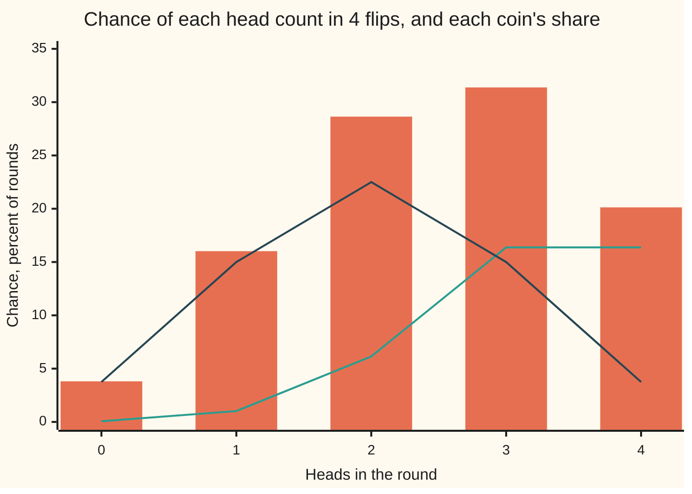

# Algebraic statistics: a model is a variety, identifiability a question about ideals

[Syllabus](../../../SYLLABUS.md) → [Algebraic geometry](../README.md) → [Schemes and Modern Language](../README.md#s06) → Algebraic statistics

---

## General Overview

A street dealer keeps two coins in a pocket. Coin A is loaded: it lands heads 4 times in 5. Coin B is fair. Each round the dealer draws one coin without showing it, coin A 2 times in 5, and flips it 4 times. The crowd sees only the heads and tails.

Over many rounds the crowd learns the chance of each head count: no heads 3.814% of the time, 3 heads 31.384%. Two questions follow.

- **Can the crowd test the story?** Is there a check that five observed chances must pass if they really come from two hidden coins?
- **Can the crowd recover the coins?** Do the five chances pin down the three hidden numbers 2/5, 4/5 and 1/2?

Both questions become algebra once each chance is written as a polynomial in the hidden numbers. The test is an equation found by **elimination**: removing the hidden numbers from the system. Here it is one cubic, a 3-by-3 determinant that must be 0. The recovery question asks how many hidden settings give the same chances. Elimination answers that too: exactly two. They are the true coins and the same coins with their labels swapped.

**A model whose chances are polynomials in its parameters is the image of a polynomial map: elimination gives the equations every distribution in it obeys, and elimination on one distribution counts the parameter points behind it.**

**What kind of fact this is:** a model, since "two hidden coins" is an assumption about the data, studied with theorems proved on this card in Why it works. The model's equations are exactly "the chances add to 1" and the cubic. Off a stated bad set, every distribution in the model comes from exactly two parameter points.

### The picture: the dealer's head counts, and where they come from



Bars (orange): what the crowd sees, the chance of each head count. First line (green): the part that comes from coin A, drawn 2 rounds in 5. Second line (dark blue): the part from coin B. At each head count the two lines add up to the bar. The crowd sees only the bars.

---

## The formula

Notation first, in words. The field is $`\mathbb{Q}`$, the rationals: every chance and parameter on this card is an exact fraction. "Over $`\mathbb{C}`$" is said where complex numbers are allowed.

The model is a **parametrisation**: a map $`\varphi`$ that takes the hidden numbers and returns the five chances.

```math
\varphi(\pi, a, b) = (p_0, p_1, p_2, p_3, p_4), \qquad p_k = \binom{4}{k}\left(\pi\, a^k (1-a)^{4-k} + (1-\pi)\, b^k (1-b)^{4-k}\right)
```

**Read it aloud:** the chance of $`k`$ heads is the chance of picking coin A times coin A's chance of $`k`$ heads, plus the same for coin B.

The **model's ideal** $`I_\varphi`$ is every polynomial in the chances that is 0 whatever the parameters are. It is an elimination ideal ([Elimination](../01-Polynomial%20Systems/05-elimination-and-implicitisation.md)): join the five equations $`p_k = \varphi_k`$ and remove the parameters.

```math
I_\varphi = \langle\, p_k - \varphi_k(\pi, a, b) \,:\, k = 0, \dots, 4 \,\rangle \cap \mathbb{Q}[p_0, \dots, p_4] = \langle\, p_0 + p_1 + p_2 + p_3 + p_4 - 1,\ \det H \,\rangle
```

Here $`H`$ is built from the chances of single sequences, $`q_k = p_k / \binom{4}{k}`$:

```math
\det H = \det \begin{pmatrix} q_0 & q_1 & q_2 \\ q_1 & q_2 & q_3 \\ q_2 & q_3 & q_4 \end{pmatrix} = q_0 q_2 q_4 + 2 q_1 q_2 q_3 - q_2^3 - q_0 q_3^2 - q_1^2 q_4
```

**Read it aloud:** apart from adding to 1, the only rule two hidden coins impose is that this 3-by-3 determinant of sequence chances is zero.

The model is the **variety** $`V(I_\varphi)`$ (the common zeros of the ideal), cut down by inequalities that keep chances real and between 0 and 1.

**Identifiability** asks how many parameter points give the same chances. The set of them is the **fibre** of $`\varphi`$ over those chances: the variety of the ideal $`\langle \varphi_k(\theta) - p_k \rangle`$ in the parameters $`\theta = (\pi, a, b)`$. For the dealer:

```math
\varphi^{-1}(\varphi(\theta_0)) = \{\,(2/5,\ 4/5,\ 1/2),\ \ (3/5,\ 1/2,\ 4/5)\,\}
```

**Read it aloud:** exactly two hidden settings give the dealer's chances, and the second is the first with the coin names swapped.

Three grades of answer, each holding away from a lower-dimensional bad set:

- **Generically identifiable:** the fibre is a single point.
- **Identifiable up to label swapping:** the only extra points are relabellings of the hidden groups. The two-coin model is this kind.
- **Locally identifiable:** the fibre is finite, so no curve of answers, but it may hold far-apart points.

| Symbol | Plain meaning | In our example | Push it up and the answer… |
| --- | --- | --- | --- |
| $`\pi`$ | chance the hidden draw picks coin A | 2/5 | more of coin A's shape in the bars |
| $`a`$, $`b`$ | heads chance of coin A, of coin B | 4/5, 1/2 | the bars lean right |
| $`\theta`$, $`\theta_0`$ | a parameter point $`(\pi, a, b)`$; the dealer's true one | $`(2/5, 4/5, 1/2)`$ | — |
| $`n`$; $`p_k`$; $`\binom{n}{k}`$ | flips per round; chance of exactly $`k`$ heads; sequences with $`k`$ heads | 4; $`p_3 = 3923/12500`$; 1, 4, 6, 4, 1 | more flips, more chances to compare |
| $`q_k`$ | chance of one given sequence with $`k`$ heads, $`p_k / \binom{4}{k}`$ | $`q_0 = 1907/50000`$ | — |
| $`\varphi`$; $`J`$ | the parametrisation; its Jacobian matrix, the table of slopes $`\partial p_k / \partial \theta`$ | rank of $`J`$ is 3 at $`\theta_0`$ | — |
| $`I_\varphi`$; $`V(\cdot)`$ | the model's ideal; the variety, the common zeros | generated by the sum rule and $`\det H`$ | — |
| $`H`$ | the Hankel matrix of the $`q_k`$: constant along each anti-diagonal | $`\det H = 0`$ | off the model, $`\det H \ne 0`$ |
| $`x`$, $`y`$; $`s`$, $`r`$; $`t`$ | the coins' odds $`a/(1-a)`$, $`b/(1-b)`$; their sum and product; the unknown in $`t^2 - s\,t + r = 0`$, whose roots are the odds | 4, 1; 5, 4; $`t = 4`$ or 1 | — |
| $`\alpha`$, $`\beta`$ | each coin's share of $`q_0`$: $`\pi (1-a)^4`$ and $`(1-\pi)(1-b)^4`$ | 2/3125, 3/80 | — |
| $`\varphi^{-1}(p)`$ | the fibre: every parameter point that gives chances $`p`$ | two points | a whole curve when not identifiable |
| $`U`$ | the unit $`1/50000^2`$ for the worked products of two $`q`$'s | — | — |

### When it holds

- **The parameters avoid the bad set.** That set is $`a = b`$, $`\pi = 0`$ or 1, and $`a`$ or $`b`$ equal to 1. With $`a = b = 1/2`$, all 9 grid values of $`\pi`$ give the same fair-coin chances, and the Jacobian's rank drops to 1.
- **Enough flips.** Three flips recover the coins but give no equation to test. Two flips do not even recover them: $`(27/125,\ 9/10,\ 19/35)`$ gives the same three chances as the dealer, 83/500, 107/250 and 203/500.
- **Exact chances, not observed frequencies.** Real data give frequencies, whose $`\det H`$ is near 0, not equal to 0. Turning "near" into a decision needs a statistical test, which this card does not build.
- **Inequalities as well as equations.** The equation works over $`\mathbb{C}`$. The chances $`(1, 12, 48, 72, 28)/161`$ add to 1 and give $`\det H = 0`$, yet no two real coins produce them.
- **"Identifiable" means up to swapping labels.** No data can say which coin was called A.

---

## Why it works

### Step 0: one coin gives a geometric sequence, two coins give a recurrence

Take coin A alone. Each extra head in a fixed sequence swaps one tail for one head. That multiplies the sequence's chance by $`a/(1-a)`$, the coin's **odds**. So one coin's sequence chances form a geometric sequence: each term is the last times a fixed number.

Two coins give a sum of two geometric sequences. Any such sum obeys one fixed rule linking three neighbouring terms. With only 2 unknowns in that rule and 3 places to check it in 4 flips, the rule must pass a consistency test. That test is the equation. Solving the same rule backwards recovers the coins.

### Step 1: write the model as a polynomial map

Each $`p_k`$ above is a polynomial in $`\pi`$, $`a`$ and $`b`$. So the set of all possible chance vectors is the image of a polynomial map. Its closure is a variety, so the tools for varieties apply.

The five chances add to 1 for every parameter point, because each coin's head counts add to 1. That is the first member of $`I_\varphi`$.

### Step 2: change coordinates to make the geometry plain

Divide out the sequence counts: $`q_k = p_k / \binom{4}{k}`$. Then pull $`(1-a)^4`$ out of coin A's term:

```math
q_k = \pi (1-a)^4 \left(\frac{a}{1-a}\right)^k + (1-\pi)(1-b)^4 \left(\frac{b}{1-b}\right)^k = \alpha\, x^k + \beta\, y^k
```

For the dealer, $`x = 4`$ and $`y = 1`$. Coin A's shares $`\alpha \cdot 4^k`$ grow fast; coin B's stay flat at $`\beta = 3/80`$.

### Step 3: eliminate the parameters

The odds $`x`$ and $`y`$ are the two roots of $`t^2 - s\,t + r`$, with $`s = x + y`$ and $`r = xy`$. So $`x^{k+2} = s\,x^{k+1} - r\,x^k`$, and the same for $`y`$. Multiply by $`\alpha`$ and $`\beta`$ and add:

```math
q_{k+2} = s\, q_{k+1} - r\, q_k \qquad \text{for } k = 0, 1, 2
```

Written as one matrix equation, that is $`H \cdot (r, -s, 1) = 0`$. A matrix that sends a nonzero vector to 0 has determinant 0. So $`\det H = 0`$ holds at every parameter point. The parameters are gone: this is elimination done by hand. For the dealer, $`s = 5`$, $`r = 4`$, and the third equation leaves exactly 0.

### Step 4: nothing else is needed

The image has 3 free directions: the Jacobian $`J`$ has rank 3 at the dealer's point ([Dimension and tangent space](../02-Affine%20and%20Projective%20Varieties/07-dimension-and-tangent-spaces.md)). The chances live in a space with 4 free directions after the sum rule. One direction is lost, so one equation beyond the sum rule is enough. The fold shows why that equation is exactly $`\det H`$.

<details>
<summary>Detailed proof: the model's ideal is generated by the sum rule and det H</summary>

Drop the sum rule for a moment and let $`\alpha`$, $`\beta`$, $`x`$, $`y`$ be any complex numbers. The points $`(q_0, \dots, q_4)`$ with $`q_k = \alpha x^k + \beta y^k`$ form the image of an irreducible space (complex 4-space), so its closure $`W`$ is irreducible. Scaling $`\alpha`$ and $`\beta`$ together adds one direction to the 3 found above, so $`W`$ has dimension 4 inside a space of dimension 5.

An irreducible variety of one dimension less than its space has a prime ideal generated by one irreducible polynomial $`f`$. Every polynomial vanishing on $`W`$ is a multiple of $`f`$.

The code's road 2 shows that no nonzero polynomial of degree 1 or 2 vanishes on $`W`$. It evaluates all 15 quadratic monomials at 60 random points of $`W`$ modulo the prime $`2^{31} - 1`$ and finds no combination that vanishes. A rational quadric vanishing on $`W`$ would, after clearing denominators and dividing out common factors, reduce to a nonzero quadric modulo the prime that vanishes at those points too. So $`f`$ has degree at least 3.

Step 3 shows $`\det H`$ vanishes on $`W`$ and has degree 3. So $`\det H`$ is a constant times $`f`$. Its ideal is all of $`I(W)`$.

Now put the sum rule back. The dealer's model is the slice of $`W`$ by the plane $`\sum_k \binom{4}{k} q_k = 1`$, which misses the origin. Slicing a cone by such a plane keeps a prime ideal prime and keeps its generators. The image of $`\varphi`$ has dimension 3 and lies in this 3-dimensional irreducible slice, so it fills it. That gives $`I_\varphi = \langle \sum_k p_k - 1,\ \det H \rangle`$.

</details>

### Step 5: identifiability is elimination again, on the fibre

Fix the dealer's chances and ask which $`(\pi, a, b)`$ give them. Run Step 3 backwards.

1. Solve the first two recurrence equations for $`s`$ and $`r`$. Their determinant is $`q_0 q_2 - q_1^2 = \alpha \beta (x - y)^2`$. It is nonzero off the bad set, so $`s`$ and $`r`$ are unique.
2. Eliminate the odds. Put $`t = a/(1-a)`$ into $`t^2 - s\,t + r = 0`$ and clear denominators. This gives one polynomial in $`a`$ alone, the **eliminant**: $`(1 + s + r)\,a^2 - (s + 2r)\,a + r = 0`$.
3. Its two roots are the two coins' heads chances. Either root may be called $`a`$.
4. With $`x`$ and $`y`$ known, $`q_0 = \alpha + \beta`$ and $`q_1 = \alpha x + \beta y`$ give $`\alpha`$ uniquely. Then $`\pi = \alpha (1 + x)^4`$.

Every step has one answer except step 3, which has two. So the fibre has exactly two points, and they differ by swapping the labels. That is a proof of identifiability up to label swapping, for every parameter point off the bad set.

### Step 6: count before computing

The Jacobian gives a quick count. A rank below the number of parameters means a curve of parameter points gives the same chances. That is the zero determinant of the slope table in [Calibration](../../12-Financial%20mathematics/07-Greeks%20by%20Numbers%20and%20Calibration/06-calibration-as-least-squares.md). Here the code finds:

| Flips $`n`$ | Head counts | Free coordinates | Rank of $`J`$ | Codimension: directions lost near $`\theta_0`$ |
| --- | --- | --- | --- | --- |
| 2 | 3 | 2 | 2 | 0, and a curve of answers |
| 3 | 4 | 3 | 3 | 0 |
| 4 | 5 | 4 | 3 | 1 |
| 5 | 6 | 5 | 3 | 2 |

The last column counts directions lost, not equations. At 4 flips the two agree: one direction, one equation. At 5 flips (now $`q_k = p_k / \binom{5}{k}`$) the model obeys four cubic equations: the 3-by-3 minors of the 3-by-4 Hankel matrix with rows $`(q_0, \dots, q_3)`$, $`(q_1, \dots, q_4)`$ and $`(q_2, \dots, q_5)`$. Each vanishes because Step 3's recurrence makes the rows dependent, and road 2 in the code finds exactly four. Near $`\theta_0`$ they cut away only two directions.

Rank 3 says the fibre is finite near $`\theta_0`$. It cannot say how many points the fibre has. The second point, the label swap, sits far away. Only the elimination in Step 5 counts it.

---

## Worked numbers, by hand

The dealer's chances, in units of 1/50000 for each $`q`$ and $`U = 1/50000^2`$ for products of two.

| Step | Arithmetic | Value |
| --- | --- | --- |
| sequence chances $`q_0, \dots, q_4`$ | $`p_k \div \binom{4}{k}`$ | 1907, 2003, 2387, 3923, 10067 |
| determinant of the 2-by-2 system | $`q_0 q_2 - q_1^2`$ | 540000 $`U`$ |
| top of $`s`$ | $`q_0 q_3 - q_1 q_2`$ | 2700000 $`U`$ |
| top of $`r`$ | $`q_1 q_3 - q_2^2`$ | 2160000 $`U`$ |
| sum of odds $`s`$ | 2700000 ÷ 540000 | 5 |
| product of odds $`r`$ | 2160000 ÷ 540000 | 4 |
| third equation | $`5 \times 3923 - 4 \times 2387 - 10067`$ | 0, so $`\det H = 0`$ |
| eliminant in $`a`$ | $`(1 + 5 + 4)a^2 - (5 + 8)a + 4`$ | $`10a^2 - 13a + 4`$ |
| its discriminant | $`13^2 - 4 \times 10 \times 4`$ | 9 |
| its roots | $`(13 \pm 3)/20`$ | 4/5 and 1/2 |
| $`\alpha`$ for $`a = 4/5`$ ($`x = 4`$, $`y = 1`$) | $`(2003 - 1907)/(4 - 1)`$, in units of 1/50000 | 2/3125 |
| $`\pi`$ | $`\alpha (1 + 4)^4`$ | **2/5** |
| the other fibre point | $`a = 1/2`$, then $`\alpha = 3/80`$, $`\pi = (3/80) \times 2^4`$ | **(3/5, 1/2, 4/5)** |

The dealer's chances pass the model's one test and give back the dealer's coins, up to which one is called A.

### What breaks if you drop a piece

| Mistake | Comes out at | What went wrong |
| --- | --- | --- |
| Only 2 flips per round | $`(27/125,\ 9/10,\ 19/35)`$ matches the dealer's 83/500, 107/250, 203/500 | 3 parameters, 2 free chances: a curve of answers |
| Two identical coins, $`a = b = 1/2`$ | 9 grid points give the same chances; rank of $`J`$ is 1 | $`\pi`$ has nothing to choose between |
| Equation with no inequalities | $`(1, 12, 48, 72, 28)/161`$: $`\det H = 0`$, odds discriminant $`-4`$ | the odds are complex: no real coins |
| Hankel matrix of $`p_k`$, not $`q_k`$ | $`\det = -3546530603/2500000000000`$ | the sequence counts break the geometric pattern |

The code prints all four.

---

## Code, from first principles, and it actually runs

Nothing imported knows the answer: there is no Grobner, root-finding or factoring routine. Fractions are exact. The model's equation is reached by **three independent roads**.

1. **Elimination by hand.** The recurrence of Step 3 gives $`s`$, $`r`$, $`\det H = 0`$, the eliminant and the fibre, all exact.
2. **Interpolation.** All 35 cubic monomials in $`q_0, \dots, q_4`$ are evaluated at 60 random points $`q_k = \alpha x^k + \beta y^k`$, with $`\alpha`$, $`\beta`$, $`x`$ and $`y`$ random and the sum rule dropped, modulo the prime $`2^{31} - 1`$, with a SplitMix64 generator seeded at 20261117. Exactly one cubic combination vanishes, and no linear or quadratic one. It matches $`\det H`$ at 20 further random points. Given a sixth value $`q_5`$ at the same points, the 56 cubic monomials in $`q_0, \dots, q_5`$ have exactly four vanishing combinations: the 5-flip count in Step 6.
3. **Brute force.** All 1089 grid points with $`\pi`$ in tenths from 1/10 to 9/10 and $`a`$, $`b`$ in tenths from 0 to 1 are pushed through $`\varphi`$ exactly. Exactly two match the dealer's chances.

The Jacobian ranks are computed exactly by Gaussian elimination.

### Python

```python
# Algebraic statistics and identifiability -- the check behind the card.
# Standard library only.  A two-coin mixture: with chance pi pick coin A (heads
# chance a), else coin B (heads chance b), flip it 4 times.  Road 1 eliminates
# the parameters by hand (a linear recurrence) and solves the fibre exactly.
# Road 2 finds every cubic that vanishes on the model by interpolation mod a
# prime.  Road 3 counts parameter points on a grid by brute force.
from fractions import Fraction as F
from math import comb, isqrt, prod

def dist(pi, a, b, n=4):               # chance of k heads in n flips, k = 0..n
    return [comb(n, k) * (pi * a**k * (1 - a)**(n - k) + (1 - pi) * b**k * (1 - b)**(n - k))
            for k in range(n + 1)]
def hankel_det(q):                     # det [[q0,q1,q2],[q1,q2,q3],[q2,q3,q4]]
    return (q[0] * (q[2] * q[4] - q[3] * q[3]) - q[1] * (q[1] * q[4] - q[3] * q[2])
            + q[2] * (q[1] * q[3] - q[2] * q[2]))
def recurrence(q):                     # solve q2 = s q1 - r q0, q3 = s q2 - r q1
    d = q[0] * q[2] - q[1] * q[1]
    return (q[0] * q[3] - q[1] * q[2]) / d, (q[1] * q[3] - q[2] * q[2]) / d
def fsqrt(x):                          # exact square root of a rational, or None
    if x < 0: return None
    n, d = isqrt(x.numerator), isqrt(x.denominator)
    return F(n, d) if F(n * n, d * d) == x else None
def fibre(p):                          # every (pi, a, b) giving p, by elimination
    q = [p[k] / comb(4, k) for k in range(5)]
    s, r = recurrence(q)               # odds x = a/(1-a) are roots of t^2 - s t + r
    A, B, C = 1 + s + r, -(s + 2 * r), r   # eliminant in a: A a^2 + B a + C = 0
    disc = B * B - 4 * A * C; root = fsqrt(disc)
    if root is None: return s, r, (A, B, C), disc, []
    r1, r2 = (-B + root) / (2 * A), (-B - root) / (2 * A)
    pts = []
    for a, b in ((r1, r2), (r2, r1)):  # pi from q0 = alpha + beta, q1 = alpha x + beta y
        x, y = a / (1 - a), b / (1 - b)
        pts.append(((q[1] - y * q[0]) / (x - y) * (1 + x)**4, a, b))
    return s, r, (A, B, C), disc, pts
def rank(rows):                        # exact Gaussian elimination
    m, rk = [list(r) for r in rows], 0
    for c in range(len(m[0])):
        piv = next((i for i in range(rk, len(m)) if m[i][c] != 0), None)
        if piv is None: continue
        m[rk], m[piv] = m[piv], m[rk]
        for i in range(len(m)):
            if i != rk and m[i][c] != 0:
                f = m[i][c] / m[rk][c]; m[i] = [u - f * v for u, v in zip(m[i], m[rk])]
        rk += 1
    return rk
def jac_rank(pi, a, b, n):             # rank of d(p_1..p_n)/d(pi, a, b), exact
    dk = lambda t, k: k * t**(k - 1) * (1 - t)**(n - k) - (n - k) * t**k * (1 - t)**(n - k - 1)
    return rank([[comb(n, k) * (a**k * (1 - a)**(n - k) - b**k * (1 - b)**(n - k)),
                  comb(n, k) * pi * dk(a, k), comb(n, k) * (1 - pi) * dk(b, k)] for k in range(1, n + 1)])

pi0, a0, b0 = F(2, 5), F(4, 5), F(1, 2)
p = dist(pi0, a0, b0); q = [p[k] / comb(4, k) for k in range(5)]
pA, pB = dist(F(1), a0, b0), dist(F(0), a0, b0)
print("example: pi = 2/5, coin A heads 4/5, coin B heads 1/2, 4 flips")
for k in range(5):
    print(f"k={k}  p = {str(p[k]):<12} {float(p[k]) * 100:7.3f}%   one sequence q = {q[k]}")
print("chart, mixture %  " + " ".join(f"{float(v) * 100:6.2f}" for v in p))
print("chart, coin A part " + " ".join(f"{float(pi0 * v) * 100:6.2f}" for v in pA))
print("chart, coin B part " + " ".join(f"{float((1 - pi0) * v) * 100:6.2f}" for v in pB))
s, r, eli, disc, pts = fibre(p)
print(f"road 1: s = {s}, r = {r}; third equation leaves {q[4] - (s * q[3] - r * q[2])}")
print(f"        Hankel determinant at the example = {hankel_det(q)}")
print(f"        eliminant {eli[0]} a^2 + ({eli[1]}) a + {eli[2]}, discriminant {disc}")
U = 50000**2                           # the worked numbers, in units of 1/50000 squared
print(f"        x U: q0q3-q1q2 = {(q[0]*q[3]-q[1]*q[2])*U}, q0q2-q1^2 = {(q[0]*q[2]-q[1]**2)*U}, q1q3-q2^2 = {(q[1]*q[3]-q[2]**2)*U}")
for t in pts: print(f"        fibre point pi = {t[0]}, a = {t[1]}, b = {t[2]} (alpha = {t[0] * (1 - t[1])**4})")

P = 2**31 - 1                          # road 2: interpolation modulo a prime
state = 20261117
def rnd():                             # SplitMix64, seed 20261117
    global state
    state = (state + 0x9E3779B97F4A7C15) % 2**64
    z = state
    z = (z ^ (z >> 30)) * 0xBF58476D1CE4E5B9 % 2**64
    z = (z ^ (z >> 27)) * 0x94D049BB133111EB % 2**64
    return (z ^ (z >> 31)) % P
def monos(deg, n=5):          # exponent vectors of degree deg, sorted
    if n == 0: return [()] if deg == 0 else []
    return [(e,) + rest for e in range(deg, -1, -1) for rest in monos(deg - e, n - 1)]
def kernel_mod(rows, ncol):            # basis of the null space mod P
    m, piv, rk = [r[:] for r in rows], [], 0
    for c in range(ncol):
        i = next((i for i in range(rk, len(m)) if m[i][c]), None)
        if i is None: continue
        m[rk], m[i] = m[i], m[rk]; inv = pow(m[rk][c], P - 2, P)
        m[rk] = [v * inv % P for v in m[rk]]
        for j in range(len(m)):
            if j != rk and m[j][c]: f = m[j][c]; m[j] = [(u - f * v) % P for u, v in zip(m[j], m[rk])]
        piv.append(c); rk += 1
    free = [c for c in range(ncol) if c not in piv]
    return [[(1 if c == f else 0) if c not in piv else (-m[piv.index(c)][f]) % P for c in range(ncol)] for f in free]
pts_mod = []
for _ in range(60):                    # random (alpha, beta, x, y): q_k = alpha x^k + beta y^k, k = 0..5
    al, be, x, y = rnd(), rnd(), rnd(), rnd()
    pts_mod.append([(al * pow(x, k, P) + be * pow(y, k, P)) % P for k in range(6)])
def ev(e, v): return prod(pow(vi, ei, P) for ei, vi in zip(e, v)) % P
kern = {}
for deg in (1, 2, 3):
    ms = monos(deg); kern[deg] = kernel_mod([[ev(e, v) for e in ms] for v in pts_mod], len(ms))
    print(f"road 2: degree {deg}: {len(ms)} monomials, vanishing combinations {len(kern[deg])}")
ms, vec = monos(3), kern[3][0]
lead = next(c for c in vec if c); inv = pow(lead, P - 2, P)
coef = [(c * inv) % P for c in vec]; coef = [c - P if c > P // 2 else c for c in coef]
terms = [(c, e) for c, e in zip(coef, ms) if c]
name = lambda e: "*".join(f"q{i}" + (f"^{k}" if k > 1 else "") for i, k in enumerate(e) if k)
print("        the cubic: " + " ".join(f"{'+' if c > 0 else '-'}{abs(c) if abs(c) > 1 else ''}{name(e)}" for c, e in terms).lstrip("+"))
m6 = monos(3, 6); k5 = len(kernel_mod([[ev(e, v) for e in m6] for v in pts_mod], len(m6)))   # 5 flips: q0..q5
print(f"road 2, 5 flips: degree 3 in q0..q5: {len(m6)} monomials, vanishing combinations {k5}")
agree = all(sum(c * ev(e, v) for c, e in terms) % P == hankel_det(v) % P   # same function as det H
            for v in [[rnd() for _ in range(5)] for _ in range(20)])

grid = lambda n: {(i, j, l): tuple(dist(F(i, 10), F(j, 10), F(l, 10), n)) for i in range(1, 10) for j in range(11) for l in range(11)}
g4 = grid(4)
hits = [t for t, v in g4.items() if v == tuple(p)]
fair = [t for t, v in g4.items() if v == tuple(dist(pi0, F(1, 2), F(1, 2)))]
print(f"road 3: grid of {len(g4)} points; same p as the example: {hits}; same p as two fair coins: {len(fair)}")
print("flips n  outcomes  free coords  Jacobian rank  codimension")
for n in (2, 3, 4, 5):
    rk = jac_rank(pi0, a0, b0, n); print(f"{n:>7} {n + 1:>9} {n:>12} {rk:>14} {n - rk:>12}")
alt = (F(27, 125), F(9, 10), F(19, 35))
print(f"break, 2 flips: {[str(v) for v in dist(*alt, 2)]} vs {[str(v) for v in dist(pi0, a0, b0, 2)]}")
print(f"break, 2 flips at 4 flips: {[str(v) for v in dist(*alt)]}")
avg = [(u + v) / 2 for u, v in zip(*pts)]
print(f"break, a = b = 1/2: Jacobian rank {jac_rank(pi0, F(1, 2), F(1, 2), 4)}; average of the two fibre points {[str(v) for v in avg]}")
pc = [F(v, 161) for v in (1, 12, 48, 72, 28)]
sc, rc, elc, dc, ptc = fibre(pc)
print(f"break, complex coins: sum {sum(pc)}, det {hankel_det([pc[k] / comb(4, k) for k in range(5)])}, s = {sc}, r = {rc}, odds discriminant {sc * sc - 4 * rc}, fibre points {len(ptc)}")
print(f"break, binomials left in: det of p-Hankel = {hankel_det(p)}")
print(f"try, b = 1/5: {[(str(t[0]), str(t[1]), str(t[2])) for t in fibre(dist(pi0, a0, F(1, 5)))[4]]}")
print(f"try, a = 3/4, b = 1/4, pi = 1/2: {[(str(t[0]), str(t[1]), str(t[2])) for t in fibre(dist(F(1, 2), F(3, 4), F(1, 4)))[4]]}")

assert sum(p) == 1 and (s, r) == (a0 / (1 - a0) + b0 / (1 - b0), a0 / (1 - a0) * b0 / (1 - b0))
assert hankel_det(q) == 0 and hankel_det(p) != 0
assert sorted(pts) == sorted([(pi0, a0, b0), (1 - pi0, b0, a0)])
assert sorted(hits) == [(4, 8, 5), (6, 5, 8)] and len(fair) == 9
assert [len(kern[d]) for d in (1, 2, 3)] == [0, 0, 1] and agree and k5 == comb(4, 3)   # 3 x 3 minors of 3 x 4
assert dist(*alt, 2) == dist(pi0, a0, b0, 2) and dist(*alt) != p
assert [jac_rank(pi0, a0, b0, n) for n in (2, 3, 4)] == [2, 3, 3]
assert hankel_det([pc[k] / comb(4, k) for k in range(5)]) == 0 and ptc == [] and sc * sc - 4 * rc < 0
print("ALL CHECKS PASS")
```

**Ran 2026-11-17 on macOS, Python 3.14.10, standard library only. All checks passed. Output, pasted from the run:**

```
example: pi = 2/5, coin A heads 4/5, coin B heads 1/2, 4 flips
k=0  p = 1907/50000     3.814%   one sequence q = 1907/50000
k=1  p = 2003/12500    16.024%   one sequence q = 2003/50000
k=2  p = 7161/25000    28.644%   one sequence q = 2387/50000
k=3  p = 3923/12500    31.384%   one sequence q = 3923/50000
k=4  p = 10067/50000   20.134%   one sequence q = 10067/50000
chart, mixture %    3.81  16.02  28.64  31.38  20.13
chart, coin A part   0.06   1.02   6.14  16.38  16.38
chart, coin B part   3.75  15.00  22.50  15.00   3.75
road 1: s = 5, r = 4; third equation leaves 0
        Hankel determinant at the example = 0
        eliminant 10 a^2 + (-13) a + 4, discriminant 9
        x U: q0q3-q1q2 = 2700000, q0q2-q1^2 = 540000, q1q3-q2^2 = 2160000
        fibre point pi = 2/5, a = 4/5, b = 1/2 (alpha = 2/3125)
        fibre point pi = 3/5, a = 1/2, b = 4/5 (alpha = 3/80)
road 2: degree 1: 5 monomials, vanishing combinations 0
road 2: degree 2: 15 monomials, vanishing combinations 0
road 2: degree 3: 35 monomials, vanishing combinations 1
        the cubic: q0*q2*q4 -q0*q3^2 -q1^2*q4 +2q1*q2*q3 -q2^3
road 2, 5 flips: degree 3 in q0..q5: 56 monomials, vanishing combinations 4
road 3: grid of 1089 points; same p as the example: [(4, 8, 5), (6, 5, 8)]; same p as two fair coins: 9
flips n  outcomes  free coords  Jacobian rank  codimension
      2         3            2              2            0
      3         4            3              3            0
      4         5            4              3            1
      5         6            5              3            2
break, 2 flips: ['83/500', '107/250', '203/500'] vs ['83/500', '107/250', '203/500']
break, 2 flips at 4 flips: ['83939/2450000', '100091/612500', '367737/1225000', '179051/612500', '514019/2450000']
break, a = b = 1/2: Jacobian rank 1; average of the two fibre points ['1/2', '13/20', '13/20']
break, complex coins: sum 1, det 0, s = 6, r = 10, odds discriminant -4, fibre points 0
break, binomials left in: det of p-Hankel = -3546530603/2500000000000
try, b = 1/5: [('2/5', '4/5', '1/5'), ('3/5', '1/5', '4/5')]
try, a = 3/4, b = 1/4, pi = 1/2: [('1/2', '3/4', '1/4'), ('1/2', '1/4', '3/4')]
ALL CHECKS PASS
```

Roads 1 and 3 find the same two parameter points. Road 2 finds Step 3's cubic without using it.

### Rust

The same checks with the same inputs. Fractions are an `i128` struct whose multiplications are checked, so an overflow would stop the run. No crates.

```rust
// Algebraic statistics and identifiability -- the same check as the Python, in Rust.  No crates.
// Two-coin mixture, 4 flips.  Road 1: elimination by a linear recurrence, fibre solved exactly.
// Road 2: every cubic vanishing on the model, by interpolation mod a prime.  Road 3: a grid search.
#[derive(Clone, Copy, PartialEq, PartialOrd, Debug)]
struct Q { n: i128, d: i128 }
fn gcd(a: i128, b: i128) -> i128 { if b == 0 { a.abs() } else { gcd(b, a % b) } }
fn q(n: i128, d: i128) -> Q { let g = gcd(n, d).max(1) * d.signum(); Q { n: n / g, d: d / g } }
fn z(n: i128) -> Q { q(n, 1) }  fn sub(a: Q, b: Q) -> Q { add(a, mul(z(-1), b)) }
fn mul(a: Q, b: Q) -> Q {
    let (g, h) = (gcd(a.n, b.d).max(1), gcd(b.n, a.d).max(1));
    q((a.n / g).checked_mul(b.n / h).unwrap(), (a.d / h).checked_mul(b.d / g).unwrap())
}
fn add(a: Q, b: Q) -> Q {
    let g = gcd(a.d, b.d);
    q(a.n.checked_mul(b.d / g).unwrap() + b.n.checked_mul(a.d / g).unwrap(), (a.d / g).checked_mul(b.d).unwrap())
}
fn div(a: Q, b: Q) -> Q { mul(a, q(b.d, b.n)) }  fn pw(a: Q, k: usize) -> Q { (0..k).fold(z(1), |acc, _| mul(acc, a)) }
fn s(a: Q) -> String { if a.d == 1 { format!("{}", a.n) } else { format!("{}/{}", a.n, a.d) } }  fn f(a: Q) -> f64 { a.n as f64 / a.d as f64 }
fn comb(n: usize, k: usize) -> i128 { (0..k).fold(1i128, |c, i| c * (n - i) as i128 / (i as i128 + 1)) }
fn list(v: &[Q]) -> String { format!("[{}]", v.iter().map(|x| format!("'{}'", s(*x))).collect::<Vec<_>>().join(", ")) }
fn dist(pi: Q, a: Q, b: Q, n: usize) -> Vec<Q> {        // chance of k heads in n flips
    (0..=n).map(|k| mul(z(comb(n, k)), add(mul(pi, mul(pw(a, k), pw(sub(z(1), a), n - k))),
        mul(sub(z(1), pi), mul(pw(b, k), pw(sub(z(1), b), n - k)))))).collect()
}
fn hankel_det(q: &[Q]) -> Q {                            // det [[q0,q1,q2],[q1,q2,q3],[q2,q3,q4]]
    let t1 = mul(q[0], sub(mul(q[2], q[4]), mul(q[3], q[3])));
    let t2 = mul(q[1], sub(mul(q[1], q[4]), mul(q[3], q[2])));
    add(sub(t1, t2), mul(q[2], sub(mul(q[1], q[3]), mul(q[2], q[2]))))
}
fn qs(p: &[Q]) -> Vec<Q> { (0..5).map(|k| div(p[k], z(comb(4, k)))).collect() }
fn isqrt(x: i128) -> i128 { let mut r = (x as f64).sqrt() as i128; while r * r > x { r -= 1 } while (r + 1) * (r + 1) <= x { r += 1 } r }
fn fsqrt(x: Q) -> Option<Q> {                            // exact square root of a rational
    if x.n < 0 { return None } let (a, b) = (isqrt(x.n), isqrt(x.d));
    if a * a == x.n && b * b == x.d { Some(q(a, b)) } else { None }
}
type Pt = (Q, Q, Q);
fn fibre(p: &[Q]) -> (Q, Q, (Q, Q, Q), Q, Vec<Pt>) {  // every (pi, a, b) giving p, by elimination
    let q = qs(p);
    let d = sub(mul(q[0], q[2]), mul(q[1], q[1]));       // solve q2 = s q1 - r q0, q3 = s q2 - r q1
    let s_ = div(sub(mul(q[0], q[3]), mul(q[1], q[2])), d);
    let r = div(sub(mul(q[1], q[3]), mul(q[2], q[2])), d);
    let (a2, b1, c0) = (add(z(1), add(s_, r)), mul(z(-1), add(s_, mul(z(2), r))), r);
    let disc = sub(mul(b1, b1), mul(z(4), mul(a2, c0)));
    let mut pts = vec![];
    if let Some(root) = fsqrt(disc) {
        let (r1, r2) = (div(sub(root, b1), mul(z(2), a2)), div(sub(mul(z(-1), b1), root), mul(z(2), a2)));
        for (a, b) in [(r1, r2), (r2, r1)] {
            let (x, y) = (div(a, sub(z(1), a)), div(b, sub(z(1), b)));
            pts.push((mul(div(sub(q[1], mul(y, q[0])), sub(x, y)), pw(add(z(1), x), 4)), a, b));
        }
    }
    (s_, r, (a2, b1, c0), disc, pts)
}
fn rank(mut m: Vec<Vec<Q>>) -> usize {                   // exact Gaussian elimination
    let mut rk = 0;
    for c in 0..m[0].len() {
        let Some(piv) = (rk..m.len()).find(|&i| m[i][c].n != 0) else { continue };
        m.swap(rk, piv);
        for i in 0..m.len() {
            if i != rk && m[i][c].n != 0 { let fct = div(m[i][c], m[rk][c]);
                m[i] = (0..m[i].len()).map(|j| sub(m[i][j], mul(fct, m[rk][j]))).collect(); } }
        rk += 1;
    }
    rk
}
fn jac_rank(pi: Q, a: Q, b: Q, n: usize) -> usize {      // rank of d(p_1..p_n)/d(pi, a, b)
    let dk = |t: Q, k: usize| { let lo = if k > 0 { mul(z(k as i128), mul(pw(t, k - 1), pw(sub(z(1), t), n - k))) } else { z(0) };
        let hi = if k < n { mul(z((n - k) as i128), mul(pw(t, k), pw(sub(z(1), t), n - k - 1))) } else { z(0) }; sub(lo, hi) };
    rank((1..=n).map(|k| { let c = z(comb(n, k));
        vec![mul(c, sub(mul(pw(a, k), pw(sub(z(1), a), n - k)), mul(pw(b, k), pw(sub(z(1), b), n - k)))),
             mul(c, mul(pi, dk(a, k))), mul(c, mul(sub(z(1), pi), dk(b, k)))] }).collect())
}
const P: u64 = (1 << 31) - 1;
fn powm(mut b: u64, mut e: u64) -> u64 { let mut r = 1; b %= P; while e > 0 { if e & 1 == 1 { r = r * b % P } b = b * b % P; e >>= 1 } r }
struct Rng(u64);
impl Rng { fn next(&mut self) -> u64 {                    // SplitMix64, seed 20261117
    self.0 = self.0.wrapping_add(0x9E3779B97F4A7C15); let mut x = self.0;
    x = (x ^ (x >> 30)).wrapping_mul(0xBF58476D1CE4E5B9); x = (x ^ (x >> 27)).wrapping_mul(0x94D049BB133111EB);
    (x ^ (x >> 31)) % P } }
fn monos(deg: u32, n: usize) -> Vec<Vec<u32>> {          // exponent vectors of degree deg
    if n == 0 { return if deg == 0 { vec![vec![]] } else { vec![] } }
    (0..=deg).rev().flat_map(|e| monos(deg - e, n - 1).into_iter().map(move |r| [vec![e], r].concat())).collect()
}
fn ev(e: &[u32], v: &[u64]) -> u64 { e.iter().zip(v).fold(1, |acc, (&k, &x)| acc * powm(x, k as u64) % P) }
fn hdet_mod(v: &[u64]) -> u64 {
    let m = |a: u64, b: u64| a * b % P; let sb = |a: u64, b: u64| (a + P - b) % P;
    let t1 = m(v[0], sb(m(v[2], v[4]), m(v[3], v[3]))); let t2 = m(v[1], sb(m(v[1], v[4]), m(v[3], v[2])));
    (sb(t1, t2) + m(v[2], sb(m(v[1], v[3]), m(v[2], v[2])))) % P
}
fn kernel_mod(mut m: Vec<Vec<u64>>, ncol: usize) -> Vec<Vec<u64>> {   // null space basis mod P
    let (mut piv, mut rk) = (vec![], 0);
    for c in 0..ncol {
        let Some(i) = (rk..m.len()).find(|&i| m[i][c] != 0) else { continue };
        m.swap(rk, i); let inv = powm(m[rk][c], P - 2);
        m[rk] = m[rk].iter().map(|v| v * inv % P).collect();
        for j in 0..m.len() { if j != rk && m[j][c] != 0 { let fc = m[j][c];
            m[j] = (0..ncol).map(|t| (m[j][t] + P - fc * m[rk][t] % P) % P).collect(); } }
        piv.push(c); rk += 1;
    }
    (0..ncol).filter(|c| !piv.contains(c)).map(|fr| (0..ncol).map(|c| match piv.iter().position(|&p| p == c) {
        None => if c == fr { 1 } else { 0 }, Some(i) => (P - m[i][fr]) % P }).collect()).collect()
}
fn tri(v: &[Pt]) -> String { format!("[{}]", v.iter().map(|t| format!("('{}', '{}', '{}')", s(t.0), s(t.1), s(t.2))).collect::<Vec<_>>().join(", ")) }
fn main() {
    let (pi0, a0, b0) = (q(2, 5), q(4, 5), q(1, 2)); let p = dist(pi0, a0, b0, 4); let qv = qs(&p);
    let (pa, pb) = (dist(z(1), a0, b0, 4), dist(z(0), a0, b0, 4)); println!("example: pi = 2/5, coin A heads 4/5, coin B heads 1/2, 4 flips");
    for k in 0..5 { println!("k={}  p = {:<12} {:7.3}%   one sequence q = {}", k, s(p[k]), f(p[k]) * 100.0, s(qv[k])); }
    let row = |v: Vec<f64>| v.iter().map(|x| format!("{:6.2}", x * 100.0)).collect::<Vec<_>>().join(" ");
    println!("chart, mixture %  {}", row(p.iter().map(|x| f(*x)).collect()));
    println!("chart, coin A part {}", row(pa.iter().map(|x| f(mul(pi0, *x))).collect()));
    println!("chart, coin B part {}", row(pb.iter().map(|x| f(mul(sub(z(1), pi0), *x))).collect()));
    let (s0, r0, eli, disc, pts) = fibre(&p);
    println!("road 1: s = {}, r = {}; third equation leaves {}", s(s0), s(r0), s(sub(qv[4], sub(mul(s0, qv[3]), mul(r0, qv[2])))));
    println!("        Hankel determinant at the example = {}", s(hankel_det(&qv)));
    println!("        eliminant {} a^2 + ({}) a + {}, discriminant {}", s(eli.0), s(eli.1), s(eli.2), s(disc));
    let u = z(50000 * 50000);                              // the worked numbers, in units of 1/50000 squared
    println!("        x U: q0q3-q1q2 = {}, q0q2-q1^2 = {}, q1q3-q2^2 = {}", s(mul(sub(mul(qv[0], qv[3]), mul(qv[1], qv[2])), u)),
        s(mul(sub(mul(qv[0], qv[2]), mul(qv[1], qv[1])), u)), s(mul(sub(mul(qv[1], qv[3]), mul(qv[2], qv[2])), u)));
    for t in &pts { println!("        fibre point pi = {}, a = {}, b = {} (alpha = {})", s(t.0), s(t.1), s(t.2), s(mul(t.0, pw(sub(z(1), t.1), 4)))); }
    let mut rng = Rng(20261117);
    let pts_mod: Vec<Vec<u64>> = (0..60).map(|_| { let (al, be, x, y) = (rng.next(), rng.next(), rng.next(), rng.next());
        (0..6).map(|k| (al * powm(x, k) + be * powm(y, k)) % P).collect() }).collect();
    let mut kern = vec![]; for deg in 1..=3u32 {
        let ms = monos(deg, 5);
        let kk = kernel_mod(pts_mod.iter().map(|v| ms.iter().map(|e| ev(e, v)).collect()).collect(), ms.len());
        println!("road 2: degree {}: {} monomials, vanishing combinations {}", deg, ms.len(), kk.len());
        kern.push(kk); }
    let (ms, vec) = (monos(3, 5), kern[2][0].clone());
    let inv = powm(*vec.iter().find(|&&c| c != 0).unwrap(), P - 2);
    let coef: Vec<i64> = vec.iter().map(|c| { let v = c * inv % P; if v > P / 2 { v as i64 - P as i64 } else { v as i64 } }).collect();
    let terms: Vec<(i64, &Vec<u32>)> = coef.iter().zip(&ms).filter(|(c, _)| **c != 0).map(|(c, e)| (*c, e)).collect();
    let name = |e: &Vec<u32>| e.iter().enumerate().filter(|(_, &k)| k > 0)
        .map(|(i, &k)| if k > 1 { format!("q{}^{}", i, k) } else { format!("q{}", i) }).collect::<Vec<_>>().join("*");
    let txt = terms.iter().map(|(c, e)| format!("{}{}{}", if *c > 0 { "+" } else { "-" },
        if c.abs() > 1 { c.abs().to_string() } else { String::new() }, name(e))).collect::<Vec<_>>().join(" ");
    println!("        the cubic: {}", txt.trim_start_matches('+'));
    let m6 = monos(3, 6); let k5 = kernel_mod(pts_mod.iter().map(|v| m6.iter().map(|e| ev(e, v)).collect()).collect(), m6.len()).len();   // 5 flips: q0..q5
    println!("road 2, 5 flips: degree 3 in q0..q5: {} monomials, vanishing combinations {}", m6.len(), k5);
    let agree = (0..20).all(|_| { let v: Vec<u64> = (0..5).map(|_| rng.next()).collect();   // same function as det H
        terms.iter().map(|(c, e)| (*c + P as i64) as u64 % P * ev(e, &v) % P).sum::<u64>() % P == hdet_mod(&v) });
    let mut g4: Vec<((i128, i128, i128), Vec<Q>)> = vec![];
    for i in 1..10 { for j in 0..11 { for l in 0..11 { g4.push(((i, j, l), dist(q(i, 10), q(j, 10), q(l, 10), 4))); } } }
    let hits: Vec<_> = g4.iter().filter(|(_, v)| *v == p).map(|(t, _)| *t).collect();
    let fairp = dist(pi0, q(1, 2), q(1, 2), 4); let fair = g4.iter().filter(|(_, v)| *v == fairp).count();
    println!("road 3: grid of {} points; same p as the example: [{}]; same p as two fair coins: {}", g4.len(),
        hits.iter().map(|t| format!("({}, {}, {})", t.0, t.1, t.2)).collect::<Vec<_>>().join(", "), fair);
    println!("flips n  outcomes  free coords  Jacobian rank  codimension");
    for n in [2usize, 3, 4, 5] { let rk = jac_rank(pi0, a0, b0, n); println!("{:>7} {:>9} {:>12} {:>14} {:>12}", n, n + 1, n, rk, n - rk); }
    let alt = (q(27, 125), q(9, 10), q(19, 35)); println!("break, 2 flips: {} vs {}", list(&dist(alt.0, alt.1, alt.2, 2)), list(&dist(pi0, a0, b0, 2)));
    println!("break, 2 flips at 4 flips: {}", list(&dist(alt.0, alt.1, alt.2, 4)));
    let avg = [mul(add(pts[0].0, pts[1].0), q(1, 2)), mul(add(pts[0].1, pts[1].1), q(1, 2)), mul(add(pts[0].2, pts[1].2), q(1, 2))];
    println!("break, a = b = 1/2: Jacobian rank {}; average of the two fibre points {}", jac_rank(pi0, q(1, 2), q(1, 2), 4), list(&avg));
    let pc: Vec<Q> = [1, 12, 48, 72, 28].iter().map(|&v| q(v, 161)).collect();
    let (sc, rc, _, _, ptc) = fibre(&pc); let dc = sub(mul(sc, sc), mul(z(4), rc));
    println!("break, complex coins: sum {}, det {}, s = {}, r = {}, odds discriminant {}, fibre points {}",
        s(pc.iter().fold(z(0), |a, b| add(a, *b))), s(hankel_det(&qs(&pc))), s(sc), s(rc), s(dc), ptc.len());
    println!("break, binomials left in: det of p-Hankel = {}", s(hankel_det(&p)));
    println!("try, b = 1/5: {}", tri(&fibre(&dist(pi0, a0, q(1, 5), 4)).4));
    println!("try, a = 3/4, b = 1/4, pi = 1/2: {}", tri(&fibre(&dist(q(1, 2), q(3, 4), q(1, 4), 4)).4));

    let (one, oneb) = (sub(z(1), a0), sub(z(1), b0)); assert!(p.iter().fold(z(0), |a, b| add(a, *b)) == z(1) && (s0, r0) == (add(div(a0, one), div(b0, oneb)), mul(div(a0, one), div(b0, oneb))));
    assert!(hankel_det(&qv) == z(0) && hankel_det(&p) != z(0));
    assert!(pts.contains(&(pi0, a0, b0)) && pts.contains(&(sub(z(1), pi0), b0, a0)) && pts.len() == 2);
    assert!(hits == vec![(4, 8, 5), (6, 5, 8)] && fair == 9);
    assert!(kern.iter().map(|k| k.len()).collect::<Vec<_>>() == vec![0, 0, 1] && agree && k5 as i128 == comb(4, 3)); // 3 x 3 minors of 3 x 4
    assert!(dist(alt.0, alt.1, alt.2, 2) == dist(pi0, a0, b0, 2) && dist(alt.0, alt.1, alt.2, 4) != p);
    assert!([2, 3, 4].iter().map(|&n| jac_rank(pi0, a0, b0, n)).collect::<Vec<_>>() == vec![2, 3, 3]);
    assert!(hankel_det(&qs(&pc)) == z(0) && ptc.is_empty() && dc.n < 0);
    println!("ALL CHECKS PASS");
}
```

**Ran 2026-11-17 on macOS, rustc 1.98.1, no crates. All checks passed. Output, pasted from the run:**

```
example: pi = 2/5, coin A heads 4/5, coin B heads 1/2, 4 flips
k=0  p = 1907/50000     3.814%   one sequence q = 1907/50000
k=1  p = 2003/12500    16.024%   one sequence q = 2003/50000
k=2  p = 7161/25000    28.644%   one sequence q = 2387/50000
k=3  p = 3923/12500    31.384%   one sequence q = 3923/50000
k=4  p = 10067/50000   20.134%   one sequence q = 10067/50000
chart, mixture %    3.81  16.02  28.64  31.38  20.13
chart, coin A part   0.06   1.02   6.14  16.38  16.38
chart, coin B part   3.75  15.00  22.50  15.00   3.75
road 1: s = 5, r = 4; third equation leaves 0
        Hankel determinant at the example = 0
        eliminant 10 a^2 + (-13) a + 4, discriminant 9
        x U: q0q3-q1q2 = 2700000, q0q2-q1^2 = 540000, q1q3-q2^2 = 2160000
        fibre point pi = 2/5, a = 4/5, b = 1/2 (alpha = 2/3125)
        fibre point pi = 3/5, a = 1/2, b = 4/5 (alpha = 3/80)
road 2: degree 1: 5 monomials, vanishing combinations 0
road 2: degree 2: 15 monomials, vanishing combinations 0
road 2: degree 3: 35 monomials, vanishing combinations 1
        the cubic: q0*q2*q4 -q0*q3^2 -q1^2*q4 +2q1*q2*q3 -q2^3
road 2, 5 flips: degree 3 in q0..q5: 56 monomials, vanishing combinations 4
road 3: grid of 1089 points; same p as the example: [(4, 8, 5), (6, 5, 8)]; same p as two fair coins: 9
flips n  outcomes  free coords  Jacobian rank  codimension
      2         3            2              2            0
      3         4            3              3            0
      4         5            4              3            1
      5         6            5              3            2
break, 2 flips: ['83/500', '107/250', '203/500'] vs ['83/500', '107/250', '203/500']
break, 2 flips at 4 flips: ['83939/2450000', '100091/612500', '367737/1225000', '179051/612500', '514019/2450000']
break, a = b = 1/2: Jacobian rank 1; average of the two fibre points ['1/2', '13/20', '13/20']
break, complex coins: sum 1, det 0, s = 6, r = 10, odds discriminant -4, fibre points 0
break, binomials left in: det of p-Hankel = -3546530603/2500000000000
try, b = 1/5: [('2/5', '4/5', '1/5'), ('3/5', '1/5', '4/5')]
try, a = 3/4, b = 1/4, pi = 1/2: [('1/2', '3/4', '1/4'), ('1/2', '1/4', '3/4')]
ALL CHECKS PASS
```

The two outputs are identical line for line.

### Lean

Lean proves the card's three theorems for 4 flips, and checks the worked numbers and three of the breaks exactly.

- Take any parameter point $`(\pi, a, b)`$. Then the five chances $`p_k`$ add to 1, and $`\det H = 0`$.
- Take $`\pi`$, $`a`$ and $`b`$ in $`\mathbb{Q}`$ off the bad set. Then the only parameter points in $`\mathbb{Q}`$ giving the same chances are $`(\pi, a, b)`$ and $`(1 - \pi, b, a)`$.
- Take any real $`\pi`$, $`a`$ and $`b`$. Then $`\varphi(\pi, a, b)`$ is never $`(1, 12, 48, 72, 28)/161`$.
- The dealer's $`p_k`$ and $`q_k`$ match the table, and $`\det H = 0`$ there. The swapped coins $`(3/5, 1/2, 4/5)`$ give the same chances.
- The worked products in units of $`U`$ are 540000, 2700000 and 2160000, and the third equation leaves 0.
- Take the eliminant $`10a^2 - 13a + 4`$. Then its discriminant is 9, and its roots are 4/5 and 1/2.
- Take $`\alpha = 2/3125`$ and $`x = 4`$. Then $`\pi = \alpha (1 + x)^4 = 2/5`$. The swapped coins give $`(3/80) \times 2^4 = 3/5`$.
- Take 2 flips. Then $`(27/125, 9/10, 19/35)`$ and the dealer's coins both give 83/500, 107/250 and 203/500.
- Take the chances $`(1, 12, 48, 72, 28)/161`$. Then they add to 1, $`\det H = 0`$, and the odds discriminant is $`6^2 - 4 \times 10 = -4`$.
- Take the Hankel matrix of the raw $`p_k`$ instead of the $`q_k`$. Then its determinant is −3546530603/2500000000000, not 0.

That no other equation is needed, the Jacobian ranks, the interpolation and the grid search are left to the Python and Rust checks.

```lean
-- Algebraic statistics: the two-coin mixture's chances always add to 1 and make the 3-by-3 Hankel determinant zero, and off the bad set the only parameter points giving the same chances are the true coins and the same coins with labels swapped.
import Mathlib.LinearAlgebra.Matrix.Determinant.Basic
import Mathlib.LinearAlgebra.Matrix.Notation
import Mathlib.Algebra.BigOperators.Fin
import Mathlib.Data.Nat.Choose.Basic
import Mathlib.Basic.Real.Basic
import Mathlib.Tactic.NormNum
import Mathlib.Tactic.FinCases
import Mathlib.Tactic.LinearCombination
import Mathlib.Tactic.Linarith
import Mathlib.Tactic.Ring
import Mathlib.Data.Fin.VecNotation

namespace AlgebraicStatisticsAndIdentifiability

open Matrix

/-! Setting. A parameter point is `θ = (π, a, b)`: with chance `π` the dealer picks coin A
(heads chance `a`), otherwise coin B (heads chance `b`), and flips it `n` times.
`seqChance n θ k` is the chance of one given sequence with `k` heads (the card's `q_k`), and
`twoCoinMap n θ k = (n choose k) * seqChance n θ k` is the chance of exactly `k` heads (the
card's `p_k`). `twoCoinMap n` is the parametrisation `φ`. -/

/-- The chance of one given sequence of `n` flips with `k` heads: the card's `q_k`. -/
def seqChance {R : Type*} [CommRing R] (n : ℕ) (θ : R × R × R) (k : ℕ) : R :=
  θ.1 * θ.2.1 ^ k * (1 - θ.2.1) ^ (n - k) + (1 - θ.1) * θ.2.2 ^ k * (1 - θ.2.2) ^ (n - k)

/-- The parametrisation `φ`: the chance of exactly `k` heads in `n` flips, the card's `p_k`. -/
def twoCoinMap {R : Type*} [CommRing R] (n : ℕ) (θ : R × R × R) : Fin (n + 1) → R :=
  fun k => (n.choose k : R) * seqChance n θ k

/-- The card's Hankel matrix `H` of the sequence chances `q_0, …, q_4`. -/
def hankel {R : Type*} [CommRing R] (q : ℕ → R) : Matrix (Fin 3) (Fin 3) R :=
  !![q 0, q 1, q 2; q 1, q 2, q 3; q 2, q 3, q 4]

/-- The model's equations hold everywhere on the model: for every parameter point
`(π, a, b)`, the five chances of 0 to 4 heads add to 1, and the 3-by-3 Hankel determinant
of the sequence chances `q_k = p_k / (4 choose k)` is zero. -/
theorem model_satisfies_sum_rule_and_hankel_det {R : Type*} [CommRing R] (θ : R × R × R) :
    (∑ k : Fin 5, twoCoinMap 4 θ k = 1) ∧ (hankel (seqChance 4 θ)).det = 0 := by
  refine ⟨?_, ?_⟩
  · simp only [Fin.sum_univ_five, twoCoinMap, seqChance]
    simp [Nat.choose]
    ring
  · simp [hankel, det_fin_three, seqChance]
    ring

/-- Identifiability up to label swapping: if the parameters avoid the bad set (`a ≠ b`,
`π ≠ 0`, `π ≠ 1`, `a ≠ 1`, `b ≠ 1`), then the fibre of the 4-flip two-coin map over the
chances of `(π, a, b)` has exactly two points: the true coins `(π, a, b)` and the same coins
with their labels swapped, `(1 - π, b, a)`. -/
theorem two_coin_mixture_identifiable_up_to_label_swap (π a b : ℚ) (hab : a ≠ b)
    (hπ0 : π ≠ 0) (hπ1 : π ≠ 1) (ha : a ≠ 1) (hb : b ≠ 1) :
    twoCoinMap 4 ⁻¹' {twoCoinMap 4 (π, a, b)} = {(π, a, b), (1 - π, b, a)} := by
  ext ⟨p', a', b'⟩
  simp only [Set.mem_preimage, Set.mem_singleton_iff, Set.mem_insert_iff, Prod.mk.injEq]
  constructor
  · intro h
    have h0 := congrFun h 0
    have h1 := congrFun h 1
    have h2 := congrFun h 2
    have h3 := congrFun h 3
    have h4 := congrFun h 4
    simp [twoCoinMap, seqChance, Nat.choose] at h0 h1 h2 h3 h4
    have hm1 : p' * a' + (1 - p') * b' = π * a + (1 - π) * b := by
      linear_combination h1 + 3 * h2 + 3 * h3 + h4
    have hm2 : p' * a' ^ 2 + (1 - p') * b' ^ 2 = π * a ^ 2 + (1 - π) * b ^ 2 := by
      linear_combination h2 + 2 * h3 + h4
    have hm3 : p' * a' ^ 3 + (1 - p') * b' ^ 3 = π * a ^ 3 + (1 - π) * b ^ 3 := by
      linear_combination h3 + h4
    have ka : π * ((a - b) * ((a - a') * (a - b'))) = 0 := by
      linear_combination (-1 : ℚ) * hm3 + (a' + b' + b) * hm2 - (a' * b' + a' * b + b' * b) * hm1
    have kb : (1 - π) * ((b - a) * ((b - a') * (b - b'))) = 0 := by
      linear_combination (-1 : ℚ) * hm3 + (a' + b' + a) * hm2 - (a' * b' + a' * a + b' * a) * hm1
    have hπ1' : (1 - π) ≠ 0 := sub_ne_zero.mpr (Ne.symm hπ1)
    have hab' : a - b ≠ 0 := sub_ne_zero.mpr hab
    have hba' : b - a ≠ 0 := sub_ne_zero.mpr (Ne.symm hab)
    rcases mul_eq_zero.mp ka with h | h
    · exact absurd h hπ0
    rcases mul_eq_zero.mp h with h | h
    · exact absurd h hab'
    rcases mul_eq_zero.mp kb with h' | h'
    · exact absurd h' hπ1'
    rcases mul_eq_zero.mp h' with h' | h'
    · exact absurd h' hba'
    rcases mul_eq_zero.mp h with ha' | hb'
    · have ea : a' = a := (sub_eq_zero.mp ha').symm
      rcases mul_eq_zero.mp h' with hb1 | hb1
      · exact absurd ((sub_eq_zero.mp hb1).trans ea) (Ne.symm hab)
      have eb : b' = b := (sub_eq_zero.mp hb1).symm
      left
      rw [ea, eb] at hm1
      refine ⟨?_, ea, eb⟩
      have : (p' - π) * (a - b) = 0 := by linear_combination hm1
      rcases mul_eq_zero.mp this with h5 | h5
      · exact sub_eq_zero.mp h5
      · exact absurd h5 hab'
    · have eb : b' = a := (sub_eq_zero.mp hb').symm
      rcases mul_eq_zero.mp h' with hb1 | hb1
      · have ea : a' = b := (sub_eq_zero.mp hb1).symm
        right
        rw [ea, eb] at hm1
        refine ⟨?_, ea, eb⟩
        have : (p' - (1 - π)) * (b - a) = 0 := by linear_combination hm1
        rcases mul_eq_zero.mp this with h5 | h5
        · exact sub_eq_zero.mp h5
        · exact absurd h5 hba'
      · exact absurd ((sub_eq_zero.mp hb1).trans eb).symm hab
  · rintro (⟨rfl, rfl, rfl⟩ | ⟨rfl, rfl, rfl⟩)
    · rfl
    · funext k
      fin_cases k <;> simp [twoCoinMap, seqChance, Nat.choose] <;> ring

/-- The equations alone are not enough: the chances `(1, 12, 48, 72, 28) / 161` add to 1 and
make the Hankel determinant zero, yet no real parameter point produces them. -/
theorem complex_coins_point_not_in_real_model :
    ∀ θ : ℝ × ℝ × ℝ, twoCoinMap 4 θ ≠ ![1 / 161, 12 / 161, 48 / 161, 72 / 161, 28 / 161] := by
  rintro ⟨π, a, b⟩ h
  have h0 := congrFun h 0
  have h1 := congrFun h 1
  have h2 := congrFun h 2
  have h3 := congrFun h 3
  have h4 := congrFun h 4
  simp [twoCoinMap, seqChance, Nat.choose] at h0 h1 h2 h3 h4
  have hm1 : π * a + (1 - π) * b = 109 / 161 := by
    linear_combination h1 / 4 + h2 / 2 + 3 * h3 / 4 + h4
  have hm2 : π * a ^ 2 + (1 - π) * b ^ 2 = 72 / 161 := by
    linear_combination h2 / 6 + h3 / 2 + h4
  have hm3 : π * a ^ 3 + (1 - π) * b ^ 3 = 46 / 161 := by
    linear_combination h3 / 4 + h4
  have e1 : 72 - 109 * (a + b) + 161 * (a * b) = 0 := by
    linear_combination (-161 : ℝ) * hm2 + 161 * (a + b) * hm1
  have e2 : 46 - 72 * (a + b) + 109 * (a * b) = 0 := by
    linear_combination (-161 : ℝ) * hm3 + 161 * (a + b) * hm2 - 161 * (a * b) * hm1
  have hs : a + b = 26 / 17 := by linear_combination (-(109 : ℝ) / 289) * e1 + 161 / 289 * e2
  have hr : a * b = 10 / 17 := by linear_combination (-(72 : ℝ) / 289) * e1 + 109 / 289 * e2
  have : (17 * a - 13) ^ 2 + 1 = 0 := by linear_combination 289 * a * hs - 289 * hr
  nlinarith [sq_nonneg (17 * a - 13)]

/-! The card's worked numbers. -/

-- The dealer's chances: π = 2/5, a = 4/5, b = 1/2, 4 flips.
example : twoCoinMap 4 ((2 / 5 : ℚ), 4 / 5, 1 / 2)
    = ![1907 / 50000, 2003 / 12500, 7161 / 25000, 3923 / 12500, 10067 / 50000] := by
  funext k
  fin_cases k <;> simp [twoCoinMap, seqChance, Nat.choose] <;> norm_num

-- The sequence chances q_0, …, q_4 in units of 1/50000.
example : (List.range 5).map (fun k => seqChance 4 ((2 / 5 : ℚ), 4 / 5, 1 / 2) k * 50000)
    = [1907, 2003, 2387, 3923, 10067] := by
  simp [List.range_succ, seqChance]
  norm_num

-- The label swap gives the same chances.
example : twoCoinMap 4 ((3 / 5 : ℚ), 1 / 2, 4 / 5) = twoCoinMap 4 ((2 / 5 : ℚ), 4 / 5, 1 / 2) := by
  funext k
  fin_cases k <;> simp [twoCoinMap, seqChance] <;> norm_num

-- Worked numbers by hand, in units of 1/50000: the 2-by-2 system, s = 5, r = 4, third equation 0.
example : 1907 * 2387 - 2003 ^ 2 = 540000 ∧ 1907 * 3923 - 2003 * 2387 = 2700000 ∧
    2003 * 3923 - 2387 ^ 2 = 2160000 ∧ 5 * 3923 - 4 * 2387 - 10067 = 0 := by
  norm_num

-- The Hankel determinant at the dealer's point is 0.
example : (hankel (seqChance 4 ((2 / 5 : ℚ), 4 / 5, 1 / 2))).det = 0 := by
  simp [hankel, det_fin_three, seqChance]
  norm_num

-- The eliminant 10 a^2 - 13 a + 4 has discriminant 9 and roots 4/5 and 1/2.
example : (13 : ℤ) ^ 2 - 4 * 10 * 4 = 9 ∧ 10 * (4 / 5 : ℚ) ^ 2 - 13 * (4 / 5) + 4 = 0 ∧
    10 * (1 / 2 : ℚ) ^ 2 - 13 * (1 / 2) + 4 = 0 := by
  norm_num

-- π back from α: (2/3125) * 5^4 = 2/5, and for the other point (3/80) * 2^4 = 3/5.
example : (2 / 3125 : ℚ) * 5 ^ 4 = 2 / 5 ∧ (3 / 80 : ℚ) * 2 ^ 4 = 3 / 5 := by
  norm_num

-- What breaks, 2 flips: (27/125, 9/10, 19/35) gives the dealer's 83/500, 107/250, 203/500.
example : twoCoinMap 2 ((27 / 125 : ℚ), 9 / 10, 19 / 35) = ![83 / 500, 107 / 250, 203 / 500] ∧
    twoCoinMap 2 ((2 / 5 : ℚ), 4 / 5, 1 / 2) = ![83 / 500, 107 / 250, 203 / 500] := by
  refine ⟨?_, ?_⟩ <;> (funext k; fin_cases k <;> simp [twoCoinMap, seqChance, Nat.choose] <;> norm_num)

-- What breaks, complex coins: (1, 12, 48, 72, 28)/161 adds to 1 and gives det H = 0;
-- the odds equation t^2 - 6 t + 10 has discriminant -4.
example : (1 + 12 + 48 + 72 + 28 : ℚ) / 161 = 1 ∧
    (hankel (fun k => ([1, 3, 8, 18, 28] : List ℚ).getD k 0 / 161)).det = 0 ∧
    (6 : ℤ) ^ 2 - 4 * 10 = -4 := by
  refine ⟨by norm_num, ?_, by norm_num⟩
  simp [hankel, det_fin_three]
  norm_num

-- What breaks, binomials left in: the Hankel determinant of the p_k is not 0.
example : (hankel (fun k => if h : k < 5 then twoCoinMap 4 ((2 / 5 : ℚ), 4 / 5, 1 / 2) ⟨k, h⟩
    else 0)).det = -3546530603 / 2500000000000 := by
  simp [hankel, det_fin_three, twoCoinMap, seqChance, Nat.choose]
  norm_num

#print axioms model_satisfies_sum_rule_and_hankel_det
#print axioms two_coin_mixture_identifiable_up_to_label_swap
#print axioms complex_coins_point_not_in_real_model

end AlgebraicStatisticsAndIdentifiability
```

**Checked 2026-11-17 on macOS, Lean 4.36.0-rc2, Mathlib v4.36.0-rc2. Every proof is complete and uses only Lean's standard axioms. Output, pasted from the run:**

```
'AlgebraicStatisticsAndIdentifiability.model_satisfies_sum_rule_and_hankel_det' depends on axioms: [propext, Classical.choice, Quot.sound]
'AlgebraicStatisticsAndIdentifiability.two_coin_mixture_identifiable_up_to_label_swap' depends on axioms: [propext, Classical.choice, Quot.sound]
'AlgebraicStatisticsAndIdentifiability.complex_coins_point_not_in_real_model' depends on axioms: [propext, Classical.choice, Quot.sound]
```

> [!TIP]
> **Try changing**
> - Guess first: if coin B lands heads 1 time in 5, how many hidden settings give the new chances? In the Python file, set `pi0, a0, b0 = F(2, 5), F(4, 5), F(1, 5)`. Answer: still two, (2/5, 4/5, 1/5) and (3/5, 1/5, 4/5), in the `fibre point` lines; the grid assert then stops the run, since it expects the old coins. The `try, b = 1/5` line prints the same pair without the change.
> - Guess first: with $`\pi = 1/2`$, $`a = 3/4`$, $`b = 1/4`$ the swap leaves $`\pi`$ unchanged. Is the setting then the only one? Set `pi0, a0, b0 = F(1, 2), F(3, 4), F(1, 4)`. Answer: no, the `fibre point` lines show (1/2, 3/4, 1/4) and (1/2, 1/4, 3/4), two different points, as the `try, a = 3/4, b = 1/4, pi = 1/2` line already prints.
> - Guess first: what does the elimination do when both coins are fair? Set `pi0, a0, b0 = F(2, 5), F(1, 2), F(1, 2)`. Answer: the run stops just after the chart lines with a division by zero, because $`q_0 q_2 - q_1^2 = 0`$ on the bad set. The `break, a = b = 1/2` line shows the Jacobian's rank there: 1, down from 3.
> - Guess first: how many directions does the model lose with 6 flips? Change `for n in (2, 3, 4, 5)` to `for n in (2, 3, 4, 5, 6)`. Answer: 3. The Jacobian's rank stays 3 while the free coordinates grow to 6.

---

## The usual mistake

> [!warning]
> **Trusting a fitted parameter without asking whether the map is one-to-one.** A fitting routine always returns some numbers. With 2 flips per round, the dealer's coins (2/5, 4/5, 1/2) and the setting (27/125, 9/10, 19/35) predict the same chances, 83/500, 107/250 and 203/500. No amount of 2-flip data can choose between them. The fit reports whichever one its starting point leads to.
>
> Smaller traps:
> - **Averaging fits across the label swap.** Two runs of [EM](../../14-Applied%20and%20computational/06-Machine%20Learning%20Mathematics/08-em-algorithm.md) can return (2/5, 4/5, 1/2) and (3/5, 1/2, 4/5). Both are right. Their average, (1/2, 13/20, 13/20), is two identical coins, which the dealer's chances rule out.
> - **Forgetting the sequence counts.** The Hankel matrix of the raw $`p_k`$ has determinant −3546530603/2500000000000, not 0. A true two-coin distribution then looks rejected.
> - **Reading the equation as the whole model.** The chances (1, 12, 48, 72, 28)/161 add to 1 and pass $`\det H = 0`$. Solving backwards gives $`s = 6`$, $`r = 10`$ and an odds discriminant of −4, so the coins would be complex.
> - **Reading full Jacobian rank as uniqueness.** Rank 3 at the dealer's point says the fibre is finite nearby. The fibre still has 2 points; the rank test cannot see the far one.

---

## Where you meet it in real life

- **Medical tests with no gold standard.** Patients are sick or well, which is hidden, like the coin. Several tests are the flips. Latent class analysis (fitting hidden groups to yes-or-no answers) fits a generalisation of this model in which each test has its own error rates, and identifiability decides how many tests are needed before the error rates can be estimated at all. The general result for such models is in the latent-structure paper in Sources.
- **Evolutionary trees.** Each tree shape gives a polynomial map from branch lengths to the chances of DNA letter patterns. Its equations, called phylogenetic invariants, hold for one tree shape and fail for others, so they help choose between trees.
- **Fitting mixtures.** [EM](../../14-Applied%20and%20computational/06-Machine%20Learning%20Mathematics/08-em-algorithm.md) fits a two-group mixture to data. This card says what such a fit can and cannot pin down, before any fitting starts.
- **Calibrating a pricing model.** [Calibration](../../12-Financial%20mathematics/07-Greeks%20by%20Numbers%20and%20Calibration/06-calibration-as-least-squares.md) spots a whole curve of parameter pairs that reprice one quote. The algebraic test here asks the same question for every point at once.

> **Say it back**
> A statistical model whose chances are polynomials in its parameters is the image of a polynomial map. Eliminating the parameters gives the model's equations: for two hidden coins and 4 flips, the chances add to 1 and one 3-by-3 Hankel determinant is 0. Identifiability asks how many parameter points give one distribution, which is again elimination, on the fibre. For the dealer the answer is two: the true coins and the swapped labels. With too few flips, with equal coins, or without the inequalities that keep coins real, the answers change.

---

## What this builds on

- [Elimination](../01-Polynomial%20Systems/05-elimination-and-implicitisation.md): removing variables from a system and finding a parametrised shape's equation. This card applies it to a statistical model.
- [Dimension and tangent space](../02-Affine%20and%20Projective%20Varieties/07-dimension-and-tangent-spaces.md): counting free directions with the Jacobian, used here to count the directions the model loses.
- [Maximum likelihood](../../09-Probability%20and%20statistics/07-Sampling%20and%20Estimation/04-maximum-likelihood.md): choosing parameters that make the data least surprising. Identifiability decides whether that choice is unique.
- [EM](../../14-Applied%20and%20computational/06-Machine%20Learning%20Mathematics/08-em-algorithm.md): how a two-group mixture is fitted in practice. This card spends its time on the mixture as a map, not on fitting.
- [Calibration](../../12-Financial%20mathematics/07-Greeks%20by%20Numbers%20and%20Calibration/06-calibration-as-least-squares.md): a zero slope-table determinant flags a curve of equally good parameters. The Jacobian here plays the same part.

## Where this goes next

- [Tropical geometry and computation](09-tropical-and-computational-geometry-in-outline.md): the next card. It covers what a computer can decide about polynomial systems, and at what cost, which limits how large a model can be eliminated.
- [Moduli spaces](07-moduli-spaces-in-outline.md): spaces of objects up to equivalence. The label swap makes the true parameter space a quotient of this kind.
- [Morphisms of schemes](04-morphisms-and-fibre-products-in-outline.md): maps between spaces and their fibres, the general setting for the fibre counted here.

The question this card leaves open: for models with more hidden groups or more variables, elimination becomes too expensive to run, so how can identifiability be decided without it?

---

## Sources

Verified 2026-11-17: every link below resolves to the publisher's page.

- Drton, Mathias, Bernd Sturmfels, and Seth Sullivant. *Lectures on Algebraic Statistics*. Birkhäuser, 2009. [DOI 10.1007/978-3-7643-8905-5](https://doi.org/10.1007/978-3-7643-8905-5). Statistical models as images of polynomial maps; hidden-variable models and their equations.
- Sullivant, Seth. *Algebraic Statistics*. American Mathematical Society, 2018. [DOI 10.1090/gsm/194](https://doi.org/10.1090/gsm/194). A textbook treatment, including identifiability decided by elimination.
- Cox, David A., John Little, and Donal O'Shea. *Ideals, Varieties, and Algorithms*, 4th ed. Springer, 2015. [DOI 10.1007/978-3-319-16721-3](https://doi.org/10.1007/978-3-319-16721-3). Chapter 3: elimination and implicitisation, the method used in Steps 3 and 5.
- Allman, Elizabeth S., Catherine Matias, and John A. Rhodes. "Identifiability of parameters in latent structure models with many observed variables." *Annals of Statistics* 37, no. 6A (2009): 3099–3132. [DOI 10.1214/09-AOS689](https://doi.org/10.1214/09-AOS689). Generic identifiability for mixture and latent class models, the general form of this card's question.
- Pachter, Lior, and Bernd Sturmfels, eds. *Algebraic Statistics for Computational Biology*. Cambridge University Press, 2005. [DOI 10.1017/CBO9780511610684](https://doi.org/10.1017/CBO9780511610684). Statistical models as polynomial maps in biology, including phylogenetic invariants.
