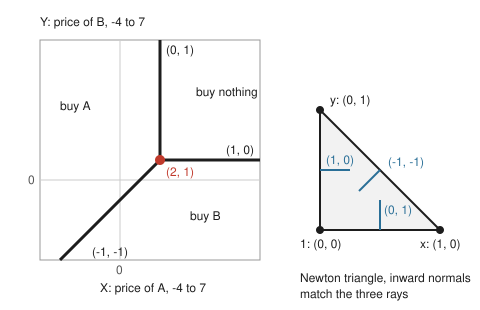

# Tropical geometry and computation: curves become polygons, and bases can blow up

[Syllabus](../../../SYLLABUS.md) → [Algebraic geometry](../README.md) → [Schemes and Modern Language](../README.md#s06) → Tropical geometry and computation

---

## General Overview

A shopper may buy one of two goods, A or B, or nothing. A is worth 2 to her and B is worth 1. If A costs $`X`$ and B costs $`Y`$, her net cost is $`X - 2`$ for A, $`Y - 1`$ for B and 0 for nothing. She takes the smallest.

At prices (1, 3) she buys A, since −1 is the smallest of 0, −1 and 2. At (3, 0) she buys B. At (3, 3) she buys nothing. The prices where she cannot decide, because two options tie for best, form three half-lines (rays) meeting at (2, 1). That shape is a **tropical line**.

The same three rays come out of an ordinary equation. Take the line $`1 + t^{-2}x + t^{-1}y = 0`$, where $`t`$ is a tiny number. Record each solution only by its **orders of magnitude**: how many powers of $`t`$ each coordinate carries. Those exponent pairs land exactly on the shopper's three rays. The drawing can be read off a polygon of exponents.

Exact computation has a price. Grobner bases (generating sets that make division in several variables give one answer) solve such systems exactly, but they can blow up: on 4 random quadratic equations in 4 unknowns, this card's plain version of the algorithm reduces 493 S-polynomials (its basic step) in one ordering and 56 in another.

**Tropical geometry replaces a polynomial by the minimum of its terms' sizes, so a curve becomes a piecewise-straight graph read off the Newton polygon, while the exact algebra of Grobner bases can, in the worst case, cost a doubly exponential amount of work.**

**What kind of fact this is:** a translation (a definition) plus several theorems used without full proof. Kapranov's lifting theorem, the genus count for smooth tropical curves and Bezout's count of solutions are checked on printed instances; Mikhalkin's correspondence theorem and the Mayr–Meyer lower bound on ideal-membership degrees are stated with their sources.

### The picture: the line and its Newton triangle

<p align="center"></p>

Drawn to scale from the check's numbers. Each edge of the Newton triangle (right) is at right angles to one ray.

---

## The formula

Notation first, in words. This card introduces **tropical arithmetic**: $`a \oplus b`$ means the smaller of $`a`$ and $`b`$, and $`a \odot b`$ means $`a + b`$. So $`3 \oplus 5 = 3`$ and $`3 \odot 5 = 8`$. Elsewhere in this wing $`\oplus`$ is a direct sum; here it is a minimum. This **min-plus** convention is fixed once; max-plus books flip every picture.

The field is $`K`$: Laurent series in $`t`$ (power series that may start at a negative power) with rational coefficients, such as $`-t^{-2} - t`$. Its **valuation** $`\mathrm{val}(x)`$ is the lowest power of $`t`$ in $`x`$: $`\mathrm{val}(-t^{-2} - t) = -2`$. Read $`t`$ as a tiny number, so a lower power means a bigger size.

A polynomial $`f = \sum c_{ij}\, x^i y^j`$ over $`K`$ has a **tropicalisation**: replace each sum by $`\oplus`$, each product by $`\odot`$, and each coefficient by its valuation.

```math
\mathrm{trop}\,f(X, Y) = \min_{(i, j)} \bigl(\mathrm{val}(c_{ij}) + iX + jY\bigr)
```

**Read it aloud:** for each term, add its coefficient's valuation to $`i`$ copies of $`X`$ and $`j`$ copies of $`Y`$, then take the smallest.

The **tropical curve** of $`f`$ is the set of points $`(X, Y)`$ where that minimum is reached by at least two terms at once. For our line, $`f = 1 + t^{-2}x + t^{-1}y`$:

```math
\mathrm{trop}\,f(X, Y) = \min(0,\; X - 2,\; Y - 1)
```

**Read it aloud:** the smallest of 0, X minus 2, and Y minus 1; the tropical line is where two of them tie for smallest.

The **Newton polygon** $`\mathrm{Newt}(f)`$ is the smallest convex shape holding every exponent pair $`(i, j)`$ of $`f`$. For the line it is the triangle with corners (0, 0), (1, 0) and (0, 1). Its **lattice points** are the points with whole-number coordinates inside it or on its edges.

| Symbol | Plain meaning | In our example | Push it up and the answer… |
| --- | --- | --- | --- |
| $`t`$ | a tiny parameter; sizes are counted in powers of it | the 'scale' of $`K`$ | — |
| $`K`$ | the field: Laurent series in $`t`$ | $`-t^{-2} - t`$ is one member | — |
| $`\mathrm{val}(x)`$ | lowest power of $`t`$ in $`x`$: its order of magnitude | $`\mathrm{val}(t^2) = 2`$ | a smaller size |
| $`x`$, $`y`$ | coordinates, members of $`K`$ | $`x = t^2`$, $`y = -2t`$ | — |
| $`X`$, $`Y`$ | tropical coordinates: $`\mathrm{val}(x)`$, $`\mathrm{val}(y)`$; the prices | (2, 1) at the vertex | moves the point across the plane |
| $`c_{ij}`$, $`i`$, $`j`$ | a coefficient and its exponents | $`c_{10} = t^{-2}`$ | — |
| $`\oplus`$, $`\odot`$ | min and plus | $`3 \oplus 5 = 3`$, $`3 \odot 5 = 8`$ | — |
| $`\mathrm{trop}\,f`$ | the minimum of the terms' sizes | $`\min(0, X - 2, Y - 1)`$ | — |
| $`\mathrm{Newt}(f)`$ | Newton polygon: hull of the exponent pairs | triangle (0, 0), (1, 0), (0, 1) | more regions, more edges |
| $`d`$ | the curve's degree; in Step 6, a generator's degree | 1 | more regions: one per lattice point |
| $`g`$ | the genus, number of holes ([Genus](../03-Plane%20Curves/06-genus-and-the-degree-genus-formula.md)) | 0 | more bounded regions |
| $`n`$, $`\kappa`$ | number of unknowns in a system; κ, a fixed constant in Step 6's bound | 1 to 4 in the code | Grobner work grows very fast |

### When it holds

- **A field with a valuation.** Over $`\mathbb{C}`$ alone every nonzero number has valuation 0, and the picture collapses to one point.
- **An algebraically closed field for the full lifting theorem.** Every point of the tropical curve comes from a classical solution only over Puiseux series (fractional powers of $`t`$) with complex coefficients. Over this card's Laurent series with rational coefficients, a point with fractional or irrational coordinates has no lift.
- **Generic coefficients for the genus count.** A smooth tropical curve, one whose Newton polygon is cut into the smallest possible triangles, has as many bounded regions as the classical genus. Bad coefficients collapse the regions and hide the holes.
- **Grobner sizes depend on the ordering, the system and the algorithm.** The counts on this card are for dense random quadrics over $`\mathbb{F}_{32003}`$ (the integers mod the prime 32003), one printed seed, run through this card's plain Buchberger, which skips only pairs whose leading terms share no variable. Better pair rules reduce fewer S-polynomials. The doubly exponential growth is a worst case, met by special systems.

---

## Why it works

### Step 0: a sum can vanish only if its two biggest terms cancel

Valuation turns products into sums: $`\mathrm{val}(ab) = \mathrm{val}(a) + \mathrm{val}(b)`$. For a sum, $`\mathrm{val}(a + b)`$ is at least the smaller of the two, and exactly that unless the lowest powers cancel.

So suppose three terms add to zero. If one term were strictly bigger (lower valuation) than the others, its lowest power of $`t`$ would survive in the sum, and the sum would not be zero. Hence the two biggest terms must be equally big. In tropical words: the minimum of the term valuations is reached at least twice. That is the whole idea.

### Step 1: read the line from the three-way minimum

The three terms of $`\min(0, X - 2, Y - 1)`$ are planes; the minimum is a roof made of three flat pieces. The tropical line is where pieces meet.

- **0 and $`Y - 1`$ tie** when $`Y = 1`$ and $`X \ge 2`$: the ray from (2, 1) in direction (1, 0).
- **0 and $`X - 2`$ tie** when $`X = 2`$ and $`Y \ge 1`$: the ray in direction (0, 1).
- **$`X - 2`$ and $`Y - 1`$ tie** when $`X - Y = 1`$ and both are below 0: the ray in direction (−1, −1).

The code walks round the box from (−4, −4) to (7, 7) and records where the best option changes: at (7, 1), (2, 7) and (−3, −4). The three directions add to (0, 0). This **balancing** holds at every vertex of every tropical curve, with each ray weighted by a whole number.

### Step 2: each ray is at right angles to an edge of the Newton polygon

Along the ray where terms $`(i, j)`$ and $`(k, l)`$ tie, their difference $`(i - k)X + (j - l)Y`$ stays constant. So the ray runs at right angles to the vector $`(i - k, j - l)`$, which is an edge of the Newton polygon.

For the line, turn each edge of the triangle a quarter turn to the left, walking round it counterclockwise. That gives the inward normals (0, 1), (−1, −1) and (1, 0): exactly the three rays. A tropical curve is the Newton polygon's subdivision drawn inside out: regions match lattice points, edges match edges, and vertices match triangles. The [Nodes and cusps](../03-Plane%20Curves/04-singularities-nodes-and-cusps.md) card uses the same polygon to read off the branches at a singular point.

### Step 3: classical solutions land on the tropical line

Solve $`1 + t^{-2}x + t^{-1}y = 0`$ for $`y`$: $`y = -t - t^{-1}x`$. Put in $`x = t^a`$ and record $`(\mathrm{val}\, x, \mathrm{val}\, y)`$:

- $`x = t^{-1}`$ gives $`y = -t^{-2} - t`$: the point (−1, −2), on the ray (−1, −1).
- $`x = t^{2}`$ gives $`y = -2t`$: the vertex (2, 1).
- $`x = t^{3}`$ gives $`y = -t - t^2`$: the point (3, 1), on the ray (1, 0).

No monomial $`x = t^a`$ reaches the upward ray. That ray needs the two big terms 1 and $`t^{-2}x`$ to cancel exactly, so $`x`$ must start with $`-t^2`$. With $`x = -t^2 + t^3`$, $`y = -t^2`$, and the point is (2, 2), on the upward ray. Step 0 in action: the third term $`t^{-1}y`$ has the room to be smaller only because the first two cancel.

The general statement is **Kapranov's theorem**: over Puiseux series with complex coefficients, the tropical curve of $`f`$ equals the closure of the set of pairs $`(\mathrm{val}\, x, \mathrm{val}\, y)`$ over all solutions with x and y nonzero. The card checks sample points in both directions on the line; the proof is in chapter 3 of Maclagan and Sturmfels (Sources).

<details>
<summary>Why a point off the tropical line has no solution above it</summary>

Take any $`x`$ and $`y`$ in $`K`$ with $`\mathrm{val}\, x = 3`$ and $`\mathrm{val}\, y = 3`$. The three terms of $`f`$ have valuations 0, 1 and 2. The term 1 is strictly biggest.

$`\displaystyle \mathrm{val}\bigl(1 + t^{-2}x + t^{-1}y\bigr) = \min(0, 1, 2) = 0`$

So the sum has a nonzero constant term and is not zero. The code prints $`x = y = t^3`$: the sum is $`1 + t + t^2`$. The same argument works at any point where one term wins alone.

</details>

### Step 4: the genus is the number of bounded regions

For a curve of degree $`d`$, the Newton polygon is the triangle with corners (0, 0), (d, 0) and (0, d). Choose the coefficients' valuations so that every lattice point wins somewhere (the code uses $`i^2 + ij + j^2`$ for the term $`x^i y^j`$); then each lattice point owns one region of the plane. The regions owned by **interior** lattice points are surrounded, so they are bounded.

Count interior lattice points of that triangle: $`(d - 1)(d - 2)/2`$. That is the degree–genus formula for a smooth plane curve ([Genus](../03-Plane%20Curves/06-genus-and-the-degree-genus-formula.md)). The holes of a smooth complex curve show up as bounded regions of its tropical picture. The code brute-forces this on a grid: degree 3 gives 10 regions and 1 bounded, degree 4 gives 15 and 3.

The same polygons count curves. Mikhalkin's correspondence theorem says the number of complex curves of a given degree and genus through enough general points equals a weighted count of tropical ones (Sources).

### Step 5: the exact road, and where it gets expensive

The [Grobner bases](../01-Polynomial%20Systems/03-grobner-bases-and-buchberger.md) card builds Buchberger's algorithm: reduce S-polynomials (each pair's cancelling combination) until all remainders are zero. Tropical pictures record orders of magnitude only; Grobner bases decide membership, solutions and dimension exactly.

The code runs Buchberger on $`n`$ dense random quadrics (degree-2 polynomials with every term present) in $`n`$ unknowns over $`\mathbb{F}_{32003}`$. Bezout's theorem predicts $`2^n`$ solutions, counted with multiplicity, and the count of standard monomials (monomials not divisible by any leading term) agrees every time.

| $`n`$ | grevlex: polynomials, top degree, S-polynomials | lex: polynomials, top degree, S-polynomials |
| --- | --- | --- |
| 2 | 3, 3, 4 | 2, 4, 7 |
| 3 | 6, 4, 16 | 3, 8, 52 |
| 4 | 12, 5, 56 | 4, 16, 493 |

Grevlex and lex are monomial orders ([Monomial orders](../01-Polynomial%20Systems/02-monomial-orders-and-division.md)): lex ranks terms by the power of the first unknown, like a dictionary; grevlex ranks by total degree first. Lex is the order for elimination: its last polynomial has one unknown and degree $`2^n`$, all the solutions in one equation. That convenience costs this card's algorithm 493 reductions at $`n = 4`$, against 56 for grevlex.

```
S-polynomials reduced, n random quadrics over F_32003 (one # = about 12)
n = 2  grevlex |                                            4
n = 2  lex     | #                                          7
n = 3  grevlex | #                                         16
n = 3  lex     | ####                                      52
n = 4  grevlex | #####                                     56
n = 4  lex     | ######################################## 493
```

### Step 6: the worst case is doubly exponential

Random systems grow singly exponentially, and that alone shows where exact solving runs out. For $`n`$ generic quadrics the lex eliminant has degree $`2^n`$, asserted in the code up to $`n = 4`$. At $`n = 10`$ that is a polynomial of degree 1024; at $`n = 20`$, one of degree 1048576, with over a million coefficients. Every exact answer must hold all $`2^n`$ solutions, so each extra unknown at least doubles the work, whatever the software.

Special systems are far worse. Mayr and Meyer (1982) built ideals in $`n`$ variables, generated by polynomials of degree $`d`$ (here a generator's degree, not a curve's), where proving one polynomial lies in the ideal needs certificates (the multipliers that write it as a combination of the generators) of degree about $`d^{2^{\kappa n}}`$, for a fixed positive constant κ (kappa). Grobner bases of such ideals can need degrees that large too. Upper bounds of the same doubly exponential shape are also known, so the worst case is pinned down.

For scale, the code prints $`2^{2^n}`$: 4, 16, 256, 65536, 4294967296 for $`n = 1`$ to 5. In complexity language, ideal membership is complete for **exponential space**, problems solvable with memory that grows like 2 to a power of the input size: Mayr and Meyer proved the hard half, and a matching algorithm came later. That class is built in the computability wing's 'Time and space classes' card (planned).

### Step 7: which software to reach for

The code on this card is a teaching version: it takes the pairs in a fixed queue and skips only those whose leading terms share no variable. Real work uses dedicated, free programs.

| Task | Reach for | Why |
| --- | --- | --- |
| general Grobner bases, ideals, modules | Singular, Macaulay2 | mature Buchberger variants, many orders |
| finitely many solutions, large systems | msolve | F4 over prime fields, then lifts to exact rationals |
| tropical curves and Grobner fans | Gfan | computes every reduced basis of an ideal and the tropical variety inside that fan |
| Newton polygons, subdivisions | polymake | polytope and tropical hypersurface computations |

Three working rules:

1. Compute in grevlex first, then convert to lex only if elimination is needed.
2. Work modulo a large prime first: coefficients stay one machine word; lift to $`\mathbb{Q}`$ afterwards.
3. Prefer F4-style linear algebra (Faugère, Sources), which reduces many S-polynomials at once as one big matrix.

---

## Worked numbers, by hand

| Step | Arithmetic | Value |
| --- | --- | --- |
| prices (1, 3) | min(0, 1 − 2, 3 − 1) = min(0, −1, 2) | buy A |
| prices (3, 3) | min(0, 1, 2) | buy nothing: one winner, off the line |
| prices (2, 1) | min(0, 0, 0) | three-way tie: the vertex |
| walk round the box | best option changes at (7, 1), (2, 7), (−3, −4) | rays (1, 0), (0, 1), (−1, −1) |
| balancing | (1, 0) + (0, 1) + (−1, −1) | (0, 0) |
| Newton triangle | inward normals of (0, 0), (1, 0), (0, 1) | (0, 1), (−1, −1), (1, 0) |
| a solution | $`x = t^2`$, $`y = -t - t^{-1}t^2 = -2t`$ | (val x, val y) = (2, 1) |
| upward ray | $`x = -t^2 + t^3`$, $`y = -t^2`$ | (2, 2) |
| smooth cubic | interior lattice points of the triangle (0, 0), (3, 0), (0, 3) | 1 bounded region, genus 1 |
| tropical line | three rays from (2, 1) | **(1, 0), (0, 1), (−1, −1)** |

**The tropical line is three rays from (2, 1), in directions (1, 0), (0, 1) and (−1, −1).** The shopper is undecided exactly on those rays, and every solution of the classical line, read by orders of magnitude, lies on them.

### What breaks if you drop a piece

| Mistake | Comes out at | What went wrong |
| --- | --- | --- |
| max instead of min | changes at (7, 6), (−4, 1), (2, −4): rays (−1, 0), (0, −1), (1, 1) | the convention flips every ray |
| curve = where trop f = 0 | trop f(3, 3) = 0 and trop f(5, 4) = 0: a quarter-plane | the curve is a tie, not a zero |
| cubic with all coefficients 0 | only 3 of 10 terms win, 0 bounded regions | not smooth: the genus 1 is hidden |
| lifting with $`x = t^a`$ only | rays (−1, −1) and (1, 0) reached, never (0, 1) | the upward ray needs a cancellation |

The code prints all four.

---

## Code, from first principles, and it actually runs

The script has two halves. For the tropical line it takes four independent roads, which agree on the vertex (2, 1) and the rays: ties of the minimum at sample prices, a walk round a box, exact Laurent-series solutions put back into the equation, and the Newton triangle's inward normals. A grid brute force then counts regions of smooth tropical curves of degrees 1 to 4 against interior lattice points and $`(d - 1)(d - 2)/2`$. For computation it runs Buchberger's algorithm over $`\mathbb{F}_{32003}`$ in two orders, and checks each basis against Bezout's $`2^n`$ by counting standard monomials. Random coefficients come from SplitMix64 with seed 2026, written out in both languages.

### Python

```python
# Tropical geometry and computation -- the check behind the card.  Nothing is imported.
# Min-plus: a (+) b = min(a, b), a (.) b = a + b.  Roads to the tropical line: ties of the
# minimum, a walk round a box, Laurent series in t, the Newton triangle's normals.  Roads
# to the blow-up: Buchberger over F_p written out, against Bezout and standard monomials.
def winners(X, Y, terms, pick=min):             # which terms reach the minimum
    v = [c + i * X + j * Y for c, i, j in terms]
    return [k for k, a in enumerate(v) if a == pick(v)]
LINE = [(0, 0, 0), (-2, 1, 0), (-1, 0, 1)]      # (coefficient, power of x, power of y)
def ladd(*fs):                                  # Laurent polynomials in t: {exponent: integer}
    out = {}
    for f in fs:
        for e, c in f.items(): out[e] = out.get(e, 0) + c
    return {e: c for e, c in out.items() if c}
def lmul(f, g): return ladd(*({a + b: c * d} for a, c in f.items() for b, d in g.items()))
def show(f):                                    # a Laurent polynomial, lowest power first
    s = "".join(f" {'-' if c < 0 else '+'} {abs(c) if abs(c) > 1 else ''}t^{e}" for e, c in sorted(f.items()))
    return s[3:] if s[1] == "+" else "-" + s[3:]
def classical(x):                               # 1 + t^-2 x + t^-1 y = 0, solved for y
    return lmul({1: -1}, ladd({0: 1}, lmul({-2: 1}, x)))
print("== min-plus arithmetic ==")
R = range(-4, 5)
assert all(a + min(b, c) == min(a + b, a + c) for a in R for b in R for c in R)
assert all(2 * min(x, y) == min(2 * x, x + y, 2 * y) for x in R for y in R)
print("3 (+) 5 =", min(3, 5), "  3 (.) 5 =", 3 + 5, "  (x (+) y)^2 = x^2 (+) y^2 on all 81 pairs")
print("== the tropical line min(0, X - 2, Y - 1) ==")
for X, Y in [(1, 3), (3, 3), (3, 0), (2, 1)]:
    print(f"prices ({X}, {Y}): costs {[c + i * X + j * Y for c, i, j in LINE]} -> best {' = '.join(['nothing', 'A', 'B'][k] for k in winners(X, Y, LINE))}")
assert winners(2, 1, LINE) == [0, 1, 2]
q = [(2 * k + 1) / 4 for k in range(22)]          # half steps, offset a quarter: no ties
s = [(7, v - 4) for v in q] + [(7 - v, 7) for v in q] + [(-4, 7 - v) for v in q] + [(v - 4, -4) for v in q]
def turns(pick):                                # midpoints where the winner changes
    return [(int(x1 + x2) // 2, int(y1 + y2) // 2) for (x1, y1), (x2, y2) in zip(s, s[1:] + s[:1])
            if winners(x1, y1, LINE, pick) != winners(x2, y2, LINE, pick)]
def rays_of(walk): return sorted(((x - 2) // max(abs(x - 2), abs(y - 1)), (y - 1) // max(abs(x - 2), abs(y - 1))) for x, y in walk)
walk = turns(min); rays = rays_of(walk)
print("walk round the box from (-4, -4) to (7, 7): the winner changes at", walk)
assert rays == [(-1, -1), (0, 1), (1, 0)]
print("rays from (2, 1):", rays, " sum:", (sum(r[0] for r in rays), sum(r[1] for r in rays)))
newton = [(0, 0), (1, 0), (0, 1)]
# each edge, turned a quarter turn to the left, gives the inward normal
normals = [(newton[k][1] - newton[(k + 1) % 3][1], newton[(k + 1) % 3][0] - newton[k][0]) for k in range(3)]
assert sorted(normals) == rays
print("Newton triangle", newton, "edges' inward normals:", normals)
print("== classical points over Laurent series: x = t^a, then y ==")
found = set()
for a in [-1, 0, 1, 2, 3, 4]:
    x = {a: 1}; y = classical(x)
    assert ladd({0: 1}, lmul({-2: 1}, x), lmul({-1: 1}, y)) == {}
    X, Y = min(x), min(y); found.add((X, Y))
    assert len(winners(X, Y, LINE)) >= 2
    print(f"x = t^{a}: y = {show(y)} -> (val x, val y) = ({X}, {Y})")
assert not any(X == 2 and Y > 1 for X, Y in found)
for b in [3, 4]:
    x = {2: -1, b: 1}; y = classical(x)
    X, Y = min(x), min(y)
    assert (X, Y) == (2, b - 1) and winners(X, Y, LINE) == [0, 1]
    print(f"x = -t^2 + t^{b}: y = {show(y)} -> ({X}, {Y}), on the upward ray: needs the cancellation")
off = ladd({0: 1}, lmul({-2: 1}, {3: 1}), lmul({-1: 1}, {3: 1}))
assert winners(3, 3, LINE) == [0] and min(off) == 0
print("off the line: (3, 3) has the single winner [0]; x = y = t^3 gives", show(off), "!= 0")
print("== a smooth tropical cubic: bounded regions = genus ==")
def lattice(d): return [(i, j) for i in range(d + 1) for j in range(d + 1 - i)]
def regions(terms):                             # brute force on a 161 x 161 grid, X and Y in -10..10
    seen, edge = set(), set()
    for u in range(-80, 81):
        for w in range(-80, 81):
            k = winners((2 * u + 1) / 8, (2 * w + 1) / 8, terms)[0]; seen.add(k)
            if abs(u) == 80 or abs(w) == 80: edge.add(k)
    return len(seen), len(seen - edge)
for d in [1, 2, 3, 4]:
    total, bounded = regions([(i * i + i * j + j * j, i, j) for i, j in lattice(d)])
    inner = sum(1 for i, j in lattice(d) if i > 0 and j > 0 and i + j < d)
    assert total == len(lattice(d)) and bounded == inner == (d - 1) * (d - 2) // 2
    print(f"degree {d}: {total} regions, {bounded} bounded; interior lattice points {inner}; (d-1)(d-2)/2 = {(d - 1) * (d - 2) // 2}")
print("== Grobner bases over F_32003: dense quadrics in n variables ==")
P, M = 32003, (1 << 64) - 1
def splitmix(s):                                # SplitMix64: returns the new state and a number
    s = (s + 0x9E3779B97F4A7C15) & M; z = ((s ^ (s >> 30)) * 0xBF58476D1CE4E5B9) & M
    z = ((z ^ (z >> 27)) * 0x94D049BB133111EB) & M; return s, z ^ (z >> 31)
def lead(f, lex): return max(f, key=lambda m: m if lex else (sum(m), tuple(-e for e in reversed(m))))
def divides(n, m): return all(a >= b for a, b in zip(m, n))
def monic(f, lex): c = pow(f[lead(f, lex)], P - 2, P); return {m: a * c % P for m, a in f.items()}
def sub(f, g, c, m, n):                         # f - c * (m / n) * g, in place
    for mm, cc in g.items():
        k = tuple(a + b - e for a, b, e in zip(mm, m, n))
        v = (f.get(k, 0) - c * cc) % P
        if v: f[k] = v
        else: f.pop(k, None)
def nf(f, G, lex):                              # the full remainder on division by G
    f, r = dict(f), {}
    while f:
        m = lead(f, lex)
        g = next((g for g in G if divides(lead(g, lex), m)), None)
        if g: sub(f, g, f[m], m, lead(g, lex))
        else: r[m] = f.pop(m)
    return r
def groebner(F, lex):                           # Buchberger, then the reduced basis
    G, done = [monic(f, lex) for f in F], 0
    pairs = [(i, j) for j in range(len(G)) for i in range(j)]
    while pairs:
        i, j = pairs.pop(0)
        a, b = lead(G[i], lex), lead(G[j], lex)
        if all(x == 0 or y == 0 for x, y in zip(a, b)): continue   # coprime leads: skip
        L = tuple(map(max, a, b)); s = {}
        sub(s, G[i], P - 1, L, a); sub(s, G[j], 1, L, b)
        r = nf(s, G, lex); done += 1
        if r: G.append(monic(r, lex)); pairs += [(k, len(G) - 1) for k in range(len(G) - 1)]
    G = [g for k, g in enumerate(G) if not any(divides(lead(h, lex), lead(g, lex)) and (lead(h, lex) != lead(g, lex) or h_ < k) for h_, h in enumerate(G) if h_ != k)]
    return [monic(nf(g, [h for h in G if h is not g], lex), lex) for g in G], done
def monomials(n, top):                          # every exponent tuple with entries 0..top
    return [()] if n == 0 else [m + (e,) for m in monomials(n - 1, top) for e in range(top + 1)]
seed = 2026
for n in [1, 2, 3, 4]:
    F = []
    for _ in range(n):
        f = {}
        for m in [m for m in monomials(n, 2) if sum(m) <= 2]:
            seed, z = splitmix(seed); f[m] = z % P
        F.append(f)
    for lex in [False, True]:
        G, done = groebner(F, lex)
        lts = [lead(g, lex) for g in G]
        std = sum(1 for m in monomials(n, 2 ** n) if not any(divides(t, m) for t in lts))
        assert std == 2 ** n                    # Bezout: 2^n solutions, counted with multiplicity
        if lex: assert max(g for t in lts for g in t[-1:]) == 2 ** n and len(G) == n and sum(map(len, G)) == n * (2 ** n + 1)   # shape lemma
        else: assert all(m == t or sum(t) > sum(m) or (sum(t) == sum(m) and [a - b for a, b in zip(t, m) if a != b][-1] < 0) for g, t in zip(G, lts) for m in g)   # grevlex, written another way
        name, top = "lex" if lex else "grevlex", max(sum(t) for t in lts)
        print(f"n = {n} {name:>7}: {len(G):>2} polynomials, top degree {top:>2}, {sum(map(len, G)):>3} terms, {done:>3} S-polynomials reduced; standard monomials {std} = 2^{n}")
print("growth shapes: n, Bezout 2^n, doubly exponential 2^(2^n):", [(n, 2 ** n, 2 ** 2 ** n) for n in range(1, 6)], " 2^10 =", 2 ** 10, " 2^20 =", 2 ** 20)
print("== what breaks ==")
print("max instead of min: the winner changes at", turns(max), "-> rays (-1, 0), (0, -1), (1, 1)")
assert rays_of(turns(max)) == [(-1, 0), (0, -1), (1, 1)]
print("call {trop f = 0} the curve: trop f(3, 3) =", min(0, 3 - 2, 3 - 1), " trop f(5, 4) =", min(0, 5 - 2, 4 - 1), "-> a whole quarter-plane, not a line")
flat = regions([(0, i, j) for i, j in lattice(3)])
assert flat == (3, 0)
print(f"cubic with every coefficient 0: only {flat[0]} of 10 terms ever win, {flat[1]} bounded -> the genus 1 is invisible")
print("monomial x = t^a only: rays reached", sorted({(1 if X > 2 else -1, 0 if Y == 1 else -1) for X, Y in found if (X, Y) != (2, 1)}), "-> the upward ray is missed")
print("figure, vertex (2, 1); box corners (-4, -4) (7, 7); ray ends (7, 1) (2, 7) (-3, -4); Newton triangle (0, 0) (1, 0) (0, 1)")
print("ALL CHECKS PASS")
```

**Ran 2026-11-17 on macOS, Python 3.14.10, standard library only. All checks passed. Output, pasted from the run:**

```
== min-plus arithmetic ==
3 (+) 5 = 3   3 (.) 5 = 8   (x (+) y)^2 = x^2 (+) y^2 on all 81 pairs
== the tropical line min(0, X - 2, Y - 1) ==
prices (1, 3): costs [0, -1, 2] -> best A
prices (3, 3): costs [0, 1, 2] -> best nothing
prices (3, 0): costs [0, 1, -1] -> best B
prices (2, 1): costs [0, 0, 0] -> best nothing = A = B
walk round the box from (-4, -4) to (7, 7): the winner changes at [(7, 1), (2, 7), (-3, -4)]
rays from (2, 1): [(-1, -1), (0, 1), (1, 0)]  sum: (0, 0)
Newton triangle [(0, 0), (1, 0), (0, 1)] edges' inward normals: [(0, 1), (-1, -1), (1, 0)]
== classical points over Laurent series: x = t^a, then y ==
x = t^-1: y = -t^-2 - t^1 -> (val x, val y) = (-1, -2)
x = t^0: y = -t^-1 - t^1 -> (val x, val y) = (0, -1)
x = t^1: y = -t^0 - t^1 -> (val x, val y) = (1, 0)
x = t^2: y = -2t^1 -> (val x, val y) = (2, 1)
x = t^3: y = -t^1 - t^2 -> (val x, val y) = (3, 1)
x = t^4: y = -t^1 - t^3 -> (val x, val y) = (4, 1)
x = -t^2 + t^3: y = -t^2 -> (2, 2), on the upward ray: needs the cancellation
x = -t^2 + t^4: y = -t^3 -> (2, 3), on the upward ray: needs the cancellation
off the line: (3, 3) has the single winner [0]; x = y = t^3 gives t^0 + t^1 + t^2 != 0
== a smooth tropical cubic: bounded regions = genus ==
degree 1: 3 regions, 0 bounded; interior lattice points 0; (d-1)(d-2)/2 = 0
degree 2: 6 regions, 0 bounded; interior lattice points 0; (d-1)(d-2)/2 = 0
degree 3: 10 regions, 1 bounded; interior lattice points 1; (d-1)(d-2)/2 = 1
degree 4: 15 regions, 3 bounded; interior lattice points 3; (d-1)(d-2)/2 = 3
== Grobner bases over F_32003: dense quadrics in n variables ==
n = 1 grevlex:  1 polynomials, top degree  2,   3 terms,   0 S-polynomials reduced; standard monomials 2 = 2^1
n = 1     lex:  1 polynomials, top degree  2,   3 terms,   0 S-polynomials reduced; standard monomials 2 = 2^1
n = 2 grevlex:  3 polynomials, top degree  3,  15 terms,   4 S-polynomials reduced; standard monomials 4 = 2^2
n = 2     lex:  2 polynomials, top degree  4,  10 terms,   7 S-polynomials reduced; standard monomials 4 = 2^2
n = 3 grevlex:  6 polynomials, top degree  4,  51 terms,  16 S-polynomials reduced; standard monomials 8 = 2^3
n = 3     lex:  3 polynomials, top degree  8,  27 terms,  52 S-polynomials reduced; standard monomials 8 = 2^3
n = 4 grevlex: 12 polynomials, top degree  5, 180 terms,  56 S-polynomials reduced; standard monomials 16 = 2^4
n = 4     lex:  4 polynomials, top degree 16,  68 terms, 493 S-polynomials reduced; standard monomials 16 = 2^4
growth shapes: n, Bezout 2^n, doubly exponential 2^(2^n): [(1, 2, 4), (2, 4, 16), (3, 8, 256), (4, 16, 65536), (5, 32, 4294967296)]  2^10 = 1024  2^20 = 1048576
== what breaks ==
max instead of min: the winner changes at [(7, 6), (-4, 1), (2, -4)] -> rays (-1, 0), (0, -1), (1, 1)
call {trop f = 0} the curve: trop f(3, 3) = 0  trop f(5, 4) = 0 -> a whole quarter-plane, not a line
cubic with every coefficient 0: only 3 of 10 terms ever win, 0 bounded -> the genus 1 is invisible
monomial x = t^a only: rays reached [(-1, -1), (1, 0)] -> the upward ray is missed
figure, vertex (2, 1); box corners (-4, -4) (7, 7); ray ends (7, 1) (2, 7) (-3, -4); Newton triangle (0, 0) (1, 0) (0, 1)
ALL CHECKS PASS
```

### Rust

```rust
// Tropical geometry and computation -- the same check as the Python file, in Rust.
// Standard library only, no crates.  Min-plus: a (+) b = min(a, b), a (.) b = a + b.
use std::collections::{BTreeMap, BTreeSet};
type Lp = BTreeMap<i64, i64>; // a Laurent polynomial in t: exponent -> integer
type Poly = BTreeMap<Vec<i64>, u64>; // a polynomial over F_p: exponents -> coefficient
const P: u64 = 32003;
const LINE: [(f64, f64, f64); 3] = [(0.0, 0.0, 0.0), (-2.0, 1.0, 0.0), (-1.0, 0.0, 1.0)];
fn winners(x: f64, y: f64, terms: &[(f64, f64, f64)], max: bool) -> Vec<usize> {
    let v: Vec<f64> = terms.iter().map(|(c, i, j)| c + i * x + j * y).collect();
    let best = v.iter().cloned().fold(v[0], |a, b| if max { a.max(b) } else { a.min(b) });
    (0..v.len()).filter(|&k| v[k] == best).collect() }
fn ladd(fs: &[&Lp]) -> Lp {
    let mut out = Lp::new();
    for f in fs { for (e, c) in f.iter() { *out.entry(*e).or_insert(0) += c; } }
    out.into_iter().filter(|(_, c)| *c != 0).collect() }
fn lmul(f: &Lp, g: &Lp) -> Lp {
    let terms: Vec<Lp> = f.iter().flat_map(|(a, c)| g.iter().map(move |(b, d)| Lp::from([(a + b, c * d)]))).collect();
    ladd(&terms.iter().collect::<Vec<_>>()) }
fn lp(t: &[(i64, i64)]) -> Lp { t.iter().cloned().collect() }
fn show(f: &Lp) -> String { // lowest power first
    let s: String = f.iter().map(|(e, c)| format!(" {} {}t^{}", if *c < 0 { "-" } else { "+" }, if c.abs() > 1 { c.abs().to_string() } else { String::new() }, e)).collect();
    if &s[1..2] == "+" { s[3..].to_string() } else { format!("-{}", &s[3..]) } }
fn classical(x: &Lp) -> Lp { lmul(&lp(&[(1, -1)]), &ladd(&[&lp(&[(0, 1)]), &lmul(&lp(&[(-2, 1)]), x)])) }
fn pairs(v: &[(i64, i64)]) -> String { format!("[{}]", v.iter().map(|(a, b)| format!("({}, {})", a, b)).collect::<Vec<_>>().join(", ")) }
fn ints(v: &[i64]) -> String { format!("[{}]", v.iter().map(|a| a.to_string()).collect::<Vec<_>>().join(", ")) }
fn turns(s: &[(f64, f64)], max: bool) -> Vec<(i64, i64)> { // midpoints where the winner changes
    (0..s.len()).filter(|&k| winners(s[k].0, s[k].1, &LINE, max) != winners(s[(k + 1) % s.len()].0, s[(k + 1) % s.len()].1, &LINE, max))
        .map(|k| (((s[k].0 + s[(k + 1) % s.len()].0) as i64).div_euclid(2), ((s[k].1 + s[(k + 1) % s.len()].1) as i64).div_euclid(2))).collect() }
fn rays_of(walk: &[(i64, i64)]) -> Vec<(i64, i64)> {
    let mut r: Vec<(i64, i64)> = walk.iter().map(|(x, y)| { let g = (x - 2).abs().max((y - 1).abs()); ((x - 2).div_euclid(g), (y - 1).div_euclid(g)) }).collect();
    r.sort(); r }
fn lattice(d: i64) -> Vec<(i64, i64)> { (0..=d).flat_map(|i| (0..=d - i).map(move |j| (i, j))).collect() }
fn regions(terms: &[(f64, f64, f64)]) -> (usize, usize) { // brute force on a 161 x 161 grid, X and Y in -10..10
    let (mut seen, mut edge) = (BTreeSet::new(), BTreeSet::new());
    for u in -80..81i64 { for w in -80..81i64 {
        let k = winners((2 * u + 1) as f64 / 8.0, (2 * w + 1) as f64 / 8.0, terms, false)[0];
        seen.insert(k); if u.abs() == 80 || w.abs() == 80 { edge.insert(k); } } }
    (seen.len(), seen.difference(&edge).count()) }
fn splitmix(s: u64) -> (u64, u64) { // SplitMix64: returns the new state and a number
    let s = s.wrapping_add(0x9E3779B97F4A7C15);
    let z = (s ^ (s >> 30)).wrapping_mul(0xBF58476D1CE4E5B9);
    let z = (z ^ (z >> 27)).wrapping_mul(0x94D049BB133111EB);
    (s, z ^ (z >> 31)) }
fn key(m: &[i64], lex: bool) -> Vec<i64> { if lex { m.to_vec() } else { let mut k = vec![m.iter().sum::<i64>()]; k.extend(m.iter().rev().map(|e| -e)); k } }
fn lead(f: &Poly, lex: bool) -> Vec<i64> { f.keys().max_by_key(|m| key(m, lex)).unwrap().clone() }
fn divides(n: &[i64], m: &[i64]) -> bool { m.iter().zip(n).all(|(a, b)| a >= b) }
fn powmod(mut b: u64, mut e: u64) -> u64 { let mut r = 1; while e > 0 { if e & 1 == 1 { r = r * b % P; } b = b * b % P; e >>= 1; } r }
fn monic(f: &Poly, lex: bool) -> Poly {
    let c = powmod(f[&lead(f, lex)], P - 2);
    f.iter().map(|(m, a)| (m.clone(), a * c % P)).collect() }
fn sub(f: &mut Poly, g: &Poly, c: u64, m: &[i64], n: &[i64]) { // f - c * (m / n) * g, in place
    for (mm, cc) in g {
        let k: Vec<i64> = (0..mm.len()).map(|i| mm[i] + m[i] - n[i]).collect();
        let v = (f.get(&k).cloned().unwrap_or(0) + P * P - c * cc % P) % P;
        if v != 0 { f.insert(k, v); } else { f.remove(&k); }
    } }
fn nf(f: &Poly, g: &[Poly], lex: bool) -> Poly { // the full remainder on division by G
    let (mut f, mut r) = (f.clone(), Poly::new());
    while !f.is_empty() {
        let m = lead(&f, lex);
        match g.iter().find(|h| divides(&lead(h, lex), &m)) {
            Some(h) => { let c = f[&m]; sub(&mut f, h, c, &m, &lead(h, lex)); }
            None => { let c = f.remove(&m).unwrap(); r.insert(m, c); }
        }
    }
    r }
fn groebner(fs: &[Poly], lex: bool) -> (Vec<Poly>, usize) { // Buchberger, then the reduced basis
    let mut g: Vec<Poly> = fs.iter().map(|f| monic(f, lex)).collect();
    let mut pairs: Vec<(usize, usize)> = (0..g.len()).flat_map(|j| (0..j).map(move |i| (i, j))).collect();
    let mut done = 0;
    while !pairs.is_empty() {
        let (i, j) = pairs.remove(0);
        let (a, b) = (lead(&g[i], lex), lead(&g[j], lex));
        if a.iter().zip(&b).all(|(x, y)| *x == 0 || *y == 0) { continue; } // coprime leads: skip
        let l: Vec<i64> = a.iter().zip(&b).map(|(x, y)| *x.max(y)).collect();
        let mut s = Poly::new();
        sub(&mut s, &g[i], P - 1, &l, &a); sub(&mut s, &g[j], 1, &l, &b);
        let r = nf(&s, &g, lex); done += 1;
        if !r.is_empty() { g.push(monic(&r, lex)); let n = g.len() - 1; pairs.extend((0..n).map(|k| (k, n))); }
    }
    let lts: Vec<Vec<i64>> = g.iter().map(|f| lead(f, lex)).collect();
    let keep: Vec<Poly> = (0..g.len()).filter(|&k| !(0..g.len()).any(|h| h != k && divides(&lts[h], &lts[k]) && (lts[h] != lts[k] || h < k))).map(|k| g[k].clone()).collect();
    let red = (0..keep.len()).map(|k| { let o: Vec<Poly> = (0..keep.len()).filter(|&h| h != k).map(|h| keep[h].clone()).collect(); monic(&nf(&keep[k], &o, lex), lex) }).collect();
    (red, done) }
fn monomials(n: usize, top: i64) -> Vec<Vec<i64>> { // every exponent tuple with entries 0..top
    if n == 0 { return vec![vec![]]; }
    monomials(n - 1, top).into_iter().flat_map(|m| (0..=top).map(move |e| { let mut v = m.clone(); v.push(e); v })).collect() }
fn main() {
    println!("== min-plus arithmetic ==");
    for a in -4..5i64 { for b in -4..5i64 { assert!((-4..5i64).all(|c| a + b.min(c) == (a + b).min(a + c)));
        assert!(2 * a.min(b) == (2 * a).min(a + b).min(2 * b)); } }
    println!("3 (+) 5 = {}   3 (.) 5 = {}   (x (+) y)^2 = x^2 (+) y^2 on all 81 pairs", 3.min(5), 3 + 5);
    println!("== the tropical line min(0, X - 2, Y - 1) ==");
    for (x, y) in [(1i64, 3i64), (3, 3), (3, 0), (2, 1)] {
        let names: Vec<&str> = winners(x as f64, y as f64, &LINE, false).iter().map(|&k| ["nothing", "A", "B"][k]).collect();
        println!("prices ({}, {}): costs {} -> best {}", x, y, ints(&[0, x - 2, y - 1]), names.join(" = "));
    }
    assert!(winners(2.0, 1.0, &LINE, false) == vec![0, 1, 2]);
    let q: Vec<f64> = (0..22).map(|k| (2 * k + 1) as f64 / 4.0).collect(); // half steps, offset a quarter: no ties
    let mut s: Vec<(f64, f64)> = q.iter().map(|v| (7.0, v - 4.0)).collect();
    s.extend(q.iter().map(|v| (7.0 - v, 7.0))); s.extend(q.iter().map(|v| (-4.0, 7.0 - v))); s.extend(q.iter().map(|v| (v - 4.0, -4.0)));
    let walk = turns(&s, false); let rays = rays_of(&walk);
    println!("walk round the box from (-4, -4) to (7, 7): the winner changes at {}", pairs(&walk));
    assert!(rays == vec![(-1, -1), (0, 1), (1, 0)]);
    println!("rays from (2, 1): {}  sum: ({}, {})", pairs(&rays), rays.iter().map(|r| r.0).sum::<i64>(), rays.iter().map(|r| r.1).sum::<i64>());
    let newton = [(0i64, 0i64), (1, 0), (0, 1)];
    // each edge, turned a quarter turn to the left, gives the inward normal
    let normals: Vec<(i64, i64)> = (0..3).map(|k| (newton[k].1 - newton[(k + 1) % 3].1, newton[(k + 1) % 3].0 - newton[k].0)).collect();
    let mut sn = normals.clone(); sn.sort(); assert!(sn == rays);
    println!("Newton triangle {} edges' inward normals: {}", pairs(&newton), pairs(&normals));
    println!("== classical points over Laurent series: x = t^a, then y ==");
    let mut found = BTreeSet::new();
    for a in [-1i64, 0, 1, 2, 3, 4] {
        let x = lp(&[(a, 1)]); let y = classical(&x);
        assert!(ladd(&[&lp(&[(0, 1)]), &lmul(&lp(&[(-2, 1)]), &x), &lmul(&lp(&[(-1, 1)]), &y)]).is_empty());
        let (vx, vy) = (*x.keys().next().unwrap(), *y.keys().next().unwrap()); found.insert((vx, vy));
        assert!(winners(vx as f64, vy as f64, &LINE, false).len() >= 2);
        println!("x = t^{}: y = {} -> (val x, val y) = ({}, {})", a, show(&y), vx, vy);
    }
    assert!(!found.iter().any(|(x, y)| *x == 2 && *y > 1));
    for b in [3i64, 4] {
        let x = lp(&[(2, -1), (b, 1)]); let y = classical(&x);
        let (vx, vy) = (*x.keys().next().unwrap(), *y.keys().next().unwrap());
        assert!((vx, vy) == (2, b - 1) && winners(vx as f64, vy as f64, &LINE, false) == vec![0, 1]);
        println!("x = -t^2 + t^{}: y = {} -> ({}, {}), on the upward ray: needs the cancellation", b, show(&y), vx, vy);
    }
    let off = ladd(&[&lp(&[(0, 1)]), &lmul(&lp(&[(-2, 1)]), &lp(&[(3, 1)])), &lmul(&lp(&[(-1, 1)]), &lp(&[(3, 1)]))]);
    assert!(winners(3.0, 3.0, &LINE, false) == vec![0] && *off.keys().next().unwrap() == 0);
    println!("off the line: (3, 3) has the single winner [0]; x = y = t^3 gives {} != 0", show(&off));
    println!("== a smooth tropical cubic: bounded regions = genus ==");
    for d in 1..5i64 {
        let (total, bounded) = regions(&lattice(d).iter().map(|&(i, j)| ((i * i + i * j + j * j) as f64, i as f64, j as f64)).collect::<Vec<_>>());
        let inner = lattice(d).iter().filter(|&&(i, j)| i > 0 && j > 0 && i + j < d).count();
        assert!(total == lattice(d).len() && bounded == inner && inner as i64 == (d - 1) * (d - 2) / 2);
        println!("degree {}: {} regions, {} bounded; interior lattice points {}; (d-1)(d-2)/2 = {}", d, total, bounded, inner, (d - 1) * (d - 2) / 2);
    }
    println!("== Grobner bases over F_32003: dense quadrics in n variables ==");
    let mut seed = 2026u64;
    for n in 1..5usize {
        let mut fs = vec![];
        for _ in 0..n {
            let mut f = Poly::new();
            for m in monomials(n, 2).into_iter().filter(|m| m.iter().sum::<i64>() <= 2) { let (s2, z) = splitmix(seed); seed = s2; f.insert(m, z % P); }
            fs.push(f);
        }
        for lex in [false, true] {
            let (g, done) = groebner(&fs, lex);
            let lts: Vec<Vec<i64>> = g.iter().map(|f| lead(f, lex)).collect();
            let std = monomials(n, 1 << n).iter().filter(|m| !lts.iter().any(|t| divides(t, m))).count();
            assert!(std == 1 << n); // Bezout: 2^n solutions, counted with multiplicity
            if lex { assert!(lts.iter().map(|t| t[n - 1]).max().unwrap() == 1 << n && g.len() == n && g.iter().map(|f| f.len()).sum::<usize>() == n * ((1 << n) + 1)); } // shape lemma
            else { assert!(g.iter().zip(&lts).all(|(f, t)| f.keys().all(|m| m == t || t.iter().sum::<i64>() > m.iter().sum::<i64>() || (t.iter().sum::<i64>() == m.iter().sum::<i64>() && t.iter().zip(m).filter(|(a, b)| a != b).last().map_or(false, |(a, b)| a < b))))); } // grevlex, written another way
            let top = lts.iter().map(|t| t.iter().sum::<i64>()).max().unwrap();
            println!("n = {} {:>7}: {:>2} polynomials, top degree {:>2}, {:>3} terms, {:>3} S-polynomials reduced; standard monomials {} = 2^{}",
                n, if lex { "lex" } else { "grevlex" }, g.len(), top, g.iter().map(|f| f.len()).sum::<usize>(), done, std, n);
        }
    }
    let shapes: Vec<String> = (1..6u32).map(|n| format!("({}, {}, {})", n, 1u64 << n, 1u64 << (1u64 << n))).collect();
    println!("growth shapes: n, Bezout 2^n, doubly exponential 2^(2^n): [{}]  2^10 = {}  2^20 = {}", shapes.join(", "), 1 << 10, 1 << 20);
    println!("== what breaks ==");
    println!("max instead of min: the winner changes at {} -> rays (-1, 0), (0, -1), (1, 1)", pairs(&turns(&s, true)));
    assert!(rays_of(&turns(&s, true)) == vec![(-1, 0), (0, -1), (1, 1)]);
    println!("call {{trop f = 0}} the curve: trop f(3, 3) = {}  trop f(5, 4) = {} -> a whole quarter-plane, not a line", 0.min(3 - 2).min(3 - 1), 0.min(5 - 2).min(4 - 1));
    let flat = regions(&lattice(3).iter().map(|&(i, j)| (0.0, i as f64, j as f64)).collect::<Vec<_>>()); assert!(flat == (3, 0));
    println!("cubic with every coefficient 0: only {} of 10 terms ever win, {} bounded -> the genus 1 is invisible", flat.0, flat.1);
    let reached: BTreeSet<(i64, i64)> = found.iter().filter(|p| **p != (2, 1)).map(|&(x, y)| (if x > 2 { 1 } else { -1 }, if y == 1 { 0 } else { -1 })).collect();
    println!("monomial x = t^a only: rays reached {} -> the upward ray is missed", pairs(&reached.into_iter().collect::<Vec<_>>()));
    println!("figure, vertex (2, 1); box corners (-4, -4) (7, 7); ray ends (7, 1) (2, 7) (-3, -4); Newton triangle (0, 0) (1, 0) (0, 1)");
    println!("ALL CHECKS PASS");
}
```

**Ran 2026-11-17 on macOS, rustc 1.98.1, no crates. All checks passed. Output, pasted from the run:**

```
== min-plus arithmetic ==
3 (+) 5 = 3   3 (.) 5 = 8   (x (+) y)^2 = x^2 (+) y^2 on all 81 pairs
== the tropical line min(0, X - 2, Y - 1) ==
prices (1, 3): costs [0, -1, 2] -> best A
prices (3, 3): costs [0, 1, 2] -> best nothing
prices (3, 0): costs [0, 1, -1] -> best B
prices (2, 1): costs [0, 0, 0] -> best nothing = A = B
walk round the box from (-4, -4) to (7, 7): the winner changes at [(7, 1), (2, 7), (-3, -4)]
rays from (2, 1): [(-1, -1), (0, 1), (1, 0)]  sum: (0, 0)
Newton triangle [(0, 0), (1, 0), (0, 1)] edges' inward normals: [(0, 1), (-1, -1), (1, 0)]
== classical points over Laurent series: x = t^a, then y ==
x = t^-1: y = -t^-2 - t^1 -> (val x, val y) = (-1, -2)
x = t^0: y = -t^-1 - t^1 -> (val x, val y) = (0, -1)
x = t^1: y = -t^0 - t^1 -> (val x, val y) = (1, 0)
x = t^2: y = -2t^1 -> (val x, val y) = (2, 1)
x = t^3: y = -t^1 - t^2 -> (val x, val y) = (3, 1)
x = t^4: y = -t^1 - t^3 -> (val x, val y) = (4, 1)
x = -t^2 + t^3: y = -t^2 -> (2, 2), on the upward ray: needs the cancellation
x = -t^2 + t^4: y = -t^3 -> (2, 3), on the upward ray: needs the cancellation
off the line: (3, 3) has the single winner [0]; x = y = t^3 gives t^0 + t^1 + t^2 != 0
== a smooth tropical cubic: bounded regions = genus ==
degree 1: 3 regions, 0 bounded; interior lattice points 0; (d-1)(d-2)/2 = 0
degree 2: 6 regions, 0 bounded; interior lattice points 0; (d-1)(d-2)/2 = 0
degree 3: 10 regions, 1 bounded; interior lattice points 1; (d-1)(d-2)/2 = 1
degree 4: 15 regions, 3 bounded; interior lattice points 3; (d-1)(d-2)/2 = 3
== Grobner bases over F_32003: dense quadrics in n variables ==
n = 1 grevlex:  1 polynomials, top degree  2,   3 terms,   0 S-polynomials reduced; standard monomials 2 = 2^1
n = 1     lex:  1 polynomials, top degree  2,   3 terms,   0 S-polynomials reduced; standard monomials 2 = 2^1
n = 2 grevlex:  3 polynomials, top degree  3,  15 terms,   4 S-polynomials reduced; standard monomials 4 = 2^2
n = 2     lex:  2 polynomials, top degree  4,  10 terms,   7 S-polynomials reduced; standard monomials 4 = 2^2
n = 3 grevlex:  6 polynomials, top degree  4,  51 terms,  16 S-polynomials reduced; standard monomials 8 = 2^3
n = 3     lex:  3 polynomials, top degree  8,  27 terms,  52 S-polynomials reduced; standard monomials 8 = 2^3
n = 4 grevlex: 12 polynomials, top degree  5, 180 terms,  56 S-polynomials reduced; standard monomials 16 = 2^4
n = 4     lex:  4 polynomials, top degree 16,  68 terms, 493 S-polynomials reduced; standard monomials 16 = 2^4
growth shapes: n, Bezout 2^n, doubly exponential 2^(2^n): [(1, 2, 4), (2, 4, 16), (3, 8, 256), (4, 16, 65536), (5, 32, 4294967296)]  2^10 = 1024  2^20 = 1048576
== what breaks ==
max instead of min: the winner changes at [(7, 6), (-4, 1), (2, -4)] -> rays (-1, 0), (0, -1), (1, 1)
call {trop f = 0} the curve: trop f(3, 3) = 0  trop f(5, 4) = 0 -> a whole quarter-plane, not a line
cubic with every coefficient 0: only 3 of 10 terms ever win, 0 bounded -> the genus 1 is invisible
monomial x = t^a only: rays reached [(-1, -1), (1, 0)] -> the upward ray is missed
figure, vertex (2, 1); box corners (-4, -4) (7, 7); ray ends (7, 1) (2, 7) (-3, -4); Newton triangle (0, 0) (1, 0) (0, 1)
ALL CHECKS PASS
```

### Lean

Lean proves Step 0, the tropical line's exact shape and the interior-point count in general, and checks the worked numbers.

- Take any field with a valuation, and three terms that add to zero. Then the smallest of their valuations is reached by at least two terms.
- Take the tropical line $`\min(0, X - 2, Y - 1)`$. Then the points where the minimum is reached at least twice are exactly three rays from (2, 1).
- Those rays point in the directions (1, 0), (0, 1) and (−1, −1).
- Take any degree $`d`$ and the Newton triangle with corners (0, 0), (d, 0) and (0, d). Then it has $`(d - 1)(d - 2)/2`$ interior lattice points.
- Take min-plus arithmetic. Then $`3 \oplus 5 = 3`$ and $`3 \odot 5 = 8`$.
- Take prices (1, 3). Then the costs are 0, −1 and 2, so A wins alone.
- Take prices (3, 3). Then the costs are 0, 1 and 2, so she buys nothing, and (3, 3) is off the line.
- Take prices (2, 1). Then all three costs are 0: a three-way tie at the vertex.
- The three ray directions add to (0, 0).
- Take the Newton triangle (0, 0), (1, 0), (0, 1). Then its inward normals are (0, 1), (−1, −1) and (1, 0).
- Take degrees 3, 4 and 5. Then the triangle has 1, 3 and 6 interior lattice points.
- Take $`n = 5`$. Then $`2^n = 32`$ and $`2^{2^n} = 4294967296`$.
- Take $`n = 10`$ and $`n = 20`$. Then $`2^n`$ is 1024 and 1048576.

Kapranov's lifting, the genus as bounded regions and all Grobner counts are left to the Python and Rust checks, on printed cases only.

```lean
-- Tropical geometry and computation: a sum in a field with a valuation can vanish only if its two biggest terms tie, the tropical line min(0, X - 2, Y - 1) is exactly three rays from (2, 1), and the triangle of a degree-d curve has (d - 1)(d - 2)/2 interior lattice points.
import Mathlib.RingTheory.Valuation.Basic
import Mathlib.Algebra.Tropical.Basic
import Mathlib.Basic.Real.Basic
import Mathlib.Order.Interval.Finset.Nat
import Mathlib.Algebra.BigOperators.Intervals
import Mathlib.Tactic

/-- Helper: in a three-term zero sum, the valuation of one term is at least the smaller
valuation of the other two. -/
theorem helper_val {K Γ₀ : Type*} [Field K] [LinearOrderedAddCommMonoidWithTop Γ₀]
    (v : AddValuation K Γ₀) (a b c : K) (h : a + b + c = 0) :
    min (v b) (v c) ≤ v a := by
  have : a = -(b + c) := by linear_combination h
  rw [this, AddValuation.map_neg]
  exact AddValuation.map_add v b c

#print axioms helper_val

/-- Step 0, "a sum can vanish only if its two biggest terms cancel": in a field with a
valuation `v` (min convention, `v 0 = ⊤`), if three terms add to zero, then the smallest
of their three valuations is reached by at least two of them. -/
theorem min_valuation_attained_twice_of_sum_eq_zero
    {K Γ₀ : Type*} [Field K] [LinearOrderedAddCommMonoidWithTop Γ₀]
    (v : AddValuation K Γ₀) (a b c : K) (h : a + b + c = 0) :
    let m := min (min (v a) (v b)) (v c)
    (v a = m ∧ v b = m) ∨ (v a = m ∧ v c = m) ∨ (v b = m ∧ v c = m) := by
  intro m
  have ha := helper_val v a b c h
  have hb := helper_val v b a c (by linear_combination h)
  have hc := helper_val v c a b (by linear_combination h)
  simp only [m]
  rcases le_total (v a) (v b) with h1 | h1 <;> rcases le_total (v a) (v c) with h2 | h2 <;>
    rcases le_total (v b) (v c) with h3 | h3 <;>
    simp_all [le_antisymm_iff]

/-- The tropical line of `1 + t^(-2) x + t^(-1) y`: the points `(X, Y)` of the plane where the
minimum of `0`, `X - 2` and `Y - 1` is reached by at least two of the three terms are exactly
the three rays from `(2, 1)` in the directions `(1, 0)`, `(0, 1)` and `(-1, -1)`. -/
theorem tropical_line_eq_three_rays :
    {p : ℝ × ℝ | let m := min (min 0 (p.1 - 2)) (p.2 - 1)
        (0 = m ∧ p.1 - 2 = m) ∨ (0 = m ∧ p.2 - 1 = m) ∨ (p.1 - 2 = m ∧ p.2 - 1 = m)} =
      {p | ∃ s : ℝ, 0 ≤ s ∧ p = (2 + s, 1)} ∪ {p | ∃ s : ℝ, 0 ≤ s ∧ p = (2, 1 + s)} ∪
        {p | ∃ s : ℝ, 0 ≤ s ∧ p = (2 - s, 1 - s)} := by
  ext ⟨x, y⟩
  simp only [Set.mem_union, Set.mem_ofPred_eq, Prod.mk.injEq]
  have hm1 : min (min 0 (x - 2)) (y - 1) ≤ 0 := (min_le_left _ _).trans (min_le_left _ _)
  have hm2 : min (min 0 (x - 2)) (y - 1) ≤ x - 2 := (min_le_left _ _).trans (min_le_right _ _)
  have hm3 : min (min 0 (x - 2)) (y - 1) ≤ y - 1 := min_le_right _ _
  constructor
  · rintro (⟨h1, h2⟩ | ⟨h1, h2⟩ | ⟨h1, h2⟩)
    · exact Or.inl (Or.inr ⟨y - 1, by linarith, by linarith, by ring⟩)
    · exact Or.inl (Or.inl ⟨x - 2, by linarith, by ring, by linarith⟩)
    · exact Or.inr ⟨2 - x, by linarith, by ring, by linarith⟩
  · rintro ((⟨s, hs, rfl, rfl⟩ | ⟨s, hs, rfl, rfl⟩) | ⟨s, hs, rfl, rfl⟩)
    · have hm : min (min 0 (2 + s - 2)) (1 - 1) = (0 : ℝ) :=
        le_antisymm (hm3.trans (by norm_num)) (le_min (le_min le_rfl (by linarith)) (by norm_num))
      exact Or.inr (Or.inl ⟨hm.symm, by rw [hm]; ring⟩)
    · have hm : min (min 0 (2 - 2)) (1 + s - 1) = (0 : ℝ) :=
        le_antisymm (hm1) (le_min (le_min le_rfl (by norm_num)) (by linarith))
      exact Or.inl ⟨hm.symm, by rw [hm]; ring⟩
    · have hm : min (min 0 (2 - s - 2)) (1 - s - 1) = (-s : ℝ) :=
        le_antisymm (hm3.trans (by linarith)) (le_min (le_min (by linarith) (by linarith)) (by linarith))
      exact Or.inr (Or.inr ⟨by rw [hm]; ring, by rw [hm]; ring⟩)

/-- Step 4's count: the Newton triangle of a degree-`d` curve, with corners `(0, 0)`, `(d, 0)`
and `(0, d)`, has `(d - 1)(d - 2)/2` interior lattice points, the genus of a smooth plane curve
of degree `d`. -/
theorem newton_triangle_interior_lattice_points (d : ℕ) :
    (((Finset.Ioo 0 d) ×ˢ (Finset.Ioo 0 d)).filter (fun p : ℕ × ℕ => p.1 + p.2 < d)).card =
      (d - 1) * (d - 2) / 2 := by
  rw [Finset.card_filter, Finset.sum_product]
  have hin : ∀ i ∈ Finset.Ioo 0 d,
      (∑ j ∈ Finset.Ioo 0 d, if i + j < d then 1 else 0) = d - 1 - i := by
    intro i hi
    rw [← Finset.card_filter]
    have : (Finset.Ioo 0 d).filter (fun j => i + j < d) = Finset.Ioo 0 (d - i) := by
      ext j; simp only [Finset.mem_filter, Finset.mem_Ioo]; omega
    rw [this, Nat.card_Ioo]; omega
  rw [Finset.sum_congr rfl hin]
  have hI : Finset.Ioo 0 d = (Finset.range (d - 1)).map (addLeftEmbedding 1) := by
    ext i
    simp only [Finset.mem_Ioo, Finset.mem_map, Finset.mem_range, addLeftEmbedding_apply]
    constructor
    · intro hi; exact ⟨i - 1, by omega, by omega⟩
    · rintro ⟨k, hk, rfl⟩; omega
  rw [hI, Finset.sum_map]
  have : ∀ k ∈ Finset.range (d - 1), d - 1 - (addLeftEmbedding 1 k) = d - 1 - 1 - k := by
    intro k _; simp only [addLeftEmbedding_apply]; omega
  rw [Finset.sum_congr rfl this, Finset.sum_range_reflect (fun k => k) (d - 1), Finset.sum_range_id, Nat.sub_sub]

-- Min-plus arithmetic: 3 ⊕ 5 = 3 and 3 ⊙ 5 = 8.
example : MinTropical.trop (3 : ℤ) + MinTropical.trop 5 = MinTropical.trop 3 := by decide
example : MinTropical.trop (3 : ℤ) * MinTropical.trop 5 = MinTropical.trop 8 := by decide

-- The shopper at prices (1, 3): the costs are 0, -1 and 2, so A (cost -1) wins alone.
example : min (min (0 : ℤ) (1 - 2)) (3 - 1) = -1 ∧ (1 - 2 : ℤ) < 0 ∧ (1 - 2 : ℤ) < 3 - 1 := by
  norm_num

-- Prices (3, 3): the costs are 0, 1 and 2, so "nothing" wins alone and (3, 3) is off the line.
example : (0 : ℤ) < 3 - 2 ∧ (0 : ℤ) < 3 - 1 := by norm_num

-- Prices (2, 1): a three-way tie, the vertex.
example : (0 : ℤ) = 2 - 2 ∧ (2 - 2 : ℤ) = 1 - 1 := by norm_num

-- Balancing: the three ray directions add to (0, 0).
example : ((1 : ℤ), (0 : ℤ)) + (0, 1) + (-1, -1) = (0, 0) := by decide

-- Newton triangle (0, 0), (1, 0), (0, 1): each edge turned a quarter turn left gives the
-- inward normals (0, 1), (-1, -1), (1, 0), the three rays.
example : [((0 : ℤ) - 0, (1 : ℤ) - 0), (0 - 1, 0 - 1), (1 - 0, 0 - 0)] =
    [(0, 1), (-1, -1), (1, 0)] := by decide

-- Interior lattice points: degree 3 has 1, degree 4 has 3, degree 5 has 6.
example : (((Finset.Ioo 0 3) ×ˢ (Finset.Ioo 0 3)).filter
    (fun p : ℕ × ℕ => p.1 + p.2 < 3)).card = 1 := by decide
example : (((Finset.Ioo 0 4) ×ˢ (Finset.Ioo 0 4)).filter
    (fun p : ℕ × ℕ => p.1 + p.2 < 4)).card = 3 := by decide
example : (((Finset.Ioo 0 5) ×ˢ (Finset.Ioo 0 5)).filter
    (fun p : ℕ × ℕ => p.1 + p.2 < 5)).card = 6 := by decide

-- Growth shapes: Bezout's 2^n and the doubly exponential 2^(2^n) at n = 5; 2^10 and 2^20.
example : (2 : ℕ) ^ 5 = 32 ∧ (2 : ℕ) ^ 2 ^ 5 = 4294967296 := by norm_num
example : (2 : ℕ) ^ 10 = 1024 ∧ (2 : ℕ) ^ 20 = 1048576 := by norm_num

#print axioms min_valuation_attained_twice_of_sum_eq_zero
#print axioms tropical_line_eq_three_rays
#print axioms newton_triangle_interior_lattice_points
```

**Checked 2026-11-17 on macOS, Lean 4.36.0-rc2, Mathlib v4.36.0-rc2. Every proof is complete and uses only Lean's standard axioms. Output, pasted from the run:**

```
'helper_val' depends on axioms: [propext, Classical.choice, Quot.sound]
'min_valuation_attained_twice_of_sum_eq_zero' depends on axioms: [propext, Classical.choice, Quot.sound]
'tropical_line_eq_three_rays' depends on axioms: [propext, Classical.choice, Quot.sound]
'newton_triangle_interior_lattice_points' depends on axioms: [propext, Classical.choice, Quot.sound]
```

> [!TIP]
> **Try changing**
> - Guess first: what does a smooth quintic look like? In the Python file, change `for d in [1, 2, 3, 4]` to `[1, 2, 3, 4, 5]`. Answer: 21 regions, 6 bounded, matching $`(5 - 1)(5 - 2)/2 = 6`$.
> - Guess first: do the Grobner counts depend on the random numbers? In the Python file, change `seed = 2026` to `seed = 7`. Answer: every count is the same, because random dense quadrics are generic.
> - Guess first: how much does one more unknown cost? Change `for n in 1..5usize` to `1..6usize` in the Rust file. Answer: at $`n = 5`$, lex reduces 3993 S-polynomials and reaches top degree 32; grevlex reduces 158 and reaches top degree 6.
> - Guess first: which ray does $`x = -t^2 + t^5`$ reach? In the Python file, change `for b in [3, 4]` to `for b in [3, 4, 5]`. Answer: $`y = -t^4`$, the point (2, 4), still on the upward ray.

---

## The usual mistake

> [!warning]
> **The tropical curve is where the minimum is reached twice, not where it equals zero.** A classical curve is a zero set, so it is tempting to write $`\mathrm{trop}\,f = 0`$. But $`\min(0, X - 2, Y - 1) = 0`$ at (3, 3) and at (5, 4), and in fact on the whole quarter-plane $`X \ge 2`$, $`Y \ge 1`$. The zero of a sum comes from cancellation, and cancellation needs two equal sizes (Step 0).
>
> - **Mixing min and max.** Max-plus books draw the same line with rays (−1, 0), (0, −1) and (1, 1). Neither is wrong; mixing them is.
> - **Reading genus from bad coefficients.** With every coefficient 0, a cubic shows only 3 of 10 regions and 0 bounded ones, though the classical cubic has genus 1.
> - **Expecting monomial solutions to cover the curve.** Using only $`x = t^a`$ misses the whole upward ray.
> - **Defaulting to lex.** At $`n = 4`$ this card's Buchberger reduces 493 S-polynomials in lex against 56 in grevlex.

---

## Where you meet it in real life

- **Auctions with several goods.** In product-mix auctions, a bidder's choice switches exactly on a tropical curve like the shopper's.
- **Shortest paths and scheduling.** Min-plus matrix products compute shortest routes in a road network; the same arithmetic times tasks in a production line.
- **Counting curves.** Curves through given points are counted as tropical curves, graphs a computer can list.
- **Evolutionary trees.** The space of trees on a set of species is a tropical object, used to compare and average trees.
- **Robot arms and cryptanalysis.** Solving the polynomial systems of a robot's joints, or of an attack on a cipher, is Grobner work, and its cost decides whether the problem is practical ([Finitely many solutions](../01-Polynomial%20Systems/07-solving-zero-dimensional-systems.md)).

> **Say it back**
> Tropical arithmetic uses min for plus and plus for times. A polynomial becomes the minimum of its terms' sizes, and its tropical curve is where two terms tie, because a sum can vanish only when its two biggest terms cancel. The line $`1 + t^{-2}x + t^{-1}y`$ gives three rays from (2, 1), at right angles to the edges of its Newton triangle. For a smooth curve, the bounded regions count the genus. Grobner bases do the exact work, but their size grows fast with the number of unknowns, doubly exponentially in the worst case, so real work uses grevlex, a prime modulus and dedicated software.

---

## What this builds on

- [Grobner bases](../01-Polynomial%20Systems/03-grobner-bases-and-buchberger.md): Buchberger's algorithm and S-polynomials, which this card runs and prices.
- [Genus](../03-Plane%20Curves/06-genus-and-the-degree-genus-formula.md): the formula $`(d - 1)(d - 2)/2`$ that the bounded regions reproduce.
- [Monomial orders](../01-Polynomial%20Systems/02-monomial-orders-and-division.md): lex and grevlex, whose costs the table compares.
- [Nodes and cusps](../03-Plane%20Curves/04-singularities-nodes-and-cusps.md): the Newton polygon, first met there for the branches at a singular point.

---

## Where this goes next

- [Algebraic statistics](08-algebraic-statistics-and-identifiability.md): elimination that decides whether a model's parameters can be recovered.
- [Moduli spaces](07-moduli-spaces-in-outline.md): spaces of curves, whose tropical versions are spaces of graphs and trees.
- [Modelling tricks](../../15-Optimization/04-Linear%20Programming/07-piecewise-linear-and-minimax-objectives-as-lps.md): a minimum of linear functions, like $`\mathrm{trop}\,f`$, written as a linear program.
- Time and space classes (computability wing, planned): exponential space, the class in which ideal membership is complete.
- [Toric varieties](13-toric-varieties.md): a fan of cones glues into a variety, and a polytope counts its sections.

What remains open on this card is how far tropical shortcuts can replace exact Grobner work: for which systems the tropical picture alone already decides the answer.

---

## Sources

Verified 2026-11-17: every link below resolves to the publisher's page.

- Maclagan, Diane, and Bernd Sturmfels. *Introduction to Tropical Geometry*. American Mathematical Society, 2015. [DOI 10.1090/gsm/161](https://doi.org/10.1090/gsm/161). Min-plus conventions, tropical curves, balancing, duality with the Newton polygon, and the fundamental theorem (Kapranov) in chapter 3.
- Mikhalkin, Grigory. "Enumerative tropical algebraic geometry in ℝ²". *Journal of the American Mathematical Society* 18 (2005), 313–377. [DOI 10.1090/S0894-0347-05-00477-7](https://doi.org/10.1090/S0894-0347-05-00477-7). The correspondence theorem: counting complex curves by counting tropical ones.
- Mayr, Ernst W., and Albert R. Meyer. "The complexity of the word problems for commutative semigroups and polynomial ideals". *Advances in Mathematics* 46 (1982), 305–329. [DOI 10.1016/0001-8708(82)90048-2](https://doi.org/10.1016/0001-8708(82)90048-2). The doubly exponential lower bound and exponential-space hardness of ideal membership.
- Faugère, Jean-Charles. "A new efficient algorithm for computing Gröbner bases (F4)". *Journal of Pure and Applied Algebra* 139 (1999), 61–88. [DOI 10.1016/S0022-4049(99)00005-5](https://doi.org/10.1016/S0022-4049(99)00005-5). Reducing many S-polynomials at once by sparse linear algebra.
- Cox, David A., John Little, and Donal O'Shea. *Ideals, Varieties, and Algorithms*, 4th ed. Springer, 2015. [DOI 10.1007/978-3-319-16721-3](https://doi.org/10.1007/978-3-319-16721-3). Buchberger's algorithm, monomial orders, elimination with lex, and the complexity of Grobner bases.
