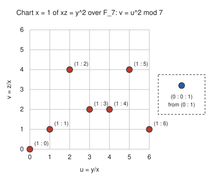

# Proj: building projective schemes from graded rings, the way Spec builds affine ones

[Syllabus](../../../SYLLABUS.md) → [Algebraic geometry](../README.md) → [Schemes and Modern Language](../README.md#s06) → Proj

---

## General Overview

Take the conic $`xz = y^2`$ and count its points over $`\mathbb{F}_7`$, the whole numbers mod 7. In the projective plane it has 8 points. They match the 8 points of the projective line one for one, through $`(s : t) \mapsto (s^2 : st : t^2)`$.

Now take the ring of the equation, $`\mathbb{F}_7[x, y, z]/(xz - y^2)`$, and form its spectrum (its prime ideals as points, from [The spectrum of a ring](02-spectrum-of-a-ring-and-schemes.md)). That is not the conic. It is the cone $`xz = y^2`$ in 3-space, with 49 points over $`\mathbb{F}_7`$. The conic is the set of lines through the cone's tip: $`(49 - 1)/6 = 8`$, since each line holds 6 nonzero points.

This card builds the tool that turns a ring into "lines through the origin" directly. It is called **Proj**. Its input is a **graded ring**: a ring split into degrees, such as polynomials split by total degree. Its points are the **homogeneous** prime ideals (ideals generated by elements that each sit in one degree), leaving out the cone's tip. It is covered by affine pieces (pieces of the form Spec of a ring), one for each chart of projective space.

Proj gives projective space, every projective variety, and weighted projective spaces, where the variables carry different degrees. Three different rings on this card all give the projective line: $`k[s, t]`$, the conic's ring, and $`k[x, y]`$ with $`x`$ of degree 1 and $`y`$ of degree 2. And $`\mathrm{Proj}\, \mathbb{Z}[x, y]`$ is the line over the whole numbers: over the prime 7 it is the line over $`\mathbb{F}_7`$, with 8 points.

**Proj of a graded ring is the set of its homogeneous prime ideals that do not contain every element of positive degree; it is covered by the affine pieces Spec S_(f), whose rings are the fractions of total degree zero, and it is the scheme of lines through the origin of the cone that Spec of the same ring would give.**

**What kind of fact this is:** definitions (graded ring, homogeneous ideal, the irrelevant ideal, Proj, the degree-zero ring $`S_{(f)}`$), and theorems. Proved on this card in Why it works: the homogeneous primes of $`k[x, y]`$, the match between the points of a chart and Spec of its degree-zero ring, the gluing of the charts, and that the conic and the weighted line are the projective line. Stated with sources, not proved: that the rings on the charts glue into a scheme, and that Proj does not change when only the even degrees are kept.

### The picture: the conic over F_7

<p align="center"></p>

Points over $`\mathbb{F}_7`$, drawn to scale on the grid, not a real curve. The grid is the chart $`x = 1`$, where the conic reads $`v = u^2`$ with $`u = y/x`$ and $`v = z/x`$. The red dot labelled $`(1 : u)`$ is the image of that point of the line. The eighth point, $`(0 : 0 : 1)`$, has $`x = 0`$ and lies outside this chart.

---

## The formula

Notation in use. The field $`k`$ is the number system of the coefficients; this card computes over $`\mathbb{F}_7`$ and uses $`\mathbb{Z}`$ and $`\mathbb{Q}`$ for the line over the whole numbers. $`\mathrm{Spec}\, R`$, its points (prime ideals $`\mathfrak{p}`$) and the open set $`D(f)`$ come from [The spectrum of a ring](02-spectrum-of-a-ring-and-schemes.md). $`R_f`$, the ring with $`f`$ made invertible, comes from [Localisation](03-localisation-and-local-rings.md). Points $`(x : y : z)`$ of $`\mathbb{P}^n`$ and homogeneous polynomials come from [Projective varieties](../02-Affine%20and%20Projective%20Varieties/04-projective-varieties-and-closure.md).

New on this card.

- A **graded ring** $`S`$ is a commutative ring that is a direct sum of pieces $`S_0, S_1, S_2, \dots`$, with a product of a degree-$`d`$ element and a degree-$`e`$ element in degree $`d + e`$. For $`k[x, y, z]`$, $`S_d`$ is the homogeneous polynomials of degree $`d`$.
- A **homogeneous ideal** is an ideal generated by homogeneous elements (each in one $`S_d`$).
- The **irrelevant ideal** $`S_+`$ is everything of positive degree. For $`k[x, y, z]`$ it is $`(x, y, z)`$, the ideal of the cone's tip.

```math
\mathrm{Proj}\, S = \{\, \mathfrak{p} \subset S : \mathfrak{p} \text{ a homogeneous prime ideal},\ S_+ \not\subseteq \mathfrak{p} \,\}, \qquad V_+(I) = \{\, \mathfrak{p} \in \mathrm{Proj}\, S : I \subseteq \mathfrak{p} \,\}, \qquad D_+(f) = \{\, \mathfrak{p} \in \mathrm{Proj}\, S : f \notin \mathfrak{p} \,\}
```

**Read it aloud:** Proj of S is the set of homogeneous prime ideals that do not contain the whole irrelevant ideal; a closed set is the primes that contain a homogeneous ideal I; the basic open set of a homogeneous f is the primes that do not contain f.

Each basic open set is an affine piece. Take $`f`$ homogeneous of positive degree. Its ring is the **degree-zero part** of $`S_f`$, written $`S_{(f)}`$:

```math
D_+(f) \cong \mathrm{Spec}\, S_{(f)}, \qquad S_{(f)} = \Big\{\, \frac{g}{f^m} : m \geq 0,\ g \in S_{m \deg f} \,\Big\}
```

**Read it aloud:** the part of Proj where f is not zero is the spectrum of the ring of fractions g over a power of f in which top and bottom have the same degree.

For the conic, $`S = k[x, y, z]/(xz - y^2)`$ and $`f = x`$. The fractions of degree zero are generated by $`u = y/x`$ and $`v = z/x`$, and the equation divided by $`x^2`$ reads $`v = u^2`$. So $`S_{(x)} = k[u, v]/(v - u^2) \cong k[u]`$, a line. Over $`\mathbb{F}_7`$ it has the 7 points in the picture.

| Symbol | Plain meaning | In our example | Push it up and the answer… |
| --- | --- | --- | --- |
| $`S`$, $`S_d`$, $`S_+`$ | a graded ring; its degree-$`d`$ piece; the irrelevant ideal, all positive degrees | the conic's ring; $`\dim S_3 = 7`$; $`(x, y, z)`$ | — |
| $`\mathfrak{p}`$, $`\mathfrak{q}`$; $`I`$; $`\varphi`$, $`\psi`$ | prime ideals (points); a homogeneous ideal; the matches from Proj to a chart and back, in the proof fold | $`(x - y)`$, the point $`(1 : 1)`$ of the line; $`(xz - y^2)`$ | — |
| $`\mathrm{Proj}\, S`$, $`V_+(I)`$, $`D_+(f)`$ | the points; a closed set; the open set where $`f`$ is not zero | $`D_+(x)`$: 7 of the conic's 8 points | — |
| $`S_f`$, $`S_{(f)}`$ | all fractions over powers of $`f`$; the degree-zero ones | $`S_{(x)} = k[u]`$ | — |
| $`k`$, $`\mathbb{F}_p`$, $`\mathbb{Z}`$, $`\mathbb{Q}`$ | a field; whole numbers mod a prime $`p`$; whole numbers; fractions | $`\mathbb{F}_7`$ | larger $`p`$, more points: $`p + 1`$ on the line |
| $`\mathbb{P}^n`$, $`\mathbb{P}(1, 2)`$ | projective $`n`$-space; the weighted line with degrees 1 and 2 | $`\mathbb{P}^1(\mathbb{F}_7)`$: 8 points | $`\mathbb{P}^2(\mathbb{F}_7)`$: 57 |
| $`x, y, z`$; $`s, t`$ | coordinates of the plane; of the line | $`(1 : 2) \mapsto (1 : 2 : 4)`$ | — |
| $`u, v`$; $`w`$ | chart coordinates $`y/x`$, $`z/x`$; the weighted chart coordinate $`y/x^2`$ | $`v = u^2`$ | — |
| $`f`$, $`g`$; $`m`$, $`d`$, $`e`$ | homogeneous elements; powers and degrees | $`f = x`$, $`e = \deg f`$ | — |
| $`S^{(2)}`$ | the **Veronese subring**: the even degrees of $`S`$, with each degree halved | $`k[s, t]^{(2)}`$ is the conic's ring | — |
| $`N_d`$; $`\mathrm{HF}`$ | the number of closed points of degree $`d`$; the Hilbert function $`\dim S_d`$ | $`N_2 = 21`$; $`2d + 1`$ | $`N_d`$ grows like $`7^d/d`$ |
| $`\lambda`$; $`\Gamma`$; $`\mathcal{O}(n)`$; $`g_2`$, $`g_3`$, $`j`$, $`O`$ | a nonzero scale; global functions (on the whole space); the twisting sheaf, whose sections are the degree-$`n`$ elements; elliptic-curve invariants and the curve's zero point, used in the real-life list | $`(\lambda x, \lambda^2 y)`$; $`\Gamma = k`$ | — |

### When it holds

- **Only homogeneous primes are points.** A point of projective space is a whole line through the origin, so its ideal must survive scaling. The prime $`(x - y)`$ of $`k[x, y]`$ is homogeneous and is the point $`(1 : 1)`$. The prime $`(x - 1)`$ is not: "$`x = 1`$" holds at $`(1, 0)`$ but not at $`(2, 0)`$, the same point.
- **The irrelevant ideal is left out.** Keep $`(x, y, z)`$ and the cone's tip comes back. It lies in no chart $`D_+(f)`$, and Spec of the conic's ring has 49 points over $`\mathbb{F}_7`$, not 8.
- **The chart ring is the degree-zero part.** All of $`S_x`$ is too big: for $`k[x, y]`$ it is $`k[x, y, 1/x]`$, a plane with a line removed. Over $`\mathbb{F}_7`$ that has 42 points, where the chart $`D_+(x)`$ has 7.
- **The chart's element has positive degree.** For $`f = 1`$, the degree-zero fractions are only $`S_0 = k`$: one point, not a chart of the line.
- **Points over a field are not orbits of vectors.** For the weighted line, the classes of nonzero $`(x, y)`$ under $`(\lambda x, \lambda^2 y)`$ number 9 over $`\mathbb{F}_7`$. The scheme has 8 points defined over $`\mathbb{F}_7`$. Two classes merge once square roots are allowed.

---

## Why it works

### Step 0: homogeneous equations describe sets of lines

A homogeneous polynomial $`g`$ of degree $`d`$ obeys $`g(\lambda v) = \lambda^d g(v)`$. So it is zero on a whole line through the origin or nowhere on it except the origin. An ideal generated by homogeneous elements therefore cuts out a cone: a union of lines through the origin.

Each such cone that cannot be split into two smaller ones has one homogeneous prime ideal. One cone is special: the origin alone, cut out by $`S_+`$. It contains no line, so it is no point of projective space. Leaving out the primes that contain $`S_+`$ removes exactly that tip.

So Proj is "Spec, but only for ideals that respect scaling, and without the tip". Everything else follows by computing in charts, where the scaling has been divided away.

### Step 1: the points of Proj k[x, y]

The ring $`k[x, y]`$ is a unique factorisation domain ([Domains, principal ideals and unique factorisation](01-integral-domains-pids-and-unique-factorisation.md)). Its homogeneous primes are of three kinds.

| Prime | What it is | In Proj? |
| --- | --- | --- |
| $`(0)`$ | the generic point, lying in every non-empty open set | yes |
| $`(g)`$, $`g`$ an irreducible homogeneous form | a closed point of degree $`\deg g`$ | yes |
| $`(x, y)`$ | the irrelevant ideal, the cone's tip | no |

A form of degree 1, $`tx - sy`$, is the point $`(s : t)`$. Over $`\mathbb{F}_7`$ there are 8 of them, up to scaling. A form of degree 2 or 3 is irreducible exactly when it has no root on the line. Brute force finds 21 such forms of degree 2 and 112 of degree 3.

These counts obey the identity "points of the line over the field with $`7^d`$ elements": each closed point of degree $`e`$ dividing $`d`$ gives $`e`$ of them.

```math
\sum_{e \mid d} e\, N_e = 7^d + 1: \qquad 8 + 2 \times 21 = 50, \qquad 8 + 3 \times 112 = 344
```

**Read it aloud:** adding e times the number of closed points of degree e, over every e dividing d, gives 7 to the d plus 1; for d = 2 that is 50, for d = 3 it is 344.

### Step 2: a chart is Spec of the degree-zero fractions

A fraction $`g/f^m`$ with top and bottom of the same degree takes the same value at $`v`$ and at $`\lambda v`$: both scale by $`\lambda^{m \deg f}`$, which cancels. So it is a genuine function on the lines where $`f`$ is not zero. These fractions form $`S_{(f)}`$.

For $`\mathbb{P}^1 = \mathrm{Proj}\, k[x, y]`$ the two charts are $`S_{(x)} = k[y/x]`$ and $`S_{(y)} = k[x/y]`$. Over $`\mathbb{F}_7`$ each has 7 points, they share 6, and $`7 + 7 - 6 = 8`$.

The theorem behind it: the points of $`D_+(f)`$ match the prime ideals of $`S_{(f)}`$ one for one. The match sends a homogeneous prime $`\mathfrak{p}`$ to its degree-zero fractions, $`\{g/f^m : g \in \mathfrak{p}\}`$.

<details>
<summary>Detailed proof: the points of D+(f) are the primes of S_(f)</summary>

Let $`f`$ have degree $`e > 0`$. A homogeneous ideal is prime exactly when the prime test passes for homogeneous elements; this standard lemma opens the Stacks Project's section on Proj of a graded ring.

**From Proj to the chart.** Send $`\mathfrak{p}`$, with $`f \notin \mathfrak{p}`$, to $`\varphi(\mathfrak{p}) = \{g/f^m \in S_{(f)} : g \in \mathfrak{p}\}`$. By [Localisation](03-localisation-and-local-rings.md), $`\mathfrak{p} S_f`$ is a prime of $`S_f`$, since $`\mathfrak{p}`$ avoids every power of $`f`$. Its degree-zero part $`\varphi(\mathfrak{p})`$ is then a prime of $`S_{(f)}`$.

**From the chart back.** For a prime $`\mathfrak{q}`$ of $`S_{(f)}`$, let $`\psi(\mathfrak{q})`$ be generated by the homogeneous $`g`$ with

$`\displaystyle \frac{g^{e}}{f^{\deg g}} \in \mathfrak{q}.`$

This fraction has degree $`e \deg g - e \deg g = 0`$, so it lies in $`S_{(f)}`$. Two elements of one degree that pass the test have a sum that passes too: every term of the sum's $`2e`$-th power holds a passing fraction as a factor, and $`\mathfrak{q}`$ is prime. For homogeneous $`a`$ and $`b`$ the test fraction of $`ab`$ is the product of theirs, so primeness of $`\mathfrak{q}`$ makes $`\psi(\mathfrak{q})`$ prime. It does not contain $`f`$, since $`f^e/f^e = 1`$ is not in $`\mathfrak{q}`$.

**They undo each other.** For homogeneous $`g`$: $`g \in \mathfrak{p}`$ exactly when $`g^e \in \mathfrak{p}`$ (primeness), exactly when $`g^e/f^{\deg g} \in \varphi(\mathfrak{p})`$. So $`\psi(\varphi(\mathfrak{p})) = \mathfrak{p}`$. In the other direction, $`g/f^m \in \mathfrak{q}`$ exactly when its $`e`$-th power $`g^e/f^{me}`$ is, which is the test for $`g`$. So $`\varphi(\psi(\mathfrak{q})) = \mathfrak{q}`$.

The same match carries closed sets to closed sets, so it is a match of spaces. That the rings of functions agree as well, making $`D_+(f)`$ an affine scheme, is Hartshorne's Proposition II.2.5.

</details>

### Step 3: the charts glue, and the global functions are constants

Two charts overlap in $`D_+(f) \cap D_+(g) = D_+(fg)`$, because a prime avoids $`fg`$ exactly when it avoids both. The overlap's ring is the chart ring of $`f`$ with one more fraction made invertible: $`g^{\deg f}/f^{\deg g}`$.

For $`\mathbb{P}^1`$ this is the gluing done by hand on [The spectrum of a ring](02-spectrum-of-a-ring-and-schemes.md):

| Piece | Ring | Points over $`\mathbb{F}_7`$ |
| --- | --- | --- |
| $`D_+(x)`$ | $`k[u]`$, $`u = y/x`$ | 7 |
| $`D_+(y)`$ | $`k[1/u]`$, $`1/u = x/y`$ | 7 |
| $`D_+(xy)`$ | $`k[u, 1/u]`$ | 6 |

A function on all of $`\mathbb{P}^1`$ is a polynomial in $`u`$ that is also a polynomial in $`1/u`$. Only constants are both. So $`\Gamma(\mathrm{Proj}\, k[x, y]) = k`$, not $`k[x, y]`$. So $`\mathbb{P}^1`$ is not Spec of any ring: that ring would have to be $`\Gamma = k`$, and $`\mathrm{Spec}\, k`$ is a single point.

### Step 4: the conic is the projective line

Send $`x \mapsto s^2`$, $`y \mapsto st`$, $`z \mapsto t^2`$. This ring map sends $`xz - y^2`$ to $`s^2 t^2 - s^2 t^2 = 0`$. Its image is the even-degree part of $`k[s, t]`$, the Veronese subring $`k[s, t]^{(2)}`$. Its kernel is exactly $`(xz - y^2)`$, by the count below.

The check counts both sides in each degree $`d`$. On the conic's side, $`\dim S_d`$ is the monomials of degree $`d`$, $`\binom{d+2}{2}`$, minus the independent multiples of $`xz - y^2`$, found by a rank computation. On the other side it is the monomials $`s^i t^{2d - i}`$, which number $`2d + 1`$. They agree for $`d = 0`$ to 6: 1, 3, 5, 7, 9, 11, 13. They agree for every $`d`$: the multiples are independent, since $`k[x, y, z]`$ has no zero divisors, so the first count is $`\binom{d+2}{2} - \binom{d}{2} = 2d + 1`$. The multiples lie in the kernel and the counts match, so they are the whole kernel.

That count is the Hilbert function of [Degree](../02-Affine%20and%20Projective%20Varieties/09-degree-and-the-hilbert-polynomial.md). It is $`2d + 1`$, a line in $`d`$, so the conic is a curve; its top coefficient 2 is the conic's degree.

The charts match too. On $`\mathbb{P}^1`$, $`D_+(s)`$ has ring $`k[t/s]`$. On the conic, $`D_+(x)`$ has ring $`k[y/x]`$, and $`y/x = st/s^2 = t/s`$. The two rings are the same. On the overlap of the conic's charts $`D_+(x)`$ and $`D_+(z)`$, the coordinates $`y/x`$ and $`y/z`$ multiply to $`y^2/(xz) = 1`$: the gluing of $`\mathbb{P}^1`$ again.

In general, $`\mathrm{Proj}\, S^{(2)} \cong \mathrm{Proj}\, S`$ for any graded ring: keeping only even degrees leaves the degree-zero fractions unchanged. This is stated with its source (Grothendieck, EGA II, section 2).

[Conics](../03-Plane%20Curves/01-conics-and-rational-parametrisation.md) found the same match point by point, by lines through a rational point. Proj says it as an isomorphism of schemes.

### Step 5: the weighted line is the projective line

Give $`x`$ degree 1 and $`y`$ degree 2. Then $`S_d`$ holds the monomials $`x^i y^j`$ with $`i + 2j = d`$: dimensions 1, 1, 2, 2, 3, 3, 4, 4, 5. Scaling acts by $`(\lambda x, \lambda^2 y)`$.

The charts:

- $`D_+(x)`$: degree-zero fractions are generated by $`w = y/x^2`$, so the ring is $`k[w]`$.
- $`D_+(y)`$: $`x/y`$ has degree $`-1`$, but $`x^2/y`$ has degree 0, so the ring is $`k[x^2/y] = k[1/w]`$.
- The overlap is $`k[w, 1/w]`$.

That is the gluing of $`\mathbb{P}^1`$ once more, so $`\mathrm{Proj}\, k[x, y] = \mathbb{P}^1`$ with these degrees. The even degrees say the same: $`S^{(2)}`$ is spanned by $`x^2`$ and $`y`$, a polynomial ring in two variables of degree 1.

Over $`\mathbb{F}_7`$ the classes of nonzero vectors under $`(\lambda x, \lambda^2 y)`$ number 9, but the scheme has 8 points. The classes $`(0 : 1)`$ and $`(0 : 3)`$ differ because 3 is not a square mod 7. Both have $`x^2/y = 0`$, so they are one point of $`D_+(y)`$. Over $`\mathbb{F}_{49}`$, which has a square root of 3, they become one class.

### Step 6: the line over the whole numbers

$`\mathrm{Proj}\, \mathbb{Z}[x, y]`$ is the projective line over $`\mathbb{Z}`$. It lies over $`\mathrm{Spec}\, \mathbb{Z}`$, one fibre (the part above one point) per prime, as in [Morphisms of schemes](04-morphisms-and-fibre-products-in-outline.md). The fibre over $`p`$ is $`\mathrm{Proj}\, \mathbb{F}_p[x, y]`$, with $`p + 1`$ points; the fibre over the generic point is the line over $`\mathbb{Q}`$.

A rational point such as $`(3 : 5)`$ reaches every fibre. Over 7 it is $`(1 : 5/3) = (1 : 4)`$, since $`5 \times 3^{-1} = 5 \times 5 = 25 = 4`$ mod 7. Over 5 it is $`(3 : 0) = (1 : 0)`$, and over 3 it is $`(0 : 1)`$. Because 3 and 5 share no prime factor, no prime kills both coordinates.

---

## Worked numbers, by hand

The conic $`xz = y^2`$ over $`\mathbb{F}_7`$, counted through its charts.

| Step | Arithmetic | Value |
| --- | --- | --- |
| chart $`D_+(x)`$: $`v = u^2`$ | $`u = 0, \dots, 6`$ gives $`v = 0, 1, 4, 2, 2, 4, 1`$ | 7 points |
| chart $`D_+(z)`$: $`x/z = (y/z)^2`$ | the same count | 7 points |
| overlap: $`x \neq 0`$ and $`z \neq 0`$ | $`y^2 = xz \neq 0`$, so $`y \neq 0`$: the 6 nonzero $`u`$ | 6 points |
| every point is in a chart | $`x = z = 0`$ forces $`y = 0`$ | none missed |
| glue | 7 + 7 − 6 | 8 |
| one point from the line | $`(1 : 2) \mapsto (1^2 : 1 \cdot 2 : 2^2)`$ | $`(1 : 2 : 4)`$ |
| the affine cone | the tip, plus 6 nonzero multiples on each of 8 lines | 1 + 48 = 49 |
| lines through the tip | (49 − 1)/6 | 8 |
| $`\dim S_3`$ | $`\binom{5}{2} - \binom{3}{2} = 10 - 3`$ | 7 = 2 × 3 + 1 |

**The conic has 8 points over $`\mathbb{F}_7`$, exactly as many as $`\mathbb{P}^1(\mathbb{F}_7)`$, and the charts, the cone and the parametrisation all give that 8.** Proj of the conic's ring and Proj of $`k[s, t]`$ are the same scheme.

### What breaks if you drop a piece

| Mistake | Comes out at | What went wrong |
| --- | --- | --- |
| Take Spec of the conic's ring, keeping the tip | 49 points, not 8 | Spec gives the cone; Proj takes its lines |
| Use all of $`S_x = \mathbb{F}_7[x, y, 1/x]`$ as the chart | 42 points, not 7 | only degree-zero fractions are functions on lines |
| Count weighted points as classes of vectors | 9, not 8 | $`(0 : 1)`$ and $`(0 : 3)`$ are one point; 3 is a square only over $`\mathbb{F}_{49}`$ |
| Read the ring back from Proj | $`\dim S_1`$ = 2, 3 and 1 for three rings giving one $`\mathbb{P}^1`$ | Proj forgets the grading's details |

---

## Code, from first principles, and it actually runs

Nothing is imported, and every number is an exact integer mod a prime. The code takes four roads to the conic's 8 points: listing all 57 points of $`\mathbb{P}^2(\mathbb{F}_7)`$, the parametrisation from $`\mathbb{P}^1`$ with its inverse, gluing the three chart rings, and counting lines through the tip of the affine cone. It finds $`\dim S_d`$ by a rank computation and by the monomials hit in $`k[s, t]`$. It counts closed points of $`\mathbb{P}^1`$ by brute force against the identity of Step 1, and the weighted line's points by its charts and by the map to $`\mathbb{P}^1`$.

### Python

```python
# Proj of a graded ring -- the check behind the card.  Nothing is imported and
# every number is an exact integer mod a prime p.  Roads: points found by listing
# all of P^n(F_p), by the parametrisation (s : t) -> (s^2 : st : t^2), by gluing
# the affine charts Spec S_(f), and by counting lines through the origin of the
# affine cone; closed points by brute force against the counting identity; and
# dim S_d by a rank computation against the image of monomials in k[s, t].
P = 7
def proj_points(n, p):                        # P^n(F_p): first nonzero coordinate scaled to 1
    out = []
    for i in range(n + 1):
        for rest in range(p ** (n - i)):
            out.append(tuple([0] * i + [1] + [rest // p ** j % p for j in range(n - i)]))
    return out
def inv(a, p):                                # a^(p-2) is the inverse of a mod p
    r = 1
    for _ in range(p - 2):
        r = r * a % p
    return r
def norm(v, p):                               # scale a nonzero vector: first nonzero entry 1
    a = next(c for c in v if c % p)
    return tuple(c * inv(a, p) % p for c in v)
def show(q):
    return "(" + " : ".join(map(str, q)) + ")"
def rank(rows, p):                            # Gaussian elimination mod p
    rows, r = [row[:] for row in rows], 0
    for c in range(len(rows[0]) if rows else 0):
        piv = next((i for i in range(r, len(rows)) if rows[i][c] % p), None)
        if piv is None:
            continue
        rows[r], rows[piv] = rows[piv], rows[r]
        k = inv(rows[r][c], p)
        for i in range(len(rows)):
            if i != r and rows[i][c] % p:
                f = rows[i][c] * k % p
                rows[i] = [(x - f * y) % p for x, y in zip(rows[i], rows[r])]
        r += 1
    return r
print("== projective space: Proj F_7[x, y] and Proj F_7[x, y, z] ==")
line, plane = proj_points(1, P), proj_points(2, P)
assert len(line) == (P ** 2 - 1) // (P - 1) and len(plane) == (P ** 3 - 1) // (P - 1)
print(f"P^1(F_7): {len(line)} points", " ".join(show(q) for q in line))
print(f"P^2(F_7): {len(plane)} points = (343 - 1)/6")
ux = sorted({y * inv(x, P) % P for x, y in line if x})      # chart D+(x): the value y/x
uy = sorted({x * inv(y, P) % P for x, y in line if y})      # chart D+(y): the value x/y
both = [q for q in line if q[0] and q[1]]
assert len(ux) + len(uy) - len(both) == len(line)
print(f"charts of P^1: D+(x) {len(ux)} values of y/x, D+(y) {len(uy)} values of x/y, overlap {len(both)}: {len(ux)} + {len(uy)} - {len(both)} = {len(line)}")
def roots(c, p):                              # points (s : t) of P^1(F_p) where the form vanishes
    d = len(c) - 1
    return [q for q in proj_points(1, p) if sum(ci * q[0] ** (d - i) * q[1] ** i for i, ci in enumerate(c)) % p == 0]
N = {1: len(line)}
for d in (2, 3):                              # degree 2 and 3: irreducible means no root
    N[d] = sum(1 for c in proj_points(d, P) if not roots(c, P))
    assert sum(e * N[e] for e in N if d % e == 0) == P ** d + 1
print("closed points of Proj F_7[x, y] by degree 1, 2, 3:", N[1], N[2], N[3], f" check: 8 + 2 x 21 = {8 + 2 * 21}, 8 + 3 x 112 = {8 + 3 * 112}")
assert not roots((1, 0, 1), P)
print("x^2 + y^2 has", len(roots((1, 0, 1), P)), "roots: a closed point of degree 2; squares mod 7:", sorted({a * a % P for a in range(1, P)}))
print("== Proj Z[x, y]: the line over Z, one fibre per prime ==")
for p in (2, 3, 5, 7, 11, 13):
    assert len(proj_points(1, p)) == p + 1
    print(f"fibre over {p}: {p + 1} points; the rational point (3 : 5) lands on {show(norm((3, 5), p))}")
print(f"over 7: 1/3 = {inv(3, P)}, 5 x {inv(3, P)} = {5 * inv(3, P)} = {5 * inv(3, P) % P} mod 7")
print("== the conic Proj F_7[x, y, z]/(xz - y^2) ==")
conic = [q for q in plane if (q[0] * q[2] - q[1] ** 2) % P == 0]
image = sorted({norm((s * s, s * t, t * t), P) for s, t in line})
assert image == sorted(conic) and len(conic) == P + 1        # road two: the parametrisation
back = lambda q: norm(q[:2], P) if q[0] or q[1] else norm(q[1:], P)
assert all(back(norm((s * s, s * t, t * t), P)) == (s, t) for s, t in line)
print("points:", " ".join(show(q) for q in conic), f"-> {len(conic)}")
print("from (s : t):", " ".join(f"{show(q)}->{show(norm((q[0] ** 2, q[0] * q[1], q[1] ** 2), P))}" for q in line[:3]), "...")
cone = sum(1 for x in range(P) for y in range(P) for z in range(P) if (x * z - y * y) % P == 0)
assert cone == 1 + (P - 1) * len(conic)                      # road three: lines through the cone's vertex
print(f"affine cone xz = y^2 in F_7^3: {cone} points = 1 + {(P - 1) * len(conic)}; ({cone} - 1)/6 = {(cone - 1) // (P - 1)} lines")
cx = [(u, v) for u in range(P) for v in range(P) if (v - u * u) % P == 0]     # S_(x): v = u^2
cz = [(a, b) for a in range(P) for b in range(P) if (a - b * b) % P == 0]     # S_(z): a = b^2
cy = [(c, e) for c in range(P) for e in range(P) if (c * e - 1) % P == 0]     # S_(y): ce = 1
xz = [q for q in conic if q[0] and q[2]]
assert all(q[0] or q[2] for q in conic) and len(cx) + len(cz) - len(xz) == len(conic) == len(cx) + 1
assert len(xz) == len(cy) and all(q[1] * inv(q[0], P) * q[1] * inv(q[2], P) % P == 1 for q in xz)
print(f"charts: Spec S_(x) {len(cx)} points, Spec S_(z) {len(cz)}, overlap {len(xz)} (= Spec S_(y), {len(cy)}): {len(cx)} + {len(cz)} - {len(xz)} = {len(conic)}")
print("on the overlap (y/x)(y/z) = 1 at all", len(xz), "points; chart x = 1 holds", " ".join(f"({u}, {v})" for u, v in cx))
def mono(d, n):                               # exponent vectors of degree d in n variables
    return [(d,)] if n == 1 else [(a,) + m for a in range(d, -1, -1) for m in mono(d - a, n - 1)]
hf = []
for d in range(7):
    ms = mono(d, 3)
    rows = []
    for a, b, c in (mono(d - 2, 3) if d >= 2 else []):       # the multiples of xz - y^2 in degree d
        row = [0] * len(ms)
        row[ms.index((a + 1, b, c + 1))] += 1
        row[ms.index((a, b + 2, c))] -= 1
        rows.append(row)
    pic = len({(2 * a + b, b + 2 * c) for a, b, c in ms})    # monomials hit by x -> s^2, y -> st, z -> t^2
    assert len(ms) - rank(rows, P) == pic == 2 * d + 1
    hf.append(pic)
print("dim S_d, d = 0..6:", " ".join(map(str, hf)), " = 2d + 1 = dim k[s, t] in degree 2d; top coefficient 2, the degree")
print(f"dim S_3 = {len(mono(3, 3))} - {len(mono(1, 3))} = {hf[3]}")
print("== the weighted line Proj F_7[x, y], deg x = 1, deg y = 2 ==")
w = [sum(1 for i in range(d + 1) for j in range(d + 1) if i + 2 * j == d) for d in range(9)]
assert w == [d // 2 + 1 for d in range(9)]
print("dim S_d, d = 0..8:", " ".join(map(str, w)), " even degrees 2d:", " ".join(str(w[2 * d]) for d in range(5)), "= d + 1, as for P^1")
def orbits(a, b, p):                          # naive classes of (x, y) != 0 under (lx, ly) -> (l^a x, l^b y)
    return sorted({min((x * l ** a % p, y * l ** b % p) for l in range(1, p)) for x in range(p) for y in range(p) if x or y})
orb = orbits(1, 2, P)
pts = sorted({norm((x * x, y), P) for x, y in orb})          # (x : y) -> (x^2 : y), onto P^1
wx = {y * inv(x * x, P) % P for x, y in orb if x}            # chart D+(x): the value y/x^2
wy = {x * x * inv(y, P) % P for x, y in orb if y}            # chart D+(y): the value x^2/y
wxy = sum(1 for q in pts if q[0] and q[1])
assert len(wx) + len(wy) - wxy == len(pts) == len(line) and len(orb) == len(pts) + 1
merged = [show(q) for q in orb if q[0] == 0]
print(f"naive orbits: {len(orb)}; scheme points: {len(pts)} = {len(wx)} values of y/x^2 + {len(wy)} of x^2/y - {wxy} on the overlap")
print("orbits", " and ".join(merged), "both have x^2/y = 0: one point of Proj")
print("== what breaks ==")
print(f"Spec instead of Proj, keeping the vertex: {cone} points, not {len(conic)}")
whole = sum(1 for x in range(P) for y in range(P) if x)
print(f"whole localisation S_x = F_7[x, y, 1/x], not its degree-0 part: {whole} points, not {len(ux)}")
print(f"weighted points as naive orbits: {len(orb)}, not {len(pts)}")
print(f"three different rings, one P^1: dim S_1 = {len(mono(1, 2))}, {hf[1]}, {w[1]}; every one has {len(line)} points over F_7")
print("== try changing ==")
print(f"orbits for weights 1, 3 over F_7: {len(orbits(1, 3, P))}, cubes mod 7: {sorted({a ** 3 % P for a in range(1, P)})}; conic over F_11: {sum(1 for q in proj_points(2, 11) if (q[0] * q[2] - q[1] ** 2) % 11 == 0)} points; dim S_10 of the conic: {len(mono(10, 3)) - len(mono(8, 3))}")
print("figure, chart x = 1 points (u, v) at px = 60 + 40u, py = 300 - 40v:", " ".join(f"({60 + 40 * u}, {300 - 40 * v})" for u, v in cx), "; (0 : 0 : 1) at infinity")
print("ALL CHECKS PASS")
```

**Ran 2026-11-24 on macOS, Python 3.14.10, standard library only. All checks passed. Output, pasted from the run:**

```
== projective space: Proj F_7[x, y] and Proj F_7[x, y, z] ==
P^1(F_7): 8 points (1 : 0) (1 : 1) (1 : 2) (1 : 3) (1 : 4) (1 : 5) (1 : 6) (0 : 1)
P^2(F_7): 57 points = (343 - 1)/6
charts of P^1: D+(x) 7 values of y/x, D+(y) 7 values of x/y, overlap 6: 7 + 7 - 6 = 8
closed points of Proj F_7[x, y] by degree 1, 2, 3: 8 21 112  check: 8 + 2 x 21 = 50, 8 + 3 x 112 = 344
x^2 + y^2 has 0 roots: a closed point of degree 2; squares mod 7: [1, 2, 4]
== Proj Z[x, y]: the line over Z, one fibre per prime ==
fibre over 2: 3 points; the rational point (3 : 5) lands on (1 : 1)
fibre over 3: 4 points; the rational point (3 : 5) lands on (0 : 1)
fibre over 5: 6 points; the rational point (3 : 5) lands on (1 : 0)
fibre over 7: 8 points; the rational point (3 : 5) lands on (1 : 4)
fibre over 11: 12 points; the rational point (3 : 5) lands on (1 : 9)
fibre over 13: 14 points; the rational point (3 : 5) lands on (1 : 6)
over 7: 1/3 = 5, 5 x 5 = 25 = 4 mod 7
== the conic Proj F_7[x, y, z]/(xz - y^2) ==
points: (1 : 0 : 0) (1 : 1 : 1) (1 : 6 : 1) (1 : 3 : 2) (1 : 4 : 2) (1 : 2 : 4) (1 : 5 : 4) (0 : 0 : 1) -> 8
from (s : t): (1 : 0)->(1 : 0 : 0) (1 : 1)->(1 : 1 : 1) (1 : 2)->(1 : 2 : 4) ...
affine cone xz = y^2 in F_7^3: 49 points = 1 + 48; (49 - 1)/6 = 8 lines
charts: Spec S_(x) 7 points, Spec S_(z) 7, overlap 6 (= Spec S_(y), 6): 7 + 7 - 6 = 8
on the overlap (y/x)(y/z) = 1 at all 6 points; chart x = 1 holds (0, 0) (1, 1) (2, 4) (3, 2) (4, 2) (5, 4) (6, 1)
dim S_d, d = 0..6: 1 3 5 7 9 11 13  = 2d + 1 = dim k[s, t] in degree 2d; top coefficient 2, the degree
dim S_3 = 10 - 3 = 7
== the weighted line Proj F_7[x, y], deg x = 1, deg y = 2 ==
dim S_d, d = 0..8: 1 1 2 2 3 3 4 4 5  even degrees 2d: 1 2 3 4 5 = d + 1, as for P^1
naive orbits: 9; scheme points: 8 = 7 values of y/x^2 + 7 of x^2/y - 6 on the overlap
orbits (0 : 1) and (0 : 3) both have x^2/y = 0: one point of Proj
== what breaks ==
Spec instead of Proj, keeping the vertex: 49 points, not 8
whole localisation S_x = F_7[x, y, 1/x], not its degree-0 part: 42 points, not 7
weighted points as naive orbits: 9, not 8
three different rings, one P^1: dim S_1 = 2, 3, 1; every one has 8 points over F_7
== try changing ==
orbits for weights 1, 3 over F_7: 10, cubes mod 7: [1, 6]; conic over F_11: 12 points; dim S_10 of the conic: 21
figure, chart x = 1 points (u, v) at px = 60 + 40u, py = 300 - 40v: (60, 300) (100, 260) (140, 140) (180, 220) (220, 220) (260, 140) (300, 260) ; (0 : 0 : 1) at infinity
ALL CHECKS PASS
```

### Rust

```rust
// Proj of a graded ring -- the same check as proj_of_a_graded_ring_check.py, in
// Rust.  Standard library only, no crates; every number is an exact integer mod p.
use std::collections::BTreeSet;
const P: i64 = 7;
fn proj_points(n: usize, p: i64) -> Vec<Vec<i64>> { // P^n(F_p): first nonzero coordinate scaled to 1
    let mut out = vec![];
    for i in 0..=n {
        for rest in 0..p.pow((n - i) as u32) {
            let mut v = vec![0; i];
            v.push(1);
            for j in 0..(n - i) { v.push(rest / p.pow(j as u32) % p); }
            out.push(v);
        }
    }
    out
}
fn inv(a: i64, p: i64) -> i64 { let mut r = 1; for _ in 0..p - 2 { r = r * a % p; } r } // a^(p-2)
fn norm(v: &[i64], p: i64) -> Vec<i64> { // scale a nonzero vector: first nonzero entry 1
    let a = *v.iter().find(|c| *c % p != 0).unwrap();
    v.iter().map(|c| c * inv(a, p) % p).collect()
}
fn show(q: &[i64]) -> String { format!("({})", q.iter().map(|c| c.to_string()).collect::<Vec<_>>().join(" : ")) }
fn rank(rows: &[Vec<i64>], p: i64) -> usize { // Gaussian elimination mod p
    let mut rows = rows.to_vec();
    let mut r = 0;
    let cols = if rows.is_empty() { 0 } else { rows[0].len() };
    for c in 0..cols {
        let piv = match (r..rows.len()).find(|&i| rows[i][c] % p != 0) { Some(i) => i, None => continue };
        rows.swap(r, piv);
        let k = inv(rows[r][c].rem_euclid(p), p);
        for i in 0..rows.len() {
            if i != r && rows[i][c] % p != 0 {
                let f = rows[i][c] * k % p;
                let pr = rows[r].clone();
                rows[i] = rows[i].iter().zip(pr.iter()).map(|(x, y)| (x - f * y).rem_euclid(p)).collect();
            }
        }
        r += 1;
    }
    r
}
fn roots(c: &[i64], p: i64) -> usize { // points (s : t) of P^1(F_p) where the form vanishes
    let d = c.len() - 1;
    proj_points(1, p).iter().filter(|q| c.iter().enumerate()
        .map(|(i, ci)| ci * q[0].pow((d - i) as u32) * q[1].pow(i as u32)).sum::<i64>() % p == 0).count()
}
fn mono(d: i64, n: usize) -> Vec<Vec<i64>> { // exponent vectors of degree d in n variables
    if n == 1 { return vec![vec![d]]; }
    let mut out = vec![];
    for a in (0..=d).rev() { for m in mono(d - a, n - 1) { let mut v = vec![a]; v.extend(m); out.push(v); } }
    out
}
fn orbits(a: u32, b: u32, p: i64) -> Vec<Vec<i64>> { // naive classes of (x, y) != 0 under (l^a x, l^b y)
    let mut s = BTreeSet::new();
    for x in 0..p { for y in 0..p {
        if x == 0 && y == 0 { continue; }
        s.insert((1..p).map(|l| vec![x * l.pow(a) % p, y * l.pow(b) % p]).min().unwrap());
    } }
    s.into_iter().collect()
}
fn conic_count(p: i64) -> usize { proj_points(2, p).iter().filter(|q| (q[0] * q[2] - q[1] * q[1]) % p == 0).count() }
fn main() {
    println!("== projective space: Proj F_7[x, y] and Proj F_7[x, y, z] ==");
    let (line, plane) = (proj_points(1, P), proj_points(2, P));
    assert!(line.len() as i64 == (P * P - 1) / (P - 1) && plane.len() as i64 == (P * P * P - 1) / (P - 1));
    println!("P^1(F_7): {} points {}", line.len(), line.iter().map(|q| show(q)).collect::<Vec<_>>().join(" "));
    println!("P^2(F_7): {} points = (343 - 1)/6", plane.len());
    let ux: BTreeSet<i64> = line.iter().filter(|q| q[0] != 0).map(|q| q[1] * inv(q[0], P) % P).collect();
    let uy: BTreeSet<i64> = line.iter().filter(|q| q[1] != 0).map(|q| q[0] * inv(q[1], P) % P).collect();
    let both = line.iter().filter(|q| q[0] != 0 && q[1] != 0).count();
    assert!(ux.len() + uy.len() - both == line.len());
    println!("charts of P^1: D+(x) {} values of y/x, D+(y) {} values of x/y, overlap {}: {} + {} - {} = {}", ux.len(), uy.len(), both, ux.len(), uy.len(), both, line.len());
    let mut n = vec![0i64, line.len() as i64, 0, 0];
    for d in 2..4usize { // degree 2 and 3: irreducible means no root
        n[d] = proj_points(d, P).iter().filter(|c| roots(c, P) == 0).count() as i64;
        assert!((1..=d).filter(|e| d % e == 0).map(|e| e as i64 * n[e]).sum::<i64>() == P.pow(d as u32) + 1);
    }
    println!("closed points of Proj F_7[x, y] by degree 1, 2, 3: {} {} {}  check: 8 + 2 x 21 = {}, 8 + 3 x 112 = {}", n[1], n[2], n[3], 8 + 2 * 21, 8 + 3 * 112);
    assert!(roots(&[1, 0, 1], P) == 0);
    let sq: BTreeSet<i64> = (1..P).map(|a| a * a % P).collect();
    println!("x^2 + y^2 has {} roots: a closed point of degree 2; squares mod 7: [{}]", roots(&[1, 0, 1], P), sq.iter().map(|c| c.to_string()).collect::<Vec<_>>().join(", "));
    println!("== Proj Z[x, y]: the line over Z, one fibre per prime ==");
    for p in [2i64, 3, 5, 7, 11, 13] {
        assert!(proj_points(1, p).len() as i64 == p + 1);
        println!("fibre over {}: {} points; the rational point (3 : 5) lands on {}", p, p + 1, show(&norm(&[3 % p, 5 % p], p)));
    }
    println!("over 7: 1/3 = {}, 5 x {} = {} = {} mod 7", inv(3, P), inv(3, P), 5 * inv(3, P), 5 * inv(3, P) % P);
    println!("== the conic Proj F_7[x, y, z]/(xz - y^2) ==");
    let conic: Vec<Vec<i64>> = plane.iter().filter(|q| (q[0] * q[2] - q[1] * q[1]) % P == 0).cloned().collect();
    let par = |q: &Vec<i64>| norm(&[q[0] * q[0], q[0] * q[1], q[1] * q[1]], P);
    let image: BTreeSet<Vec<i64>> = line.iter().map(|q| par(q)).collect();
    assert!(image == conic.iter().cloned().collect::<BTreeSet<_>>() && conic.len() as i64 == P + 1);
    let back = |q: &Vec<i64>| if q[0] != 0 || q[1] != 0 { norm(&q[..2], P) } else { norm(&q[1..], P) };
    assert!(line.iter().all(|q| back(&par(q)) == *q));
    println!("points: {} -> {}", conic.iter().map(|q| show(q)).collect::<Vec<_>>().join(" "), conic.len());
    println!("from (s : t): {} ...", line[..3].iter().map(|q| format!("{}->{}", show(q), show(&par(q)))).collect::<Vec<_>>().join(" "));
    let mut cone = 0usize;
    for x in 0..P { for y in 0..P { for z in 0..P { if (x * z - y * y) % P == 0 { cone += 1; } } } }
    assert!(cone == 1 + (P as usize - 1) * conic.len()); // lines through the cone's vertex
    println!("affine cone xz = y^2 in F_7^3: {} points = 1 + {}; ({} - 1)/6 = {} lines", cone, (P as usize - 1) * conic.len(), cone, (cone - 1) / (P as usize - 1));
    let pairs = |f: &dyn Fn(i64, i64) -> bool| -> Vec<(i64, i64)> { (0..P).flat_map(|a| (0..P).map(move |b| (a, b))).filter(|&(a, b)| f(a, b)).collect() };
    let cx = pairs(&|u, v| (v - u * u) % P == 0); // S_(x): v = u^2
    let cz = pairs(&|a, b| (a - b * b) % P == 0); // S_(z): a = b^2
    let cy = pairs(&|c, e| (c * e - 1) % P == 0); // S_(y): ce = 1
    let xz: Vec<&Vec<i64>> = conic.iter().filter(|q| q[0] != 0 && q[2] != 0).collect();
    assert!(conic.iter().all(|q| q[0] != 0 || q[2] != 0) && cx.len() + cz.len() - xz.len() == conic.len() && conic.len() == cx.len() + 1);
    assert!(xz.len() == cy.len() && xz.iter().all(|q| q[1] * inv(q[0], P) % P * q[1] % P * inv(q[2], P) % P == 1));
    println!("charts: Spec S_(x) {} points, Spec S_(z) {}, overlap {} (= Spec S_(y), {}): {} + {} - {} = {}", cx.len(), cz.len(), xz.len(), cy.len(), cx.len(), cz.len(), xz.len(), conic.len());
    println!("on the overlap (y/x)(y/z) = 1 at all {} points; chart x = 1 holds {}", xz.len(), cx.iter().map(|(u, v)| format!("({}, {})", u, v)).collect::<Vec<_>>().join(" "));
    let mut hf = vec![];
    for d in 0..7i64 {
        let ms = mono(d, 3);
        let idx = |m: Vec<i64>| ms.iter().position(|x| *x == m).unwrap();
        let mut rows = vec![];
        for m in if d >= 2 { mono(d - 2, 3) } else { vec![] } { // the multiples of xz - y^2 in degree d
            let mut row = vec![0i64; ms.len()];
            row[idx(vec![m[0] + 1, m[1], m[2] + 1])] += 1;
            row[idx(vec![m[0], m[1] + 2, m[2]])] -= 1;
            rows.push(row);
        }
        let pic = ms.iter().map(|m| (2 * m[0] + m[1], m[1] + 2 * m[2])).collect::<BTreeSet<_>>().len();
        assert!(ms.len() - rank(&rows, P) == pic && pic as i64 == 2 * d + 1);
        hf.push(pic);
    }
    println!("dim S_d, d = 0..6: {}  = 2d + 1 = dim k[s, t] in degree 2d; top coefficient 2, the degree", hf.iter().map(|h| h.to_string()).collect::<Vec<_>>().join(" "));
    println!("dim S_3 = {} - {} = {}", mono(3, 3).len(), mono(1, 3).len(), hf[3]);
    println!("== the weighted line Proj F_7[x, y], deg x = 1, deg y = 2 ==");
    let w: Vec<i64> = (0..9i64).map(|d| (0..=d).flat_map(|i| (0..=d).map(move |j| (i, j))).filter(|&(i, j)| i + 2 * j == d).count() as i64).collect();
    assert!(w == (0..9i64).map(|d| d / 2 + 1).collect::<Vec<_>>());
    println!("dim S_d, d = 0..8: {}  even degrees 2d: {} = d + 1, as for P^1", w.iter().map(|h| h.to_string()).collect::<Vec<_>>().join(" "), (0..5).map(|d| w[2 * d].to_string()).collect::<Vec<_>>().join(" "));
    let orb = orbits(1, 2, P);
    let pts: BTreeSet<Vec<i64>> = orb.iter().map(|q| norm(&[q[0] * q[0], q[1]], P)).collect(); // (x : y) -> (x^2 : y)
    let wx: BTreeSet<i64> = orb.iter().filter(|q| q[0] != 0).map(|q| q[1] * inv(q[0] * q[0] % P, P) % P).collect();
    let wy: BTreeSet<i64> = orb.iter().filter(|q| q[1] != 0).map(|q| q[0] * q[0] % P * inv(q[1], P) % P).collect();
    let wxy = pts.iter().filter(|q| q[0] != 0 && q[1] != 0).count();
    assert!(wx.len() + wy.len() - wxy == pts.len() && pts.len() == line.len() && orb.len() == pts.len() + 1);
    let merged: Vec<String> = orb.iter().filter(|q| q[0] == 0).map(|q| show(q)).collect();
    println!("naive orbits: {}; scheme points: {} = {} values of y/x^2 + {} of x^2/y - {} on the overlap", orb.len(), pts.len(), wx.len(), wy.len(), wxy);
    println!("orbits {} both have x^2/y = 0: one point of Proj", merged.join(" and "));
    println!("== what breaks ==");
    println!("Spec instead of Proj, keeping the vertex: {} points, not {}", cone, conic.len());
    let whole = (1..P).count() * P as usize;
    println!("whole localisation S_x = F_7[x, y, 1/x], not its degree-0 part: {} points, not {}", whole, ux.len());
    println!("weighted points as naive orbits: {}, not {}", orb.len(), pts.len());
    println!("three different rings, one P^1: dim S_1 = {}, {}, {}; every one has {} points over F_7", mono(1, 2).len(), hf[1], w[1], line.len());
    println!("== try changing ==");
    let cubes: BTreeSet<i64> = (1..P).map(|a| a * a * a % P).collect();
    println!("orbits for weights 1, 3 over F_7: {}, cubes mod 7: [{}]; conic over F_11: {} points; dim S_10 of the conic: {}", orbits(1, 3, P).len(), cubes.iter().map(|c| c.to_string()).collect::<Vec<_>>().join(", "), conic_count(11), mono(10, 3).len() - mono(8, 3).len());
    println!("figure, chart x = 1 points (u, v) at px = 60 + 40u, py = 300 - 40v: {} ; (0 : 0 : 1) at infinity", cx.iter().map(|(u, v)| format!("({}, {})", 60 + 40 * u, 300 - 40 * v)).collect::<Vec<_>>().join(" "));
    println!("ALL CHECKS PASS");
}
```

**Ran 2026-11-24 on macOS, rustc 1.98.1, no crates. All checks passed. Output, pasted from the run:**

```
== projective space: Proj F_7[x, y] and Proj F_7[x, y, z] ==
P^1(F_7): 8 points (1 : 0) (1 : 1) (1 : 2) (1 : 3) (1 : 4) (1 : 5) (1 : 6) (0 : 1)
P^2(F_7): 57 points = (343 - 1)/6
charts of P^1: D+(x) 7 values of y/x, D+(y) 7 values of x/y, overlap 6: 7 + 7 - 6 = 8
closed points of Proj F_7[x, y] by degree 1, 2, 3: 8 21 112  check: 8 + 2 x 21 = 50, 8 + 3 x 112 = 344
x^2 + y^2 has 0 roots: a closed point of degree 2; squares mod 7: [1, 2, 4]
== Proj Z[x, y]: the line over Z, one fibre per prime ==
fibre over 2: 3 points; the rational point (3 : 5) lands on (1 : 1)
fibre over 3: 4 points; the rational point (3 : 5) lands on (0 : 1)
fibre over 5: 6 points; the rational point (3 : 5) lands on (1 : 0)
fibre over 7: 8 points; the rational point (3 : 5) lands on (1 : 4)
fibre over 11: 12 points; the rational point (3 : 5) lands on (1 : 9)
fibre over 13: 14 points; the rational point (3 : 5) lands on (1 : 6)
over 7: 1/3 = 5, 5 x 5 = 25 = 4 mod 7
== the conic Proj F_7[x, y, z]/(xz - y^2) ==
points: (1 : 0 : 0) (1 : 1 : 1) (1 : 6 : 1) (1 : 3 : 2) (1 : 4 : 2) (1 : 2 : 4) (1 : 5 : 4) (0 : 0 : 1) -> 8
from (s : t): (1 : 0)->(1 : 0 : 0) (1 : 1)->(1 : 1 : 1) (1 : 2)->(1 : 2 : 4) ...
affine cone xz = y^2 in F_7^3: 49 points = 1 + 48; (49 - 1)/6 = 8 lines
charts: Spec S_(x) 7 points, Spec S_(z) 7, overlap 6 (= Spec S_(y), 6): 7 + 7 - 6 = 8
on the overlap (y/x)(y/z) = 1 at all 6 points; chart x = 1 holds (0, 0) (1, 1) (2, 4) (3, 2) (4, 2) (5, 4) (6, 1)
dim S_d, d = 0..6: 1 3 5 7 9 11 13  = 2d + 1 = dim k[s, t] in degree 2d; top coefficient 2, the degree
dim S_3 = 10 - 3 = 7
== the weighted line Proj F_7[x, y], deg x = 1, deg y = 2 ==
dim S_d, d = 0..8: 1 1 2 2 3 3 4 4 5  even degrees 2d: 1 2 3 4 5 = d + 1, as for P^1
naive orbits: 9; scheme points: 8 = 7 values of y/x^2 + 7 of x^2/y - 6 on the overlap
orbits (0 : 1) and (0 : 3) both have x^2/y = 0: one point of Proj
== what breaks ==
Spec instead of Proj, keeping the vertex: 49 points, not 8
whole localisation S_x = F_7[x, y, 1/x], not its degree-0 part: 42 points, not 7
weighted points as naive orbits: 9, not 8
three different rings, one P^1: dim S_1 = 2, 3, 1; every one has 8 points over F_7
== try changing ==
orbits for weights 1, 3 over F_7: 10, cubes mod 7: [1, 6]; conic over F_11: 12 points; dim S_10 of the conic: 21
figure, chart x = 1 points (u, v) at px = 60 + 40u, py = 300 - 40v: (60, 300) (100, 260) (140, 140) (180, 220) (220, 220) (260, 140) (300, 260) ; (0 : 0 : 1) at infinity
ALL CHECKS PASS
```

### Lean

Lean proves the card's three theorems, for every graded ring and every field, and checks the worked numbers over $`\mathbb{F}_7`$ exactly.

- Take a graded ring S. Then every point of Proj S lies in some $`D_+(f)`$, with f homogeneous of positive degree.
- Take f homogeneous of positive degree. Then $`D_+(f) \cong \mathrm{Spec}\, S_{(f)}`$ as schemes.
- Take the same f. Then the points of $`D_+(f)`$ match the primes of $`S_{(f)}`$ one for one, closed sets to closed sets.
- Under that match, $`g/f^m`$ lies in the image of $`\mathfrak{p}`$ exactly when $`g \in \mathfrak{p}`$.
- Take any field k. Then $`x \mapsto s^2`$, $`y \mapsto st`$, $`z \mapsto t^2`$ has kernel exactly $`(xz - y^2)`$.
- Over $`\mathbb{F}_7`$ the cone $`xz = y^2`$ has 49 points, and $`(49 - 1)/6 = 8`$.
- The conic's chart $`D_+(x)`$ has 7 points and its overlap with $`D_+(z)`$ has 6. So $`7 + 7 - 6 = 8`$.
- The whole localisation $`\mathbb{F}_7[x, y, 1/x]`$ has 42 points, not 7.
- $`(1 : 2) \mapsto (1 : 2 : 4)`$, and $`\dim S_3 = 10 - 3 = 7`$ for the conic.
- Over $`\mathbb{F}_7`$, 126 forms of degree 2 have no root on the line: 21 points up to scaling.
- $`8 + 2 \times 21 = 50`$ and $`8 + 3 \times 112 = 344`$.
- $`(3 : 5)`$ lands on $`(1 : 4)`$ over 7, since $`3 \times 5 = 1`$ and $`5 \times 5 = 4`$ mod 7.

Gluing rings, $`\Gamma = k`$, the weighted line, other fibres and the count 112 are left to the Python and Rust checks.

```lean
-- Proj: Proj of a graded ring is covered by the open sets D₊(f), one for each homogeneous f of positive degree, each isomorphic to Spec of the degree-zero fractions S_(f).
import Mathlib.AlgebraicGeometry.ProjectiveSpectrum.Basic
import Mathlib.RingTheory.MvPolynomial.Basic
import Mathlib.Data.ZMod.Basic
import Mathlib.Algebra.MvPolynomial.Expand

open AlgebraicGeometry CategoryTheory MvPolynomial

universe u

/-- Proj of a graded ring `S` (its homogeneous prime ideals that do not contain the irrelevant
ideal `S₊`) is covered by the basic open sets `D₊(f)`, for `f` homogeneous of positive degree;
and each such `D₊(f)` is an affine scheme, isomorphic to `Spec S_(f)`, where `S_(f)` is the ring
of fractions `g / f ^ n` whose top and bottom have the same degree. -/
theorem proj_covered_by_spec_of_degree_zero_fractions
    {σ : Type*} {A : Type u} [CommRing A] [SetLike σ A] [AddSubgroupClass σ A]
    (𝒜 : ℕ → σ) [GradedRing 𝒜] :
    (∀ x : Proj 𝒜, ∃ (f : A) (m : ℕ), f ∈ 𝒜 m ∧ 0 < m ∧ x ∈ Proj.basicOpen 𝒜 f) ∧
    ∀ (f : A) (m : ℕ), f ∈ 𝒜 m → 0 < m →
      Nonempty ((Proj.basicOpen 𝒜 f).toScheme ≅
        Spec (CommRingCat.of (HomogeneousLocalization.Away 𝒜 f))) := by
  refine ⟨fun x => ?_, fun f m hf hm => ⟨Proj.basicOpenIsoSpec 𝒜 f hf hm⟩⟩
  have hcov := Proj.iSup_basicOpen_eq_top 𝒜 (ι := Σ i : PNat, 𝒜 i) (fun i ↦ (i.2 : A)) (by
    classical
    intro z hz
    rw [← DirectSum.sum_support_decompose 𝒜 z]
    refine Ideal.sum_mem _ fun c hc ↦ if hc0 : c = 0 then ?_ else
      Ideal.subset_span ⟨⟨⟨c, Nat.pos_iff_ne_zero.mpr hc0⟩, _⟩, rfl⟩
    convert Ideal.zero_mem _
    subst hc0
    exact hz)
  have hx : x ∈ (⊤ : (Proj 𝒜).Opens) := trivial
  rw [← hcov, TopologicalSpace.Opens.mem_iSup] at hx
  obtain ⟨i, hi⟩ := hx
  exact ⟨i.2, i.1, i.2.2, i.1.2, hi⟩

/-- The points of `D₊(f)` match the prime ideals of `S_(f)` one for one, and closed sets to closed
sets, when `f` is homogeneous of positive degree: the match sends a homogeneous prime `𝔭` to its
degree-zero fractions, so a fraction `g / f ^ n` lies in the image of `𝔭` exactly when `g ∈ 𝔭`. -/
theorem points_of_basicOpen_match_primes_of_degree_zero_fractions
    {σ : Type*} {A : Type*} [CommRing A] [SetLike σ A] [AddSubgroupClass σ A]
    (𝒜 : ℕ → σ) [GradedRing 𝒜] (f : A) {m : ℕ} (f_deg : f ∈ 𝒜 m) (hm : 0 < m) :
    ∃ e : {x : ProjectiveSpectrum 𝒜 // f ∉ x.asHomogeneousIdeal} ≃ₜ
        PrimeSpectrum (HomogeneousLocalization.Away 𝒜 f),
      ∀ (x : {x : ProjectiveSpectrum 𝒜 // f ∉ x.asHomogeneousIdeal})
        (z : HomogeneousLocalization.NumDenSameDeg 𝒜 (Submonoid.powers f)),
        HomogeneousLocalization.mk z ∈ (e x).asIdeal ↔
          (z.num : A) ∈ x.1.asHomogeneousIdeal := by
  exact ⟨TopCat.homeoOfIso (projIsoSpecTopComponent f_deg hm), fun x z =>
    ProjIsoSpecTopComponent.ToSpec.mk_mem_carrier x z⟩

/-- Every polynomial in `x, y, z` is, modulo `x * z - y ^ 2`, of the form `a(x, z) + y * b(x, z)`. -/
lemma conic_normal_form {k : Type*} [Field k] (p : MvPolynomial (Fin 3) k) :
    ∃ (q : MvPolynomial (Fin 3) k) (a b : MvPolynomial (Fin 2) k),
      p = q * (X 0 * X 2 - X 1 ^ 2) + rename ![(0 : Fin 3), 2] a +
        X 1 * rename ![(0 : Fin 3), 2] b := by
  induction p using MvPolynomial.induction_on with
  | C c => exact ⟨0, C c, 0, by simp⟩
  | add p₁ p₂ h₁ h₂ =>
    obtain ⟨q₁, a₁, b₁, e₁⟩ := h₁
    obtain ⟨q₂, a₂, b₂, e₂⟩ := h₂
    exact ⟨q₁ + q₂, a₁ + a₂, b₁ + b₂, by rw [e₁, e₂]; simp only [map_add]; ring⟩
  | mul_X p n h =>
    obtain ⟨q, a, b, e⟩ := h
    fin_cases n
    · refine ⟨q * X 0, a * X 0, b * X 0, ?_⟩
      simp only [map_mul, rename_X]
      simp only [Fin.isValue, Matrix.cons_val_zero, Fin.zero_eta]
      rw [e]; ring
    · refine ⟨q * X 1 - rename ![(0 : Fin 3), 2] b, X 0 * X 1 * b, a, ?_⟩
      simp only [map_mul, rename_X]
      simp only [Fin.isValue, Matrix.cons_val_zero, Matrix.cons_val_one, Fin.mk_one]
      rw [e]; ring
    · refine ⟨q * X 2, a * X 1, b * X 1, ?_⟩
      show p * X 2 = _
      simp only [map_mul, rename_X]
      rw [show (![(0 : Fin 3), 2] : Fin 2 → Fin 3) 1 = 2 from rfl, e]; ring

/-- Under `x ↦ s ^ 2, y ↦ s * t, z ↦ t ^ 2`, the polynomial `a(x, z)` goes to `a(s ^ 2, t ^ 2)`. -/
lemma conic_aeval_rename {k : Type*} [Field k] (a : MvPolynomial (Fin 2) k) :
    MvPolynomial.aeval (R := k)
        (![X 0 ^ 2, X 0 * X 1, X 1 ^ 2] : Fin 3 → MvPolynomial (Fin 2) k)
        (rename ![(0 : Fin 3), 2] a) = expand 2 a := by
  rw [aeval_rename]
  have : (![X 0 ^ 2, X 0 * X 1, X 1 ^ 2] : Fin 3 → MvPolynomial (Fin 2) k) ∘
      ![(0 : Fin 3), 2] = fun i => X i ^ 2 := by
    funext i; fin_cases i <;> rfl
  rw [this]
  rfl

/-- If `a(s ^ 2, t ^ 2) + s * t * b(s ^ 2, t ^ 2) = 0` then `a = 0` and `b = 0`. -/
lemma conic_parity {k : Type*} [Field k] (a b : MvPolynomial (Fin 2) k)
    (h : expand 2 a + X 0 * X 1 * expand 2 b = 0) : a = 0 ∧ b = 0 := by
  classical
  have hm : (X 0 * X 1 : MvPolynomial (Fin 2) k) =
      monomial (Finsupp.single 0 1 + Finsupp.single 1 1) 1 := by
    rw [X, X, monomial_mul_monomial, one_mul]
  have ha : a = 0 := by
    ext m
    have h1 := congrArg (fun p => p.coeff (2 • m)) h
    simp only [AddMonoidAlgebra.coeff_add, Finsupp.add_apply] at h1
    rw [hm, coeff_monomial_mul', coeff_expand_smul 2 two_ne_zero] at h1
    split_ifs at h1 with hle
    · rw [coeff_expand_of_not_dvd (i := 0)] at h1
      · simpa using h1
      · intro hd
        have h0 := hle 0
        simp only [Finsupp.coe_add, Pi.add_apply, Finsupp.single_eq_same,
          Finsupp.smul_apply, smul_eq_mul, Finsupp.coe_tsub, Pi.sub_apply] at h0 hd ⊢
        simp only [Finsupp.single_apply, Fin.isValue, one_ne_zero, ↓reduceIte, add_zero] at h0 hd
        omega
    · simpa using h1
  subst ha
  rw [map_zero, zero_add, mul_eq_zero] at h
  refine ⟨rfl, ?_⟩
  rcases h with h | h
  · exfalso
    exact mul_ne_zero (X_ne_zero 0) (X_ne_zero 1) h
  · exact (expand_eq_zero two_pos).mp h

#print axioms conic_normal_form
#print axioms conic_aeval_rename
#print axioms conic_parity

/-- The conic is the projective line: over a field `k`, the ring map
`x ↦ s ^ 2, y ↦ s * t, z ↦ t ^ 2` from `k[x, y, z]` to `k[s, t]` has kernel exactly the ideal
`(x * z - y ^ 2)`, so the conic's ring is the even-degree (Veronese) part of `k[s, t]`. -/
theorem kernel_of_conic_parametrisation_is_conic_ideal (k : Type*) [Field k] :
    RingHom.ker
        (MvPolynomial.aeval (R := k)
          (![X 0 ^ 2, X 0 * X 1, X 1 ^ 2] : Fin 3 → MvPolynomial (Fin 2) k)).toRingHom =
      Ideal.span {(X 0 * X 2 - X 1 ^ 2 : MvPolynomial (Fin 3) k)} := by
  have hg : MvPolynomial.aeval (R := k)
      (![X 0 ^ 2, X 0 * X 1, X 1 ^ 2] : Fin 3 → MvPolynomial (Fin 2) k)
      (X 0 * X 2 - X 1 ^ 2 : MvPolynomial (Fin 3) k) = 0 := by
    simp only [map_sub, map_mul, map_pow, aeval_X]
    change (X 0 ^ 2) * (X 1 ^ 2) - (X 0 * X 1) ^ 2 = (0 : MvPolynomial (Fin 2) k)
    ring
  ext p
  rw [RingHom.mem_ker, Ideal.mem_span_singleton']
  constructor
  · intro hp
    obtain ⟨q, a, b, e⟩ := conic_normal_form p
    change MvPolynomial.aeval _ p = 0 at hp
    rw [e, map_add, map_add, map_mul, map_mul, hg, mul_zero, zero_add, conic_aeval_rename,
      conic_aeval_rename, aeval_X] at hp
    have hX : (![X 0 ^ 2, X 0 * X 1, X 1 ^ 2] : Fin 3 → MvPolynomial (Fin 2) k) 1 = X 0 * X 1 :=
      rfl
    rw [hX] at hp
    obtain ⟨rfl, rfl⟩ := conic_parity a b hp
    exact ⟨q, by rw [e]; simp⟩
  · rintro ⟨c, rfl⟩
    change MvPolynomial.aeval _ (c * _) = 0
    rw [map_mul, hg, mul_zero]

/- The card's worked numbers over F_7. -/

-- The affine cone xz = y² in F_7³ has 49 points: the tip plus 48 nonzero ones.
example : (Finset.univ.filter
    (fun v : ZMod 7 × ZMod 7 × ZMod 7 => v.1 * v.2.2 = v.2.1 ^ 2)).card = 49 := by
  decide

-- Each line through the tip holds 6 nonzero points, so the conic has (49 - 1)/6 = 8 points.
example : (49 - 1) / 6 = 8 := by norm_num

-- The chart D₊(x) of the conic is v = u²: 7 points over F_7.
example : (Finset.univ.filter (fun v : ZMod 7 × ZMod 7 => v.2 = v.1 ^ 2)).card = 7 := by
  decide

-- The chart ring D₊(x) ∩ D₊(z) is ce = 1: 6 points, and 7 + 7 - 6 = 8.
example : (Finset.univ.filter (fun v : ZMod 7 × ZMod 7 => v.1 * v.2 = 1)).card = 6 := by
  decide

example : 7 + 7 - 6 = 8 := by norm_num

-- The whole localisation F_7[x, y, 1/x]: 42 points, not 7.
example : (Finset.univ.filter (fun v : ZMod 7 × ZMod 7 => v.1 ≠ 0)).card = 42 := by
  decide

-- (1 : 2) ↦ (1² : 1 · 2 : 2²) = (1 : 2 : 4).
example : ((1 : ℕ) ^ 2, 1 * 2, (2 : ℕ) ^ 2) = (1, 2, 4) := by norm_num

-- dim S_3 of the conic: C(5, 2) - C(3, 2) = 10 - 3 = 7 = 2 · 3 + 1.
example : Nat.choose 5 2 - Nat.choose 3 2 = 2 * 3 + 1 := by decide

-- The closed points of degree 2 of P¹ over F_7: forms ax² + bxy + cy² with no root on the line,
-- 126 of them, which is 21 up to the 6 nonzero scalars; and 8 + 2 · 21 = 7² + 1.
set_option maxRecDepth 100000 in
example : (Finset.univ.filter (fun v : ZMod 7 × ZMod 7 × ZMod 7 =>
    v.2.2 ≠ 0 ∧ ∀ t : ZMod 7, v.1 + v.2.1 * t + v.2.2 * t ^ 2 ≠ 0)).card = 6 * 21 := by
  decide

example : 8 + 2 * 21 = 7 ^ 2 + 1 := by norm_num

example : 8 + 3 * 112 = 7 ^ 3 + 1 := by norm_num

-- The rational point (3 : 5) lands on (1 : 4) over 7: 3⁻¹ = 5 mod 7, and 5 · 5 = 25 = 4 mod 7.
example : (3 : ZMod 7) * 5 = 1 ∧ (5 : ZMod 7) * 5 = 4 := by decide

#print axioms proj_covered_by_spec_of_degree_zero_fractions
#print axioms points_of_basicOpen_match_primes_of_degree_zero_fractions
#print axioms kernel_of_conic_parametrisation_is_conic_ideal
```

**Checked 2026-11-24 on macOS, Lean 4.36.0-rc2, Mathlib v4.36.0-rc2. Every proof is complete and uses only Lean's standard axioms. Output, pasted from the run:**

```
'conic_normal_form' depends on axioms: [propext, Classical.choice, Quot.sound]
'conic_aeval_rename' depends on axioms: [propext, Classical.choice, Quot.sound]
'conic_parity' depends on axioms: [propext, Classical.choice, Quot.sound]
'proj_covered_by_spec_of_degree_zero_fractions' depends on axioms: [propext, Classical.choice, Quot.sound]
'points_of_basicOpen_match_primes_of_degree_zero_fractions' depends on axioms: [propext, Classical.choice, Quot.sound]
'kernel_of_conic_parametrisation_is_conic_ideal' depends on axioms: [propext, Classical.choice, Quot.sound]
```

> [!TIP]
> **Try changing**
> - Guess first: how many points does the line over $`\mathbb{Z}`$ have over 13? Read the line `fibre over 13`. Answer: 14, and $`(3 : 5)`$ lands on $`(1 : 6)`$.
> - Guess first: with weights 1 and 3, how many classes of nonzero vectors does $`\mathbb{F}_7^2`$ have? Run `orbits(1, 3, P)`. Answer: 10, though $`\mathbb{P}(1, 3)`$ is again a line with 8 points: only 2 of the 6 nonzero numbers mod 7 are cubes.
> - Guess first: how many points does the conic have over $`\mathbb{F}_{11}`$? Change the prime to 11 in the conic count. Answer: 12, one more than the prime, like the line.
> - Guess first: what is $`\dim S_{10}`$ for the conic? Subtract `len(mono(8, 3))` from `len(mono(10, 3))`. Answer: 21, which is 2d + 1 at d = 10.

---

## The usual mistake

> [!warning]
> **Expecting Proj to give the ring back.** Spec does: the global functions of Spec R are R. Proj does not. $`k[s, t]`$, the conic's ring and the weighted ring have $`\dim S_1`$ = 2, 3 and 1, yet all three give the same $`\mathbb{P}^1`$, with 8 points over $`\mathbb{F}_7`$. Its global functions are only the constants. The graded ring is a way to build the scheme, not an invariant of it.
>
> - **Taking Spec instead of Proj.** Spec of the conic's ring is the cone, with 49 points over $`\mathbb{F}_7`$, not 8.
> - **Inverting $`f`$ and keeping every fraction.** $`\mathbb{F}_7[x, y, 1/x]`$ has 42 points; the chart has 7.
> - **Counting weighted points as classes of vectors.** $`\mathbb{P}(1, 2)`$ has 8 points over $`\mathbb{F}_7`$, not 9.
> - **Counting only points with coordinates in the field.** $`\mathbb{P}^1`$ over $`\mathbb{F}_7`$ also has 21 closed points of degree 2 and 112 of degree 3, such as $`(x^2 + y^2)`$.

---

## Where you meet it in real life

- **Computer algebra.** Systems such as Macaulay2 and Singular store a projective variety as a homogeneous ideal. They compute its Hilbert function, degree and charts from the graded ring, as this card does for the conic.
- **Elliptic curves.** The Weierstrass equation $`y^2 = x^3 + axz^4 + bz^6`$ is homogeneous when $`x`$, $`y`$ and $`z`$ have degrees 2, 3 and 1. Proj of its graded ring is the curve with its one point at infinity, $`O`$ ([The group law](../04-Elliptic%20Curves/01-elliptic-curves-and-the-group-law.md)).
- **Moduli of elliptic curves.** The invariants $`g_2`$ and $`g_3`$ have weights 4 and 6. The degree-zero fraction $`g_2^3/(g_2^3 - 27 g_3^2)`$ is, up to the factor 1728, the $`j`$-invariant. Proj of $`k[g_2, g_3]`$ is the line of $`j`$-values ([Moduli spaces](07-moduli-spaces-in-outline.md)).
- **String theory.** Large lists of Calabi–Yau threefolds, the shapes used for extra dimensions, are hypersurfaces in weighted projective 4-spaces, each built as Proj of a weighted polynomial ring.
- **Arithmetic.** $`\mathrm{Proj}\, \mathbb{Z}[x, y]`$ holds the line over every $`\mathbb{F}_p`$ at once. A point with coprime whole-number coordinates reduces to a point over every prime, never to "undefined".

> **Say it back**
> Proj takes a graded ring and keeps its homogeneous primes, except those containing every element of positive degree. Those primes are lines through the origin of the cone that Spec of the same ring would give. Proj is covered by the charts $`D_+(f)`$, each the spectrum of the fractions of degree zero. The conic $`xz = y^2`$, the weighted line and $`k[s, t]`$ all give the projective line, with 8 points over $`\mathbb{F}_7`$. Proj does not remember which graded ring built it.

---

## What this builds on

- [The spectrum of a ring](02-spectrum-of-a-ring-and-schemes.md): prime ideals as points, the Zariski topology, and the projective line glued by hand from two copies of the line.
- [Localisation](03-localisation-and-local-rings.md): the ring $`S_f`$ with $`f`$ inverted, and its primes as the primes avoiding $`f`$; the chart ring is its degree-zero part.
- [Projective varieties](../02-Affine%20and%20Projective%20Varieties/04-projective-varieties-and-closure.md): homogeneous polynomials and charts, here turned into homogeneous ideals and the rings $`S_{(f)}`$.
- [Degree](../02-Affine%20and%20Projective%20Varieties/09-degree-and-the-hilbert-polynomial.md): the Hilbert function $`\dim S_d`$, here $`2d + 1`$ for the conic, with its top coefficient as the degree.
- [Conics](../03-Plane%20Curves/01-conics-and-rational-parametrisation.md): the conic matched with the line point by point, here an isomorphism of schemes.

## Where this goes next

- [Quasi-coherent sheaves](11-quasi-coherent-and-coherent-sheaves.md): graded modules over $`S`$ give sheaves on Proj S in the same way, including the twisting sheaves $`\mathcal{O}(n)`$, whose sections over a chart are degree-$`n`$ fractions.
- [Separated and proper](12-separated-and-proper-morphisms.md): why Proj of a finitely generated graded ring is proper (compact, in this algebra), as the line over $`\mathbb{Z}`$ suggests.
- [Toric varieties](13-toric-varieties.md): weighted projective spaces are the first toric varieties beyond $`\mathbb{P}^n`$.
- [Quotients by group actions](14-geometric-invariant-theory-in-outline.md): the quotient of a projective variety by a group is built as Proj of its ring of invariants.

The graded ring builds Proj but Proj forgets it. Which extra data on Proj recovers the ring?

---

## Sources

Verified 2026-11-24: every link below resolves to the publisher's page.

- Grothendieck, Alexander. "Éléments de géométrie algébrique: II. Étude globale élémentaire de quelques classes de morphismes." *Publications Mathématiques de l'IHÉS* 8 (1961): 5–222. [doi:10.1007/BF02699291](https://doi.org/10.1007/BF02699291). The founding text for Proj, its charts and the even-degree (Veronese) isomorphism.
- Hartshorne, Robin. *Algebraic Geometry*. Springer, Graduate Texts in Mathematics 52, 1977. [doi:10.1007/978-1-4757-3849-0](https://doi.org/10.1007/978-1-4757-3849-0). Section II.2: the construction of Proj and Proposition II.2.5, that each $`D_+(f)`$ is Spec of $`S_{(f)}`$.
- Vakil, Ravi. *The Rising Sea: Foundations of Algebraic Geometry*. Princeton University Press, 2025. [Publisher's page](https://press.princeton.edu/books/paperback/9780691268675/the-rising-sea). The Proj construction with many examples, including weighted projective space.
- Dolgachev, Igor. "Weighted projective varieties." In *Group Actions and Vector Fields*, Springer Lecture Notes in Mathematics 956, 1982: 34–71. [doi:10.1007/BFb0101508](https://doi.org/10.1007/BFb0101508). Weighted projective spaces as Proj, and the reduction of weights that makes every weighted projective line, $`\mathbb{P}(1, 2)`$ among them, the ordinary line.
- The Stacks Project Authors. *The Stacks Project*, section 10.57, "Proj of a graded ring". [Tag 00JM](https://stacks.math.columbia.edu/tag/00JM). Its opening paragraph states the lemma used in the proof fold: a homogeneous ideal is prime once the prime test passes for homogeneous elements.
