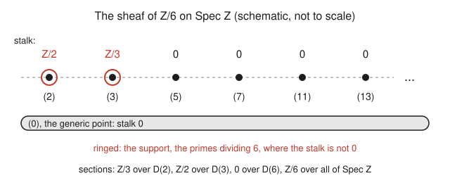

# Quasi-coherent sheaves: modules spread over a scheme, and the line bundles O(d) as shifted graded modules

[Syllabus](../../../SYLLABUS.md) → [Algebraic geometry](../README.md) → [Schemes and Modern Language](../README.md#s06) → Quasi-coherent sheaves

---

## General Overview

Take the six-hour clock ℤ/6: the numbers 0 to 5, added and multiplied with wrap-around at 6. It is a module over the whole numbers ℤ: a set that adds and is multiplied by whole numbers ([Modules](05-modules-and-the-structure-theorem.md)).

[The spectrum of a ring](02-spectrum-of-a-ring-and-schemes.md) turns ℤ into a space, Spec ℤ: one point for each prime, plus the generic point (0). Ask what the clock looks like at each point. At the prime 5, allow division by every number that 5 does not divide. That includes 6, which is 0 on this clock, and dividing by 0 collapses everything: the clock becomes 0 at 5.

At 2 the clock becomes the two-hour clock ℤ/2. At 3 it becomes ℤ/3. Everywhere else it becomes 0. So one module has become data spread over a space, nonzero at exactly two points. That spread-out module is a sheaf, written $`\widetilde{M}`$ ("M tilde").

The same move works on the projective line. Polynomials in x and y, sorted by degree and shifted by d, give the sheaf 𝒪(d). For d = 2 it has 3 global sections, the forms $`x^2`$, $`xy`$ and $`y^2`$. The polynomials that vanish at the point $`(1 : 2)`$ give the sheaf 𝒪(−1).

**A module over a ring becomes a sheaf on the ring's spectrum by putting the module's fractions over each open set; sheaves that look like this on every affine piece are quasi-coherent, coherent when the modules are finitely generated, and vector bundles when they are locally free; on the projective line the degree-shifted module S(d) gives the line bundle 𝒪(d), with d + 1 global sections, and the ideal of a point gives 𝒪(−1).**

**What kind of fact this is:** definitions (the sheaf of a module, quasi-coherent, coherent, locally free, the twist 𝒪(d)), and theorems proved on this card in Why it works: the sheaf of a module has the fractions as sections and the localised module as stalks; 𝒪(d) on the projective line has d + 1 global sections for d ≥ 0 and none below; the ideal sheaf of a point is 𝒪(−1). That every quasi-coherent sheaf on an affine scheme or on projective space comes from a module is stated with sources.

<p align="center"></p>

The figure is schematic, not to scale. Each dot is a closed point, one per prime. The ringed points are the support: the only points where the stalk is not 0.

---

## The formula

Notation first, in words. [Localisation](03-localisation-and-local-rings.md) builds fractions $`\tfrac{m}{s}`$, with bottoms s from a chosen set S, equal when $`u\,(s' m - s m') = 0`$ for some u in S. The same rule works with tops m from a module.

- R is a commutative ring with 1, and M is a module over it. Here R = ℤ and M = ℤ/6.
- $`M_f`$ is M with powers of f allowed as bottoms. $`M_{\mathfrak{p}}`$ is M with everything outside the prime ideal $`\mathfrak{p}`$ allowed as bottoms.
- D(f) is the open set of Spec R where f is not zero, as in [The spectrum of a ring](02-spectrum-of-a-ring-and-schemes.md).
- The **stalk** of a sheaf at a point is its data near that point: two sections count as equal there when they agree on some open set around the point.

The new construction, introduced on this card, is the **sheaf of a module**, $`\widetilde{M}`$:

```math
\widetilde{M}\big(D(f)\big) = M_f, \qquad \widetilde{M}_{\mathfrak{p}} = M_{\mathfrak{p}}, \qquad \Gamma\big(\mathrm{Spec}\, R, \widetilde{M}\big) = M
```

**Read it aloud:** over the open set where f is not zero, the sections are the fractions of M with powers of f below; the stalk at a prime is M localised at that prime; and over the whole space the sections are M itself.

For the clock: the sections over D(2) are ℤ/3, the stalk at (2) is ℤ/2, and the global sections are ℤ/6.

Now the three kinds of sheaf. All are **sheaves of modules**: on each open set U, the sections form a module over the functions $`\mathcal{O}(U)`$, and restriction respects that.

- **Quasi-coherent**: the space is covered by affine pieces $`\mathrm{Spec}\, R_i`$ (spectra of rings), and on each piece the sheaf is $`\widetilde{M_i}`$ for some module $`M_i`$.
- **Coherent**: quasi-coherent, with each $`R_i`$ Noetherian (every ideal has finitely many generators) and each $`M_i`$ finitely generated.
- **Locally free of rank r**, or a **vector bundle**: on each piece the sheaf is $`\mathcal{O}^r`$, r free copies of the functions. Rank 1 is a **line bundle**, as in [Line bundles and divisors](../05-Cohomology%20and%20the%20Hodge%20Conjecture/06-line-bundles-and-divisor-classes.md).

The **fibre** at a point $`\mathfrak{p}`$ is $`M_{\mathfrak{p}} \otimes k(\mathfrak{p})`$, with $`\otimes`$ the product of [Tensor products](../../03-Algebra/11-Duals%2C%20Quotients%20and%20Tensors/03-tensor-products.md). It is a vector space over the **residue field** $`k(\mathfrak{p})`$, the field of values at the point: $`\mathbb{F}_p`$ at (p), where the fibre is M/pM, and ℚ at (0). A vector bundle of rank r has a fibre of dimension r everywhere.

On projective space the modules are **graded**: sorted by degree. $`S = \mathbb{Q}[x, y]`$, and $`S_n`$ is the forms of degree n. [Proj](10-proj-of-a-graded-ring.md) builds $`\mathbb{P}^1 = \mathrm{Proj}\, S`$ from the charts $`D_+(x)`$ and $`D_+(y)`$, where x or y is not zero. From here on S means this polynomial ring, not a set of bottoms. The **shifted module** S(d) is S with every degree moved down by d:

```math
S(d)_n = S_{d+n}, \qquad \mathcal{O}(d) = \widetilde{S(d)}, \qquad \mathcal{O}(d)\big(D_+(x)\big) = x^d\, \mathbb{Q}[t], \qquad \Gamma\big(\mathbb{P}^1, \mathcal{O}(d)\big) = S_d
```

**Read it aloud:** the degree-n part of S(d) is the degree d + n part of S; its sheaf is 𝒪(d); on the chart where x is not zero its sections are x to the d times polynomials in t = y/x; and its global sections are the forms of degree d.

The ideal sheaf of the point $`P = (1 : 2)`$, where the line $`2x - y`$ vanishes:

```math
\mathcal{I}_P = \widetilde{(2x - y)} \cong \widetilde{S(-1)} = \mathcal{O}(-1), \qquad \dim \Gamma\big(\mathbb{P}^1, \mathcal{O}(d)\big) = \max(d + 1,\ 0)
```

**Read it aloud:** the sheaf of functions vanishing at P comes from the ideal of 2x − y, which is S shifted by minus one, so it is 𝒪(−1); and 𝒪(d) has d + 1 independent global sections when d is at least 0, and none below.

| Symbol | Plain meaning | In our example | Push it up and the answer… |
| --- | --- | --- | --- |
| $`R`$, $`M`$, $`m`$, $`s`$, $`S`$, $`u`$, $`k`$ | ring; module; top; bottom; the set of allowed bottoms (later S is the polynomial ring); extra factor; an exponent | ℤ; ℤ/6 | — |
| $`f`$, $`M_f`$, $`M_{\mathfrak{p}}`$, $`v`$ | an element of R; M localised at f; at $`\mathfrak{p}`$; how many times p divides n in ℤ/n | ℤ/3 for f = 2; ℤ/2 at (2) | more bottoms, less survives |
| Spec R, D(f), $`\mathfrak{p}`$, (p), (0) | the space of prime ideals; where f is not zero; a prime ideal; the point of p; the generic point | D(2): all but (2) | — |
| $`\widetilde{M}`$, $`\Gamma`$ | the sheaf of a module; global sections | ℤ/6 over all of Spec ℤ | — |
| $`\mathcal{O}`$, $`\mathcal{O}^r`$, $`r`$ | the structure sheaf; r free copies; the rank | the sheaf of ℤ, rank 1 | — |
| $`k(\mathfrak{p})`$, $`\otimes`$ | residue field; tensor product | $`\mathbb{F}_2`$ at (2), ℚ at (0) | — |
| $`S`$, $`S_n`$, $`n`$, S(d) | polynomials in x, y; forms of degree n; a degree; S shifted by d | $`S(-1)_1 = S_0`$ | — |
| $`\mathbb{P}^1`$, $`D_+(x)`$, $`D_+(y)`$, $`t`$, $`s`$ | the projective line; its two charts; their coordinates y/x and x/y (this s is not a bottom) | P has t = 2, s = 1/2 | — |
| 𝒪(d), $`d`$ | the twist; the twist number | d = 2: 3 sections | one more section per step |
| $`f`$, $`g`$, $`a`$, $`b`$ | sections on the two charts (this f is not the f of D(f)) | $`f = 1 + 4t + t^2`$ | — |
| $`P`$, $`\ell`$, $`\mathcal{I}_P`$ | a point; the line through it; the functions vanishing at P | (1 : 2); 2x − y | — |
| $`\mathbb{F}_3`$, ℚ | whole numbers mod 3; the rationals, the field throughout | brute force; the charts | — |

### When it holds

- **The sheaf must come from a module on every affine piece.** Keep the sections of 𝒪 over open sets that miss (2), and put 0 over every open set that contains (2). This sheaf has global sections 0, but its stalk at (3) is $`\mathbb{Z}_{(3)}`$, fractions with bottoms prime to 3. A quasi-coherent sheaf on Spec ℤ with no global sections is 0, so this one is not quasi-coherent.
- **Coherent needs finitely many generators.** ℚ gives a quasi-coherent sheaf on Spec ℤ that is not coherent: finitely many fractions share a bottom D, and 1/(2D) is not built from them.
- **Locally free needs one fibre dimension everywhere.** The clock's fibre has dimension 1 at (2) and 0 at (5): coherent, not a vector bundle.
- **The graded ring must be generated in degree 1.** Then every 𝒪(d) is a line bundle. With a generator of degree 2, the sheaf of S(1) need not be locally free; Hartshorne's Section II.5 assumes degree-1 generators.
- **Any field.** The proofs compare coefficients, so d + 1 holds over $`\mathbb{F}_3`$ too, where the code counts by brute force.

---

## Why it works

### Step 0: a module already knows its local pieces

On D(f), f is not zero, so f may be divided by: that is localisation. So a module gives a module $`M_f`$ on each basic open set, with no choices. The work is to show that the pieces glue. The gluing comes from one identity, $`1 = a_1 f_1 + a_2 f_2`$, when $`D(f_1)`$ and $`D(f_2)`$ cover the space.

### Step 1: sections on basic open sets, and stalks

When D(g) lies inside D(f), f is invertible on D(g), so each fraction $`m/f^k`$ can be read in $`M_g`$. That reading is the restriction map.

For a finite module the fractions are easy. If some bottom s kills m (that is, $`sm = 0`$), then $`m/1 = 0`$: take $`u = s`$ in the fraction rule. The rest survives, and each bottom acts invertibly on it. So $`M_S`$ is M with the part killed by some bottom removed.

| Open set or point | Bottoms allowed (mod 6) | Killed | Sections or stalk |
| --- | --- | --- | --- |
| D(2) | powers of 2: 1, 2, 4 | 0, 3 | ℤ/3 |
| D(3) | powers of 3: 1, 3 | 0, 2, 4 | ℤ/2 |
| D(6) | powers of 6: 0, 1 | everything | 0 |
| stalk at (2) | odd numbers: 1, 3, 5 | 0, 2, 4 | ℤ/2 |
| stalk at (3) | not multiples of 3: 1, 2, 4, 5 | 0, 3 | ℤ/3 |
| stalk at (5), (7), … | includes 6, which is 0 mod 6 | everything | 0 |
| stalk at (0) | every nonzero number, including 6 | everything | 0 |

The stalk at $`\mathfrak{p}`$ collects the sections over every D(f) around it, and each such f lies outside $`\mathfrak{p}`$. Allowing all of them as bottoms gives $`M_{\mathfrak{p}}`$. In general the stalk of ℤ/n at (p) is $`\mathbb{Z}/p^v`$, where p divides n exactly v times.

### Step 2: the pieces glue

D(2) and D(3) cover Spec ℤ, since no prime ideal holds both 2 and 3: $`1 = (-1) \cdot 2 + 1 \cdot 3`$. Their overlap D(6) has only the section 0, so any section on D(2) and any on D(3) agree there. By the sheaf rule they glue to exactly one global section.

That is the Chinese remainder theorem. A pair (a in ℤ/3, b in ℤ/2) glues to $`m = a \cdot (-2) + b \cdot 3`$ mod 6, since −2 and 3, the two pieces of the identity, are each 1 on one open set and 0 on the other. For a = 2, b = 1: m = −4 + 3 = 5, which is 2 mod 3 and 1 mod 2. All 6 pairs are reached once each, so the global sections are ℤ/6.

<details>
<summary>Detailed proof: the sections over D(f) glue, for any module over any ring</summary>

Take open sets $`D(f_1), \dots, D(f_n)`$ that cover Spec R. No prime ideal holds all the $`f_i`$, so the ideal they generate is all of R, and $`1 = \sum a_i f_i`$. Raising to a high power shows the same for any powers: $`1 = \sum b_i f_i^k`$ for some $`b_i`$.

One section, not two. Suppose m in M is 0 in every $`M_{f_i}`$. Then $`f_i^k m = 0`$ for some k, the same for all i. So

$`\displaystyle m = \Big(\sum_i b_i f_i^k\Big) m = \sum_i b_i\, (f_i^k m) = 0.`$

Existence. Suppose sections $`m_i / f_i^k`$ on $`D(f_i)`$ agree on every overlap $`D(f_i f_j)`$. Agreement means $`(f_i f_j)^N (f_j^k m_i - f_i^k m_j) = 0`$ for a large N. Replace $`m_i`$ by $`f_i^N m_i`$ and k by $`k + N`$; now $`f_j^k m_i = f_i^k m_j`$ exactly. Take $`1 = \sum b_j f_j^k`$ and set

$`\displaystyle m = \sum_j b_j\, m_j.`$

Then $`f_i^k m = \sum_j b_j f_i^k m_j = \sum_j b_j f_j^k m_i = m_i`$, so m restricts to $`m_i / f_i^k`$ on each $`D(f_i)`$. The same argument on $`\mathrm{Spec}\, R_f`$ handles a cover of any D(f), so $`\widetilde{M}`$ is a sheaf with $`\widetilde{M}(D(f)) = M_f`$. Hartshorne, Proposition II.5.1, gives the full statement.

</details>

The converse is stated here with its source. On Spec R every quasi-coherent sheaf is $`\widetilde{M}`$ for one module M, its global sections; for Noetherian R, the coherent ones are those with M finitely generated (Hartshorne, Corollary II.5.5). On an affine scheme, a quasi-coherent sheaf and a module carry the same information.

### Step 3: three sizes of niceness

The three kinds of sheaf nest inside each other. Each smaller kind adds one condition.

| Kind | Local form | Example on Spec ℤ | What fails one level down |
| --- | --- | --- | --- |
| quasi-coherent | $`\widetilde{M}`$, M any module | $`\widetilde{\mathbb{Q}}`$ | ℚ is not finitely generated |
| coherent | M finitely generated | $`\widetilde{\mathbb{Z}/6}`$ | fibre dimension jumps from 1 to 0 |
| locally free of rank r | $`\mathcal{O}^r`$ | $`\widetilde{\mathbb{Z}} = \mathcal{O}`$, rank 1 | — |

The test for "locally free" is the fibre. A free module $`R_f^r`$ has a fibre of dimension r at every point of D(f). The clock's fibre M/pM has dimension 1 at (2) and (3), and 0 at (5), (7), (11) and (13). At (0) it is $`(\mathbb{Z}/6) \otimes \mathbb{Q} = 0`$.

Spec ℤ is in one piece, so a vector bundle has one rank everywhere, and the jump from 1 to 0 rules it out. Directly: the stalk ℤ/2 at (2) has 2 elements, while a free module over $`\mathbb{Z}_{(2)}`$ is 0 or infinite.

### Step 4: graded modules make sheaves on projective space

[Proj](10-proj-of-a-graded-ring.md) puts the degree-zero fractions of S on each chart. The same recipe works for a graded module: on $`D_+(x)`$, take the fractions $`F/x^n`$ with $`F`$ of degree n in the module.

Apply it to S(d). An element of degree n in S(d) is a form of degree $`d + n`$. So the sections on $`D_+(x)`$ are $`F/x^n`$ with $`\deg F = d + n`$. Factor out $`x^d`$:

```math
\frac{F}{x^n} = x^d \cdot \frac{F}{x^{d+n}} = x^d \, f(t), \qquad t = \frac{y}{x}
```

**Read it aloud:** a section on the x-chart is x to the d times a polynomial in t, because F over x to its own degree is a polynomial in y over x.

Likewise, on $`D_+(y)`$ a section is $`y^d g(s)`$ with $`s = x/y`$. Dividing by $`x^d`$, or by $`y^d`$, matches the sections with the ordinary functions $`\mathbb{Q}[t]`$, or $`\mathbb{Q}[s]`$. So 𝒪(d) is one copy of $`\mathcal{O}`$ on each chart: a line bundle.

### Step 5: the gluing rule, and d + 1 global sections

A global section is a pair that agrees on the overlap: $`x^d f(t) = y^d g(s)`$. Divide by $`x^d`$ and use $`y/x = t`$, $`s = 1/t`$:

```math
f(t) = t^d \, g(1/t)
```

**Read it aloud:** the polynomial on the t-chart equals t to the d times the polynomial on the s-chart, read in t.

This is the gluing rule that [Sheaves](../05-Cohomology%20and%20the%20Hodge%20Conjecture/01-sheaves-in-outline.md) used to define its twisted sheaves. Here it is derived from S(d), so the two definitions agree.

The right side uses only the powers $`t^d, t^{d-1}, \dots`$; the left uses only $`t^0, t^1, \dots`$. They can share only the powers from 0 to d. So f is any polynomial of degree at most d, and g is fixed by f: d + 1 free coefficients for d ≥ 0, none for d < 0. Each such pair is one form of degree d, $`x^d f(y/x)`$. So $`\Gamma(\mathbb{P}^1, \mathcal{O}(d)) = S_d`$.

For d = 2, the form $`x^2 + 4xy + y^2`$ reads $`1 + 4t + t^2`$ on the t-chart and $`s^2 + 4s + 1`$ on the s-chart. Then $`t^2(1/t^2 + 4/t + 1) = 1 + 4t + t^2`$: the pair glues.

The code also finds this count as the kernel of the gluing map, and by testing all 729 pairs (f, g) of degree at most 2 over $`\mathbb{F}_3`$: $`3^{d+1}`$ of them glue for d from 0 to 2, and only the zero pair for d = −1 and d = −2.

### Step 6: the ideal of a point is 𝒪(−1)

The forms that vanish at $`P = (1 : 2)`$ are the multiples of $`\ell = 2x - y`$. The code puts P back into $`\ell`$ and into each of its multiples up to degree 5 and gets 0 every time. In each degree n from 0 to 5 it finds both spaces of dimension n, so they are the same space.

Multiplication by $`\ell`$ sends a form of degree $`n - 1`$ to one of degree n, and loses nothing. So it matches $`S(-1)_n = S_{n-1}`$ with $`(\ell)_n`$, degree by degree. So $`(\ell) \cong S(-1)`$ as graded modules, and their sheaves agree: $`\mathcal{I}_P \cong \mathcal{O}(-1)`$.

The same answer comes out on the charts. On the t-chart, P is $`t = 2`$, and its ideal is generated by $`\ell/x = 2 - t`$. On the s-chart, P is $`s = 1/2`$, with generator $`\ell/y = 2s - 1`$. A section of $`\mathcal{I}_P`$ is $`(2 - t)\, a(t)`$ on one chart and $`(2s - 1)\, b(s)`$ on the other. On the overlap $`2s - 1 = t^{-1}(2 - t)`$, so

```math
(2 - t)\, a(t) = t^{-1} (2 - t)\, b(1/t) \quad \Longrightarrow \quad a(t) = t^{-1} b(1/t)
```

**Read it aloud:** cancel the common factor 2 − t, and what is left is the gluing rule of 𝒪(d) with d = −1.

So $`\mathcal{I}_P`$ has no global sections. Twisting adds to the shift, since $`S(-1) \otimes_S S(d) = S(d - 1)`$ (Hartshorne, Proposition II.5.12). So $`\mathcal{I}_P \otimes \mathcal{O}(d)`$ has d global sections: the degree-d forms vanishing at P. Over $`\mathbb{F}_3`$ the code counts $`3^d`$ of them, for d from 0 to 3.

On projective space too, every quasi-coherent sheaf comes from a graded module (Hartshorne, Proposition II.5.15).

---

## Worked numbers, by hand

| Step | Arithmetic | Value |
| --- | --- | --- |
| stalk at (2) | odd bottoms kill 0, 2, 4; 6 ÷ 3 | ℤ/2 |
| stalk at (3) | bottoms 1, 2, 4, 5 kill 0, 3; 6 ÷ 2 | ℤ/3 |
| stalk at (5) and (0) | 6 is a bottom, and 6 is 0 | 0 |
| sections over D(2), D(3), D(6) | kill 0, 3; kill 0, 2, 4; kill all | ℤ/3, ℤ/2, 0 |
| the cover | $`(-1) \cdot 2 + 1 \cdot 3`$ | 1 |
| glue 2 in ℤ/3 with 1 in ℤ/2 | $`2 \cdot (-2) + 1 \cdot 3`$ | 5 mod 6 |
| fibre dimensions at (2), (3), (5) | $`(\mathbb{Z}/6)/p(\mathbb{Z}/6)`$ has 2, 3, 1 elements | 1, 1, 0 |
| global sections of 𝒪(2) | $`x^2`$, $`xy`$, $`y^2`$ | 3 |
| global sections of 𝒪(−1) and 𝒪(−2) | no monomials of negative degree | 0 |
| forms of degree 3 vanishing at $`(1 : 2)`$ | 4 coefficients, 1 condition | 3 |
| global sections of $`\mathcal{I}_P`$ | constants that vanish at P | **0, as for 𝒪(−1)** |

The clock lives only at 2 and 3, and the functions vanishing at one point of the line behave exactly like 𝒪(−1): no global sections, and one fewer section than 𝒪(d) after each twist.

### What breaks if you drop a piece

| Mistake | Comes out at | What went wrong |
| --- | --- | --- |
| Reading the generic stalk as M itself | 6 elements, not 1 | at (0) every nonzero number is a bottom, including 6, which kills the clock |
| Calling $`\widetilde{\mathbb{Z}/6}`$ a vector bundle | fibre dimensions 1, 1, 0, 0, 0, 0 | a vector bundle on Spec ℤ has one rank everywhere |
| Shifting the wrong way, $`S(d)_n = S_{n-d}`$ | 0 global sections for d = 2, not 3 | that is 𝒪(−2) |
| Reading the ideal sheaf as 𝒪(1) | 2 global sections, against 0 | multiplication by $`\ell`$ raises degree by 1, so the ideal is S shifted down |

The code prints all four.

---

## Code, from first principles, and it actually runs

Nothing is imported, and every number is an exact integer. Three roads lead to each stalk: sorting every fraction (m, s) into classes by the rule with u, counting what the bottoms kill, and the p-part formula. The gluing is checked by the Chinese remainder map. Three roads count the sections of 𝒪(d): monomials, the kernel of the gluing map by exact elimination, and brute force over $`\mathbb{F}_3`$. Last, P is put back into 2x − y and its multiples, the ideal of 2x − y is compared with S(−1) degree by degree, and forms vanishing at P are counted over $`\mathbb{F}_3`$.

### Python

```python
# Quasi-coherent and coherent sheaves -- the check behind the card.  Nothing is
# imported; every number is an exact integer.  Part 1: the module M = Z/6 over
# R = Z, spread over Spec Z as the sheaf M~.  Part 2: O(d) on the projective
# line P^1 over Q, built from the shifted graded module S(d), S = Q[x, y].
# Part 3: the ideal sheaf of the point P = (1 : 2) is O(-1).
# Roads: fractions m/s sorted into classes by brute force, against a count of
# what the denominators kill and the Chinese remainder gluing; d + 1 monomials
# against the rank of the gluing map and a count of glued pairs over F_3; the
# ideal's dimensions against S(-1), and forms vanishing at P counted over F_3.
N, PRIMES = 6, [2, 3, 5, 7, 11, 13]
NAME = lambda c: "0" if c == 1 else f"Z/{c}"   # the stalks here are cyclic

def classes(S):            # road one: sort pairs (m, s) by u (m t - m' s) = 0 in Z/6
    reps = []
    for m in range(N):
        for s in S:
            if not any(any(u * (m * t - m2 * s) % N == 0 for u in S) for m2, t in reps):
                reps.append((m, s))
    return len(reps)

def kept(S):               # road two: M_S = M / (what some s kills); count that kernel
    killed = sum(1 for m in range(N) if any(s * m % N == 0 for s in S))
    return N // killed

def p_part(p):             # road three: p to the number of times p divides N
    n, out = N, 1
    while n % p == 0:
        n, out = n // p, out * p
    return out

away = lambda p: sorted({n % N for n in range(1, N * p + 1) if n % p})   # denominators outside (p), mod 6
powers = lambda f: sorted({f ** k % N for k in range(N)})                # powers of f, mod 6
everything = sorted({n % N for n in range(1, N + 1)})                    # all nonzero n: the generic point
stalk = {p: (classes(away(p)), kept(away(p)), p_part(p)) for p in PRIMES}
gen = (classes(everything), kept(everything))
print(f"R = Z, M = Z/{N}; the stalk of M~ at a prime (p) is M_(p): fractions m/s with p not dividing s")
for p in PRIMES:
    c, k, q = stalk[p]
    print(f"stalk at ({p}): classes {c}, M/kernel {k}, p-part {q}: {NAME(c)}")
print(f"stalk at (0), the generic point: classes {gen[0]}, M/kernel {gen[1]}: 0, since {N} is inverted there")
for label, S in [("D(2)", powers(2)), ("D(3)", powers(3)), ("D(6)", powers(6)), ("(2)", away(2)), ("(3)", away(3)),
                 ("(5)", away(5)), ("(0)", everything)]:
    print(f"{label}: bottoms mod {N} {S}, killed {[m for m in range(N) if any(s * m % N == 0 for s in S)]}")
sec = {f: classes(powers(f)) for f in (1, 2, 3, 6)}
print(f"sections over D(2), D(3), D(6), Spec Z: {NAME(sec[2])}, {NAME(sec[3])}, {NAME(sec[6])}, {NAME(sec[1])}")
a, b = next((a, b) for a in range(-3, 4) for b in range(-3, 4) if 2 * a + 3 * b == 1)
glue = {(m % 3, m % 2) for m in range(N)}
print(f"D(2) and D(3) cover Spec Z, since 1 = {a}*2 + ({b})*3; Z/6 -> Z/3 x Z/2 hits {len(glue)} of 6 pairs")
m5 = (2 * (a * 2) + 1 * (b * 3)) % N
print(f"glue 2 in Z/3 with 1 in Z/2: m = 2*({a * 2}) + 1*{b * 3} = {m5} mod 6; {m5} mod 3 = {m5 % 3}, {m5} mod 2 = {m5 % 2}")

def laurent(f, g, d):      # f(t) - t^d g(1/t), as a map from powers to coefficients
    out = {}
    for i, c in enumerate(f):
        out[i] = out.get(i, 0) + c
    for j, c in enumerate(g):
        out[d - j] = out.get(d - j, 0) - c
    return {k: v for k, v in out.items() if v}

def rank(rows):            # exact elimination over Q, kept in whole numbers
    rows, r = [row[:] for row in rows], 0
    for col in range(len(rows[0]) if rows else 0):
        piv = next((i for i in range(r, len(rows)) if rows[i][col]), None)
        if piv is None:
            continue
        rows[r], rows[piv] = rows[piv], rows[r]
        for i in range(len(rows)):
            if i != r and rows[i][col]:
                rows[i] = [rows[r][col] * x - rows[i][col] * y for x, y in zip(rows[i], rows[r])]
        r += 1
    return r

fib = [len({m % N for m in range(N)}) // len({p * m % N for m in range(N)}) for p in PRIMES]
dims = [next(e for e in range(6) if p ** e == s) for p, s in zip(PRIMES, fib)]
gdim = 1 - rank([[N]])     # at (0): M = Z/6 has one generator and one relation, 6; over Q that relation has rank 1
print(f"M/pM has {', '.join(map(str, fib))} elements, so the fibre dimension of M ⊗ k(p) at (2), (3), (5), (7), (11), (13)"
      f" is {', '.join(map(str, dims))}; at (0): {gdim}")

def glued_rank(d, deg=6):  # road two: kernel of (f, g) -> f(t) - t^d g(1/t), degrees at most 6
    powers_seen = range(d - deg, deg + 1)
    cols = [laurent([int(i == k) for i in range(deg + 1)], [], d) for k in range(deg + 1)] + \
           [laurent([], [int(j == k) for j in range(deg + 1)], d) for k in range(deg + 1)]
    return 2 * (deg + 1) - rank([[c.get(e, 0) for c in cols] for e in powers_seen])

def glued_f3(d):           # road three: every pair (f, g) over F_3 of degree at most 2
    vecs = [(i % 3, i // 3 % 3, i // 9) for i in range(27)]
    return sum(1 for f in vecs for g in vecs if all(v % 3 == 0 for v in laurent(f, g, d).values()))

monomials = lambda d: sum(1 for i in range(d + 1) for j in range(d + 1) if i + j == d)
print("P^1 = Proj Q[x, y]; O(d) = S(d)~ with S(d)_n = S_(d+n); charts t = y/x and s = x/y")
counts = {d: (monomials(d), glued_rank(d), glued_f3(d)) for d in range(-2, 3)}
for d, (m, r, c) in counts.items():
    print(f"d = {d}: monomials of degree d {m}, kernel of the gluing map {r}, glued pairs over F_3 (of 729) {c}")
form = [1, 4, 1]                         # x^2 + 4xy + y^2, coefficient of x^(2-i) y^i
f, g = form, form[::-1]
print(f"x^2 + 4xy + y^2 over x^2 is 1 + 4t + t^2, over y^2 is s^2 + 4s + 1; f - t^2 g(1/t) = {laurent(f, g, 2) or 0}")
print(f"wrong shift S(d)_n = S_(n-d): degree-0 part of S(-2) has {monomials(-2)} monomials, not {monomials(2)}")
PT, L = (1, 2), [2, -1]                  # the point P = (1 : 2), and the line 2x - y through it: coefficients of x and y
at_P = lambda c: sum(a * PT[0] ** (len(c) - 1 - i) * PT[1] ** i for i, a in enumerate(c))   # form, x^(n-i) y^i, at P
mult = lambda n: [[sum(L[k] for k in range(2) if i + k == j) for j in range(n + 1)] for i in range(n)]
ideal_dims = [rank(mult(n)) if n else 0 for n in range(6)]
vanish = [n + 1 - rank([[PT[0] ** (n - i) * PT[1] ** i for i in range(n + 1)]]) for n in range(6)]
on_P = all(at_P(row) == 0 for n in range(1, 6) for row in mult(n))     # put P back into every multiple of the line
print(f"2x - y at P: {at_P(L)}; its multiples in degrees 1 to 5 vanish at P: {'yes' if on_P else 'no'}")
print(f"dimension of (2x - y) in degrees 0 to 5: {ideal_dims}; of S(-1): {[monomials(n - 1) for n in range(6)]}")
print(f"degree-n forms vanishing at P, n = 0 to 5: {vanish}")
f3 = [sum(1 for i in range(3 ** (n + 1)) if at_P([i // 3 ** k % 3 for k in range(n + 1)]) % 3 == 0) for n in range(4)]
print(f"over F_3, forms of degree 0 to 3 vanishing at (1 : 2): {f3}")
local = laurent(L, L[::-1], 1) == {}     # the line over x is 2 - t, over y is 2s - 1; they differ by the factor t
print(f"local generators: 2 - t on t-chart, 2s - 1 on s-chart; 2 - t = t * (2/t - 1): "
      f"{'yes' if local else 'no'}, so a(t) = t^-1 b(1/t), the rule for d = -1")
print(f"global sections: ideal sheaf {vanish[0]}, O(-1) {counts[-1][0]}, O(1) {counts[1][0]}")
print(f"mistake, generic stalk read as M: {N} elements, against {gen[0]}")
print(f"figure, schematic Spec Z: dots at x = {', '.join(str(70 + 90 * i) for i in range(6))}; "
      f"stalk sizes {', '.join(str(stalk[p][0]) for p in PRIMES)}; generic {gen[0]}")
assert all(c == k == q for c, k, q in stalk.values()) and gen == (1, 1)   # three roads to every stalk
assert (sec[2], sec[3], sec[6], sec[1]) == (3, 2, 1, 6) and len(glue) == 6 and sec[2] * sec[3] == N and (m5 % 3, m5 % 2) == (2, 1)
assert dims == [1, 1, 0, 0, 0, 0] and gdim == 0                           # fibre dimension jumps
assert all(m == r and c == 3 ** r for m, r, c in counts.values())          # monomials = rank = F_3 count
assert [m for m, _, _ in counts.values()] == [0, 0, 1, 2, 3] and laurent(f, g, 2) == {}
assert at_P(L) == 0 and on_P and local                                    # P lies on the line; its local generators glue
assert ideal_dims == vanish == [monomials(n - 1) for n in range(6)] and f3 == [3 ** n for n in range(4)]
print("ALL CHECKS PASS")
```

**Ran 2026-11-24 on macOS, Python 3.14.10, standard library only. All checks passed. Output, pasted from the run:**

```
R = Z, M = Z/6; the stalk of M~ at a prime (p) is M_(p): fractions m/s with p not dividing s
stalk at (2): classes 2, M/kernel 2, p-part 2: Z/2
stalk at (3): classes 3, M/kernel 3, p-part 3: Z/3
stalk at (5): classes 1, M/kernel 1, p-part 1: 0
stalk at (7): classes 1, M/kernel 1, p-part 1: 0
stalk at (11): classes 1, M/kernel 1, p-part 1: 0
stalk at (13): classes 1, M/kernel 1, p-part 1: 0
stalk at (0), the generic point: classes 1, M/kernel 1: 0, since 6 is inverted there
D(2): bottoms mod 6 [1, 2, 4], killed [0, 3]
D(3): bottoms mod 6 [1, 3], killed [0, 2, 4]
D(6): bottoms mod 6 [0, 1], killed [0, 1, 2, 3, 4, 5]
(2): bottoms mod 6 [1, 3, 5], killed [0, 2, 4]
(3): bottoms mod 6 [1, 2, 4, 5], killed [0, 3]
(5): bottoms mod 6 [0, 1, 2, 3, 4, 5], killed [0, 1, 2, 3, 4, 5]
(0): bottoms mod 6 [0, 1, 2, 3, 4, 5], killed [0, 1, 2, 3, 4, 5]
sections over D(2), D(3), D(6), Spec Z: Z/3, Z/2, 0, Z/6
D(2) and D(3) cover Spec Z, since 1 = -1*2 + (1)*3; Z/6 -> Z/3 x Z/2 hits 6 of 6 pairs
glue 2 in Z/3 with 1 in Z/2: m = 2*(-2) + 1*3 = 5 mod 6; 5 mod 3 = 2, 5 mod 2 = 1
M/pM has 2, 3, 1, 1, 1, 1 elements, so the fibre dimension of M ⊗ k(p) at (2), (3), (5), (7), (11), (13) is 1, 1, 0, 0, 0, 0; at (0): 0
P^1 = Proj Q[x, y]; O(d) = S(d)~ with S(d)_n = S_(d+n); charts t = y/x and s = x/y
d = -2: monomials of degree d 0, kernel of the gluing map 0, glued pairs over F_3 (of 729) 1
d = -1: monomials of degree d 0, kernel of the gluing map 0, glued pairs over F_3 (of 729) 1
d = 0: monomials of degree d 1, kernel of the gluing map 1, glued pairs over F_3 (of 729) 3
d = 1: monomials of degree d 2, kernel of the gluing map 2, glued pairs over F_3 (of 729) 9
d = 2: monomials of degree d 3, kernel of the gluing map 3, glued pairs over F_3 (of 729) 27
x^2 + 4xy + y^2 over x^2 is 1 + 4t + t^2, over y^2 is s^2 + 4s + 1; f - t^2 g(1/t) = 0
wrong shift S(d)_n = S_(n-d): degree-0 part of S(-2) has 0 monomials, not 3
2x - y at P: 0; its multiples in degrees 1 to 5 vanish at P: yes
dimension of (2x - y) in degrees 0 to 5: [0, 1, 2, 3, 4, 5]; of S(-1): [0, 1, 2, 3, 4, 5]
degree-n forms vanishing at P, n = 0 to 5: [0, 1, 2, 3, 4, 5]
over F_3, forms of degree 0 to 3 vanishing at (1 : 2): [1, 3, 9, 27]
local generators: 2 - t on t-chart, 2s - 1 on s-chart; 2 - t = t * (2/t - 1): yes, so a(t) = t^-1 b(1/t), the rule for d = -1
global sections: ideal sheaf 0, O(-1) 0, O(1) 2
mistake, generic stalk read as M: 6 elements, against 1
figure, schematic Spec Z: dots at x = 70, 160, 250, 340, 430, 520; stalk sizes 2, 3, 1, 1, 1, 1; generic 1
ALL CHECKS PASS
```

### Rust

Same numbers, same labels, built with `rustc --edition 2021 -O`.

```rust
// Quasi-coherent and coherent sheaves -- the same check as the Python, in Rust.
// No crates; every number is an exact integer.  Part 1: the module M = Z/6
// over R = Z, spread over Spec Z as the sheaf M~.  Part 2: O(d) on the
// projective line P^1 over Q, built from the shifted graded module S(d),
// S = Q[x, y].  Part 3: the ideal sheaf of the point P = (1 : 2) is O(-1).
// Roads: fractions m/s sorted into classes by brute force, against a count of
// what the denominators kill and the Chinese remainder gluing; d + 1 monomials
// against the rank of the gluing map and a count of glued pairs over F_3; the
// ideal's dimensions against S(-1), and forms vanishing at P counted over F_3.
use std::collections::{BTreeMap, BTreeSet};

const N: i64 = 6;
const PRIMES: [i64; 6] = [2, 3, 5, 7, 11, 13];

fn name(c: i64) -> String { if c == 1 { "0".to_string() } else { format!("Z/{}", c) } }   // the stalks here are cyclic

fn classes(s_set: &[i64]) -> i64 {       // road one: sort pairs (m, s) by u (m t - m' s) = 0 in Z/6
    let mut reps: Vec<(i64, i64)> = Vec::new();
    for m in 0..N { for &s in s_set {
        if !reps.iter().any(|&(m2, t)| s_set.iter().any(|&u| (u * (m * t - m2 * s)).rem_euclid(N) == 0)) {
            reps.push((m, s));
        }
    } }
    reps.len() as i64
}

fn kept(s_set: &[i64]) -> i64 {          // road two: M_S = M / (what some s kills); count that kernel
    N / (0..N).filter(|&m| s_set.iter().any(|&s| s * m % N == 0)).count() as i64
}

fn p_part(p: i64) -> i64 {               // road three: p to the number of times p divides N
    let (mut n, mut out) = (N, 1);
    while n % p == 0 { n /= p; out *= p }
    out
}

fn uniq(v: impl Iterator<Item = i64>) -> Vec<i64> { v.collect::<BTreeSet<i64>>().into_iter().collect() }
fn away(p: i64) -> Vec<i64> { uniq((1..=N * p).filter(|n| n % p != 0).map(|n| n % N)) }
fn powers(f: i64) -> Vec<i64> { uniq((0..N as u32).map(|k| f.pow(k) % N)) }

fn laurent(f: &[i64], g: &[i64], d: i64) -> BTreeMap<i64, i64> {  // f(t) - t^d g(1/t)
    let mut out = BTreeMap::new();
    for (i, c) in f.iter().enumerate() { *out.entry(i as i64).or_insert(0) += c }
    for (j, c) in g.iter().enumerate() { *out.entry(d - j as i64).or_insert(0) -= c }
    out.retain(|_, v| *v != 0);
    out
}

fn rank(rows: &[Vec<i64>]) -> usize {    // exact elimination over Q, kept in whole numbers
    let mut rows = rows.to_vec();
    let mut r = 0;
    let width = if rows.is_empty() { 0 } else { rows[0].len() };
    for col in 0..width {
        let Some(piv) = (r..rows.len()).find(|&i| rows[i][col] != 0) else { continue };
        rows.swap(r, piv);
        for i in 0..rows.len() {
            if i != r && rows[i][col] != 0 {
                let (a, b) = (rows[r][col], rows[i][col]);
                rows[i] = rows[i].iter().zip(&rows[r]).map(|(x, y)| a * x - b * y).collect();
            }
        }
        r += 1;
    }
    r
}

fn glued_rank(d: i64) -> usize {         // road two: kernel of (f, g) -> f(t) - t^d g(1/t), degrees at most 6
    let deg = 6;
    let unit = |k: usize| (0..=deg).map(|i| (i == k) as i64).collect::<Vec<i64>>();
    let mut cols: Vec<BTreeMap<i64, i64>> = (0..=deg).map(|k| laurent(&unit(k), &[], d)).collect();
    cols.extend((0..=deg).map(|k| laurent(&[], &unit(k), d)));
    let rows: Vec<Vec<i64>> = (d - deg as i64..=deg as i64).map(|e| cols.iter().map(|c| *c.get(&e).unwrap_or(&0)).collect()).collect();
    2 * (deg + 1) - rank(&rows)
}

fn glued_f3(d: i64) -> usize {           // road three: every pair (f, g) over F_3 of degree at most 2
    let vecs: Vec<[i64; 3]> = (0..27).map(|i| [i % 3, i / 3 % 3, i / 9]).collect();
    vecs.iter().map(|f| vecs.iter().filter(|g| laurent(f.as_slice(), g.as_slice(), d).values().all(|v| v % 3 == 0)).count()).sum()
}

fn monomials(d: i64) -> usize { (0..=d).flat_map(|i| (0..=d).map(move |j| (i, j))).filter(|&(i, j)| i + j == d).count() }

fn join(v: &[i64]) -> String { v.iter().map(|x| x.to_string()).collect::<Vec<_>>().join(", ") }

fn main() {
    let everything = uniq((1..=N).map(|n| n % N));
    let stalk: Vec<(i64, i64, i64)> = PRIMES.iter().map(|&p| (classes(&away(p)), kept(&away(p)), p_part(p))).collect();
    let gen = (classes(&everything), kept(&everything));
    println!("R = Z, M = Z/{}; the stalk of M~ at a prime (p) is M_(p): fractions m/s with p not dividing s", N);
    for (p, &(c, k, q)) in PRIMES.iter().zip(&stalk) {
        println!("stalk at ({}): classes {}, M/kernel {}, p-part {}: {}", p, c, k, q, name(c));
    }
    println!("stalk at (0), the generic point: classes {}, M/kernel {}: 0, since {} is inverted there", gen.0, gen.1, N);
    let labelled = [("D(2)", powers(2)), ("D(3)", powers(3)), ("D(6)", powers(6)), ("(2)", away(2)), ("(3)", away(3)),
                    ("(5)", away(5)), ("(0)", everything.clone())];
    for (label, s_set) in &labelled {
        let killed: Vec<i64> = (0..N).filter(|&m| s_set.iter().any(|&s| s * m % N == 0)).collect();
        println!("{}: bottoms mod {} {:?}, killed {:?}", label, N, s_set, killed);
    }
    let sec: BTreeMap<i64, i64> = [1, 2, 3, 6].iter().map(|&f| (f, classes(&powers(f)))).collect();
    println!("sections over D(2), D(3), D(6), Spec Z: {}, {}, {}, {}", name(sec[&2]), name(sec[&3]), name(sec[&6]), name(sec[&1]));
    let (a, b): (i64, i64) = (-3..4).flat_map(|a| (-3..4).map(move |b| (a, b))).find(|&(a, b)| 2 * a + 3 * b == 1).unwrap();
    let glue: BTreeSet<(i64, i64)> = (0..N).map(|m| (m % 3, m % 2)).collect();
    println!("D(2) and D(3) cover Spec Z, since 1 = {}*2 + ({})*3; Z/6 -> Z/3 x Z/2 hits {} of 6 pairs", a, b, glue.len());
    let m5 = (2 * (a * 2) + b * 3).rem_euclid(N);
    println!("glue 2 in Z/3 with 1 in Z/2: m = 2*({}) + 1*{} = {} mod 6; {} mod 3 = {}, {} mod 2 = {}", a * 2, b * 3, m5, m5, m5 % 3, m5, m5 % 2);
    let fib: Vec<i64> = PRIMES.iter().map(|&p| N / uniq((0..N).map(|m| p * m % N)).len() as i64).collect();
    let dims: Vec<i64> = PRIMES.iter().zip(&fib).map(|(&p, &size)| (0..6).find(|&e| p.pow(e as u32) == size).unwrap()).collect();
    let gdim = 1 - rank(&[vec![N]]) as i64;   // at (0): M = Z/6 has one generator and one relation, 6; over Q that relation has rank 1
    println!("M/pM has {} elements, so the fibre dimension of M ⊗ k(p) at (2), (3), (5), (7), (11), (13) is {}; at (0): {}",
             join(&fib), join(&dims), gdim);
    println!("P^1 = Proj Q[x, y]; O(d) = S(d)~ with S(d)_n = S_(d+n); charts t = y/x and s = x/y");
    let counts: Vec<(i64, usize, usize, usize)> = (-2..3).map(|d| (d, monomials(d), glued_rank(d), glued_f3(d))).collect();
    for &(d, m, r, c) in &counts {
        println!("d = {}: monomials of degree d {}, kernel of the gluing map {}, glued pairs over F_3 (of 729) {}", d, m, r, c);
    }
    let (f, g) = ([1, 4, 1], [1, 4, 1]);   // x^2 + 4xy + y^2, read on each chart
    let diff = laurent(&f, &g, 2);
    println!("x^2 + 4xy + y^2 over x^2 is 1 + 4t + t^2, over y^2 is s^2 + 4s + 1; f - t^2 g(1/t) = {}",
             if diff.is_empty() { "0".to_string() } else { format!("{:?}", diff) });
    println!("wrong shift S(d)_n = S_(n-d): degree-0 part of S(-2) has {} monomials, not {}", monomials(-2), monomials(2));
    let (pt, l) = ((1i64, 2i64), [2i64, -1]);   // the point P = (1 : 2), and the line 2x - y through it: coefficients of x and y
    let at_p = |c: &[i64]| -> i64 { c.iter().enumerate().map(|(i, &a)| a * pt.0.pow((c.len() - 1 - i) as u32) * pt.1.pow(i as u32)).sum() };
    let mult = |n: usize| -> Vec<Vec<i64>> { (0..n).map(|i| (0..=n).map(|j| (0..2).filter(|&k| i + k == j).map(|k| l[k]).sum()).collect()).collect() };
    let ideal_dims: Vec<usize> = (0..6).map(|n| if n == 0 { 0 } else { rank(&mult(n)) }).collect();
    let vanish: Vec<usize> = (0..6usize).map(|n| n + 1 - rank(&[(0..=n).map(|i| pt.0.pow((n - i) as u32) * pt.1.pow(i as u32)).collect()])).collect();
    let on_p = (1..6).all(|n| mult(n).iter().all(|row| at_p(row) == 0));   // put P back into every multiple of the line
    println!("2x - y at P: {}; its multiples in degrees 1 to 5 vanish at P: {}", at_p(&l), if on_p { "yes" } else { "no" });
    let shifted: Vec<usize> = (0..6).map(|n| monomials(n - 1)).collect();
    println!("dimension of (2x - y) in degrees 0 to 5: {:?}; of S(-1): {:?}", ideal_dims, shifted);
    println!("degree-n forms vanishing at P, n = 0 to 5: {:?}", vanish);
    let f3: Vec<usize> = (0..4u32).map(|n| (0..3i64.pow(n + 1)).filter(|i| at_p(&(0..=n).map(|k| i / 3i64.pow(k) % 3).collect::<Vec<_>>()) % 3 == 0).count()).collect();
    println!("over F_3, forms of degree 0 to 3 vanishing at (1 : 2): {:?}", f3);
    let local = laurent(&l, &[l[1], l[0]], 1).is_empty();   // the line over x is 2 - t, over y is 2s - 1; they differ by the factor t
    println!("local generators: 2 - t on t-chart, 2s - 1 on s-chart; 2 - t = t * (2/t - 1): {}, so a(t) = t^-1 b(1/t), the rule for d = -1",
             if local { "yes" } else { "no" });
    println!("global sections: ideal sheaf {}, O(-1) {}, O(1) {}", vanish[0], counts[1].1, counts[3].1);
    println!("mistake, generic stalk read as M: {} elements, against {}", N, gen.0);
    let xs: Vec<i64> = (0..6).map(|i| 70 + 90 * i).collect();
    let sizes: Vec<i64> = stalk.iter().map(|s| s.0).collect();
    println!("figure, schematic Spec Z: dots at x = {}; stalk sizes {}; generic {}", join(&xs), join(&sizes), gen.0);
    assert!(stalk.iter().all(|&(c, k, q)| c == k && k == q) && gen == (1, 1));   // three roads to every stalk
    assert!((sec[&2], sec[&3], sec[&6], sec[&1]) == (3, 2, 1, 6) && glue.len() == 6 && sec[&2] * sec[&3] == N && (m5 % 3, m5 % 2) == (2, 1));
    assert!(dims == vec![1, 1, 0, 0, 0, 0] && gdim == 0);                        // fibre dimension jumps
    assert!(counts.iter().all(|&(_, m, r, c)| m == r && c == 3usize.pow(r as u32)));  // monomials = rank = F_3 count
    assert!(counts.iter().map(|c| c.1).collect::<Vec<_>>() == vec![0, 0, 1, 2, 3] && diff.is_empty());
    assert!(at_p(&l) == 0 && on_p && local);                                     // P lies on the line; its local generators glue
    assert!(ideal_dims == vanish && vanish == shifted && f3 == (0..4u32).map(|n| 3usize.pow(n)).collect::<Vec<_>>());
    println!("ALL CHECKS PASS");
}
```

**Ran 2026-11-24 on macOS, rustc 1.98.1, no crates. All checks passed. Output, pasted from the run:**

```
R = Z, M = Z/6; the stalk of M~ at a prime (p) is M_(p): fractions m/s with p not dividing s
stalk at (2): classes 2, M/kernel 2, p-part 2: Z/2
stalk at (3): classes 3, M/kernel 3, p-part 3: Z/3
stalk at (5): classes 1, M/kernel 1, p-part 1: 0
stalk at (7): classes 1, M/kernel 1, p-part 1: 0
stalk at (11): classes 1, M/kernel 1, p-part 1: 0
stalk at (13): classes 1, M/kernel 1, p-part 1: 0
stalk at (0), the generic point: classes 1, M/kernel 1: 0, since 6 is inverted there
D(2): bottoms mod 6 [1, 2, 4], killed [0, 3]
D(3): bottoms mod 6 [1, 3], killed [0, 2, 4]
D(6): bottoms mod 6 [0, 1], killed [0, 1, 2, 3, 4, 5]
(2): bottoms mod 6 [1, 3, 5], killed [0, 2, 4]
(3): bottoms mod 6 [1, 2, 4, 5], killed [0, 3]
(5): bottoms mod 6 [0, 1, 2, 3, 4, 5], killed [0, 1, 2, 3, 4, 5]
(0): bottoms mod 6 [0, 1, 2, 3, 4, 5], killed [0, 1, 2, 3, 4, 5]
sections over D(2), D(3), D(6), Spec Z: Z/3, Z/2, 0, Z/6
D(2) and D(3) cover Spec Z, since 1 = -1*2 + (1)*3; Z/6 -> Z/3 x Z/2 hits 6 of 6 pairs
glue 2 in Z/3 with 1 in Z/2: m = 2*(-2) + 1*3 = 5 mod 6; 5 mod 3 = 2, 5 mod 2 = 1
M/pM has 2, 3, 1, 1, 1, 1 elements, so the fibre dimension of M ⊗ k(p) at (2), (3), (5), (7), (11), (13) is 1, 1, 0, 0, 0, 0; at (0): 0
P^1 = Proj Q[x, y]; O(d) = S(d)~ with S(d)_n = S_(d+n); charts t = y/x and s = x/y
d = -2: monomials of degree d 0, kernel of the gluing map 0, glued pairs over F_3 (of 729) 1
d = -1: monomials of degree d 0, kernel of the gluing map 0, glued pairs over F_3 (of 729) 1
d = 0: monomials of degree d 1, kernel of the gluing map 1, glued pairs over F_3 (of 729) 3
d = 1: monomials of degree d 2, kernel of the gluing map 2, glued pairs over F_3 (of 729) 9
d = 2: monomials of degree d 3, kernel of the gluing map 3, glued pairs over F_3 (of 729) 27
x^2 + 4xy + y^2 over x^2 is 1 + 4t + t^2, over y^2 is s^2 + 4s + 1; f - t^2 g(1/t) = 0
wrong shift S(d)_n = S_(n-d): degree-0 part of S(-2) has 0 monomials, not 3
2x - y at P: 0; its multiples in degrees 1 to 5 vanish at P: yes
dimension of (2x - y) in degrees 0 to 5: [0, 1, 2, 3, 4, 5]; of S(-1): [0, 1, 2, 3, 4, 5]
degree-n forms vanishing at P, n = 0 to 5: [0, 1, 2, 3, 4, 5]
over F_3, forms of degree 0 to 3 vanishing at (1 : 2): [1, 3, 9, 27]
local generators: 2 - t on t-chart, 2s - 1 on s-chart; 2 - t = t * (2/t - 1): yes, so a(t) = t^-1 b(1/t), the rule for d = -1
global sections: ideal sheaf 0, O(-1) 0, O(1) 2
mistake, generic stalk read as M: 6 elements, against 1
figure, schematic Spec Z: dots at x = 70, 160, 250, 340, 430, 520; stalk sizes 2, 3, 1, 1, 1, 1; generic 1
ALL CHECKS PASS
```

The two outputs match line for line.

### Lean

Lean proves the facts about $`\widetilde{M}`$ for every ring, the counts on the projective line for every field, and checks the worked numbers.

- Take any commutative ring R with 1 and any module M over it. Then $`\widetilde{M}`$ is quasi-coherent.
- Take the same R and M. Then the sections over D(f) are $`M_f`$, the stalk at $`\mathfrak{p}`$ is $`M_{\mathfrak{p}}`$, and the global sections are M.
- Take any field and any whole number d. Then the forms of degree d in x and y have dimension $`\max(d + 1,\ 0)`$.
- Take any point P of the projective line, over any field, and ℓ the line through it. Then multiplying by ℓ loses nothing. In each degree n, it sends $`S(-1)_n`$ onto exactly the degree-n forms vanishing at P.
- Take the clock ℤ/6. Then counting what the bottoms kill gives the stalks ℤ/2 at (2), ℤ/3 at (3), and 0 at (5) and (0).
- Take the same clock. Then gluing 2 in ℤ/3 with 1 in ℤ/2 gives 5 mod 6, and all 6 pairs are reached once each.
- Take the form $`x^2 + 4xy + y^2`$. Then its two chart readings glue: $`t^2(1/t^2 + 4/t + 1) = 1 + 4t + t^2`$.
- Take the field $`\mathbb{F}_3`$. Then 27 of the 81 forms of degree 3 vanish at $`(1 : 2)`$.

The gluing that turns these counts into global sections of 𝒪(d) and of the ideal sheaf is left to the Python and Rust checks.

```lean
-- Quasi-coherent sheaves: the sheaf of a module on Spec R is quasi-coherent with sections M_f over D(f), stalks M_p and global sections M, the forms of degree d in two variables have dimension max(d + 1, 0), and the ideal of a point of the projective line is the polynomial ring shifted by -1.
import Mathlib.AlgebraicGeometry.Modules.Tilde
import Mathlib.RingTheory.MvPolynomial.WeightedHomogeneous
import Mathlib.LinearAlgebra.Dimension.Finrank
import Mathlib.Data.ZMod.Basic
import Mathlib.Tactic.NormNum
import Mathlib.Tactic.FieldSimp
import Mathlib.Tactic.Ring
import Mathlib.LinearAlgebra.Dimension.Constructions
import Mathlib.LinearAlgebra.FiniteDimensional.Lemmas

universe u

open AlgebraicGeometry MvPolynomial

lemma weight_one_fin2 (f : Fin 2 →₀ ℕ) :
    Finsupp.weight (fun _ : Fin 2 => (1 : ℤ)) f = (f 0 : ℤ) + f 1 := by
  rw [Finsupp.weight_apply, Finsupp.sum_fintype _ _ (by simp)]
  simp [Fin.sum_univ_two]

noncomputable def degSetEquiv (d : ℤ) :
    {f : Fin 2 →₀ ℕ | Finsupp.weight (fun _ : Fin 2 => (1 : ℤ)) f = d} ≃ Fin (d + 1).toNat where
  toFun f := ⟨f.1 0, by
    have h := f.2
    simp only [Set.mem_ofPred_eq, weight_one_fin2] at h
    omega⟩
  invFun i := ⟨Finsupp.single 0 (i : ℕ) + Finsupp.single 1 ((d + 1).toNat - 1 - i), by
    have := i.2
    simp only [Set.mem_ofPred_eq, weight_one_fin2]
    simp
    omega⟩
  left_inv f := by
    have h := f.2
    simp only [Set.mem_ofPred_eq, weight_one_fin2] at h
    apply Subtype.ext
    ext j
    fin_cases j <;> simp; omega
  right_inv i := by
    ext
    simp

lemma forms_finite (k : Type u) [Field k] (d : ℤ) :
    FiniteDimensional k (weightedHomogeneousSubmodule k (fun _ : Fin 2 => (1 : ℤ)) d) :=
  Module.Finite.equiv ((LinearEquiv.ofEq _ _
    (weightedHomogeneousSubmodule_eq_finsupp_supported k (fun _ : Fin 2 => (1 : ℤ)) d)).trans
    ((AddMonoidAlgebra.supportedEquivFinsupp _).trans (Finsupp.domLCongr (degSetEquiv d)))).symm

lemma line_ne_zero (k : Type u) [Field k] (a b : k) (hP : (a, b) ≠ (0, 0)) :
    (C b * X 0 - C a * X 1 : MvPolynomial (Fin 2) k) ≠ 0 := by
  intro h
  apply hP
  have h0 := congrArg (MvPolynomial.eval ![1, 0]) h
  have h1 := congrArg (MvPolynomial.eval ![0, 1]) h
  simp at h0 h1
  simp [h0, h1]

#print axioms weight_one_fin2
#print axioms degSetEquiv
#print axioms forms_finite
#print axioms line_ne_zero

/-- The sheaf of a module. For a commutative ring `R` with 1 and any `R`-module `M`, the sheaf
`M~` on `Spec R` is quasi-coherent; its sections over the open set `D(f)` where `f` is not zero
are the fractions `M_f` (the map from `M` is a localisation at the powers of `f`); its stalk at
a prime `𝔭` is `M_𝔭` (a localisation at the complement of `𝔭`); and its global sections are
`M` itself (the map from `M` is a bijection). -/
theorem tilde_sections_stalks_and_global_sections (R : CommRingCat.{u}) (M : ModuleCat.{u} R) :
    (tilde M).IsQuasicoherent ∧
    (∀ f : R, IsLocalizedModule (Submonoid.powers f)
      (tilde.toOpen M (PrimeSpectrum.basicOpen f)).hom) ∧
    (∀ x : PrimeSpectrum.Top R, IsLocalizedModule x.asIdeal.primeCompl (tilde.toStalk M x).hom) ∧
    Function.Bijective (tilde.toOpen M ⊤).hom := by
  refine ⟨inferInstance, fun f => inferInstance, fun x => inferInstance, ?_⟩
  exact CategoryTheory.ConcreteCategory.bijective_of_isIso (tilde.toOpen M ⊤)

/-- The global sections of `𝒪(d)` on the projective line over a field `k` are the degree-zero
part of the shifted module `S(d)`, that is the forms of degree `d` in `x` and `y`. With degrees
read as whole numbers (every variable of weight 1), this space has dimension `d + 1` when
`d ≥ 0` and `0` when `d < 0`. -/
theorem finrank_forms_of_degree_eq_twist_sections (k : Type u) [Field k] (d : ℤ) :
    Module.finrank k (weightedHomogeneousSubmodule k (fun _ : Fin 2 => (1 : ℤ)) d) =
      (d + 1).toNat := by
  rw [weightedHomogeneousSubmodule_eq_finsupp_supported,
    (AddMonoidAlgebra.supportedEquivFinsupp _).finrank_eq,
    (Finsupp.domLCongr (degSetEquiv d)).finrank_eq, Module.finrank_finsupp_self, Fintype.card_fin]

/-- The ideal of a point is `S(-1)`. Let `P = (a : b)` be a point of the projective line over a
field `k` (so `a` and `b` are not both zero), and `ℓ = b x - a y` the line through it. In every
degree `n`, multiplying by `ℓ` sends the forms of degree `n - 1` onto exactly the forms of
degree `n` that vanish at `P`, and loses nothing. So the graded ideal of `P` is `S(-1)`, and the
ideal sheaf of `P` is `𝒪(-1)`; in degree 0 it says no nonzero constant vanishes at `P`. -/
theorem ideal_of_point_eq_shift_minus_one (k : Type u) [Field k] (a b : k)
    (hP : (a, b) ≠ (0, 0)) :
    Function.Injective (LinearMap.mulLeft k (C b * X 0 - C a * X 1 : MvPolynomial (Fin 2) k)) ∧
    ∀ n : ℤ,
      (weightedHomogeneousSubmodule k (fun _ : Fin 2 => (1 : ℤ)) (n - 1)).map
          (LinearMap.mulLeft k (C b * X 0 - C a * X 1 : MvPolynomial (Fin 2) k)) =
        weightedHomogeneousSubmodule k (fun _ : Fin 2 => (1 : ℤ)) n ⊓
          LinearMap.ker (MvPolynomial.aeval ![a, b] : MvPolynomial (Fin 2) k →ₐ[k] k).toLinearMap := by
  set ℓ : MvPolynomial (Fin 2) k := C b * X 0 - C a * X 1 with hℓ
  have hinj : Function.Injective (LinearMap.mulLeft k ℓ) := by
    intro p q hpq
    exact mul_left_cancel₀ (line_ne_zero k a b hP) hpq
  refine ⟨hinj, fun n => ?_⟩
  set w : Fin 2 → ℤ := fun _ => 1
  set F := weightedHomogeneousSubmodule k w n
  set T := F ⊓ LinearMap.ker (MvPolynomial.aeval ![a, b] : MvPolynomial (Fin 2) k →ₐ[k] k).toLinearMap
  have hℓhom : ℓ.IsWeightedHomogeneous w 1 := by
    apply IsWeightedHomogeneous.sub
    · simpa using (isWeightedHomogeneous_X k w 0).C_mul b
    · simpa using (isWeightedHomogeneous_X k w 1).C_mul a
  have hle : (weightedHomogeneousSubmodule k w (n - 1)).map (LinearMap.mulLeft k ℓ) ≤ T := by
    rintro _ ⟨p, hp, rfl⟩
    refine ⟨?_, ?_⟩
    · have := hℓhom.mul hp
      rw [add_sub_cancel] at this
      exact this
    · simp [hℓ]
      left
      ring
  have hFfin : Module.finrank k F = (n + 1).toNat := finrank_forms_of_degree_eq_twist_sections k n
  have hmap : Module.finrank k ((weightedHomogeneousSubmodule k w (n - 1)).map
      (LinearMap.mulLeft k ℓ)) = n.toNat := by
    rw [← (Submodule.equivMapOfInjective _ hinj _).finrank_eq,
      finrank_forms_of_degree_eq_twist_sections k (n - 1)]
    congr 1
    ring
  have : FiniteDimensional k F := forms_finite k n
  have : FiniteDimensional k T := Submodule.finiteDimensional_of_le inf_le_left
  refine Submodule.eq_of_le_of_finrank_le hle ?_
  rw [hmap]
  rcases lt_or_ge n 0 with hn | hn
  · have hF0 : F = ⊥ := by
      rw [← Submodule.finrank_eq_zero, hFfin]
      omega
    have hT0 : T = ⊥ := le_bot_iff.mp (hF0 ▸ inf_le_left)
    rw [hT0, finrank_bot]
    exact Nat.zero_le _
  · have key : ∃ p ∈ F, MvPolynomial.aeval ![a, b] p ≠ 0 := by
      by_cases ha : a = 0
      · have hb : b ≠ 0 := by
          intro hb
          exact hP (by simp [ha, hb])
        refine ⟨X 1 ^ n.toNat, ?_, ?_⟩
        · have h := (isWeightedHomogeneous_X k w 1).pow n.toNat
          have hdeg : n.toNat • w 1 = n := by
            simp [w]
            omega
          rw [hdeg] at h
          exact h
        · simp [hb]
      · refine ⟨X 0 ^ n.toNat, ?_, ?_⟩
        · have h := (isWeightedHomogeneous_X k w 0).pow n.toNat
          have hdeg : n.toNat • w 0 = n := by
            simp [w]
            omega
          rw [hdeg] at h
          exact h
        · simp [ha]
    have hlt : T < F := by
      refine lt_of_le_of_ne inf_le_left ?_
      intro hTF
      obtain ⟨p, hpF, hp⟩ := key
      have hpT : p ∈ T := hTF ▸ hpF
      exact hp (LinearMap.mem_ker.mp hpT.2)
    have := Submodule.finrank_lt_finrank_of_lt hlt
    omega

/-! ### The card's worked numbers -/

-- Stalk at (2): the odd bottoms 1, 3, 5 kill 0, 2, 4 in ℤ/6, so 6 / 3 = 2 survive: ℤ/2.
example : (Finset.univ.filter fun m : ZMod 6 =>
    ∃ s ∈ ({1, 3, 5} : Finset (ZMod 6)), s * m = 0).card = 3 := by decide
-- Stalk at (3): the bottoms 1, 2, 4, 5 kill 0 and 3, so 6 / 2 = 3 survive: ℤ/3.
example : (Finset.univ.filter fun m : ZMod 6 =>
    ∃ s ∈ ({1, 2, 4, 5} : Finset (ZMod 6)), s * m = 0).card = 2 := by decide
-- Sections over D(2): the powers 1, 2, 4 of 2 kill 0 and 3, leaving ℤ/3.
example : (Finset.univ.filter fun m : ZMod 6 =>
    ∃ s ∈ ({1, 2, 4} : Finset (ZMod 6)), s * m = 0).card = 2 := by decide
-- Sections over D(3): the powers 1, 3 of 3 kill 0, 2, 4, leaving ℤ/2.
example : (Finset.univ.filter fun m : ZMod 6 =>
    ∃ s ∈ ({1, 3} : Finset (ZMod 6)), s * m = 0).card = 3 := by decide
-- Stalk at (5) and at (0): 6 is a bottom, and 6 is 0, so everything is killed.
example : (Finset.univ.filter fun m : ZMod 6 => ∃ s ∈ ({0, 1} : Finset (ZMod 6)), s * m = 0).card = 6 := by
  decide
-- The cover: D(2) and D(3) cover Spec ℤ, since 1 = (-1)·2 + 1·3.
example : (-1 : ℤ) * 2 + 1 * 3 = 1 := by norm_num
-- Gluing 2 in ℤ/3 with 1 in ℤ/2 gives 2·(-2) + 1·3 = 5 mod 6, which is 2 mod 3 and 1 mod 2.
example : (2 * (-2) + 1 * 3 : ℤ) % 6 = 5 ∧ (5 : ℤ) % 3 = 2 ∧ (5 : ℤ) % 2 = 1 := by norm_num
-- The Chinese remainder gluing: ℤ/6 → ℤ/3 × ℤ/2 hits all 6 pairs once each.
example : Function.Bijective (fun m : ZMod 6 => ((m.val : ZMod 3), (m.val : ZMod 2))) := by decide
-- Fibre M/pM of ℤ/6 at (2), (3), (5): 2, 3 and 1 elements, so dimensions 1, 1, 0.
example : (Finset.univ.image fun m : ZMod 6 => 2 * m).card = 3 ∧
    (Finset.univ.image fun m : ZMod 6 => 3 * m).card = 2 ∧
    (Finset.univ.image fun m : ZMod 6 => 5 * m).card = 6 := by decide
-- 𝒪(2) has 3 global sections: the monomials x², xy, y² of degree 2.
example : ((Finset.range 3 ×ˢ Finset.range 3).filter fun ij => ij.1 + ij.2 = 2).card = 3 := by
  decide
-- x² + 4xy + y² reads 1 + 4t + t² and s² + 4s + 1 on the two charts, and t²·g(1/t) = f(t).
example (t : ℚ) (ht : t ≠ 0) : t ^ 2 * ((1 / t) ^ 2 + 4 * (1 / t) + 1) = 1 + 4 * t + t ^ 2 := by
  field_simp
-- The point P = (1 : 2) lies on the line 2x - y.
example : (2 : ℚ) * 1 - 2 = 0 := by norm_num
-- Over 𝔽₃, the forms of degree 3 vanishing at (1 : 2) number 27 = 3³ of the 81.
example : (Finset.univ.filter fun c : Fin 4 → ZMod 3 =>
    c 0 * 1 + c 1 * 2 + c 2 * 4 + c 3 * 8 = 0).card = 27 := by decide

#print axioms tilde_sections_stalks_and_global_sections
#print axioms finrank_forms_of_degree_eq_twist_sections
#print axioms ideal_of_point_eq_shift_minus_one
```

**Checked 2026-11-24 on macOS, Lean 4.36.0-rc2, Mathlib v4.36.0-rc2. Every proof is complete and uses only Lean's standard axioms. Output, pasted from the run:**

```
'weight_one_fin2' depends on axioms: [propext, Classical.choice, Quot.sound]
'degSetEquiv' depends on axioms: [propext, Classical.choice, Quot.sound]
'forms_finite' depends on axioms: [propext, Classical.choice, Quot.sound]
'line_ne_zero' depends on axioms: [propext, Classical.choice, Quot.sound]
'tilde_sections_stalks_and_global_sections' depends on axioms: [propext, Classical.choice, Quot.sound]
'finrank_forms_of_degree_eq_twist_sections' depends on axioms: [propext, Classical.choice, Quot.sound]
'ideal_of_point_eq_shift_minus_one' depends on axioms: [propext, Classical.choice, Quot.sound]
```

> [!TIP]
> **Try changing**
> Guess first, then run it. The asserts are pinned to the card's numbers, so expect one to stop the program.
> - **A ten-hour clock.** Set `N, PRIMES = 10, ...` in the first line. Guess the stalks at 2, 3 and 5. Answer: ℤ/2, 0 and $`\mathbb{Z}/5`$; the sections over D(2) become $`\mathbb{Z}/5`$, and the second assert stops the run.
> - **Forget the extra u.** In `classes`, test only `u = 1`. Guess the stalk at (2). Answer: 8 classes, more than the clock's 6 elements, so the sorting is no longer the fraction rule; the first assert stops the run.
> - **Lower the degree cap.** In `glued_rank`, set `deg=2`. Guess the counts. Answer: unchanged, 0, 0, 1, 2, 3, because the cap is still at least d; every assert passes.

---

## The usual mistake

> [!warning]
> **Expecting the global sections to determine the sheaf on projective space.** On an affine scheme they do: the sheaf is $`\widetilde{M}`$, M its global sections. On $`\mathbb{P}^1`$ they do not: 𝒪(−1), 𝒪(−2) and $`\mathcal{I}_P`$ all have 0 global sections, yet none is the zero sheaf. The graded module, or all the twists together, carries the information.
>
> - **The generic stalk is not M.** At (0) the bottom 6 kills the clock: 1 element, not 6.
> - **Coherent is not locally free.** The clock's fibre dimensions are 1, 1, 0, 0, 0, 0.
> - **The shift goes the other way.** $`S(d)_n = S_{d+n}`$; reading it as $`S_{n-d}`$ gives 0 sections of 𝒪(2) instead of 3.
> - **An ideal is shifted down, not up.** $`\mathcal{I}_P`$ is 𝒪(−1), with 0 sections, not 𝒪(1), with 2.

---

## Where you meet it in real life

- **Error-correcting codes.** A Reed–Solomon code evaluates every polynomial of degree at most d at n points, n greater than d. Those polynomials are the d + 1 global sections of 𝒪(d), so the code has dimension d + 1. Algebraic-geometry codes use line bundles on curves the same way.
- **Computer algebra.** Programs store a coherent sheaf on projective space as a finitely generated graded module, and its twists as shifts S(d).
- **Finite groups in number theory.** A finite abelian group is a coherent sheaf on Spec ℤ, supported at the primes dividing its size. Its stalks are its p-parts, as ℤ/6 splits into ℤ/2 and ℤ/3.
- **Counting functions on curves.** [Divisors and Riemann-Roch](../03-Plane%20Curves/07-divisors-and-riemann-roch.md) counts the global sections of a line bundle 𝒪(D) on a curve; on the line, a divisor of degree d gives 𝒪(d), with d + 1 sections.

> **Say it back**
> A module gives a sheaf on the spectrum of its ring: over the set where f is not zero, the sections are the module with f allowed as a bottom. For ℤ/6 the stalks are ℤ/2 at 2, ℤ/3 at 3 and 0 elsewhere, and the pieces glue back by the Chinese remainder theorem. Such sheaves are quasi-coherent; coherent adds finitely many generators; locally free adds one fibre dimension everywhere. On the projective line the shifted module S(d) gives 𝒪(d), with d + 1 global sections, the forms of degree d. The ideal of a point is S shifted by −1, so its sheaf is 𝒪(−1).

---

## What this builds on

- [Sheaves](../05-Cohomology%20and%20the%20Hodge%20Conjecture/01-sheaves-in-outline.md): sections, restriction and gluing, and the twisted sheaves 𝒪(d) defined by the rule $`f(t) = t^d g(1/t)`$, which this card derives from S(d).
- [Modules](05-modules-and-the-structure-theorem.md): modules over a ring, finitely generated modules and the cyclic module ℤ/6.
- [Localisation](03-localisation-and-local-rings.md): fractions with a chosen set of bottoms, and the rule with the extra factor u, used here with tops from a module.
- [Proj](10-proj-of-a-graded-ring.md): the projective line as $`\mathrm{Proj}\, \mathbb{Q}[x, y]`$, with charts $`D_+(x)`$ and $`D_+(y)`$ and degree-zero fractions.
- [Line bundles and divisors](../05-Cohomology%20and%20the%20Hodge%20Conjecture/06-line-bundles-and-divisor-classes.md): line bundles as charts glued by one nowhere-zero function, and $`\mathcal{O}(D) \cong \mathcal{O}(\deg D)`$ on projective space.
- [Tensor products](../../03-Algebra/11-Duals%2C%20Quotients%20and%20Tensors/03-tensor-products.md): the product used for the fibre $`M \otimes k(\mathfrak{p})`$ and for twisting, $`S(-1) \otimes_S S(d) = S(d - 1)`$.

## Where this goes next

- [Separated and proper](12-separated-and-proper-morphisms.md): the conditions that rule out doubled points and escape to infinity; the projective line, where 𝒪(d) lives, is proper, and the affine line is not.
- [Toric varieties](13-toric-varieties.md): the line bundles of a toric variety are read off from its fan, and their global sections are lattice points of a polygon, generalising the d + 1 monomials of degree d.
- [Cech cohomology](../08-Sheaf%20Cohomology%20and%20Differentials/04-cech-cohomology-of-projective-space.md): measures what fails to glue, such as the term $`t^{-1}`$ that neither chart of 𝒪(−2) can reach.
- [Kahler differentials](../08-Sheaf%20Cohomology%20and%20Differentials/01-kahler-differentials.md): the module of differentials of a ring, whose sheaf on a smooth curve is a line bundle, the cotangent bundle.

Global sections of 𝒪(d) are counted on this card; how to count the sections that local data cannot account for, and why they vanish for 𝒪(d) once $`d \ge -1`$, is the question this card leaves open.

---

## Sources

Verified 2026-11-24: every link below resolves to the publisher's page.

- Serre, Jean-Pierre. "Faisceaux algébriques cohérents." *Annals of Mathematics* 61, no. 2 (1955): 197–278. [doi:10.2307/1969915](https://doi.org/10.2307/1969915). The paper that brought coherent sheaves into algebraic geometry, with graded modules and twists on projective space.
- Hartshorne, Robin. *Algebraic Geometry*. Springer, 1977. [doi:10.1007/978-1-4757-3849-0](https://doi.org/10.1007/978-1-4757-3849-0). Section II.5: the sheaf of a module, quasi-coherent and coherent sheaves, $`\mathcal{O}(n)`$ on Proj, and the statements cited above.
- Vakil, Ravi. *The Rising Sea: Foundations of Algebraic Geometry*. Princeton University Press, 2025. [doi:10.1515/9780691268682](https://doi.org/10.1515/9780691268682). Its chapters on quasicoherent sheaves, line bundles and sheaves on projective schemes, with worked examples.
- Eisenbud, David, and Joe Harris. *The Geometry of Schemes*. Springer, 2000. [doi:10.1007/b97680](https://doi.org/10.1007/b97680). Schemes and sheaves of modules built from rings, with pictures of arithmetic examples over Spec ℤ.
