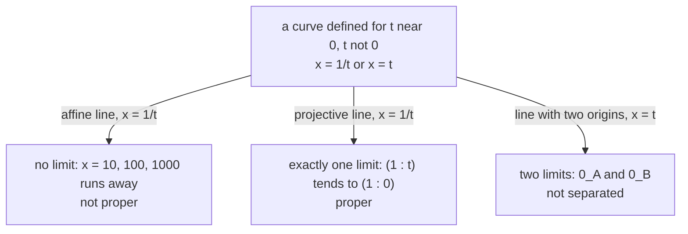

# Separated and proper: no doubled points, and nothing escapes to infinity

[Syllabus](../../../SYLLABUS.md) → [Algebraic geometry](../README.md) → [Schemes and Modern Language](../README.md#s06) → Separated and proper

---

## General Overview

Walk along the curve $`x = 1/t`$ as t shrinks toward 0. At t = 1/10, 1/100 and 1/1000 the point is at x = 10, 100 and 1000. On the affine line $`\mathbb{A}^1`$ (the ordinary number line, as a variety) it runs away and has no limit.

Now put the same curve on the projective line $`\mathbb{P}^1`$, where the number x is the point $`(x : 1)`$. Scaling both entries by t gives $`(1 : t)`$. As t goes to 0 this tends to $`(1 : 0)`$, the point at infinity. On $`\mathbb{P}^1`$ nothing escapes.

A second failure goes the other way. Take two copies of the line and glue them at every point except 0. The result, the **line with two origins**, has two zeros, $`0_A`$ and $`0_B`$. The curve $`x = t`$ now has two places to land. Its limit exists but is not unique.

The modern language names the two good behaviours, for a map $`X \to S`$ and not only for a single space:

- **Separated**: a moving point has at most one limit. This is the stand-in for "Hausdorff" (two different points have disjoint neighbourhoods).
- **Proper**: a moving point always has exactly one limit. This is the stand-in for "compact" (every open cover has a finite selection that still covers).
- **Finite**: the strongest of the three. The map $`x \mapsto x^2`$ on the line is finite, because every polynomial in x is $`g(x^2) + x\, h(x^2)`$: $`k[x]`$ is generated by 1 and x over $`k[x^2]`$.

Why anyone cares: a proper map sends closed sets to closed sets, even after any change of base. Over the integers mod 7, the hyperbola $`xy = 1`$ casts a shadow of 6 of the 7 points on the x-line, with x = 0 missing. Its closure in $`\mathbb{A}^1 \times \mathbb{P}^1`$ casts a shadow of all 7, because over x = 0 the point $`y = \infty`$ fills the gap.

**A map is separated when a moving point has at most one limit and proper when it has exactly one, which the schemes language says through the diagonal and through closed shadows after every base change; projective space is proper, the affine line is not, the line with two origins is not even separated, and $`x \mapsto x^2`$ is finite.**

**What kind of fact this is:** four definitions (separated, universally closed, proper, finite) and five theorems proved on this card in Why it works: the affine line is separated but not proper, the line with two origins is not separated, $`\mathbb{P}^n`$ passes the limit test, and $`x \mapsto x^2`$ is finite. The valuative criteria, "finite implies proper" and "passing the test implies proper" are stated with their source, Hartshorne chapter II.4.

### The picture: one curve near t = 0, three spaces



Each arrow counts the curve's limits as t goes to 0 in one space.

---

## The formula

Reminders first, each in one line.

- **Field.** The field k is ℚ for limits. Point counts use $`\mathbb{F}_7`$, the integers mod 7, and $`\mathbb{F}_{49}`$, the field with 49 elements. Pictures in words are over ℂ.
- **Morphisms and fibre products.** A map of schemes $`f: X \to S`$ is a ring map read backwards, and $`X \times_S Y`$ joins two spaces over S so that their maps agree ([Morphisms of schemes](04-morphisms-and-fibre-products-in-outline.md)).
- **Closed sets.** A closed set is a solution set of polynomial equations ([The Zariski topology](../02-Affine%20and%20Projective%20Varieties/02-zariski-topology-and-irreducibility.md)). On the line, the closed sets are the finite sets and the whole line.
- **Projective space.** $`\mathbb{P}^n`$ has points $`(x_0 : \cdots : x_n)`$, lists up to scaling; chart i is where $`x_i \neq 0`$ ([Projective space](../02-Affine%20and%20Projective%20Varieties/03-projective-space-and-homogeneous-coordinates.md)). As a scheme it is [Proj](10-proj-of-a-graded-ring.md) of $`k[x_0, \ldots, x_n]`$.
- **The little disc.** $`R = k[t]_{\langle t\rangle}`$ is the local ring at 0: fractions whose bottom is nonzero at t = 0 ([Localisation](03-localisation-and-local-rings.md)). $`K = k(t)`$ is all fractions of polynomials in t.

The **valuation** $`v(f)`$ of a fraction f in K is the order of its top at t = 0 minus the order of its bottom. So $`v(t^2) = 2`$, $`v(3 + t) = 0`$ and $`v(1/t) = -1`$. A fraction lies in R exactly when $`v(f) \ge 0`$: that is when it has a value at t = 0.

### Separated: the diagonal is closed

The **diagonal** of $`f: X \to S`$ sends each point to the pair (point, itself):

```math
\Delta_{X/S}: X \to X \times_S X, \qquad P \mapsto (P, P)
```

**Read it aloud:** the diagonal map sends each point of X to the pair made of that point twice.

The map f is **separated** when the diagonal is a closed immersion: its image is closed and X is that closed set. Here $`\Delta`$ is the diagonal, not the discriminant of shelf 04.

### Proper: closed shadows after every base change

A map is **closed** when it sends closed sets to closed sets. It is **universally closed** when every base change $`X \times_S S' \to S'`$ is closed too, for every map $`S' \to S`$. A map is **of finite type** when X is covered by finitely many spectra of rings generated by finitely many elements over the ring of S.

```math
\text{proper} = \text{separated} + \text{of finite type} + \text{universally closed}
```

**Read it aloud:** a proper map is separated, is described by finitely many polynomials, and keeps closed sets closed after any change of base.

### Finite: finitely many generators as a module

A map $`f: X \to S`$ is **finite** when S is covered by spectra $`\mathrm{Spec}\, B`$ whose preimages are spectra $`\mathrm{Spec}\, A`$, with A generated by finitely many elements $`a_1, \ldots, a_r`$ as a B-module:

```math
A = B a_1 + B a_2 + \cdots + B a_r
```

**Read it aloud:** every function upstairs is a combination of a few fixed functions, with coefficients from downstairs.

For $`x \mapsto u = x^2`$, $`A = k[x]`$, $`B = k[u]`$, and $`A = B \cdot 1 + B \cdot x`$.

### The limit test

A curve on the punctured disc is a map $`\mathrm{Spec}\, K \to X`$: a point of X with coordinates in K. A **limit** is a way to extend it to $`\mathrm{Spec}\, R \to X`$, the whole disc, compatible with the map to S. The **valuative criteria** count these extensions on every disc: every **discrete valuation ring** R with fraction field K, meaning a ring like the little disc, with one valuation.

```math
f \text{ separated} \iff \#\{\text{limits}\} \le 1, \qquad f \text{ proper} \iff \#\{\text{limits}\} = 1, \qquad \text{for every curve on every disc}
```

**Read it aloud:** a map is separated when every curve on every little disc has at most one limit, and proper when it has exactly one.

The disc $`k[t]_{\langle t\rangle}`$ is one such ring, and testing it alone is not enough. Remove the two points where $`x^2 = -1`$ from the projective line over ℚ. A curve with coordinates in ℚ(t) still has exactly one limit, because it lands on a point with rational coordinates. But take a disc centred at the removed points, with x itself as the moving coordinate: that curve runs into the hole and has no limit, so the space is not proper.

In $`\mathbb{P}^n`$ the limit is found by one rescaling. Let m be the least valuation among the coordinates:

```math
\lim_{t \to 0}\, (f_0 : \cdots : f_n) = \left( t^{-m} f_0 : \cdots : t^{-m} f_n \right)\Big|_{t = 0}, \qquad m = \min_i v(f_i)
```

**Read it aloud:** multiply every coordinate by the power of t that makes the worst one finite and nonzero, then set t to 0.

For $`(1/t : 1)`$ the valuations are −1 and 0, so m = −1. Multiply by t: $`(1 : t)`$, which at t = 0 is $`(1 : 0)`$.

| Symbol | Plain meaning | In our example | Push it up and the answer… |
| --- | --- | --- | --- |
| $`k`$, $`\mathbb{F}_7`$, $`\mathbb{F}_{49}`$ | the field of limits; the fields for counting | ℚ; integers mod 7; mod 7 with $`i^2 = -1`$ adjoined | a bigger field holds more points |
| $`f: X \to S`$, $`\mathrm{Spec}`$ | the map being tested; the space of prime ideals of a ring | $`\mathbb{P}^1 \to \mathrm{Spec}\, k`$ | — |
| $`\mathbb{A}^1`$, $`\mathbb{P}^n`$, $`w`$ | the affine line; projective space; $`w = 1/x`$, the second chart's coordinate on $`\mathbb{P}^1`$ | $`x = 1/t`$ escapes in $`\mathbb{A}^1`$; $`w = t`$ tends to 0 | larger n, more charts to test |
| $`0_A`$, $`0_B`$ | the two origins of the doubled line | the two limits of $`x = t`$ | — |
| $`X \times_S X`$, $`\otimes`$, $`\Delta_{X/S}`$, $`P`$ | pairs of points over S; the tensor product, its ring; the diagonal $`P \mapsto (P, P)`$ of a point P | the line $`x = y`$ in the plane | — |
| $`S'`$ | a new base for a base change | the x-line, for $`\mathbb{A}^1 \times \mathbb{A}^1 \to \mathbb{A}^1`$ | — |
| $`R`$, $`K`$, $`t`$ | a disc's ring, a discrete valuation ring; its fractions; the disc's coordinate | $`k[t]_{\langle t\rangle}`$; $`k(t)`$ | — |
| $`v(f)`$ | valuation: order of top minus order of bottom at t = 0 | $`v(1/t) = -1`$ | f vanishes faster at 0 |
| $`(f_0 : \cdots : f_n)`$, $`m`$, $`\lambda`$ | a curve in $`\mathbb{P}^n`$ with coordinates in K, indexed by i, j, l; the least valuation; a rescaling factor | $`(1/t : 1)`$, m = −1, $`\lambda = t`$ | — |
| $`A`$, $`B`$, $`a_1, \ldots, a_r`$ | the rings upstairs and downstairs; r module generators | $`k[x]`$, $`k[u]`$; 1 and x, r = 2 | larger r, more points per fibre |
| $`u`$, $`c`$, $`g`$, $`h`$, $`T`$ | the coordinate $`x^2`$ downstairs; one value of it; the even and odd parts; the unknown of a monic equation | $`g(u) = 3u + 2`$, $`h(u) = u^2 - 1`$; $`T^2 - u = 0`$ | — |
| $`y_0`$, $`y_1`$ | homogeneous coordinates of $`y = y_0/y_1`$ on $`\mathbb{P}^1`$ | $`y = \infty`$ is $`(1 : 0)`$ | — |

### When it holds

- **Finite type, and a Noetherian X, for the valuative criteria.** For Noetherian schemes of finite type it is enough to test discrete valuation rings, rings like R with one valuation (Hartshorne, Exercise II.4.11). Without finite type the criteria need every valuation ring.
- **Universally closed, not just closed.** $`\mathbb{A}^1 \to \mathrm{Spec}\, k`$ is closed, since its target is one point. After the base change to the x-line, the closed hyperbola $`xy = 1`$ has as shadow the line minus the origin, which is not closed. Over $`\mathbb{F}_7`$ the hole shows as 6 of 7 points.
- **Every chart.** Tested in the chart of x alone, $`\mathbb{P}^1`$ finds 0 limits for $`x = 1/t`$. The limit lives in the chart of $`w = 1/x`$.
- **Finite means module-finite, not finite fibres.** The punctured line inside the line has fibres of 0 or 1 points, yet it is not finite: its image, the line minus the origin, is not closed. Over $`\mathbb{F}_7`$ that image is 6 of 7 points.
- **Limits over the field you name.** The limit test is algebra over ℚ. Over ℂ, a variety is proper exactly when its complex points form a compact space in the usual topology (Hartshorne, Appendix B).

---

## Why it works

### Step 0: copy the topology through products, not neighbourhoods

In ordinary topology two facts hold. A space is Hausdorff exactly when its diagonal is closed in the product. For a compact space, the projection from its product with any other space onto that other space sends closed sets to closed sets. A point outside the shadow has a whole tube around it that misses the set, built from finitely many open pieces ([Compactness with no distances, and Tychonoff](../../17-Topology/02-Topological%20Spaces/06-compactness-and-tychonoff.md)).

The Zariski topology on a curve is not Hausdorff: on the line, any two nonempty open sets meet. But the scheme product $`X \times_S X`$ has more closed sets than the product topology, such as the line $`x = y`$. So the diagonal and shadow forms still say something, and the definitions copy them.

### Step 1: the affine line is separated

For $`\mathbb{A}^1`$ over k, the product $`\mathbb{A}^1 \times \mathbb{A}^1`$ is the plane with coordinates (x, y). The diagonal is the solution set of $`x - y = 0`$, which is closed.

The same holds for every affine scheme $`\mathrm{Spec}\, A`$. The diagonal comes from the multiplication map $`A \otimes A \to A`$, $`a \otimes b \mapsto ab`$. That map is onto, so the diagonal is a closed immersion. The **tensor product** $`A \otimes A`$ is the ring of the product ([Morphisms of schemes](04-morphisms-and-fibre-products-in-outline.md)).

### Step 2: the line with two origins is not separated

The doubled line X is covered by two charts A and B, each a copy of the line with coordinate x. So $`X \times X`$ is covered by four planes: (A, A), (A, B), (B, A), (B, B).

In the plane (A, B), the diagonal is the set of (x, y) where x in chart A and y in chart B name the same point of X. That happens when x = y and x is not 0, since $`0_A \neq 0_B`$. So the diagonal there is the line $`x = y`$ minus its origin.

That set is not closed. A polynomial vanishing on it vanishes at infinitely many points of the line, so it vanishes on the whole line, origin included. Over $`\mathbb{F}_7`$ the code counts the gap: the diagonal holds 6 of the 7 points on $`x = y`$, missing $`(0_A, 0_B)`$. This count, like every count over $`\mathbb{F}_7`$ on this card, shows which point is missing, not that the set fails to be closed: a finite set of points is always closed. Not being closed is a statement about the points over every larger field, infinitely many in all.

The limit test says the same. The curve $`x = t`$ extends in chart A, to $`0_A`$, and in chart B, to $`0_B`$. The gluing does not identify them, so there are two limits.

### Step 3: the affine line is not proper

Base change $`\mathbb{A}^1 \to \mathrm{Spec}\, k`$ along the x-line. The result is the projection of the plane to the x-line, $`(x, y) \mapsto x`$. The hyperbola $`xy = 1`$ is closed in the plane. Its shadow is every x except 0: an infinite set that is not the whole line, so it is not closed. Hence $`\mathbb{A}^1`$ is not universally closed, so not proper.

The limit test agrees. A limit of $`x = 1/t`$ would be a ring map $`k[x] \to R`$ sending x to $`1/t`$. But $`v(1/t) = -1`$, so $`1/t`$ is not in R. No limit exists. On the hyperbola this is the point (t, 1/t): as t goes to 0, its y escapes.

### Step 4: projective space passes the limit test

Take a curve $`(f_0 : \cdots : f_n)`$ with each $`f_i`$ in K, not all zero. Let m be the least valuation.

- **Existence.** After multiplying by $`t^{-m}`$, every coordinate has valuation at least 0, so it lies in R. At least one has valuation exactly 0, so it is nonzero at t = 0. Setting t = 0 gives a list that is not all zero: a point of $`\mathbb{P}^n`$.
- **Uniqueness.** In chart i, the curve has coordinates $`f_j / f_i`$. These lie in R exactly when $`v(f_i)`$ is the least valuation. Every chart that works gives the same point, since the ratios agree wherever both are defined.

The argument uses only the valuation, so it works on every disc of the criteria, with t replaced by any fraction of valuation 1.

The code finds each limit both ways, and a third way by evaluating at $`t = 10^{-6}`$ in floating point.

<details>
<summary>Detailed proof: the rescaled limit does not depend on the choices</summary>

Suppose two lists $`(g_0, \ldots, g_n)`$ and $`(h_0, \ldots, h_n)`$ with entries in R both name the curve, and each has an entry that is a unit of R (nonzero at t = 0). They name the same point of $`\mathbb{P}^n(K)`$, so $`h_j = \lambda\, g_j`$ for one fraction $`\lambda`$ in K.

Take an index j with $`g_j`$ a unit. Then $`v(\lambda) = v(h_j) \ge 0`$. Take an index l with $`h_l`$ a unit. Then $`0 = v(h_l) = v(\lambda) + v(g_l) \ge v(\lambda)`$. So $`v(\lambda) = 0`$: $`\lambda`$ is a unit of R, with a nonzero value $`\lambda(0)`$.

Setting t = 0 gives $`h_j(0) = \lambda(0)\, g_j(0)`$ for every j. The two limit points are the same point of $`\mathbb{P}^n(k)`$.

</details>

Hartshorne proves the valuative criterion of properness (Theorem II.4.7). He uses it to show that $`\mathbb{P}^n`$ is proper, and with it every projective morphism, the maps built from Proj (Theorem II.4.9).

### Step 5: the gap in the shadow is filled at infinity

Close up the hyperbola in $`\mathbb{A}^1 \times \mathbb{P}^1`$, the x-line times a projective y-line. Write $`y = y_0 / y_1`$, so $`xy = 1`$ becomes $`x\, y_0 = y_1`$.

For x not 0, the one solution is $`(y_0 : y_1) = (1 : x)`$, the old point y = 1/x. At x = 0 the equation reads $`y_1 = 0`$, so the solution is $`(1 : 0)`$: the point $`y = \infty`$. The shadow is now the whole x-line. Over $`\mathbb{F}_7`$ the code counts 7 points on the closure and a shadow of 7 of 7.

That is the general rule for $`\mathbb{P}^n`$: the shadow of a closed set in $`\mathbb{P}^n \times \mathbb{A}^m`$ on $`\mathbb{A}^m`$ is closed. Eliminating projective variables always leaves a set cut out by equations. The [Elimination](../01-Polynomial%20Systems/05-elimination-and-implicitisation.md) card met the affine failure: from $`xy - 1`$, every y passes elimination, yet y = 0 has no x.

### Step 6: x ↦ x² is finite

Split any polynomial f in x into its even and odd powers. The even powers form $`g(x^2)`$ and the odd powers form $`x\, h(x^2)`$. For $`f = x^5 + 3x^2 - x + 2`$:

```math
x^5 + 3x^2 - x + 2 = (3u + 2) + x\,(u^2 - 1), \qquad u = x^2
```

**Read it aloud:** the polynomial is 3u + 2 plus x times u² − 1, where u stands for x squared.

So $`k[x] = k[u] \cdot 1 + k[u] \cdot x`$, and the map is finite. The split is unique, since even and odd powers never mix. Each element of $`k[x]`$ also satisfies a **monic** equation (leading coefficient 1) over $`k[u]`$; for x itself it is $`T^2 - u = 0`$. That property is called **integral**.

The fibre over a point u = c has ring $`k[x]/\langle x^2 - c\rangle`$, with basis 1 and x: dimension 2 for every c. Over $`\mathbb{F}_7`$ the point counts are 1, 2, 2, 0, 2, 0, 0 for c = 0 to 6. The three zeros are the non-squares 3, 5 and 6. Over $`\mathbb{F}_{49}`$, which holds every square root of $`\mathbb{F}_7`$, the counts are 1, 2, 2, 2, 2, 2, 2. At c = 0 the single point $`x = 0`$ counts twice: $`x^2`$ has order 2 there, as on [Localisation](03-localisation-and-local-rings.md).

Finite maps are proper (Hartshorne, Exercise II.4.1). The idea: an integral extension of rings has the lying-over and going-up properties (every prime ideal downstairs has one above it, and chains of primes lift), so a finite map sends closed sets to closed sets. Base change keeps a map finite, and affine maps are separated.

The punctured line inside the line, from $`k[x] \to k[x, 1/x]`$, is not finite. If $`1/x`$ satisfied a monic equation of degree n with coefficients in $`k[x]`$, multiplying by $`x^n`$ would give 1 plus a multiple of x equal to 0. Its constant term, 1, rules that out.

---

## Worked numbers, by hand

| Step | Arithmetic | Value |
| --- | --- | --- |
| $`x = 1/t`$ at t = 1/10, 1/100, 1/1000 | divide | x = 10, 100, 1000 |
| valuation of $`1/t`$ | top order 0, bottom order 1 | −1: not in R, no limit in $`\mathbb{A}^1`$ |
| $`(1/t : 1)`$ in $`\mathbb{P}^1`$ | m = −1, multiply by t | $`(1 : t)`$ |
| set t = 0 | $`(1 : 0)`$ | **the point at infinity** |
| line $`y = 2x + 1`$, $`x = 1/t`$ | $`(1/t : (2 + t)/t : 1)`$ times t | $`(1 : 2 + t : t) \to (1 : 2 : 0)`$ |
| parabola $`y = x^2`$, $`x = 1/t`$ | $`(1/t : 1/t^2 : 1)`$ times $`t^2`$ | $`(t : 1 : t^2) \to (0 : 1 : 0)`$ |
| $`x = 3 + t`$, $`y = t/(1 - t)`$ | every valuation at least 0, m = 0 | $`(3 : 0 : 1)`$, the ordinary point (3, 0) |
| $`x = t`$ on the doubled line | limit in chart A and in chart B | 2 limits, $`0_A`$ and $`0_B`$ |
| diagonal in chart (A, B), over $`\mathbb{F}_7`$ | x = y, x not 0 | 6 of the 7 points on x = y |
| shadow of $`xy = 1`$ over $`\mathbb{F}_7`$ | x = 1, …, 6 have $`y = x^{-1}`$ | 6 of 7 |
| shadow of its closure | add $`(0, (1 : 0))`$ | 7 of 7 |
| even and odd parts of $`x^5 + 3x^2 - x + 2`$ | coefficients 2, 3 and −1, 1 | $`g = 3u + 2`$, $`h = u^2 - 1`$ |

The curve $`x = 1/t`$, which runs away on the affine line, lands on $`(1 : 0)`$ in $`\mathbb{P}^1`$. The line $`y = 2x + 1`$ lands on $`(1 : 2 : 0)`$, the point at infinity of its slope 2, so every line of slope 2 lands there too.

### What breaks if you drop a piece

| Mistake | Comes out at | What went wrong |
| --- | --- | --- |
| "Closed map, so proper" for $`\mathbb{A}^1 \to \mathrm{Spec}\, k`$ | shadow 1 of 1, but 6 of 7 after base change | properness needs closed shadows after every base change |
| Testing $`\mathbb{P}^1`$ in the chart of x only | 0 limits for $`x = 1/t`$, not 1 | the limit $`(1 : 0)`$ lives in the other chart |
| "Fibres of at most one point, so finite" | punctured line: fibres 0, 1, 1, 1, 1, 1, 1; image 6 of 7 | finite means module-finite; $`1/x`$ is not integral |
| Gluing two lines away from 0 | 2 limits for $`x = t`$ | the diagonal misses $`(0_A, 0_B)`$, so not separated |

The code prints all four.

---

## Code, from first principles, and it actually runs

Nothing is imported. A fraction in t is a pair of integer coefficient lists, and every limit is exact. The code takes three independent roads to each limit in $`\mathbb{P}^1`$ and $`\mathbb{P}^2`$: rescaling by the least valuation, testing chart by chart, and evaluating in floating point at $`t = 10^{-6}`$. It counts the limits of three curves in the affine line, the projective line and the doubled line, which it builds as two copies of the line glued at every point except 0. It counts the diagonal, from the same gluing, and the hyperbola's shadow and its closure over $`\mathbb{F}_7`$ by brute force. It checks the even and odd split by evaluation, and the fibres of $`x \mapsto x^2`$ by brute force over $`\mathbb{F}_7`$ and $`\mathbb{F}_{49}`$ against Euler's test for squares.

### Python

```python
# Separated, finite and proper -- the check behind the card.  Nothing is
# imported.  Field Q for limits; F_7 and F_49 for counts.  A rational function
# of t is a pair (num, den) of integer coefficient lists, lowest power first.
# A punctured-disc curve is a list of such functions; its limit as t -> 0 is
# found by rescaling by the least order, against chart by chart, against a
# float evaluation near t = 0.  Point counts are by brute force.
def gcd(a, b):
    while b:
        a, b = b, a % b
    return abs(a)

def pmul(a, b):
    out = [0] * (len(a) + len(b) - 1)
    for i, c in enumerate(a):
        for j, d in enumerate(b):
            out[i + j] += c * d
    return out

def order(p):                                  # how many times t divides p; None for p = 0
    return next((i for i, c in enumerate(p) if c), None)

def val(f):                                    # the valuation v(f): order of top minus order of bottom
    return None if order(f[0]) is None else order(f[0]) - order(f[1])

def at0(f):                                    # the value at t = 0 of f with v(f) >= 0, as (num, den)
    if val(f) is None or val(f) > 0:
        return (0, 1)
    a, b = f[0][order(f[0])], f[1][order(f[1])]
    g = gcd(a, b) * (1 if b > 0 else -1)
    return (a // g, b // g)

def normal(v):                                 # a projective point in lowest terms, last nonzero entry > 0
    g = 0
    for c in v:
        g = gcd(g, c)
    s = 1 if [c for c in v if c][-1] > 0 else -1
    return tuple(s * c // g for c in v)

def rescale(curve):                            # road 1: clear bottoms, divide by t^m, m the least order
    polys = []
    for i, (n, _) in enumerate(curve):
        for j, (_, d) in enumerate(curve):
            n = n if i == j else pmul(n, d)
        polys.append(n)
    m = min(order(p) for p in polys if order(p) is not None)
    return normal([p[m] if len(p) > m else 0 for p in polys])

def chart_limits(curve):                       # road 2: in chart i divide by coordinate i; keep it if every ratio has v >= 0
    found = set()
    for i, (ni, di) in enumerate(curve):
        if order(ni) is None:
            continue
        ratios = [(pmul(n, di), pmul(d, ni)) for n, d in curve]
        if all(val(r) is None or val(r) >= 0 for r in ratios):
            vals = [at0(r) for r in ratios]
            den = 1
            for _, b in vals:
                den = den * b // gcd(den, b)
            found.add(normal([a * (den // b) for a, b in vals]))
    return found

def by_float(curve, r, t=1e-6):                # road 3: evaluate near 0, divide by the largest entry, compare with r
    ev = lambda p: sum(c * t ** k for k, c in enumerate(p))
    v = [ev(n) / ev(d) for n, d in curve]
    big, rbig = max(v, key=abs), max(r, key=abs)
    return all(abs(a / big - b / rbig) < 1e-4 for a, b in zip(v, r))

def show(pt):
    return "(" + " : ".join(str(c) for c in pt) + ")"

T, ONE = [0, 1], [1]
glue = lambda chart, a: (chart, a) if a[0] == 0 else a   # doubled line: (A, a) and (B, a) are one point unless a = 0
curves = {"x = 1/t": (ONE, T), "x = t": (T, ONE), "x = 1 + 2t": ([1, 2], ONE)}
print("punctured-disc curves t -> x(t), t != 0; limit points as t -> 0 (field Q)")
counts = {}
for name, x in curves.items():
    curve = [x, (ONE, ONE)]                    # in P^1 the point x is (x : 1); the point at infinity is (1 : 0)
    p1, r = chart_limits(curve), rescale(curve)
    a1 = [at0(x)] if val(x) is None or val(x) >= 0 else []   # A^1 = Spec k[x]: a limit needs x in R
    dbl = {glue(chart, a) for chart in "AB" for a in a1}     # doubled line: each chart is a copy of A^1, then glue
    counts[name] = (len(a1), len(p1), len(dbl))
    assert p1 == {r} and by_float(curve, r)    # three roads to the P^1 limit
    print(f"  {name:11}: limits in A^1 {len(a1)}; in P^1 {len(p1)}, {show(r)}; in the doubled line {len(dbl)}")
assert counts == {"x = 1/t": (0, 1, 0), "x = t": (1, 1, 2), "x = 1 + 2t": (1, 1, 1)}
vs = [val(f) for f in [([0, 0, 1], ONE), ([3, 1], ONE), (ONE, T), (ONE, [0, 0, 1])]]
print(f"valuations: v(t^2) = {vs[0]}, v(3 + t) = {vs[1]}, v(1/t) = {vs[2]}, v(1/t^2) = {vs[3]}; (1/t : 1) has m = {min(vs[2], 0)}")
assert vs == [2, 0, -1, -2]
print("x = 1/t near 0: t = 1/10, 1/100, 1/1000 gives x = " + ", ".join(str(10 ** k) for k in (1, 2, 3))
      + "; in P^1, (x : 1) = (1 : t) = " + ", ".join(f"(1 : 1/{10 ** k})" for k in (1, 2, 3)))

plane = {"line y = 2x + 1, x = 1/t": [(ONE, T), ([2, 1], T), (ONE, ONE)],
         "line y = 2x + 5, x = 1/t": [(ONE, T), ([2, 5], T), (ONE, ONE)],
         "parabola y = x^2, x = 1/t": [(ONE, T), (ONE, [0, 0, 1]), (ONE, ONE)],
         "x = 3 + t, y = t/(1 - t)": [([3, 1], ONE), (T, [1, -1]), (ONE, ONE)]}
for name, curve in plane.items():
    r, c, close = rescale(curve), chart_limits(curve), by_float(curve, rescale(curve))
    print(f"P^2, {name}: rescaled {show(r)}; charts {len(c)} point(s), {show(next(iter(c)))}; float near 0 agrees: {'yes' if close else 'no'}")
    assert c == {r} and close                  # three roads to one limit
assert rescale(plane["line y = 2x + 1, x = 1/t"]) == rescale(plane["line y = 2x + 5, x = 1/t"])   # parallel lines meet

p = 7                                          # the diagonal in chart (A, B): x in A and y in B name one point
diag_AA = sum(1 for x in range(p) for y in range(p) if glue("A", (x, 1)) == glue("A", (y, 1)))
diag_AB = sum(1 for x in range(p) for y in range(p) if glue("A", (x, 1)) == glue("B", (y, 1)))
print(f"doubled line, diagonal over F_{p}: chart (A, A) {diag_AA} of the {p} points on x = y; "
      f"chart (A, B) {diag_AB} of {p}, missing (0_A, 0_B)")
hyper = {x for x in range(p) for y in range(p) if (x * y - 1) % p == 0}
P1 = [(1, 0)] + [(a, 1) for a in range(p)]     # the 8 points (y0 : y1) of P^1 over F_7, y = y0/y1
closure = [(x, q) for x in range(p) for q in P1 if (x * q[0] - q[1]) % p == 0]   # xy = 1 as x y0 = y1
shadow = {x for x, _ in closure}
over0 = [q for x, q in closure if x == 0]
print(f"hyperbola xy = 1 over F_{p}: shadow on the x-line {len(hyper)} of {p} points, x = 0 missing")
print(f"its closure in A^1 x P^1: {len(closure)} points, shadow {len(shadow)} of {p}; over x = 0 the point y = {show(over0[0])}")
assert len(hyper) == p - 1 and 0 not in hyper and len(shadow) == p and over0 == [(1, 0)]   # brute force against p - 1 and p
print(f"mistake 1: A^1 -> a point is closed (shadow 1 of 1), yet its base change has shadow {len(hyper)} of {p}")
print(f"mistake 2: P^1 tested in the chart x only: x = 1/t finds {counts['x = 1/t'][0]} limits, not {counts['x = 1/t'][1]}")
fib = [sum(1 for x in range(1, p) if x == a) for a in range(p)]   # the punctured line inside the line
print(f"mistake 3: punctured line -> line, fibres over F_{p} {fib}: all at most 1, image {sum(fib)} of {p}, origin missing")
assert (diag_AA, diag_AB) == (p, p - 1) and fib == [0] + [1] * (p - 1)    # brute force against p, p - 1 and the hole at 0
print(f"mistake 4: doubled line, x = t has {counts['x = t'][2]} limits; separated needs at most 1")

f = [2, -1, 3, 0, 0, 1]                        # x^5 + 3x^2 - x + 2, lowest power first
g, h = f[0::2], f[1::2]                        # f(x) = g(x^2) + x h(x^2)
grid = range(-4, 5)
same = all(sum(c * x ** k for k, c in enumerate(f)) ==
           sum(c * x ** (2 * k) for k, c in enumerate(g)) + x * sum(c * x ** (2 * k) for k, c in enumerate(h)) for x in grid)
print(f"x -> u = x^2: f = x^5 + 3x^2 - x + 2 = g(x^2) + x h(x^2), g(u) = 3u + 2, h(u) = u^2 - 1; agrees at x = -4..4: {'yes' if same else 'no'}")
assert g == [2, 3, 0] and h == [-1, 0, 1] and same
sq7 = [sum(1 for x in range(p) if (x * x - a) % p == 0) for a in range(p)]
euler = [1 + (1 if pow(a, (p - 1) // 2, p) == 1 else -1 if a else 0) for a in range(p)]
F49 = [(a, b) for a in range(p) for b in range(p)]                 # a + b i with i^2 = -1, p = 3 mod 4
sq49 = [sum(1 for a, b in F49 if ((a * a - b * b - c) % p, (2 * a * b) % p) == (0, 0)) for c in range(p)]
print(f"fibres of x -> x^2 over u = 0..{p - 1}: points over F_{p} {sq7}, Euler's test {euler}; over F_{p * p} {sq49}")
print("fibre ring k[x]/<x^2 - u> has basis 1, x: dimension 2 for every u; at u = 0 the one point counts twice")
assert sq7 == euler and sq49 == [1] + [2] * (p - 1)               # brute force against Euler, and F_49 roots
print("ALL CHECKS PASS")
```

**Ran 2026-11-24 on macOS, Python 3.14.10, standard library only. All checks passed. Output, pasted from the run:**

```
punctured-disc curves t -> x(t), t != 0; limit points as t -> 0 (field Q)
  x = 1/t    : limits in A^1 0; in P^1 1, (1 : 0); in the doubled line 0
  x = t      : limits in A^1 1; in P^1 1, (0 : 1); in the doubled line 2
  x = 1 + 2t : limits in A^1 1; in P^1 1, (1 : 1); in the doubled line 1
valuations: v(t^2) = 2, v(3 + t) = 0, v(1/t) = -1, v(1/t^2) = -2; (1/t : 1) has m = -1
x = 1/t near 0: t = 1/10, 1/100, 1/1000 gives x = 10, 100, 1000; in P^1, (x : 1) = (1 : t) = (1 : 1/10), (1 : 1/100), (1 : 1/1000)
P^2, line y = 2x + 1, x = 1/t: rescaled (1 : 2 : 0); charts 1 point(s), (1 : 2 : 0); float near 0 agrees: yes
P^2, line y = 2x + 5, x = 1/t: rescaled (1 : 2 : 0); charts 1 point(s), (1 : 2 : 0); float near 0 agrees: yes
P^2, parabola y = x^2, x = 1/t: rescaled (0 : 1 : 0); charts 1 point(s), (0 : 1 : 0); float near 0 agrees: yes
P^2, x = 3 + t, y = t/(1 - t): rescaled (3 : 0 : 1); charts 1 point(s), (3 : 0 : 1); float near 0 agrees: yes
doubled line, diagonal over F_7: chart (A, A) 7 of the 7 points on x = y; chart (A, B) 6 of 7, missing (0_A, 0_B)
hyperbola xy = 1 over F_7: shadow on the x-line 6 of 7 points, x = 0 missing
its closure in A^1 x P^1: 7 points, shadow 7 of 7; over x = 0 the point y = (1 : 0)
mistake 1: A^1 -> a point is closed (shadow 1 of 1), yet its base change has shadow 6 of 7
mistake 2: P^1 tested in the chart x only: x = 1/t finds 0 limits, not 1
mistake 3: punctured line -> line, fibres over F_7 [0, 1, 1, 1, 1, 1, 1]: all at most 1, image 6 of 7, origin missing
mistake 4: doubled line, x = t has 2 limits; separated needs at most 1
x -> u = x^2: f = x^5 + 3x^2 - x + 2 = g(x^2) + x h(x^2), g(u) = 3u + 2, h(u) = u^2 - 1; agrees at x = -4..4: yes
fibres of x -> x^2 over u = 0..6: points over F_7 [1, 2, 2, 0, 2, 0, 0], Euler's test [1, 2, 2, 0, 2, 0, 0]; over F_49 [1, 2, 2, 2, 2, 2, 2]
fibre ring k[x]/<x^2 - u> has basis 1, x: dimension 2 for every u; at u = 0 the one point counts twice
ALL CHECKS PASS
```

### Rust

Same numbers, same labels, built with `rustc --edition 2021 -O`.

```rust
// Separated, finite and proper -- the same check as the Python, in Rust.  No
// crates.  Field Q for limits; F_7 and F_49 for counts.  A rational function
// of t is a pair (num, den) of i128 coefficient lists, lowest power first,
// multiplied with checked_mul so overflow stops the run.  The limit of a
// punctured-disc curve as t -> 0 is found by rescaling by the least order,
// against chart by chart, against a float evaluation near t = 0.
use std::collections::BTreeSet;
type P = Vec<i128>;
type F = (P, P);

fn gcd(mut a: i128, mut b: i128) -> i128 { while b != 0 { (a, b) = (b, a % b) } a.abs() }

fn pmul(a: &P, b: &P) -> P {
    let mut out = vec![0i128; a.len() + b.len() - 1];
    for (i, c) in a.iter().enumerate() {
        for (j, d) in b.iter().enumerate() { out[i + j] += c.checked_mul(*d).expect("overflow") }
    }
    out
}

fn order(p: &P) -> Option<usize> { p.iter().position(|&c| c != 0) }   // how many times t divides p

fn val(f: &F) -> Option<i64> {                    // v(f): order of top minus order of bottom
    order(&f.0).map(|n| n as i64 - order(&f.1).unwrap() as i64)
}

fn at0(f: &F) -> (i128, i128) {                   // value at t = 0 of f with v(f) >= 0
    match val(f) {
        None => (0, 1),
        Some(v) if v > 0 => (0, 1),
        _ => {
            let (a, b) = (f.0[order(&f.0).unwrap()], f.1[order(&f.1).unwrap()]);
            let g = gcd(a, b) * if b > 0 { 1 } else { -1 };
            (a / g, b / g)
        }
    }
}

fn normal(v: &[i128]) -> Vec<i128> {             // lowest terms, last nonzero entry > 0
    let g = v.iter().fold(0, |g, &c| gcd(g, c));
    let s = if *v.iter().filter(|&&c| c != 0).last().unwrap() > 0 { 1 } else { -1 };
    v.iter().map(|&c| s * c / g).collect()
}

fn rescale(curve: &[F]) -> Vec<i128> {           // road 1: clear bottoms, divide by t^m
    let polys: Vec<P> = (0..curve.len()).map(|i| {
        let mut n = curve[i].0.clone();
        for j in 0..curve.len() { if j != i { n = pmul(&n, &curve[j].1) } }
        n
    }).collect();
    let m = polys.iter().filter_map(order).min().unwrap();
    normal(&polys.iter().map(|p| if p.len() > m { p[m] } else { 0 }).collect::<Vec<_>>())
}

fn chart_limits(curve: &[F]) -> BTreeSet<Vec<i128>> {   // road 2: chart by chart
    let mut found = BTreeSet::new();
    for (ni, di) in curve {
        if order(ni).is_none() { continue }
        let ratios: Vec<F> = curve.iter().map(|(n, d)| (pmul(n, di), pmul(d, ni))).collect();
        if ratios.iter().all(|r| val(r).map_or(true, |v| v >= 0)) {
            let vals: Vec<(i128, i128)> = ratios.iter().map(at0).collect();
            let den = vals.iter().fold(1, |den, &(_, b)| den * b / gcd(den, b));
            found.insert(normal(&vals.iter().map(|&(a, b)| a * (den / b)).collect::<Vec<_>>()));
        }
    }
    found
}

fn by_float(curve: &[F], r: &[i128], t: f64) -> bool {   // road 3: evaluate near 0, compare with r
    let ev = |p: &P| p.iter().enumerate().map(|(k, &c)| c as f64 * t.powi(k as i32)).sum::<f64>();
    let v: Vec<f64> = curve.iter().map(|(n, d)| ev(n) / ev(d)).collect();
    let big = v.iter().cloned().fold(0.0f64, |b, c| if c.abs() > b.abs() { c } else { b });
    let rbig = r.iter().cloned().fold(0i128, |b, x| if x.abs() > b.abs() { x } else { b }) as f64;
    v.iter().zip(r).all(|(a, &b)| (a / big - b as f64 / rbig).abs() < 1e-4)
}

fn show(pt: &[i128]) -> String { format!("({})", pt.iter().map(|c| c.to_string()).collect::<Vec<_>>().join(" : ")) }
fn yn(b: bool) -> &'static str { if b { "yes" } else { "no" } }

fn main() {
    let (t, one): (P, P) = (vec![0, 1], vec![1]);
    let glue = |chart: char, a: (i128, i128)| if a.0 == 0 { (chart, a) } else { ('*', a) };   // doubled line: (A, a) = (B, a) unless a = 0
    let curves: Vec<(&str, F)> = vec![("x = 1/t", (one.clone(), t.clone())), ("x = t", (t.clone(), one.clone())),
                                      ("x = 1 + 2t", (vec![1, 2], one.clone()))];
    println!("punctured-disc curves t -> x(t), t != 0; limit points as t -> 0 (field Q)");
    let mut counts = Vec::new();
    for (name, x) in &curves {
        let curve = vec![x.clone(), (one.clone(), one.clone())];
        let (p1, r) = (chart_limits(&curve), rescale(&curve));
        let a1: Vec<(i128, i128)> = if val(x).map_or(true, |v| v >= 0) { vec![at0(x)] } else { vec![] };   // A^1: x must lie in R
        let dbl: BTreeSet<(char, (i128, i128))> = ['A', 'B'].iter().flat_map(|&c| a1.iter().map(move |&a| glue(c, a))).collect();
        counts.push((a1.len(), p1.len(), dbl.len()));
        assert!(p1.len() == 1 && p1.contains(&r) && by_float(&curve, &r, 1e-6));   // three roads to the P^1 limit
        println!("  {:11}: limits in A^1 {}; in P^1 {}, {}; in the doubled line {}", name, a1.len(), p1.len(), show(&r), dbl.len());
    }
    assert!(counts == vec![(0, 1, 0), (1, 1, 2), (1, 1, 1)]);
    let vs: Vec<i64> = [(vec![0, 0, 1], one.clone()), (vec![3, 1], one.clone()), (one.clone(), t.clone()), (one.clone(), vec![0, 0, 1])]
        .iter().map(|f| val(f).unwrap()).collect();
    println!("valuations: v(t^2) = {}, v(3 + t) = {}, v(1/t) = {}, v(1/t^2) = {}; (1/t : 1) has m = {}", vs[0], vs[1], vs[2], vs[3], vs[2].min(0));
    assert!(vs == vec![2, 0, -1, -2]);
    println!("x = 1/t near 0: t = 1/10, 1/100, 1/1000 gives x = 10, 100, 1000; in P^1, (x : 1) = (1 : t) = {}",
             (1..4).map(|k| format!("(1 : 1/{})", 10i64.pow(k))).collect::<Vec<_>>().join(", "));

    let plane: Vec<(&str, Vec<F>)> = vec![
        ("line y = 2x + 1, x = 1/t", vec![(one.clone(), t.clone()), (vec![2, 1], t.clone()), (one.clone(), one.clone())]),
        ("line y = 2x + 5, x = 1/t", vec![(one.clone(), t.clone()), (vec![2, 5], t.clone()), (one.clone(), one.clone())]),
        ("parabola y = x^2, x = 1/t", vec![(one.clone(), t.clone()), (one.clone(), vec![0, 0, 1]), (one.clone(), one.clone())]),
        ("x = 3 + t, y = t/(1 - t)", vec![(vec![3, 1], one.clone()), (t.clone(), vec![1, -1]), (one.clone(), one.clone())])];
    for (name, curve) in &plane {
        let (r, c) = (rescale(curve), chart_limits(curve));
        let close = by_float(curve, &r, 1e-6);
        println!("P^2, {}: rescaled {}; charts {} point(s), {}; float near 0 agrees: {}",
                 name, show(&r), c.len(), show(c.iter().next().unwrap()), yn(close));
        assert!(c.len() == 1 && c.contains(&r) && close);   // three roads to one limit
    }
    assert!(rescale(&plane[0].1) == rescale(&plane[1].1));   // parallel lines meet

    let p: i64 = 7;                                  // the diagonal in chart (A, B): x in A and y in B name one point
    let diag_aa = (0..p).flat_map(|x| (0..p).map(move |y| (x, y))).filter(|&(x, y)| glue('A', (x as i128, 1)) == glue('A', (y as i128, 1))).count();
    let diag_ab = (0..p).flat_map(|x| (0..p).map(move |y| (x, y))).filter(|&(x, y)| glue('A', (x as i128, 1)) == glue('B', (y as i128, 1))).count();
    println!("doubled line, diagonal over F_{}: chart (A, A) {} of the {} points on x = y; chart (A, B) {} of {}, missing (0_A, 0_B)",
             p, diag_aa, p, diag_ab, p);
    let hyper: BTreeSet<i64> = (0..p).flat_map(|x| (0..p).map(move |y| (x, y)))
        .filter(|&(x, y)| (x * y - 1).rem_euclid(p) == 0).map(|(x, _)| x).collect();
    let mut p1: Vec<(i64, i64)> = vec![(1, 0)];
    p1.extend((0..p).map(|a| (a, 1)));
    let closure: Vec<(i64, (i64, i64))> = (0..p).flat_map(|x| p1.iter().map(move |&q| (x, q)))
        .filter(|&(x, q)| (x * q.0 - q.1).rem_euclid(p) == 0).collect();   // xy = 1 as x y0 = y1
    let over0: Vec<(i64, i64)> = closure.iter().filter(|&&(x, _)| x == 0).map(|&(_, q)| q).collect();
    let shadow: BTreeSet<i64> = closure.iter().map(|&(x, _)| x).collect();
    println!("hyperbola xy = 1 over F_{}: shadow on the x-line {} of {} points, x = 0 missing", p, hyper.len(), p);
    println!("its closure in A^1 x P^1: {} points, shadow {} of {}; over x = 0 the point y = {}", closure.len(), shadow.len(), p,
             show(&[over0[0].0 as i128, over0[0].1 as i128]));
    assert!(hyper.len() as i64 == p - 1 && !hyper.contains(&0) && shadow.len() as i64 == p && over0 == vec![(1, 0)]);
    println!("mistake 1: A^1 -> a point is closed (shadow 1 of 1), yet its base change has shadow {} of {}", hyper.len(), p);
    println!("mistake 2: P^1 tested in the chart x only: x = 1/t finds {} limits, not {}", counts[0].0, counts[0].1);
    let fib: Vec<usize> = (0..p).map(|a| (1..p).filter(|&x| x == a).count()).collect();
    println!("mistake 3: punctured line -> line, fibres over F_{} {:?}: all at most 1, image {} of {}, origin missing",
             p, fib, fib.iter().sum::<usize>(), p);
    assert!((diag_aa as i64, diag_ab as i64) == (p, p - 1) && fib == [vec![0], vec![1; p as usize - 1]].concat());
    println!("mistake 4: doubled line, x = t has {} limits; separated needs at most 1", counts[1].2);

    let f: Vec<i64> = vec![2, -1, 3, 0, 0, 1];   // x^5 + 3x^2 - x + 2, lowest power first
    let g: Vec<i64> = f.iter().step_by(2).cloned().collect();
    let h: Vec<i64> = f.iter().skip(1).step_by(2).cloned().collect();
    let ev = |q: &[i64], x: i64, s: u32| q.iter().enumerate().map(|(k, &c)| c * x.pow(s * k as u32)).sum::<i64>();
    let same = (-4..5).all(|x| ev(&f, x, 1) == ev(&g, x, 2) + x * ev(&h, x, 2));
    println!("x -> u = x^2: f = x^5 + 3x^2 - x + 2 = g(x^2) + x h(x^2), g(u) = 3u + 2, h(u) = u^2 - 1; agrees at x = -4..4: {}", yn(same));
    assert!(g == vec![2, 3, 0] && h == vec![-1, 0, 1] && same);
    let sq7: Vec<usize> = (0..p).map(|a| (0..p).filter(|&x| (x * x - a).rem_euclid(p) == 0).count()).collect();
    let pw = |a: i64| (0..(p - 1) / 2).fold(1, |r, _| r * a % p);
    let euler: Vec<usize> = (0..p).map(|a| if a == 0 { 1 } else if pw(a) == 1 { 2 } else { 0 }).collect();
    let sq49: Vec<usize> = (0..p).map(|c| (0..p).flat_map(|a| (0..p).map(move |b| (a, b)))
        .filter(|&(a, b)| (a * a - b * b - c).rem_euclid(p) == 0 && (2 * a * b).rem_euclid(p) == 0).count()).collect();
    println!("fibres of x -> x^2 over u = 0..{}: points over F_{} {:?}, Euler's test {:?}; over F_{} {:?}", p - 1, p, sq7, euler, p * p, sq49);
    println!("fibre ring k[x]/<x^2 - u> has basis 1, x: dimension 2 for every u; at u = 0 the one point counts twice");
    let mut want = vec![2usize; p as usize];
    want[0] = 1;
    assert!(sq7 == euler && sq49 == want);       // brute force against Euler, and F_49 roots
    println!("ALL CHECKS PASS");
}
```

**Ran 2026-11-24 on macOS, rustc 1.98.1, no crates. All checks passed. Output, pasted from the run:**

```
punctured-disc curves t -> x(t), t != 0; limit points as t -> 0 (field Q)
  x = 1/t    : limits in A^1 0; in P^1 1, (1 : 0); in the doubled line 0
  x = t      : limits in A^1 1; in P^1 1, (0 : 1); in the doubled line 2
  x = 1 + 2t : limits in A^1 1; in P^1 1, (1 : 1); in the doubled line 1
valuations: v(t^2) = 2, v(3 + t) = 0, v(1/t) = -1, v(1/t^2) = -2; (1/t : 1) has m = -1
x = 1/t near 0: t = 1/10, 1/100, 1/1000 gives x = 10, 100, 1000; in P^1, (x : 1) = (1 : t) = (1 : 1/10), (1 : 1/100), (1 : 1/1000)
P^2, line y = 2x + 1, x = 1/t: rescaled (1 : 2 : 0); charts 1 point(s), (1 : 2 : 0); float near 0 agrees: yes
P^2, line y = 2x + 5, x = 1/t: rescaled (1 : 2 : 0); charts 1 point(s), (1 : 2 : 0); float near 0 agrees: yes
P^2, parabola y = x^2, x = 1/t: rescaled (0 : 1 : 0); charts 1 point(s), (0 : 1 : 0); float near 0 agrees: yes
P^2, x = 3 + t, y = t/(1 - t): rescaled (3 : 0 : 1); charts 1 point(s), (3 : 0 : 1); float near 0 agrees: yes
doubled line, diagonal over F_7: chart (A, A) 7 of the 7 points on x = y; chart (A, B) 6 of 7, missing (0_A, 0_B)
hyperbola xy = 1 over F_7: shadow on the x-line 6 of 7 points, x = 0 missing
its closure in A^1 x P^1: 7 points, shadow 7 of 7; over x = 0 the point y = (1 : 0)
mistake 1: A^1 -> a point is closed (shadow 1 of 1), yet its base change has shadow 6 of 7
mistake 2: P^1 tested in the chart x only: x = 1/t finds 0 limits, not 1
mistake 3: punctured line -> line, fibres over F_7 [0, 1, 1, 1, 1, 1, 1]: all at most 1, image 6 of 7, origin missing
mistake 4: doubled line, x = t has 2 limits; separated needs at most 1
x -> u = x^2: f = x^5 + 3x^2 - x + 2 = g(x^2) + x h(x^2), g(u) = 3u + 2, h(u) = u^2 - 1; agrees at x = -4..4: yes
fibres of x -> x^2 over u = 0..6: points over F_7 [1, 2, 2, 0, 2, 0, 0], Euler's test [1, 2, 2, 0, 2, 0, 0]; over F_49 [1, 2, 2, 2, 2, 2, 2]
fibre ring k[x]/<x^2 - u> has basis 1, x: dimension 2 for every u; at u = 0 the one point counts twice
ALL CHECKS PASS
```

### Lean

Lean proves the limit test in general, and over any field k that $`\mathbb{P}^n`$ is proper and $`\mathbb{A}^1`$ is not.

- Suppose $`f: X \to S`$ is of finite type and X is Noetherian. Then f is separated exactly when every curve on every disc has at most one limit. Lean tests every valuation ring, as in Hartshorne's Theorems II.4.3 and II.4.7, not only discrete ones.
- For the same f, f is proper exactly when every such curve has exactly one limit.
- Take a field k. Then $`\mathbb{P}^n`$, built as Proj of $`k[x_0, \ldots, x_n]`$, is proper over $`\mathrm{Spec}\, k`$.
- Take a field k. Then $`\mathbb{A}^1 \to \mathrm{Spec}\, k`$ is not proper.
- Take $`u = x^2`$. Then $`x^5 + 3x^2 - x + 2 = (3u + 2) + x\,(u^2 - 1)`$.
- Work over $`\mathbb{F}_7`$. Then the hyperbola $`xy = 1`$ casts a shadow of 6 of the 7 points on the x-line.
- Work over $`\mathbb{F}_7`$. Then its closure $`x\, y_0 = y_1`$ in $`\mathbb{A}^1 \times \mathbb{P}^1`$ casts a shadow of all 7.
- Work over $`\mathbb{F}_7`$. Then 6 of the 7 points on $`x = y`$ have x not 0, as in the doubled line's chart (A, B).
- Work over $`\mathbb{F}_7`$. Then the fibres of $`x \mapsto x^2`$ over c = 0 to 6 hold 1, 2, 2, 0, 2, 0, 0 points.

The doubled line, the limits themselves and the $`\mathbb{F}_{49}`$ counts are left to the Python and Rust checks.

```lean
-- Separated and proper: a map from a Noetherian scheme is separated exactly when every curve on every little disc has at most one limit, and proper (when of finite type) exactly when it has exactly one; projective space is proper and the affine line is not.
import Mathlib.AlgebraicGeometry.ValuativeCriterion
import Mathlib.AlgebraicGeometry.ProjectiveSpectrum.Proper
import Mathlib.AlgebraicGeometry.Noetherian
import Mathlib.RingTheory.MvPolynomial.Homogeneous
import Mathlib.Algebra.Polynomial.Expand
import Mathlib.Data.ZMod.Basic

universe u

open CategoryTheory AlgebraicGeometry

/-- **The limit test (valuative criteria).** Let `f : X → S` be a map of schemes with `X`
Noetherian. A curve on a punctured disc is a map `Spec K → X`, where `K` is the fraction
field of a valuation ring `R` (the disc), and a limit is an extension of it to the whole disc
`Spec R → X` that agrees with the given map `Spec R → S`. Then `f` is separated exactly when
every such curve has at most one limit. If `f` is also of finite type, `f` is proper exactly
when every such curve has exactly one limit. (Mathlib tests every valuation ring, the form the
card gives for the general case; the card's discrete-valuation-ring shortcut is not used.) -/
theorem separated_iff_at_most_one_limit_and_proper_iff_exactly_one_limit
    {X S : Scheme.{u}} (f : X ⟶ S) [IsNoetherian X] [QuasiCompact f]
    [LocallyOfFiniteType f] :
    (IsSeparated f ↔ ValuativeCriterion.Uniqueness f) ∧
      (IsProper f ↔ ValuativeCriterion f) := by
  have : QuasiSeparated f := inferInstance
  refine ⟨⟨fun _ ↦ IsSeparated.valuativeCriterion f,
    fun h ↦ IsSeparated.of_valuativeCriterion f h⟩, ⟨fun hp ↦ ?_,
    fun h ↦ IsProper.of_valuativeCriterion f h⟩⟩
  rw [IsProper.eq_valuativeCriterion] at hp
  exact hp.1.1.1

attribute [local instance] MvPolynomial.gradedAlgebra

/-- **Projective space is proper.** Projective space `P^n` over a field `k`, built as `Proj` of
the polynomial ring `k[x_0, …, x_n]` graded by degree, is proper over the spectrum of the
degree-0 part (the constants `k`): nothing escapes to infinity. -/
theorem projective_space_is_proper (k : Type u) [Field k] (n : ℕ) :
    IsProper (Proj.toSpecZero (MvPolynomial.homogeneousSubmodule (Fin (n + 1)) k)) := by
  have : IsScalarTower k (MvPolynomial.homogeneousSubmodule (Fin (n + 1)) k 0)
      (MvPolynomial (Fin (n + 1)) k) :=
    IsScalarTower.of_algebraMap_eq (R := k)
      (S := MvPolynomial.homogeneousSubmodule (Fin (n + 1)) k 0) (fun _ ↦ rfl)
  have : Algebra.FiniteType (MvPolynomial.homogeneousSubmodule (Fin (n + 1)) k 0)
      (MvPolynomial (Fin (n + 1)) k) := Algebra.FiniteType.of_restrictScalars_finiteType k _ _
  infer_instance

/-- **The affine line is not proper.** The affine line `A^1 = Spec k[x]` over a field `k`,
with its map to the point `Spec k` (from the inclusion of constants `k → k[x]`), is not proper:
after base change to the x-line the hyperbola `xy = 1` has a shadow that is not closed. -/
theorem affine_line_is_not_proper (k : Type u) [Field k] :
    ¬ IsProper (Spec.map (CommRingCat.ofHom (Polynomial.C : k →+* Polynomial k))) := by
  intro h
  have : IsFinite (Spec.map (CommRingCat.ofHom (Polynomial.C : k →+* Polynomial k))) :=
    IsFinite.iff_isProper_and_isAffineHom.mpr ⟨h, inferInstance⟩
  rw [IsFinite.SpecMap_iff, CommRingCat.hom_ofHom, ← Polynomial.algebraMap_eq,
    RingHom.finite_algebraMap] at this
  exact Polynomial.not_finite (R := k) this

open Polynomial in
-- The even and odd split for x ↦ x²: x⁵ + 3x² − x + 2 = (3u + 2) + x(u² − 1) with u = x².
-- `expand ℤ 2` substitutes x² for the variable.
example : (X ^ 5 + 3 * X ^ 2 - X + 2 : ℤ[X]) =
    expand ℤ 2 (3 * X + 2) + X * expand ℤ 2 (X ^ 2 - 1) := by
  simp only [map_add, map_sub, map_mul, map_pow, map_ofNat, expand_X, map_one]
  ring

-- Over F_7 the hyperbola xy = 1 casts a shadow of 6 of the 7 points of the x-line.
example : ((Finset.univ : Finset (ZMod 7)).filter (fun x => ∃ y : ZMod 7, x * y = 1)).card = 6 := by
  decide

-- Its closure x·y₀ = y₁ in A^1 × P^1, with (y₀ : y₁) not (0 : 0), casts a shadow of all 7.
example : ((Finset.univ : Finset (ZMod 7)).filter
    (fun x => ∃ y₀ y₁ : ZMod 7, (y₀ ≠ 0 ∨ y₁ ≠ 0) ∧ x * y₀ = y₁)).card = 7 := by
  decide

-- On the doubled line, the diagonal in chart (A, B) holds the 6 points of x = y with x ≠ 0.
example : ((Finset.univ : Finset (ZMod 7)).filter (fun x => x ≠ 0)).card = 6 := by
  decide

-- Fibres of x ↦ x² over F_7: the number of x with x² = c, for c = 0, …, 6.
example : (List.range 7).map (fun c => ((Finset.univ : Finset (ZMod 7)).filter
    (fun x => x ^ 2 = (c : ZMod 7))).card) = [1, 2, 2, 0, 2, 0, 0] := by
  decide

#print axioms separated_iff_at_most_one_limit_and_proper_iff_exactly_one_limit
#print axioms projective_space_is_proper
#print axioms affine_line_is_not_proper
```

**Checked 2026-11-24 on macOS, Lean 4.36.0-rc2, Mathlib v4.36.0-rc2. Every proof is complete and uses only Lean's standard axioms. Output, pasted from the run:**

```
'separated_iff_at_most_one_limit_and_proper_iff_exactly_one_limit' depends on axioms: [propext, Classical.choice, Quot.sound]
'projective_space_is_proper' depends on axioms: [propext, Classical.choice, Quot.sound]
'affine_line_is_not_proper' depends on axioms: [propext, Classical.choice, Quot.sound]
```

> [!TIP]
> **Try changing**
> - Guess first: does $`x = 1/t^2`$ still land at $`(1 : 0)`$? Change `"x = 1/t": (ONE, T)` to `(ONE, [0, 0, 1])`. Yes: the valuation is −2, multiplying by $`t^2`$ gives $`(1 : t^2)`$, and the limit is $`(1 : 0)`$ again.
> - Guess first: where does the line $`y = 2x + 5`$ land? Change `[2, 1]` to `[2, 5]`. At $`(1 : 2 : 0)`$ again: parallel lines share their point at infinity.
> - Guess first: what does the doubled line do with $`x = 2t`$? Change `(T, ONE)` to `([0, 2], ONE)`. Two limits again, since the limit is still 0.
> - Guess first: over $`\mathbb{F}_{11}`$, how big is the hyperbola's shadow? Set `p = 11`. 10 of 11, and the closure's shadow is 11 of 11. The squaring fibres over $`\mathbb{F}_{121}`$ are 1, then ten 2s. The $`i^2 = -1`$ trick needs p to leave remainder 3 on division by 4.

---

## The usual mistake

> [!warning]
> **The biggest trap is testing properness on the space alone, by asking whether the map is closed.** Every map to a single point is closed, so $`\mathbb{A}^1 \to \mathrm{Spec}\, k`$ passes that test, yet the affine line is the standard example of a space that is not proper. Properness asks for closed shadows after every base change: over the x-line the hyperbola's shadow is 6 of 7 points over $`\mathbb{F}_7`$, and that hole at x = 0 is the escape to infinity.
>
> - **One chart is not the space.** In the chart of x, $`\mathbb{P}^1`$ finds 0 limits for $`x = 1/t`$. The limit $`(1 : 0)`$ is in the chart of $`1/x`$.
> - **Each chart of the doubled line is an honest line.** No test inside one chart sees the problem. Only the diagonal in the plane (A, B), with 6 of 7 points on $`x = y`$, or the 2 limits of $`x = t`$, shows it.
> - **Finite fibres are not finite maps.** The punctured line inside the line has fibres of 0 or 1 points and an image of 6 of 7.
> - **The sign of the valuation.** $`v(1/t) = -1`$, not +1. A fraction with a pole at 0 has negative valuation and is not in R.

---

## Where you meet it in real life

- **Solving with resultants and elimination.** Eliminating a projective variable leaves a set given by equations, because $`\mathbb{P}^n`$ is proper. That is why resultants, which test for a common root on $`\mathbb{P}^1`$, never miss one at infinity ([The resultant](../01-Polynomial%20Systems/06-resultants-and-common-roots.md)).
- **Counting intersections.** [Bezout's theorem](../03-Plane%20Curves/03-bezouts-theorem.md) counts points in the projective plane, which is proper: the parallel lines $`y = 2x + 1`$ and $`y = 2x + 5`$ meet at $`(1 : 2 : 0)`$ rather than nowhere.
- **Families of curves.** In a family over a disc, a proper family assigns every moving point a limit on the central curve. [Moduli spaces](07-moduli-spaces-in-outline.md) are built proper so that degenerating shapes have limits inside the space.

> **Say it back**
> A map is separated when a moving point has at most one limit, and the definition says it by asking the diagonal to be closed. A map is proper when a moving point has exactly one limit, and the definition says it by asking every base change to keep shadows closed. The curve x = 1/t escapes the affine line but lands on (1 : 0) in the projective line, and the hyperbola's shadow over F_7 grows from 6 of 7 to 7 of 7 once the point at infinity is added. The line with two origins gives x = t two limits, so it is not separated. The squaring map is finite because every polynomial is g(x²) + x h(x²), and finite maps are proper.

---

## What this builds on

- [Morphisms of schemes](04-morphisms-and-fibre-products-in-outline.md): maps as ring maps read backwards, and the fibre product $`X \times_S X`$ that holds the diagonal and every base change.
- [Proj](10-proj-of-a-graded-ring.md): projective space as a scheme, glued from the charts in which the limit test runs.
- [Localisation](03-localisation-and-local-rings.md): the local ring $`k[t]_{\langle t\rangle}`$, the little disc of the limit test, and the order 2 of $`x^2`$ at 0.
- [The Zariski topology](../02-Affine%20and%20Projective%20Varieties/02-zariski-topology-and-irreducibility.md): which sets are closed, and why the line minus a point is not.
- [Compactness with no distances, and Tychonoff](../../17-Topology/02-Topological%20Spaces/06-compactness-and-tychonoff.md): compactness by finite covers, the property that properness stands in for.

---

## Where this goes next

- [Toric varieties](13-toric-varieties.md): spaces built from cones, where the limit test becomes a question about which directions the cones cover.
- [Quotients by group actions](14-geometric-invariant-theory-in-outline.md): quotients built by Proj, which are proper over the affine quotient, so limits in families of orbits exist.
- [Flat, smooth and etale](../08-Sheaf%20Cohomology%20and%20Differentials/03-flat-smooth-and-etale-morphisms.md): the other properties of maps, which need Tor and differentials.

This card leaves open how to make a space proper when it is not: whether every variety sits as an open part of a proper one, and how to choose the points to add.

---

## Sources

Verified 2026-11-24: every link below resolves to the publisher's page.

- Hartshorne, Robin. *Algebraic Geometry*. Springer, 1977. [doi:10.1007/978-1-4757-3849-0](https://doi.org/10.1007/978-1-4757-3849-0). Chapter II.4: separated and proper morphisms, the valuative criteria (Theorems II.4.3 and II.4.7), projective morphisms are proper (II.4.9), and finite morphisms are proper (Exercise II.4.1).
- Vakil, Ravi. *The Rising Sea: Foundations of Algebraic Geometry*. Princeton University Press, 2025. [Publisher's page](https://press.princeton.edu/books/hardcover/9780691268668/the-rising-sea). Chapter 11, separated and proper morphisms through the diagonal, and section 13.7, the valuative criteria for separatedness and properness.
- Görtz, Ulrich, and Torsten Wedhorn. *Algebraic Geometry I: Schemes*, 2nd ed. Springer, 2020. [doi:10.1007/978-3-658-30733-2](https://doi.org/10.1007/978-3-658-30733-2). Chapter 9 on separated morphisms, and chapters 12 and 13 on affine, proper and projective morphisms, with full proofs.
- Eisenbud, David. *Commutative Algebra with a View Toward Algebraic Geometry*. Springer, 1995. [doi:10.1007/978-1-4612-5350-1](https://doi.org/10.1007/978-1-4612-5350-1). Integral extensions, lying over and going up, the ring side of "finite maps are closed".
