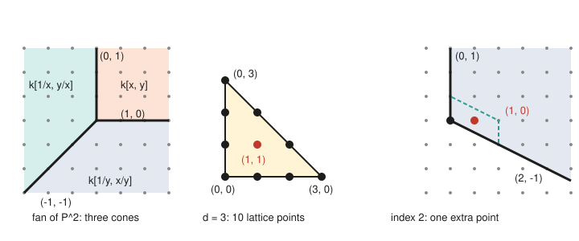

# Toric varieties: a fan of cones glues into a variety, and a polytope counts its sections

[Syllabus](../../../SYLLABUS.md) → [Algebraic geometry](../README.md) → [Schemes and Modern Language](../README.md#s06) → Toric varieties

---

## General Overview

A cubic curve in the projective plane has an equation with 10 coefficients, one for each cubic monomial: $`x_0^3`$, $`x_0^2 x_1`$, and so on up to $`x_2^3`$. That is why 9 points in general position (no special alignment among them) fix a cubic: each point is one linear condition, and 10 coefficients minus 9 conditions leave one curve, up to scale.

There is a second way to get the number 10, with no algebra at all. Draw the triangle with corners (0, 0), (3, 0) and (0, 3) on squared paper and count the dots with whole-number coordinates inside it or on its edges. There are 10. Each dot (a, b) is the monomial $`x_0^{3-a-b} x_1^a x_2^b`$.

That match is no coincidence. The projective plane $`\mathbb{P}^2`$ is a **toric variety**: a shape built entirely from monomials, so that every question about it becomes a question about whole-number points in the plane. Inside it sits a **torus**: the points where no coordinate is zero, which act on the whole variety by scaling coordinates. Three rules carry the whole subject:

1. **A cone gives a chart.** A wedge of the plane with whole-number corner directions gives a ring of monomials, and so a piece of the variety.
2. **A fan glues the charts.** A collection of wedges that meet edge to edge glues their pieces together; the three wedges of $`\mathbb{P}^2`$'s fan give its three standard charts.
3. **A polytope counts sections.** A line bundle is a rule for which functions, with which poles, are allowed. Those functions match the dots of a polygon; for cubics, the 10 dots of the triangle.

The same picture spots bad points. The wedge between the directions (0, 1) and (2, −1) is "twice too wide" for the grid. Its chart is the cone $`uw = v^2`$, which has a sharp tip, exactly like the torch beam $`x^2 + y^2 = z^2`$ of [Smooth and singular points](../02-Affine%20and%20Projective%20Varieties/08-smooth-and-singular-points.md).

**A toric variety is glued from the monomial rings of the cones of a fan; a cone gives a smooth chart exactly when its edge vectors have determinant ±1, and the sections of a torus-invariant line bundle have a basis of monomials, one for each lattice point of its polytope.**

**What kind of fact this is:** definitions (cone, dual cone, affine toric variety, fan, the polytope of a divisor) and theorems. The two-dimensional smoothness test and the section count are proved on this card in Why it works; Gordan's lemma is proved in outline; the orbit–cone correspondence is stated with its source and checked by a point count over $`\mathbb{F}_7`$.

### The picture: a fan, a triangle and a cone that is too wide

<p align="center"></p>

All three panels are to scale on the integer grid. They are pictures of the combinatorial data, not of the varieties. Left: the fan of $`\mathbb{P}^2`$, with each cone labelled by its ring. Middle: the 10 lattice points of the cubic triangle; the red (1, 1) is its one interior point. Right: the index-2 cone; its parallelogram holds one lattice point too many, the red (1, 0).

---

## The formula

Notation first, in words. The field is $`k`$; take $`k = \mathbb{C}`$ for pictures, though every integer step below works over any field. Two copies of the integer grid $`\mathbb{Z}^2`$ appear, with different jobs:

- $`N`$ holds the cones. Its points are written $`u`$.
- $`M`$ holds exponents. The point $`m = (a, b)`$ of $`M`$ stands for the Laurent monomial $`x^a y^b`$ (negative powers allowed).
- The pairing $`\langle m, u \rangle = m_1 u_1 + m_2 u_2`$ is the ordinary dot product of an exponent with a cone vector.

A **cone** $`\sigma`$ is all non-negative combinations of a few vectors of $`N`$, its **rays**. It must be **strongly convex**: it contains no whole line. Its **dual cone** $`\sigma^\vee`$ is the set of exponents that pair non-negatively with the whole cone. The ring $`k[\sigma^\vee \cap M]`$ is spanned by the monomials whose exponents lie in $`\sigma^\vee`$, and its spectrum (the space whose functions are this ring) is the chart ([The spectrum of a ring](02-spectrum-of-a-ring-and-schemes.md)).

```math
U_\sigma = \mathrm{Spec}\, k[\sigma^\vee \cap M], \qquad \sigma^\vee = \{\, m : \langle m, u \rangle \ge 0 \text{ for every } u \in \sigma \,\}
```

**Read it aloud:** the chart of a cone is the variety whose functions are the monomials with exponents in the dual cone.

A **fan** $`\Sigma`$ is a set of cones that meet each other only along common faces (edges or the origin). The **toric variety** $`X_\Sigma`$ glues the charts $`U_\sigma`$: two charts are glued along the chart of the face $`\tau`$ they share.

Take a two-dimensional cone, and let $`u_1`$ and $`u_2`$ be the first lattice points on its two rays. Its chart is **smooth** when these edges are a basis of the grid:

```math
U_\sigma \text{ is smooth} \iff \lvert \det(u_1, u_2) \rvert = 1, \qquad \det(u_1, u_2) = u_{1,1} u_{2,2} - u_{1,2} u_{2,1}
```

**Read it aloud:** the chart is smooth exactly when the parallelogram on the two edge vectors has area 1. The area $`\lvert \det \rvert`$ is the cone's **index**.

Each ray $`\rho`$, with first lattice point $`u_\rho`$, gives a curve $`D_\rho`$ on $`X_\Sigma`$. A **torus-invariant divisor** is a whole-number combination $`D = \sum a_\rho D_\rho`$ of them. Its **polytope** is a polygon in $`M`$:

```math
P_D = \{\, m : \langle m, u_\rho \rangle \ge -a_\rho \text{ for every ray } \rho \,\}, \qquad \dim_k \Gamma\bigl(X_\Sigma, \mathcal{O}(D)\bigr) = \#\bigl(P_D \cap M\bigr)
```

**Read it aloud:** the sections of the line bundle of D have a basis of monomials, one for each lattice point of the polygon cut out by "pairing with each ray is at least minus its weight".

Here $`\mathcal{O}(D)`$ is the line bundle of D and $`\Gamma`$ takes its global sections, the functions it allows everywhere ([Line bundles and divisors](../05-Cohomology%20and%20the%20Hodge%20Conjecture/06-line-bundles-and-divisor-classes.md)). For $`\mathbb{P}^2`$ with $`D = 3D_0`$, the polygon is the triangle (0, 0), (3, 0), (0, 3), and the count is 10.

| Symbol | Plain meaning | In our example | Push it up and the answer… |
| --- | --- | --- | --- |
| $`k`$; $`q`$ | the field of coefficients; the size of a finite field | $`\mathbb{C}`$; $`\mathbb{F}_7`$, q = 7, for point counts | more points: $`q^2 + q + 1`$ |
| $`N`$, $`M`$, $`\langle m, u \rangle`$, $`x^m`$ | grid of cone vectors; grid of exponents; their dot product; the monomial of m | $`\langle (1, 2), (2, -1) \rangle = 0`$; $`x^{(1, 2)} = xy^2`$ | — |
| $`\sigma`$, $`\rho`$, $`u_\rho`$ | a cone; one of its rays; the first lattice point on that ray | cone on (0, 1) and (2, −1) | a wider cone has a smaller dual |
| $`\sigma^\vee`$; $`v_1`$, $`v_2`$ | dual cone: exponents pairing $`\ge 0`$ with all of $`\sigma`$; its two rays | rays (1, 0) and (1, 2) | — |
| $`k[\sigma^\vee \cap M]`$, $`U_\sigma`$ | monomials with exponents in $`\sigma^\vee`$; their chart | $`k[x, xy, xy^2]`$; the cone $`uw = v^2`$ | — |
| $`\Sigma`$, $`X_\Sigma`$, $`\tau`$ | a fan; its glued variety; a face two cones share | fan of $`\mathbb{P}^2`$; ray (0, 1) | more cones, more charts |
| $`\det(u_1, u_2)`$, index; $`\mathfrak{m}`$ | signed area of the edge parallelogram; its size; the functions vanishing at a cone's fixed point | 1 for each cone of $`\mathbb{P}^2`$; −2 for the wide cone; $`\mathfrak{m} = (u, v, w)`$ at the tip | above 1 means singular |
| $`x_0, x_1, x_2`$; $`x`$, $`y`$; $`T`$ | coordinates on $`\mathbb{P}^2`$; $`x = x_1/x_0`$, $`y = x_2/x_0`$; the torus, where x and y are nonzero | chart $`x_1 \ne 0`$ has coordinates $`1/x`$, $`y/x`$ | — |
| $`D = \sum a_\rho D_\rho`$, $`d`$ | weighted sum of the ray curves $`D_\rho`$ with weights $`a_\rho`$; the weight on the line $`x_0 = 0`$ | $`D = 3D_0`$, $`d = 3`$ | the polygon grows |
| $`P_D`$; $`m_\sigma`$; I, B | polygon of exponents allowed by D; the generating section's exponent on chart σ (here a corner); the polygon's interior and boundary lattice points | triangle (0, 0), (3, 0), (0, 3); I = 1, B = 9 | — |
| $`\mathcal{O}(D)`$, $`\Gamma(X_\Sigma, \mathcal{O}(D))`$ | the line bundle of D; its global sections | the 10 cubic forms | $`(d + 1)(d + 2)/2`$ |
| $`u`$, $`v`$, $`w`$; $`n`$ | coordinates of the wide cone's chart; a degree in its grading | $`u = x`$, $`v = xy`$, $`w = xy^2`$; 2n + 1 monomials in degree n | — |

### When it holds

- **Rays must be rational.** A cone whose edge points in an irrational direction has a dual cone whose lattice points need infinitely many generators, so the ring is not finitely generated and there is no variety.
- **Cones must be strongly convex.** The upper half-plane contains a whole line. Its dual is only the ray through (0, 1), the ring is $`k[y]`$, and the "chart" is a line: dimension 1, not 2.
- **Cones must meet along faces.** Two cones that overlap any other way are glued along too small an open set, so one limit of torus points lies in both charts as two different points. The result is not separated (it has doubled points), in the sense of [Separated and proper](12-separated-and-proper-morphisms.md).
- **The determinant of the first lattice points decides, not the rays alone.** Both edges of the wide cone are primitive (their coordinates have no common factor), yet the cone is singular. The cone on (2, 0) and (0, 1) has determinant 2, but it is the quadrant, with ring $`k[x, y]`$: smooth.
- **The polytope counts the sections of a torus-invariant divisor on a complete fan.** A complete fan covers the whole plane, which makes $`X_\Sigma`$ compact and $`P_D`$ bounded. Any other divisor is first moved to a torus-invariant one with the same line bundle.

---

## Why it works

### Step 0: monomials are functions on the torus, and cones choose which ones

The torus $`T = (k^*)^2`$ is the set of pairs (x, y) with neither coordinate zero. Its functions are all Laurent polynomials: $`k[x^{\pm 1}, y^{\pm 1}] = k[M]`$. Every exponent is allowed, because x and y never vanish.

A chart adds points where some monomials may vanish. The cone decides which monomials stay defined there: exactly those with exponents in $`\sigma^\vee`$. A **semigroup** (a set closed under addition) of exponents gives a ring, because multiplying monomials adds exponents.

### Step 1: the three cones of the fan of P^2 are its three charts

The fan of $`\mathbb{P}^2`$ has rays $`u_0 = (-1, -1)`$, $`u_1 = (1, 0)`$ and $`u_2 = (0, 1)`$. Cone $`\sigma_i`$ is the one that leaves out $`u_i`$. Each dual cone is spanned by its two inward normals, and their monomials generate the ring.

| Cone | Rays | det | Dual cone rays | Ring | Chart of $`\mathbb{P}^2`$ |
| --- | --- | --- | --- | --- | --- |
| $`\sigma_0`$ | (1, 0), (0, 1) | 1 | (0, 1), (1, 0) | $`k[x, y]`$ | $`x_0 \ne 0`$ |
| $`\sigma_1`$ | (0, 1), (−1, −1) | 1 | (−1, 0), (−1, 1) | $`k[1/x, y/x]`$ | $`x_1 \ne 0`$ |
| $`\sigma_2`$ | (−1, −1), (1, 0) | 1 | (1, −1), (0, −1) | $`k[1/y, x/y]`$ | $`x_2 \ne 0`$ |

The last column is an independent road. With $`x = x_1/x_0`$ and $`y = x_2/x_0`$, the chart $`x_1 \ne 0`$ of [Projective space](../02-Affine%20and%20Projective%20Varieties/03-projective-space-and-homogeneous-coordinates.md) has coordinates $`x_0/x_1 = 1/x`$ and $`x_2/x_1 = y/x`$. The code computes the rings from the cones by brute force and asserts they match the charts.

Each ring is a polynomial ring in two variables, so each chart is a copy of the plane $`\mathbb{A}^2`$.

### Step 2: gluing is inverting one monomial

Charts $`\sigma_0`$ and $`\sigma_1`$ share the ray $`\tau = (0, 1)`$. Its dual cone is the half-plane $`b \ge 0`$, with ring $`k[x^{\pm 1}, y]`$.

Both charts reach that ring by inverting one function ([Localisation](03-localisation-and-local-rings.md)):

- $`k[x, y]`$ with $`x`$ inverted is $`k[x^{\pm 1}, y]`$.
- $`k[1/x, y/x]`$ with $`1/x`$ inverted gives back $`x`$, and then $`y = (y/x) \cdot x`$. That is $`k[x^{\pm 1}, y]`$ again.

The inverted monomial is the inward normal that is zero on the shared ray. Geometrically, both charts contain the open set $`x_0 x_1 \ne 0`$, and they agree there. The code checks all three pairs of charts by listing exponents in a box from −3 to 3: all three descriptions give the same 28 exponents.

This is the gluing rule in general. If $`\tau`$ is a face of $`\sigma`$, cut out by an exponent $`m`$ that is zero on $`\tau`$ and non-negative on $`\sigma`$, then $`k[\tau^\vee \cap M]`$ is $`k[\sigma^\vee \cap M]`$ with $`x^m`$ inverted. So $`U_\tau`$ is an open piece of $`U_\sigma`$, and two cones that share $`\tau`$ are glued along $`U_\tau`$.

### Step 3: Gordan's lemma makes the ring finitely generated

A chart is a variety only if its ring needs finitely many generators. **Gordan's lemma** says $`\sigma^\vee \cap M`$ is generated, under addition, by finitely many exponents.

In outline: let $`v_1, v_2`$ be the rays of $`\sigma^\vee`$. Every lattice point of $`\sigma^\vee`$ is a non-negative whole-number combination of $`v_1, v_2`$ plus a lattice point of the bounded parallelogram $`\{s v_1 + t v_2 : 0 \le s, t < 1\}`$. That parallelogram holds finitely many lattice points. They, with $`v_1`$ and $`v_2`$, generate everything.

The smallest generating set is the **Hilbert basis**: the nonzero lattice points of $`\sigma^\vee`$ that are not sums of two others. The code finds it by brute force in a box.

### Step 4: smooth exactly when the determinant is ±1

Suppose $`\lvert \det(u_1, u_2) \rvert = 1`$. Then $`u_1, u_2`$ are a basis of $`N`$, and the dual basis $`v_1, v_2`$ of $`M`$ spans $`\sigma^\vee`$. Every exponent in $`\sigma^\vee`$ is then $`i v_1 + j v_2`$ with whole $`i, j \ge 0`$. The ring is the polynomial ring $`k[x^{v_1}, x^{v_2}]`$, and the chart is the plane: smooth.

Now suppose $`\lvert \det \rvert \ge 2`$. The dual cone then has index $`\lvert \det \rvert`$ too, so $`v_1, v_2`$ miss some lattice point of $`\sigma^\vee`$, and the Hilbert basis has at least 3 elements. At the fixed point every monomial vanishes. The cotangent space there, $`\mathfrak{m}/\mathfrak{m}^2`$ (functions vanishing at the point, modulo products of two such), has one basis vector per Hilbert basis element. So the tangent space has dimension at least 3 on a surface: singular.

Take the wide cone, renaming its edges $`u_1 = (0, 1)`$ and $`u_2 = (2, -1)`$ for this step:

- $`\det(u_1, u_2) = 0 \cdot (-1) - 1 \cdot 2 = -2`$, so the index is 2.
- The half-open parallelogram on $`u_1, u_2`$ holds 2 lattice points, (0, 0) and the extra (1, 0) of the picture. In general it holds $`\lvert \det \rvert`$ points.
- The [Smith normal form](06-smith-normal-form-and-canonical-forms.md) of the matrix with rows (0, 1) and (2, −1) is diag(1, 2). So the grid modulo the cone's sublattice is $`\mathbb{Z}/2`$: the chart is the plane folded by a group of order 2.
- The dual cone has rays (1, 0) and (1, 2), and its Hilbert basis is (1, 0), (1, 1), (1, 2). Name them $`u = x`$, $`v = xy`$, $`w = xy^2`$; in the rest of this step u, v and w are these coordinates, not cone vectors.
- Exponents add: (1, 0) + (1, 2) = 2 · (1, 1). So $`uw = x^2 y^2 = v^2`$.

That relation is the only one. Grade by the first coordinate of the exponent, so u, v and w each have degree 1. In degree n the dual cone holds the $`2n + 1`$ exponents (n, 0) up to (n, 2n), the same count as the conic of [Proj](10-proj-of-a-graded-ring.md).

On the other side, take the monomial order with v first, so the leading term of $`uw - v^2`$ is $`v^2`$. A single polynomial is always a Grobner basis of the ideal it generates, so the monomials not divisible by $`v^2`$ span the quotient ring. Those $`u^i v^j w^l`$ of degree n number $`(n + 1) + n = 2n + 1`$. The counts match for every n, so the ring is exactly $`k[u, v, w]/(uw - v^2)`$.

Three roads agree that the tip is singular:

1. **Too many generators.** The tangent space at the tip has one dimension per Hilbert basis element: 3, more than the surface's 2.
2. **The Jacobian test.** The gradient of $`uw - v^2`$ is $`(w, -2v, u)`$. It vanishes only at (0, 0, 0). Over $`\mathbb{F}_7`$ the code checks all 49 points of the surface and finds no other.
3. **The torch beam.** In the torch's own coordinates, put $`u = z - x`$, $`v = y`$, $`w = z + x`$. Then $`uw - v^2 = z^2 - x^2 - y^2`$: the cone of [Smooth and singular points](../02-Affine%20and%20Projective%20Varieties/08-smooth-and-singular-points.md). Its point (3, 4, 5) becomes u = 2, v = 4, w = 8, and 2 · 8 = 16 = 4².

The same chart sits in a complete fan: the rays (1, 0), (0, 1) and (−1, −2) give the weighted projective plane $`\mathbb{P}(1, 1, 2)`$, a weighted space like those of [Proj](10-proj-of-a-graded-ring.md) (stated; Cox, Little and Schenck). Its cones have determinants 1, 1 and 2, and the third has generators 1/y, x/y and x²/y: the chart $`uw = v^2`$ again.

### Step 5: sections are monomials, one per lattice point

On the torus, a section of $`\mathcal{O}(D)`$ is a Laurent polynomial $`f = \sum c_m x^m`$. The torus is dense, so f determines the section.

On the chart $`U_\sigma`$, the bundle $`\mathcal{O}(D)`$ has one generating section, the monomial $`x^{m_\sigma}`$: every section there is $`x^{m_\sigma}`$ times a function on the chart. Here $`m_\sigma`$ solves $`\langle m_\sigma, u_\rho \rangle = -a_\rho`$ on both rays of $`\sigma`$. It is a lattice point because the cones here are smooth, and for this D it is a corner of $`P_D`$, though not for every D. So f is a section on $`U_\sigma`$ exactly when $`x^{-m_\sigma} f`$ lies in $`k[\sigma^\vee \cap M]`$.

That ring is spanned by monomials, so the test runs term by term: each exponent m of f needs $`m - m_\sigma \in \sigma^\vee`$. Asking this for every cone is the same as asking $`\langle m, u_\rho \rangle \ge -a_\rho`$ for every ray. That is $`m \in P_D`$. So the monomials $`x^m`$, for m in $`P_D \cap M`$, form a basis of the sections.

For $`\mathbb{P}^2`$ with $`D = d D_0`$, the weights are $`a_0 = d`$ and $`a_1 = a_2 = 0`$. The inequalities are $`a \ge 0`$, $`b \ge 0`$ and $`-a - b \ge -d`$: the triangle (0, 0), (d, 0), (0, d). The corners $`m_\sigma`$ come out as (0, 0), (d, 0) and (0, d), one per chart.

The code counts lattice points five ways for d = 1 to 6, and all agree:

- the inequalities of $`P_D`$;
- the chart conditions $`m - m_\sigma \in \sigma^\vee`$;
- monomials $`x_0^{e_0} x_1^{e_1} x_2^{e_2}`$ with $`e_0 + e_1 + e_2 = d`$;
- [Pick's theorem](../../05-Geometry%20and%20trig/07-Points%2C%20Convexity%20and%20Fractals/07-picks-theorem.md): area $`= I + B/2 - 1`$, with I interior and B boundary points;
- the formula $`(d + 1)(d + 2)/2`$.

The count $`(d + 1)(d + 2)/2`$ is also the Hilbert function of $`\mathbb{P}^2`$ in degree d ([Degree](../02-Affine%20and%20Projective%20Varieties/09-degree-and-the-hilbert-polynomial.md)). For the toric variety of a lattice polygon P, it counts the lattice points of the dilated polygon dP, and [Proj](10-proj-of-a-graded-ring.md) of the graded ring of those monomials rebuilds the variety from the polygon alone.

### Step 6: cones count orbits

The torus acts on $`X_\Sigma`$ by scaling coordinates; an orbit is the set of points one point can be moved to. The orbits match the cones, with the dimensions reversed:

- the cone $`\{0\}`$ gives the torus itself, dimension 2;
- each ray $`\rho`$ gives the curve $`D_\rho`$ minus its torus-fixed points (for $`\mathbb{P}^2`$, a line minus two points), dimension 1;
- each two-dimensional cone gives one fixed point, the origin of its chart.

For $`\mathbb{P}^2`$ that is 1 + 3 + 3 cones. Over $`\mathbb{F}_q`$ the torus has $`(q - 1)^2`$ points and each one-dimensional orbit has $`q - 1`$. So $`\#\mathbb{P}^2(\mathbb{F}_q) = (q - 1)^2 + 3(q - 1) + 3 = q^2 + q + 1`$. For q = 7 this is 57, and a brute-force count of normalised triples also gives 57. The correspondence in general is in Cox, Little and Schenck, chapter 3 (Sources).

---

## Worked numbers, by hand

| Step | Arithmetic | Value |
| --- | --- | --- |
| cone $`\sigma_1`$ on (0, 1), (−1, −1) | det = 0 · (−1) − 1 · (−1) | 1: smooth |
| its dual rays | inward normals: ⟨(−1, 0), (0, 1)⟩ = 0, ⟨(−1, 1), (−1, −1)⟩ = 0 | (−1, 0), (−1, 1) |
| its ring | exponents (−1, 0), (−1, 1) as monomials | $`k[1/x, y/x]`$ |
| glue $`\sigma_0`$, $`\sigma_1`$ | invert x in $`k[x, y]`$; invert 1/x in $`k[1/x, y/x]`$ | both $`k[x^{\pm 1}, y]`$ |
| triangle for d = 3 | lattice points with $`a, b \ge 0`$ and $`a + b \le 3`$ | 10 |
| Pick check | area 9/2, B = 9, I = 1: 9/2 = 1 + 9/2 − 1 | I + B = 10 |
| wide cone | det((0, 1), (2, −1)) = 0 − 2 | −2: index 2 |
| its generators | (1, 0), (1, 1), (1, 2); (1, 0) + (1, 2) = 2 · (1, 1) | $`uw = v^2`$ |
| its tip | gradient (w, −2v, u) = 0 only at (0, 0, 0) | singular |
| points of $`\mathbb{P}^2(\mathbb{F}_7)`$ | 36 + 18 + 3 | 57 |
| cubic forms | lattice points of the triangle | **10** |

**The triangle (0, 0), (3, 0), (0, 3) holds 10 lattice points, so the cubic curves of the plane form a 10-dimensional space of equations.** The fan of $`\mathbb{P}^2`$ produced the triangle from the line at infinity counted 3 times, and every one of its cones has determinant 1, so the plane is smooth.

### What breaks if you drop a piece

| Mistake | Comes out at | What went wrong |
| --- | --- | --- |
| cone instead of dual cone, for $`\sigma_1`$ | $`k[1/(xy), y]`$, not $`k[1/x, y/x]`$ | the chart's functions are the exponents pairing non-negatively with the cone, not the cone's own points |
| primitive rays as the smoothness test | gcd 1 and 1 say "smooth" for the wide cone | det −2 and 3 generators: singular |
| area or interior points instead of all lattice points | area 9/2, interior points 1 | the true count is 10: sections are dots, not area |
| edge (2, 0) instead of first lattice point (1, 0) | det 2 says "singular" for the quadrant | its ring is $`k[x, y]`$: smooth; the first lattice points give det 1 |
| half-plane, not strongly convex | dual generators (0, 1): $`k[y]`$ | a line, dimension 1, not a surface |

The code prints all five.

---

## Code, from first principles, and it actually runs

The script builds every ring from its cone by brute force: it lists the lattice points of the dual cone in a box and keeps those that are not sums of two others. For the fan of $`\mathbb{P}^2`$ it takes two roads to each chart (the dual cone, and the projective chart $`x_i \ne 0`$) and two to each overlap (inverting a monomial from either side, and the shared ray's own dual). It counts sections five independent ways and counts $`\mathbb{P}^2(\mathbb{F}_7)`$ by orbits and by brute force. For the wide cone it reaches index 2 three ways (determinant, parallelogram, Smith form), proves the ring is $`k[u, v, w]/(uw - v^2)`$ by matching graded counts, and finds the singular tip by the Jacobian test over $`\mathbb{F}_7`$. Everything is exact integer arithmetic.

### Python

```python
# Toric varieties -- the check behind the card.  Nothing is imported.
# The lattice N = Z^2 holds the cones; the lattice M = Z^2 holds exponents: m = (a, b) is x^a y^b.
def dot(m, u): return m[0] * u[0] + m[1] * u[1]
def det(u, v): return u[0] * v[1] - u[1] * v[0]
def gcd(a, b): return gcd(b, a % b) if b else abs(a)
def box(r): return [(a, b) for a in range(-r, r + 1) for b in range(-r, r + 1)]
def in_dual(m, cone): return all(dot(m, u) >= 0 for u in cone)
def hilbert(cone, r=6):                         # minimal generators of (dual cone) cap M, brute force
    pts = [m for m in box(r) if m != (0, 0) and in_dual(m, cone)]; s = set(pts)
    return sorted((m for m in pts if not any((m[0] - p[0], m[1] - p[1]) in s for p in pts)), key=lambda m: (m[1], m[0]))
def normals(c):                                 # inward normals of a 2-dimensional cone: its dual's rays
    out = []
    for u, v in [(c[0], c[1]), (c[1], c[0])]:
        n = (-u[1], u[0]); out.append(n if dot(n, v) > 0 else (-n[0], -n[1]))
    return out
def mono(m):                                    # an exponent pair written as a monomial
    def part(e, v): return "" if e <= 0 else v if e == 1 else f"{v}^{e}"
    top, bot = part(m[0], "x") + part(m[1], "y"), part(-m[0], "x") + part(-m[1], "y")
    return (top or "1") + (f"/{bot}" if bot else "")
def ring(gens): return "k[" + ", ".join(mono(m) for m in gens) + "]"
print("== the fan of P^2: three rays, three 2-dimensional cones ==")
U = [(-1, -1), (1, 0), (0, 1)]                  # ray U[i] <-> the line x_i = 0 in P^2
CONES = [(U[1], U[2]), (U[2], U[0]), (U[0], U[1])]   # cone i leaves out U[i] <-> chart x_i != 0
E = [(0, 0), (1, 0), (0, 1)]                    # x = x1/x0, y = x2/x0: x_j/x_i has exponent E[j] - E[i]
for i, c in enumerate(CONES):
    gens = hilbert(c)
    chart = sorted(((E[j][0] - E[i][0], E[j][1] - E[i][1]) for j in range(3) if j != i), key=lambda m: (m[1], m[0]))
    assert gens == chart and abs(det(*c)) == 1 and len(gens) == 2
    print(f"cone {i} on {c[0]}, {c[1]}: det {det(*c)}, dual rays {normals(c)} -> {ring(gens)} = chart x{i} != 0")
print("== gluing: two charts agree on the ray they share ==")
def local(c, m, r):                             # exponents of k[dual of c][1/x^m] inside box(r)
    s = set(box(r)); return {(p[0] - k * m[0], p[1] - k * m[1]) for p in box(2 * r) if in_dual(p, c)
                             for k in range(3 * r) if (p[0] - k * m[0], p[1] - k * m[1]) in s}
for i, j in [(0, 1), (1, 2), (2, 0)]:
    t = next(u for u in CONES[i] if u in CONES[j])
    mi, mj = [next(n for n in normals(CONES[k]) if dot(n, t) == 0) for k in (i, j)]
    A, B, T = local(CONES[i], mi, 3), local(CONES[j], mj, 3), {m for m in box(3) if dot(m, t) >= 0}
    assert A == B == T and len(T) == 28
    print(f"charts {i} and {j} share ray {t}: {ring(hilbert(CONES[i]))} with {mono(mi)} inverted = {ring(hilbert(CONES[j]))} with {mono(mj)} inverted, {len(T)} = {len(T)} exponents in the box")
q = 7
cells = [1, 3, 3]                               # cones of dimension 0, 1, 2 <-> orbits of dimension 2, 1, 0
orbit = sum(n * (q - 1) ** (2 - k) for k, n in enumerate(cells))
brute = sum(1 for a in range(q) for b in range(q) for c in range(q)
            if (a, b, c) != (0, 0, 0) and [v for v in (a, b, c) if v][0] == 1)
assert orbit == brute == q * q + q + 1
print(f"points of P^2 over F_{q}: orbits (q-1)^2 + 3(q-1) + 3 = {(q - 1) ** 2} + {3 * (q - 1)} + 3 = {orbit}; brute force {brute}; q^2 + q + 1 = {q * q + q + 1}")
print("== sections of O(d) = lattice points of the triangle (0, 0), (d, 0), (0, d) ==")
for d in range(1, 7):
    A = {U[0]: d, U[1]: 0, U[2]: 0}             # D = d * (line at infinity x0 = 0)
    poly = sum(1 for m in box(d) if all(dot(m, u) >= -A[u] for u in U))
    verts = []
    for c in CONES:                             # m_sigma: <m, u> = -a_u on both rays (Cramer)
        D, r0, r1 = det(*c), -A[c[0]], -A[c[1]]
        verts.append(((r0 * c[1][1] - r1 * c[0][1]) // D, (c[0][0] * r1 - c[1][0] * r0) // D))
    charts = sum(1 for m in box(d) if all(in_dual((m[0] - v[0], m[1] - v[1]), c) for v, c in zip(verts, CONES)))
    forms = sum(1 for e0 in range(d + 1) for e1 in range(d + 1) if e0 + e1 <= d)
    area2 = abs(det((verts[1][0] - verts[0][0], verts[1][1] - verts[0][1]), (verts[2][0] - verts[0][0], verts[2][1] - verts[0][1])))
    bnd = sum(gcd(verts[k][0] - verts[k - 1][0], verts[k][1] - verts[k - 1][1]) for k in range(3))
    inner = (area2 - bnd + 2) // 2              # Pick: area = I + B/2 - 1
    if d == 3: area3, inner3 = area2, inner
    assert poly == charts == forms == inner + bnd == (d + 1) * (d + 2) // 2
    print(f"d = {d}: vertices {sorted(verts)}; inequalities {poly}, charts {charts}, forms {forms}, Pick {inner} + {bnd} = {inner + bnd}; (d+1)(d+2)/2 = {(d + 1) * (d + 2) // 2}")
d = 3
pts = [(a, b) for b in range(d + 1) for a in range(d + 1 - b)]
def form(e): return "".join(f"x{k}" + (f"^{n}" if n > 1 else "") for k, n in enumerate(e) if n)
print("d = 3 sections:", ", ".join(form((d - a - b, a, b)) for a, b in pts))
print(f"{len(pts)} coefficients in a cubic, so {len(pts) - 1} general points fix one up to scale")
print("== the cone on (0, 1) and (2, -1): index 2 ==")
C = ((0, 1), (2, -1)); D = det(*C); sg = 1 if D > 0 else -1
par = sorted(m for m in box(3) if 0 <= sg * det(m, C[1]) < abs(D) and 0 <= sg * det(C[0], m) < abs(D))
inv = [gcd(gcd(C[0][0], C[0][1]), gcd(C[1][0], C[1][1])), abs(D) // gcd(gcd(C[0][0], C[0][1]), gcd(C[1][0], C[1][1]))]
assert abs(D) == len(par) == 2 and par == [(0, 0), (1, 0)] and inv == [1, 2]
print(f"det {D}: index {abs(D)}; lattice points in the half-open parallelogram {par}; Smith form diag{tuple(inv)}: N / sublattice = Z/{inv[1]}")
hb = hilbert(C); u, v, w = hb
assert normals(C) == [(1, 0), (1, 2)] and hb == [(1, 0), (1, 1), (1, 2)] and (u[0] + w[0], u[1] + w[1]) == (2 * v[0], 2 * v[1])
print(f"dual rays {normals(C)}; generators {hb} -> u = {mono(u)}, v = {mono(v)}, w = {mono(w)}; u*w = {mono((u[0] + w[0], u[1] + w[1]))} = v^2")
print(f"pairing <{w}, {C[1]}> = {dot(w, C[1])}; x^{w} = {mono(w)}")
lat = [sum(1 for b in range(-20, 21) if in_dual((n, b), C)) for n in range(7)]
std = [sum(1 for i in range(n + 1) for j in range(2) for l in range(n + 1) if i + j + l == n) for n in range(7)]
assert lat == std == [2 * n + 1 for n in range(7)]
print("degree n = 0..6: lattice points", lat, "= monomials u^i v^j w^l with j <= 1", std, "-> ring = k[u, v, w]/(uw - v^2)")
F = [(a, b, c) for a in range(q) for b in range(q) for c in range(q) if (a * c - b * b) % q == 0]
sing = [p for p in F if (p[2] % q, -2 * p[1] % q, p[0] % q) == (0, 0, 0)]
assert len(F) == q * q and (1, 1, 1) in F and sing == [(0, 0, 0)]
print(f"uw = v^2 over F_{q}: {len(F)} points; gradient (w, -2v, u) vanishes only at {sing}; tangent space at the tip: dimension {len(hb)} > 2")
x, y, z = 3, 4, 5
torch = sorted(((c - a) % q, b, (c + a) % q) for a in range(q) for b in range(q) for c in range(q) if (a * a + b * b - c * c) % q == 0)
assert torch == F                               # (x, y, z) -> (z - x, y, z + x) carries the torch cone onto uw = v^2
print(f"torch cone x^2 + y^2 = z^2 at ({x}, {y}, {z}): u = z - x = {z - x}, v = y = {y}, w = z + x = {z + x}; uw = {(z - x) * (z + x)} = v^2 = {y * y}")
print(f"over F_{q} the torch's {len(torch)} points map onto the {len(F)} points of uw = v^2")
W = [(1, 0), (0, 1), (-1, -2)]                  # fan of the weighted projective plane P(1, 1, 2)
wc = [(W[k], W[(k + 1) % 3]) for k in range(3)]; g3 = hilbert(wc[2])
assert [det(*c) for c in wc] == [1, 1, 2] and len(g3) == 3 and (g3[0][0] + g3[2][0], g3[0][1] + g3[2][1]) == (2 * g3[1][0], 2 * g3[1][1])
print(f"P(1, 1, 2): rays {W}, 1*{W[0]} + 2*{W[1]} + 1*{W[2]} = {(W[0][0] + 2 * W[1][0] + W[2][0], W[0][1] + 2 * W[1][1] + W[2][1])}; "
      f"dets {[det(*c) for c in wc]}; third cone -> {ring(g3)}: uw = v^2 again")
print("== what breaks ==")
wrong = hilbert(normals(CONES[1]))             # lattice points of the cone itself, not its dual
assert wrong == [(-1, -1), (0, 1)] and wrong != hilbert(CONES[1])
print(f"cone, not dual, for cone 1: {ring(wrong)}, not {ring(hilbert(CONES[1]))}")
print(f"primitive rays only: gcd {gcd(*C[0])} and {gcd(*C[1])} say smooth, but det {D} and {len(hb)} generators say singular")
print(f"d = 3 by area or interior only: area {area3}/2, interior points {inner3}; true count {len(pts)}")
half = hilbert(((1, 0), (-1, 0), (0, 1)))
assert half == [(0, 1)]
fat = ((2, 0), (0, 1))                          # rays not given by their first lattice points
assert det(*fat) == 2 and hilbert(fat) == hilbert(CONES[0]) == [(1, 0), (0, 1)]
print(f"edge (2, 0) instead of (1, 0): det {det(*fat)}, yet the ring is {ring(hilbert(fat))}, smooth; first lattice points give det {det(*CONES[0])}")
print(f"half-plane, not strongly convex: dual generators {half} -> {ring(half)}, a line: dimension 1, not 2")
print("figure, fan rays (-1, -1) (1, 0) (0, 1); triangle (0, 0) (3, 0) (0, 3), 10 points; cone (0, 1) (2, -1), extra point (1, 0); interior point (1, 1); dual (1, 0) (1, 1) (1, 2)")
print("ALL CHECKS PASS")
```

**Ran 2026-11-24 on macOS, Python 3.14.10, standard library only. All checks passed. Output, pasted from the run:**

```
== the fan of P^2: three rays, three 2-dimensional cones ==
cone 0 on (1, 0), (0, 1): det 1, dual rays [(0, 1), (1, 0)] -> k[x, y] = chart x0 != 0
cone 1 on (0, 1), (-1, -1): det 1, dual rays [(-1, 0), (-1, 1)] -> k[1/x, y/x] = chart x1 != 0
cone 2 on (-1, -1), (1, 0): det 1, dual rays [(1, -1), (0, -1)] -> k[1/y, x/y] = chart x2 != 0
== gluing: two charts agree on the ray they share ==
charts 0 and 1 share ray (0, 1): k[x, y] with x inverted = k[1/x, y/x] with 1/x inverted, 28 = 28 exponents in the box
charts 1 and 2 share ray (-1, -1): k[1/x, y/x] with y/x inverted = k[1/y, x/y] with x/y inverted, 28 = 28 exponents in the box
charts 2 and 0 share ray (1, 0): k[1/y, x/y] with 1/y inverted = k[x, y] with y inverted, 28 = 28 exponents in the box
points of P^2 over F_7: orbits (q-1)^2 + 3(q-1) + 3 = 36 + 18 + 3 = 57; brute force 57; q^2 + q + 1 = 57
== sections of O(d) = lattice points of the triangle (0, 0), (d, 0), (0, d) ==
d = 1: vertices [(0, 0), (0, 1), (1, 0)]; inequalities 3, charts 3, forms 3, Pick 0 + 3 = 3; (d+1)(d+2)/2 = 3
d = 2: vertices [(0, 0), (0, 2), (2, 0)]; inequalities 6, charts 6, forms 6, Pick 0 + 6 = 6; (d+1)(d+2)/2 = 6
d = 3: vertices [(0, 0), (0, 3), (3, 0)]; inequalities 10, charts 10, forms 10, Pick 1 + 9 = 10; (d+1)(d+2)/2 = 10
d = 4: vertices [(0, 0), (0, 4), (4, 0)]; inequalities 15, charts 15, forms 15, Pick 3 + 12 = 15; (d+1)(d+2)/2 = 15
d = 5: vertices [(0, 0), (0, 5), (5, 0)]; inequalities 21, charts 21, forms 21, Pick 6 + 15 = 21; (d+1)(d+2)/2 = 21
d = 6: vertices [(0, 0), (0, 6), (6, 0)]; inequalities 28, charts 28, forms 28, Pick 10 + 18 = 28; (d+1)(d+2)/2 = 28
d = 3 sections: x0^3, x0^2x1, x0x1^2, x1^3, x0^2x2, x0x1x2, x1^2x2, x0x2^2, x1x2^2, x2^3
10 coefficients in a cubic, so 9 general points fix one up to scale
== the cone on (0, 1) and (2, -1): index 2 ==
det -2: index 2; lattice points in the half-open parallelogram [(0, 0), (1, 0)]; Smith form diag(1, 2): N / sublattice = Z/2
dual rays [(1, 0), (1, 2)]; generators [(1, 0), (1, 1), (1, 2)] -> u = x, v = xy, w = xy^2; u*w = x^2y^2 = v^2
pairing <(1, 2), (2, -1)> = 0; x^(1, 2) = xy^2
degree n = 0..6: lattice points [1, 3, 5, 7, 9, 11, 13] = monomials u^i v^j w^l with j <= 1 [1, 3, 5, 7, 9, 11, 13] -> ring = k[u, v, w]/(uw - v^2)
uw = v^2 over F_7: 49 points; gradient (w, -2v, u) vanishes only at [(0, 0, 0)]; tangent space at the tip: dimension 3 > 2
torch cone x^2 + y^2 = z^2 at (3, 4, 5): u = z - x = 2, v = y = 4, w = z + x = 8; uw = 16 = v^2 = 16
over F_7 the torch's 49 points map onto the 49 points of uw = v^2
P(1, 1, 2): rays [(1, 0), (0, 1), (-1, -2)], 1*(1, 0) + 2*(0, 1) + 1*(-1, -2) = (0, 0); dets [1, 1, 2]; third cone -> k[1/y, x/y, x^2/y]: uw = v^2 again
== what breaks ==
cone, not dual, for cone 1: k[1/xy, y], not k[1/x, y/x]
primitive rays only: gcd 1 and 1 say smooth, but det -2 and 3 generators say singular
d = 3 by area or interior only: area 9/2, interior points 1; true count 10
edge (2, 0) instead of (1, 0): det 2, yet the ring is k[x, y], smooth; first lattice points give det 1
half-plane, not strongly convex: dual generators [(0, 1)] -> k[y], a line: dimension 1, not 2
figure, fan rays (-1, -1) (1, 0) (0, 1); triangle (0, 0) (3, 0) (0, 3), 10 points; cone (0, 1) (2, -1), extra point (1, 0); interior point (1, 1); dual (1, 0) (1, 1) (1, 2)
ALL CHECKS PASS
```

### Rust

```rust
// Toric varieties -- the same check as the Python file, in Rust.  Standard library only, no crates.
// The lattice N = Z^2 holds the cones; the lattice M = Z^2 holds exponents: m = (a, b) is x^a y^b.
use std::collections::BTreeSet;
type V = (i64, i64);
fn dot(m: V, u: V) -> i64 { m.0 * u.0 + m.1 * u.1 }
fn det(u: V, v: V) -> i64 { u.0 * v.1 - u.1 * v.0 }
fn gcd(a: i64, b: i64) -> i64 { let (mut a, mut b) = (a.abs(), b.abs()); while b != 0 { let t = a % b; a = b; b = t; } a }
fn bx(r: i64) -> Vec<V> { (-r..=r).flat_map(|a| (-r..=r).map(move |b| (a, b))).collect() }
fn in_dual(m: V, cone: &[V]) -> bool { cone.iter().all(|&u| dot(m, u) >= 0) }
fn hilbert(cone: &[V]) -> Vec<V> { // minimal generators of (dual cone) cap M, brute force
    let pts: Vec<V> = bx(6).into_iter().filter(|&m| m != (0, 0) && in_dual(m, cone)).collect();
    let s: BTreeSet<V> = pts.iter().cloned().collect();
    let mut out: Vec<V> = pts.iter().cloned().filter(|&m| !pts.iter().any(|&p| s.contains(&(m.0 - p.0, m.1 - p.1)))).collect();
    out.sort_by_key(|m| (m.1, m.0)); out }
fn normals(c: &[V]) -> Vec<V> { // inward normals of a 2-dimensional cone: its dual's rays
    [(c[0], c[1]), (c[1], c[0])].iter().map(|&(u, v)| { let n = (-u.1, u.0); if dot(n, v) > 0 { n } else { (-n.0, -n.1) } }).collect() }
fn part(e: i64, v: &str) -> String { if e <= 0 { String::new() } else if e == 1 { v.to_string() } else { format!("{}^{}", v, e) } }
fn mono(m: V) -> String { // an exponent pair written as a monomial
    let top = part(m.0, "x") + &part(m.1, "y");
    let bot = part(-m.0, "x") + &part(-m.1, "y");
    format!("{}{}", if top.is_empty() { "1".to_string() } else { top }, if bot.is_empty() { String::new() } else { format!("/{}", bot) }) }
fn ring(g: &[V]) -> String { format!("k[{}]", g.iter().map(|&m| mono(m)).collect::<Vec<_>>().join(", ")) }
fn p(v: V) -> String { format!("({}, {})", v.0, v.1) }
fn ps(v: &[V]) -> String { format!("[{}]", v.iter().map(|&x| p(x)).collect::<Vec<_>>().join(", ")) }
fn ints(v: &[i64]) -> String { format!("[{}]", v.iter().map(|x| x.to_string()).collect::<Vec<_>>().join(", ")) }
fn local(c: &[V], m: V, r: i64) -> BTreeSet<V> { // exponents of k[dual of c][1/x^m] inside box(r)
    let s: BTreeSet<V> = bx(r).into_iter().collect();
    let mut out = BTreeSet::new();
    for q in bx(2 * r) { if in_dual(q, c) { for k in 0..3 * r { let t = (q.0 - k * m.0, q.1 - k * m.1); if s.contains(&t) { out.insert(t); } } } }
    out }
fn main() {
    println!("== the fan of P^2: three rays, three 2-dimensional cones ==");
    let u: [V; 3] = [(-1, -1), (1, 0), (0, 1)]; // ray u[i] <-> the line x_i = 0 in P^2
    let cones: [[V; 2]; 3] = [[u[1], u[2]], [u[2], u[0]], [u[0], u[1]]]; // cone i leaves out u[i] <-> chart x_i != 0
    let e: [V; 3] = [(0, 0), (1, 0), (0, 1)]; // x = x1/x0, y = x2/x0: x_j/x_i has exponent e[j] - e[i]
    for (i, c) in cones.iter().enumerate() {
        let gens = hilbert(c);
        let mut chart: Vec<V> = (0..3).filter(|&j| j != i).map(|j| (e[j].0 - e[i].0, e[j].1 - e[i].1)).collect();
        chart.sort_by_key(|m| (m.1, m.0));
        assert!(gens == chart && det(c[0], c[1]).abs() == 1 && gens.len() == 2);
        println!("cone {} on {}, {}: det {}, dual rays {} -> {} = chart x{} != 0", i, p(c[0]), p(c[1]), det(c[0], c[1]), ps(&normals(c)), ring(&gens), i);
    }
    println!("== gluing: two charts agree on the ray they share ==");
    for (i, j) in [(0usize, 1usize), (1, 2), (2, 0)] {
        let t = *cones[i].iter().find(|x| cones[j].contains(x)).unwrap();
        let mi = *normals(&cones[i]).iter().find(|&&n| dot(n, t) == 0).unwrap();
        let mj = *normals(&cones[j]).iter().find(|&&n| dot(n, t) == 0).unwrap();
        let (a, b) = (local(&cones[i], mi, 3), local(&cones[j], mj, 3));
        let tt: BTreeSet<V> = bx(3).into_iter().filter(|&m| dot(m, t) >= 0).collect();
        assert!(a == b && b == tt && tt.len() == 28);
        println!("charts {} and {} share ray {}: {} with {} inverted = {} with {} inverted, {} = {} exponents in the box",
            i, j, p(t), ring(&hilbert(&cones[i])), mono(mi), ring(&hilbert(&cones[j])), mono(mj), tt.len(), tt.len());
    }
    let q: i64 = 7;
    let cells = [1i64, 3, 3]; // cones of dimension 0, 1, 2 <-> orbits of dimension 2, 1, 0
    let orbit: i64 = cells.iter().enumerate().map(|(k, n)| n * (q - 1).pow(2 - k as u32)).sum();
    let mut brute = 0;
    for a in 0..q { for b in 0..q { for c in 0..q {
        let v = [a, b, c];
        if v != [0, 0, 0] && *v.iter().find(|&&x| x != 0).unwrap() == 1 { brute += 1; } } } }
    assert!(orbit == brute && brute == q * q + q + 1);
    println!("points of P^2 over F_{}: orbits (q-1)^2 + 3(q-1) + 3 = {} + {} + 3 = {}; brute force {}; q^2 + q + 1 = {}", q, (q - 1).pow(2), 3 * (q - 1), orbit, brute, q * q + q + 1);
    println!("== sections of O(d) = lattice points of the triangle (0, 0), (d, 0), (0, d) ==");
    let (mut area3, mut inner3) = (0, 0);
    for d in 1..7i64 {
        let a = |r: V| if r == u[0] { d } else { 0 }; // D = d * (line at infinity x0 = 0)
        let poly = bx(d).into_iter().filter(|&m| u.iter().all(|&r| dot(m, r) >= -a(r))).count();
        let verts: Vec<V> = cones.iter().map(|c| { // m_sigma: <m, u> = -a_u on both rays (Cramer)
            let (dd, r0, r1) = (det(c[0], c[1]), -a(c[0]), -a(c[1]));
            ((r0 * c[1].1 - r1 * c[0].1) / dd, (c[0].0 * r1 - c[1].0 * r0) / dd) }).collect();
        let charts = bx(d).into_iter().filter(|&m| verts.iter().zip(cones.iter()).all(|(v, c)| in_dual((m.0 - v.0, m.1 - v.1), c))).count();
        let forms = (0..=d).flat_map(|e0| (0..=d).map(move |e1| (e0, e1))).filter(|(e0, e1)| e0 + e1 <= d).count();
        let area2 = det((verts[1].0 - verts[0].0, verts[1].1 - verts[0].1), (verts[2].0 - verts[0].0, verts[2].1 - verts[0].1)).abs();
        let bnd: i64 = (0..3).map(|k| { let pr = verts[(k + 2) % 3]; gcd(verts[k].0 - pr.0, verts[k].1 - pr.1) }).sum();
        let inner = (area2 - bnd + 2) / 2; // Pick: area = I + B/2 - 1
        if d == 3 { area3 = area2; inner3 = inner; }
        let f = ((d + 1) * (d + 2) / 2) as usize;
        assert!(poly == charts && charts == forms && forms == (inner + bnd) as usize && forms == f);
        let mut sv = verts.clone(); sv.sort();
        println!("d = {}: vertices {}; inequalities {}, charts {}, forms {}, Pick {} + {} = {}; (d+1)(d+2)/2 = {}", d, ps(&sv), poly, charts, forms, inner, bnd, inner + bnd, f);
    }
    let d = 3i64;
    let pts: Vec<V> = (0..=d).flat_map(|b| (0..=d - b).map(move |a| (a, b))).collect();
    let form = |ex: [i64; 3]| -> String { (0..3).filter(|&k| ex[k] > 0).map(|k| format!("x{}{}", k, if ex[k] > 1 { format!("^{}", ex[k]) } else { String::new() })).collect() };
    println!("d = 3 sections: {}", pts.iter().map(|&(a, b)| form([d - a - b, a, b])).collect::<Vec<_>>().join(", "));
    println!("{} coefficients in a cubic, so {} general points fix one up to scale", pts.len(), pts.len() - 1);
    println!("== the cone on (0, 1) and (2, -1): index 2 ==");
    let c: [V; 2] = [(0, 1), (2, -1)];
    let dc = det(c[0], c[1]); let sg = if dc > 0 { 1 } else { -1 };
    let mut par: Vec<V> = bx(3).into_iter().filter(|&m| 0 <= sg * det(m, c[1]) && sg * det(m, c[1]) < dc.abs() && 0 <= sg * det(c[0], m) && sg * det(c[0], m) < dc.abs()).collect();
    par.sort();
    let g = gcd(gcd(c[0].0, c[0].1), gcd(c[1].0, c[1].1));
    let inv = [g, dc.abs() / g];
    assert!(dc.abs() == 2 && par.len() == 2 && par == vec![(0, 0), (1, 0)] && inv == [1, 2]);
    println!("det {}: index {}; lattice points in the half-open parallelogram {}; Smith form diag({}, {}): N / sublattice = Z/{}", dc, dc.abs(), ps(&par), inv[0], inv[1], inv[1]);
    let hb = hilbert(&c); let (uu, vv, ww) = (hb[0], hb[1], hb[2]);
    assert!(normals(&c) == vec![(1, 0), (1, 2)] && hb == vec![(1, 0), (1, 1), (1, 2)] && (uu.0 + ww.0, uu.1 + ww.1) == (2 * vv.0, 2 * vv.1));
    println!("dual rays {}; generators {} -> u = {}, v = {}, w = {}; u*w = {} = v^2", ps(&normals(&c)), ps(&hb), mono(uu), mono(vv), mono(ww), mono((uu.0 + ww.0, uu.1 + ww.1)));
    println!("pairing <{}, {}> = {}; x^{} = {}", p(ww), p(c[1]), dot(ww, c[1]), p(ww), mono(ww));
    let lat: Vec<i64> = (0..7).map(|n| (-20..21).filter(|&b| in_dual((n, b), &c)).count() as i64).collect();
    let stdm: Vec<i64> = (0..7i64).map(|n| { let mut k = 0; for i in 0..=n { for j in 0..2 { for l in 0..=n { if i + j + l == n { k += 1; } } } } k }).collect();
    assert!(lat == stdm && stdm == (0..7).map(|n| 2 * n + 1).collect::<Vec<i64>>());
    println!("degree n = 0..6: lattice points {} = monomials u^i v^j w^l with j <= 1 {} -> ring = k[u, v, w]/(uw - v^2)", ints(&lat), ints(&stdm));
    let mut fp: Vec<(i64, i64, i64)> = vec![];
    for a in 0..q { for b in 0..q { for cc in 0..q { if (a * cc - b * b).rem_euclid(q) == 0 { fp.push((a, b, cc)); } } } }
    let sing: Vec<(i64, i64, i64)> = fp.iter().cloned().filter(|t| (t.2.rem_euclid(q), (-2 * t.1).rem_euclid(q), t.0.rem_euclid(q)) == (0, 0, 0)).collect();
    assert!(fp.len() as i64 == q * q && fp.contains(&(1, 1, 1)) && sing == vec![(0, 0, 0)]);
    println!("uw = v^2 over F_{}: {} points; gradient (w, -2v, u) vanishes only at [{}]; tangent space at the tip: dimension {} > 2", q, fp.len(),
        sing.iter().map(|t| format!("({}, {}, {})", t.0, t.1, t.2)).collect::<Vec<_>>().join(", "), hb.len());
    let (x, y, z) = (3i64, 4i64, 5i64);
    let mut torch: Vec<(i64, i64, i64)> = vec![];
    for a in 0..q { for b in 0..q { for cc in 0..q { if (a * a + b * b - cc * cc).rem_euclid(q) == 0 { torch.push(((cc - a).rem_euclid(q), b, (cc + a).rem_euclid(q))); } } } }
    torch.sort();
    assert!(torch == fp); // (x, y, z) -> (z - x, y, z + x) carries the torch cone onto uw = v^2
    println!("torch cone x^2 + y^2 = z^2 at ({}, {}, {}): u = z - x = {}, v = y = {}, w = z + x = {}; uw = {} = v^2 = {}", x, y, z, z - x, y, z + x, (z - x) * (z + x), y * y);
    println!("over F_{} the torch's {} points map onto the {} points of uw = v^2", q, torch.len(), fp.len());
    let wr: [V; 3] = [(1, 0), (0, 1), (-1, -2)]; // fan of the weighted projective plane P(1, 1, 2)
    let wc: Vec<[V; 2]> = (0..3).map(|k| [wr[k], wr[(k + 1) % 3]]).collect();
    let g3 = hilbert(&wc[2]); let wd: Vec<i64> = wc.iter().map(|c| det(c[0], c[1])).collect();
    assert!(wd == vec![1, 1, 2] && g3.len() == 3 && (g3[0].0 + g3[2].0, g3[0].1 + g3[2].1) == (2 * g3[1].0, 2 * g3[1].1));
    println!("P(1, 1, 2): rays {}, 1*{} + 2*{} + 1*{} = {}; dets {}; third cone -> {}: uw = v^2 again", ps(&wr), p(wr[0]), p(wr[1]), p(wr[2]),
        p((wr[0].0 + 2 * wr[1].0 + wr[2].0, wr[0].1 + 2 * wr[1].1 + wr[2].1)), ints(&wd), ring(&g3));
    println!("== what breaks ==");
    let wrong = hilbert(&normals(&cones[1])); // lattice points of the cone itself, not its dual
    assert!(wrong == vec![(-1, -1), (0, 1)] && wrong != hilbert(&cones[1]));
    println!("cone, not dual, for cone 1: {}, not {}", ring(&wrong), ring(&hilbert(&cones[1])));
    println!("primitive rays only: gcd {} and {} say smooth, but det {} and {} generators say singular", gcd(c[0].0, c[0].1), gcd(c[1].0, c[1].1), dc, hb.len());
    println!("d = 3 by area or interior only: area {}/2, interior points {}; true count {}", area3, inner3, pts.len());
    let fat: [V; 2] = [(2, 0), (0, 1)]; // rays not given by their first lattice points
    assert!(det(fat[0], fat[1]) == 2 && hilbert(&fat) == hilbert(&cones[0]) && hilbert(&fat) == vec![(1, 0), (0, 1)]);
    println!("edge (2, 0) instead of (1, 0): det {}, yet the ring is {}, smooth; first lattice points give det {}", det(fat[0], fat[1]), ring(&hilbert(&fat)), det(cones[0][0], cones[0][1]));
    let half = hilbert(&[(1, 0), (-1, 0), (0, 1)]);
    assert!(half == vec![(0, 1)]);
    println!("half-plane, not strongly convex: dual generators {} -> {}, a line: dimension 1, not 2", ps(&half), ring(&half));
    println!("figure, fan rays (-1, -1) (1, 0) (0, 1); triangle (0, 0) (3, 0) (0, 3), 10 points; cone (0, 1) (2, -1), extra point (1, 0); interior point (1, 1); dual (1, 0) (1, 1) (1, 2)");
    println!("ALL CHECKS PASS");
}
```

**Ran 2026-11-24 on macOS, rustc 1.98.1, no crates. All checks passed. Output, pasted from the run:**

```
== the fan of P^2: three rays, three 2-dimensional cones ==
cone 0 on (1, 0), (0, 1): det 1, dual rays [(0, 1), (1, 0)] -> k[x, y] = chart x0 != 0
cone 1 on (0, 1), (-1, -1): det 1, dual rays [(-1, 0), (-1, 1)] -> k[1/x, y/x] = chart x1 != 0
cone 2 on (-1, -1), (1, 0): det 1, dual rays [(1, -1), (0, -1)] -> k[1/y, x/y] = chart x2 != 0
== gluing: two charts agree on the ray they share ==
charts 0 and 1 share ray (0, 1): k[x, y] with x inverted = k[1/x, y/x] with 1/x inverted, 28 = 28 exponents in the box
charts 1 and 2 share ray (-1, -1): k[1/x, y/x] with y/x inverted = k[1/y, x/y] with x/y inverted, 28 = 28 exponents in the box
charts 2 and 0 share ray (1, 0): k[1/y, x/y] with 1/y inverted = k[x, y] with y inverted, 28 = 28 exponents in the box
points of P^2 over F_7: orbits (q-1)^2 + 3(q-1) + 3 = 36 + 18 + 3 = 57; brute force 57; q^2 + q + 1 = 57
== sections of O(d) = lattice points of the triangle (0, 0), (d, 0), (0, d) ==
d = 1: vertices [(0, 0), (0, 1), (1, 0)]; inequalities 3, charts 3, forms 3, Pick 0 + 3 = 3; (d+1)(d+2)/2 = 3
d = 2: vertices [(0, 0), (0, 2), (2, 0)]; inequalities 6, charts 6, forms 6, Pick 0 + 6 = 6; (d+1)(d+2)/2 = 6
d = 3: vertices [(0, 0), (0, 3), (3, 0)]; inequalities 10, charts 10, forms 10, Pick 1 + 9 = 10; (d+1)(d+2)/2 = 10
d = 4: vertices [(0, 0), (0, 4), (4, 0)]; inequalities 15, charts 15, forms 15, Pick 3 + 12 = 15; (d+1)(d+2)/2 = 15
d = 5: vertices [(0, 0), (0, 5), (5, 0)]; inequalities 21, charts 21, forms 21, Pick 6 + 15 = 21; (d+1)(d+2)/2 = 21
d = 6: vertices [(0, 0), (0, 6), (6, 0)]; inequalities 28, charts 28, forms 28, Pick 10 + 18 = 28; (d+1)(d+2)/2 = 28
d = 3 sections: x0^3, x0^2x1, x0x1^2, x1^3, x0^2x2, x0x1x2, x1^2x2, x0x2^2, x1x2^2, x2^3
10 coefficients in a cubic, so 9 general points fix one up to scale
== the cone on (0, 1) and (2, -1): index 2 ==
det -2: index 2; lattice points in the half-open parallelogram [(0, 0), (1, 0)]; Smith form diag(1, 2): N / sublattice = Z/2
dual rays [(1, 0), (1, 2)]; generators [(1, 0), (1, 1), (1, 2)] -> u = x, v = xy, w = xy^2; u*w = x^2y^2 = v^2
pairing <(1, 2), (2, -1)> = 0; x^(1, 2) = xy^2
degree n = 0..6: lattice points [1, 3, 5, 7, 9, 11, 13] = monomials u^i v^j w^l with j <= 1 [1, 3, 5, 7, 9, 11, 13] -> ring = k[u, v, w]/(uw - v^2)
uw = v^2 over F_7: 49 points; gradient (w, -2v, u) vanishes only at [(0, 0, 0)]; tangent space at the tip: dimension 3 > 2
torch cone x^2 + y^2 = z^2 at (3, 4, 5): u = z - x = 2, v = y = 4, w = z + x = 8; uw = 16 = v^2 = 16
over F_7 the torch's 49 points map onto the 49 points of uw = v^2
P(1, 1, 2): rays [(1, 0), (0, 1), (-1, -2)], 1*(1, 0) + 2*(0, 1) + 1*(-1, -2) = (0, 0); dets [1, 1, 2]; third cone -> k[1/y, x/y, x^2/y]: uw = v^2 again
== what breaks ==
cone, not dual, for cone 1: k[1/xy, y], not k[1/x, y/x]
primitive rays only: gcd 1 and 1 say smooth, but det -2 and 3 generators say singular
d = 3 by area or interior only: area 9/2, interior points 1; true count 10
edge (2, 0) instead of (1, 0): det 2, yet the ring is k[x, y], smooth; first lattice points give det 1
half-plane, not strongly convex: dual generators [(0, 1)] -> k[y], a line: dimension 1, not 2
figure, fan rays (-1, -1) (1, 0) (0, 1); triangle (0, 0) (3, 0) (0, 3), 10 points; cone (0, 1) (2, -1), extra point (1, 0); interior point (1, 1); dual (1, 0) (1, 1) (1, 2)
ALL CHECKS PASS
```

### Lean

Lean proves the smoothness test in its monomial form, the triangle's point count for every d, and the wide cone's three generators.

- Take a two-dimensional cone whose edges $`u_1`$, $`u_2`$ are first lattice points. Then the monomials of its dual cone are generated by two of them exactly when $`\lvert \det(u_1, u_2) \rvert = 1`$.
- Take the fan of $`\mathbb{P}^2`$ and $`D = d D_0`$ for any whole $`d \ge 0`$. Then $`P_D`$ holds exactly $`(d + 1)(d + 2)/2`$ lattice points.
- Take the wide cone on (0, 1) and (2, −1). Then the lattice points of its dual cone are exactly the non-negative whole-number combinations of (1, 0), (1, 1) and (1, 2).
- Take $`u = x`$, $`v = xy`$ and $`w = xy^2`$. Then $`uw = v^2`$, because (1, 0) + (1, 2) = 2 · (1, 1).
- The worked numbers also hold, such as determinants 1 and −2, the 10 cubic points and the orbit sum 57 over $`\mathbb{F}_7`$.

That two generators mean a smooth chart, the gluing, and the match of points with sections are left to the Python and Rust checks.

```lean
-- Toric varieties: a two-dimensional cone's monomials form a polynomial ring in two of them exactly when its edge vectors have determinant ±1, the sections of O(d) on the projective plane match the (d + 1)(d + 2)/2 lattice points of a triangle, and the index-2 cone's monomials are generated by u = x, v = xy, w = xy^2 with uw = v^2.
import Mathlib.Data.Int.GCD
import Mathlib.Data.Int.Interval
import Mathlib.Data.Set.Card
import Mathlib.Algebra.Order.Group.Abs
import Mathlib.Tactic.Ring
import Mathlib.Tactic.NormNum
import Mathlib.Tactic.Linarith
import Mathlib.Tactic.LinearCombination

/-- The pairing ⟨m, u⟩ = m₁u₁ + m₂u₂ of an exponent m in M = ℤ² with a cone vector u in N = ℤ². -/
def pairing (m u : ℤ × ℤ) : ℤ := m.1 * u.1 + m.2 * u.2

/-- The determinant det(u₁, u₂) = u₁,₁ u₂,₂ − u₁,₂ u₂,₁: the signed area of the edge parallelogram. -/
def det2 (u₁ u₂ : ℤ × ℤ) : ℤ := u₁.1 * u₂.2 - u₁.2 * u₂.1

/-- The lattice points of the dual cone of the cone on u₁ and u₂: the exponents m with
⟨m, u₁⟩ ≥ 0 and ⟨m, u₂⟩ ≥ 0. Their monomials x^m span the chart's ring k[σ^∨ ∩ M]. -/
def dualCone (u₁ u₂ : ℤ × ℤ) : Set (ℤ × ℤ) := {m | 0 ≤ pairing m u₁ ∧ 0 ≤ pairing m u₂}

/-- Two nonnegative products with sum zero are both zero (the first one here). -/
theorem left_prod_zero_of_sum_zero {i a j b : ℤ} (hi : 0 ≤ i) (ha : 0 ≤ a) (hj : 0 ≤ j)
    (hb : 0 ≤ b) (h : i * a + j * b = 0) : i * a = 0 := by
  have := mul_nonneg hi ha
  have := mul_nonneg hj hb
  linarith

/-- A nonnegative integer whose product with a nonnegative integer is 1 equals 1. -/
theorem eq_one_of_mul_eq_one_nonneg {k a : ℤ} (hk : 0 ≤ k) (h : k * a = 1) :
    a = 1 := by
  rcases Int.eq_one_or_neg_one_of_mul_eq_one' h with ⟨_, h2⟩ | ⟨_, h2⟩
  · exact h2
  · omega

/-- The lattice triangle with corners (0, 0), (d, 0), (0, d), as a finite set. -/
def triangleFinset (d : ℕ) : Finset (ℤ × ℤ) :=
  (Finset.Icc (0 : ℤ) d ×ˢ Finset.Icc (0 : ℤ) d).filter (fun m => m.1 + m.2 ≤ d)

/-- Twice the number of lattice points of the triangle is (d + 1)(d + 2). -/
theorem triangleFinset_card_mul_two (d : ℕ) :
    (triangleFinset d).card * 2 = (d + 1) * (d + 2) := by
  induction d with
  | zero => decide
  | succ n ih =>
    have hsplit : triangleFinset (n + 1) = triangleFinset n ∪
        (Finset.range (n + 2)).image (fun k : ℕ => ((k : ℤ), ((n + 1 : ℕ) : ℤ) - k)) := by
      ext ⟨a, b⟩
      simp only [triangleFinset, Finset.mem_union, Finset.mem_filter, Finset.mem_product,
        Finset.mem_Icc, Finset.mem_image, Finset.mem_range, Prod.mk.injEq]
      constructor
      · rintro ⟨⟨⟨h1, h2⟩, h3, h4⟩, h5⟩
        by_cases h : a + b ≤ n
        · left; omega
        · right; exact ⟨a.toNat, by omega, by omega, by omega⟩
      · rintro (⟨⟨⟨h1, h2⟩, h3, h4⟩, h5⟩ | ⟨k, hk, rfl, rfl⟩) <;> omega
    have hdisj : Disjoint (triangleFinset n)
        ((Finset.range (n + 2)).image (fun k : ℕ => ((k : ℤ), ((n + 1 : ℕ) : ℤ) - k))) := by
      rw [Finset.disjoint_left]
      rintro ⟨a, b⟩ h1 h2
      simp only [triangleFinset, Finset.mem_filter, Finset.mem_product, Finset.mem_Icc,
        Finset.mem_image, Finset.mem_range, Prod.mk.injEq] at h1 h2
      obtain ⟨k, hk, rfl, rfl⟩ := h2
      omega
    have himg : ((Finset.range (n + 2)).image
        (fun k : ℕ => ((k : ℤ), ((n + 1 : ℕ) : ℤ) - k))).card = n + 2 := by
      rw [Finset.card_image_of_injective, Finset.card_range]
      intro x y h
      simp only [Prod.mk.injEq] at h
      omega
    rw [hsplit, Finset.card_union_of_disjoint hdisj, himg]
    rw [add_mul, ih]; ring

/-- Smoothness test for a two-dimensional cone. Let u₁ and u₂ be the first lattice points on the
two rays of a strongly convex two-dimensional cone (primitive vectors, not on one line). The
monomials of the dual cone form a polynomial ring in two monomials x^v₁, x^v₂ (every exponent in
σ^∨ ∩ M is i v₁ + j v₂ with whole i, j ≥ 0), so the chart U_σ is a smooth copy of the plane,
exactly when |det(u₁, u₂)| = 1. -/
theorem chart_is_plane_iff_abs_det_eq_one (u₁ u₂ : ℤ × ℤ)
    (h₁ : Int.gcd u₁.1 u₁.2 = 1) (h₂ : Int.gcd u₂.1 u₂.2 = 1) (hσ : det2 u₁ u₂ ≠ 0) :
    (∃ v₁ v₂ : ℤ × ℤ, ∀ m : ℤ × ℤ,
        m ∈ dualCone u₁ u₂ ↔ ∃ i j : ℕ, m = (i : ℤ) • v₁ + (j : ℤ) • v₂) ↔
      |det2 u₁ u₂| = 1 := by
  obtain ⟨a, b⟩ := u₁
  obtain ⟨c, e⟩ := u₂
  simp only [det2] at hσ h₁ h₂ ⊢
  constructor
  · rintro ⟨⟨p, q⟩, ⟨r, s⟩, hv⟩
    -- Every exponent (x, y) of the dual cone is i v₁ + j v₂ with whole i, j ≥ 0.
    have mem : ∀ x y : ℤ, 0 ≤ x * a + y * b → 0 ≤ x * c + y * e →
        ∃ i j : ℤ, 0 ≤ i ∧ 0 ≤ j ∧ x = i * p + j * r ∧ y = i * q + j * s := by
      intro x y hx hy
      obtain ⟨i, j, h⟩ := (hv (x, y)).1 ⟨hx, hy⟩
      simp only [Prod.smul_mk, smul_eq_mul, Prod.mk_add_mk, Prod.mk.injEq] at h
      exact ⟨i, j, by positivity, by positivity, h.1, h.2⟩
    -- The generators lie in the dual cone.
    have hv1 := (hv (p, q)).2 ⟨1, 0, by simp⟩
    have hv2 := (hv (r, s)).2 ⟨0, 1, by simp⟩
    simp only [dualCone, pairing, Set.mem_ofPred_eq] at hv1 hv2
    obtain ⟨hα₁, hβ₁⟩ := hv1
    obtain ⟨hα₂, hβ₂⟩ := hv2
    set D := a * e - b * c with hD
    have hD2 : 0 < D ^ 2 := by positivity
    -- The two edge exponents of the dual cone, with pairings (D², 0) and (0, D²).
    obtain ⟨i, j, hi, hj, hx, hy⟩ := mem (D * e) (-(D * c)) (by nlinarith) (by nlinarith)
    obtain ⟨i', j', hi', hj', hx', hy'⟩ := mem (-(D * b)) (D * a) (by nlinarith) (by nlinarith)
    have E1 : i * (p * a + q * b) + j * (r * a + s * b) = D ^ 2 := by
      linear_combination (-a) * hx - b * hy
    have E2 : i * (p * c + q * e) + j * (r * c + s * e) = 0 := by
      linear_combination (-c) * hx - e * hy
    have E3 : i' * (p * a + q * b) + j' * (r * a + s * b) = 0 := by
      linear_combination (-a) * hx' - b * hy'
    have E4 : i' * (p * c + q * e) + j' * (r * c + s * e) = D ^ 2 := by
      linear_combination (-c) * hx' - e * hy'
    -- Exponents with pairing 1 against u₁ (and ≥ 0 against u₂), and the same with roles swapped.
    have hb1 := Int.gcd_eq_gcd_ab a b
    have hb2 := Int.gcd_eq_gcd_ab c e
    rw [h₁, Nat.cast_one] at hb1
    rw [h₂, Nat.cast_one] at hb2
    set x₀ := Int.gcdA a b
    set y₀ := Int.gcdB a b
    set x₁ := Int.gcdA c e
    set y₁ := Int.gcdB c e
    set t := x₀ * c + y₀ * e
    set t' := x₁ * a + y₁ * b
    obtain ⟨k, l, hk, hl, hkx, hky⟩ := mem (x₀ + |t| * (-(D * b))) (y₀ + |t| * (D * a))
      (by linear_combination hb1) (by nlinarith [abs_nonneg t, le_abs_self t, neg_abs_le t])
    obtain ⟨k', l', hk', hl', hkx', hky'⟩ := mem (x₁ + |t'| * (D * e)) (y₁ + |t'| * (-(D * c)))
      (by nlinarith [abs_nonneg t', le_abs_self t', neg_abs_le t']) (by linear_combination hb2)
    have E5 : k * (p * a + q * b) + l * (r * a + s * b) = 1 := by
      linear_combination (-a) * hkx - b * hky - hb1
    have E6 : k' * (p * c + q * e) + l' * (r * c + s * e) = 1 := by
      linear_combination (-c) * hkx' - e * hky' - hb2
    have hkey : D * (p * s - q * r) =
        (p * a + q * b) * (r * c + s * e) - (r * a + s * b) * (p * c + q * e) := by
      linear_combination (p * s - q * r) * hD
    have n1 := left_prod_zero_of_sum_zero hi hβ₁ hj hβ₂ E2
    have n2 : j * (r * c + s * e) = 0 := by linarith
    have n3 := left_prod_zero_of_sum_zero hi' hα₁ hj' hα₂ E3
    have n4 : j' * (r * a + s * b) = 0 := by linarith
    have hunit : D = 1 ∨ D = -1 := by
      rcases eq_or_lt_of_le hα₁ with h0 | hpos
      · -- α₁ = 0: then j α₂ = D², so β₂ = 0, α₂ = 1 and β₁ = 1.
        rw [← h0] at E1 E5
        have hj0 : j ≠ 0 := by
          rintro rfl
          linarith
        have hβ₂0 : r * c + s * e = 0 := by
          rcases mul_eq_zero.mp n2 with h | h
          · exact absurd h hj0
          · exact h
        rw [hβ₂0] at E6
        have hα₂1 : r * a + s * b = 1 := eq_one_of_mul_eq_one_nonneg hl (by linarith)
        have hβ₁1 : p * c + q * e = 1 := eq_one_of_mul_eq_one_nonneg hk' (by linarith)
        rw [← h0, hβ₂0, hα₂1, hβ₁1] at hkey
        exact Int.eq_one_or_neg_one_of_mul_eq_one (u := D) (v := -(p * s - q * r))
          (by linarith)
      · -- α₁ > 0: then i' = 0, so β₂ > 0 and α₂ = 0; also β₁ = 0, α₁ = 1, β₂ = 1.
        have hi'0 : i' = 0 := by
          rcases mul_eq_zero.mp n3 with h | h
          · exact h
          · linarith
        rw [hi'0] at E4
        have hj'0 : j' ≠ 0 := by
          rintro rfl
          linarith
        have hα₂0 : r * a + s * b = 0 := by
          rcases mul_eq_zero.mp n4 with h | h
          · exact absurd h hj'0
          · exact h
        rw [hα₂0] at E1 E5
        have hi0 : i ≠ 0 := by
          rintro rfl
          linarith
        have hβ₁0 : p * c + q * e = 0 := by
          rcases mul_eq_zero.mp n1 with h | h
          · exact absurd h hi0
          · exact h
        rw [hβ₁0] at E6
        have hα₁1 : p * a + q * b = 1 := eq_one_of_mul_eq_one_nonneg hk (by linarith)
        have hβ₂1 : r * c + s * e = 1 := eq_one_of_mul_eq_one_nonneg hl' (by linarith)
        rw [hα₂0, hβ₁0, hα₁1, hβ₂1] at hkey
        exact Int.eq_one_or_neg_one_of_mul_eq_one (u := D) (v := p * s - q * r) (by linarith)
    rcases hunit with h | h <;> rw [h] <;> norm_num
  · intro hD
    have hD2 : (a * e - b * c) ^ 2 = 1 := by
      rcases (abs_eq zero_le_one).mp hD with h | h <;> rw [h] <;> norm_num
    refine ⟨((a * e - b * c) * e, -((a * e - b * c) * c)),
      (-((a * e - b * c) * b), (a * e - b * c) * a), ?_⟩
    rintro ⟨x, y⟩
    simp only [dualCone, pairing, Set.mem_ofPred_eq, Prod.smul_mk, smul_eq_mul, Prod.mk_add_mk,
      Prod.mk.injEq]
    constructor
    · rintro ⟨h1, h2⟩
      refine ⟨(x * a + y * b).toNat, (x * c + y * e).toNat, ?_, ?_⟩
      · rw [Int.toNat_of_nonneg h1, Int.toNat_of_nonneg h2]
        linear_combination (-x) * hD2
      · rw [Int.toNat_of_nonneg h1, Int.toNat_of_nonneg h2]
        linear_combination (-y) * hD2
    · rintro ⟨i, j, rfl, rfl⟩
      have hi : (0 : ℤ) ≤ i := by positivity
      have hj : (0 : ℤ) ≤ j := by positivity
      constructor
      · have : ((i : ℤ) * ((a * e - b * c) * e) + (j : ℤ) * -((a * e - b * c) * b)) * a +
            ((i : ℤ) * -((a * e - b * c) * c) + (j : ℤ) * ((a * e - b * c) * a)) * b = i := by
          linear_combination (i : ℤ) * hD2
        rw [this]
        exact hi
      · have : ((i : ℤ) * ((a * e - b * c) * e) + (j : ℤ) * -((a * e - b * c) * b)) * c +
            ((i : ℤ) * -((a * e - b * c) * c) + (j : ℤ) * ((a * e - b * c) * a)) * e = j := by
          linear_combination (j : ℤ) * hD2
        rw [this]
        exact hj

/-- Sections of O(d) on the projective plane. The fan of P² has rays u₀ = (−1, −1), u₁ = (1, 0),
u₂ = (0, 1); for D = d·D₀ the polytope P_D is cut out by ⟨m, u₀⟩ ≥ −d, ⟨m, u₁⟩ ≥ 0, ⟨m, u₂⟩ ≥ 0,
the triangle (0, 0), (d, 0), (0, d). It holds (d + 1)(d + 2)/2 lattice points, one per section. -/
theorem projective_plane_sections_count (d : ℕ) :
    {m : ℤ × ℤ | -(d : ℤ) ≤ pairing m (-1, -1) ∧ 0 ≤ pairing m (1, 0) ∧ 0 ≤ pairing m (0, 1)}.ncard =
      (d + 1) * (d + 2) / 2 := by
  have hset : {m : ℤ × ℤ | -(d : ℤ) ≤ pairing m (-1, -1) ∧ 0 ≤ pairing m (1, 0) ∧
      0 ≤ pairing m (0, 1)} = ↑(triangleFinset d) := by
    ext ⟨a, b⟩
    simp only [pairing, triangleFinset, Set.mem_ofPred_eq, Finset.coe_filter, Finset.mem_product,
      Finset.mem_Icc]
    constructor
    · rintro ⟨h1, h2, h3⟩; omega
    · rintro ⟨⟨⟨h1, h2⟩, h3, h4⟩, h5⟩; omega
  rw [hset, Set.ncard_coe_finset]
  have := triangleFinset_card_mul_two d
  omega

/-- The index-2 cone on (0, 1) and (2, −1): its dual cone's lattice points are exactly the
whole-number combinations of (1, 0), (1, 1), (1, 2), so its ring is k[u, v, w] with u = x,
v = xy, w = xy², and these satisfy uw = v² because (1, 0) + (1, 2) = 2·(1, 1). -/
theorem wide_cone_generated_by_three (m : ℤ × ℤ) :
    m ∈ dualCone (0, 1) (2, -1) ↔
      ∃ i j l : ℕ, m = (i : ℤ) • ((1, 0) : ℤ × ℤ) + (j : ℤ) • ((1, 1) : ℤ × ℤ) + (l : ℤ) • ((1, 2) : ℤ × ℤ) := by
  obtain ⟨a, b⟩ := m
  simp only [dualCone, pairing, Set.mem_ofPred_eq, Prod.smul_mk, smul_eq_mul, Prod.mk_add_mk,
    Prod.mk.injEq]
  constructor
  · rintro ⟨h1, h2⟩
    by_cases hab : b ≤ a
    · refine ⟨(a - b).toNat, b.toNat, 0, ?_, ?_⟩ <;> omega
    · refine ⟨0, (2 * a - b).toNat, (b - a).toNat, ?_, ?_⟩ <;> omega
  · rintro ⟨i, j, l, rfl, rfl⟩
    constructor <;> omega

-- The three cones of the fan of P² have determinant 1: all three charts are smooth.
example : det2 (1, 0) (0, 1) = 1 := by decide
example : det2 (0, 1) (-1, -1) = 1 := by decide
example : det2 (-1, -1) (1, 0) = 1 := by decide
-- The wide cone on (0, 1) and (2, −1) has determinant −2: index 2.
example : det2 (0, 1) (2, -1) = -2 := by decide
-- Its edges are primitive, yet it is singular: gcd alone does not decide.
example : Int.gcd 0 1 = 1 ∧ Int.gcd 2 (-1) = 1 := by decide
-- The pairing ⟨(1, 2), (2, −1)⟩ = 0.
example : pairing (1, 2) (2, -1) = 0 := by decide
-- The exponent relation behind uw = v²: (1, 0) + (1, 2) = 2·(1, 1).
example : ((1, 0) : ℤ × ℤ) + (1, 2) = (2 : ℤ) • ((1, 1) : ℤ × ℤ) := by decide
-- uw = v² with u = x, v = xy, w = xy².
example (R : Type*) [CommRing R] (x y : R) : x * (x * y ^ 2) = (x * y) ^ 2 := by ring
-- The torch beam: with u = z − x, v = y, w = z + x, uw − v² = z² − x² − y².
example (R : Type*) [CommRing R] (x y z : R) : (z - x) * (z + x) - y ^ 2 = z ^ 2 - x ^ 2 - y ^ 2 := by ring
-- The point (3, 4, 5) of the cone becomes u = 2, v = 4, w = 8, and 2 · 8 = 4².
example : (5 - 3 : ℤ) * (5 + 3) = 4 ^ 2 := by norm_num
-- The triangle (0, 0), (3, 0), (0, 3) holds 10 lattice points: the 10 cubic forms.
example : ((Finset.Icc (0 : ℤ) 3 ×ˢ Finset.Icc (0 : ℤ) 3).filter (fun m => m.1 + m.2 ≤ 3)).card = 10 := by
  decide
example : (3 + 1) * (3 + 2) / 2 = 10 := by norm_num
-- Pick for the cubic triangle: twice the area 9 = 2·1 + 9 − 2, with I = 1 and B = 9.
example : (9 : ℤ) = 2 * 1 + 9 - 2 := by norm_num
-- Points of P² over 𝔽₇ by orbits: 36 + 18 + 3 = 57 = 7² + 7 + 1.
example : (7 - 1) ^ 2 + 3 * (7 - 1) + 3 = 57 ∧ 7 ^ 2 + 7 + 1 = 57 := by norm_num

#print axioms left_prod_zero_of_sum_zero
#print axioms eq_one_of_mul_eq_one_nonneg
#print axioms triangleFinset_card_mul_two
#print axioms chart_is_plane_iff_abs_det_eq_one
#print axioms projective_plane_sections_count
#print axioms wide_cone_generated_by_three
```

**Checked 2026-11-24 on macOS, Lean 4.36.0-rc2, Mathlib v4.36.0-rc2. Every proof is complete and uses only Lean's standard axioms. Output, pasted from the run:**

```
'left_prod_zero_of_sum_zero' depends on axioms: [propext, Classical.choice, Quot.sound]
'eq_one_of_mul_eq_one_nonneg' depends on axioms: [propext, Classical.choice, Quot.sound]
'triangleFinset_card_mul_two' depends on axioms: [propext, Classical.choice, Quot.sound]
'chart_is_plane_iff_abs_det_eq_one' depends on axioms: [propext, Classical.choice, Quot.sound]
'projective_plane_sections_count' depends on axioms: [propext, Classical.choice, Quot.sound]
'wide_cone_generated_by_three' depends on axioms: [propext, Quot.sound]
```

> [!TIP]
> **Try changing**
> - Guess first: how many quartics, quintics, and so on up to degree 10? In the Rust file, change `for d in 1..7i64` to `for d in 1..11i64`. Answer: at d = 10 the triangle holds 66 lattice points, 36 inside and 30 on the edges.
> - Guess first: how many generators does a cone of index 3 need? In the Python file, add the line `print(hilbert(((0, 1), (3, -1))))` before the last line. Answer: four, (1, 0), (1, 1), (1, 2) and (1, 3), so the chart sits in 4-space: the cone over the twisted cubic.
> - Guess first: how many points does $`\mathbb{P}^2`$ have over $`\mathbb{F}_5`$? In the Python file, change `q = 7` to `q = 5`. Answer: 31 = 16 + 12 + 3, and the surface $`uw = v^2`$ has 25 points, still singular only at the tip.

---

## The usual mistake

> [!warning]
> **The chart of a cone uses the dual cone, not the cone.** The cone lives in N, the grid of directions; monomials live in M, the grid of exponents. Using the cone's own lattice points for $`\sigma_1`$ gives $`k[1/(xy), y]`$. That ring is a plane too, but the wrong one. It contains $`y = x_2/x_0`$, which is not defined at the point (0 : 1 : 0) of the chart $`x_1 \ne 0`$.
>
> - **Testing smoothness ray by ray.** Each edge of the wide cone is primitive, but the determinant is −2 and the chart is the singular cone $`uw = v^2`$.
> - **Measuring area instead of counting dots.** The cubic triangle has area 9/2 and only 1 interior point, but 10 sections.
> - **Allowing a cone with a line in it.** The upper half-plane gives $`k[y]`$, a line, and loses a dimension.

---

## Where you meet it in real life

- **Counting solutions of polynomial systems.** Bernstein's theorem says a generic system has as many solutions in the torus as the mixed volume of its Newton polygons (an area built from the polygons together). Polyhedral homotopy solvers start from this count.
- **Statistics.** Log-linear models, such as independence in a two-way table, are toric varieties: their equations are differences of two monomials ([Algebraic statistics](08-algebraic-statistics-and-identifiability.md)).
- **Error-correcting codes.** A toric code evaluates the monomials of a polygon at the points of the torus over $`\mathbb{F}_q`$. When the polygon is small compared with q, its dimension is the number of lattice points.
- **Integer programming.** Counting and optimising over lattice points of polytopes is the subject of [Integer programs](../../15-Optimization/05-Integer%20and%20Combinatorial%20Optimisation/01-integer-programs-and-relaxations.md); Ehrhart's lattice-point polynomials are Hilbert polynomials of toric varieties.

> **Say it back**
> A cone of whole-number vectors gives a ring: the monomials whose exponents pair non-negatively with the cone. A fan of cones that meet along faces glues these charts into a toric variety, such as $`\mathbb{P}^2`$ from three cones. A two-dimensional cone gives a smooth chart exactly when its edge vectors have determinant ±1; the cone on (0, 1) and (2, −1) has determinant −2 and gives the singular cone $`uw = v^2`$. The sections of a torus-invariant line bundle are the monomials of the lattice points of its polygon. For cubics on the plane that is the triangle (0, 0), (3, 0), (0, 3), with 10 points.

---

## What this builds on

- [Proj](10-proj-of-a-graded-ring.md): the projective plane as Proj of a graded ring, and the rebuilding of a toric variety from its polygon's graded ring.
- [Smooth and singular points](../02-Affine%20and%20Projective%20Varieties/08-smooth-and-singular-points.md): the Jacobian test and the torch-beam cone, which reappears here as $`uw = v^2`$.
- [Tropical geometry and computation](09-tropical-and-computational-geometry-in-outline.md): Newton polygons and their normal directions, which are the rays of a fan: the tropical line's three rays are this card's fan of $`\mathbb{P}^2`$.
- [Convex sets](../../05-Geometry%20and%20trig/07-Points%2C%20Convexity%20and%20Fractals/02-convex-sets-and-convex-hulls.md): convex sets and hulls, the shapes every cone and polytope is made of.

---

## Where this goes next

- [Quotients by group actions](14-geometric-invariant-theory-in-outline.md): $`\mathbb{P}^2`$ as the quotient of 3-space minus the origin by scaling, and the wide cone's chart as the plane modulo $`\pm 1`$, both toric examples of a quotient.
- [The Chow ring](../09-Intersection%20Theory%20and%20Surfaces/01-chow-rings-and-intersection-products.md): intersection numbers on toric surfaces, such as the Hirzebruch surfaces, read off the fan.

What this card leaves open is how the fan computes more than smoothness and sections: the full cohomology ring, and which toric varieties are projective.

---

## Sources

Verified 2026-11-24: every link below resolves to the publisher's page.

- Cox, David A., John B. Little, and Henry K. Schenck. *Toric Varieties*. Graduate Studies in Mathematics 124. American Mathematical Society, 2011. [DOI 10.1090/gsm/124](https://doi.org/10.1090/gsm/124). Affine toric varieties, Gordan's lemma and the smoothness criterion (chapter 1), fans, gluing and the orbit–cone correspondence (chapter 3), and the polytope of a divisor and its sections (chapter 4).
- Fulton, William. *Introduction to Toric Varieties*. Annals of Mathematics Studies 131. Princeton University Press, 1993. [DOI 10.1515/9781400882526](https://doi.org/10.1515/9781400882526). The short classic route: cones, fans, singular cones such as the quadric cone, and lattice-point counts of sections.
- Sturmfels, Bernd. *Gröbner Bases and Convex Polytopes*. University Lecture Series 8. American Mathematical Society, 1995. [DOI 10.1090/ulect/008](https://doi.org/10.1090/ulect/008). Toric ideals as binomial ideals, computed by Gröbner bases, the bridge to the computational and statistical cards.
