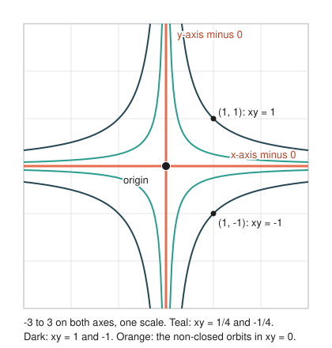

# Quotients by group actions: geometric invariant theory keeps the stable orbits and drops the rest

[Syllabus](../../../SYLLABUS.md) → [Algebraic geometry](../README.md) → [Schemes and Modern Language](../README.md#s06) → Quotients by group actions

---

## General Overview

Four lamp posts stand 10 m apart along a straight road, at 0, 10, 20 and 30 m. A photograph of the road puts them at 0, 200, 300 and 360 pixels from the first post. The spacing is gone: the far posts crowd together. Ratios of lengths are gone too.

One number survives. The **cross-ratio** of the four positions is 3/4 for the posts and 3/4 for the photograph. A camera aimed at a line acts on it by a projective map (a map of the form $`z \mapsto (az + b)/(cz + d)`$), and the cross-ratio is the one thing every such map leaves alone. If the posts are not labelled, so their order in the photo is unknown, a second number, $`j = 35152/9`$, also forgets the order.

That is the problem this card solves in general. A group (here, the projective maps of the line) moves the points of a space around. Each **orbit** is the set of points one point can be moved to. The goal is a new space, the **quotient**, with one point for each orbit, built from equations like every other variety. For four points on a line, the quotient is a line, and $`j`$ is its coordinate.

The tool is **invariant functions**: functions the group does not change. Over a finite group they separate the orbits. Over an infinite group like the scalings of space, some orbits are not closed (they creep towards another orbit without reaching it), and no invariant can tell them apart from what they creep towards. **Geometric invariant theory** (GIT) decides which orbits to keep and which to drop so that a quotient exists.

**The quotient of a space by a group is built from the invariant functions: for a finite group their spectrum has one point per orbit; for a reductive group (a group like the nonzero scalars or the invertible matrices) it has one point per closed orbit, and the projective version keeps the stable orbits, drops the unstable ones, and for four points on a line gives the line whose coordinate is j.**

**What kind of fact this is:** a construction and seven theorems. Proved on this card: invariants are constant on orbit closures; the cross-ratio is the complete invariant of four ordered points; the values of j match the reorderings exactly. Stated with sources: invariant rings of reductive groups are finitely generated, the quotient's points are the closed orbits, the Hilbert–Mumford test for stability, and the quotient of binary quartics as Proj of the ring of I and J.

### The picture: from posts to j


The cross-ratio forgets the camera. The j-invariant forgets the order too.

---

## The formula

Notation first, in words. G is a group acting on a space X, and $`g \cdot x`$ is where the group element g moves the point x. The ring $`k[X]^G`$ holds the **invariants**: polynomial functions f on X with $`f(g \cdot x) = f(x)`$ for every g, over a field k. The quotient is written $`X /\!\!/ G`$, read "X mod G". Spec of a ring is its space of prime ideals ([The spectrum of a ring](02-spectrum-of-a-ring-and-schemes.md)), and Proj of a graded ring is the projective space built from it ([Proj](10-proj-of-a-graded-ring.md)).

```math
X /\!\!/ G = \mathrm{Spec}\, k[X]^G, \qquad X^{ss} /\!\!/ G = \mathrm{Proj} \bigoplus_{d \ge 0} k[X]^{G}_{d}
```

**Read it aloud:** the affine quotient is the spectrum of the ring of invariants; the projective quotient is Proj of the ring of semi-invariants, taken degree by degree, and it sees only the semistable points.

A **semi-invariant of degree d** is a function the group multiplies by a fixed factor $`\chi(g)^d`$, where χ (chi) is a chosen character: a map from G to the nonzero numbers that respects multiplication. For the scalars, $`\chi(t) = t`$, and the degree-d semi-invariants are the polynomials of degree d. A point is **semistable** when some semi-invariant of positive degree is nonzero there, and **unstable** otherwise.

For four points on the line, with cross-ratio λ (lambda), the quotient's coordinate is

```math
j = \frac{256\,(\lambda^2 - \lambda + 1)^3}{\lambda^2(\lambda - 1)^2} = \frac{1728\, I^3}{I^3 - 27J^2}
```

**Read it aloud:** j is 256 times the cube of lambda squared minus lambda plus one, over lambda squared times lambda minus one squared; it is also 1728 I cubed over I cubed minus 27 J squared, for the two invariants I and J of the quartic whose roots are the four points.

Write the quartic as $`f = a_0 x^4 + 4a_1 x^3 y + 6a_2 x^2 y^2 + 4a_3 x y^3 + a_4 y^4`$. Then $`I = a_0 a_4 - 4a_1 a_3 + 3a_2^2`$ and $`J = a_0 a_2 a_4 + 2a_1 a_2 a_3 - a_0 a_3^2 - a_1^2 a_4 - a_2^3`$. Books scale I and J in different ways, and the 1728 formula needs this scaling.

For the posts, λ = 3/4 gives $`\lambda^2 - \lambda + 1 = 13/16`$ and $`\lambda^2(\lambda - 1)^2 = 9/256`$, so $`j = 256 \times (2197/4096) \times (256/9) = 35152/9`$.

| Symbol | Plain meaning | In our example | Push it up and the answer… |
| --- | --- | --- | --- |
| $`G`$, $`g`$ | the group, and one of its elements | projective maps of the line; $`z \mapsto 600z/(z + 20)`$ | a bigger group leaves fewer invariants |
| $`X`$, $`x`$, $`X^{ss}`$ | the space acted on, a point of it, and its semistable points | four points on the line; $`k^{n+1}`$ minus the origin for the scalars, n = 2 in the counts | — |
| $`G \cdot x`$, $`\overline{G \cdot x}`$ | the orbit of x, and its closure (the bar is closure here) | all photos of the four posts | — |
| $`k[X]^G`$ | the invariants: functions the group leaves alone | functions of λ, then of j | — |
| $`X /\!\!/ G`$ | the quotient: one point per closed orbit | the j-line | — |
| $`\chi`$, $`d`$, $`k[X]^G_d`$ | a character, a degree, and the degree-d semi-invariants | $`\chi(t) = t`$; polynomials of degree d | — |
| $`z_1, \dots, z_4`$, $`f`$ | four points on the line, and the quartic with those roots | 0, 10, 20, 30; $`x(x - 10y)(x - 20y)(x - 30y)`$ | — |
| $`\lambda`$ | the cross-ratio: where the fourth point lands when the first three go to 0, ∞, 1 | 3/4 | j grows as λ nears 0 or 1 |
| $`j`$ | the quotient's coordinate for four unordered points | 35152/9 | — |
| $`I`$, $`J`$; $`a_0, \dots, a_4`$ | the two invariants of a binary quartic, of degrees 2 and 3 in its coefficients; the coefficients, divided by 1, 4, 6, 4, 1 | 32500/3 and −4375000/27; 1, −15, 550/3, −1500, 0 | — |
| $`t`$ | a nonzero scalar, acting as $`(x, y) \mapsto (tx, y/t)`$ in the torus example | 1/10 | as t → 0, $`(t, 0)`$ runs into the origin |
| $`k`$, $`\mathbb{F}_p`$ | the field of numbers; remainders mod a prime p, used to count | ℂ for the geometry; p = 5, 7, 37 | — |

### When it holds

- **The group is finite or reductive.** Reductive groups include the finite groups, the nonzero scalars, tori (products of copies of the scalars) and the invertible matrices. For the additive group $`(x, y) \mapsto (x, y + sx)`$, which is not reductive, the invariant x lumps 7 closed orbits into one point over $`\mathbb{F}_7`$.
- **Orbits that are not closed are not points.** The quotient has one point per closed orbit. A count of all orbits gives 9 for the torus over $`\mathbb{F}_7`$; the quotient has 7 points.
- **The projective quotient drops unstable points first.** The scalars' invariants are only constants, so $`\mathrm{Spec}`$ gives one point. Dropping the origin and taking Proj gives $`\mathbb{P}^n`$.
- **For four points, the points must be distinct for a finite j.** Two points meeting give λ = 0, 1 or ∞, and j = ∞. Three meeting is unstable: both I and J vanish, and j is 0/0.
- **The field is ℂ for the geometry.** The counts mod p are $`\mathbb{F}_p`$ points of the complex picture: orbits of the complex group that meet the $`\mathbb{F}_p`$ points, and values of its complex invariants there. Over $`\mathbb{F}_p`$ the scalars, the torus and the additive group become finite groups with more invariants. The quotient can also have points no such orbit reaches: the cone $`v^2 = uw`$ of Step 1 has 49 points over $`\mathbb{F}_7`$, and the plane's 25 orbits reach 25 of them.

---

## Why it works

### Step 0: an invariant cannot separate an orbit from its limit

An invariant f takes one value on a whole orbit. Polynomials are continuous, so f takes that same value on the orbit's closure too. If the closures of two orbits meet, every invariant agrees on both. No space built from invariants can keep them apart. Every choice GIT makes follows from this.

### Step 1: a finite group, where every orbit is closed

Let the sign group $`\{1, -1\}`$ act on the plane by $`(x, y) \mapsto (-x, -y)`$. Each orbit is a pair of points, or the origin alone, and a finite set is closed. The invariant polynomials are those whose terms all have even degree. They are generated by $`u = x^2`$, $`v = xy`$, $`w = y^2`$, which satisfy one relation:

```math
k[x, y]^{\pm 1} = k[u, v, w]/(v^2 - uw)
```

**Read it aloud:** the invariants are polynomials in u, v and w, where v squared is set equal to u times w.

So the quotient is the cone $`v^2 = uw`$. Over $`\mathbb{F}_7`$ the points of the plane fall into 25 orbits, and grouping them by the values of $`(x^2, xy, y^2)`$ gives the same 25 classes. The count of invariants matches too: degree d has d + 1 of them for even d, and so does the cone. [Invariants of a finite group](../01-Polynomial%20Systems/10-invariant-theory-and-molien-series.md) builds such rings by averaging and counts them with the Molien series.

### Step 2: the scalars, where no orbit but one is closed

Let the nonzero scalars t act on $`k^{n+1}`$ by $`v \mapsto tv`$. A degree-d monomial gains the factor $`t^d`$, so at t = 2 it is fixed only for d = 0. The only invariants are constants. Every other orbit is a line through the origin with the origin removed, and its closure contains the origin. By Step 0, the affine quotient is one point.

GIT drops the origin, the one unstable point, since every polynomial of positive degree vanishes there. The degree-d semi-invariants for $`\chi(t) = t`$ are the degree-d polynomials. Proj of all of them is $`\mathbb{P}^n`$. Over $`\mathbb{F}_5`$ with n = 2, the nonzero vectors fall into 31 orbits, and the charts of $`\mathbb{P}^2`$ count 25 + 5 + 1 = 31 points. [Toric varieties](13-toric-varieties.md) builds the same $`\mathbb{P}^2`$ from a fan.

### Step 3: a torus, where some orbits must be glued

Let t act on the plane by $`(x, y) \mapsto (tx, y/t)`$. The monomial $`x^a y^b`$ gains $`t^{a - b}`$, so the invariants are polynomials in xy. The quotient is the line with coordinate $`c = xy`$.

<p align="center"></p>

Real points only, to scale. Each hyperbola $`xy = c`$ with c not zero is one closed orbit. Over c = 0 sit three orbits: the x-axis without the origin, the y-axis without the origin, and the origin. Moving $`(1, 0)`$ by t gives $`(t, 0)`$, which tends to the origin as t shrinks, so the axes are not closed. By Step 0 they are glued to the origin. Over $`\mathbb{F}_7`$ there are 9 orbits but 7 values of xy; the fibre over 0 (the points with xy = 0) holds orbits of sizes 1, 6 and 6.

### Step 4: the theorem, stated

For a reductive group G acting on an affine variety X over ℂ:

1. The invariant ring $`k[X]^G`$ is finitely generated, so $`X /\!\!/ G`$ is a variety (Hilbert for the matrix groups, Nagata in general).
2. Each point of $`X /\!\!/ G`$ comes from exactly one closed orbit. Every other orbit sent to that point has that closed orbit inside its closure.
3. A point is **stable** when its orbit is closed and its stabiliser (the group elements fixing it) is finite. On stable points the quotient really is the space of orbits.

These are stated, not proved. Mumford, Fogarty and Kirwan prove them in chapter 1. Algebraic groups, needed for the proofs, are left to a planned card in outline.

### Step 5: the Hilbert–Mumford test

Testing stability against the whole group is hard. The Hilbert–Mumford criterion says it is enough to test one-parameter subgroups: copies of the scalars inside G, such as $`t \mapsto \mathrm{diag}(t, 1/t)`$. Under that one, the monomial $`x^{4-k}y^k`$ of a binary quartic (a polynomial in x and y with every term of degree 4) is multiplied by $`t^{4-2k}`$, its **weight**. A form is unstable when, after some change of coordinates, its weights are all positive or all negative, so t → 0 or t → ∞ sends it to 0. A weight of 0 blocks this, since that term never moves.

For binary quartics this gives a rule about roots, stated with its source. A quartic is unstable when a root is repeated three or more times, semistable when no root is repeated more than twice, and stable when its four roots are distinct.

| Quartic | Roots | Weights present | I, J, $`I^3 - 27J^2`$ | Status |
| --- | --- | --- | --- | --- |
| $`xy^3`$ | a triple root | −2 | 0, 0, 0 | unstable: dropped |
| $`x^2y^2`$ | two double roots | 0 | 1/12, −1/216, 0 | semistable, closed orbit |
| $`x^2y^2 - x^3y`$ | one double root | 2, 0 | 1/12, −1/216, 0 | semistable, not closed |
| four distinct roots | — | — | $`I^3 \ne 27J^2`$ | stable |

At t = 1/10 the third quartic becomes $`x^2y^2 - \tfrac{1}{100}x^3y`$. As t → 0 it tends to $`x^2y^2`$, so its orbit closure holds the second one's orbit, and both get the same I and J. GIT keeps them as one point, j = ∞.

### Step 6: four ordered points have one invariant, λ

A projective map of the line is fixed by where it sends three points. So one map sends $`z_1, z_2, z_3`$ to 0, ∞, 1, and the image of $`z_4`$ is

```math
\lambda = \frac{(z_4 - z_1)(z_3 - z_2)}{(z_4 - z_2)(z_3 - z_1)}
```

**Read it aloud:** lambda is the product of the gaps from z4 to z1 and from z3 to z2, over the product of the gaps from z4 to z2 and from z3 to z1.

Two ordered quadruples are in one orbit exactly when their λ agree. For the posts, $`\lambda = (30 \times 10)/(20 \times 20) = 3/4`$; for the photo, $`(360 \times 100)/(160 \times 300) = 3/4`$.

### Step 7: forgetting the order gives j

The 24 orderings of four points give only 6 values of λ: λ, 1/λ, 1 − λ, 1/(1 − λ), λ/(λ − 1) and (λ − 1)/λ. For the posts they are −3, −1/3, 1/4, 3/4, 4/3 and 4. So unordered points need a function of λ that these six moves leave alone, and j is one.

<details>
<summary>Why j separates the six-value groups exactly</summary>

Substitute λ → 1/λ: the top gains a factor $`\lambda^{-6}`$ and so does the bottom. Substitute λ → 1 − λ: both $`\lambda^2 - \lambda + 1`$ and $`\lambda^2(\lambda - 1)^2`$ are unchanged. These two moves generate all six, so j is invariant.

Conversely, λ is a root of the degree-6 polynomial

$`\displaystyle 256\,(\lambda^2 - \lambda + 1)^3 - j\,\lambda^2(\lambda - 1)^2 = 0`$

with coefficients in the functions of j. So the functions of λ are at most degree 6 over the functions of j. The six moves form a group of order 6, and the functions they fix are exactly degree 6 below the functions of λ (Artin's theorem on fixed fields). The fixed functions contain the functions of j, and both sit degree 6 below, so they are equal. A value of j therefore has six values of λ, counted with repeats, and they form one group of six moves.

</details>

The code checks this mod 37: for λ = 2 to 36, grouping by the value of j gives exactly the groups made by the six moves, 7 of them, of sizes 2, 3, 6, 6, 6, 6 and 6. The group of 3 is the harmonic set −1, 2, 1/2, with j = 1728. The group of 2 holds the two roots of $`\lambda^2 - \lambda + 1`$, where the top of j vanishes. Counting orderings directly agrees: the harmonic set −3, 0, 1, 3 gives each of its three values from 8 of the 24 orderings, and the set 0, 1, 10, 26 mod 37, which is 0 and the three cube roots of 1, gives each of its two values from 12.

### Step 8: the same j, three ways

The quartic with roots at the four posts is $`f = x(x - 10y)(x - 20y)(x - 30y) = x^4 - 60x^3y + 1100x^2y^2 - 6000xy^3`$. So $`a_0, \dots, a_4`$ are 1, −15, 550/3, −1500 and 0, and the formulas for I and J give $`I = 32500/3`$ and $`J = -4375000/27`$. The substitution $`x \to 2x + y`$, $`y \to x + y`$ has determinant 1 and leaves both unchanged. The quotient of all binary quartics by these substitutions is Proj of the ring generated by I and J (stated; Dolgachev, in Sources). Its one coordinate is $`I^3/(I^3 - 27J^2)`$, and 1728 times it is j, giving 35152/9.

The third road is the elliptic curve $`y^2 = x(x - 1)(x - \lambda)`$, the Legendre form. Its four branch points (where the two square roots meet) are 0, 1, λ and ∞. Moving it to short form and applying the j of [Weierstrass form](../04-Elliptic%20Curves/02-weierstrass-forms-discriminant-and-j-invariant.md) gives 35152/9 again. So four points on the line and elliptic curves share one moduli space, the j-line of [Moduli spaces](07-moduli-spaces-in-outline.md). At λ = −1 the curve is $`y^2 = x^3 - x`$, with j = 1728.

---

## Worked numbers, by hand

| Step | Arithmetic | Value |
| --- | --- | --- |
| posts | 10 m apart | 0, 10, 20, 30 m |
| photo | $`600z/(z + 20)`$ | 0, 200, 300, 360 px |
| cross-ratio, posts | $`(30 \times 10)/(20 \times 20)`$ | 3/4 |
| cross-ratio, photo | $`(360 \times 100)/(160 \times 300)`$ | 3/4 |
| the six orderings | λ, 1/λ, 1 − λ, … | −3, −1/3, 1/4, 3/4, 4/3, 4 |
| top of j | $`256 \times (13/16)^3 = 256 \times 2197/4096`$ | 2197/16 |
| bottom of j | $`(3/4)^2 \times (1/4)^2`$ | 9/256 |
| j | $`(2197/16) \times (256/9)`$ | **35152/9** |
| check by I and J | $`1728 I^3/(I^3 - 27J^2)`$ | 35152/9 |
| harmonic set, λ = −1 | $`256 \times 3^3/(1 \times 4) = 256 \times 27/4`$ | 1728 |

Any photo of these four posts, from any camera and with the posts in any order, gives j = 35152/9, and four points with a different j cannot be a photo of these posts. For the harmonic set, four points with λ = −1, the six values collapse to three, −1, 2 and 1/2, each from 8 of the 24 orderings, and j = 1728. Only the equianharmonic set, where $`\lambda^2 - \lambda + 1 = 0`$ and j = 0, is more symmetric: two values, 12 orderings each.

### What breaks if you drop a piece

| Mistake | Comes out at | What went wrong |
| --- | --- | --- |
| Spec of the scalars' invariants as the quotient | 1 point, not the 31 points of $`\mathbb{P}^2`$ over $`\mathbb{F}_5`$ | the unstable origin lies in every orbit closure; drop it and take Proj |
| Every torus orbit counted as a point | 9 points over $`\mathbb{F}_7`$, not 7 | the axes are not closed and glue to the origin |
| λ used for unordered points | 6 values for one photo | λ sees the order; j forgets it |
| A non-reductive group | 13 closed orbits over $`\mathbb{F}_7`$, 7 values of the invariant x | the additive group fails the theorem of Step 4 |

The code prints all four.

---

## Code, from first principles, and it actually runs

Nothing imported contains an answer; Python uses fractions from the standard library and Rust an i128 fraction type with checked multiplication. The checks take four kinds of road. Orbits are listed by moving points and compared with classes of equal invariants over $`\mathbb{F}_7`$, $`\mathbb{F}_5`$ and $`\mathbb{F}_{37}`$. Invariants are counted two ways for the sign group. The j of the posts is reached three ways: the λ formula, the quartic's I and J, and the Legendre curve's Weierstrass j. The stability table is computed from coefficients.

### Python

```python
# Geometric invariant theory in outline -- the check behind the card.  Standard
# library only.  Quotients by group actions, decided exactly: the sign group on
# the plane, the scalars giving P^2, a torus whose fibre over 0 holds orbits that
# are not closed, an additive group that breaks the rule, and four points on a
# line, whose quotient coordinate j is reached by three roads and counted mod 37.
from fractions import Fraction as F

def fr(v): return str(v.numerator) if v.denominator == 1 else f"{v.numerator}/{v.denominator}"
def ls(vals): return "[" + ", ".join(fr(v) for v in vals) + "]"
def yn(claim): return "yes" if claim else "no"

def orbits(points, moves):                  # orbits under a full list of group elements
    seen, out = set(), []
    for pt in points:
        if pt not in seen:
            orb = {m(pt) for m in moves}
            seen |= orb
            out.append(tuple(sorted(orb)))
    return sorted(out)
def classes(points, key):                   # points grouped by the value of key
    out = {}
    for pt in points:
        out.setdefault(key(pt), []).append(pt)
    return sorted(tuple(sorted(c)) for c in out.values())

p = 7
plane = [(x, y) for x in range(p) for y in range(p)]
signs = orbits(plane, [lambda v: v, lambda v: (-v[0] % p, -v[1] % p)])
sign_cls = classes(plane, lambda v: (v[0] * v[0] % p, v[0] * v[1] % p, v[1] * v[1] % p))
print(f"signs on F_7^2: {len(signs)} orbits, {len(sign_cls)} classes of equal (x^2, xy, y^2); same split: {yn(signs == sign_cls)}")
cone7 = {(u, v, w) for u in range(p) for v in range(p) for w in range(p) if (v * v - u * w) % p == 0}
print(f"cone v^2 = uw over F_7: {len(cone7)} points; values of (x^2, xy, y^2) on F_7^2: {len(sign_cls)} of them")
inv_deg = [sum(1 for a in range(d + 1) if d % 2 == 0) for d in range(9)]      # monomials x^a y^(d-a), d even
cone_deg = [0 if d % 2 else sum(1 for i in range(d // 2 + 1) for e in (0, 1) for k in range(d // 2 + 1)
                                if i + e + k == d // 2) for d in range(9)]     # u^i v^e w^k, v^2 replaced
print(f"invariants of degree 0 to 8: {inv_deg}; cone uw = v^2 by degree: {cone_deg}")
units5 = [lambda v, t=t: tuple(t * c % 5 for c in v) for t in range(1, 5)]
space = [(a, b, c) for a in range(5) for b in range(5) for c in range(5) if (a, b, c) != (0, 0, 0)]
lines5 = orbits(space, units5)
print(f"scalars on F_5^3 minus 0: {len(lines5)} orbits; P^2 over F_5 by charts: 25 + 5 + 1 = {25 + 5 + 1}")
print(f"degrees 0 to 4 whose monomials in x, y, z are fixed by t = 2: {[d for d in range(5) if F(2) ** d == 1]}")
torus = orbits(plane, [lambda v, t=t: (t * v[0] % p, pow(t, p - 2, p) * v[1] % p) for t in range(1, p)])
fibre0 = sorted(len(o) for o in torus if o[0][0] * o[0][1] % p == 0)
print(f"torus (tx, y/t) on F_7^2: {len(torus)} orbits, {len({v[0] * v[1] % p for v in plane})} values of xy; "
      f"orbit sizes over xy = 0: {fibre0}")
print(f"monomials x^a y^b, a + b <= 4, fixed by t = 2: {[(a, b) for a in range(5) for b in range(5 - a) if F(2) ** (a - b) == 1]}")
add_orbs = orbits(plane, [lambda v, s=s: (v[0], (v[1] + s * v[0]) % p) for s in range(p)])
print(f"additive group (x, y + sx) on F_7^2: {len(add_orbs)} orbits, all closed; the invariant x takes {p} values")

def cross(z1, z2, z3, z4):                  # send z1, z2, z3 to 0, infinity, 1: lambda is where z4 lands
    return (z4 - z1) * (z3 - z2) / ((z4 - z2) * (z3 - z1))
def jl(lam):                                # j as a function of the cross-ratio
    return 256 * (lam * lam - lam + 1) ** 3 / (lam * lam * (lam - 1) ** 2)
def quartic(roots):                         # coefficients of prod (x - r y), from x^4 down to y^4
    c = [F(1)]
    for r in roots:
        c = [(c[i] if i < len(c) else 0) - (r * c[i - 1] if i else 0) for i in range(len(c) + 1)]
    return c
def IJ(c):                                  # I, J of a0 x^4 + 4a1 x^3y + 6a2 x^2y^2 + 4a3 xy^3 + a4 y^4
    a, b, cc, d, e = c[0], c[1] / 4, c[2] / 6, c[3] / 4, c[4]
    return a * e - 4 * b * d + 3 * cc * cc, a * cc * e + 2 * b * cc * d - a * d * d - b * b * e - cc ** 3
def j_ij(c):
    i, j = IJ(c)
    return 1728 * i ** 3 / (i ** 3 - 27 * j * j)
def j_legendre(lam):                        # y^2 = x(x - 1)(x - lam), moved to short Weierstrass form
    pp, qq = -(1 + lam), lam
    a, b = qq - pp * pp / 3, -pp * qq / 3 + 2 * pp ** 3 / 27
    return 1728 * 4 * a ** 3 / (4 * a ** 3 + 27 * b * b)

def act(c, g):                              # substitute x -> g0 x + g1 y, y -> g2 x + g3 y
    out = [F(0)] * 5
    for k, ck in enumerate(c):
        term = [F(1)]
        for lin in [(g[0], g[1])] * (4 - k) + [(g[2], g[3])] * k:
            term = [(term[i] if i < len(term) else 0) * lin[0] + (term[i - 1] * lin[1] if i else 0)
                    for i in range(len(term) + 1)]
        out = [o + ck * t for o, t in zip(out, term)]
    return out

posts = [F(0), F(10), F(20), F(30)]
photo = [600 * z / (z + 20) for z in posts]
lam = cross(*posts)
perms = [(a, b, c, d) for a in range(4) for b in range(4) for c in range(4) for d in range(4) if len({a, b, c, d}) == 4]
six = sorted({cross(*[posts[i] for i in q]) for q in perms})
print(f"posts at {ls(posts)} m; photo at {ls(photo)} px")
print(f"cross-ratio of the posts {fr(lam)}, of the photo {fr(cross(*photo))}")
print(f"24 orderings give {len(six)} values: {ls(six)}")
print(f"j of the six: {ls(sorted({jl(v) for v in six}))}")
top = lam * lam - lam + 1
print(f"by hand at 3/4: lambda^2 - lambda + 1 = {fr(top)}, cubed {fr(top ** 3)}, times 256 = {fr(256 * top ** 3)}; "
      f"lambda^2 (lambda - 1)^2 = {fr(lam * lam * (lam - 1) ** 2)}")
print(f"j by the formula {fr(jl(lam))}; by I and J of the posts {fr(j_ij(quartic(posts)))}, "
      f"of the photo {fr(j_ij(quartic(photo)))}; by the Legendre curve {fr(j_legendre(lam))}")
g = (2, 1, 1, 1)
I0, J0 = IJ(quartic(posts))
I1, J1 = IJ(act(quartic(posts), g))
print(f"posts quartic: coefficients {ls(quartic(posts))}; a0..a4 = {ls([v / k for v, k in zip(quartic(posts), (1, 4, 6, 4, 1))])}")
print(f"posts quartic: I = {fr(I0)}, J = {fr(J0)}; after x -> 2x + y, y -> x + y: I = {fr(I1)}, J = {fr(J1)}")
h = F(-1)
print(f"harmonic lambda = -1, 2, 1/2: j = {ls([jl(F(v)) for v in (-1, 2, F(1, 2))])}; at -1: 256 x {fr((h * h - h + 1) ** 3 / (h * h * (h - 1) ** 2))}; "
      f"xy(x - y)(x + y) has J = {fr(IJ([F(0), F(1), F(0), F(-1), F(0)])[1])}, j = {fr(j_ij([F(0), F(1), F(0), F(-1), F(0)]))}")
hv = [cross(*[[F(-3), F(0), F(1), F(3)][i] for i in o]) for o in perms]      # a harmonic set: lambda = -1 in some order
print(f"harmonic set -3, 0, 1, 3: {len(hv)} orderings give {ls(sorted(set(hv)))}, orderings per value {[hv.count(v) for v in sorted(set(hv))]}")
q = 37
six_maps = [lambda l: l, lambda l: pow(l, q - 2, q), lambda l: (1 - l) % q, lambda l: pow(1 - l, q - 2, q),
            lambda l: l * pow(l - 1, q - 2, q) % q, lambda l: (l - 1) * pow(l, q - 2, q) % q]
jmod = lambda l: 256 * pow(l * l - l + 1, 3, q) * pow(l * l * (l - 1) ** 2, q - 2, q) % q
lam_orbs = orbits(list(range(2, q)), six_maps)
j_cls = classes(list(range(2, q)), jmod)
print(f"mod {q}: {len(lam_orbs)} orbits of the six moves on lambda = 2..{q - 1}, {len(j_cls)} values of j; "
      f"same split: {yn(lam_orbs == j_cls)}; orbit sizes {sorted(len(o) for o in lam_orbs)}")
w3 = next(x for x in range(2, q) if pow(x, 3, q) == 1); eq = [0, 1, w3, w3 * w3 % q]   # 0 and the three cube roots of 1
ev = [(eq[d] - eq[a]) * (eq[c] - eq[b]) * pow((eq[d] - eq[b]) * (eq[c] - eq[a]), q - 2, q) % q for a, b, c, d in perms]
print(f"mod {q}: equianharmonic set {eq}: values {sorted(set(ev))}, orderings per value {[ev.count(v) for v in sorted(set(ev))]}, j = {sorted({jmod(v) for v in ev})}")
for name, c in [("x y^3, triple root", [0, 0, 0, 1, 0]), ("x^2 y^2, two double roots", [0, 0, 1, 0, 0]),
                ("x^2 y^2 - x^3 y, one double root", [0, -1, 1, 0, 0])]:
    i, j = IJ([F(v) for v in c])
    wts = [4 - 2 * k for k in range(5) if c[k]]
    print(f"{name}: I = {fr(i)}, J = {fr(j)}, I^3 - 27J^2 = {fr(i ** 3 - 27 * j * j)}; torus weights {wts}")
t = F(1, 10)
print(f"x^2 y^2 - x^3 y moved by x -> tx, y -> y/t at t = 1/10: x^3 y coefficient {fr(-t * t)}, x^2 y^2 coefficient 1")
print(f"mistake 1, Spec of the scalars' invariants: 1 point, not the {len(lines5)} points of P^2 over F_5")
print(f"mistake 2, every torus orbit a point: {len(torus)} points, not {p}")
print(f"mistake 3, lambda as the coordinate of unordered points: {len(six)} values for one photo, not 1")
print(f"mistake 4, a non-reductive group: {len(add_orbs)} closed orbits, {p} values of the invariant")
print("figure, square -3 to 3 at 60 px per unit; (1, 1) at (270, 150); (1, -1) at (270, 270); origin at (210, 210)")
assert signs == sign_cls and len(signs) == (p * p - 1) // 2 + 1                       # finite group: classes = orbits
assert inv_deg == cone_deg                                                           # two counts of invariants
assert len(lines5) == 31 and len(torus) == p + 2 and fibre0 == [1, p - 1, p - 1]     # orbit counts
assert len(add_orbs) == 2 * p - 1 and all(len({a * b % p for a, b in o}) == 1 for o in torus)  # xy is invariant
assert lam == cross(*photo) == F(3, 4) and len(six) == 6                             # camera keeps lambda
assert jl(lam) == j_ij(quartic(posts)) == j_ij(quartic(photo)) == j_legendre(lam)    # three roads to j
assert len({jl(v) for v in six}) == 1 and (I0, J0) == (I1, J1)                       # j forgets the order
assert jl(F(-1)) == 1728 == j_legendre(F(-1))
assert sorted(set(hv)) == [-1, F(1, 2), 2] and [hv.count(v) for v in set(hv)] == [8, 8, 8]       # harmonic: 3 values
assert [ev.count(v) for v in set(ev)] == [12, 12] and {jmod(v) for v in ev} == {0}                # equianharmonic: 2 values
assert len(cone7) == p * p and {(x * x % p, x * y % p, y * y % p) for x, y in plane} < cone7       # the plane reaches 25 of 49
assert lam_orbs == j_cls                                                             # fibres of j are orbits
print("ALL CHECKS PASS")
```

**Ran 2026-11-24 on macOS, Python 3.14.10, standard library only. All checks passed. Output, pasted from the run:**

```
signs on F_7^2: 25 orbits, 25 classes of equal (x^2, xy, y^2); same split: yes
cone v^2 = uw over F_7: 49 points; values of (x^2, xy, y^2) on F_7^2: 25 of them
invariants of degree 0 to 8: [1, 0, 3, 0, 5, 0, 7, 0, 9]; cone uw = v^2 by degree: [1, 0, 3, 0, 5, 0, 7, 0, 9]
scalars on F_5^3 minus 0: 31 orbits; P^2 over F_5 by charts: 25 + 5 + 1 = 31
degrees 0 to 4 whose monomials in x, y, z are fixed by t = 2: [0]
torus (tx, y/t) on F_7^2: 9 orbits, 7 values of xy; orbit sizes over xy = 0: [1, 6, 6]
monomials x^a y^b, a + b <= 4, fixed by t = 2: [(0, 0), (1, 1), (2, 2)]
additive group (x, y + sx) on F_7^2: 13 orbits, all closed; the invariant x takes 7 values
posts at [0, 10, 20, 30] m; photo at [0, 200, 300, 360] px
cross-ratio of the posts 3/4, of the photo 3/4
24 orderings give 6 values: [-3, -1/3, 1/4, 3/4, 4/3, 4]
j of the six: [35152/9]
by hand at 3/4: lambda^2 - lambda + 1 = 13/16, cubed 2197/4096, times 256 = 2197/16; lambda^2 (lambda - 1)^2 = 9/256
j by the formula 35152/9; by I and J of the posts 35152/9, of the photo 35152/9; by the Legendre curve 35152/9
posts quartic: coefficients [1, -60, 1100, -6000, 0]; a0..a4 = [1, -15, 550/3, -1500, 0]
posts quartic: I = 32500/3, J = -4375000/27; after x -> 2x + y, y -> x + y: I = 32500/3, J = -4375000/27
harmonic lambda = -1, 2, 1/2: j = [1728, 1728, 1728]; at -1: 256 x 27/4; xy(x - y)(x + y) has J = 0, j = 1728
harmonic set -3, 0, 1, 3: 24 orderings give [-1, 1/2, 2], orderings per value [8, 8, 8]
mod 37: 7 orbits of the six moves on lambda = 2..36, 7 values of j; same split: yes; orbit sizes [2, 3, 6, 6, 6, 6, 6]
mod 37: equianharmonic set [0, 1, 10, 26]: values [11, 27], orderings per value [12, 12], j = [0]
x y^3, triple root: I = 0, J = 0, I^3 - 27J^2 = 0; torus weights [-2]
x^2 y^2, two double roots: I = 1/12, J = -1/216, I^3 - 27J^2 = 0; torus weights [0]
x^2 y^2 - x^3 y, one double root: I = 1/12, J = -1/216, I^3 - 27J^2 = 0; torus weights [2, 0]
x^2 y^2 - x^3 y moved by x -> tx, y -> y/t at t = 1/10: x^3 y coefficient -1/100, x^2 y^2 coefficient 1
mistake 1, Spec of the scalars' invariants: 1 point, not the 31 points of P^2 over F_5
mistake 2, every torus orbit a point: 9 points, not 7
mistake 3, lambda as the coordinate of unordered points: 6 values for one photo, not 1
mistake 4, a non-reductive group: 13 closed orbits, 7 values of the invariant
figure, square -3 to 3 at 60 px per unit; (1, 1) at (270, 150); (1, -1) at (270, 270); origin at (210, 210)
ALL CHECKS PASS
```

### Rust

Same numbers, same labels, built with `rustc --edition 2021 -O`. Fractions are an i128 struct with checked multiplication, so an overflow stops the run.

```rust
// Geometric invariant theory in outline -- the same check as the Python, in Rust.
// No crates.  Quotients by group actions, decided exactly: the sign group on
// the plane, the scalars giving P^2, a torus whose fibre over 0 holds orbits that
// are not closed, an additive group that breaks the rule, and four points on a
// line, whose quotient coordinate j is reached by three roads and counted mod 37.
use std::collections::{BTreeMap, BTreeSet};
#[derive(Clone, Copy, PartialEq, Eq, PartialOrd, Ord, Debug, Hash)]
struct Q { n: i128, d: i128 }
fn gcd(a: i128, b: i128) -> i128 { if b == 0 { a.abs() } else { gcd(b, a % b) } }
fn q(n: i128, d: i128) -> Q { let g = gcd(n, d).max(1) * d.signum(); Q { n: n / g, d: d / g } }
fn z(n: i128) -> Q { q(n, 1) }
fn mul(a: Q, b: Q) -> Q {                          // cancel across first, then multiply
    let (g, h) = (gcd(a.n, b.d).max(1), gcd(b.n, a.d).max(1));
    q((a.n / g).checked_mul(b.n / h).unwrap(), (a.d / h).checked_mul(b.d / g).unwrap()) }
fn add(a: Q, b: Q) -> Q {
    let l = (a.d / gcd(a.d, b.d)).checked_mul(b.d).unwrap();
    q((l / a.d).checked_mul(a.n).unwrap().checked_add((l / b.d).checked_mul(b.n).unwrap()).unwrap(), l) }
fn sub(a: Q, b: Q) -> Q { add(a, mul(z(-1), b)) }
fn div(a: Q, b: Q) -> Q { mul(a, q(b.d, b.n)) }
fn pw(a: Q, k: u32) -> Q { (0..k).fold(z(1), |acc, _| mul(acc, a)) }
fn s(a: Q) -> String { if a.d == 1 { format!("{}", a.n) } else { format!("{}/{}", a.n, a.d) } }
fn ls(v: &[Q]) -> String { format!("[{}]", v.iter().map(|&x| s(x)).collect::<Vec<_>>().join(", ")) }
fn yn(c: bool) -> &'static str { if c { "yes" } else { "no" } }
fn orbits<P: Ord + Clone>(pts: &[P], all: impl Fn(&P) -> Vec<P>) -> Vec<Vec<P>> {
    let (mut seen, mut out) = (BTreeSet::new(), Vec::new());
    for pt in pts {
        if !seen.contains(pt) {
            let orb: BTreeSet<P> = all(pt).into_iter().collect();
            seen.extend(orb.iter().cloned());
            out.push(orb.into_iter().collect::<Vec<P>>());
        }
    }
    out.sort(); out }
fn classes<P: Ord + Clone, K: Ord>(pts: &[P], key: impl Fn(&P) -> K) -> Vec<Vec<P>> {
    let mut m: BTreeMap<K, Vec<P>> = BTreeMap::new();
    for pt in pts { m.entry(key(pt)).or_default().push(pt.clone()) }
    let mut out: Vec<Vec<P>> = m.into_values().map(|mut c| { c.sort(); c }).collect();
    out.sort(); out }
fn pmod(b: i64, e: i64, m: i64) -> i64 { (0..e).fold(1, |acc, _| acc * b.rem_euclid(m) % m) }
fn cross(z1: Q, z2: Q, z3: Q, z4: Q) -> Q {        // send z1, z2, z3 to 0, infinity, 1: lambda is where z4 lands
    div(mul(sub(z4, z1), sub(z3, z2)), mul(sub(z4, z2), sub(z3, z1))) }
fn jl(l: Q) -> Q {                                 // j as a function of the cross-ratio
    div(mul(z(256), pw(add(sub(mul(l, l), l), z(1)), 3)), mul(mul(l, l), pw(sub(l, z(1)), 2))) }
fn quartic(roots: &[Q]) -> Vec<Q> {                // coefficients of prod (x - r y), from x^4 down to y^4
    let mut c = vec![z(1)];
    for &r in roots {
        c = (0..=c.len()).map(|i| sub(if i < c.len() { c[i] } else { z(0) }, if i > 0 { mul(r, c[i - 1]) } else { z(0) })).collect();
    }
    c }
fn ij(c: &[Q]) -> (Q, Q) {                         // I, J of a0 x^4 + 4a1 x^3y + 6a2 x^2y^2 + 4a3 xy^3 + a4 y^4
    let (a, b, cc, d, e) = (c[0], div(c[1], z(4)), div(c[2], z(6)), div(c[3], z(4)), c[4]);
    let i = add(sub(mul(a, e), mul(z(4), mul(b, d))), mul(z(3), mul(cc, cc)));
    let j = sub(sub(sub(add(mul(a, mul(cc, e)), mul(z(2), mul(b, mul(cc, d)))), mul(a, mul(d, d))), mul(mul(b, b), e)), pw(cc, 3));
    (i, j) }
fn j_ij(c: &[Q]) -> Q { let (i, j) = ij(c); div(mul(z(1728), pw(i, 3)), sub(pw(i, 3), mul(z(27), mul(j, j)))) }
fn j_legendre(l: Q) -> Q {                         // y^2 = x(x - 1)(x - lam), moved to short Weierstrass form
    let (p, qq) = (mul(z(-1), add(z(1), l)), l);
    let a = sub(qq, div(mul(p, p), z(3)));
    let b = add(div(mul(z(-1), mul(p, qq)), z(3)), div(mul(z(2), pw(p, 3)), z(27)));
    div(mul(z(1728 * 4), pw(a, 3)), add(mul(z(4), pw(a, 3)), mul(z(27), mul(b, b)))) }
fn act(c: &[Q], g: [Q; 4]) -> Vec<Q> {             // substitute x -> g0 x + g1 y, y -> g2 x + g3 y
    let mut out = vec![z(0); 5];
    for (k, &ck) in c.iter().enumerate() {
        let mut term = vec![z(1)];
        for m in 0..4 {
            let lin = if m < 4 - k { (g[0], g[1]) } else { (g[2], g[3]) };
            term = (0..=term.len()).map(|i| add(if i < term.len() { mul(term[i], lin.0) } else { z(0) },
                                                 if i > 0 { mul(term[i - 1], lin.1) } else { z(0) })).collect();
        }
        for i in 0..5 { out[i] = add(out[i], mul(ck, term[i])) }
    }
    out }
fn main() {
    let p: i64 = 7;
    let plane: Vec<(i64, i64)> = (0..p).flat_map(|x| (0..p).map(move |y| (x, y))).collect();
    let signs = orbits(&plane, |v| vec![*v, ((-v.0).rem_euclid(p), (-v.1).rem_euclid(p))]);
    let sign_cls = classes(&plane, |v| (v.0 * v.0 % p, v.0 * v.1 % p, v.1 * v.1 % p));
    println!("signs on F_7^2: {} orbits, {} classes of equal (x^2, xy, y^2); same split: {}", signs.len(), sign_cls.len(), yn(signs == sign_cls));
    let cone7: BTreeSet<(i64, i64, i64)> = (0..p * p * p).map(|n| (n / (p * p), n / p % p, n % p)).filter(|&(u, v, w)| (v * v - u * w) % p == 0).collect();
    println!("cone v^2 = uw over F_7: {} points; values of (x^2, xy, y^2) on F_7^2: {} of them", cone7.len(), sign_cls.len());
    let inv_deg: Vec<i64> = (0..9).map(|d| if d % 2 == 0 { d + 1 } else { 0 }).collect();
    let cone_deg: Vec<i64> = (0..9).map(|d: i64| if d % 2 == 1 { 0 } else {
        let h = d / 2;
        (0..=h).map(|i| [0, 1].iter().map(|e| (0..=h).filter(|k| i + e + k == h).count() as i64).sum::<i64>()).sum() }).collect();
    println!("invariants of degree 0 to 8: {:?}; cone uw = v^2 by degree: {:?}", inv_deg, cone_deg);
    let space: Vec<(i64, i64, i64)> = (0..125).map(|n| (n / 25, n / 5 % 5, n % 5)).filter(|&v| v != (0, 0, 0)).collect();
    let lines5 = orbits(&space, |v| (1..5).map(|t| (t * v.0 % 5, t * v.1 % 5, t * v.2 % 5)).collect());
    println!("scalars on F_5^3 minus 0: {} orbits; P^2 over F_5 by charts: 25 + 5 + 1 = {}", lines5.len(), 25 + 5 + 1);
    println!("degrees 0 to 4 whose monomials in x, y, z are fixed by t = 2: {:?}", (0..5).filter(|&d| pw(z(2), d) == z(1)).collect::<Vec<u32>>());
    let torus = orbits(&plane, |v| (1..p).map(|t| (t * v.0 % p, pmod(t, p - 2, p) * v.1 % p)).collect());
    let mut fibre0: Vec<usize> = torus.iter().filter(|o| o[0].0 * o[0].1 % p == 0).map(|o| o.len()).collect(); fibre0.sort();
    let xy_vals: BTreeSet<i64> = plane.iter().map(|v| v.0 * v.1 % p).collect();
    println!("torus (tx, y/t) on F_7^2: {} orbits, {} values of xy; orbit sizes over xy = 0: {:?}", torus.len(), xy_vals.len(), fibre0);
    let fixed: Vec<(i32, i32)> = (0..5).flat_map(|a| (0..5 - a).map(move |b| (a, b))).filter(|&(a, b): &(i32, i32)| pw(z(2), (a - b).unsigned_abs()) == z(1)).collect();
    println!("monomials x^a y^b, a + b <= 4, fixed by t = 2: {:?}", fixed);
    let add_orbs = orbits(&plane, |v| (0..p).map(|s| (v.0, (v.1 + s * v.0) % p)).collect());
    println!("additive group (x, y + sx) on F_7^2: {} orbits, all closed; the invariant x takes {} values", add_orbs.len(), p);
    let posts: Vec<Q> = [0, 10, 20, 30].iter().map(|&v| z(v)).collect();
    let photo: Vec<Q> = posts.iter().map(|&v| div(mul(z(600), v), add(v, z(20)))).collect();
    let lam = cross(posts[0], posts[1], posts[2], posts[3]);
    let perms: Vec<[usize; 4]> = (0..256).map(|n| [n / 64, n / 16 % 4, n / 4 % 4, n % 4]).filter(|o| BTreeSet::from(*o).len() == 4).collect();
    let mut six: Vec<Q> = Vec::new();
    for o in &perms { let v = cross(posts[o[0]], posts[o[1]], posts[o[2]], posts[o[3]]); if !six.contains(&v) { six.push(v) } }
    six.sort_by(|x, y| (x.n * y.d).cmp(&(y.n * x.d)));
    println!("posts at {} m; photo at {} px", ls(&posts), ls(&photo));
    println!("cross-ratio of the posts {}, of the photo {}", s(lam), s(cross(photo[0], photo[1], photo[2], photo[3])));
    println!("24 orderings give {} values: {}", six.len(), ls(&six));
    let mut js: Vec<Q> = six.iter().map(|&v| jl(v)).collect(); js.dedup();
    println!("j of the six: {}", ls(&js));
    let top = add(sub(mul(lam, lam), lam), z(1));
    println!("by hand at 3/4: lambda^2 - lambda + 1 = {}, cubed {}, times 256 = {}; lambda^2 (lambda - 1)^2 = {}",
             s(top), s(pw(top, 3)), s(mul(z(256), pw(top, 3))), s(mul(mul(lam, lam), pw(sub(lam, z(1)), 2))));
    println!("j by the formula {}; by I and J of the posts {}, of the photo {}; by the Legendre curve {}",
             s(jl(lam)), s(j_ij(&quartic(&posts))), s(j_ij(&quartic(&photo))), s(j_legendre(lam)));
    let (i0, j0) = ij(&quartic(&posts));
    let (i1, j1) = ij(&act(&quartic(&posts), [z(2), z(1), z(1), z(1)]));
    println!("posts quartic: coefficients {}; a0..a4 = {}", ls(&quartic(&posts)), ls(&quartic(&posts).iter().zip([1, 4, 6, 4, 1]).map(|(&v, k)| div(v, z(k))).collect::<Vec<Q>>()));
    println!("posts quartic: I = {}, J = {}; after x -> 2x + y, y -> x + y: I = {}, J = {}", s(i0), s(j0), s(i1), s(j1));
    let hq = [z(0), z(1), z(0), z(-1), z(0)]; let h = z(-1);
    println!("harmonic lambda = -1, 2, 1/2: j = {}; at -1: 256 x {}; xy(x - y)(x + y) has J = {}, j = {}",
             ls(&[jl(z(-1)), jl(z(2)), jl(q(1, 2))]), s(div(pw(add(sub(mul(h, h), h), z(1)), 3), mul(mul(h, h), pw(sub(h, z(1)), 2)))), s(ij(&hq).1), s(j_ij(&hq)));
    let hs = [z(-3), z(0), z(1), z(3)]; // a harmonic set: lambda = -1 in some order
    let hv: Vec<Q> = perms.iter().map(|o| cross(hs[o[0]], hs[o[1]], hs[o[2]], hs[o[3]])).collect();
    let hset: Vec<Q> = { let mut v = hv.clone(); v.sort_by(|x, y| sub(*x, *y).n.cmp(&0)); v.dedup(); v };
    let hcnt: Vec<usize> = hset.iter().map(|v| hv.iter().filter(|w| *w == v).count()).collect();
    println!("harmonic set -3, 0, 1, 3: {} orderings give {}, orderings per value {:?}", hv.len(), ls(&hset), hcnt);
    let m: i64 = 37;
    let inv = |l: i64| pmod(l, m - 2, m);
    let lams: Vec<i64> = (2..m).collect();
    let lam_orbs = orbits(&lams, |&l| vec![l, inv(l), (1 - l).rem_euclid(m), inv((1 - l).rem_euclid(m)), l * inv(l - 1) % m, (l - 1) * inv(l) % m]);
    let jm = |l: i64| 256 * pmod(l * l - l + 1, 3, m) % m * inv(l * l % m * (l - 1) % m * (l - 1) % m) % m;
    let j_cls = classes(&lams, |&l| jm(l));
    let mut osz: Vec<usize> = lam_orbs.iter().map(|o| o.len()).collect(); osz.sort();
    println!("mod {}: {} orbits of the six moves on lambda = 2..{}, {} values of j; same split: {}; orbit sizes {:?}",
             m, lam_orbs.len(), m - 1, j_cls.len(), yn(lam_orbs == j_cls), osz);
    let w3 = (2..m).find(|&x| pmod(x, 3, m) == 1).unwrap(); let eq = [0, 1, w3, w3 * w3 % m]; // 0 and the three cube roots of 1
    let ev: Vec<i64> = perms.iter().map(|o| (eq[o[3]] - eq[o[0]]) * (eq[o[2]] - eq[o[1]]) % m * inv(((eq[o[3]] - eq[o[1]]) * (eq[o[2]] - eq[o[0]])).rem_euclid(m)) % m).map(|v| v.rem_euclid(m)).collect();
    let eset: Vec<i64> = ev.iter().cloned().collect::<BTreeSet<i64>>().into_iter().collect();
    let ecnt: Vec<usize> = eset.iter().map(|v| ev.iter().filter(|w| *w == v).count()).collect();
    let jeq: Vec<i64> = ev.iter().map(|&l| jm(l)).collect::<BTreeSet<i64>>().into_iter().collect();
    println!("mod {}: equianharmonic set {:?}: values {:?}, orderings per value {:?}, j = {:?}", m, eq, eset, ecnt, jeq);
    for (name, c) in [("x y^3, triple root", [0, 0, 0, 1, 0]), ("x^2 y^2, two double roots", [0, 0, 1, 0, 0]),
                      ("x^2 y^2 - x^3 y, one double root", [0, -1, 1, 0, 0])] {
        let cq: Vec<Q> = c.iter().map(|&v| z(v)).collect();
        let (i, j) = ij(&cq);
        let wts: Vec<i64> = (0..5).filter(|&k| c[k] != 0).map(|k| 4 - 2 * k as i64).collect();
        println!("{}: I = {}, J = {}, I^3 - 27J^2 = {}; torus weights {:?}", name, s(i), s(j), s(sub(pw(i, 3), mul(z(27), mul(j, j)))), wts);
    }
    let t = q(1, 10);
    println!("x^2 y^2 - x^3 y moved by x -> tx, y -> y/t at t = 1/10: x^3 y coefficient {}, x^2 y^2 coefficient 1", s(mul(z(-1), mul(t, t))));
    println!("mistake 1, Spec of the scalars' invariants: 1 point, not the {} points of P^2 over F_5", lines5.len());
    println!("mistake 2, every torus orbit a point: {} points, not {}", torus.len(), p);
    println!("mistake 3, lambda as the coordinate of unordered points: {} values for one photo, not 1", six.len());
    println!("mistake 4, a non-reductive group: {} closed orbits, {} values of the invariant", add_orbs.len(), p);
    println!("figure, square -3 to 3 at 60 px per unit; (1, 1) at (270, 150); (1, -1) at (270, 270); origin at (210, 210)");
    assert!(signs == sign_cls && signs.len() as i64 == (p * p - 1) / 2 + 1);    // finite group: classes = orbits
    assert!(inv_deg == cone_deg);                                               // two counts of invariants
    assert!(lines5.len() == 31 && torus.len() as i64 == p + 2 && fibre0 == vec![1, 6, 6]);
    assert!(add_orbs.len() as i64 == 2 * p - 1 && torus.iter().all(|o| o.iter().all(|v| v.0 * v.1 % p == o[0].0 * o[0].1 % p)));
    assert!(lam == cross(photo[0], photo[1], photo[2], photo[3]) && lam == q(3, 4) && six.len() == 6);
    assert!(jl(lam) == j_ij(&quartic(&posts)) && jl(lam) == j_ij(&quartic(&photo)) && jl(lam) == j_legendre(lam));
    assert!(js.len() == 1 && (i0, j0) == (i1, j1));                             // j forgets the order
    assert!(jl(z(-1)) == z(1728) && j_legendre(z(-1)) == z(1728));
    assert!(hset == vec![z(-1), q(1, 2), z(2)] && hcnt == vec![8, 8, 8]);       // harmonic: 3 values
    assert!(ecnt == vec![12, 12] && jeq == vec![0]);                             // equianharmonic: 2 values
    assert!(cone7.len() as i64 == p * p && plane.iter().all(|v| cone7.contains(&(v.0 * v.0 % p, v.0 * v.1 % p, v.1 * v.1 % p))) && cone7.len() > sign_cls.len());
    assert!(lam_orbs == j_cls);                                                 // fibres of j are orbits
    println!("ALL CHECKS PASS");
}
```

**Ran 2026-11-24 on macOS, rustc 1.98.1, no crates. All checks passed. Output, pasted from the run:**

```
signs on F_7^2: 25 orbits, 25 classes of equal (x^2, xy, y^2); same split: yes
cone v^2 = uw over F_7: 49 points; values of (x^2, xy, y^2) on F_7^2: 25 of them
invariants of degree 0 to 8: [1, 0, 3, 0, 5, 0, 7, 0, 9]; cone uw = v^2 by degree: [1, 0, 3, 0, 5, 0, 7, 0, 9]
scalars on F_5^3 minus 0: 31 orbits; P^2 over F_5 by charts: 25 + 5 + 1 = 31
degrees 0 to 4 whose monomials in x, y, z are fixed by t = 2: [0]
torus (tx, y/t) on F_7^2: 9 orbits, 7 values of xy; orbit sizes over xy = 0: [1, 6, 6]
monomials x^a y^b, a + b <= 4, fixed by t = 2: [(0, 0), (1, 1), (2, 2)]
additive group (x, y + sx) on F_7^2: 13 orbits, all closed; the invariant x takes 7 values
posts at [0, 10, 20, 30] m; photo at [0, 200, 300, 360] px
cross-ratio of the posts 3/4, of the photo 3/4
24 orderings give 6 values: [-3, -1/3, 1/4, 3/4, 4/3, 4]
j of the six: [35152/9]
by hand at 3/4: lambda^2 - lambda + 1 = 13/16, cubed 2197/4096, times 256 = 2197/16; lambda^2 (lambda - 1)^2 = 9/256
j by the formula 35152/9; by I and J of the posts 35152/9, of the photo 35152/9; by the Legendre curve 35152/9
posts quartic: coefficients [1, -60, 1100, -6000, 0]; a0..a4 = [1, -15, 550/3, -1500, 0]
posts quartic: I = 32500/3, J = -4375000/27; after x -> 2x + y, y -> x + y: I = 32500/3, J = -4375000/27
harmonic lambda = -1, 2, 1/2: j = [1728, 1728, 1728]; at -1: 256 x 27/4; xy(x - y)(x + y) has J = 0, j = 1728
harmonic set -3, 0, 1, 3: 24 orderings give [-1, 1/2, 2], orderings per value [8, 8, 8]
mod 37: 7 orbits of the six moves on lambda = 2..36, 7 values of j; same split: yes; orbit sizes [2, 3, 6, 6, 6, 6, 6]
mod 37: equianharmonic set [0, 1, 10, 26]: values [11, 27], orderings per value [12, 12], j = [0]
x y^3, triple root: I = 0, J = 0, I^3 - 27J^2 = 0; torus weights [-2]
x^2 y^2, two double roots: I = 1/12, J = -1/216, I^3 - 27J^2 = 0; torus weights [0]
x^2 y^2 - x^3 y, one double root: I = 1/12, J = -1/216, I^3 - 27J^2 = 0; torus weights [2, 0]
x^2 y^2 - x^3 y moved by x -> tx, y -> y/t at t = 1/10: x^3 y coefficient -1/100, x^2 y^2 coefficient 1
mistake 1, Spec of the scalars' invariants: 1 point, not the 31 points of P^2 over F_5
mistake 2, every torus orbit a point: 9 points, not 7
mistake 3, lambda as the coordinate of unordered points: 6 values for one photo, not 1
mistake 4, a non-reductive group: 13 closed orbits, 7 values of the invariant
figure, square -3 to 3 at 60 px per unit; (1, 1) at (270, 150); (1, -1) at (270, 270); origin at (210, 210)
ALL CHECKS PASS
```

The two outputs match line for line.

### Lean

Lean proves Step 0, the finite-group quotient and the j test in general, and checks the worked numbers exactly.

- Take a finite group G acting on $`k[X]`$, over a field k. Then every prime ideal of $`k[X]^G`$ is the set of invariants inside some prime ideal of $`k[X]`$.
- Take two prime ideals of $`k[X]`$. Then they hold the same invariants exactly when some element of G moves one onto the other.
- So $`\mathrm{Spec}\, k[X]^G`$ has one point per orbit of prime ideals.
- Take a continuous invariant f, with values in a space where single points are closed. Then f agrees at x and y whenever the orbit closures of x and y meet.
- Take two cross-ratios λ and μ (mu) in ℂ, neither equal to 0 or 1. Then j takes the same value at μ and λ exactly when μ is one of the six values Step 7 lists for λ.
- On the way, the difference of the two values of j, with denominators cleared, splits into six factors, one for each value.
- The posts and the photo both have cross-ratio 3/4. The camera $`600z/(z + 20)`$ sends 0, 10, 20, 30 to 0, 200, 300, 360.
- The other five values of λ are 4/3, 1/4, 4, −3 and −1/3.
- Take λ = 3/4. Then $`\lambda^2 - \lambda + 1 = 13/16`$ and $`\lambda^2(\lambda - 1)^2 = 9/256`$, and all six values give $`j = 35152/9`$.
- The posts' quartic is $`x^4 - 60x^3y + 1100x^2y^2 - 6000xy^3`$.
- Its invariants are I = 32500/3 and J = −4375000/27, and $`1728 I^3/(I^3 - 27J^2)`$ gives 35152/9 again.
- The harmonic set λ = −1, 2, 1/2 gives j = 1728, and $`xy(x - y)(x + y)`$ has J = 0.
- In the stability table, $`xy^3`$ has I = J = 0.
- Both $`x^2y^2`$ and $`x^2y^2 - x^3y`$ have I = 1/12 and J = −1/216. So $`I^3 - 27J^2 = 0`$ for both.

The orbit counts mod 5, 7 and 37 and the Legendre-curve road to j are left to the Python and Rust checks.

```lean
-- Quotients by group actions: for a finite group the spectrum of the invariant ring has one point per orbit, invariants are constant on orbit closures, and j takes equal values exactly on the six reorderings of a cross-ratio.
import Mathlib.RingTheory.Invariant.Basic
import Mathlib.RingTheory.Ideal.Pointwise
import Mathlib.RingTheory.Spectrum.Prime.Basic
import Mathlib.Topology.Separation.Basic
import Mathlib.Analysis.Complex.Basic
import Mathlib.Tactic

open scoped Pointwise

/-- The j-coordinate of four points on the line with cross-ratio `l`:
`j = 256 (l^2 - l + 1)^3 / (l^2 (l - 1)^2)`. -/
def jOfLambda {K : Type*} [Field K] (l : K) : K :=
  256 * (l ^ 2 - l + 1) ^ 3 / (l ^ 2 * (l - 1) ^ 2)

/-- The cross-ratio of four points: where `z₄` lands when `z₁, z₂, z₃` go to `0, ∞, 1`. -/
def crossRatio {K : Type*} [Field K] (z₁ z₂ z₃ z₄ : K) : K :=
  (z₄ - z₁) * (z₃ - z₂) / ((z₄ - z₂) * (z₃ - z₁))

/-- The binary-quartic invariant `I = a₀a₄ - 4a₁a₃ + 3a₂²`. -/
def quarticI {K : Type*} [Field K] (a₀ a₁ a₂ a₃ a₄ : K) : K :=
  a₀ * a₄ - 4 * a₁ * a₃ + 3 * a₂ ^ 2

/-- The binary-quartic invariant `J = a₀a₂a₄ + 2a₁a₂a₃ - a₀a₃² - a₁²a₄ - a₂³`. -/
def quarticJ {K : Type*} [Field K] (a₀ a₁ a₂ a₃ a₄ : K) : K :=
  a₀ * a₂ * a₄ + 2 * a₁ * a₂ * a₃ - a₀ * a₃ ^ 2 - a₁ ^ 2 * a₄ - a₂ ^ 3

/-- Clearing denominators: the difference of two j-values factors into the six
linear factors `μ - σ(l)`, one for each reordering `σ`. -/
theorem jOfLambda_cross_mul_factor (l μ : ℂ) :
    (μ ^ 2 - μ + 1) ^ 3 * (l ^ 2 * (l - 1) ^ 2) - (l ^ 2 - l + 1) ^ 3 * (μ ^ 2 * (μ - 1) ^ 2)
      = -((μ - l) * (l * μ - 1) * (μ - 1 + l) * ((1 - l) * μ - 1) * ((l - 1) * μ - l) *
          (l * μ - (l - 1))) := by
  ring

#print axioms jOfLambda_cross_mul_factor

/-- For a finite group `G` acting on the coordinate ring `B` of a space over a field `k`,
the quotient `Spec k[X]^G` has one point per orbit: every prime of the invariant ring
comes from a prime of `B`, and two primes of `B` give the same point of the quotient
exactly when the group moves one onto the other. -/
theorem spec_invariants_one_point_per_orbit (k B G : Type*) [Field k] [CommRing B]
    [Algebra k B] [Group G] [Finite G] [MulSemiringAction G B] [SMulCommClass G k B] :
    (∀ q : PrimeSpectrum (FixedPoints.subalgebra k B G),
        ∃ P : Ideal B, P.IsPrime ∧
          P.comap (algebraMap (FixedPoints.subalgebra k B G) B) = q.asIdeal) ∧
    (∀ P Q : Ideal B, P.IsPrime → Q.IsPrime →
        (P.comap (algebraMap (FixedPoints.subalgebra k B G) B) =
            Q.comap (algebraMap (FixedPoints.subalgebra k B G) B) ↔
          ∃ g : G, Q = g • P)) := by
  have : Algebra.IsIntegral (FixedPoints.subalgebra k B G) B :=
    Algebra.IsInvariant.isIntegral (FixedPoints.subalgebra k B G) B G
  refine ⟨fun q => ?_, fun P Q hP hQ => ⟨fun h => ?_, ?_⟩⟩
  · obtain ⟨P, -, hP, hPq⟩ := Ideal.exists_ideal_over_prime_of_isIntegral q.asIdeal (⊥ : Ideal B)
      (by
        intro x hx
        rw [Ideal.mem_comap, Ideal.mem_bot] at hx
        have : x = 0 := Subtype.ext hx
        rw [this]; exact q.asIdeal.zero_mem)
    exact ⟨P, hP, hPq⟩
  · exact Algebra.IsInvariant.exists_smul_of_under_eq (FixedPoints.subalgebra k B G) B G P Q h
  · rintro ⟨g, rfl⟩
    exact (Ideal.under_smul (FixedPoints.subalgebra k B G) P g).symm

/-- An invariant cannot separate an orbit from its limit: a continuous function that the
group leaves alone takes the same value at two points whose orbit closures meet. -/
theorem invariant_agrees_when_orbit_closures_meet {G X Y : Type*} [Group G] [MulAction G X]
    [TopologicalSpace X] [TopologicalSpace Y] [T1Space Y]
    (f : X → Y) (hf : Continuous f) (hinv : ∀ (g : G) (x : X), f (g • x) = f x)
    (x y : X)
    (hmeet : (closure (MulAction.orbit G x) ∩ closure (MulAction.orbit G y)).Nonempty) :
    f x = f y := by
  have key : ∀ a : X, closure (MulAction.orbit G a) ⊆ f ⁻¹' {f a} := by
    intro a
    apply closure_minimal
    · rintro _ ⟨g, rfl⟩
      simp [hinv]
    · exact isClosed_singleton.preimage hf
  obtain ⟨z, hzx, hzy⟩ := hmeet
  have h1 : f z = f x := key x hzx
  have h2 : f z = f y := key y hzy
  rw [← h1, h2]

/-- Over ℂ, for cross-ratios of four distinct points (`λ, μ ≠ 0, 1`), the j-invariant takes
equal values exactly when `μ` is one of the six reorderings
`λ, 1/λ, 1 - λ, 1/(1 - λ), λ/(λ - 1), (λ - 1)/λ`. -/
theorem j_eq_iff_six_reorderings (l μ : ℂ) (hl0 : l ≠ 0) (hl1 : l ≠ 1)
    (hμ0 : μ ≠ 0) (hμ1 : μ ≠ 1) :
    jOfLambda μ = jOfLambda l ↔
      (μ = l ∨ μ = 1 / l ∨ μ = 1 - l ∨ μ = 1 / (1 - l) ∨
        μ = l / (l - 1) ∨ μ = (l - 1) / l) := by
  have hl1' : l - 1 ≠ 0 := sub_ne_zero.mpr hl1
  have hl1'' : 1 - l ≠ 0 := sub_ne_zero.mpr (Ne.symm hl1)
  have hμ1' : μ - 1 ≠ 0 := sub_ne_zero.mpr hμ1
  have hDl : l ^ 2 * (l - 1) ^ 2 ≠ 0 := by positivity
  have hDμ : μ ^ 2 * (μ - 1) ^ 2 ≠ 0 := by positivity
  have step1 : jOfLambda μ = jOfLambda l ↔
      (μ ^ 2 - μ + 1) ^ 3 * (l ^ 2 * (l - 1) ^ 2) - (l ^ 2 - l + 1) ^ 3 * (μ ^ 2 * (μ - 1) ^ 2)
        = 0 := by
    unfold jOfLambda
    rw [div_eq_div_iff hDμ hDl, sub_eq_zero]
    constructor
    · intro h; linear_combination h / 256
    · intro h; linear_combination 256 * h
  rw [step1, jOfLambda_cross_mul_factor, neg_eq_zero]
  simp only [mul_eq_zero, sub_eq_zero]
  have e2 : l * μ = 1 ↔ μ = 1 / l := by
    rw [eq_div_iff hl0]; constructor <;> intro h <;> linear_combination h
  have e3 : μ - 1 + l = 0 ↔ μ = 1 - l := by
    constructor <;> intro h <;> linear_combination h
  have e4 : (1 - l) * μ = 1 ↔ μ = 1 / (1 - l) := by
    rw [eq_div_iff hl1'']; constructor <;> intro h <;> linear_combination h
  have e5 : (l - 1) * μ = l ↔ μ = l / (l - 1) := by
    rw [eq_div_iff hl1']; constructor <;> intro h <;> linear_combination h
  have e6 : l * μ = l - 1 ↔ μ = (l - 1) / l := by
    rw [eq_div_iff hl0]; constructor <;> intro h <;> linear_combination h
  rw [e2, e4, e5, e6]
  simp only [e3, or_assoc]

-- The posts at 0, 10, 20, 30 m and the photo at 0, 200, 300, 360 px share cross-ratio 3/4.
example : crossRatio (0 : ℚ) 10 20 30 = 3 / 4 := by norm_num [crossRatio]
example : crossRatio (0 : ℚ) 200 300 360 = 3 / 4 := by norm_num [crossRatio]
-- The camera z ↦ 600z/(z + 20) sends the posts to the photo.
example : ((fun z : ℚ => 600 * z / (z + 20)) '' {0, 10, 20, 30}) = {0, 200, 300, 360} := by
  norm_num [Set.image_insert_eq]
-- The 24 orderings of the posts give the six values -3, -1/3, 1/4, 3/4, 4/3, 4.
example : (1 / (3 / 4 : ℚ), 1 - (3 / 4 : ℚ), 1 / (1 - (3 / 4 : ℚ)),
    (3 / 4 : ℚ) / (3 / 4 - 1), (3 / 4 - 1 : ℚ) / (3 / 4)) = (4 / 3, 1 / 4, 4, -3, -1 / 3) := by
  norm_num
-- j of the posts, by hand: 256 × (13/16)^3 / (9/256) = 35152/9.
example : (3 / 4 : ℚ) ^ 2 - 3 / 4 + 1 = 13 / 16 := by norm_num
example : (3 / 4 : ℚ) ^ 2 * (3 / 4 - 1) ^ 2 = 9 / 256 := by norm_num
example : jOfLambda (3 / 4 : ℚ) = 35152 / 9 := by norm_num [jOfLambda]
-- All six reorderings give the same j.
example : jOfLambda (-3 : ℚ) = 35152 / 9 ∧ jOfLambda (-1 / 3 : ℚ) = 35152 / 9 ∧
    jOfLambda (1 / 4 : ℚ) = 35152 / 9 ∧ jOfLambda (4 / 3 : ℚ) = 35152 / 9 ∧
    jOfLambda (4 : ℚ) = 35152 / 9 := by
  norm_num [jOfLambda]
-- The posts' quartic x(x - 10y)(x - 20y)(x - 30y) = x^4 - 60x^3y + 1100x^2y^2 - 6000xy^3.
example (x y : ℚ) : x * (x - 10 * y) * (x - 20 * y) * (x - 30 * y) =
    x ^ 4 - 60 * x ^ 3 * y + 1100 * x ^ 2 * y ^ 2 - 6000 * x * y ^ 3 := by ring
-- Its I and J (a₀..a₄ = 1, -15, 550/3, -1500, 0), and j = 1728 I^3 / (I^3 - 27 J^2) = 35152/9.
example : quarticI (1 : ℚ) (-15) (550 / 3) (-1500) 0 = 32500 / 3 := by norm_num [quarticI]
example : quarticJ (1 : ℚ) (-15) (550 / 3) (-1500) 0 = -4375000 / 27 := by norm_num [quarticJ]
example : 1728 * (32500 / 3 : ℚ) ^ 3 / ((32500 / 3) ^ 3 - 27 * (-4375000 / 27) ^ 2) = 35152 / 9 := by
  norm_num
-- The harmonic set λ = -1, 2, 1/2: j = 256 × 27/4 = 1728.
example : jOfLambda (-1 : ℚ) = 256 * (27 / 4) ∧ (256 : ℚ) * (27 / 4) = 1728 := by
  norm_num [jOfLambda]
example : jOfLambda (2 : ℚ) = 1728 ∧ jOfLambda (1 / 2 : ℚ) = 1728 := by norm_num [jOfLambda]
-- xy(x - y)(x + y) = x^3y - xy^3 has J = 0 and j = 1728.
example : quarticJ (0 : ℚ) (1 / 4) 0 (-1 / 4) 0 = 0 := by norm_num [quarticJ]
-- The stability table: x y^3 has I = J = 0; x^2 y^2 and x^2 y^2 - x^3 y have I = 1/12, J = -1/216.
example : quarticI (0 : ℚ) 0 0 (1 / 4) 0 = 0 ∧ quarticJ (0 : ℚ) 0 0 (1 / 4) 0 = 0 := by
  norm_num [quarticI, quarticJ]
example : quarticI (0 : ℚ) 0 (1 / 6) 0 0 = 1 / 12 ∧ quarticJ (0 : ℚ) 0 (1 / 6) 0 0 = -1 / 216 ∧
    (1 / 12 : ℚ) ^ 3 - 27 * (-1 / 216) ^ 2 = 0 := by
  norm_num [quarticI, quarticJ]
example : quarticI (0 : ℚ) (-1 / 4) (1 / 6) 0 0 = 1 / 12 ∧
    quarticJ (0 : ℚ) (-1 / 4) (1 / 6) 0 0 = -1 / 216 := by
  norm_num [quarticI, quarticJ]

#print axioms spec_invariants_one_point_per_orbit
#print axioms invariant_agrees_when_orbit_closures_meet
#print axioms j_eq_iff_six_reorderings
```

**Checked 2026-11-24 on macOS, Lean 4.36.0-rc2, Mathlib v4.36.0-rc2. Every proof is complete and uses only Lean's standard axioms. Output, pasted from the run:**

```
'jOfLambda_cross_mul_factor' depends on axioms: [propext, Classical.choice, Quot.sound]
'spec_invariants_one_point_per_orbit' depends on axioms: [propext, Classical.choice, Quot.sound]
'invariant_agrees_when_orbit_closures_meet' depends on axioms: [propext, Classical.choice, Quot.sound]
'j_eq_iff_six_reorderings' depends on axioms: [propext, Classical.choice, Quot.sound]
```

> [!TIP]
> **Try changing**
> - Guess first: move the fourth post from 30 m to 40 m in `posts`. What are λ and j? λ = 2/3 and j = 21952/9, and the six orderings are −2, −1/2, 1/3, 2/3, 3/2, 3. The run then stops at its λ assert.
> - Guess first: change the prime 37 to 31. How many j values? 6, with orbit sizes 2, 3, 6, 6, 6, 6: 31 leaves 1 when divided by 3, so the group of 2 survives.
> - Guess first: change `g` to (1, 1, 0, 2), determinant 2. I becomes 520000/3, 16 times larger, and J becomes −280000000/27, 64 times larger. The run then stops at its invariance assert.

---

## The usual mistake

> [!warning]
> **Taking the spectrum of all invariants and calling it the orbit space.** Invariants cannot separate an orbit from the orbits in its closure. For the scalars on $`k^{n+1}`$ that leaves one point, not $`\mathbb{P}^n`$: over $`\mathbb{F}_5`$ with n = 2, 1 point instead of 31. Drop the unstable points and use semi-invariants first.
>
> - **Counting orbits, not closed orbits.** For $`(tx, y/t)`$ over $`\mathbb{F}_7`$ that gives 9 points where the quotient has 7.
> - **Using λ as the coordinate of unordered points.** One photo gives 6 values: −3, −1/3, 1/4, 3/4, 4/3, 4.
> - **Applying the theorem to any group.** The additive group $`(x, y + sx)`$ is not reductive: 13 closed orbits over $`\mathbb{F}_7`$, 7 values of x.
> - **Keeping unstable quartics.** $`xy^3`$ has I = J = 0, so j would be 0/0: no point of the quotient stands for it.

---

## Where you meet it in real life

- **Computer vision.** The cross-ratio of four points on a line, and invariants of points in the plane, let a program recognise a shape in photos taken from any angle.
- **Moduli of curves.** The spaces of curves of each genus are built as GIT quotients; the j-line is the first case.
- **Shape analysis.** Biologists compare skull landmarks up to moving, turning and resizing: a quotient of the landmark positions by a group.
- **Elliptic curves.** The Legendre form $`y^2 = x(x - 1)(x - \lambda)`$ turns any four branch points into a curve with the same j.

> **Say it back**
> A group acting on a space sorts its points into orbits, and the quotient should have one point per orbit. Invariant functions build it, but they cannot separate an orbit from orbits in its closure. For a finite group every orbit is closed, and the spectrum of the invariants is the orbit space. For a reductive group, the points are the closed orbits; the projective version drops the unstable points and keeps the stable orbits as true points. Four points on a line have cross-ratio λ, and forgetting their order leaves j, the coordinate of the quotient line.

---

## What this builds on

- [Invariants of a finite group](../01-Polynomial%20Systems/10-invariant-theory-and-molien-series.md): the invariant ring of a finite group, built by averaging and counted by degree.
- [Moduli spaces](07-moduli-spaces-in-outline.md): the j-line built by hand, which this card rebuilds as a quotient.
- [Proj](10-proj-of-a-graded-ring.md): the projective space of a graded ring, used for the projective quotient.
- [Weierstrass form](../04-Elliptic%20Curves/02-weierstrass-forms-discriminant-and-j-invariant.md): the j of a short Weierstrass cubic, the third road to the posts' j.

## Where this goes next

- Algebraic groups in outline (planned): reductive groups, with the proofs of Step 4 and of the Hilbert–Mumford criterion.

What remains open on this card is the proof of Step 4 and the Hilbert–Mumford criterion, which need algebraic groups.

---

## Sources

Verified 2026-11-24: every link below resolves to the publisher's page.

- Cox, David A., John Little and Donal O'Shea. *Ideals, Varieties, and Algorithms*, 4th ed. Springer, 2015. [DOI 10.1007/978-3-319-16721-3](https://doi.org/10.1007/978-3-319-16721-3). Chapter 7, section 4: relations among the generators of a finite group's invariants and the orbit space they cut out.
- Mumford, David, John Fogarty and Frances Kirwan. *Geometric Invariant Theory*, 3rd ed. Springer, 1994. [DOI 10.1007/978-3-642-57916-5](https://doi.org/10.1007/978-3-642-57916-5). Chapter 1: affine and projective quotients by reductive groups, closed orbits and stability; chapter 2: the numerical criterion.
- Dolgachev, Igor. *Lectures on Invariant Theory*. Cambridge University Press, 2003. [DOI 10.1017/CBO9780511615436](https://doi.org/10.1017/CBO9780511615436). Quotients, linearisation, stability and the Hilbert–Mumford criterion, with binary forms as examples.
- Hartley, Richard, and Andrew Zisserman. *Multiple View Geometry in Computer Vision*, 2nd ed. Cambridge University Press, 2004. [DOI 10.1017/CBO9780511811685](https://doi.org/10.1017/CBO9780511811685). Chapter 2: the cross-ratio of four points on a line is unchanged by projective maps.
