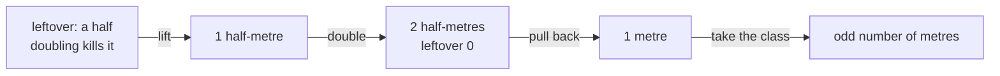

# Exact sequences of modules: what one map hits the next one kills, and the snake lemma's connecting map

[Syllabus](../../../SYLLABUS.md) → [Algebraic geometry](../README.md) → [Exact Sequences, Ext and Tor](../README.md#s07) → Exact sequences of modules

---

## General Overview

A tape measure is marked in half-metres. A length of 7 half-metres reads as 3 metres plus a leftover half. Three whole-number readings sit side by side: whole metres, half-metres, and the leftover (0 or 1 half).

Two maps join them. "Times 2" turns metres into half-metres. "Mod 2" turns half-metres into the leftover. A half-metre count has leftover 0 exactly when it is twice a whole number of metres. So what the first map hits is exactly what the second map kills. That matching is called **exactness**.

The leftover does not split off as a separate counter. Half plus half is 2 half-metres: 1 whole metre, with leftover 0. The half carries into the metres, like a carry digit in addition. In a split model, metres side by side with a separate leftover, half plus half would be leftover 0 and no extra metre.

Now double every reading. Doubling kills the leftover half, since two halves make a whole. It also misses something: doubled metre counts are all even, so no odd count is reached. The **snake lemma** links what is killed to what is missed by one map, the **connecting map**. It sends the leftover half to "an odd number of metres", because a half, doubled, is exactly 1 metre. Here that map is one-to-one and onto, so nothing is lost.

**An exact sequence is a chain of maps in which each map's image is exactly the next map's kernel; it splits only when the middle is the two ends side by side, and when a whole exact row is mapped to another, the snake lemma joins the kernels (what each map kills) and the cokernels (what each map misses) into one long exact row through a connecting map built by chasing elements.**

**What kind of fact this is:** exactness, splitting, kernel and cokernel are definitions. The splitting test, the snake lemma and the five lemma are theorems, proved on this card in Why it works, with the longer chases in folds.

### The picture: the half, chased round the snake



The connecting map starts at the leftover, climbs to the tape, goes down by doubling, and comes back along the metres. Why it works, Step 3, shows each move is forced.

---

## The formula

Notation from [Modules](../06-Schemes%20and%20Modern%20Language/05-modules-and-the-structure-theorem.md), in one line each: a **module** is a set that adds, with scalars from a ring R. Here R is the whole numbers ℤ, so a module is an abelian group: a set with an addition where order does not matter. $`\mathbb{Z}/n`$ is the counter that wraps at n. $`\oplus`$ puts modules side by side, and $`\cong`$ means "is the same module as".

New words, each defined once:

- A **homomorphism** $`f\colon A \to B`$ is a map that respects adding and scalars: $`f(x + y) = f(x) + f(y)`$.
- Its **kernel** $`\ker f`$ is everything it sends to 0. Its **image** $`\mathrm{im}\, f`$ is everything it reaches.
- An **isomorphism** is a homomorphism that is one-to-one and onto: a perfect matching that respects adding.
- Its **cokernel** $`\mathrm{coker}\, f = B / \mathrm{im}\, f`$ is B with everything f reaches treated as zero: what f misses.
- A row $`A \xrightarrow{f} B \xrightarrow{g} C`$ is **exact at B** when $`\mathrm{im}\, f = \ker g`$. A longer row is exact when it is exact at every inner spot.
- A **short exact sequence** is an exact row $`0 \to A \to B \to C \to 0`$. Exact at A means f is one-to-one. Exact at C means g is onto.

The ruler is the short exact sequence

```math
0 \to \mathbb{Z} \xrightarrow{\;\times 2\;} \mathbb{Z} \xrightarrow{\;\mathrm{mod}\ 2\;} \mathbb{Z}/2 \to 0
```

**Read it aloud:** metres go one-to-one into half-metres by doubling, half-metres go onto the leftover, and the half-metre counts with leftover 0 are exactly the doubled metres.

**Split.** The row is **split** when B is A and C side by side, compatibly: $`B \cong A \oplus C`$ with f becoming $`x \mapsto (x, 0)`$ and g becoming $`(x, z) \mapsto z`$. Step 1 proves this happens exactly when g has a **section**, a homomorphism $`s\colon C \to B`$ with $`g(s(z)) = z`$.

**The snake lemma.** Take two exact rows and three downward maps a, b, c, with every square **commuting**: going right then down gives the same answer as going down then right.

```math
\begin{array}{ccccccc} & A & \xrightarrow{\;f\;} & B & \xrightarrow{\;g\;} & C & \to 0 \\ & \downarrow a & & \downarrow b & & \downarrow c & \\ 0 \to & A' & \xrightarrow{\;f'\;} & B' & \xrightarrow{\;g'\;} & C' & \end{array}
```

Then there is a homomorphism $`\delta`$, the **connecting map**, that makes this row exact:

```math
\ker a \to \ker b \to \ker c \xrightarrow{\;\delta\;} \mathrm{coker}\, a \to \mathrm{coker}\, b \to \mathrm{coker}\, c
```

It is built by a **diagram chase**: following one element through the maps. For z in ker c, lift z to some y in B, push it down to b(y) in B′, pull that back to the unique x in A′ with $`f'(x) = b(y)`$, and keep x's class [x]: x counted up to anything a reaches:

```math
\delta(z) = \big[\, x \,\big] \in \mathrm{coker}\, a, \qquad g(y) = z, \quad f'(x) = b(y)
```

**Read it aloud:** to send a kernel member on the right to a cokernel member on the left, go up, down and back along the bottom row.

If f is one-to-one, the six-term row starts with 0 →. If g′ is onto, it ends with → 0.

On the ruler, take both rows equal and all three downward maps "times 2":

```math
0 \to 0 \to 0 \to \mathbb{Z}/2 \xrightarrow{\;\delta\;} \mathbb{Z}/2 \xrightarrow{\;0\;} \mathbb{Z}/2 \xrightarrow{\;\cong\;} \mathbb{Z}/2 \to 0
```

Doubling kills nothing in the metres or the half-metres, so ker a = ker b = 0. It kills the leftover half, so ker c = ℤ/2. Its cokernels are the counts mod 2: ℤ/2 three times. The map δ is an isomorphism.

**The five lemma.** In a commuting ladder of two exact rows of five modules, if the four outer downward maps are isomorphisms, so is the middle one. The **short five lemma** is the case $`0 \to A \to B \to C \to 0`$: if a and c are isomorphisms, so is b.

| Symbol | Plain meaning | In our example | Push it up and the answer… |
| --- | --- | --- | --- |
| $`R`$, $`\mathbb{Z}`$, $`\mathbb{Z}/n`$, $`\oplus`$, $`\cong`$ | the ring of scalars; whole numbers; the counter that wraps at n; side by side; the same module | R = ℤ; metres and half-metres; the leftover, n = 2 | a larger n leaves a larger leftover |
| $`A, B, C`$ | the top row's modules | metres, half-metres, leftover | — |
| $`A', B', C'`$ | the bottom row's modules | the same three, after doubling | — |
| $`f, g`$; $`f', g'`$ | the row maps on top; on the bottom | times 2; mod 2, on both rows | — |
| $`a, b, c`$ | the downward maps; every square commutes | times m on all three, m = 2 | a larger m gives larger cokernels |
| $`\ker`$, $`\mathrm{im}`$, $`\mathrm{coker}`$ | what a map kills; what it reaches; what it misses | ker c = ℤ/2; im f = even counts; coker a = ℤ/2 | — |
| $`0`$ | the module with one member; an arrow from it hits only 0 | ker a = ker b = 0 | — |
| $`\delta`$ | the connecting map, ker c to coker a | the half goes to "odd metres" | — |
| $`x, y, z`$; $`[x]`$ | members of A′, B, C on the chase; x's class in coker a; other small letters in the folds are members met on a chase | z = the half, y = 1 half-metre, x = 1 metre; (p, t) is a pair in ℤ ⊕ ℤ/2 | — |
| $`s`$, $`r`$, $`1`$ | a section $`C \to B`$ with $`g s = 1`$; a retraction $`B \to A`$ with $`r f = 1`$; 1 is the identity map | none exist for the ruler | — |
| $`t_1, \dots, t_5`$; $`\alpha_i`$, $`\beta_i`$ | the five lemma's downward maps; its top and bottom row maps | Step 5's fold only | — |
| $`n`$, $`m`$, $`d`$ | the wrap size; the multiplier on the downward maps; their gcd | 2, 2, 2; the house pair n = 4, m = 6, d = 2 | ker c and coker c have d members |

### When it holds

- **The rows are exact.** The pull-back step needs the bottom row exact at B′. In the row $`0 \to \mathbb{Z} \xrightarrow{\times 4} \mathbb{Z} \xrightarrow{\mathrm{mod}\ 2} \mathbb{Z}/2 \to 0`$ the composite is zero, yet 2 has leftover 0 and is not 4 times a whole number. The chase has nothing to pull back to.
- **The squares commute.** The chase lands in the image of f′ only because $`g'(b(y)) = c(g(y)) = c(z) = 0`$. Without commuting squares b(y) can have a nonzero leftover and the pull-back fails.
- **The end zeros need the end maps.** The row starts 0 → ker a only when f is one-to-one, and ends coker c → 0 only when g′ is onto. Without them the six-term row is still exact in the middle.
- **The five lemma needs a middle map.** Equal ends do not give equal middles. The ruler and the split row $`0 \to \mathbb{Z} \to \mathbb{Z} \oplus \mathbb{Z}/2 \to \mathbb{Z}/2 \to 0`$ share both ends, but no commuting map with identity ends exists between them (the checks find none), and their middles differ.
- **The ring is ℤ, not a field.** Over a field every short exact sequence splits, since a subspace always has a complement ([Direct sums and quotient spaces](../../03-Algebra/11-Duals%2C%20Quotients%20and%20Tensors/01-direct-sums-and-quotient-spaces.md)).

---

## Why it works

### Step 0: three moves, and commuting squares

Every proof on this card is a diagram chase, built from three moves on single elements.

1. **Push**: apply a map.
2. **Lift**: along an onto map, pick any element that lands on the target. There is a choice.
3. **Pull back**: at an exact spot, an element the next map kills came from the previous map. If that previous map is one-to-one, the source is unique.

A commuting square lets an element go either way round with the same result. Each chase strings these moves together and checks that the choices do not matter.

### Step 1: the ruler is exact, and it does not split

**Exact.** Doubling sends only 0 to 0, so it is one-to-one. Every count has a leftover, so mod 2 is onto. A count with leftover 0 is even, so it is twice some metre count. So the image of "times 2" is the kernel of "mod 2".

**Not split.** A section s would send the leftover half to some count y, with y odd so that $`g(y) = 1`$. But in ℤ/2 the half plus the half is 0, so a homomorphism needs $`2y = s(1 + 1) = s(0) = 0`$. Only y = 0 has 2y = 0, and 0 is even. No section exists.

A retraction fails too. It would be $`r(y) = cy`$ for a fixed whole number c, with $`r(2) = 2c = 1`$, and no whole number does that. The cleanest test needs no search: ℤ has 1 member killed by 2 and ℤ ⊕ ℤ/2 has 2, so they are different modules.

<details>
<summary>Detailed proof: a section, a retraction and a splitting come together</summary>

Take a short exact sequence $`0 \to A \xrightarrow{f} B \xrightarrow{g} C \to 0`$.

**Section gives a splitting.** Let $`g s = 1`$. Send b in B to the pair $`(\,f^{-1}(b - s g(b)),\ g(b)\,)`$. The first entry exists, because $`g(b - s g b) = g b - g b = 0`$, so $`b - s g b`$ lies in $`\ker g = \mathrm{im}\, f`$. It is unique, because f is one-to-one. The inverse sends (x, z) to $`f(x) + s(z)`$. Both maps respect adding, so $`B \cong A \oplus C`$, with f becoming $`x \mapsto (x, 0)`$ and g becoming $`(x, z) \mapsto z`$.

**Retraction gives a splitting.** Let $`r f = 1`$. Send b to $`(r(b), g(b))`$. It is one-to-one: if $`g(b) = 0`$ then $`b = f(x)`$, and $`r(b) = x = 0`$ forces b = 0. It is onto: given (x, z), lift z to some b, then $`b + f(x - r b)`$ maps to (x, z).

**A splitting gives both.** In $`A \oplus C`$ take $`s(z) = (0, z)`$ and $`r(x, z) = x`$.

</details>

### Step 2: kernels map to kernels, cokernels to cokernels

If $`a(u) = 0`$ then $`b(f(u)) = f'(a(u)) = 0`$, by the left square. So f sends ker a into ker b. In the same way g sends ker b into ker c.

On the bottom, f′ sends the image of a into the image of b, again by the left square. So f′ passes to a map coker a → coker b, and g′ to coker b → coker c.

On the ruler, coker a → coker b sends a metre count mod 2 to twice it mod 2, which is always 0. And coker b → coker c sends a half-metre count mod 2 to its leftover, an isomorphism.

<details>
<summary>Detailed proof: exactness at ker b and at coker b</summary>

**At ker b.** The composite $`g f`$ is zero, so ker a → ker c through ker b is zero. Now let y in ker b have $`g(y) = 0`$. The top row is exact at B, so $`y = f(u)`$ for some u in A. Then $`f'(a(u)) = b(f(u)) = b(y) = 0`$, and f′ is one-to-one, so $`a(u) = 0`$: u lies in ker a.

**At coker b.** The composite $`g' f'`$ is zero, so coker a → coker c is zero. Now let $`[w]`$ in coker b go to 0 in coker c: $`g'(w) = c(z)`$ for some z in C. Lift z to y in B with $`g(y) = z`$. Then $`g'(w - b(y)) = c(z) - c(g(y)) = 0`$, so $`w - b(y) = f'(x)`$ for some x in A′. Since b(y) lies in the image of b, $`[w] = [f'(x)]`$, the image of [x].

</details>

### Step 3: the connecting map, and why the choices wash out

Start with z in ker c. The top map g is onto, so lift z to some y with $`g(y) = z`$. Push y down to b(y). By the right square, $`g'(b(y)) = c(g(y)) = c(z) = 0`$. The bottom row is exact at B′, so $`b(y) = f'(x)`$ for one x, unique since f′ is one-to-one. Set $`\delta(z) = [x]`$ in coker a.

On the ruler: z is the leftover half. Lift it to y = 1 half-metre. Double it to 2 half-metres. Its leftover is 0, so it is f′ of x = 1 metre. The class of 1 metre mod 2 is "odd". So δ sends the half to the odd class.

The lift was a choice. Lifting to 3 half-metres instead pulls back to 3 metres: still odd. The checks try the seven lifts −5, −3, …, 7. They pull back to −5, −3, …, 7 metres, all odd.

<details>
<summary>Detailed proof: δ does not depend on the lift, and is a homomorphism</summary>

Let y and $`y_2`$ both lift z. Then $`g(y - y_2) = 0`$, so $`y - y_2 = f(u)`$ for some u in A. Push down:

$`\displaystyle b(y) - b(y_2) = b(f(u)) = f'(a(u)).`$

So the two pull-backs differ by a(u), which is zero in coker a. The class [x] is the same.

For sums: if y lifts z and $`y_2`$ lifts $`z_2`$, then $`y + y_2`$ lifts $`z + z_2`$, and every step respects adding. So $`\delta(z + z_2) = \delta(z) + \delta(z_2)`$.

</details>

### Step 4: the row is exact at the two joints

Two spots touch δ: ker c and coker a. At each, the composite is zero and the kernel is no bigger than the image.

- **At ker c.** A member that comes from ker b lifts into ker b, pushes down to 0, and so has δ = 0. Conversely, a zero δ lets the lift be corrected into ker b.
- **At coker a.** Every δ(z) dies in coker b, since its pull-back lands on b(y). Conversely, a class that dies in coker b is the end of some chase.

On the ruler, these two spots carry the whole example. Ker b is 0, so δ must be one-to-one. The map coker a → coker b is zero, so δ must be onto. The checks confirm all six spots by listing every member.

<details>
<summary>Detailed proof: the converse halves at ker c and coker a</summary>

**At ker c.** Suppose $`\delta(z) = 0`$: the pull-back x with $`f'(x) = b(y)`$ lies in the image of a, say $`x = a(u)`$. Then

$`\displaystyle b(y - f(u)) = b(y) - f'(a(u)) = f'(x) - f'(x) = 0,`$

so $`y - f(u)`$ lies in ker b, and $`g(y - f(u)) = g(y) = z`$. So z comes from ker b.

**At coker a.** First the composite: $`[f'(x)] = [b(y)] = 0`$ in coker b. Next suppose $`[f'(x)] = 0`$ in coker b, so $`f'(x) = b(y)`$ for some y in B. Then $`c(g(y)) = g'(b(y)) = g'(f'(x)) = 0`$, so z = g(y) lies in ker c. The chase for z can use the lift y, and it pulls back to x. So $`\delta(z) = [x]`$.

</details>

### Step 5: the five lemma, from the snake and by a chase

**The short five lemma comes straight from the snake.** If a and c are isomorphisms, their kernels and cokernels are 0. The exact row then reads 0 → ker b → 0 and 0 → coker b → 0, so ker b and coker b are 0. So b is one-to-one and onto.

The ruler shows why the middle map must be given. A map b from the ruler to the split row with identity ends would need $`b(2) = (1, 0)`$, that is $`2b(1) = (1, 0)`$. No pair (p, t) has 2p = 1, so no such b exists. If one did, the five lemma would make ℤ ≅ ℤ ⊕ ℤ/2, which is false.

<details>
<summary>Detailed proof: the full five lemma for rows of five</summary>

Take exact rows $`A_1 \to A_2 \to A_3 \to A_4 \to A_5`$ and $`B_1 \to \dots \to B_5`$, joined by downward maps $`t_1, \dots, t_5`$, with every square commuting. Suppose $`t_2`$ and $`t_4`$ are isomorphisms, $`t_1`$ is onto and $`t_5`$ is one-to-one. Write the row maps as $`\alpha_i\colon A_i \to A_{i+1}`$ and $`\beta_i\colon B_i \to B_{i+1}`$.

**$`t_3`$ is one-to-one.** Let $`t_3(u) = 0`$. Then $`t_4(\alpha_3 u) = \beta_3 t_3 u = 0`$, so $`\alpha_3 u = 0`$, so $`u = \alpha_2(v)`$. Now $`\beta_2 t_2 v = t_3 \alpha_2 v = 0`$, so $`t_2 v = \beta_1(w)`$. Write $`w = t_1(w_1)`$. Then $`t_2(\alpha_1 w_1) = \beta_1 t_1 w_1 = t_2 v`$, so $`v = \alpha_1 w_1`$, and $`u = \alpha_2 \alpha_1 w_1 = 0`$.

**$`t_3`$ is onto.** Take e in $`B_3`$. Write $`\beta_3 e = t_4(q)`$. Then $`t_5(\alpha_4 q) = \beta_4 \beta_3 e = 0`$, so $`\alpha_4 q = 0`$ and $`q = \alpha_3(p)`$. Now $`\beta_3(e - t_3 p) = \beta_3 e - t_4 \alpha_3 p = 0`$, so $`e - t_3 p = \beta_2(h)`$. Write $`h = t_2(h_1)`$. Then

$`\displaystyle e = t_3 p + \beta_2 t_2 h_1 = t_3\big(p + \alpha_2 h_1\big).`$

</details>

### Step 6: what this card does not redo

A short exact sequence of chain complexes gives a long exact sequence in homology. The proof is the snake lemma run once per degree, with δ as the connecting map. [Mayer-Vietoris and exact sequences](../../17-Topology/05-Homology/06-mayer-vietoris-and-long-exact-sequences.md) proves it for chains on a space, and the chase there is the chase of Step 3. This card supplies the module version that the rest of the shelf uses.

---

## Worked numbers, by hand

The ruler row, with every module multiplied by m = 2.

| Step | Arithmetic | Value |
| --- | --- | --- |
| exact at metres | 2x = 0 only for x = 0 | ker of times 2 = {0} |
| exact at half-metres | even counts = doubled metres | im f = ker g |
| exact at the leftover | 0 and 1 both reached | g onto |
| the carry | 1 + 1 = 2 half-metres = 1 metre | leftover 0, one metre more |
| members killed by 2 | ℤ against ℤ ⊕ ℤ/2 | 1 against 2: not split |
| ker a, ker b | 2x = 0 in ℤ | 0, 0 |
| ker c | 2 × (half) = whole = leftover 0 | ℤ/2, 2 members |
| coker a, coker b, coker c | counts mod 2; leftover mod its doubles | ℤ/2, ℤ/2, ℤ/2 |
| δ(half) | lift 1, double to 2, pull back 1, class odd | **odd: δ is an isomorphism** |
| coker a → coker b | x ↦ 2x mod 2 | the zero map |
| coker b → coker c | count mod 2 ↦ leftover | an isomorphism |
| order count | 1 × 2 × 2 against 1 × 2 × 2 | 4 = 4 |

The snake row is 0 → 0 → 0 → ℤ/2 → ℤ/2 → ℤ/2 → ℤ/2 → 0. The leftover half, the one thing doubling kills, comes back as the odd metre counts that doubling never reaches.

**The split row, for contrast.** Multiply $`0 \to \mathbb{Z} \to \mathbb{Z} \oplus \mathbb{Z}/2 \to \mathbb{Z}/2 \to 0`$ by 2 as well. Now the middle has a kernel: (0, 1) is killed. The kernels have 1, 2 and 2 members, the cokernels 2, 4 and 2. The half lifts to (0, 1), doubles to (0, 0) and pulls back to 0 metres, so δ = 0. The ruler's δ is not zero because the half carries. The connecting map measures the twist.

**The house pair.** Run the same snake on $`0 \to \mathbb{Z} \xrightarrow{\times 4} \mathbb{Z} \to \mathbb{Z}/4 \to 0`$ with every module multiplied by 6. Ker c is {0, 2}, with d = gcd(4, 6) = 2 members. The cokernels have 6, 6 and 2 members. The chase sends 2 to 3 in coker a = ℤ/6. The [Tor](04-free-resolutions-and-tor.md) card reads these two 2-member pieces as Tor and the tensor product of ℤ/4 and ℤ/6.

### What breaks if you drop a piece

| Mistake | Comes out at | What went wrong |
| --- | --- | --- |
| Leave out δ, as if the kernels and cokernels were two separate rows | exact at 4 of 6 spots | ker c and coker a fail: δ is the only way the half reaches the metres |
| Same ends, so same middle | ℤ has 1 member killed by 2, ℤ ⊕ ℤ/2 has 2 | exactness fixes the ends, not how they are glued |
| Check only that the composite is zero | times 4 then mod 2: image index 4, kernel index 2, 2 classes left over | a zero composite makes a complex, not an exact row |
| Five lemma with a not an isomorphism | a = times 2, c = 1: b(x) = (x, x mod 2) commutes, misses (0, 1); coker b has 2 members | the four outer maps must be isomorphisms |

---

## Code, from first principles, and it actually runs

Nothing is imported except gcd, used only as the formula the counts are checked against. Members of ℤ are searched in a window from −60 to 60, and cokernels of ℤ are counted in a box of 360 whole numbers. Four independent roads reach the snake row:

1. the chase, which computes δ from seven different lifts of each member;
2. exactness at all six spots, by listing every image and every kernel;
3. the sizes of kernels and cokernels, counted by listing, against gcd(n, m) and m;
4. the order count: in an exact row of finite modules that starts and ends with 0, the products of alternate sizes agree.

Searches settle splitting: sections, retractions and five-lemma maps are hunted for in the window. The same snake then runs on the split row, the house pair and n = 2, m = 3.

### Python

```python
# Exact sequences and the snake lemma, checked by brute force on whole numbers.
# Row: 0 -> Z --times n--> Z --mod n--> Z/n -> 0 (metres -> half-metres -> leftover, for n = 2).
# Snake: multiply every module in the row by m and chase elements.
from math import gcd

W = range(-60, 61)   # a window of whole numbers, for searches in Z
L = 360              # a box [0, L) that every modulus here divides
B = range(-L, L)     # a wider window, so images cover the box

def index_in_box(image):              # |Z / image| = box points / image points in the box
    return L // len({y for y in image if 0 <= y < L})

def cosets(n, sub):                   # the members of (Z/n)/sub, each as a frozenset
    return sorted({frozenset((z + s) % n for s in sub) for z in range(n)}, key=min)

def snake(n, m, delta_on=True):
    ker_a = [x for x in W if m * x == 0]
    ker_b = [y for y in W if m * y == 0]
    ker_c = [z for z in range(n) if (m * z) % n == 0]
    coker_a, coker_b = range(m), range(m)
    im_c = {(m * z) % n for z in range(n)}
    coker_c = cosets(n, im_c)
    cls = lambda z: next(k for k in coker_c if z % n in k)
    chase = {}
    for z in ker_c:                   # lift, push down, pull back, take the class
        classes = set()
        for t in range(-3, 4):
            y = z + n * t                                  # lift: y mod n = z
            x = next(x for x in W if n * x == m * y)       # pull back: n x = m y
            classes.add(x % m)
        assert len(classes) == 1, "delta depends on the lift"
        chase[z] = classes.pop()
    delta = (lambda z: chase[z]) if delta_on else (lambda z: 0)
    spots = [  # (incoming source, incoming map, spot, outgoing map, zero of the target)
        ([0], lambda x: 0, ker_a, lambda x: n * x, 0),
        (ker_a, lambda x: n * x, ker_b, lambda y: y % n, 0),
        (ker_b, lambda y: y % n, ker_c, delta, 0),
        (ker_c, delta, coker_a, lambda x: (n * x) % m, 0),
        (coker_a, lambda x: (n * x) % m, coker_b, lambda y: cls(y), cls(0)),
        (coker_b, lambda y: cls(y), coker_c, lambda k: 0, 0)]
    exact = sum({f(x) for x in s} == {v for v in spot if g(v) == zero}
                for s, f, spot, g, zero in spots)
    sizes = [len(ker_a), len(ker_b), len(ker_c),
             index_in_box(m * x for x in B), index_in_box(m * y for y in B), len(coker_c)]
    return sizes, chase, exact

# 1. the row is exact, three spots, on the window
inj = [x for x in W if 2 * x == 0]
mid = {y for y in W if y % 2 == 0} == {2 * x for x in W if -60 <= 2 * x <= 60}
onto = {y % 2 for y in W} == {0, 1}
print(f"row 0 -> Z --x2--> Z --mod 2--> Z/2 -> 0: kernel of x2 {inj}; "
      f"image of x2 = kernel of mod 2: {mid}; mod 2 onto: {onto}")
assert inj == [0] and mid and onto
r = 7
print(f"ruler: {r} half-metres = {r // 2} metres + leftover {r % 2}; half + half = {1 + 1} half-metres "
      f"= {(1 + 1) // 2} metre, leftover {(1 + 1) % 2}; split model (0, 1) + (0, 1) = {(0, (1 + 1) % 2)}")
# 2. not split: no section, no retraction, and Z has no member of order 2
sections = [y for y in W if 2 * y == 0 and y % 2 == 1]
retractions = [c for c in W if 2 * c == 1]
order2_Z = [x for x in W if 2 * x == 0]
order2_split = [(x, t) for x in W for t in (0, 1) if 2 * x == 0 and (2 * t) % 2 == 0]
split_sections = [v for v in order2_split if v[1] == 1]      # s(1) = v with 2v = 0 and g'(v) = 1
print(f"sections s with s(1) odd and 2 s(1) = 0: {len(sections)} found; "
      f"retractions r(x) = c x with r(2) = 1: {len(retractions)} found")
print(f"members killed by 2: in Z {len(order2_Z)}, in Z (+) Z/2 {len(order2_split)}; split row sections: {split_sections}")
assert sections == [] and retractions == [] and len(order2_Z) == 1 and len(order2_split) == 2
assert split_sections == [(0, 1)]
# 3. the snake on the row, multiplied by 2
sizes, chase, exact = snake(2, 2)
print(f"snake n = 2, m = 2: kernels {sizes[:3]}, cokernels {sizes[3:]}")
y = 1; x = next(x for x in W if 2 * x == 2 * y)
print(f"  chase of the half: lift to {y} half-metre, double to {2 * y}, pull back to {x} metre, class {x % 2} (odd)")
pulls = [next(x for x in W if 2 * x == 2 * y) for y in range(-5, 8, 2)]
print(f"  pull-backs for the lifts -5, -3, ..., 7: {pulls}, classes mod 2: {sorted({x % 2 for x in pulls})}")
print(f"  delta: {chase}; same class for lifts 1 + 2t, t = -3..3; exact at {exact} of 6 spots")
assert sizes == [1, 1, 2, 2, 2, 2] and chase == {0: 0, 1: 1} and exact == 6
# alternating count: |ker a| |ker c| |coker b| = |ker b| |coker a| |coker c|
lhs, rhs = sizes[0] * sizes[2] * sizes[4], sizes[1] * sizes[3] * sizes[5]
print(f"  order count: {sizes[0]} * {sizes[2]} * {sizes[4]} = {lhs}, {sizes[1]} * {sizes[3]} * {sizes[5]} = {rhs}")
assert lhs == rhs
# 4. the split row 0 -> Z -> Z (+) Z/2 -> Z/2 -> 0, also multiplied by 2: delta is zero
ker_b = [(x, t) for x in W for t in (0, 1) if 2 * x == 0]
img = {(2 * x, 0) for x in B if 0 <= 2 * x < L}
split_sizes = [len([x for x in W if 2 * x == 0]), len(ker_b), len([z for z in range(2) if (2 * z) % 2 == 0]),
               index_in_box(2 * x for x in B), 2 * L // len(img), len(cosets(2, {(2 * z) % 2 for z in range(2)}))]
d_split = set()
for t in range(-3, 4):               # lift 1 to (2t, 1), double it, pull back through x -> (x, 0)
    doubled = (2 * (2 * t), (2 * 1) % 2)
    d_split.add(next(x for x in W if (x, 0) == doubled) % 2)
print(f"split row snake: kernels {split_sizes[:3]}, cokernels {split_sizes[3:]}, delta(1) = {d_split}")
assert split_sizes == [1, 2, 2, 2, 4, 2] and d_split == {0}
# 5. the same snake on other rows: gcd(n, m) members in ker c and in coker c
for n, m in [(4, 6), (2, 3)]:
    sizes, chase, exact = snake(n, m)
    print(f"snake n = {n}, m = {m}: kernels {sizes[:3]}, cokernels {sizes[3:]}, delta {chase}, exact at {exact} of 6")
    assert sizes[2] == sizes[5] == gcd(n, m) and sizes[3] == sizes[4] == m and exact == 6
# 6. what breaks
_, _, exact0 = snake(2, 2, delta_on=False)
print(f"mistake, no connecting map (delta = 0): exact at {exact0} of 6 spots")
assert exact0 == 4
print(f"mistake, ends equal so middles equal: Z has {len(order2_Z)} member killed by 2, Z (+) Z/2 has {len(order2_split)}")
comp_zero = all((4 * x) % 2 == 0 for x in W)
i_img, i_ker = index_in_box(4 * x for x in B), index_in_box(y for y in B if y % 2 == 0)
gap = i_img // i_ker
print(f"mistake, composite zero only: x4 then mod 2 composes to zero: {comp_zero}; "
      f"image index {i_img}, kernel index {i_ker}, {gap} classes left over")
assert comp_zero and gap == 2
# five lemma: no map b from the twisted row to the split row with identity ends
maps = [(p, t) for p in W for t in (0, 1) if (2 * p, (2 * t) % 2) == (1, 0)]
print(f"five lemma: maps b with b(1) = (p, t) and identity ends: {len(maps)} found")
assert maps == []
# hypothesis dropped: a = times 2, c = identity, b(x) = (x, x mod 2) commutes but is not onto
f, g = (lambda x: 2 * x), (lambda y: y % 2)                 # the twisted row
f2, g2 = (lambda x: (x, 0)), (lambda v: v[1])               # the split row
a, b, c = (lambda x: 2 * x), (lambda y: (y, y % 2)), (lambda z: z)
comm = all(b(f(x)) == f2(a(x)) and g2(b(x)) == c(g(x)) for x in W)
hit = {b(y) for y in B}
box_hits = len({v for v in hit if 0 <= v[0] < L})
print(f"mistake, five lemma with a = x2: b(x) = (x, x mod 2) commutes {comm}, misses (0, 1) {(0, 1) not in hit}, "
      f"coker b has {2 * L // box_hits} members")
assert comm and (0, 1) not in hit and 2 * L // box_hits == 2
print("ALL CHECKS PASS")
```

**Ran 2026-11-24 on macOS, Python 3.14.10, standard library only. All checks passed. Output, pasted from the run:**

```
row 0 -> Z --x2--> Z --mod 2--> Z/2 -> 0: kernel of x2 [0]; image of x2 = kernel of mod 2: True; mod 2 onto: True
ruler: 7 half-metres = 3 metres + leftover 1; half + half = 2 half-metres = 1 metre, leftover 0; split model (0, 1) + (0, 1) = (0, 0)
sections s with s(1) odd and 2 s(1) = 0: 0 found; retractions r(x) = c x with r(2) = 1: 0 found
members killed by 2: in Z 1, in Z (+) Z/2 2; split row sections: [(0, 1)]
snake n = 2, m = 2: kernels [1, 1, 2], cokernels [2, 2, 2]
  chase of the half: lift to 1 half-metre, double to 2, pull back to 1 metre, class 1 (odd)
  pull-backs for the lifts -5, -3, ..., 7: [-5, -3, -1, 1, 3, 5, 7], classes mod 2: [1]
  delta: {0: 0, 1: 1}; same class for lifts 1 + 2t, t = -3..3; exact at 6 of 6 spots
  order count: 1 * 2 * 2 = 4, 1 * 2 * 2 = 4
split row snake: kernels [1, 2, 2], cokernels [2, 4, 2], delta(1) = {0}
snake n = 4, m = 6: kernels [1, 1, 2], cokernels [6, 6, 2], delta {0: 0, 2: 3}, exact at 6 of 6
snake n = 2, m = 3: kernels [1, 1, 1], cokernels [3, 3, 1], delta {0: 0}, exact at 6 of 6
mistake, no connecting map (delta = 0): exact at 4 of 6 spots
mistake, ends equal so middles equal: Z has 1 member killed by 2, Z (+) Z/2 has 2
mistake, composite zero only: x4 then mod 2 composes to zero: True; image index 4, kernel index 2, 2 classes left over
five lemma: maps b with b(1) = (p, t) and identity ends: 0 found
mistake, five lemma with a = x2: b(x) = (x, x mod 2) commutes True, misses (0, 1) True, coker b has 2 members
ALL CHECKS PASS
```

### Rust

Same searches, same labels, built with `rustc --edition 2021 -O`.

```rust
// Exact sequences and the snake lemma, checked by brute force on whole numbers.
// Row: 0 -> Z --times n--> Z --mod n--> Z/n -> 0 (metres -> half-metres -> leftover, for n = 2).
// Snake: multiply every module in the row by m and chase elements.
use std::collections::BTreeSet;

const L: i64 = 360; // a box [0, L) that every modulus here divides

fn w() -> std::ops::RangeInclusive<i64> { -60..=60 } // a window of whole numbers, for searches in Z
fn bw() -> std::ops::Range<i64> { -L..L }             // a wider window, so images cover the box
fn md(a: i64, n: i64) -> i64 { a.rem_euclid(n) }
fn py(b: bool) -> &'static str { if b { "True" } else { "False" } }
fn gcd(a: i64, b: i64) -> i64 { if b == 0 { a.abs() } else { gcd(b, a % b) } }

fn index_in_box(image: impl Iterator<Item = i64>) -> i64 {
    // |Z / image| = box points / image points in the box
    L / image.filter(|&y| 0 <= y && y < L).collect::<BTreeSet<i64>>().len() as i64
}

fn cosets(n: i64, sub: &BTreeSet<i64>) -> Vec<BTreeSet<i64>> {
    // the members of (Z/n)/sub, each as a set
    let all: BTreeSet<BTreeSet<i64>> = (0..n).map(|z| sub.iter().map(|s| md(z + s, n)).collect()).collect();
    all.into_iter().collect()
}

fn dict(c: &[(i64, i64)]) -> String {
    let parts: Vec<String> = c.iter().map(|(k, v)| format!("{}: {}", k, v)).collect();
    format!("{{{}}}", parts.join(", "))
}

type Map = Box<dyn Fn(i64) -> i64>;

fn snake(n: i64, m: i64, delta_on: bool) -> (Vec<i64>, Vec<(i64, i64)>, usize) {
    let ker_a: Vec<i64> = w().filter(|&x| m * x == 0).collect();
    let ker_b: Vec<i64> = w().filter(|&y| m * y == 0).collect();
    let ker_c: Vec<i64> = (0..n).filter(|&z| md(m * z, n) == 0).collect();
    let coker_a: Vec<i64> = (0..m).collect();
    let coker_b: Vec<i64> = (0..m).collect();
    let im_c: BTreeSet<i64> = (0..n).map(|z| md(m * z, n)).collect();
    let coker_c = cosets(n, &im_c);
    let cc = coker_c.clone();
    let cls = move |z: i64| cc.iter().position(|k| k.contains(&md(z, n))).unwrap() as i64;
    let mut chase: Vec<(i64, i64)> = Vec::new();
    for &z in &ker_c {
        // lift, push down, pull back, take the class
        let mut classes = BTreeSet::new();
        for t in -3..=3 {
            let y = z + n * t; // lift: y mod n = z
            let x = w().find(|&x| n * x == m * y).unwrap(); // pull back: n x = m y
            classes.insert(md(x, m));
        }
        assert!(classes.len() == 1, "delta depends on the lift");
        chase.push((z, *classes.iter().next().unwrap()));
    }
    let ch = chase.clone();
    let delta = move |z: i64| if delta_on { ch.iter().find(|p| p.0 == z).unwrap().1 } else { 0 };
    let idx: Vec<i64> = (0..coker_c.len() as i64).collect();
    let (d1, d2) = (delta.clone(), delta);
    let (c1, c2, c0) = (cls.clone(), cls.clone(), cls(0));
    // (incoming source, incoming map, spot, outgoing map, zero of the target)
    let spots: Vec<(Vec<i64>, Map, Vec<i64>, Map, i64)> = vec![
        (vec![0], Box::new(|_| 0), ker_a.clone(), Box::new(move |x| n * x), 0),
        (ker_a.clone(), Box::new(move |x| n * x), ker_b.clone(), Box::new(move |y| md(y, n)), 0),
        (ker_b.clone(), Box::new(move |y| md(y, n)), ker_c.clone(), Box::new(d1), 0),
        (ker_c.clone(), Box::new(d2), coker_a.clone(), Box::new(move |x| md(n * x, m)), 0),
        (coker_a.clone(), Box::new(move |x| md(n * x, m)), coker_b.clone(), Box::new(c1), c0),
        (coker_b.clone(), Box::new(c2), idx, Box::new(|_| 0), 0),
    ];
    let exact = spots.iter().filter(|(s, f, spot, g, zero)| {
        let img: BTreeSet<i64> = s.iter().map(|&x| f(x)).collect();
        let ker: BTreeSet<i64> = spot.iter().copied().filter(|&v| g(v) == *zero).collect();
        img == ker
    }).count();
    let sizes = vec![ker_a.len() as i64, ker_b.len() as i64, ker_c.len() as i64,
        index_in_box(bw().map(|x| m * x)), index_in_box(bw().map(|y| m * y)), coker_c.len() as i64];
    (sizes, chase, exact)
}

fn main() {
    // 1. the row is exact, three spots, on the window
    let inj: Vec<i64> = w().filter(|&x| 2 * x == 0).collect();
    let doubles: BTreeSet<i64> = w().map(|x| 2 * x).filter(|&y| -60 <= y && y <= 60).collect();
    let mid = w().filter(|&y| md(y, 2) == 0).collect::<BTreeSet<i64>>() == doubles;
    let onto = w().map(|y| md(y, 2)).collect::<BTreeSet<i64>>() == [0, 1].into_iter().collect();
    println!("row 0 -> Z --x2--> Z --mod 2--> Z/2 -> 0: kernel of x2 {:?}; image of x2 = kernel of mod 2: {}; mod 2 onto: {}",
        inj, py(mid), py(onto));
    assert!(inj == vec![0] && mid && onto);
    let r = 7;
    println!("ruler: {} half-metres = {} metres + leftover {}; half + half = {} half-metres = {} metre, leftover {}; split model (0, 1) + (0, 1) = ({}, {})",
        r, r / 2, r % 2, 1 + 1, (1 + 1) / 2, (1 + 1) % 2, 0, (1 + 1) % 2);
    // 2. not split: no section, no retraction, and Z has no member of order 2
    let sections: Vec<i64> = w().filter(|&y| 2 * y == 0 && md(y, 2) == 1).collect();
    let retractions: Vec<i64> = w().filter(|&c| 2 * c == 1).collect();
    let order2_z: Vec<i64> = w().filter(|&x| 2 * x == 0).collect();
    let order2_split: Vec<(i64, i64)> = w().flat_map(|x| [(x, 0), (x, 1)])
        .filter(|&(x, t)| 2 * x == 0 && md(2 * t, 2) == 0).collect();
    let split_sections: Vec<(i64, i64)> = order2_split.iter().copied().filter(|v| v.1 == 1).collect();
    println!("sections s with s(1) odd and 2 s(1) = 0: {} found; retractions r(x) = c x with r(2) = 1: {} found",
        sections.len(), retractions.len());
    println!("members killed by 2: in Z {}, in Z (+) Z/2 {}; split row sections: {:?}",
        order2_z.len(), order2_split.len(), split_sections);
    assert!(sections.is_empty() && retractions.is_empty() && order2_z.len() == 1 && order2_split.len() == 2);
    assert!(split_sections == vec![(0, 1)]);
    // 3. the snake on the row, multiplied by 2
    let (sizes, chase, exact) = snake(2, 2, true);
    println!("snake n = 2, m = 2: kernels {:?}, cokernels {:?}", &sizes[..3], &sizes[3..]);
    let y = 1;
    let x = w().find(|&x| 2 * x == 2 * y).unwrap();
    println!("  chase of the half: lift to {} half-metre, double to {}, pull back to {} metre, class {} (odd)", y, 2 * y, x, md(x, 2));
    let pulls: Vec<i64> = (-5..8).step_by(2).map(|y| w().find(|&x| 2 * x == 2 * y).unwrap()).collect();
    let pc: BTreeSet<i64> = pulls.iter().map(|&x| md(x, 2)).collect();
    println!("  pull-backs for the lifts -5, -3, ..., 7: {:?}, classes mod 2: {:?}", pulls, pc.iter().collect::<Vec<_>>());
    println!("  delta: {}; same class for lifts 1 + 2t, t = -3..3; exact at {} of 6 spots", dict(&chase), exact);
    assert!(sizes == vec![1, 1, 2, 2, 2, 2] && chase == vec![(0, 0), (1, 1)] && exact == 6);
    // alternating count: |ker a| |ker c| |coker b| = |ker b| |coker a| |coker c|
    let (lhs, rhs) = (sizes[0] * sizes[2] * sizes[4], sizes[1] * sizes[3] * sizes[5]);
    println!("  order count: {} * {} * {} = {}, {} * {} * {} = {}", sizes[0], sizes[2], sizes[4], lhs, sizes[1], sizes[3], sizes[5], rhs);
    assert!(lhs == rhs);
    // 4. the split row 0 -> Z -> Z (+) Z/2 -> Z/2 -> 0, also multiplied by 2: delta is zero
    let ker_b: Vec<(i64, i64)> = w().flat_map(|x| [(x, 0), (x, 1)]).filter(|&(x, _)| 2 * x == 0).collect();
    let img: BTreeSet<(i64, i64)> = bw().filter(|&x| 0 <= 2 * x && 2 * x < L).map(|x| (2 * x, 0)).collect();
    let sub: BTreeSet<i64> = (0..2).map(|z| md(2 * z, 2)).collect();
    let split_sizes = vec![w().filter(|&x| 2 * x == 0).count() as i64, ker_b.len() as i64,
        (0..2).filter(|&z| md(2 * z, 2) == 0).count() as i64, index_in_box(bw().map(|x| 2 * x)),
        2 * L / img.len() as i64, cosets(2, &sub).len() as i64];
    let mut d_split = BTreeSet::new();
    for t in -3..=3 {
        // lift 1 to (2t, 1), double it, pull back through x -> (x, 0)
        let doubled = (2 * (2 * t), md(2 * 1, 2));
        d_split.insert(md(w().find(|&x| (x, 0) == doubled).unwrap(), 2));
    }
    let ds: Vec<String> = d_split.iter().map(|v| v.to_string()).collect();
    println!("split row snake: kernels {:?}, cokernels {:?}, delta(1) = {{{}}}", &split_sizes[..3], &split_sizes[3..], ds.join(", "));
    assert!(split_sizes == vec![1, 2, 2, 2, 4, 2] && d_split == [0].into_iter().collect());
    // 5. the same snake on other rows: gcd(n, m) members in ker c and in coker c
    for (n, m) in [(4, 6), (2, 3)] {
        let (sizes, chase, exact) = snake(n, m, true);
        println!("snake n = {}, m = {}: kernels {:?}, cokernels {:?}, delta {}, exact at {} of 6",
            n, m, &sizes[..3], &sizes[3..], dict(&chase), exact);
        assert!(sizes[2] == gcd(n, m) && sizes[5] == gcd(n, m) && sizes[3] == m && sizes[4] == m && exact == 6);
    }
    // 6. what breaks
    let (_, _, exact0) = snake(2, 2, false);
    println!("mistake, no connecting map (delta = 0): exact at {} of 6 spots", exact0);
    assert!(exact0 == 4);
    println!("mistake, ends equal so middles equal: Z has {} member killed by 2, Z (+) Z/2 has {}", order2_z.len(), order2_split.len());
    let comp_zero = w().all(|x| md(4 * x, 2) == 0);
    let (i_img, i_ker) = (index_in_box(bw().map(|x| 4 * x)), index_in_box(bw().filter(|&y| md(y, 2) == 0)));
    let gap = i_img / i_ker;
    println!("mistake, composite zero only: x4 then mod 2 composes to zero: {}; image index {}, kernel index {}, {} classes left over",
        py(comp_zero), i_img, i_ker, gap);
    assert!(comp_zero && gap == 2);
    // five lemma: no map b from the twisted row to the split row with identity ends
    let maps: Vec<(i64, i64)> = w().flat_map(|p| [(p, 0), (p, 1)]).filter(|&(p, t)| (2 * p, md(2 * t, 2)) == (1, 0)).collect();
    println!("five lemma: maps b with b(1) = (p, t) and identity ends: {} found", maps.len());
    assert!(maps.is_empty());
    // hypothesis dropped: a = times 2, c = identity, b(x) = (x, x mod 2) commutes but is not onto
    let (f, g) = (|x: i64| 2 * x, |y: i64| md(y, 2)); // the twisted row
    let (f2, g2) = (|x: i64| (x, 0), |v: (i64, i64)| v.1); // the split row
    let (a, b, c) = (|x: i64| 2 * x, |y: i64| (y, md(y, 2)), |z: i64| z);
    let comm = w().all(|x| b(f(x)) == f2(a(x)) && g2(b(x)) == c(g(x)));
    let hit: BTreeSet<(i64, i64)> = bw().map(b).collect();
    let box_hits = hit.iter().filter(|v| 0 <= v.0 && v.0 < L).count() as i64;
    let missed = !hit.contains(&(0, 1));
    println!("mistake, five lemma with a = x2: b(x) = (x, x mod 2) commutes {}, misses (0, 1) {}, coker b has {} members",
        py(comm), py(missed), 2 * L / box_hits);
    assert!(comm && missed && 2 * L / box_hits == 2);
    println!("ALL CHECKS PASS");
}
```

**Ran 2026-11-24 on macOS, rustc 1.98.1, no crates. All checks passed. Output, pasted from the run:**

```
row 0 -> Z --x2--> Z --mod 2--> Z/2 -> 0: kernel of x2 [0]; image of x2 = kernel of mod 2: True; mod 2 onto: True
ruler: 7 half-metres = 3 metres + leftover 1; half + half = 2 half-metres = 1 metre, leftover 0; split model (0, 1) + (0, 1) = (0, 0)
sections s with s(1) odd and 2 s(1) = 0: 0 found; retractions r(x) = c x with r(2) = 1: 0 found
members killed by 2: in Z 1, in Z (+) Z/2 2; split row sections: [(0, 1)]
snake n = 2, m = 2: kernels [1, 1, 2], cokernels [2, 2, 2]
  chase of the half: lift to 1 half-metre, double to 2, pull back to 1 metre, class 1 (odd)
  pull-backs for the lifts -5, -3, ..., 7: [-5, -3, -1, 1, 3, 5, 7], classes mod 2: [1]
  delta: {0: 0, 1: 1}; same class for lifts 1 + 2t, t = -3..3; exact at 6 of 6 spots
  order count: 1 * 2 * 2 = 4, 1 * 2 * 2 = 4
split row snake: kernels [1, 2, 2], cokernels [2, 4, 2], delta(1) = {0}
snake n = 4, m = 6: kernels [1, 1, 2], cokernels [6, 6, 2], delta {0: 0, 2: 3}, exact at 6 of 6
snake n = 2, m = 3: kernels [1, 1, 1], cokernels [3, 3, 1], delta {0: 0}, exact at 6 of 6
mistake, no connecting map (delta = 0): exact at 4 of 6 spots
mistake, ends equal so middles equal: Z has 1 member killed by 2, Z (+) Z/2 has 2
mistake, composite zero only: x4 then mod 2 composes to zero: True; image index 4, kernel index 2, 2 classes left over
five lemma: maps b with b(1) = (p, t) and identity ends: 0 found
mistake, five lemma with a = x2: b(x) = (x, x mod 2) commutes True, misses (0, 1) True, coker b has 2 members
ALL CHECKS PASS
```

The two outputs match line for line.

### Lean

Lean proves the splitting test, the snake lemma and the five lemma for modules over every ring, and checks the ruler's numbers exactly.

- Take a short exact sequence $`0 \to A \to B \to C \to 0`$. Then it splits exactly when g has a section, and exactly when f has a retraction.
- Take the snake lemma's two exact rows, with g onto, f′ one-to-one and both squares commuting. Then the chase gives δ the same class for every lift.
- With those rows, the six-term row of kernels and cokernels through δ is exact. If f is one-to-one, it starts with 0 →. If g′ is onto, it ends with → 0.
- Take a commuting ladder of two exact rows of five modules, with the four outer downward maps isomorphisms. Then the middle map is an isomorphism too.
- 7 half-metres are 3 metres plus a leftover half. Half plus half is 1 metre with leftover 0.
- In ℤ/2 both members are killed by 2. No homomorphism from ℤ/2 to ℤ sends the half to an odd count, so the ruler has no section.
- The ruler's chase pulls 2 half-metres back to 1 metre, an odd count. The order count is 1 × 2 × 2 on both sides.
- Take the house pair n = 4, m = 6. Then ker c = {0, 2}, times 6 reaches {0, 2} in ℤ/4, and d = 2.
- In the house pair the chase sends 2 to 3, since 6 × 2 = 4 × 3.
- Times 4 then mod 2 composes to zero, yet 2 has leftover 0 and is not 4 times a whole number.

The split row, the row n = 2, m = 3 and the searches for maps are left to the Python and Rust checks.

```lean
-- Exact sequences of modules: for exact rows of modules joined by commuting downward maps, the kernels and cokernels form an exact six-term row through the connecting map built by the chase, a short exact sequence splits exactly when it has a section or a retraction, and the five lemma holds.
import Mathlib.Algebra.Exact.Basic
import Mathlib.LinearAlgebra.Quotient.Basic
import Mathlib.LinearAlgebra.Prod
import Mathlib.Data.ZMod.Basic
import Mathlib.Algebra.FiveLemma
import Mathlib.Tactic.NormNum

namespace SnakeLemmaCard

open LinearMap Function

variable {R : Type*} [Ring R]
  {A B C A' B' C' : Type*}
  [AddCommGroup A] [Module R A] [AddCommGroup B] [Module R B] [AddCommGroup C] [Module R C]
  [AddCommGroup A'] [Module R A'] [AddCommGroup B'] [Module R B'] [AddCommGroup C'] [Module R C']

/-- The snake lemma. Take a top exact row `A → B → C → 0` (exact at `B`, with `g` onto), a
bottom exact row `0 → A' → B' → C'` (exact at `B'`, with `f'` one-to-one), and downward maps
`a, b, c` making both squares commute. Then `f` and `g` restrict to maps
`ker a → ker b → ker c`, `f'` and `g'` pass to maps `coker a → coker b → coker c`, and there is
a connecting map `δ : ker c → coker a`, given by the chase (lift `z` to `y` with `g y = z`,
pull `b y` back to the `x` with `f' x = b y`, take the class `[x]`), that makes the six-term row
`ker a → ker b → ker c → coker a → coker b → coker c` exact at every inner spot. If `f` is
one-to-one the row starts with `0 →`, and if `g'` is onto it ends with `→ 0`. -/
theorem snake_lemma_exact_six_term_row
    (f : A →ₗ[R] B) (g : B →ₗ[R] C) (f' : A' →ₗ[R] B') (g' : B' →ₗ[R] C')
    (a : A →ₗ[R] A') (b : B →ₗ[R] B') (c : C →ₗ[R] C')
    (hfg : Exact f g) (hg : Surjective g)
    (hf'g' : Exact f' g') (hf' : Injective f')
    (hsq₁ : b ∘ₗ f = f' ∘ₗ a) (hsq₂ : c ∘ₗ g = g' ∘ₗ b) :
    ∃ (κ₁ : ker a →ₗ[R] ker b) (κ₂ : ker b →ₗ[R] ker c)
      (δ : ker c →ₗ[R] A' ⧸ range a)
      (γ₁ : A' ⧸ range a →ₗ[R] B' ⧸ range b) (γ₂ : B' ⧸ range b →ₗ[R] C' ⧸ range c),
      (∀ u, (κ₁ u : B) = f u) ∧ (∀ v, (κ₂ v : C) = g v) ∧
      (∀ x, γ₁ ((range a).mkQ x) = (range b).mkQ (f' x)) ∧
      (∀ w, γ₂ ((range b).mkQ w) = (range c).mkQ (g' w)) ∧
      (∀ (z : ker c) (y : B) (x : A'), g y = z → f' x = b y → δ z = (range a).mkQ x) ∧
      Exact κ₁ κ₂ ∧ Exact κ₂ δ ∧ Exact δ γ₁ ∧ Exact γ₁ γ₂ ∧
      (Injective f → Injective κ₁) ∧ (Surjective g' → Surjective γ₂) := by
  classical
  have hgf : ∀ u, g (f u) = 0 := fun u => hfg.apply_apply_eq_zero u
  have hg'f' : ∀ u, g' (f' u) = 0 := fun u => hf'g'.apply_apply_eq_zero u
  have sq₁ : ∀ u, b (f u) = f' (a u) := fun u => LinearMap.congr_fun hsq₁ u
  have sq₂ : ∀ u, c (g u) = g' (b u) := fun u => LinearMap.congr_fun hsq₂ u
  -- the two restricted maps
  let κ₁ : ker a →ₗ[R] ker b :=
    LinearMap.restrict f (fun u (hu : u ∈ ker a) => by
      simp only [mem_ker] at hu ⊢; rw [sq₁, hu, map_zero])
  let κ₂ : ker b →ₗ[R] ker c :=
    LinearMap.restrict g (fun v (hv : v ∈ ker b) => by
      simp only [mem_ker] at hv ⊢; rw [sq₂, hv, map_zero])
  let γ₁ : A' ⧸ range a →ₗ[R] B' ⧸ range b :=
    (range a).mapQ (range b) f' (by
      rintro _ ⟨u, rfl⟩; exact ⟨f u, by rw [sq₁]⟩)
  let γ₂ : B' ⧸ range b →ₗ[R] C' ⧸ range c :=
    (range b).mapQ (range c) g' (by
      rintro _ ⟨u, rfl⟩; exact ⟨g u, by rw [sq₂]⟩)
  -- the chase
  have hx : ∀ y : B, c (g y) = 0 → ∃ x, f' x = b y := by
    intro y hy
    rw [sq₂] at hy
    exact (hf'g' (b y)).mp hy
  have wd : ∀ (y₁ y₂ : B) (x₁ x₂ : A'), g y₁ = g y₂ → f' x₁ = b y₁ → f' x₂ = b y₂ →
      (range a).mkQ x₁ = (range a).mkQ x₂ := by
    intro y₁ y₂ x₁ x₂ hy h₁ h₂
    have : g (y₁ - y₂) = 0 := by rw [map_sub, hy, sub_self]
    obtain ⟨w, hw⟩ := (hfg _).mp this
    rw [Submodule.mkQ_apply, Submodule.mkQ_apply, Submodule.Quotient.eq]
    refine ⟨w, hf' ?_⟩
    rw [← sq₁, hw, map_sub, map_sub, h₁, h₂]
  have yspec : ∀ z : ker c, g (hg z).choose = z := fun z => (hg z).choose_spec
  have ykc : ∀ z : ker c, c (g (hg z).choose) = 0 := fun z => by rw [yspec]; exact z.2
  let δf : ker c → A' ⧸ range a := fun z => (range a).mkQ (hx _ (ykc z)).choose
  have hδf : ∀ (z : ker c) (y : B) (x : A'), g y = z → f' x = b y → δf z = (range a).mkQ x := by
    intro z y x hy hxy
    exact wd _ y _ x (by rw [yspec, hy]) (hx _ (ykc z)).choose_spec hxy
  have lift : ∀ z : ker c, ∃ y x, g y = z ∧ f' x = b y := fun z =>
    ⟨_, _, yspec z, (hx _ (ykc z)).choose_spec⟩
  let δ : ker c →ₗ[R] A' ⧸ range a :=
    { toFun := δf
      map_add' := by
        intro z₁ z₂
        obtain ⟨y₁, x₁, hy₁, hx₁⟩ := lift z₁
        obtain ⟨y₂, x₂, hy₂, hx₂⟩ := lift z₂
        rw [hδf z₁ y₁ x₁ hy₁ hx₁, hδf z₂ y₂ x₂ hy₂ hx₂,
          hδf (z₁ + z₂) (y₁ + y₂) (x₁ + x₂) (by simp [hy₁, hy₂]) (by simp [hx₁, hx₂]),
          map_add]
      map_smul' := by
        intro r z
        obtain ⟨y, x, hy, hxy⟩ := lift z
        rw [hδf z y x hy hxy, hδf (r • z) (r • y) (r • x) (by simp [hy]) (by simp [hxy]),
          map_smul, RingHom.id_apply] }
  have hδ : ∀ (z : ker c) (y : B) (x : A'), g y = z → f' x = b y → δ z = (range a).mkQ x := hδf
  have hκ₁ : ∀ u, (κ₁ u : B) = f u := fun u => rfl
  have hκ₂ : ∀ v, (κ₂ v : C) = g v := fun v => rfl
  have hγ₁ : ∀ x, γ₁ ((range a).mkQ x) = (range b).mkQ (f' x) := fun x => rfl
  have hγ₂ : ∀ w, γ₂ ((range b).mkQ w) = (range c).mkQ (g' w) := fun w => rfl
  refine ⟨κ₁, κ₂, δ, γ₁, γ₂, hκ₁, hκ₂, hγ₁, hγ₂, hδ, ?_, ?_, ?_, ?_, ?_, ?_⟩
  · -- exact at ker b
    intro v
    constructor
    · intro hv
      have hv' : g (v : B) = 0 := by rw [← hκ₂, hv]; rfl
      obtain ⟨u, hu⟩ := (hfg _).mp hv'
      have hau : a u = 0 := by
        apply hf'
        rw [← sq₁, hu, map_zero]
        exact v.2
      exact ⟨⟨u, hau⟩, Subtype.ext (by rw [hκ₁]; exact hu)⟩
    · rintro ⟨u, rfl⟩
      exact Subtype.ext (by rw [hκ₂, hκ₁, hgf]; rfl)
  · -- exact at ker c
    intro z
    constructor
    · intro hz
      obtain ⟨y, x, hy, hxy⟩ := lift z
      rw [hδ z y x hy hxy, Submodule.mkQ_apply, Submodule.Quotient.mk_eq_zero] at hz
      obtain ⟨w, hw⟩ := hz
      refine ⟨⟨y - f w, ?_⟩, Subtype.ext ?_⟩
      · rw [mem_ker, map_sub, sq₁, hw, hxy, sub_self]
      · rw [hκ₂]; simp [hgf, hy]
    · rintro ⟨v, rfl⟩
      rw [hδ (κ₂ v) v 0 (hκ₂ v) (by rw [map_zero]; exact v.2.symm), map_zero]
  · -- exact at coker a
    intro q
    obtain ⟨x, rfl⟩ := Submodule.mkQ_surjective _ q
    constructor
    · intro hq
      rw [hγ₁, Submodule.mkQ_apply, Submodule.Quotient.mk_eq_zero] at hq
      obtain ⟨y, hy⟩ := hq
      have hz : g y ∈ ker c := by rw [mem_ker, sq₂, hy, hg'f']
      exact ⟨⟨g y, hz⟩, hδ _ y x rfl hy.symm⟩
    · rintro ⟨z, hz⟩
      obtain ⟨y, x', hy, hxy⟩ := lift z
      rw [hδ z y x' hy hxy] at hz
      rw [← hz, hγ₁, hxy, Submodule.mkQ_apply, Submodule.Quotient.mk_eq_zero]
      exact ⟨y, rfl⟩
  · -- exact at coker b
    intro q
    obtain ⟨w, rfl⟩ := Submodule.mkQ_surjective _ q
    constructor
    · intro hq
      rw [hγ₂, Submodule.mkQ_apply, Submodule.Quotient.mk_eq_zero] at hq
      obtain ⟨z, hz⟩ := hq
      obtain ⟨y, rfl⟩ := hg z
      have : g' (w - b y) = 0 := by rw [map_sub, ← sq₂, hz, sub_self]
      obtain ⟨x, hx'⟩ := (hf'g' _).mp this
      refine ⟨(range a).mkQ x, ?_⟩
      rw [hγ₁, hx', Submodule.mkQ_apply, Submodule.mkQ_apply, Submodule.Quotient.eq]
      exact ⟨-y, by simp⟩
    · rintro ⟨q', hq'⟩
      obtain ⟨x, rfl⟩ := Submodule.mkQ_surjective _ q'
      rw [← hq', hγ₁, hγ₂, hg'f', map_zero]
  · -- left end
    intro hf u₁ u₂ h
    apply Subtype.ext
    apply hf
    rw [← hκ₁, ← hκ₁, h]
  · -- right end
    intro hg' q
    obtain ⟨w, rfl⟩ := Submodule.mkQ_surjective _ q
    obtain ⟨v, rfl⟩ := hg' w
    exact ⟨(range b).mkQ v, hγ₂ v⟩

/-- Split, section, retraction. For a short exact sequence `0 → A → B → C → 0`, the row is
split (an isomorphism `B ≅ A ⊕ C` turning `f` into `x ↦ (x, 0)` and `g` into `(x, z) ↦ z`)
exactly when `g` has a section `s` with `g ∘ s = 1`, and exactly when `f` has a retraction
`r` with `r ∘ f = 1`. -/
theorem short_exact_split_iff_section_iff_retraction
    (f : A →ₗ[R] B) (g : B →ₗ[R] C)
    (hf : Injective f) (hfg : Exact f g) (hg : Surjective g) :
    ((∃ s : C →ₗ[R] B, g ∘ₗ s = LinearMap.id) ↔
      ∃ e : B ≃ₗ[R] A × C, (∀ x, e (f x) = (x, 0)) ∧ ∀ y, (e y).2 = g y) ∧
    ((∃ r : B →ₗ[R] A, r ∘ₗ f = LinearMap.id) ↔
      ∃ e : B ≃ₗ[R] A × C, (∀ x, e (f x) = (x, 0)) ∧ ∀ y, (e y).2 = g y) := by
  have key : ∀ e : B ≃ₗ[R] A × C,
      ((∀ x, e (f x) = (x, 0)) ∧ ∀ y, (e y).2 = g y) ↔
        (f = e.symm.toLinearMap ∘ₗ LinearMap.inl R A C ∧ g = LinearMap.snd R A C ∘ₗ e.toLinearMap) := by
    intro e
    constructor
    · rintro ⟨h₁, h₂⟩
      refine ⟨LinearMap.ext fun x => ?_, LinearMap.ext fun y => ?_⟩
      · simp only [LinearMap.coe_comp, LinearEquiv.coe_coe, Function.comp_apply,
          LinearMap.inl_apply]
        rw [← h₁, LinearEquiv.symm_apply_apply]
      · simp [h₂]
    · rintro ⟨h₁, h₂⟩
      refine ⟨fun x => ?_, fun y => ?_⟩
      · rw [h₁]; simp
      · rw [h₂]; simp
  constructor
  · constructor
    · rintro ⟨s, hs⟩
      obtain ⟨e, he⟩ := (hfg.splitSurjectiveEquiv hf ⟨s, hs⟩)
      exact ⟨e, (key e).mpr he⟩
    · rintro ⟨e, he⟩
      exact ⟨_, ((hfg.splitSurjectiveEquiv hf).symm ⟨e, (key e).mp he⟩).2⟩
  · constructor
    · rintro ⟨r, hr⟩
      obtain ⟨e, he⟩ := (hfg.splitInjectiveEquiv hg ⟨r, hr⟩)
      exact ⟨e, (key e).mpr he⟩
    · rintro ⟨e, he⟩
      exact ⟨_, ((hfg.splitInjectiveEquiv hg).symm ⟨e, (key e).mp he⟩).2⟩

/-- The five lemma. In a commuting ladder of two exact rows of five modules
`A₁ → A₂ → A₃ → A₄ → A₅` and `B₁ → B₂ → B₃ → B₄ → B₅`, joined by downward maps
`t₁, …, t₅`, if the four outer downward maps are isomorphisms, so is the middle one. -/
theorem five_lemma
    {A₁ A₂ A₃ A₄ A₅ B₁ B₂ B₃ B₄ B₅ : Type*}
    [AddCommGroup A₁] [Module R A₁] [AddCommGroup A₂] [Module R A₂]
    [AddCommGroup A₃] [Module R A₃] [AddCommGroup A₄] [Module R A₄]
    [AddCommGroup A₅] [Module R A₅]
    [AddCommGroup B₁] [Module R B₁] [AddCommGroup B₂] [Module R B₂]
    [AddCommGroup B₃] [Module R B₃] [AddCommGroup B₄] [Module R B₄]
    [AddCommGroup B₅] [Module R B₅]
    (α₁ : A₁ →ₗ[R] A₂) (α₂ : A₂ →ₗ[R] A₃) (α₃ : A₃ →ₗ[R] A₄) (α₄ : A₄ →ₗ[R] A₅)
    (β₁ : B₁ →ₗ[R] B₂) (β₂ : B₂ →ₗ[R] B₃) (β₃ : B₃ →ₗ[R] B₄) (β₄ : B₄ →ₗ[R] B₅)
    (t₁ : A₁ →ₗ[R] B₁) (t₂ : A₂ →ₗ[R] B₂) (t₃ : A₃ →ₗ[R] B₃)
    (t₄ : A₄ →ₗ[R] B₄) (t₅ : A₅ →ₗ[R] B₅)
    (hα₁ : Exact α₁ α₂) (hα₂ : Exact α₂ α₃) (hα₃ : Exact α₃ α₄)
    (hβ₁ : Exact β₁ β₂) (hβ₂ : Exact β₂ β₃) (hβ₃ : Exact β₃ β₄)
    (h₁ : t₂ ∘ₗ α₁ = β₁ ∘ₗ t₁) (h₂ : t₃ ∘ₗ α₂ = β₂ ∘ₗ t₂)
    (h₃ : t₄ ∘ₗ α₃ = β₃ ∘ₗ t₃) (h₄ : t₅ ∘ₗ α₄ = β₄ ∘ₗ t₄)
    (ht₁ : Bijective t₁) (ht₂ : Bijective t₂) (ht₄ : Bijective t₄) (ht₅ : Bijective t₅) :
    Bijective t₃ := by
  have c₁ : β₁.toAddMonoidHom.comp t₁.toAddMonoidHom = t₂.toAddMonoidHom.comp α₁.toAddMonoidHom :=
    AddMonoidHom.ext fun x => (LinearMap.congr_fun h₁ x).symm
  have c₂ : β₂.toAddMonoidHom.comp t₂.toAddMonoidHom = t₃.toAddMonoidHom.comp α₂.toAddMonoidHom :=
    AddMonoidHom.ext fun x => (LinearMap.congr_fun h₂ x).symm
  have c₃ : β₃.toAddMonoidHom.comp t₃.toAddMonoidHom = t₄.toAddMonoidHom.comp α₃.toAddMonoidHom :=
    AddMonoidHom.ext fun x => (LinearMap.congr_fun h₃ x).symm
  have c₄ : β₄.toAddMonoidHom.comp t₄.toAddMonoidHom = t₅.toAddMonoidHom.comp α₄.toAddMonoidHom :=
    AddMonoidHom.ext fun x => (LinearMap.congr_fun h₄ x).symm
  exact AddMonoidHom.bijective_of_surjective_of_bijective_of_bijective_of_injective
    α₁.toAddMonoidHom α₂.toAddMonoidHom α₃.toAddMonoidHom α₄.toAddMonoidHom
    β₁.toAddMonoidHom β₂.toAddMonoidHom β₃.toAddMonoidHom β₄.toAddMonoidHom
    t₁.toAddMonoidHom t₂.toAddMonoidHom t₃.toAddMonoidHom t₄.toAddMonoidHom t₅.toAddMonoidHom
    c₁ c₂ c₃ c₄ hα₁ hα₂ hα₃ hβ₁ hβ₂ hβ₃ ht₁.2 ht₂ ht₄ ht₅.1

-- The ruler: 7 half-metres = 3 metres + leftover 1; half + half = 2 half-metres = 1 metre,
-- leftover 0.
example : (7 : ℤ) = 2 * 3 + 1 ∧ (1 : ℤ) + 1 = 2 * 1 + 0 := by norm_num
-- Not split: in ℤ/2 both members are killed by 2, but in ℤ only 0 is, so no homomorphism
-- ℤ/2 → ℤ sends the half to an odd count.
example : (Finset.univ.filter fun z : ZMod 2 => 2 * z = 0).card = 2 := by decide
example : ¬ ∃ s : ZMod 2 →+ ℤ, s 1 % 2 = 1 := by
  rintro ⟨s, hs⟩
  have h2 : s 1 + s 1 = 0 := by rw [← map_add]; exact (congrArg s (by decide)).trans s.map_zero
  omega
-- Snake on the ruler times 2: ker c = ℤ/2; the chase lifts the half to 1, doubles it to 2,
-- pulls back to 1 metre (2 · 1 = 2 · 1), whose class mod 2 is odd.
example : (2 : ℤ) * 1 = 2 * 1 ∧ (1 : ℤ) % 2 = 1 := by norm_num
-- Order count: 1 · 2 · 2 = 1 · 2 · 2.
example : 1 * 2 * 2 = 1 * 2 * 2 := by norm_num
-- The house pair n = 4, m = 6: ker c = {0, 2}, the image of times 6 in ℤ/4 is {0, 2}
-- (so coker c has 4 / 2 = 2 members), d = gcd(4, 6) = 2, and the chase sends 2 to the class
-- of 3, since 6 · 2 = 4 · 3.
example : (Finset.univ.filter fun z : ZMod 4 => 6 * z = 0) = {0, 2} := by decide
example : (Finset.univ.image fun z : ZMod 4 => 6 * z) = {0, 2} := by decide
example : Nat.gcd 4 6 = 2 ∧ (6 : ℤ) * 2 = 4 * 3 := by norm_num
-- What breaks: times 4 then mod 2 composes to zero, yet 2 has leftover 0 and is not
-- 4 times a whole number.
example : (∀ x : ZMod 2, (4 : ZMod 2) * x = 0) ∧ (2 : ℤ) % 4 = 2 := by decide

#print axioms snake_lemma_exact_six_term_row
#print axioms short_exact_split_iff_section_iff_retraction
#print axioms five_lemma

end SnakeLemmaCard
```

**Checked 2026-11-24 on macOS, Lean 4.36.0-rc2, Mathlib v4.36.0-rc2. Every proof is complete and uses only Lean's standard axioms. Output, pasted from the run:**

```
'SnakeLemmaCard.snake_lemma_exact_six_term_row' depends on axioms: [propext, Classical.choice, Quot.sound]
'SnakeLemmaCard.short_exact_split_iff_section_iff_retraction' depends on axioms: [propext, Classical.choice, Quot.sound]
'SnakeLemmaCard.five_lemma' depends on axioms: [propext, Classical.choice, Quot.sound]
```

> [!TIP]
> **Try changing**
> Guess first, then run it. The asserts are pinned to the example, so expect some to stop the program.
> - **Turn off the connecting map.** In part 3, call `snake(2, 2, delta_on=False)`. Guess how many spots stay exact. It is 4 of 6: ker c and coker a fail, and the assert stops the run.
> - **Skip the pull-back.** In `snake`, replace `n * x == m * y` with `x == y`. On the ruler nothing seems wrong, but on the house pair n = 4, m = 6 the seven lifts give different classes, and the "delta depends on the lift" assert stops the run.
> - **Make the gcd 1.** The row n = 2, m = 3 is already printed. Guess ker c first. It has 1 member, coker c has 1, and the snake row is 0 → ℤ/3 → ℤ/3 → 0 with times 2 between: tripling kills no leftover, so δ has nothing to carry.
> - **Use the house pair.** Swap part 3 to `snake(4, 6)`. Guess δ(2). It is 3 in ℤ/6, and the asserts pinned to the ruler stop the run.

---

## The usual mistake

> [!warning]
> **Treating the ends as the whole story.** A short exact sequence says B is built from A and C. It does not say how. The ruler and the split row have the same ends, ℤ and ℤ/2, but ℤ has 1 member killed by 2 and ℤ ⊕ ℤ/2 has 2. Telling them apart is the job of splitting, and later of [Ext](05-ext-and-extensions.md).
>
> - **Forgetting δ.** Without it the ruler's snake is exact at only 4 of 6 spots.
> - **Taking "composite zero" for exactness.** Times 4 then mod 2 composes to zero, but leaves 2 classes over.
> - **Reading δ as a number, not a class.** The lift 1 pulls back to 1 metre, the lift 7 to 7 metres. Only the class, odd, is well defined.
> - **Using the five lemma without its hypotheses.** With a = times 2, the map b(x) = (x, x mod 2) commutes but misses (0, 1). Its cokernel has 2 members.

---

## Where you meet it in real life

- **Homology of spaces.** The Mayer-Vietoris sequence and the sequence of a pair are the snake lemma run degree by degree. Every Betti number read off them uses a connecting map: [Mayer-Vietoris and exact sequences](../../17-Topology/05-Homology/06-mayer-vietoris-and-long-exact-sequences.md).
- **Carries in arithmetic.** A clock's minutes carry into hours, and a counter's digits carry into the next digit. Each is a short exact sequence that does not split, like the ruler.
- **Error-correcting codes.** A linear code is the kernel of its parity-check matrix, and the matrix sends every word onto its syndrome. Codeword, word and syndrome form a short exact sequence of vector spaces over a finite field, which always splits.
- **Tor, Ext and resolutions.** This shelf computes Tor and Ext by snake-lemma rows, as the house pair n = 4, m = 6 shows, and [Hilbert's syzygy theorem](06-hilbert-syzygy-theorem.md) writes a module as a long exact row of free modules.
- **Comparing two constructions.** To show two modules agree, map one exact row to another and apply the five lemma: the known outer pieces force the middle.

> **Say it back**
> A row is exact when each map's image is exactly the next map's kernel. A short exact sequence builds a middle from two ends, and splits only when the middle is the ends side by side. The ruler does not split, because two halves carry into a metre. When one exact row maps to another, the kernels and cokernels form one exact row joined by δ: lift, push down, pull back. If the outer maps are isomorphisms, the five lemma makes a given middle map one too.

---

## What this builds on

- [Modules](../06-Schemes%20and%20Modern%20Language/05-modules-and-the-structure-theorem.md): modules, submodules, quotients and ⊕ over a ring, the objects every row here is made of.
- [Smith normal form](../06-Schemes%20and%20Modern%20Language/06-smith-normal-form-and-canonical-forms.md): kernels and cokernels of maps between free modules, computed exactly, as for "times m" here.
- [Mayer-Vietoris and exact sequences](../../17-Topology/05-Homology/06-mayer-vietoris-and-long-exact-sequences.md): exactness for chain complexes and the zig-zag connecting map, which this card does for modules.
- [Direct sums and quotient spaces](../../03-Algebra/11-Duals%2C%20Quotients%20and%20Tensors/01-direct-sums-and-quotient-spaces.md): the direct sum a split sequence produces, and why over a field every sequence splits.
- [The isomorphism theorems](../../03-Algebra/08-Groups/09-isomorphism-theorems-and-correspondence.md): the first isomorphism theorem, which makes C the cokernel of f in any short exact sequence.

## Where this goes next

- [Projective, injective and flat](02-projective-injective-and-flat-modules.md): the next card: modules P for which every short exact sequence ending at P splits, their mirror image for sequences starting there, and flat modules, which keep rows exact under the tensor product.
- [Nakayama's lemma](03-nakayamas-lemma.md): a finitely generated module that equals its own multiples by a maximal ideal of a local ring is zero, and what that says about generators.
- [Tor](04-free-resolutions-and-tor.md): the snake row of the house pair, read as Tor and the tensor product.
- [Ext](05-ext-and-extensions.md): the group that tells the ruler from the split row, one member for each way to glue the ends.
- [Hilbert's syzygy theorem](06-hilbert-syzygy-theorem.md): long exact rows of free modules over polynomial rings, and how long they need to be.

The question this card leaves open: the ruler and the split row are two ways to glue ℤ/2 onto ℤ, so how many ways are there, and can they be added?

---

## Sources

Verified 2026-11-24: every link below resolves to the publisher's page, and every DOI was checked against Crossref.

- Weibel, Charles A. *An Introduction to Homological Algebra*. Cambridge University Press, 1994. [doi:10.1017/CBO9781139644136](https://doi.org/10.1017/CBO9781139644136). Section 1.3: the snake lemma, its connecting map and the long exact sequence it gives in homology, with the five lemma.
- Atiyah, Michael F., and Ian G. Macdonald. *Introduction to Commutative Algebra*. Addison-Wesley, 1969; reissued by CRC Press, 2018. [doi:10.1201/9780429493621](https://doi.org/10.1201/9780429493621). Chapter 2: exact sequences of modules and the snake lemma for two short exact rows.
- Dummit, David S., and Richard M. Foote. *Abstract Algebra*, 3rd ed. Wiley, 2003. [Publisher page](https://www.wiley.com/en-us/Abstract+Algebra%2C+3rd+Edition-p-9780471433347). Section 10.5: exact sequences, split short exact sequences and the short five lemma, with worked examples over ℤ.
