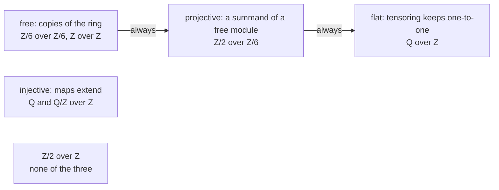

# Projective, injective and flat: the modules that keep Hom and tensor exact

[Syllabus](../../../SYLLABUS.md) → [Algebraic geometry](../README.md) → [Exact Sequences, Ext and Tor](../README.md#s07) → Projective, injective and flat

---

## General Overview

Take the clock that counts hours mod 6, the ring $`\mathbb{Z}/6`$. Read each hour twice: once mod 2 (odd or even) and once mod 3. The six hours give all six pairs, so the clock is two smaller clocks side by side: $`\mathbb{Z}/6 = \mathbb{Z}/2 \times \mathbb{Z}/3`$. That splitting makes the 2-hour clock $`\mathbb{Z}/2`$ a clean piece of the ring itself.

Now move to the whole numbers $`\mathbb{Z}`$ and the sequence "times 2, then mod 2": $`0 \to \mathbb{Z} \to \mathbb{Z} \to \mathbb{Z}/2 \to 0`$. It is exact: each map's image is the next map's kernel ([Exact sequences of modules](01-exact-sequences-and-the-snake-lemma.md)). Feed it to three standard operations:

- **Maps out of a module P**, written $`\mathrm{Hom}(P, -)`$: does every map into $`\mathbb{Z}/2`$ lift to a map into $`\mathbb{Z}`$?
- **Maps into a module I**, written $`\mathrm{Hom}(-, I)`$: does every map defined on the even numbers extend to all of $`\mathbb{Z}`$?
- **Tensoring with a module F**: does "times 2" stay one-to-one after tensoring?

With $`\mathbb{Z}/2`$ in every role, all three answers are no. Tensoring with $`\mathbb{Z}/2`$ turns "times 2" into the zero map on $`\mathbb{Z}/2`$, which kills 1. Put $`\mathbb{Q}`$ (the fractions) in the tensor slot and "times 2" stays one-to-one. Put $`\mathbb{Q}/\mathbb{Z}`$ (fractions with whole numbers ignored) in the Hom slot, and the map that sends 2 to 1/3 extends: send 1 to 1/6.

The modules that never break a sequence get names. **Projective** modules keep $`\mathrm{Hom}(P, -)`$ exact, **injective** modules keep $`\mathrm{Hom}(-, I)`$ exact, and **flat** modules keep tensoring exact. They are the safe inputs from which the later cards on this shelf build Tor and Ext.

**Projective, injective and flat modules are exactly those that keep every short exact sequence exact under maps out, maps in and tensoring; projectives are the direct summands of free modules, injectives are detected on ideals alone (Baer), and over the whole numbers injective means divisible and flat means no torsion.**

**What kind of fact this is:** three definitions with three theorems attached: the summand description and Baer's criterion, proved in Why it works, and the ideal test for flatness, stated with its key step and a named source.

### The picture: which property gives which



The arrows never reverse in general: $`\mathbb{Z}/2`$ over $`\mathbb{Z}/6`$ is projective but not free, and $`\mathbb{Q}`$ is flat but not projective. Injective is a separate property: $`\mathbb{Q}`$ has it and $`\mathbb{Z}`$ does not.

---

## The formula

Notation first, in words. R is a commutative ring with 1. A module is as on the [Modules](../06-Schemes%20and%20Modern%20Language/05-modules-and-the-structure-theorem.md) card: it adds, and ring members multiply it.

- $`\mathrm{Hom}_R(M, N)`$ is the set of module maps from M to N: maps that keep sums and scalar multiples. It is a module itself. With N the field k it is the dual space of [Dual spaces](../../03-Algebra/11-Duals%2C%20Quotients%20and%20Tensors/02-dual-spaces.md).
- $`M \otimes_R N`$ is the tensor product of [Tensor products](../../03-Algebra/11-Duals%2C%20Quotients%20and%20Tensors/03-tensor-products.md), built over the ring: sums of $`u \otimes v`$, linear in each slot, with $`ru \otimes v = u \otimes rv`$.
- Two facts about it carry the card: $`R \otimes_R M = M`$, and $`R/(a) \otimes_R M = M/aM`$, the module M with all multiples $`a\,u`$ set to zero.

A short exact sequence $`0 \to A \to B \to C \to 0`$ has f one-to-one, g onto, and the image of f equal to the kernel of g. The three operations turn it into three new sequences:

```math
\begin{aligned} &0 \to \mathrm{Hom}(P, A) \xrightarrow{f \circ} \mathrm{Hom}(P, B) \xrightarrow{g \circ} \mathrm{Hom}(P, C) \to 0 \\ &0 \to \mathrm{Hom}(C, I) \xrightarrow{\circ g} \mathrm{Hom}(B, I) \xrightarrow{\circ f} \mathrm{Hom}(A, I) \to 0 \\ &0 \to A \otimes F \xrightarrow{f \otimes 1} B \otimes F \xrightarrow{g \otimes 1} C \otimes F \to 0 \end{aligned}
```

**Read it aloud:** compose maps out of P with f or g; compose maps into I with g or f, in reverse order; tensor every module with F.

Every line is always exact except at one end: the last arrow of the first two lines, and the first arrow of the third. P is **projective**, I is **injective** and F is **flat** exactly when that one end is exact for every short exact sequence:

| Property | The end that can fail | In words |
| --- | --- | --- |
| P projective | $`\mathrm{Hom}(P, B) \to \mathrm{Hom}(P, C)`$ onto | every map $`P \to C`$ lifts through every onto map $`B \to C`$ |
| I injective | $`\mathrm{Hom}(B, I) \to \mathrm{Hom}(A, I)`$ onto | every map $`A \to I`$ extends along every one-to-one map $`A \to B`$ |
| F flat | $`A \otimes F \to B \otimes F`$ one-to-one | tensoring with F keeps one-to-one maps one-to-one |

The theorems of this card, with J running over the ideals of R:

```math
P \text{ projective} \iff P \oplus Q \cong R^{(S)} \text{ for some } Q, \qquad I \text{ injective} \iff \text{every } J \to I \text{ extends to } R \to I
```

**Read it aloud:** a module is projective when some other module Q fills it out to a free module; a module is injective when maps from ideals into it always extend to the whole ring.

Over the whole numbers the three tests become arithmetic. Write "times n" for the map $`x \mapsto nx`$ on a module M:

```math
\text{over } \mathbb{Z}: \quad I \text{ injective} \iff \text{times } n \text{ is onto for all } n \neq 0, \qquad F \text{ flat} \iff \text{times } n \text{ is one-to-one for all } n \neq 0
```

**Read it aloud:** over the integers, injective means every member can be divided by every nonzero n, and flat means no nonzero member is killed by a nonzero n.

| Symbol | Plain meaning | In our example | Push it up and the answer… |
| --- | --- | --- | --- |
| $`R`$; $`J`$, $`d`$; $`r`$, $`a`$ | the ring of scalars, commutative with 1; an ideal and its generator; scalars | $`\mathbb{Z}/4`$; $`\{0, 2\}`$, d = 2 | more ideals for Baer to test |
| $`\mathbb{Z}`$, $`\mathbb{Q}`$, $`\mathbb{Q}/\mathbb{Z}`$, $`\mathbb{Z}/n`$, $`k`$ | whole numbers; fractions; fractions mod 1; the n-hour clock; a field | 1/3 + 2/3 = 0 in $`\mathbb{Q}/\mathbb{Z}`$ | — |
| $`A, B, C`$; $`f, g`$ | the modules of a short exact sequence; its one-to-one and onto maps; from Step 5 on, f also names a test map into $`\mathbb{Z}`$ | $`\mathbb{Z}`$, $`\mathbb{Z}`$, $`\mathbb{Z}/2`$; times 2, mod 2 | — |
| $`P`$, $`I`$, $`F`$, $`Q`$ | the module in the Hom-out, Hom-in or tensor slot; a complement | $`\mathbb{Z}/2`$, $`\mathbb{Q}/\mathbb{Z}`$, $`\mathbb{Q}`$; $`\{0, 2, 4\}`$ | — |
| $`\mathrm{Hom}(M, N)`$; $`h, \ell, \varphi, \pi`$; $`\mathrm{id}`$ | module maps from M to N; maps in the proofs; the identity map | $`\mathrm{Hom}(\mathbb{Z}/2, \mathbb{Z}) = 0`$ | — |
| $`s`$ | a section: a map back with $`g \circ s = \mathrm{id}`$ | s(1) = 3 for $`\mathbb{Z}/6 \to \mathbb{Z}/2`$ | — |
| $`\otimes`$, $`f \otimes 1`$ | tensor product; f applied in the first slot | times 2 on $`\mathbb{Z} \otimes \mathbb{Z}/2 = \mathbb{Z}/2`$ is 0 | — |
| $`R^{(S)}`$, $`e_i`$, $`b_i`$, $`\oplus`$ | a free module on a set S; its basis; chosen lifts; side by side | $`\mathbb{Z}/6 = \{0, 3\} \oplus \{0, 2, 4\}`$ | — |
| $`n`$, $`m`$, $`N`$ | the ring $`\mathbb{Z}/n`$ and module $`\mathbb{Z}/m`$, m dividing n; a whole number | n = 6, m = 2; N = 1 to 20 | — |
| $`e`$ | an idempotent: $`e^2 = e`$ | e = 3 in $`\mathbb{Z}/6`$ | — |
| $`x, y`$; $`u, v, b, c, w, p`$; $`A'`$ | a member to divide and the answer, $`ny = x`$; members in the proofs; a partial domain | x = 1/3, y = 1/6 in $`\mathbb{Q}/\mathbb{Z}`$ | — |
| $`\gcd(m, n/m)`$ | the test that decides all three over $`\mathbb{Z}/n`$ | gcd(2, 3) = 1 | above 1: all three fail |

### When it holds

- **The ring is commutative.** Over a non-commutative ring, Hom is no longer a module over R, and left and right flatness differ; the theorems survive with one side fixed throughout.
- **The ring is fixed.** $`\mathbb{Z}/2`$ is projective over $`\mathbb{Z}/6`$ and not over $`\mathbb{Z}`$: the only map $`\mathbb{Z}/2 \to \mathbb{Z}`$ is zero.
- **Baer needs every ideal.** Testing only the ideal R itself passes every module: all 81 pairs checked, where 59 are injective.
- **Divisible means injective over a principal ideal domain** (a domain where every ideal has one generator), such as $`\mathbb{Z}`$, not over every ring. In $`\mathbb{Z}/4`$ the only members that kill nothing are the units 1 and 3, so every module is divisible by them. Yet $`\mathbb{Z}/2`$ is not injective there: the map $`2 \mapsto 1`$ on the ideal $`\{0, 2\}`$ needs $`2y = 1`$ in $`\mathbb{Z}/2`$.
- **Torsion-free means flat over a principal ideal domain**, because every ideal is principal and the ideal test becomes "times n is one-to-one". Over the domain $`k[x, y]`$ the ideal $`(x, y)`$ has no torsion but is not flat. Over $`\mathbb{Z}/6`$, 3 × 2 = 0, yet $`\mathbb{Z}/6`$ is free over itself, so flat. Away from principal ideal domains the ideal test decides, not torsion.

---

## Why it works

### Step 0: each operation can fail at one end only, and the good modules are where it does not

Maps out of P never lose information: a map into A, pushed into B, is still recorded. Only lifting can fail, because an onto map $`B \to C`$ may have no way back. Tensoring never creates new relations at the right end, but it can glue members on the left: "times 2" on $`\mathbb{Z}`$ becomes $`2x`$ on $`\mathbb{Z}/2`$, which is 0.

So each operation is "half exact" for free, and each named property is the other half. The work is to recognise the modules that have it.

### Step 1: why the other end always holds

Take $`\mathrm{Hom}(P, -)`$. If $`f \circ h = 0`$ for a map $`h : P \to A`$, then $`h = 0`$, since f is one-to-one. If $`g \circ \ell = 0`$ for $`\ell : P \to B`$, every value of $`\ell`$ lies in the kernel of g, which is the image of f, so $`\ell`$ factors through A. That is exactness at the first two places.

The same reasoning, with arrows reversed, gives $`\mathrm{Hom}(-, I)`$. For tensoring, $`g \otimes 1`$ is onto because every $`c \otimes v`$ is $`g(b) \otimes v`$; exactness in the middle is the right exactness of the tensor product, proved in both Weibel and Rotman.

### Step 2: projective means a direct summand of a free module

**Free modules are projective.** A free module has a basis: members $`e_i`$ that build everything in exactly one way. To lift $`h : R^{(S)} \to C`$ through onto $`g : B \to C`$, pick any $`b_i`$ with $`g(b_i) = h(e_i)`$ and send $`e_i \mapsto b_i`$. A basis allows any choice.

**Summands of projectives are projective.** If $`P \oplus Q`$ is free, extend a map on P by zero on Q, lift it, and restrict back to P.

**Every projective is a summand of a free module.** Map a free module onto P, one basis member per member of P. Projectivity lifts the identity of P to a section s. Then the free module is $`s(P) \oplus \ker`$.

<details>
<summary>Detailed proof: a section splits the free module</summary>

Let $`\pi : R^{(S)} \to P`$ be onto and $`s : P \to R^{(S)}`$ satisfy $`\pi \circ s = \mathrm{id}_P`$. For any w in the free module, write

$`\displaystyle w = s(\pi(w)) + \big(w - s(\pi(w))\big).`$

The first part lies in $`s(P)`$. The second lies in the kernel of $`\pi`$, since $`\pi(w) - \pi(s(\pi(w))) = \pi(w) - \pi(w) = 0`$. If w lies in both, $`w = s(p)`$ and $`0 = \pi(w) = p`$, so $`w = 0`$. The sum is direct, and s maps P one-to-one onto $`s(P)`$.

</details>

### Step 3: the hour clock gives a projective that is not free

In $`\mathbb{Z}/6`$ the members with $`e^2 = e`$ are 0, 1, 3 and 4. The multiples of 3 are $`\{0, 3\}`$, a copy of $`\mathbb{Z}/2`$; the multiples of 4 are $`\{0, 2, 4\}`$, a copy of $`\mathbb{Z}/3`$. Since $`3 + 4 = 1`$ in $`\mathbb{Z}/6`$, every hour splits uniquely as one of each:

```math
\mathbb{Z}/6 = \{0, 3\} \oplus \{0, 2, 4\} \cong \mathbb{Z}/2 \oplus \mathbb{Z}/3
```

**Read it aloud:** the six-hour clock is a 2-hour clock and a 3-hour clock side by side.

So $`\mathbb{Z}/2`$ is a summand of the free module $`\mathbb{Z}/6`$, and Step 2 makes it projective. The section is explicit: send 1 to 3, since $`2 \times 3 = 0`$ in $`\mathbb{Z}/6`$ and 3 reads 1 mod 2. It is not free: a free $`\mathbb{Z}/6`$-module has a power of 6 members (1, 6, 36, 216, …), and $`\mathbb{Z}/2`$ has 2.

The same search over $`\mathbb{Z}/4`$ finds no section of $`\mathbb{Z}/4 \to \mathbb{Z}/2`$: the only idempotents are 0 and 1, so the ring does not split. Over a ring like $`\mathbb{Z}/4`$, with one maximal ideal, projective forces free: the payoff of [Nakayama's lemma](03-nakayamas-lemma.md).

### Step 4: Baer's criterion, extension tested on ideals

Injectivity asks about every one-to-one map $`A \to B`$, a huge family. Reinhold Baer showed in 1940 that the ideals of R suffice: if every map $`J \to I`$ from an ideal extends to $`R \to I`$, then I is injective.

The proof grows the extension one member at a time. Start from $`h : A \to I`$ and take a maximal partial extension (one that no other partial extension enlarges), which exists by Zorn's lemma (any chain of partial extensions has an upper bound, its union). If it stops short of B at a member b, the scalars r with $`rb`$ already covered form an ideal J. Baer's condition extends the map on J to R, and that tells where to send b. The larger extension contradicts maximality.

<details>
<summary>Detailed proof: one more member always fits</summary>

Let $`h' : A' \to I`$ be a maximal extension, with $`A \subseteq A' \subseteq B`$, and suppose b lies in B but not in A'. Let

$`\displaystyle J = \{\, r \in R : rb \in A' \,\},`$

an ideal, and define $`\varphi : J \to I`$ by $`\varphi(r) = h'(rb)`$. By hypothesis $`\varphi`$ extends to R; let y be the image of 1, so $`\varphi(r) = ry`$. Define on $`A' + Rb`$:

$`\displaystyle a + rb \mapsto h'(a) + ry.`$

It is well defined: if $`a + rb = a_2 + r_2 b`$, then $`(r - r_2)b = a_2 - a`$ lies in A', so $`r - r_2`$ lies in J and $`h'(a_2) - h'(a) = h'((r - r_2)b) = (r - r_2)y`$. It is a module map extending h', on a strictly larger submodule. That contradicts maximality, so $`A' = B`$.

</details>

Over $`\mathbb{Z}/n`$ the ideals are $`d\mathbb{Z}/n`$ for each d dividing n, so Baer's criterion becomes a finite search. The code runs it on every ring $`\mathbb{Z}/n`$ up to n = 30.

### Step 5: over the whole numbers, three properties become arithmetic

Every ideal of $`\mathbb{Z}`$ is $`n\mathbb{Z}`$. A map $`n\mathbb{Z} \to I`$ is fixed by where n goes, say x. It extends to $`\mathbb{Z}`$ exactly when some y has $`ny = x`$. So Baer's criterion reads: I is injective exactly when it is **divisible**, every member divisible by every nonzero n.

- $`\mathbb{Q}`$ is divisible: $`y = x/n`$.
- $`\mathbb{Q}/\mathbb{Z}`$ is divisible: $`a/b`$ divided by n is $`a/(nb)`$. In fact $`ny = x`$ has exactly n answers, checked for all 46 classes with bottom at most 12 and n from 2 to 12.
- $`\mathbb{Z}`$ is not: $`2y = 1`$ has no whole-number answer.

Flatness has a matching ideal test: F is flat exactly when $`J \otimes F \to F`$ is one-to-one for every ideal J (proved in Lam; the key step writes any one-to-one map as a union of finitely generated pieces). For $`J = n\mathbb{Z}`$, $`J \otimes F`$ is a copy of F and the map is "times n". So over $`\mathbb{Z}`$, flat means **torsion-free**: no nonzero member is killed by a nonzero n.

- $`\mathbb{Q}`$ is flat: $`2x = 0`$ forces $`x = 0`$.
- $`\mathbb{Q}/\mathbb{Z}`$ is not: $`2 \times 1/2 = 1`$, which is 0 there.
- $`\mathbb{Z}/2`$ is not: tensoring "times 2" with it gives the zero map on $`\mathbb{Z}/2`$.

Projective over $`\mathbb{Z}`$ means free, because summands of free modules are submodules of free modules, and over a principal ideal domain those are free ([Modules](../06-Schemes%20and%20Modern%20Language/05-modules-and-the-structure-theorem.md) proves the finite case; Rotman proves the general one). $`\mathbb{Q}`$ fails a sharper test: a map $`f : \mathbb{Q} \to \mathbb{Z}`$ has $`f(1) = N f(1/N)`$ for every N, so $`f(1)`$ is a multiple of every whole number, and only 0 is. A nonzero summand of a free module has a nonzero map to $`\mathbb{Z}`$ (one coordinate), so $`\mathbb{Q}`$ is no summand.

### Step 6: projective implies flat, and over Z/n all three agree

Tensoring with $`R^{(S)}`$ gives one copy of each module per basis member, so free modules are flat. A summand of a flat module is flat: $`A \otimes (P \oplus Q)`$ splits as $`(A \otimes P) \oplus (A \otimes Q)`$, and $`f \otimes 1`$ acts on each piece separately, so if it is one-to-one on the whole it is one-to-one on the P piece. So every projective is flat.

Over $`\mathbb{Z}/n`$ the module $`\mathbb{Z}/m`$ splits off exactly when the ring splits as $`\mathbb{Z}/m \times \mathbb{Z}/(n/m)`$, which by the Chinese remainder theorem means $`\gcd(m, n/m) = 1`$. Rings $`\mathbb{Z}/n`$ have the further habit that projective and injective coincide for these modules (Lam calls such rings quasi-Frobenius). The code confirms it on all 81 pairs: section, summand, Baer and ideal test all match the gcd rule, and 59 pairs pass.

---

## Worked numbers, by hand

| Step | Arithmetic | Value |
| --- | --- | --- |
| split the clock | x ↦ (x mod 2, x mod 3) on 0 to 5 | all 6 pairs hit |
| idempotents of $`\mathbb{Z}/6`$ | $`e^2 = e`$: 0, 1, 9 mod 6 = 3, 16 mod 6 = 4 | 0, 1, 3, 4 |
| the two pieces | multiples of 3; multiples of 4 | {0, 3} and {0, 2, 4} |
| section for $`\mathbb{Z}/6 \to \mathbb{Z}/2`$ | 2 × 3 = 6 = 0 mod 6, and 3 mod 2 = 1 | **s(1) = 3: projective** |
| free sizes over $`\mathbb{Z}/6`$ | powers of 6 | 1, 6, 36, 216, never 2: not free |
| lift the identity of $`\mathbb{Z}/2`$ to $`\mathbb{Z}`$ | 2 f(1) = f(0) = 0 | f(1) = 0 only: **not projective over Z** |
| extend 2 ↦ 1 from $`2\mathbb{Z}`$ into $`\mathbb{Z}`$ | 2y = 1 | no y: $`\mathbb{Z}`$ not injective |
| extend 2 ↦ 1/3 into $`\mathbb{Q}/\mathbb{Z}`$ | 2y = 1/3 mod 1 | y = 1/6 or 2/3: extends |
| times 2 tensored with $`\mathbb{Z}/2`$ | 2 × 1 = 0 mod 2 | **kernel {0, 1}: not flat** |
| times 2 on $`\mathbb{Q}/\mathbb{Z}`$ | 2 × 1/2 = 1 = 0 mod 1 | kernel {0, 1/2}: not flat |
| times 2 on $`\mathbb{Z}`$ | 2x = 0 | kernel {0}: $`\mathbb{Z}`$ flat |
| a map $`\mathbb{Q} \to \mathbb{Z}`$ | f(1) a multiple of 1 to 20, lcm 232792560 | f = 0: $`\mathbb{Q}`$ not projective |

The verdicts. $`\mathbb{Z}`$ is free on 1, so projective. $`\mathbb{Q}`$ is divisible (Step 5), so injective. $`\mathbb{Q}/\mathbb{Z}`$ is not flat, so not projective (Step 6). Every other entry is read from a row above:

| Module over $`\mathbb{Z}`$ | Projective | Injective | Flat |
| --- | --- | --- | --- |
| $`\mathbb{Z}`$ | yes | no | yes |
| $`\mathbb{Q}`$ | no | yes | yes |
| $`\mathbb{Q}/\mathbb{Z}`$ | no | yes | no |
| $`\mathbb{Z}/2`$ | no | no | no |

The same two-element module changes meaning with the ring: $`\mathbb{Z}/2`$ is all three over $`\mathbb{Z}/6`$ and none of the three over $`\mathbb{Z}`$ or $`\mathbb{Z}/4`$.

### What breaks if you drop a piece

| Mistake | Comes out at | What went wrong |
| --- | --- | --- |
| $`\mathbb{Z}/2`$ is projective over $`\mathbb{Z}/6`$, so over $`\mathbb{Z}`$ too | maps $`\mathbb{Z}/2 \to \mathbb{Z}`$: only f(1) = 0 | The ring changed; $`\mathbb{Z}`$ does not split off a 2-clock |
| $`\mathbb{Q}`$ has no torsion, so it is projective | maps $`\mathbb{Q} \to \mathbb{Z}`$: only 0, since f(1) needs lcm(1..20) = 232792560 to divide it | Torsion-free gives flat; it gives free only for finitely generated modules, and $`\mathbb{Q}`$ is not finitely generated |
| Baer tested on the ideal R alone | passes 81 of 81 pairs; the true count is 59 | The ideal R always extends; $`\{0, 2\}`$ in $`\mathbb{Z}/4`$ catches $`\mathbb{Z}/2`$ |
| $`\mathbb{Q}/\mathbb{Z}`$ is injective, so flat | times 2 has kernel {0, 1/2} | Injective and flat are different ends of different sequences |

The code prints all four.

---

## Code, from first principles, and it actually runs

Nothing is imported. Part 1 decides each property for every module $`\mathbb{Z}/m`$ over every ring $`\mathbb{Z}/n`$ up to n = 30 by four separate finite searches: a section of $`\mathbb{Z}/n \to \mathbb{Z}/m`$, an idempotent cutting out a summand, Baer's criterion on every ideal, and the ideal test for flatness. All four must match the gcd rule. Part 2 runs the sequence $`0 \to \mathbb{Z} \to \mathbb{Z} \to \mathbb{Z}/2 \to 0`$ through the three operations, with exact fractions for $`\mathbb{Q}`$ and $`\mathbb{Q}/\mathbb{Z}`$, and ends on the shelf's house example.

### Python

```python
# Projective, injective and flat modules -- the check behind the card.  Nothing is
# imported.  Part 1: over each ring Z/n, n = 2 to 30, every module Z/m (m > 1, m
# dividing n) is tested by finite search: projective two ways (a section, a summand),
# injective by Baer's criterion, flat by the ideal test, all against gcd(m, n/m) = 1.
# Part 2: over Z, the sequence 0 -> Z -> Z -> Z/2 -> 0 (first map times 2) is fed to
# Hom(P, -), Hom(-, I) and - tensor F, with exact fractions for Q and Q/Z.

def gcd(a, b):
    a, b = abs(a), abs(b)
    while b:
        a, b = b, a % b
    return a

def yn(c):
    return "yes" if c else "no"

# Part 1.  The ring Z/n acts on the module Z/m by r.x = r*x mod m.
def section(n, m):      # the onto map Z/n -> Z/m, 1 -> 1, has a module map back with s(1) = r
    return [r for r in range(n) if m * r % n == 0 and r % m == 1]

def summand(n, m):      # an idempotent e (e*e = e) with e(Z/n) of size m: Z/n = eZ/n + (1-e)Z/n
    return any(e * e % n == e and n // gcd(e, n) == m for e in range(n))

def baer(n, m, ideals):  # every map from an ideal dZ/n to Z/m extends to all of Z/n
    for d in ideals:
        for x in range(m):                   # d -> x is a well-defined map when (n/d) x = 0
            if (n // d) * x % m == 0 and not any(d * y % m == x for y in range(m)):
                return False
    return True

def ideal_test(n, m):   # dZ/n tensor Z/m = Z/m over (n/d)Z/m, sent into Z/m by x -> d x
    for d in range(1, n + 1):
        if n % d == 0:
            killed = {x for x in range(m) if d * x % m == 0}
            if not killed <= {(n // d) * z % m for z in range(m)}:
                return False
    return True

def verdicts(n, m):
    divs = [d for d in range(1, n + 1) if n % d == 0]
    return [bool(section(n, m)), summand(n, m), baer(n, m, divs), ideal_test(n, m)]

print("ring  module  section  summand  Baer  flat  gcd(m, n/m)")
for n, m in [(6, 2), (6, 3), (6, 6), (4, 2), (4, 4), (12, 2), (12, 4), (12, 6)]:
    v = verdicts(n, m)
    print(f"Z/{n:<3} Z/{m:<4} {yn(v[0]):<8} {yn(v[1]):<8} {yn(v[2]):<5} {yn(v[3]):<5} {gcd(m, n // m)}")
pairs = [(n, m) for n in range(2, 31) for m in range(2, n + 1) if n % m == 0]
agree = all(verdicts(n, m) == [gcd(m, n // m) == 1] * 4 for n, m in pairs)
good = sum(1 for n, m in pairs if verdicts(n, m)[0])
whole_ring_only = sum(1 for n, m in pairs if baer(n, m, [1]))
crt = sorted({(x % 2, x % 3) for x in range(6)})
idem = [e for e in range(6) if e * e % 6 == e]
print(f"Z/6 -> Z/2 x Z/3, x -> (x mod 2, x mod 3), hits {len(crt)} of 6 pairs")
print(f"idempotents of Z/6: {idem}; 3Z/6 = {sorted({3 * r % 6 for r in range(6)})}, "
      f"4Z/6 = {sorted({4 * r % 6 for r in range(6)})}, 3 + 4 = {(3 + 4) % 6} mod 6")
print(f"sections of Z/6 -> Z/2: s(1) in {section(6, 2)}; of Z/4 -> Z/2: s(1) in {section(4, 2)}")
print(f"free Z/6-modules have {[6 ** k for k in range(4)]} members; Z/2 has 2")
print(f"Z/4 on Z/2, ideal 2Z/4, map 2 -> 1: solutions of 2y = 1 in Z/2: {[y for y in range(2) if 2 * y % 2 == 1]}")
print(f"pairs (n, m) checked: {len(pairs)}; all four tests match gcd(m, n/m) = 1: {yn(agree)}; all three hold: {good}")
print(f"Baer tested on the ideal Z/n alone passes {whole_ring_only} of {len(pairs)}")

# Part 2.  Fractions p/q in lowest terms, q > 0; in Q/Z the top is taken mod q.
def frac(p, q, mod1=False):
    if q < 0:
        p, q = -p, -q
    g = gcd(p, q)
    p, q = p // g, q // g
    return (p % q, q) if mod1 else (p, q)

def show(f):
    return str(f[0]) if f[1] == 1 else f"{f[0]}/{f[1]}"

QZ = sorted({frac(c, d, True) for d in range(1, 13) for c in range(d)})       # Q/Z, bottoms <= 12
QS = sorted({frac(c, d) for d in range(1, 13) for c in range(-12, 13)})      # a window of Q
ZW = range(-1000, 1001)                                                     # a window of Z
hom_z2_z = [k for k in ZW if 2 * k == 0]
ext_z = [y for y in ZW if 2 * y == 1]
ext_qz = [show(y) for y in QZ if frac(2 * y[0], y[1], True) == frac(1, 3)]
ker_zz = [x for x in ZW if 2 * x == 0]
ker_z2 = [x for x in range(2) if 2 * x % 2 == 0]
ext_z2 = [y for y in range(2) if 2 * y % 2 == 1]
ker_q = [show(x) for x in QS if frac(2 * x[0], x[1]) == (0, 1)]
ker_qz = [show(x) for x in QZ if frac(2 * x[0], x[1], True) == (0, 1)]
roots = {len([c for c in range(n * x[1]) if frac(n * c, n * x[1], True) == x])
         for x in QZ for n in range(2, 13)}
roots_ok = all(len([c for c in range(n * x[1]) if frac(n * c, n * x[1], True) == x]) == n
               for x in QZ for n in range(2, 13))
lcm = 1
for k in range(1, 21):
    lcm = lcm * k // gcd(lcm, k)
hom_q_z = [k for k in ZW if all(k % N == 0 for N in range(1, 21))]
lift_z = all(any(b % 2 == t for b in ZW) for t in range(2))          # each map Z -> Z/2, 1 -> t, lifts to 1 -> b
div_q = all(frac(n * y[0], y[1]) == x for x in QS for n in range(2, 13) for y in [frac(x[0], n * x[1])])
print("the sequence 0 -> Z -> Z -> Z/2 -> 0, first map times 2")
print(f"Hom(Z/2, -): maps Z/2 -> Z have f(1) in {hom_z2_z}, so the identity of Z/2 does not lift")
print(f"Hom(-, Z): extend 2 -> 1 from 2Z to Z: solutions of 2y = 1 in -1000..1000: {ext_z}")
print(f"Hom(-, Q/Z): extend 2 -> 1/3 from 2Z to Z: solutions of 2y = 1/3: [{", ".join(ext_qz)}]")
print(f"tensor Z: times 2 on Z, kernel in -1000..1000: {ker_zz}")
print(f"tensor Z/2: times 2 on Z/2, kernel {ker_z2}")
print(f"tensor Q: times 2 on Q, kernel in the window of {len(QS)} fractions: [{", ".join(ker_q)}]")
print(f"tensor Q/Z: times 2 on Q/Z, kernel [{", ".join(ker_qz)}]")
print(f"Q/Z, {len(QZ)} classes, n = 2..12: n y = x has exactly n solutions every time: {yn(roots_ok)}")
print(f"a map Q -> Z sends 1 to a multiple of 1..20; lcm(1..20) = {lcm}; such f(1) in -1000..1000: {hom_q_z}")
print("module  projective  injective  flat")
table = [("Z", lift_z, bool(ext_z), ker_zz == [0]), ("Q", hom_q_z != [0], div_q, ker_q == ["0"]),   # Z lifts; Q divides
         ("Q/Z", len(ker_qz) == 1, roots_ok, len(ker_qz) == 1),    # not flat, so not projective
         ("Z/2", hom_z2_z != [0], bool(ext_z2), len(ker_z2) == 1)]
for name, p, i, f in table:
    print(f"{name:<7} {yn(p):<11} {yn(i):<10} {yn(f)}")
tor = [x for x in range(6) if 4 * x % 6 == 0]
ext = len(range(6)) // len({4 * x % 6 for x in range(6)})
print(f"house example: times 4 on Z/6 has kernel {tor} (Tor) and {ext} classes left over (Ext)")
assert agree and len(pairs) == 81 and good == 59                 # four roads, one rule
assert section(6, 2) == [3] and section(4, 2) == [] and crt == [(a, b) for a in range(2) for b in range(3)]
assert hom_z2_z == [0] and ext_z == [] and ext_qz == ["1/6", "2/3"]   # Z/2 and Z fail
assert ker_z2 == [0, 1] and ker_q == ["0"] and ker_qz == ["0", "1/2"]
assert roots_ok and roots == set(range(2, 13)) and hom_q_z == [0] and lcm == 232792560
assert whole_ring_only == len(pairs) and tor == [0, 3] and ext == 2 and ker_zz == [0]
assert [r[1:] for r in table] == [(1, 0, 1), (0, 1, 1), (0, 1, 0), (0, 0, 0)]   # the verdict table
print("ALL CHECKS PASS")
```

**Ran 2026-11-24 on macOS, Python 3.14.10, standard library only. All checks passed. Output, pasted from the run:**

```
ring  module  section  summand  Baer  flat  gcd(m, n/m)
Z/6   Z/2    yes      yes      yes   yes   1
Z/6   Z/3    yes      yes      yes   yes   1
Z/6   Z/6    yes      yes      yes   yes   1
Z/4   Z/2    no       no       no    no    2
Z/4   Z/4    yes      yes      yes   yes   1
Z/12  Z/2    no       no       no    no    2
Z/12  Z/4    yes      yes      yes   yes   1
Z/12  Z/6    no       no       no    no    2
Z/6 -> Z/2 x Z/3, x -> (x mod 2, x mod 3), hits 6 of 6 pairs
idempotents of Z/6: [0, 1, 3, 4]; 3Z/6 = [0, 3], 4Z/6 = [0, 2, 4], 3 + 4 = 1 mod 6
sections of Z/6 -> Z/2: s(1) in [3]; of Z/4 -> Z/2: s(1) in []
free Z/6-modules have [1, 6, 36, 216] members; Z/2 has 2
Z/4 on Z/2, ideal 2Z/4, map 2 -> 1: solutions of 2y = 1 in Z/2: []
pairs (n, m) checked: 81; all four tests match gcd(m, n/m) = 1: yes; all three hold: 59
Baer tested on the ideal Z/n alone passes 81 of 81
the sequence 0 -> Z -> Z -> Z/2 -> 0, first map times 2
Hom(Z/2, -): maps Z/2 -> Z have f(1) in [0], so the identity of Z/2 does not lift
Hom(-, Z): extend 2 -> 1 from 2Z to Z: solutions of 2y = 1 in -1000..1000: []
Hom(-, Q/Z): extend 2 -> 1/3 from 2Z to Z: solutions of 2y = 1/3: [1/6, 2/3]
tensor Z: times 2 on Z, kernel in -1000..1000: [0]
tensor Z/2: times 2 on Z/2, kernel [0, 1]
tensor Q: times 2 on Q, kernel in the window of 183 fractions: [0]
tensor Q/Z: times 2 on Q/Z, kernel [0, 1/2]
Q/Z, 46 classes, n = 2..12: n y = x has exactly n solutions every time: yes
a map Q -> Z sends 1 to a multiple of 1..20; lcm(1..20) = 232792560; such f(1) in -1000..1000: [0]
module  projective  injective  flat
Z       yes         no         yes
Q       no          yes        yes
Q/Z     no          yes        no
Z/2     no          no         no
house example: times 4 on Z/6 has kernel [0, 3] (Tor) and 2 classes left over (Ext)
ALL CHECKS PASS
```

### Rust

Same numbers, same labels, built with `rustc --edition 2021 -O`.

```rust
// Projective, injective and flat modules -- the same check as the Python, in Rust.
// No crates.  Part 1: over each ring Z/n, n = 2 to 30, every module Z/m (m > 1, m
// dividing n) is tested by finite search: projective two ways (a section, a summand),
// injective by Baer's criterion, flat by the ideal test, all against gcd(m, n/m) = 1.
// Part 2: over Z, the sequence 0 -> Z -> Z -> Z/2 -> 0 (first map times 2) is fed to
// Hom(P, -), Hom(-, I) and - tensor F, with exact fractions for Q and Q/Z.
use std::collections::BTreeSet;

fn gcd(a: i64, b: i64) -> i64 {
    let (mut a, mut b) = (a.abs(), b.abs());
    while b != 0 { (a, b) = (b, a % b) }
    a
}

fn yn(c: bool) -> &'static str { if c { "yes" } else { "no" } }

// Part 1.  The ring Z/n acts on the module Z/m by r.x = r*x mod m.
fn section(n: i64, m: i64) -> Vec<i64> {      // the onto map Z/n -> Z/m, 1 -> 1, has s(1) = r
    (0..n).filter(|&r| m * r % n == 0 && r % m == 1).collect()
}

fn summand(n: i64, m: i64) -> bool {          // an idempotent e with e(Z/n) of size m
    (0..n).any(|e| e * e % n == e && n / gcd(e, n) == m)
}

fn baer(n: i64, m: i64, ideals: &[i64]) -> bool { // every map from an ideal dZ/n extends
    for &d in ideals {
        for x in 0..m {                        // d -> x is well defined when (n/d) x = 0
            if (n / d) * x % m == 0 && !(0..m).any(|y| d * y % m == x) { return false }
        }
    }
    true
}

fn ideal_test(n: i64, m: i64) -> bool {       // dZ/n tensor Z/m = Z/m over (n/d)Z/m, x -> d x
    for d in (1..=n).filter(|d| n % d == 0) {
        let zero: BTreeSet<i64> = (0..m).map(|z| (n / d) * z % m).collect();
        if (0..m).any(|x| d * x % m == 0 && !zero.contains(&x)) { return false }
    }
    true
}

fn verdicts(n: i64, m: i64) -> Vec<bool> {
    let divs: Vec<i64> = (1..=n).filter(|d| n % d == 0).collect();
    vec![!section(n, m).is_empty(), summand(n, m), baer(n, m, &divs), ideal_test(n, m)]
}

// Part 2.  Fractions p/q in lowest terms, q > 0; in Q/Z the top is taken mod q.
fn frac(p: i64, q: i64, mod1: bool) -> (i64, i64) {
    let (p, q) = if q < 0 { (-p, -q) } else { (p, q) };
    let g = gcd(p, q);
    let (p, q) = (p / g, q / g);
    if mod1 { (p.rem_euclid(q), q) } else { (p, q) }
}

fn show(f: (i64, i64)) -> String { if f.1 == 1 { format!("{}", f.0) } else { format!("{}/{}", f.0, f.1) } }

fn lst(v: &[String]) -> String { format!("[{}]", v.join(", ")) }

fn main() {
    println!("ring  module  section  summand  Baer  flat  gcd(m, n/m)");
    for (n, m) in [(6, 2), (6, 3), (6, 6), (4, 2), (4, 4), (12, 2), (12, 4), (12, 6)] {
        let v = verdicts(n, m);
        println!("{:<5} {:<6} {:<8} {:<8} {:<5} {:<5} {}", format!("Z/{}", n), format!("Z/{}", m),
                 yn(v[0]), yn(v[1]), yn(v[2]), yn(v[3]), gcd(m, n / m));
    }
    let mut pairs: Vec<(i64, i64)> = Vec::new();
    for n in 2..31 { for m in 2..=n { if n % m == 0 { pairs.push((n, m)) } } }
    let agree = pairs.iter().all(|&(n, m)| verdicts(n, m) == vec![gcd(m, n / m) == 1; 4]);
    let good = pairs.iter().filter(|&&(n, m)| verdicts(n, m)[0]).count();
    let whole_ring_only = pairs.iter().filter(|&&(n, m)| baer(n, m, &[1])).count();
    let crt: BTreeSet<(i64, i64)> = (0..6).map(|x| (x % 2, x % 3)).collect();
    let idem: Vec<i64> = (0..6).filter(|e| e * e % 6 == *e).collect();
    let i3: BTreeSet<i64> = (0..6).map(|r| 3 * r % 6).collect();
    let i4: BTreeSet<i64> = (0..6).map(|r| 4 * r % 6).collect();
    println!("Z/6 -> Z/2 x Z/3, x -> (x mod 2, x mod 3), hits {} of 6 pairs", crt.len());
    println!("idempotents of Z/6: {:?}; 3Z/6 = {:?}, 4Z/6 = {:?}, 3 + 4 = {} mod 6", idem,
             i3.iter().collect::<Vec<_>>(), i4.iter().collect::<Vec<_>>(), (3 + 4) % 6);
    println!("sections of Z/6 -> Z/2: s(1) in {:?}; of Z/4 -> Z/2: s(1) in {:?}", section(6, 2), section(4, 2));
    println!("free Z/6-modules have {:?} members; Z/2 has 2", (0..4).map(|k| 6i64.pow(k)).collect::<Vec<_>>());
    println!("Z/4 on Z/2, ideal 2Z/4, map 2 -> 1: solutions of 2y = 1 in Z/2: {:?}",
             (0..2).filter(|y| 2 * y % 2 == 1).collect::<Vec<i64>>());
    println!("pairs (n, m) checked: {}; all four tests match gcd(m, n/m) = 1: {}; all three hold: {}",
             pairs.len(), yn(agree), good);
    println!("Baer tested on the ideal Z/n alone passes {} of {}", whole_ring_only, pairs.len());

    let qz: Vec<(i64, i64)> = (1..13).flat_map(|d| (0..d).map(move |c| frac(c, d, true)))
        .collect::<BTreeSet<_>>().into_iter().collect();
    let qs: Vec<(i64, i64)> = (1..13).flat_map(|d| (-12..13).map(move |c| frac(c, d, false)))
        .collect::<BTreeSet<_>>().into_iter().collect();
    let zw = -1000i64..1001;
    let hom_z2_z: Vec<i64> = zw.clone().filter(|k| 2 * k == 0).collect();
    let ext_z: Vec<i64> = zw.clone().filter(|y| 2 * y == 1).collect();
    let ext_qz: Vec<String> = qz.iter().filter(|y| frac(2 * y.0, y.1, true) == frac(1, 3, false))
        .map(|&y| show(y)).collect();
    let ker_zz: Vec<i64> = zw.clone().filter(|x| 2 * x == 0).collect();
    let ker_z2: Vec<i64> = (0..2).filter(|x| 2 * x % 2 == 0).collect();
    let ext_z2: Vec<i64> = (0..2).filter(|y| 2 * y % 2 == 1).collect();
    let ker_q: Vec<String> = qs.iter().filter(|x| frac(2 * x.0, x.1, false) == (0, 1)).map(|&x| show(x)).collect();
    let ker_qz: Vec<String> = qz.iter().filter(|x| frac(2 * x.0, x.1, true) == (0, 1)).map(|&x| show(x)).collect();
    let count = |x: (i64, i64), n: i64| (0..n * x.1).filter(|&c| frac(n * c, n * x.1, true) == x).count() as i64;
    let roots: BTreeSet<i64> = qz.iter().flat_map(|&x| (2..13).map(move |n| count(x, n))).collect();
    let roots_ok = qz.iter().all(|&x| (2..13).all(|n| count(x, n) == n));
    let mut lcm = 1i64;
    for k in 1..21 { lcm = lcm * k / gcd(lcm, k) }
    let hom_q_z: Vec<i64> = zw.clone().filter(|k| (1..21).all(|nn| k % nn == 0)).collect();
    let lift_z = (0..2).all(|t| zw.clone().any(|b| b.rem_euclid(2) == t));  // each map Z -> Z/2, 1 -> t, lifts to 1 -> b
    let div_q = qs.iter().all(|&x| (2..13).all(|n| { let y = frac(x.0, n * x.1, false); frac(n * y.0, y.1, false) == x }));
    println!("the sequence 0 -> Z -> Z -> Z/2 -> 0, first map times 2");
    println!("Hom(Z/2, -): maps Z/2 -> Z have f(1) in {:?}, so the identity of Z/2 does not lift", hom_z2_z);
    println!("Hom(-, Z): extend 2 -> 1 from 2Z to Z: solutions of 2y = 1 in -1000..1000: {:?}", ext_z);
    println!("Hom(-, Q/Z): extend 2 -> 1/3 from 2Z to Z: solutions of 2y = 1/3: {}", lst(&ext_qz));
    println!("tensor Z: times 2 on Z, kernel in -1000..1000: {:?}", ker_zz);
    println!("tensor Z/2: times 2 on Z/2, kernel {:?}", ker_z2);
    println!("tensor Q: times 2 on Q, kernel in the window of {} fractions: {}", qs.len(), lst(&ker_q));
    println!("tensor Q/Z: times 2 on Q/Z, kernel {}", lst(&ker_qz));
    println!("Q/Z, {} classes, n = 2..12: n y = x has exactly n solutions every time: {}", qz.len(), yn(roots_ok));
    println!("a map Q -> Z sends 1 to a multiple of 1..20; lcm(1..20) = {}; such f(1) in -1000..1000: {:?}", lcm, hom_q_z);
    println!("module  projective  injective  flat");
    let table = [("Z", lift_z, !ext_z.is_empty(), ker_zz == vec![0]),        // Z lifts
                 ("Q", hom_q_z != vec![0], div_q, ker_q == vec!["0".to_string()]), // Q divides
                 ("Q/Z", ker_qz.len() == 1, roots_ok, ker_qz.len() == 1),     // not flat, so not projective
                 ("Z/2", hom_z2_z != vec![0], !ext_z2.is_empty(), ker_z2.len() == 1)];
    for &(name, p, i, f) in table.iter() {
        println!("{:<7} {:<11} {:<10} {}", name, yn(p), yn(i), yn(f));
    }
    let tor: Vec<i64> = (0..6).filter(|x| 4 * x % 6 == 0).collect();
    let ext = 6 / (0..6).map(|x| 4 * x % 6).collect::<BTreeSet<i64>>().len();
    println!("house example: times 4 on Z/6 has kernel {:?} (Tor) and {} classes left over (Ext)", tor, ext);
    assert!(agree && pairs.len() == 81 && good == 59);               // four roads, one rule
    let all_pairs: BTreeSet<(i64, i64)> = (0..2).flat_map(|a| (0..3).map(move |b| (a, b))).collect();
    assert!(section(6, 2) == vec![3] && section(4, 2).is_empty() && crt == all_pairs);
    assert!(hom_z2_z == vec![0] && ext_z.is_empty() && ext_qz == vec!["1/6", "2/3"]);
    assert!(ker_z2 == vec![0, 1] && ker_q == vec!["0"] && ker_qz == vec!["0", "1/2"]);
    assert!(roots_ok && roots == (2..13).collect::<BTreeSet<i64>>() && hom_q_z == vec![0] && lcm == 232792560);
    assert!(whole_ring_only == pairs.len() && tor == vec![0, 3] && ext == 2 && ker_zz == vec![0]);
    let verdicts_seen: Vec<(bool, bool, bool)> = table.iter().map(|r| (r.1, r.2, r.3)).collect();
    assert!(verdicts_seen == vec![(true, false, true), (false, true, true), (false, true, false), (false, false, false)]);
    println!("ALL CHECKS PASS");
}
```

**Ran 2026-11-24 on macOS, rustc 1.98.1, no crates. All checks passed. Output, pasted from the run:**

```
ring  module  section  summand  Baer  flat  gcd(m, n/m)
Z/6   Z/2    yes      yes      yes   yes   1
Z/6   Z/3    yes      yes      yes   yes   1
Z/6   Z/6    yes      yes      yes   yes   1
Z/4   Z/2    no       no       no    no    2
Z/4   Z/4    yes      yes      yes   yes   1
Z/12  Z/2    no       no       no    no    2
Z/12  Z/4    yes      yes      yes   yes   1
Z/12  Z/6    no       no       no    no    2
Z/6 -> Z/2 x Z/3, x -> (x mod 2, x mod 3), hits 6 of 6 pairs
idempotents of Z/6: [0, 1, 3, 4]; 3Z/6 = [0, 3], 4Z/6 = [0, 2, 4], 3 + 4 = 1 mod 6
sections of Z/6 -> Z/2: s(1) in [3]; of Z/4 -> Z/2: s(1) in []
free Z/6-modules have [1, 6, 36, 216] members; Z/2 has 2
Z/4 on Z/2, ideal 2Z/4, map 2 -> 1: solutions of 2y = 1 in Z/2: []
pairs (n, m) checked: 81; all four tests match gcd(m, n/m) = 1: yes; all three hold: 59
Baer tested on the ideal Z/n alone passes 81 of 81
the sequence 0 -> Z -> Z -> Z/2 -> 0, first map times 2
Hom(Z/2, -): maps Z/2 -> Z have f(1) in [0], so the identity of Z/2 does not lift
Hom(-, Z): extend 2 -> 1 from 2Z to Z: solutions of 2y = 1 in -1000..1000: []
Hom(-, Q/Z): extend 2 -> 1/3 from 2Z to Z: solutions of 2y = 1/3: [1/6, 2/3]
tensor Z: times 2 on Z, kernel in -1000..1000: [0]
tensor Z/2: times 2 on Z/2, kernel [0, 1]
tensor Q: times 2 on Q, kernel in the window of 183 fractions: [0]
tensor Q/Z: times 2 on Q/Z, kernel [0, 1/2]
Q/Z, 46 classes, n = 2..12: n y = x has exactly n solutions every time: yes
a map Q -> Z sends 1 to a multiple of 1..20; lcm(1..20) = 232792560; such f(1) in -1000..1000: [0]
module  projective  injective  flat
Z       yes         no         yes
Q       no          yes        yes
Q/Z     no          yes        no
Z/2     no          no         no
house example: times 4 on Z/6 has kernel [0, 3] (Tor) and 2 classes left over (Ext)
ALL CHECKS PASS
```

The two outputs match line for line.

### Lean

Lean proves the card's three theorems for every commutative ring or for the whole numbers, and checks the clock numbers exactly.

- Take any commutative ring R. Then a module P is projective exactly when some module Q makes $`P \oplus Q`$ free.
- Take any commutative ring R. Then a module I is injective exactly when every map from an ideal into I extends to R: Baer's criterion.
- Take any module M over the whole numbers. Then M is injective exactly when it is divisible, and flat exactly when it is torsion-free.
- Take the hours 0 to 5 of the six-hour clock. Then reading each mod 2 and mod 3 hits all six pairs once.
- Take the members with $`e^2 = e`$ in $`\mathbb{Z}/6`$. Then they are 0, 1, 3 and 4, and 3 + 4 = 1.
- Take a section s of $`\mathbb{Z}/6 \to \mathbb{Z}/2`$. Then s(1) = 3, and $`\mathbb{Z}/4 \to \mathbb{Z}/2`$ has no section.
- Take $`\mathbb{Z}/2`$ as a module over $`\mathbb{Z}/4`$. Then 2y = 1 has no answer y in it.
- Take the gcd test with m = 2. Then it gives 1 for n = 6 and 2 for n = 4.
- Take the whole numbers 1 to 20. Then their least common multiple is 232792560.
- Take times 4 on $`\mathbb{Z}/6`$ in the house example. Then its kernel is {0, 3}, and its image has 3 members, leaving 2 classes.

The 81-pair searches over the rings $`\mathbb{Z}/n`$ and the fraction checks are left to the Python and Rust checks.

```lean
-- Projective, injective and flat: projective modules are the direct summands of free modules, Baer's ideal test detects injective modules, and over the whole numbers injective means divisible and flat means torsion-free.
import Mathlib.Algebra.Module.Projective
import Mathlib.Algebra.Module.Injective
import Mathlib.RingTheory.Flat.Basic
import Mathlib.Algebra.Exact.Basic
import Mathlib.Algebra.Category.Grp.Injective
import Mathlib.RingTheory.Flat.TorsionFree
import Mathlib.Data.ZMod.Basic
import Mathlib.Algebra.GCDMonoid.Finset
import Mathlib.Algebra.GCDMonoid.Nat

universe u

/-- Over a commutative ring R, a module P is projective exactly when some module Q fills it
out to a free module: P ⊕ Q ≅ R^(S) for some set S. -/
theorem projective_iff_direct_summand_of_free (R : Type u) [CommRing R]
    (P : Type u) [AddCommGroup P] [Module R P] :
    Module.Projective R P ↔
      ∃ (Q : Type u) (_ : AddCommGroup Q) (_ : Module R Q) (S : Type u),
        Nonempty ((P × Q) ≃ₗ[R] (S →₀ R)) := by
  constructor
  · intro hP
    let π : (P →₀ R) →ₗ[R] P := Finsupp.linearCombination R id
    have hπ : Function.Surjective π := fun x => ⟨Finsupp.single x 1, by simp [π]⟩
    obtain ⟨l, hl⟩ := Module.projective_lifting_property π LinearMap.id hπ
    have hex : Function.Exact (LinearMap.ker π).subtype π := LinearMap.exact_subtype_ker_map π
    let e := (hex.splitSurjectiveEquiv (Submodule.injective_subtype _) ⟨l, hl⟩).1
    exact ⟨LinearMap.ker π, inferInstance, inferInstance, P,
      ⟨(LinearEquiv.prodComm R P (LinearMap.ker π)).trans e.symm⟩⟩
  · rintro ⟨Q, _, _, S, ⟨e⟩⟩
    exact Module.Projective.of_split (e.toLinearMap ∘ₗ LinearMap.inl R P Q)
      (LinearMap.fst R P Q ∘ₗ e.symm.toLinearMap) (by ext x; simp)

/-- Baer's criterion: over a commutative ring R, a module I is injective exactly when every
module map from an ideal J of R into I extends to a module map from all of R into I. -/
theorem injective_iff_maps_from_ideals_extend (R : Type u) [CommRing R]
    (I : Type u) [AddCommGroup I] [Module R I] :
    Module.Injective R I ↔
      ∀ (J : Ideal R) (g : J →ₗ[R] I),
        ∃ g' : R →ₗ[R] I, ∀ (x : R) (hx : x ∈ J), g' x = g ⟨x, hx⟩ := by
  exact Module.Baer.iff_injective.symm

/-- Over the whole numbers, a module is injective exactly when it is divisible (n y = x always
has an answer y for n ≠ 0), and flat exactly when it is torsion-free (n x = 0 with n ≠ 0
forces x = 0). -/
theorem int_injective_iff_divisible_and_flat_iff_torsion_free
    (M : Type u) [AddCommGroup M] :
    (Module.Injective ℤ M ↔ ∀ n : ℤ, n ≠ 0 → ∀ x : M, ∃ y : M, n • y = x) ∧
      (Module.Flat ℤ M ↔ ∀ n : ℤ, n ≠ 0 → ∀ x : M, n • x = 0 → x = 0) := by
  constructor
  · constructor
    · intro hM n hn x
      obtain ⟨h, hh⟩ := Module.Injective.extension_property ℤ M ℤ ℤ
        (n • LinearMap.id) (fun a b hab => by
          simpa [hn] using hab) (LinearMap.toSpanSingleton ℤ M x)
      refine ⟨h 1, ?_⟩
      have := LinearMap.congr_fun hh 1
      rw [← map_zsmul, smul_eq_mul, mul_one]
      simpa using this
    · intro hdiv
      let _ : DivisibleBy M ℤ := divisibleByOfSMulRightSurj M ℤ (fun hn x => hdiv _ hn x)
      exact (Module.Baer.of_divisible M).injective
  · rw [Module.Flat.flat_iff_torsion_eq_bot_of_isBezout]
    constructor
    · intro h n hn x hx
      have : x ∈ Submodule.torsion ℤ M :=
        ⟨⟨n, mem_nonZeroDivisors_of_ne_zero hn⟩, hx⟩
      rw [h] at this
      simpa using this
    · intro h
      rw [eq_bot_iff]
      rintro x ⟨⟨n, hn⟩, hx⟩
      exact h n (nonZeroDivisors.ne_zero hn) x hx

-- Z/6 = Z/2 × Z/3: reading x mod 2 and mod 3 hits all six pairs exactly once.
example : Function.Injective (fun x : ZMod 6 => (x.val % 2, x.val % 3)) := by decide
-- The idempotents of Z/6 are 0, 1, 3 and 4, and 3 + 4 = 1.
example : (Finset.univ.filter fun e : ZMod 6 => e * e = e) = {0, 1, 3, 4} := by decide
example : (3 : ZMod 6) + 4 = 1 := by decide
-- Sections of Z/6 → Z/2: s(1) must have 2 s(1) = 0 and read 1 mod 2; only s(1) = 3 works.
example : ∀ s : ZMod 6, (2 * s = 0 ∧ s.val % 2 = 1) ↔ s = 3 := by decide
-- Z/4 → Z/2 has no section.
example : ∀ s : ZMod 4, ¬ (2 * s = 0 ∧ s.val % 2 = 1) := by decide
-- Z/2 is not injective over Z/4: 2 y = 1 has no answer in Z/2.
example : ∀ y : ZMod 2, 2 * y ≠ 1 := by decide
-- The gcd test for Z/2 over Z/6 and over Z/4.
example : Nat.gcd 2 (6 / 2) = 1 ∧ Nat.gcd 2 (4 / 2) = 2 := by decide
-- A map Q → Z sends 1 to a multiple of 1, ..., 20, whose lcm is 232792560.
example : (Finset.Icc 1 20).lcm id = 232792560 := by decide
-- House example: times 4 on Z/6 has kernel {0, 3} (Tor) and leaves 6 / 3 = 2 classes (Ext).
example : (Finset.univ.filter fun x : ZMod 6 => 4 * x = 0) = {0, 3} := by decide
example : (Finset.univ.image fun x : ZMod 6 => 4 * x).card = 3 := by decide

#print axioms projective_iff_direct_summand_of_free
#print axioms injective_iff_maps_from_ideals_extend
#print axioms int_injective_iff_divisible_and_flat_iff_torsion_free
```

**Checked 2026-11-24 on macOS, Lean 4.36.0-rc2, Mathlib v4.36.0-rc2. Every proof is complete and uses only Lean's standard axioms. Output, pasted from the run:**

```
'projective_iff_direct_summand_of_free' depends on axioms: [propext, Classical.choice, Quot.sound]
'injective_iff_maps_from_ideals_extend' depends on axioms: [propext, Classical.choice, Quot.sound]
'int_injective_iff_divisible_and_flat_iff_torsion_free' depends on axioms: [propext, Classical.choice, Quot.sound]
```

> [!TIP]
> **Try changing**
> Guess first, then run it. The asserts are pinned to the printed numbers, so expect one to stop the program.
> - **Bigger rings.** Change `range(2, 31)` to `range(2, 61)`. Guess how many pairs pass. Answer: 201 pairs, 139 pass, and the four tests still agree; the first assert stops it on the counts.
> - **Weaken Baer.** Change `baer(n, m, divs)` in `verdicts` to `baer(n, m, [1])`. Answer: the row for $`\mathbb{Z}/4`$, $`\mathbb{Z}/2`$ now reads Baer yes, the agreement line reads no, and the first assert stops it.
> - **Another target.** Change `frac(1, 3)` in `ext_qz` to `frac(1, 5)`. Guess the halves of 1/5 in $`\mathbb{Q}/\mathbb{Z}`$. Answer: 1/10 and 3/5, two again, since the kernel of times 2 is {0, 1/2}. The printed label still reads 1/3, and the third assert stops it.

---

## The usual mistake

> [!warning]
> **Checking a property without naming the ring.** "$`\mathbb{Z}/2`$ is projective" is neither true nor false. Over $`\mathbb{Z}/6`$ it is projective, injective and flat; over $`\mathbb{Z}`$ and over $`\mathbb{Z}/4`$ it is none of them. The section s(1) = 3 exists in $`\mathbb{Z}/6`$; in $`\mathbb{Z}`$ the only map back is 0.
>
> - **Reading "injective module" as "one-to-one map".** $`\mathbb{Q}/\mathbb{Z}`$ is an injective module, yet times 2 on it kills 1/2.
> - **Torsion-free as projective.** True for finitely generated modules over a principal ideal domain, false for $`\mathbb{Q}`$: every map $`\mathbb{Q} \to \mathbb{Z}`$ is 0.
> - **Testing Baer on the whole ring only.** That test passes all 81 pairs checked; only 59 are injective.
> - **Expecting tensoring to keep one-to-one maps.** Times 2 on $`\mathbb{Z}`$, tensored with $`\mathbb{Z}/2`$, becomes the zero map with kernel {0, 1}.

---

## Where you meet it in real life

- **Flat families in algebraic geometry.** A family of varieties is flat when its coordinate ring is a flat module over the parameter ring. Flatness is the condition that keeps the Hilbert polynomial (the degree and dimension counts of [Degree](../02-Affine%20and%20Projective%20Varieties/09-degree-and-the-hilbert-polynomial.md)) constant across a family over a connected base.
- **Localisation.** Inverting chosen functions, as on [Localisation](../06-Schemes%20and%20Modern%20Language/03-localisation-and-local-rings.md), is tensoring with a flat module. $`\mathbb{Q}`$ is $`\mathbb{Z}`$ with all nonzero numbers inverted, which is why it is flat.
- **Vector bundles.** Finitely generated projective modules over a ring of functions are the algebraic form of vector bundles. Over $`k[x_1, \dots, x_n]`$ they are all free, the Quillen–Suslin theorem.
- **Character duals of finite groups.** $`\mathrm{Hom}(-, \mathbb{Q}/\mathbb{Z})`$ turns a finite abelian group into its dual of the same size. It is exact because $`\mathbb{Q}/\mathbb{Z}`$ is injective.
- **Computer algebra.** Resolving a module by free modules, as for the twisted cubic on [Hilbert's syzygy theorem](06-hilbert-syzygy-theorem.md), is how systems compute Tor, Ext and Hilbert functions.

> **Say it back**
> Maps out of a module, maps into a module, and tensoring each keep a short exact sequence exact except at one end. Projective, injective and flat modules are those that keep that end too. Projectives are summands of free modules, like $`\mathbb{Z}/2`$ inside $`\mathbb{Z}/6`$ with section s(1) = 3. Baer's criterion tests injectivity on ideals, so over $`\mathbb{Z}`$ injective means divisible, like $`\mathbb{Q}/\mathbb{Z}`$, and flat means torsion-free, like $`\mathbb{Q}`$. $`\mathbb{Z}/2`$ over $`\mathbb{Z}`$ is none of the three: tensoring times 2 with it gives the zero map.

---

## What this builds on

- [Exact sequences of modules](01-exact-sequences-and-the-snake-lemma.md): short exact sequences, the input to every test here.
- [Modules](../06-Schemes%20and%20Modern%20Language/05-modules-and-the-structure-theorem.md): modules, direct sums, and submodules of free modules over a principal ideal domain being free.
- [Tensor products](../../03-Algebra/11-Duals%2C%20Quotients%20and%20Tensors/03-tensor-products.md): the construction that flatness asks about.
- [Dual spaces](../../03-Algebra/11-Duals%2C%20Quotients%20and%20Tensors/02-dual-spaces.md): Hom into the field and the dual map, which $`\mathrm{Hom}(-, I)`$ generalises.

## Where this goes next

- [Nakayama's lemma](03-nakayamas-lemma.md): over a local ring a finitely generated projective is free, which explains why $`\mathbb{Z}/4`$ has no section.
- [Tor](04-free-resolutions-and-tor.md): resolve by projectives, then tensor; Tor measures the lost one-to-one, as the kernel {0, 3} of times 4 on $`\mathbb{Z}/6`$.
- [Ext](05-ext-and-extensions.md): resolve by projectives or injectives, then apply Hom; Ext measures the lost onto, as the 2 classes left after times 4 on $`\mathbb{Z}/6`$.
- [Hilbert's syzygy theorem](06-hilbert-syzygy-theorem.md): every finitely generated graded module over a polynomial ring has a finite free resolution.

The projective modules over a ring form a group under direct sum once differences are allowed, called $`K_0`$, which this card leaves open: how far is each projective from free?

---

## Sources

Verified 2026-11-24: every link below resolves to the publisher's page, and every DOI was checked against Crossref.

- Weibel, Charles A. *An Introduction to Homological Algebra*. Cambridge University Press, 1994. [doi:10.1017/CBO9781139644136](https://doi.org/10.1017/CBO9781139644136). Sections 2.2 and 2.3: projective and injective modules, Baer's criterion, divisible groups.
- Rotman, Joseph J. *An Introduction to Homological Algebra*, 2nd ed. Springer, 2009. [doi:10.1007/b98977](https://doi.org/10.1007/b98977). Chapter 3: projective, injective and flat modules; also submodules of free modules over a principal ideal domain.
- Lam, T. Y. *Lectures on Modules and Rings*. Springer, 1999. [doi:10.1007/978-1-4612-0525-8](https://doi.org/10.1007/978-1-4612-0525-8). The ideal test for flatness and quasi-Frobenius rings such as $`\mathbb{Z}/n`$.
- Baer, Reinhold. "Abelian groups that are direct summands of every containing abelian group." *Bulletin of the American Mathematical Society* 46 (1940): 800–806. [doi:10.1090/S0002-9904-1940-07306-9](https://doi.org/10.1090/S0002-9904-1940-07306-9). The original criterion, proved for abelian groups.
