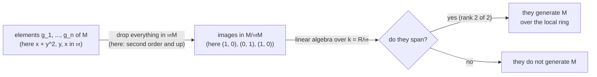

# Nakayama's lemma: over a local ring, generators can be checked modulo the maximal ideal

[Syllabus](../../../SYLLABUS.md) → [Algebraic geometry](../README.md) → [Exact Sequences, Ext and Tor](../README.md#s07) → Nakayama's lemma

---

## General Overview

Stand at the origin of the plane and look only at what happens near it. The polynomials with value 0 there form the ideal $`\mathfrak{m} = (x, y)`$. Someone hands over three polynomials, $`x + y^2`$, $`y`$ and $`x`$, and asks two things. Do they generate $`\mathfrak{m}`$? And how many of them are really needed?

Near a point, a polynomial splits into its first-order part (its linear part) and higher-order parts. The linear parts here are $`x`$, $`y`$ and $`x`$; the $`y^2`$ in $`x + y^2`$ is second order. Two independent linear parts appear (neither is a multiple of the other), so the answer is: yes, and exactly 2 are needed. Any two whose linear parts are independent will do, for example $`x`$ and $`y`$. The pair $`x + y^2`$ and $`x`$ fails, because both have linear part $`x`$.

That shortcut, throwing away everything of second order and doing linear algebra on what is left, is Nakayama's lemma. It works over a **local ring**: a ring with exactly one maximal ideal, such as the fractions of polynomials whose bottom is nonzero at one point ([Localisation](../06-Schemes%20and%20Modern%20Language/03-localisation-and-local-rings.md)). It does not work for polynomials on the whole plane. The pair $`x + y^2`$ and $`y + x^2`$ passes the linear test at the origin. Both also vanish at the far point $`(-1, -1)`$, where $`x`$ does not. So the pair generates $`\mathfrak{m}`$ near the origin only.

The same lemma shows that a finitely generated projective module over a local ring is free, so near one point "projective" and "free" are the same.

**Over a local ring with maximal ideal 𝔪, a finitely generated module M equal to 𝔪M is zero; so elements generate M exactly when their images span the vector space M/𝔪M, the smallest number of generators is the dimension of M/𝔪M, and a finitely generated projective module is free.**

**What kind of fact this is:** a theorem with three corollaries, all proved on this card in Why it works.

### The picture: the test the lemma licenses



The left arrow loses information. Nakayama's lemma says that, over a local ring and for a finitely generated module, the lost part never changes the answer.

---

## The formula

Notation first, in words. A **module** over a ring R is a set with addition, whose members can be multiplied by members of R, like a vector space over a field ([Modules](../06-Schemes%20and%20Modern%20Language/05-modules-and-the-structure-theorem.md)). **Finitely generated** means finitely many members $`u_1, \dots, u_n`$ give every member as $`r_1 u_1 + \dots + r_n u_n`$. For an ideal $`J`$, $`JM`$ is the set of all such sums with every $`r_i`$ in $`J`$.

The main ring is $`R = \mathbb{Q}[x, y]_{\mathfrak{m}}`$: fractions of polynomials with rational coefficients whose bottom is nonzero at the origin. Its one maximal ideal is $`\mathfrak{m} = (x, y)`$, and its **residue field** $`k = R/\mathfrak{m}`$ is $`\mathbb{Q}`$: a fraction modulo $`\mathfrak{m}`$ is just its value at the origin.

```math
M \text{ finitely generated and } M = \mathfrak{m}M \;\implies\; M = 0
```

**Read it aloud:** if a finitely generated module over a local ring equals the maximal ideal times itself, then it is zero.

The working form, for members $`g_1, \dots, g_n`$ of $`M`$ and their images $`\bar g_i`$ in $`M/\mathfrak{m}M`$:

```math
g_1, \dots, g_n \text{ generate } M \iff \bar g_1, \dots, \bar g_n \text{ span } M/\mathfrak{m}M, \qquad \mu(M) = \dim_k M/\mathfrak{m}M
```

**Read it aloud:** some members generate the module exactly when their images span the quotient by the maximal ideal, and the smallest number of generators is that quotient's dimension over the residue field.

Here $`M/\mathfrak{m}M`$ is a vector space over $`k`$, and $`\mu(M)`$ is the smallest number of generators of $`M`$. For $`M = \mathfrak{m}`$, $`\mathfrak{m}M = \mathfrak{m}^2`$, and $`\mathfrak{m}/\mathfrak{m}^2`$ is the space of linear parts at the origin, the dual of the tangent space ([Dimension and tangent space](../02-Affine%20and%20Projective%20Varieties/07-dimension-and-tangent-spaces.md)). Its dimension is 2.

The engine of the proof is the **determinant trick**. If $`M`$ has $`n`$ generators and a map $`\varphi : M \to M`$ that respects the module operations has $`\varphi(M) \subseteq JM`$, then

```math
\varphi^n + a_1 \varphi^{n-1} + \dots + a_n = 0 \quad \text{on } M, \qquad a_i \in J^i
```

**Read it aloud:** a map that pushes the module into J times the module satisfies a monic polynomial whose i-th coefficient lies in the i-th power of J.

| Symbol | Plain meaning | In our example | Push it up and the answer… |
| --- | --- | --- | --- |
| $`R`$, $`\mathfrak{m}`$, $`k`$ | a local ring; its one maximal ideal; the residue field $`R/\mathfrak{m}`$ | $`\mathbb{Q}[x, y]_{\mathfrak{m}}`$; $`(x, y)`$; $`\mathbb{Q}`$ | — |
| $`M`$, $`u_1, \dots, u_n`$ | a finitely generated module; generators of it | $`\mathfrak{m}`$, generated by $`x + y^2, y, x`$ | more generators, a bigger matrix in the trick |
| $`J`$, $`JM`$ | an ideal; sums of members of $`J`$ times members of $`M`$ | $`J = \mathfrak{m}`$, $`\mathfrak{m}M = \mathfrak{m}^2`$ | — |
| $`M/\mathfrak{m}M`$, $`\bar g`$ | the module modulo $`\mathfrak{m}M`$, a $`k`$-vector space; the image of $`g`$ in it | $`\mathfrak{m}/\mathfrak{m}^2`$, linear parts; $`\bar g = (1, 0)`$ for $`g = x + y^2`$ | — |
| $`\mu(M)`$ | the smallest number of generators | 2 | a bigger $`M/\mathfrak{m}M`$ needs more |
| $`I`$ | the example ideal | $`(x + y^2, y, x)`$, equal to $`\mathfrak{m}`$ | — |
| $`N`$, $`g_1, g_2`$ | a smaller ideal; its two generators | $`N = (x + y^2, y + x^2)`$ | — |
| $`\varphi`$, $`A = (a_{ij})`$, $`\mathrm{Id}`$ | a map from $`M`$ to itself; the matrix with $`\varphi(u_i) = \sum_j a_{ij} u_j`$; the identity matrix | $`\varphi`$ the identity on $`\mathfrak{m}/N`$; $`A`$ = `[[0, -y], [-x, 0]]` | — |
| $`\det`$, $`\mathrm{adj}`$ | determinant; adjugate, the matrix of signed minors with $`\mathrm{adj}(B)\,B = \det(B)\,\mathrm{Id}`$ | $`\det(\mathrm{Id} - A) = 1 - xy`$ | — |
| $`P`$, $`P'`$, $`K`$, $`R^n`$ | a projective module, a direct summand of a free one; a copy of $`P`$; the kernel of $`R^n \to P`$; the free module of $`n`$-tuples | images of idempotent matrices over $`\mathbb{Z}/4`$ | — |
| $`\mathbb{Z}/4`$, $`\mathbb{Z}/6`$, $`\mathbb{F}_5`$ | whole numbers mod 4, mod 6, mod 5 | $`\mathbb{Z}/4`$ is local with $`\mathfrak{m} = (2)`$; $`\mathbb{Z}/6`$ is not | — |
| $`\mathbb{Z}_{(2)}`$, $`v_2`$ | fractions with odd bottom, a local ring; the 2-adic order, the power of 2 in a fraction | $`v_2(3/4) = -2`$ | — |

### When it holds

- **The ring is local, or J lies in every maximal ideal.** Over $`\mathbb{Z}/6`$, the module $`M = \{0, 3\}`$ has $`3M = M`$ and is not 0, because $`1 - 3 = 4`$ kills it but is no unit. The pair $`x + y^2, y + x^2`$ generates $`\mathfrak{m}`$ near the origin but not in $`\mathbb{Q}[x, y]`$.
- **M is finitely generated.** Over $`\mathbb{Z}_{(2)}`$, the rationals $`\mathbb{Q}`$ satisfy $`2\mathbb{Q} = \mathbb{Q}`$, since every $`q`$ is $`2 \cdot q/2`$, yet $`\mathbb{Q} \neq 0`$. No finite list of fractions generates $`\mathbb{Q}`$.
- **The generator count uses the maximal ideal, not a smaller one.** It works in $`M/\mathfrak{m}M`$, a vector space over $`k`$; for $`M = \mathfrak{m}`$ that is $`\mathfrak{m}/\mathfrak{m}^2`$. With a smaller ideal $`J`$ in place of $`\mathfrak{m}`$, $`M/JM`$ is in general no vector space, so its dimension is not defined.
- **The determinant proof needs a commutative ring.** The trick multiplies by the adjugate, whose identity $`\mathrm{adj}(B)\,B = \det(B)\,\mathrm{Id}`$ needs entries that commute. The lemma itself survives over non-commutative rings, for one-sided modules, by a different proof.

---

## Why it works

### Step 0: one plus something small is a unit

In a local ring, every member outside $`\mathfrak{m}`$ is a unit (has an inverse), and $`\mathfrak{m}`$ is exactly the non-units. So $`1 + a`$ is a unit for every $`a`$ in $`\mathfrak{m}`$: its value at the origin is 1. Near the origin, $`1 - xy`$ is invertible, with inverse $`1/(1 - xy)`$.

The whole proof turns "$`M = \mathfrak{m}M`$" into "some $`1 + a`$ with $`a`$ in $`\mathfrak{m}`$ kills $`M`$". A unit kills only 0, so $`M = 0`$. The tool that produces $`1 + a`$ is a determinant.

### Step 1: the determinant trick

Write $`\varphi(u_i) = \sum_j a_{ij} u_j`$ with every $`a_{ij}`$ in $`J`$, which $`\varphi(M) \subseteq JM`$ allows. As a matrix equation over the commutative ring $`R[\varphi]`$ (polynomials in $`\varphi`$ acting on $`M`$), this says $`(\varphi\,\mathrm{Id} - A)`$ applied to the column of generators gives 0.

Multiply on the left by the adjugate of $`\varphi\,\mathrm{Id} - A`$. The adjugate identity turns the matrix into $`\det(\varphi\,\mathrm{Id} - A)\,\mathrm{Id}`$. So $`\det(\varphi\,\mathrm{Id} - A)`$ kills every generator, hence all of $`M`$.

This is Cayley-Hamilton over a ring: the matrix $`A`$ satisfies its own characteristic polynomial ([Cayley-Hamilton and the minimal polynomial](../../03-Algebra/07-Eigenvalues%20and%20Symmetric%20Matrices/08-cayley-hamilton-and-minimal-polynomial.md) proves it over a field by triangles; the adjugate proof needs only commutativity).

<details>
<summary>Detailed proof: why the adjugate identity holds over any commutative ring, and where the coefficients live</summary>

The entries of $`\mathrm{adj}(B)`$ are signed $`(n-1) \times (n-1)`$ minors of $`B`$. The identity $`\mathrm{adj}(B)\,B = \det(B)\,\mathrm{Id}`$ says: row $`i`$ of the adjugate against column $`i`$ of $`B`$ is the expansion of $`\det(B)`$ along that column; against another column it is the determinant of a matrix with two equal columns, which is 0.

Both facts are identities between polynomials in the entries with integer coefficients. They hold over $`\mathbb{Q}`$ for every input, so they hold as polynomial identities, so they hold in every commutative ring.

Now let $`B = \varphi\,\mathrm{Id} - A`$ and let $`\mathbf{u}`$ be the column of generators. Then $`B\mathbf{u} = 0`$, so

$`\displaystyle 0 = \mathrm{adj}(B)\,B\,\mathbf{u} = \det(B)\,\mathbf{u}.`$

Expanding $`\det(\varphi\,\mathrm{Id} - A)`$ gives $`\varphi^n + a_1 \varphi^{n-1} + \dots + a_n`$. Each term of $`a_i`$ is a product of $`i`$ entries of $`A`$, so $`a_i`$ lies in $`J^i`$.

</details>

On the example, take $`M = \mathfrak{m}/N`$ with $`N = (x + y^2, y + x^2)`$. In $`M`$, $`x = -y^2 = (-y)\,y`$ and $`y = -x^2 = (-x)\,x`$. With $`\varphi`$ the identity, the matrix is $`A`$ = `[[0, -y], [-x, 0]]`, entries in $`\mathfrak{m}`$, and

```math
\det(\mathrm{Id} - A) = \det\begin{pmatrix} 1 & y \\ x & 1 \end{pmatrix} = 1 - xy
```

So $`1 - xy`$ kills $`x`$ and $`y`$ modulo $`N`$. The checks confirm it directly: $`(x + y^2) - y(y + x^2) = x(1 - xy)`$ and $`(y + x^2) - x(x + y^2) = y(1 - xy)`$.

### Step 2: Nakayama's lemma

Suppose $`M = \mathfrak{m}M`$. Take $`\varphi`$ the identity and $`J = \mathfrak{m}`$ in Step 1. Then

```math
(1 + a_1 + \dots + a_n)\,M = 0, \qquad a_1 + \dots + a_n \in \mathfrak{m}
```

By Step 0 the factor is a unit, so $`M = 0`$.

For $`\mathfrak{m}/N`$ above, the factor is $`1 - xy`$, value 1 at the origin. So $`\mathfrak{m}/N = 0`$ in the local ring: $`N = \mathfrak{m}`$ there.

### Step 3: generators can be checked modulo 𝔪

Let $`N`$ be the submodule generated by $`g_1, \dots, g_n`$. Their images span $`M/\mathfrak{m}M`$ exactly when $`N + \mathfrak{m}M = M`$.

Pass to $`M/N`$, which is finitely generated. The equation $`N + \mathfrak{m}M = M`$ says $`\mathfrak{m}(M/N) = M/N`$. Step 2 gives $`M/N = 0`$, so $`N = M`$. The other direction is plain: generators of $`M`$ map to generators of $`M/\mathfrak{m}M`$.

On the example ideal $`I = (x + y^2, y, x)`$: the images in $`\mathfrak{m}/\mathfrak{m}^2`$ are $`(1, 0)`$, $`(0, 1)`$, $`(1, 0)`$ in the basis $`\bar x, \bar y`$. They span, so $`I = \mathfrak{m}`$. Here even the plain certificate $`x = (x + y^2) - y \cdot y`$ works.

### Step 4: the smallest number of generators is a dimension

A generating set of $`M`$ maps to a spanning set of $`M/\mathfrak{m}M`$, so it has at least $`\dim_k M/\mathfrak{m}M`$ members. Conversely, pick members whose images form a basis; by Step 3 they generate. So

```math
\mu(M) = \dim_k M/\mathfrak{m}M
```

Better: a generating set is minimal (no member can be dropped) exactly when its images form a basis. So every minimal generating set has the same size, as in a vector space. Over a ring that is not local this fails: over $`\mathbb{Z}`$, the sets $`\{1\}`$ and $`\{2, 3\}`$ both generate $`\mathbb{Z}`$, and neither can be shortened.

For $`\mathfrak{m}`$ the dimension is 2. So $`\mathfrak{m}`$ needs two generators, and no single polynomial generates it near the origin: one element spans at most one direction of $`\mathfrak{m}/\mathfrak{m}^2`$.

### Step 5: projective is free

Let $`P`$ be finitely generated and **projective**: a direct summand of a free module ([Projective, injective and flat](02-projective-injective-and-flat-modules.md)). Choose $`n = \dim_k P/\mathfrak{m}P`$ generators of $`P`$ by Step 4. They give a surjection $`R^n \to P`$.

Because $`P`$ is projective, the surjection splits: $`R^n = P' \oplus K`$, with $`P'`$ a copy of $`P`$ and $`K`$ the kernel. Reduce modulo $`\mathfrak{m}`$:

```math
k^n = P/\mathfrak{m}P \oplus K/\mathfrak{m}K, \qquad n = n + \dim_k K/\mathfrak{m}K
```

So $`K/\mathfrak{m}K = 0`$. $`K`$ is finitely generated, as the image of $`R^n`$ under the projection onto it. Step 2 gives $`K = 0`$, and $`P \cong R^n`$ is free.

A 1958 theorem, listed under Sources, removes the finite generation: every projective module over a local ring is free.

---

## Worked numbers, by hand

The ring is $`\mathbb{Q}[x, y]`$ localised at $`\mathfrak{m} = (x, y)`$.

| Step | Arithmetic | Value |
| --- | --- | --- |
| values at the origin | $`x + y^2`$, $`y`$, $`x`$ at $`(0, 0)`$ | 0, 0, 0: all in $`\mathfrak{m}`$ |
| images in $`\mathfrak{m}/\mathfrak{m}^2`$ | keep the linear part, drop $`y^2`$ | $`(1, 0)`$, $`(0, 1)`$, $`(1, 0)`$ |
| rank of the 3 × 2 matrix | two independent rows | **2** |
| pair $`x + y^2, y`$ | rows $`(1, 0), (0, 1)`$ | rank 2: generates |
| pair $`x + y^2, x`$ | rows $`(1, 0), (1, 0)`$ | rank 1: does not |
| pair $`y, x`$ | rows $`(0, 1), (1, 0)`$ | rank 2: generates |
| $`N = (x + y^2, y + x^2)`$ | images $`(1, 0), (0, 1)`$ | rank 2: $`N = \mathfrak{m}`$ near the origin |
| determinant trick on $`\mathfrak{m}/N`$ | $`\det`$ `[[1, y], [x, 1]]` | $`1 - xy`$, value 1 at the origin |
| far point $`(-1, -1)`$ | $`-1 + 1`$, $`-1 + 1`$, $`1 - 1`$ | $`g_1 = g_2 = 0`$, $`1 - xy = 0`$, $`x = -1`$ |

The ideal $`(x + y^2, y, x)`$ is the maximal ideal and needs exactly **2** generators; near the origin, $`x`$ and $`y`$ suffice, and so does any pair whose linear parts are independent.

The far point shows where the unit fails. At any zero of $`N`$ other than the origin, $`x = -y^2`$ and $`y = -x^2`$, so $`x = -x^4`$, $`x^3 = -1`$ and $`xy = -x^3 = 1`$: the factor $`1 - xy`$ that Nakayama needs is 0 there, not a unit. Over $`\mathbb{Q}`$ the only such zero is $`(-1, -1)`$; the others are complex.

### What breaks if you drop a piece

| Mistake | Comes out at | What went wrong |
| --- | --- | --- |
| Drop "local": $`\mathbb{Z}/6`$, $`M = \{0, 3\}`$ | $`3M = \{0, 3\} = M`$, yet $`M \neq 0`$ | $`1 - 3 = 4`$ kills $`M`$ but is no unit in $`\mathbb{Z}/6`$ |
| Drop "local": $`N`$ in $`\mathbb{Q}[x, y]`$ | $`N \neq \mathfrak{m}`$: $`N`$ vanishes at $`(-1, -1)`$, $`x`$ is $`-1`$ there | $`1 - xy`$ is a unit near 0 only |
| Drop "finitely generated": $`\mathbb{Q}`$ over $`\mathbb{Z}_{(2)}`$ | $`2\mathbb{Q} = \mathbb{Q}`$; $`1/2, 3/4, 5/8`$ reach 2-adic order −3, $`1/16`$ has −4 | infinitely many generators, no determinant |
| Count generators, not the dimension | 3 generators for $`I`$ | $`\mathfrak{m}/\mathfrak{m}^2`$ has dimension 2 |

The code prints all four.

---

## Code, from first principles, and it actually runs

Both programs work with exact integers only. The generator question is settled by three independent roads. The first is the rank of the linear parts in $`\mathfrak{m}/\mathfrak{m}^2`$. The second is explicit membership certificates multiplied out, with the determinant from the trick checked against them. The third is brute force in the finite local ring $`A = \mathbb{F}_5[x, y]/(x, y)^3`$, which keeps every term up to degree 2: there each pair's ideal is spanned directly, and all 3,125 members of $`\mathfrak{m}_A`$ are tried as single generators. The counting and projective claims are checked by exhaustive search over the local ring $`\mathbb{Z}/4`$, against the non-local $`\mathbb{Z}/6`$.

### Python

```python
# Nakayama's lemma -- the check behind the card.  Standard library only.
# Ring: Q[x, y] near the origin, maximal ideal m = (x, y).  A polynomial is a
# dict {(i, j): c} meaning c x^i y^j.  Roads: linear parts in m/m^2 against
# membership certificates, against brute force in the finite local ring
# F_5[x, y]/(x, y)^3; then searches over the finite local ring Z/4 and Z/6.
from itertools import combinations, product

def add(*fs):
    out = {}
    for f in fs:
        for e, c in f.items():
            out[e] = out.get(e, 0) + c
    return {e: c for e, c in out.items() if c}

def mul(f, g):
    return add(*[{(a + c, b + d): s * t} for (a, b), s in f.items() for (c, d), t in g.items()])

def neg(f):
    return {e: -c for e, c in f.items()}

def show(f):                                    # leading term first, x > y
    s = ""
    for (i, j), c in sorted(f.items(), reverse=True):
        mono = ("x" if i else "") + (f"^{i}" if i > 1 else "") + ("y" if j else "") + (f"^{j}" if j > 1 else "")
        num = str(abs(c)) if abs(c) != 1 or not mono else ""
        s += (" - " if c < 0 else " + ") + num + mono
    return (s[3:] if s.startswith(" + ") else "-" + s[3:]) if s else "0"

def at(f, x, y):
    return sum(c * x**i * y**j for (i, j), c in f.items())

def rank(rows, p=0):                            # p = 0: over Q, fraction-free; else mod p
    rows, r = [list(v) for v in rows], 0
    for col in range(len(rows[0]) if rows else 0):
        piv = next((i for i in range(r, len(rows)) if (rows[i][col] % p if p else rows[i][col])), None)
        if piv is None:
            continue
        rows[r], rows[piv] = rows[piv], rows[r]
        for i in range(r + 1, len(rows)):
            a, b = rows[r][col], rows[i][col]
            rows[i] = [(a * u - b * w) % p if p else a * u - b * w for u, w in zip(rows[i], rows[r])]
        r += 1
    return r

X, Y, ONE = {(1, 0): 1}, {(0, 1): 1}, {(0, 0): 1}
g1, g2 = add(X, mul(Y, Y)), add(Y, mul(X, X))
gens = [("x + y^2", g1), ("y", Y), ("x", X)]
lin = lambda f: (f.get((1, 0), 0), f.get((0, 1), 0))     # the image in m/m^2
BASIS = [(1, 0), (0, 1), (2, 0), (1, 1), (0, 2)]          # m_A in F_5[x, y]/(x, y)^3

def ideal_dim(fs, p=5):                         # dim over F_5 of the ideal of A they span
    vecs = [mul(m, f) for f in fs for m in (ONE, X, Y)]
    return rank([[v.get(e, 0) % p for e in BASIS] for v in vecs], p)

print("-- the ideal I = (x + y^2, y, x) in Q[x, y] localised at m = (x, y) --")
for name, f in gens:
    print(f"generator {name}: value at the origin {at(f, 0, 0)}, image in m/m^2 = {lin(f)}")
dim_I = rank([lin(f) for _, f in gens])
print(f"dimension of the image of I in m/m^2: {dim_I}, so I needs exactly {dim_I} generators")
pair_rows = []
for (n1, f1), (n2, f2) in combinations(gens, 2):
    r, d = rank([lin(f1), lin(f2)]), ideal_dim([f1, f2])
    pair_rows.append((r, d))
    print(f"pair {n1}, {n2}: rank in m/m^2 {r}; ideal in F_5[x, y]/(x, y)^3 has dimension {d} of 5")
print(f"certificate: (x + y^2) - y*y = {show(add(g1, neg(mul(Y, Y))))}")
one_gen = max(ideal_dim([dict(zip(BASIS, c))]) for c in product(range(5), repeat=5))
print(f"largest ideal one element spans, over all 5^5 = 3125 members of m_A: dimension {one_gen} of 5")

print("-- local, not global: N = (x + y^2, y + x^2) --")
dim_N = rank([lin(g1), lin(g2)])
print(f"images in m/m^2: {lin(g1)}, {lin(g2)}: rank {dim_N}, so N = m in the local ring")
c1, c2 = add(g1, neg(mul(Y, g2))), add(g2, neg(mul(X, g1)))
print(f"certificate: (x + y^2) - y*(y + x^2) = {show(c1)}")
print(f"certificate: (y + x^2) - x*(x + y^2) = {show(c2)}")
A = [[{}, neg(Y)], [neg(X), {}]]                 # x = (-y) y and y = (-x) x modulo N
B = [[add(ONE if i == j else {}, neg(A[i][j])) for j in range(2)] for i in range(2)]
det = add(mul(B[0][0], B[1][1]), neg(mul(B[0][1], B[1][0])))
print(f"determinant trick on m/N: A = [[0, -y], [-x, 0]], det(Id - A) = {show(det)}, value at the origin {at(det, 0, 0)}")
print(f"det(Id - A) times x equals the first certificate: {'yes' if mul(det, X) == c1 else 'no'}")
print(f"det(Id - A) times y equals the second certificate: {'yes' if mul(det, Y) == c2 else 'no'}")
print(f"at (-1, -1): x + y^2 = {at(g1, -1, -1)}, y + x^2 = {at(g2, -1, -1)}, 1 - xy = {at(det, -1, -1)}, x = -1")

def elems(orders):
    return list(product(*[range(o) for o in orders]))

def span(vs, orders, n):
    return {tuple(sum(c * v[i] for c, v in zip(cs, vs)) % orders[i] for i in range(len(orders)))
            for cs in product(range(n), repeat=len(vs))}

def min_gens(members, orders, n):
    full = set(members)
    return next(r for r in range(len(orders) + 2) if any(span(s, orders, n) == full for s in combinations(members, r)))

print("-- minimal generators over the local ring Z/4, m = (2), residue field F_2 --")
gen_rows = []
for orders in [(4,), (2,), (2, 4), (4, 4), (2, 2, 4)]:
    M = elems(orders)
    twoM = {tuple(2 * a % o for a, o in zip(v, orders)) for v in M}
    d, mu = (len(M) // len(twoM)).bit_length() - 1, min_gens(M, orders, 4)
    gen_rows.append((d, mu))
    print(f"M = {' + '.join(f'Z/{o}' for o in orders)}: dim M/2M = {d}, smallest generating set by search = {mu}")

def idempotents(n):
    out = []
    for a, b, c, d in product(range(n), repeat=4):
        if ((a * a + b * c) % n, (a * b + b * d) % n, (c * a + d * c) % n, (c * b + d * d) % n) == (a, b, c, d):
            out.append((a, b, c, d))
    return out

def image(E, n):
    a, b, c, d = E
    return sorted({((a * u + b * v) % n, (c * u + d * v) % n) for u in range(n) for v in range(n)})

print("-- projective is free over a local ring: images of idempotent 2 x 2 matrices E --")
free_ok = []
for E in idempotents(4):
    P, r = image(E, 4), rank([[E[0] % 2, E[1] % 2], [E[2] % 2, E[3] % 2]], 2)
    free_ok.append(len(P) == 4**r and min_gens(P, (4, 4), 4) == r)
print(f"over Z/4: {len(free_ok)} idempotents; each image free of rank = rank of E mod 2: {'yes' if all(free_ok) else 'no'}")
sizes6 = sorted({len(image(E, 6)) for E in idempotents(6)})
print(f"over Z/6: {len(idempotents(6))} idempotents; image sizes {sizes6}; no power of 6: {[s for s in sizes6 if s not in (1, 6, 36)]}")

print("-- what breaks --")
M3 = [0, 3]
print(f"not local: over Z/6, M = {M3} has 3M = {sorted({3 * v % 6 for v in M3})}, yet M is not 0; (1 - 3)M = {sorted({4 * v % 6 for v in M3})}, and 1 - 3 = 4 mod 6 is no unit")
v2 = lambda a: (a & -a).bit_length() - 1
v2d = lambda a: 0 if a % 2 else 1 + v2d(a // 2)                        # the same order, by halving
fr = [(1, 2), (3, 4), (5, 8)]
low = min(v2(a) - v2(b) for a, b in fr)
print(f"not finitely generated: Q over Z_(2) has 2Q = Q, since 1/16 = 2 * 1/32; generators 1/2, 3/4, 5/8 reach 2-adic order {low} only, 1/16 has order {v2(1) - v2(16)}")
print(f"counting generators instead of the dimension: I has {len(gens)} generators, m/m^2 has dimension {dim_I}")
assert dim_I == 2 and dim_N == 2 and one_gen == 3                    # two needed, one never enough
assert all((r == 2) == (d == 5) for r, d in pair_rows)                # m/m^2 test against direct span
assert mul(det, X) == c1 and mul(det, Y) == c2 and at(det, 0, 0) == 1 # determinant trick = certificate
assert at(g1, -1, -1) == 0 == at(g2, -1, -1) and at(det, -1, -1) == 0
assert all(d == mu for d, mu in gen_rows) and all(free_ok)            # mu(M) = dim M/mM; projective = free
assert [s for s in sizes6 if s not in (1, 6, 36)]                      # Z/6: projective, not free
assert low == -3 == min(v2d(a) - v2d(b) for a, b in fr) and v2(1) - v2(16) == -4 == v2d(1) - v2d(16)
print("ALL CHECKS PASS")
```

**Ran 2026-11-24 on macOS, Python 3.14.10, standard library only. All checks passed. Output, pasted from the run:**

```
-- the ideal I = (x + y^2, y, x) in Q[x, y] localised at m = (x, y) --
generator x + y^2: value at the origin 0, image in m/m^2 = (1, 0)
generator y: value at the origin 0, image in m/m^2 = (0, 1)
generator x: value at the origin 0, image in m/m^2 = (1, 0)
dimension of the image of I in m/m^2: 2, so I needs exactly 2 generators
pair x + y^2, y: rank in m/m^2 2; ideal in F_5[x, y]/(x, y)^3 has dimension 5 of 5
pair x + y^2, x: rank in m/m^2 1; ideal in F_5[x, y]/(x, y)^3 has dimension 4 of 5
pair y, x: rank in m/m^2 2; ideal in F_5[x, y]/(x, y)^3 has dimension 5 of 5
certificate: (x + y^2) - y*y = x
largest ideal one element spans, over all 5^5 = 3125 members of m_A: dimension 3 of 5
-- local, not global: N = (x + y^2, y + x^2) --
images in m/m^2: (1, 0), (0, 1): rank 2, so N = m in the local ring
certificate: (x + y^2) - y*(y + x^2) = -x^2y + x
certificate: (y + x^2) - x*(x + y^2) = -xy^2 + y
determinant trick on m/N: A = [[0, -y], [-x, 0]], det(Id - A) = -xy + 1, value at the origin 1
det(Id - A) times x equals the first certificate: yes
det(Id - A) times y equals the second certificate: yes
at (-1, -1): x + y^2 = 0, y + x^2 = 0, 1 - xy = 0, x = -1
-- minimal generators over the local ring Z/4, m = (2), residue field F_2 --
M = Z/4: dim M/2M = 1, smallest generating set by search = 1
M = Z/2: dim M/2M = 1, smallest generating set by search = 1
M = Z/2 + Z/4: dim M/2M = 2, smallest generating set by search = 2
M = Z/4 + Z/4: dim M/2M = 2, smallest generating set by search = 2
M = Z/2 + Z/2 + Z/4: dim M/2M = 3, smallest generating set by search = 3
-- projective is free over a local ring: images of idempotent 2 x 2 matrices E --
over Z/4: 26 idempotents; each image free of rank = rank of E mod 2: yes
over Z/6: 112 idempotents; image sizes [1, 2, 3, 4, 6, 9, 12, 18, 36]; no power of 6: [2, 3, 4, 9, 12, 18]
-- what breaks --
not local: over Z/6, M = [0, 3] has 3M = [0, 3], yet M is not 0; (1 - 3)M = [0], and 1 - 3 = 4 mod 6 is no unit
not finitely generated: Q over Z_(2) has 2Q = Q, since 1/16 = 2 * 1/32; generators 1/2, 3/4, 5/8 reach 2-adic order -3 only, 1/16 has order -4
counting generators instead of the dimension: I has 3 generators, m/m^2 has dimension 2
ALL CHECKS PASS
```

### Rust

Same numbers, same labels, built with `rustc --edition 2021 -O`.

```rust
// Nakayama's lemma -- the same check as the Python, in Rust.  No crates.
// Ring: Q[x, y] near the origin, maximal ideal m = (x, y).  A polynomial is a
// map {(i, j): c} meaning c x^i y^j.  Roads: linear parts in m/m^2 against
// membership certificates, against brute force in the finite local ring
// F_5[x, y]/(x, y)^3; then searches over the finite local ring Z/4 and Z/6.
use std::collections::{BTreeMap, BTreeSet};
type Poly = BTreeMap<(u32, u32), i64>;
type V = Vec<i64>;

fn add(fs: &[&Poly]) -> Poly {
    let mut out = Poly::new();
    for f in fs { for (e, c) in f.iter() { *out.entry(*e).or_insert(0) += c } }
    out.into_iter().filter(|(_, c)| *c != 0).collect()
}
fn mul(f: &Poly, g: &Poly) -> Poly {
    let mut out = Poly::new();
    for ((a, b), s) in f { for ((c, d), t) in g { *out.entry((a + c, b + d)).or_insert(0) += s * t } }
    out.into_iter().filter(|(_, c)| *c != 0).collect()
}
fn neg(f: &Poly) -> Poly { f.iter().map(|(e, c)| (*e, -c)).collect() }
fn mono(i: u32, j: u32, c: i64) -> Poly { [((i, j), c)].into_iter().collect() }
fn show(f: &Poly) -> String {                    // leading term first, x > y
    let mut s = String::new();
    for ((i, j), c) in f.iter().rev() {
        let mut m = String::new();
        if *i > 0 { m += "x" } if *i > 1 { m += &format!("^{}", i) }
        if *j > 0 { m += "y" } if *j > 1 { m += &format!("^{}", j) }
        let num = if c.abs() != 1 || m.is_empty() { c.abs().to_string() } else { String::new() };
        s += &format!("{}{}{}", if *c < 0 { " - " } else { " + " }, num, m);
    }
    if s.is_empty() { "0".into() } else if s.starts_with(" + ") { s[3..].into() } else { format!("-{}", &s[3..]) }
}
fn at(f: &Poly, x: i64, y: i64) -> i64 { f.iter().map(|((i, j), c)| c * x.pow(*i) * y.pow(*j)).sum() }
fn rank(rows: &[V], p: i64) -> usize {           // p = 0: over Q, fraction-free; else mod p
    let mut rows: Vec<V> = rows.to_vec();
    let mut r = 0;
    let cols = if rows.is_empty() { 0 } else { rows[0].len() };
    for col in 0..cols {
        let nz = |v: i64| if p > 0 { v.rem_euclid(p) != 0 } else { v != 0 };
        let piv = match (r..rows.len()).find(|&i| nz(rows[i][col])) { Some(i) => i, None => continue };
        rows.swap(r, piv);
        for i in r + 1..rows.len() {
            let (a, b) = (rows[r][col], rows[i][col]);
            rows[i] = (0..cols).map(|k| { let v = a * rows[i][k] - b * rows[r][k]; if p > 0 { v.rem_euclid(p) } else { v } }).collect();
        }
        r += 1;
    }
    r
}
fn lin(f: &Poly) -> V { vec![*f.get(&(1, 0)).unwrap_or(&0), *f.get(&(0, 1)).unwrap_or(&0)] }
const BASIS: [(u32, u32); 5] = [(1, 0), (0, 1), (2, 0), (1, 1), (0, 2)];
fn ideal_dim(fs: &[&Poly]) -> usize {           // dim over F_5 of the ideal of A they span
    let ms = [mono(0, 0, 1), mono(1, 0, 1), mono(0, 1, 1)];
    let rows: Vec<V> = fs.iter().flat_map(|f| ms.iter().map(move |m| mul(m, f)))
        .map(|v| BASIS.iter().map(|e| v.get(e).unwrap_or(&0).rem_euclid(5)).collect()).collect();
    rank(&rows, 5)
}
fn combos<T: Clone>(items: &[T], r: usize) -> Vec<Vec<T>> {
    if r == 0 { return vec![vec![]] }
    let mut out = Vec::new();
    for i in 0..items.len() { for mut rest in combos(&items[i + 1..], r - 1) { rest.insert(0, items[i].clone()); out.push(rest) } }
    out
}
fn tuples(ranges: &[i64]) -> Vec<V> {            // every tuple with entry k in 0..ranges[k]
    let mut out: Vec<V> = vec![vec![]];
    for &o in ranges { out = out.into_iter().flat_map(|t| (0..o).map(move |a| { let mut u = t.clone(); u.push(a); u })).collect() }
    out
}
fn span(vs: &[V], orders: &[i64], n: i64) -> BTreeSet<V> {
    tuples(&vec![n; vs.len()]).iter().map(|cs| (0..orders.len())
        .map(|i| cs.iter().zip(vs).map(|(c, v)| c * v[i]).sum::<i64>().rem_euclid(orders[i])).collect()).collect()
}
fn min_gens(members: &[V], orders: &[i64], n: i64) -> usize {
    let full: BTreeSet<V> = members.iter().cloned().collect();
    (0..orders.len() + 2).find(|&r| combos(members, r).iter().any(|s| span(s, orders, n) == full)).unwrap()
}
fn idempotents(n: i64) -> Vec<V> {
    tuples(&[n; 4]).into_iter().filter(|e| { let (a, b, c, d) = (e[0], e[1], e[2], e[3]);
        vec![(a * a + b * c) % n, (a * b + b * d) % n, (c * a + d * c) % n, (c * b + d * d) % n] == *e }).collect()
}
fn image(e: &V, n: i64) -> Vec<V> {
    let s: BTreeSet<V> = tuples(&[n, n]).iter().map(|t| vec![(e[0] * t[0] + e[1] * t[1]) % n, (e[2] * t[0] + e[3] * t[1]) % n]).collect();
    s.into_iter().collect()
}
fn yn(b: bool) -> &'static str { if b { "yes" } else { "no" } }
fn tup(v: &V) -> String { format!("({}, {})", v[0], v[1]) }
fn v2(a: i64) -> i64 { a.trailing_zeros() as i64 }
fn v2d(a: i64) -> i64 { if a % 2 != 0 { 0 } else { 1 + v2d(a / 2) } } // the same order, by halving

fn main() {
    let (x, y, one) = (mono(1, 0, 1), mono(0, 1, 1), mono(0, 0, 1));
    let (g1, g2) = (add(&[&x, &mul(&y, &y)]), add(&[&y, &mul(&x, &x)]));
    let gens: Vec<(&str, &Poly)> = vec![("x + y^2", &g1), ("y", &y), ("x", &x)];
    println!("-- the ideal I = (x + y^2, y, x) in Q[x, y] localised at m = (x, y) --");
    for (name, f) in &gens { println!("generator {}: value at the origin {}, image in m/m^2 = {}", name, at(f, 0, 0), tup(&lin(f))) }
    let dim_i = rank(&gens.iter().map(|(_, f)| lin(f)).collect::<Vec<V>>(), 0);
    println!("dimension of the image of I in m/m^2: {}, so I needs exactly {} generators", dim_i, dim_i);
    let mut pair_rows = Vec::new();
    for pr in combos(&gens, 2) {
        let ((n1, f1), (n2, f2)) = (pr[0], pr[1]);
        let (r, d) = (rank(&[lin(f1), lin(f2)], 0), ideal_dim(&[f1, f2]));
        pair_rows.push((r, d));
        println!("pair {}, {}: rank in m/m^2 {}; ideal in F_5[x, y]/(x, y)^3 has dimension {} of 5", n1, n2, r, d);
    }
    println!("certificate: (x + y^2) - y*y = {}", show(&add(&[&g1, &neg(&mul(&y, &y))])));
    let one_gen = tuples(&[5; 5]).iter().map(|c| ideal_dim(&[&BASIS.iter().zip(c).map(|(e, v)| (*e, *v)).collect::<Poly>()])).max().unwrap();
    println!("largest ideal one element spans, over all 5^5 = 3125 members of m_A: dimension {} of 5", one_gen);

    println!("-- local, not global: N = (x + y^2, y + x^2) --");
    let dim_n = rank(&[lin(&g1), lin(&g2)], 0);
    println!("images in m/m^2: {}, {}: rank {}, so N = m in the local ring", tup(&lin(&g1)), tup(&lin(&g2)), dim_n);
    let c1 = add(&[&g1, &neg(&mul(&y, &g2))]);
    let c2 = add(&[&g2, &neg(&mul(&x, &g1))]);
    println!("certificate: (x + y^2) - y*(y + x^2) = {}", show(&c1));
    println!("certificate: (y + x^2) - x*(x + y^2) = {}", show(&c2));
    let a = [[Poly::new(), neg(&y)], [neg(&x), Poly::new()]];   // x = (-y) y and y = (-x) x modulo N
    let b: Vec<Vec<Poly>> = (0..2).map(|i| (0..2).map(|j| add(&[if i == j { &one } else { &a[0][0] }, &neg(&a[i][j])])).collect()).collect();
    let det = add(&[&mul(&b[0][0], &b[1][1]), &neg(&mul(&b[0][1], &b[1][0]))]);
    println!("determinant trick on m/N: A = [[0, -y], [-x, 0]], det(Id - A) = {}, value at the origin {}", show(&det), at(&det, 0, 0));
    println!("det(Id - A) times x equals the first certificate: {}", yn(mul(&det, &x) == c1));
    println!("det(Id - A) times y equals the second certificate: {}", yn(mul(&det, &y) == c2));
    println!("at (-1, -1): x + y^2 = {}, y + x^2 = {}, 1 - xy = {}, x = -1", at(&g1, -1, -1), at(&g2, -1, -1), at(&det, -1, -1));

    println!("-- minimal generators over the local ring Z/4, m = (2), residue field F_2 --");
    let mut gen_rows = Vec::new();
    for orders in [vec![4], vec![2], vec![2, 4], vec![4, 4], vec![2, 2, 4]] {
        let m = tuples(&orders);
        let two_m: BTreeSet<V> = m.iter().map(|v| v.iter().zip(&orders).map(|(a, o)| 2 * a % o).collect()).collect();
        let (d, mu) = ((m.len() / two_m.len()).trailing_zeros() as usize, min_gens(&m, &orders, 4));
        gen_rows.push((d, mu));
        let name: Vec<String> = orders.iter().map(|o| format!("Z/{}", o)).collect();
        println!("M = {}: dim M/2M = {}, smallest generating set by search = {}", name.join(" + "), d, mu);
    }
    println!("-- projective is free over a local ring: images of idempotent 2 x 2 matrices E --");
    let ids4 = idempotents(4);
    let free_ok: Vec<bool> = ids4.iter().map(|e| { let p = image(e, 4);
        let r = rank(&[vec![e[0] % 2, e[1] % 2], vec![e[2] % 2, e[3] % 2]], 2);
        p.len() == 4usize.pow(r as u32) && min_gens(&p, &[4, 4], 4) == r }).collect();
    println!("over Z/4: {} idempotents; each image free of rank = rank of E mod 2: {}", free_ok.len(), yn(free_ok.iter().all(|&b| b)));
    let ids6 = idempotents(6);
    let sizes6: BTreeSet<usize> = ids6.iter().map(|e| image(e, 6).len()).collect();
    let bad: Vec<usize> = sizes6.iter().copied().filter(|s| ![1, 6, 36].contains(s)).collect();
    println!("over Z/6: {} idempotents; image sizes {:?}; no power of 6: {:?}", ids6.len(), sizes6.iter().collect::<Vec<_>>(), bad);

    println!("-- what breaks --");
    let m3 = [0i64, 3];
    let s3: Vec<i64> = m3.iter().map(|v| 3 * v % 6).collect::<BTreeSet<i64>>().into_iter().collect();
    let s4: Vec<i64> = m3.iter().map(|v| 4 * v % 6).collect::<BTreeSet<i64>>().into_iter().collect();
    println!("not local: over Z/6, M = {:?} has 3M = {:?}, yet M is not 0; (1 - 3)M = {:?}, and 1 - 3 = 4 mod 6 is no unit", m3, s3, s4);
    let fr = [(1i64, 2i64), (3, 4), (5, 8)];
    let low = fr.iter().map(|(a, b)| v2(*a) - v2(*b)).min().unwrap();
    println!("not finitely generated: Q over Z_(2) has 2Q = Q, since 1/16 = 2 * 1/32; generators 1/2, 3/4, 5/8 reach 2-adic order {} only, 1/16 has order {}", low, v2(1) - v2(16));
    println!("counting generators instead of the dimension: I has {} generators, m/m^2 has dimension {}", gens.len(), dim_i);
    assert!(dim_i == 2 && dim_n == 2 && one_gen == 3);                   // two needed, one never enough
    assert!(pair_rows.iter().all(|&(r, d)| (r == 2) == (d == 5)));       // m/m^2 test against direct span
    assert!(mul(&det, &x) == c1 && mul(&det, &y) == c2 && at(&det, 0, 0) == 1);
    assert!(at(&g1, -1, -1) == 0 && at(&g2, -1, -1) == 0 && at(&det, -1, -1) == 0);
    assert!(gen_rows.iter().all(|&(d, mu)| d == mu) && free_ok.iter().all(|&b| b));
    assert!(!bad.is_empty());                                           // Z/6: projective, not free
    let low_d = fr.iter().map(|(a, b)| v2d(*a) - v2d(*b)).min().unwrap();
    assert!(low == -3 && low_d == -3 && v2(1) - v2(16) == -4 && v2d(1) - v2d(16) == -4);
    println!("ALL CHECKS PASS");
}
```

**Ran 2026-11-24 on macOS, rustc 1.98.1, no crates. All checks passed. Output, pasted from the run:**

```
-- the ideal I = (x + y^2, y, x) in Q[x, y] localised at m = (x, y) --
generator x + y^2: value at the origin 0, image in m/m^2 = (1, 0)
generator y: value at the origin 0, image in m/m^2 = (0, 1)
generator x: value at the origin 0, image in m/m^2 = (1, 0)
dimension of the image of I in m/m^2: 2, so I needs exactly 2 generators
pair x + y^2, y: rank in m/m^2 2; ideal in F_5[x, y]/(x, y)^3 has dimension 5 of 5
pair x + y^2, x: rank in m/m^2 1; ideal in F_5[x, y]/(x, y)^3 has dimension 4 of 5
pair y, x: rank in m/m^2 2; ideal in F_5[x, y]/(x, y)^3 has dimension 5 of 5
certificate: (x + y^2) - y*y = x
largest ideal one element spans, over all 5^5 = 3125 members of m_A: dimension 3 of 5
-- local, not global: N = (x + y^2, y + x^2) --
images in m/m^2: (1, 0), (0, 1): rank 2, so N = m in the local ring
certificate: (x + y^2) - y*(y + x^2) = -x^2y + x
certificate: (y + x^2) - x*(x + y^2) = -xy^2 + y
determinant trick on m/N: A = [[0, -y], [-x, 0]], det(Id - A) = -xy + 1, value at the origin 1
det(Id - A) times x equals the first certificate: yes
det(Id - A) times y equals the second certificate: yes
at (-1, -1): x + y^2 = 0, y + x^2 = 0, 1 - xy = 0, x = -1
-- minimal generators over the local ring Z/4, m = (2), residue field F_2 --
M = Z/4: dim M/2M = 1, smallest generating set by search = 1
M = Z/2: dim M/2M = 1, smallest generating set by search = 1
M = Z/2 + Z/4: dim M/2M = 2, smallest generating set by search = 2
M = Z/4 + Z/4: dim M/2M = 2, smallest generating set by search = 2
M = Z/2 + Z/2 + Z/4: dim M/2M = 3, smallest generating set by search = 3
-- projective is free over a local ring: images of idempotent 2 x 2 matrices E --
over Z/4: 26 idempotents; each image free of rank = rank of E mod 2: yes
over Z/6: 112 idempotents; image sizes [1, 2, 3, 4, 6, 9, 12, 18, 36]; no power of 6: [2, 3, 4, 9, 12, 18]
-- what breaks --
not local: over Z/6, M = [0, 3] has 3M = [0, 3], yet M is not 0; (1 - 3)M = [0], and 1 - 3 = 4 mod 6 is no unit
not finitely generated: Q over Z_(2) has 2Q = Q, since 1/16 = 2 * 1/32; generators 1/2, 3/4, 5/8 reach 2-adic order -3 only, 1/16 has order -4
counting generators instead of the dimension: I has 3 generators, m/m^2 has dimension 2
ALL CHECKS PASS
```

The two outputs match line for line. Over $`\mathbb{Z}/4`$, each of the 26 idempotent matrices $`E`$ (with $`E^2 = E`$) has a projective image, and the search finds it free of rank equal to the rank of $`E`$ mod 2. Over $`\mathbb{Z}/6`$, six image sizes are no power of 6, so those projectives are not free.

### Lean

Lean proves Nakayama's lemma and its three corollaries over every commutative local ring, and checks the card's worked numbers.

- Take a local ring R and a finitely generated module M with $`M = \mathfrak{m}M`$. Then $`M = 0`$.
- Take such an M and members $`g_1, \dots, g_n`$ of it. Then they generate M exactly when their images span $`M/\mathfrak{m}M`$ over k.
- Keep the same M. Then $`\mu(M) = \dim_k M/\mathfrak{m}M`$.
- A finitely generated projective module over a local ring is free.
- Take x and y in any commutative ring. Then $`(x + y^2) - y \cdot y = x`$, and both determinant-trick certificates hold.
- Take the far point $`(-1, -1)`$. Then $`x + y^2`$, $`y + x^2`$ and $`1 - xy`$ are all 0 there.
- Take $`\mathbb{Z}/6`$ and $`M = \{0, 3\}`$. Then $`3M = M`$, and $`1 - 3 = 4`$ kills M but is no unit.
- In $`\mathbb{Q}`$, $`1/16 = 2 \cdot 1/32`$, the step that shows $`2\mathbb{Q} = \mathbb{Q}`$.
- Take $`M = \mathbb{Z}/4 \oplus \mathbb{Z}/4`$. Then 2M has 4 members, and no single member generates M.
- Take $`M = \mathbb{Z}/2 \oplus \mathbb{Z}/4`$ over $`\mathbb{Z}/4`$. Then M has 8 members and 2M has 2.
- Over $`\mathbb{Z}/4`$ there are 26 idempotent 2 × 2 matrices.

The rank tests, the generator searches and the idempotent images are left to the Python and Rust checks.

```lean
-- Nakayama's lemma: over a local ring, a finitely generated module equal to the maximal ideal times itself is zero, so elements generate it exactly when their images span M/𝔪M, the fewest generators is the dimension of M/𝔪M, and a finitely generated projective module is free.
import Mathlib.RingTheory.LocalRing.Module
import Mathlib.RingTheory.Nakayama
import Mathlib.Algebra.Module.SpanRank
import Mathlib.Algebra.Module.Torsion.Basic
import Mathlib.Algebra.Module.Projective
import Mathlib.LinearAlgebra.Dimension.Free
import Mathlib.Data.ZMod.Basic
import Mathlib.Tactic.NormNum
import Mathlib.Tactic.Ring
import Mathlib.Algebra.Module.SpanRankOperations

/-! The ring `R` is commutative and local, with maximal ideal `𝔪 = IsLocalRing.maximalIdeal R`
and residue field `k = R ⧸ 𝔪`. For a module `M`, the product `𝔪M` is the submodule
`𝔪 • ⊤`, and `M/𝔪M` is the quotient `M ⧸ 𝔪 • ⊤`, a vector space over `k`. The smallest number
of generators `μ(M)` is Mathlib's `spanFinrank` of the whole module `⊤`. -/

namespace NakayamaCard

open IsLocalRing Submodule

/-- **Nakayama's lemma.** Over a commutative local ring `R` with maximal ideal `𝔪`, a finitely
generated module `M` with `M = 𝔪M` is zero. -/
theorem finitely_generated_module_eq_maximal_ideal_smul_is_zero
    {R M : Type*} [CommRing R] [IsLocalRing R] [AddCommGroup M] [Module R M]
    [Module.Finite R M] (h : maximalIdeal R • (⊤ : Submodule R M) = ⊤) :
    Subsingleton M := by
  have h1 : (⊤ : Submodule R M) = ⊥ :=
    Submodule.eq_bot_of_le_smul_of_le_jacobson_bot (maximalIdeal R) ⊤ Module.Finite.fg_top
      h.ge (by rw [jacobson_eq_maximalIdeal ⊥ bot_ne_top])
  refine subsingleton_of_forall_eq 0 fun x => ?_
  have hx : x ∈ (⊤ : Submodule R M) := Submodule.mem_top
  rwa [h1, Submodule.mem_bot] at hx

/-- **Generators can be checked modulo 𝔪, and the fewest generators is a dimension.** Over a
commutative local ring `R` with maximal ideal `𝔪` and residue field `k = R/𝔪`, let `M` be a
finitely generated module. Members `g₁, …, gₙ` of `M` generate `M` exactly when their images
in `M/𝔪M` span it as a vector space over `k`; and the smallest number of generators of `M`
is the dimension of `M/𝔪M` over `k`. -/
theorem generate_iff_images_span_and_min_generators_eq_dim
    {R M : Type*} [CommRing R] [IsLocalRing R] [AddCommGroup M] [Module R M]
    [Module.Finite R M] :
    (∀ (n : ℕ) (g : Fin n → M),
      span R (Set.range g) = ⊤ ↔
        span (R ⧸ maximalIdeal R)
          (Set.range fun i => (maximalIdeal R • (⊤ : Submodule R M)).mkQ (g i)) = ⊤) ∧
    (⊤ : Submodule R M).spanFinrank =
      Module.finrank (R ⧸ maximalIdeal R) (M ⧸ maximalIdeal R • (⊤ : Submodule R M)) := by
  refine ⟨fun n g => ?_, ?_⟩
  · rw [← IsLocalRing.map_mkQ_eq_top, Submodule.map_span, ← Submodule.restrictScalars_span R
      (R ⧸ maximalIdeal R) Ideal.Quotient.mk_surjective, Submodule.restrictScalars_eq_top_iff,
      ← Set.range_comp]
    rfl
  · rw [IsLocalRing.spanFinrank_eq_finrank_quotient _ Module.Finite.fg_top]
    let e : ((⊤ : Submodule R M) ⧸ maximalIdeal R • (⊤ : Submodule R (⊤ : Submodule R M))) ≃ₗ[R]
        (M ⧸ maximalIdeal R • (⊤ : Submodule R M)) :=
      Submodule.Quotient.equiv _ _ (Submodule.topEquiv) (by
        rw [Submodule.map_smul'', Submodule.map_top, LinearEquiv.range])
    exact (e.extendScalarsOfSurjective Ideal.Quotient.mk_surjective).finrank_eq

/-- **Projective is free over a local ring.** Over a commutative local ring, a finitely
generated projective module is free. -/
theorem finitely_generated_projective_is_free
    {R P : Type*} [CommRing R] [IsLocalRing R] [AddCommGroup P] [Module R P]
    [Module.Finite R P] [Module.Projective R P] :
    Module.Free R P := by
  exact Module.free_of_flat_of_isLocalRing

/-! Worked numbers from the card, checked exactly. -/

-- The certificate (x + y²) − y·y = x, so x already lies in the ideal generated by x + y² and y.
example {A : Type*} [CommRing A] (x y : A) : (x + y ^ 2) - y * y = x := by ring

-- The determinant trick on 𝔪/N with N = (x + y², y + x²): det [[1, y], [x, 1]] = 1 − xy,
-- and 1 − xy times x and times y are the two certificates.
example {A : Type*} [CommRing A] (x y : A) :
    (x + y ^ 2) - y * (y + x ^ 2) = x * (1 - x * y) ∧
    (y + x ^ 2) - x * (x + y ^ 2) = y * (1 - x * y) := by
  constructor <;> ring

-- At the far point (−1, −1): x + y² = 0, y + x² = 0 and 1 − xy = 0, while x = −1.
example : ((-1 : ℤ) + (-1) ^ 2 = 0) ∧ ((-1 : ℤ) + (-1) ^ 2 = 0) ∧ (1 - (-1 : ℤ) * (-1) = 0) := by
  norm_num

-- Not local: over ℤ/6, M = {0, 3} has 3·3 = 3, so 3M = M, yet M ≠ 0; (1 − 3)·3 = 0,
-- and 1 − 3 = 4 is no unit mod 6.
example : (3 : ZMod 6) * 3 = 3 ∧ (1 - 3 : ZMod 6) * 3 = 0 ∧ (1 - 3 : ZMod 6) = 4 ∧
    ∀ u : ZMod 6, 4 * u ≠ 1 := by
  decide

-- Not finitely generated: 1/16 = 2 · 1/32, the step that shows 2ℚ = ℚ.
example : (1 / 16 : ℚ) = 2 * (1 / 32) := by norm_num

-- Over ℤ/4 with 𝔪 = (2): M = ℤ/4 ⊕ ℤ/4 has 16 members and 2M has 4, so M/2M has 4 = 2²
-- members and dimension 2 over 𝔽₂.
example : ((Finset.univ : Finset (ZMod 4 × ZMod 4)).image (fun m => (2 : ZMod 4) • m)).card = 4 := by
  decide

-- … and no single member generates ℤ/4 ⊕ ℤ/4, so it needs exactly 2 generators.
example : ∀ m : ZMod 4 × ZMod 4, ∃ v : ZMod 4 × ZMod 4, ∀ r : ZMod 4, r • m ≠ v := by
  decide

-- Over ℤ/4, M = ℤ/2 ⊕ ℤ/4 (here ℤ/2 is {0, 2} ⊂ ℤ/4): 8 members, 2M has 2, so M/2M has 4 = 2²
-- members and dimension 2.
example : ((Finset.univ : Finset (ZMod 4 × ZMod 4)).filter (fun m => 2 * m.1 = 0)).card = 8 ∧
    (((Finset.univ : Finset (ZMod 4 × ZMod 4)).filter (fun m => 2 * m.1 = 0)).image
      (fun m => (2 : ZMod 4) • m)).card = 2 := by
  decide

-- Over ℤ/4 there are 26 idempotent 2 × 2 matrices E (E² = E).
example : ((Finset.univ : Finset (Matrix (Fin 2) (Fin 2) (ZMod 4))).filter
    (fun E => E * E = E)).card = 26 := by
  decide

#print axioms finitely_generated_module_eq_maximal_ideal_smul_is_zero
#print axioms generate_iff_images_span_and_min_generators_eq_dim
#print axioms finitely_generated_projective_is_free

end NakayamaCard
```

**Checked 2026-11-24 on macOS, Lean 4.36.0-rc2, Mathlib v4.36.0-rc2. Every proof is complete and uses only Lean's standard axioms. Output, pasted from the run:**

```
'NakayamaCard.finitely_generated_module_eq_maximal_ideal_smul_is_zero' depends on axioms: [propext, Classical.choice, Quot.sound]
'NakayamaCard.generate_iff_images_span_and_min_generators_eq_dim' depends on axioms: [propext, Classical.choice, Quot.sound]
'NakayamaCard.finitely_generated_projective_is_free' depends on axioms: [propext, Classical.choice, Quot.sound]
```

> [!TIP]
> **Try changing**
> - Guess first: does $`x + y^2`$, $`y + x^2`$ still generate near the origin if the second generator becomes $`y + xy`$? Change `add(Y, mul(X, X))` to `add(Y, mul(X, Y))`. Answer: yes, rank 2 in $`\mathfrak{m}/\mathfrak{m}^2`$, but the certificates change, so the determinant assert stops the run.
> - Guess first: how many generators does $`\mathbb{Z}/2 \oplus \mathbb{Z}/4 \oplus \mathbb{Z}/4`$ need over $`\mathbb{Z}/4`$? Add `(2, 4, 4)` to the module list. Answer: 3, the dimension of $`M/2M`$, and every assert still passes.
> - Guess first: what breaks if the residue map uses 3 in place of 2, `3 * a % o`? Answer: $`3M = M`$ over $`\mathbb{Z}/4`$, since 3 is a unit, so every dimension prints 0 and the counting assert fails.
> - Guess first: is the largest one-element ideal still 3 if the ideal span forgets the multiplier $`y`$, `(ONE, X)`? Answer: no, it drops to 2, and the first assert fails.

---

## The usual mistake

> [!warning]
> **Using the linear test away from a local ring.** The test "the images span $`\mathfrak{m}/\mathfrak{m}^2`$" proves generation only near the point. The pair $`x + y^2, y + x^2`$ passes it at the origin, yet in $`\mathbb{Q}[x, y]`$ it does not generate $`(x, y)`$: both vanish at $`(-1, -1)`$, where $`x = -1`$. The unit $`1 - xy`$ the proof needs is zero there.
>
> - **Counting the given generators.** $`I = (x + y^2, y, x)`$ is written with 3 generators, but $`\mu(I) = 2`$. The count of a list is an upper bound, not the answer.
> - **Forgetting finite generation.** $`2\mathbb{Q} = \mathbb{Q}`$ over $`\mathbb{Z}_{(2)}`$, yet $`\mathbb{Q} \neq 0`$; the generators $`1/2, 3/4, 5/8`$ only reach 2-adic order −3.
> - **Reading a non-local ring as local.** Over $`\mathbb{Z}/6`$, $`\{0, 3\}`$ satisfies $`3M = M`$ and is not 0; it is projective with 2 elements, so not free.
> - **Taking a minimal generating set as smallest.** Over $`\mathbb{Z}`$, $`\{2, 3\}`$ cannot be shortened, yet $`\{1\}`$ also generates. Only over a local ring do all minimal sets have one size.

---

## Where you meet it in real life

- **Tangent spaces and singular points.** At a point of a variety, the fewest functions that generate the maximal ideal of the local ring is $`\dim \mathfrak{m}/\mathfrak{m}^2`$, the dimension of the tangent space. [Dimension and tangent space](../02-Affine%20and%20Projective%20Varieties/07-dimension-and-tangent-spaces.md) uses Nakayama's lemma inside its Lean proof, as one step towards a bound on the height of the maximal ideal.
- **Vector bundles.** On a reduced variety (one whose local rings have no nonzero nilpotents), a coherent sheaf is locally free exactly where its fibre dimension is locally constant; Nakayama turns the fibre $`M/\mathfrak{m}M`$ into a count of local generators ([Quasi-coherent sheaves](../06-Schemes%20and%20Modern%20Language/11-quasi-coherent-and-coherent-sheaves.md)).
- **Computer algebra.** Minimal free resolutions in systems such as Macaulay2 and Singular rest on this lemma: a resolution is minimal when its matrices have every entry in $`\mathfrak{m}`$, and its ranks are then forced.
- **Lifting solutions.** Lifting arguments carry an answer mod $`p`$ to the $`p`$-adic numbers. Nakayama is not one of them, but it lifts one fact the same way: over a local ring, a map into a finitely generated module that is onto mod $`\mathfrak{m}`$ is onto.

> **Say it back**
> A local ring has one maximal ideal, and one plus anything in it is a unit. The determinant trick turns $`M = \mathfrak{m}M`$ into such a unit killing $`M`$, so a finitely generated $`M`$ is zero. Hence elements generate $`M`$ exactly when their images span $`M/\mathfrak{m}M`$, and the fewest generators is its dimension. The ideal $`(x + y^2, y, x)`$ at the origin needs exactly 2, and a finitely generated projective module over a local ring is free.

---

## What this builds on

- [Projective, injective and flat](02-projective-injective-and-flat-modules.md): projective modules as direct summands of free ones, the input to Step 5.
- [Localisation](../06-Schemes%20and%20Modern%20Language/03-localisation-and-local-rings.md): the local ring at a point and why everything outside $`\mathfrak{m}`$ is a unit.
- [Dimension and tangent space](../02-Affine%20and%20Projective%20Varieties/07-dimension-and-tangent-spaces.md): $`\mathfrak{m}/\mathfrak{m}^2`$ as the linear parts at a point, whose dimension is the tangent space's dimension.
- [Cayley-Hamilton and the minimal polynomial](../../03-Algebra/07-Eigenvalues%20and%20Symmetric%20Matrices/08-cayley-hamilton-and-minimal-polynomial.md): a matrix satisfies its characteristic polynomial, which the determinant trick extends to modules.

## Where this goes next

- [Tor](04-free-resolutions-and-tor.md): over a Noetherian local ring, a finitely generated module is free exactly when it is flat, since $`\mathrm{Tor}_1(M, k) = 0`$ forces the kernel to vanish by Nakayama.
- [Hilbert's syzygy theorem](06-hilbert-syzygy-theorem.md): minimal free resolutions, whose ranks (the Betti numbers) are the dimensions Nakayama counts, generator by generator and relation by relation.

The lemma counts generators near one point; how the count can jump from point to point, and what that says about the shape, is the question it leaves open.

---

## Sources

Verified 2026-11-24: every link below resolves to the publisher's page.

- Atiyah, M. F., and I. G. Macdonald. *Introduction to Commutative Algebra*. Addison-Wesley, 1969; CRC Press reissue, 2018. [DOI 10.1201/9780429493621](https://doi.org/10.1201/9780429493621). Chapter 2 gives the determinant trick, Nakayama's lemma and the generators-mod-𝔪 corollary.
- Eisenbud, David. *Commutative Algebra with a View Toward Algebraic Geometry*. Springer GTM 150, 1995. [DOI 10.1007/978-1-4612-5350-1](https://doi.org/10.1007/978-1-4612-5350-1). Section 4.1 proves Nakayama from Cayley-Hamilton over a ring, and counts minimal generators.
- Matsumura, Hideyuki. *Commutative Ring Theory*. Cambridge University Press, 1986. [DOI 10.1017/CBO9781139171762](https://doi.org/10.1017/CBO9781139171762). Section 2 states Nakayama's lemma and that finitely generated projective modules over a local ring are free.
- Kaplansky, Irving. "Projective modules." *Annals of Mathematics* 68, no. 2 (1958), from page 372. [DOI 10.2307/1970252](https://doi.org/10.2307/1970252). Every projective module over a local ring is free, without finite generation.
