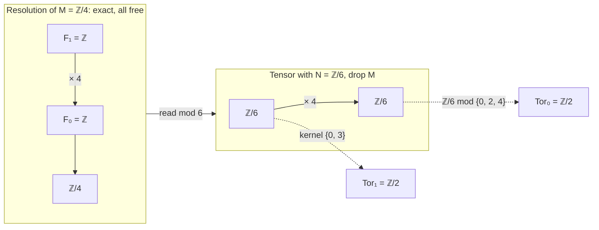

# Tor: resolve one module by free ones, tensor, and measure the exactness that was lost

[Syllabus](../../../SYLLABUS.md) → [Algebraic geometry](../README.md) → [Exact Sequences, Ext and Tor](../README.md#s07) → Tor

---

## General Overview

Take a counter that wraps at 4, the group $`\mathbb{Z}/4`$, and read it on a counter that wraps at 6, $`\mathbb{Z}/6`$. The plain way to describe $`\mathbb{Z}/4`$ is by a recipe: start with the whole numbers $`\mathbb{Z}`$ and declare every multiple of 4 to be zero. As a sequence of maps, that recipe is $`0 \to \mathbb{Z} \xrightarrow{\times 4} \mathbb{Z} \to \mathbb{Z}/4 \to 0`$.

Now reduce everything mod 6. The first map, "times 4", was one-to-one on the whole numbers: only 0 times 4 is 0. On $`\mathbb{Z}/6`$ it is not, since 4 × 3 = 12 reads 0. The element 3 is lost. That lost piece, $`\{0, 3\}`$, is a copy of $`\mathbb{Z}/2`$, and its name is $`\mathrm{Tor}_1(\mathbb{Z}/4, \mathbb{Z}/6)`$.

The loss is real, not an accident of one recipe. Any recipe for $`\mathbb{Z}/4`$ built from free pieces loses the same $`\mathbb{Z}/2`$, and the answer is always $`\mathbb{Z}/\gcd(4, 6)`$. It matters wherever whole numbers are swapped for numbers mod p. The Klein bottle, a closed one-sided surface, has no 2-dimensional class over $`\mathbb{Z}`$. Counted mod 2 it has one, and $`\mathrm{Tor}_1(\mathbb{Z}/2, \mathbb{Z}/2) = \mathbb{Z}/2`$ is exactly that class.

**To compute Tor, write the module as the end of a chain of free modules, apply the operation that loses exactness (tensoring with N, here reducing mod 6) to the free part only, and read off where the chain stops being exact; the answer does not depend on which chain was chosen.**

**What kind of fact this is:** a definition (Tor) carrying three theorems proved on this card in Why it works: Tor does not depend on the resolution, $`\mathrm{Tor}_1(\mathbb{Z}/m, \mathbb{Z}/n) = \mathbb{Z}/\gcd(m, n)`$, and the same rule over $`k[x]`$. Two further theorems, the long exact sequence and the symmetry of Tor in its two slots, are stated with their proof's shape and a named source.

### The picture: resolve, tensor, look for the gap



The top row is exact: each map's image is the next map's kernel. The bottom row is not. Tor measures the gaps.

---

## The formula

Notation first, in words. These cards work over a commutative ring R: here the whole numbers $`\mathbb{Z}`$, then $`k[x]`$, the polynomials over a field k (here $`k = \mathbb{Q}`$, the fractions).

- A **module** over R is like a vector space, but with scalars from R ([Modules](../06-Schemes%20and%20Modern%20Language/05-modules-and-the-structure-theorem.md)). A **free** module is $`R^k`$: lists of k scalars, with no relations among them.
- A sequence of maps is **exact** at a module when what the incoming map hits is exactly what the outgoing map kills ([Exact sequences of modules](01-exact-sequences-and-the-snake-lemma.md)). The **kernel**, ker, is what a map sends to 0; the **image**, im, is everything it hits.
- A **free resolution** of M is an exact sequence $`\cdots \to F_2 \xrightarrow{d_2} F_1 \xrightarrow{d_1} F_0 \to M \to 0`$ with every $`F_i`$ free. The maps $`d_i`$ are matrices.
- The **tensor product** $`M \otimes N`$ pairs each element of M with each of N, linearly in both slots ([Tensor products](../../03-Algebra/11-Duals%2C%20Quotients%20and%20Tensors/03-tensor-products.md) builds it for vector spaces). Two working rules are all this card needs: $`R^k \otimes N = N^k`$, with every matrix acting as before, and $`R/(a) \otimes N = N/aN`$.

Tor is the homology of the tensored resolution (at each spot, kernel over image), with M itself left out:

```math
\mathrm{Tor}_i^R(M, N) \;=\; \frac{\ker\big(d_i \otimes N : F_i \otimes N \to F_{i-1} \otimes N\big)}{\mathrm{im}\big(d_{i+1} \otimes N : F_{i+1} \otimes N \to F_i \otimes N\big)}
```

**Read it aloud:** Tor number i of M and N is what the i-th tensored map kills, with what the next tensored map hits thrown away.

For i = 0 there is no outgoing map, so $`d_0 = 0`$ and $`\mathrm{Tor}_0(M, N) = M \otimes N`$. For cyclic modules (generated by one element) over $`\mathbb{Z}`$ and over $`k[x]`$, with m, n ≥ 1 and f, g nonzero:

```math
\mathrm{Tor}_0(\mathbb{Z}/m, \mathbb{Z}/n) \cong \mathrm{Tor}_1(\mathbb{Z}/m, \mathbb{Z}/n) \cong \mathbb{Z}/\gcd(m, n), \qquad \mathrm{Tor}_1\big(k[x]/(f), k[x]/(g)\big) \cong k[x]/\big(\gcd(f, g)\big)
```

**Read it aloud:** a counter wrapping at m against one wrapping at n has Tor equal to a counter wrapping at their greatest common divisor; for polynomials, the gcd of the two polynomials plays the same part. All Tor past number 1 is zero over these two rings.

On the example, $`\mathrm{Tor}_1(\mathbb{Z}/4, \mathbb{Z}/6) = \mathbb{Z}/2`$, since gcd(4, 6) = 2.

Tor's job is to repair tensoring. A **short exact sequence** $`0 \to A \to B \to C \to 0`$ stays exact on the right after tensoring, but the left map can stop being one-to-one. Tor fills the gap:

```math
\cdots \to \mathrm{Tor}_1(B, N) \to \mathrm{Tor}_1(C, N) \to A \otimes N \to B \otimes N \to C \otimes N \to 0
```

**Read it aloud:** the long sequence is exact again, and the kernel of $`A \otimes N \to B \otimes N`$, the part tensoring lost, is the image of $`\mathrm{Tor}_1(C, N)`$.

| Symbol | Plain meaning | In our example | Push it up and the answer… |
| --- | --- | --- | --- |
| $`R`$ | the ring of scalars | $`\mathbb{Z}`$; later $`\mathbb{Q}[x]`$ | more variables, longer resolutions |
| $`M`$, $`N`$ | the module resolved; the module tensored with | $`\mathbb{Z}/4`$; $`\mathbb{Z}/6`$ | more shared factors, larger Tor |
| $`F_i`$, $`d_i`$ | the free modules of a resolution; the matrices between them | $`F_1 = F_0 = \mathbb{Z}`$, $`d_1 = \times 4`$ | — |
| $`\otimes N`$ | tensor with N: replace $`R^k`$ by $`N^k`$, keep the matrix | $`\mathbb{Z} \otimes \mathbb{Z}/6 = \mathbb{Z}/6`$ | — |
| $`\ker`$, $`\mathrm{im}`$ | what a map kills; what a map hits | $`\{0, 3\}`$; $`\{0, 2, 4\}`$ | — |
| $`\mathrm{Tor}_i(M, N)`$ | the gap at spot i of the tensored resolution | $`\mathrm{Tor}_1 = \mathbb{Z}/2`$ | — |
| $`\mathbb{Z}/m`$, $`\gcd`$ | a counter wrapping at m; greatest common divisor | $`\gcd(4, 6) = 2`$ | a larger gcd, a larger Tor |
| $`k[x]`$, $`f`$, $`g`$ | polynomials over a field k; two of them | $`k = \mathbb{Q}`$; $`x^2 - 1`$, $`x^2 - 3x + 2`$ | more shared roots, larger Tor |
| $`P`$, $`Q`$, $`\varphi_i`$, $`\psi_i`$ | two resolutions; chain maps from P to Q and back | A and B; $`\varphi_1 = (1, 0)`$, $`\psi_1 = (1\ \ 1)`$ | — |
| $`h_i`$ | a chain homotopy: maps one spot up | $`h_1 = (0\ \ {-1})`$ | — |
| $`\varepsilon`$, $`\eta`$ | the maps $`P_0 \to M`$ and $`Q_0 \to M`$ | reduce mod 4 | — |
| $`A`$, $`B`$, $`C`$; $`H_k(X; G)`$ | a short exact sequence; homology of a space X with coefficients G | $`\mathbb{Z}, \mathbb{Z}, \mathbb{Z}/4`$; $`H_2(\text{Klein}; \mathbb{Z}/2) = \mathbb{Z}/2`$ | — |

### When it holds

- **Every $`F_i`$ is free** (projective also works). Resolve $`\mathbb{Z}/4`$ instead by the exact $`0 \to \mathbb{Z}/3 \xrightarrow{\times 4} \mathbb{Z}/12 \to \mathbb{Z}/4 \to 0`$, which is not free, and the same recipe reads $`\mathrm{Tor}_1 = 0`$.
- **The resolution is exact everywhere.** A sequence that skips a relation, or adds a false one, resolves a different module, and its Tor belongs to that module.
- **M is dropped before taking homology.** Keep it, and the tensored sequence is exact at $`F_0`$, so $`\mathrm{Tor}_0`$ reads 0 instead of $`\mathbb{Z}/4 \otimes \mathbb{Z}/6 = \mathbb{Z}/2`$.
- **Tor past number 1 vanishes over rings such as $`\mathbb{Z}`$ and $`k[x]`$.** These are PIDs: domains (no two nonzero elements multiply to 0) in which every ideal is the multiples of one element. There a submodule of a free module is free, so resolutions stop after one step. Over $`k[x, y, z, w]`$ they run longer: [Hilbert's syzygy theorem](06-hilbert-syzygy-theorem.md).

---

## Why it works

### Step 0: free modules lose nothing, so push the loss onto M

Tensoring with N is harmless on free modules: $`R^k \otimes N = N^k`$, and the matrices carry over unchanged. The trouble is relations. In $`\mathbb{Z}/4`$ the relation "4 is 0" clashes with $`\mathbb{Z}/6`$, where 4 × 3 is already 0.

So the plan is to replace M by free modules that hold all its relations as matrices. Tensor those. Any failure of exactness can then only come from M's relations meeting N. Measuring that failure gives Tor.

### Step 1: build a free resolution

Generators give $`F_0`$, relations give $`F_1`$, relations among relations give $`F_2`$, and so on until nothing is left.

- **Resolution A.** $`\mathbb{Z}/4`$ has one generator and one relation, 4 · 1 = 0. So $`F_0 = F_1 = \mathbb{Z}`$ with $`d_1 = \times 4`$. Times 4 is one-to-one on $`\mathbb{Z}`$, so no relations among relations: the resolution stops.
- **Resolution B.** Write the relation twice, as a row $`(4\ \ 4) : \mathbb{Z}^2 \to \mathbb{Z}`$. Its image is still the multiples of 4, but now the two relations satisfy one relation of their own: $`(1, -1)`$ goes to $`4 - 4 = 0`$. So $`F_2 = \mathbb{Z}`$, $`d_2 = (1, -1)`$, and B reads $`0 \to \mathbb{Z} \to \mathbb{Z}^2 \to \mathbb{Z} \to \mathbb{Z}/4 \to 0`$.

B is wasteful on purpose. It tests whether Tor depends on the choice.

### Step 2: tensor and read the gaps

Tensor A with $`\mathbb{Z}/6`$: the sequence becomes $`\mathbb{Z}/6 \xrightarrow{\times 4} \mathbb{Z}/6`$. At spot 1 the kernel is $`\{0, 3\}`$ and nothing comes in, so $`\mathrm{Tor}_1 = \mathbb{Z}/2`$. At spot 0 the image is $`\{0, 2, 4\}`$, so $`\mathrm{Tor}_0 = \mathbb{Z}/6 \big/ \{0, 2, 4\} = \mathbb{Z}/2`$.

Tensor B with $`\mathbb{Z}/6`$. At spot 1 the kernel of $`(4\ \ 4)`$ on $`(\mathbb{Z}/6)^2`$ is every pair with $`4(a + b) \equiv 0`$: 12 pairs. The image of $`(1, -1)`$ is the 6 pairs $`(c, -c)`$. The gap is 12 / 6 = 2 elements: $`\mathbb{Z}/2`$ again, now as a quotient, not a bare kernel. At spot 2, $`(c, -c) = 0`$ only for c = 0, so $`\mathrm{Tor}_2 = 0`$.

### Step 3: any two resolutions are joined by maps that lift the identity

Write $`P`$ for resolution A and $`Q`$ for resolution B. A **chain map** $`\varphi : P \to Q`$ is a map $`\varphi_i : P_i \to Q_i`$ at each spot that commutes with the d's. One that does nothing to M always exists.

The reason is freeness. To define a map out of a free module, choose where each generator goes; any choice works. So build $`\varphi_0`$, then pick $`\varphi_1`$ of each generator to land where the square needs it, which exactness of Q makes possible, and repeat.

For A and B: $`\varphi_0 = \psi_0 = 1`$ on $`\mathbb{Z}`$. Then $`\varphi_1 = (1, 0)`$ works, since $`(4\ \ 4)(1, 0) = 4`$. Going back, $`\psi_1 = (1\ \ 1)`$ works, since $`4 \cdot (a + b) = 4a + 4b`$.

### Step 4: the round trips are homotopic to the identity, so Tor agrees

The round trip $`\psi \circ \varphi`$ on A is the identity: $`\psi_1 \varphi_1 = 1`$. The round trip $`\varphi \circ \psi`$ on B is not: $`\varphi_1 \psi_1`$ is the matrix with rows $`(1, 1)`$ and $`(0, 0)`$.

It is close enough. A **chain homotopy** is a set of maps $`h_i : Q_i \to Q_{i+1}`$, one spot up, with $`1 - \varphi \psi = d h + h d`$ at every spot. With $`h_1 = (0\ \ {-1})`$, both $`1 - \varphi_1 \psi_1 = d_2 h_1`$ and $`1 - \varphi_2 \psi_2 = h_1 d_2`$ hold; the checks multiply the matrices out.

Homotopic maps give the same map on homology, and tensoring with N keeps a homotopy a homotopy. So after tensoring, $`\varphi`$ and $`\psi`$ are inverse on homology: Tor from A and Tor from B are the same group. In the example, $`\varphi_1`$ sends A's class 3 to $`(3, 0)`$ in B, which is not of the form $`(c, -c)`$, so the class survives.

<details>
<summary>Detailed proof: Tor does not depend on the resolution</summary>

Let P and Q be free resolutions of M, with augmentations $`\varepsilon : P_0 \to M`$ and $`\eta : Q_0 \to M`$.

Existence of a chain map. Each $`P_0`$ generator $`e`$ has $`\varepsilon(e)`$ in M, and $`\eta`$ is onto, so choose $`\varphi_0(e)`$ in $`Q_0`$ with $`\eta \varphi_0(e) = \varepsilon(e)`$. Suppose $`\varphi_0, \dots, \varphi_i`$ commute with the d's. For a generator $`e`$ of $`P_{i+1}`$, the element $`\varphi_i d(e)`$ is killed by $`d`$ (or by $`\eta`$ when i = 0), because $`d \varphi_i d = \varphi_{i-1} d d = 0`$. Q is exact, so $`\varphi_i d(e) = d(q)`$ for some $`q`$ in $`Q_{i+1}`$. Set $`\varphi_{i+1}(e) = q`$.

Uniqueness up to homotopy. If $`\varphi`$ and $`\varphi'`$ both lift the identity of M, then $`u = \varphi - \varphi'`$ lifts 0. The same induction builds $`h`$: $`\eta u_0 = 0`$ puts $`u_0(e)`$ in the image of $`d_1`$, which defines $`h_0`$. Then $`u_{i+1} - h_i d`$ lands in the kernel of $`d`$ and hence in an image, which defines $`h_{i+1}`$. Each step gives

$`\displaystyle u_{i} = d\, h_{i} + h_{i-1}\, d.`$

Apply this to $`\psi \varphi`$ against the identity of P, and $`\varphi \psi`$ against the identity of Q.

Tensoring. Tensoring with N is applied map by map, so $`u = dh + hd`$ stays true after it. A cycle $`z`$ (killed by $`d`$) then satisfies $`u(z) = d(h z)`$, a boundary, so $`u`$ is zero on homology. Hence $`\psi \varphi`$ and $`\varphi \psi`$ act as the identity on homology after tensoring, and $`\varphi`$ gives an isomorphism from Tor computed by P to Tor computed by Q.

</details>

### Step 5: the gcd rule, over ℤ and over k[x]

Over $`\mathbb{Z}`$, with m, n ≥ 1, resolution A of $`\mathbb{Z}/m`$ tensored with $`\mathbb{Z}/n`$ is "times m" on $`\mathbb{Z}/n`$. Then $`mx \equiv 0 \pmod n`$ exactly when $`n / \gcd(m, n)`$ divides x, and there are $`\gcd(m, n)`$ such x among 0 to n − 1. So the kernel, $`\mathrm{Tor}_1`$, is cyclic with $`\gcd(m, n)`$ elements. The image is the multiples of $`\gcd(m, n)`$, so the cokernel (the target with the image set to 0), $`\mathrm{Tor}_0`$, is the same size. For m = 4 and n = 6 both are $`\mathbb{Z}/2`$.

Over $`k[x]`$, with f and g nonzero, the same argument runs with polynomials: $`fh`$ is a multiple of g exactly when $`g / \gcd(f, g)`$ divides h, so the kernel of times f on $`k[x]/(g)`$ is a copy of $`k[x]/(\gcd(f, g))`$. Take $`f = x^2 - 1`$ and $`g = x^2 - 3x + 2`$ over $`\mathbb{Q}`$. Then $`\mathbb{Q}[x]/(g)`$ has basis $`1, x`$, and multiplying by f is a 2 × 2 matrix. Its first column, $`(-3, 3)`$, is $`f \bmod g = 3x - 3`$. The matrix has rank 1, so the kernel has dimension 1.

The kernel is spanned by $`x - 2`$: $`(x - 2)(x^2 - 1)`$ is a multiple of $`g = (x - 1)(x - 2)`$. On it, x acts as the number 1. So $`\mathrm{Tor}_1 = \mathbb{Q}[x]/(x - 1)`$, and $`x - 1`$ is $`\gcd(f, g)`$.

The geometry is the dictionary of this wing. $`f`$ vanishes at $`\pm 1`$ and $`g`$ at 1 and 2. Tor lives at the one shared point, x = 1.

### Step 6: Tor repairs the tensor product

Tensor the short exact sequence $`0 \to \mathbb{Z} \xrightarrow{\times 4} \mathbb{Z} \to \mathbb{Z}/4 \to 0`$ with $`\mathbb{Z}/6`$. The result is $`\mathbb{Z}/6 \xrightarrow{\times 4} \mathbb{Z}/6 \to \mathbb{Z}/2 \to 0`$: exact on the right, but times 4 kills $`\{0, 3\}`$.

The long exact sequence in The formula says this kernel is the image of $`\mathrm{Tor}_1(\mathbb{Z}/4, \mathbb{Z}/6)`$. The term before it, $`\mathrm{Tor}_1(\mathbb{Z}, \mathbb{Z}/6)`$, is 0, because $`\mathbb{Z}`$ is its own free resolution. So the kernel is all of $`\mathrm{Tor}_1`$, $`\mathbb{Z}/2`$, as found.

The proof of the long sequence resolves A and C, builds a resolution of B from the two, and applies the [Exact sequences of modules](01-exact-sequences-and-the-snake-lemma.md) card's snake lemma to the tensored result. Weibel proves it in chapter 2.

Tor is also **balanced**: resolving N instead of M gives the same groups. Resolve $`\mathbb{Z}/6`$ by "times 6" and tensor with $`\mathbb{Z}/4`$: the kernel of times 6 on $`\mathbb{Z}/4`$ is $`\{0, 2\}`$, again $`\mathbb{Z}/2`$. The general proof is a double-complex argument, stated here and proved in Weibel, section 2.7.

### Step 7: the universal coefficient correction

For a space X with integer homology $`H_k(X)`$, homology with coefficients in G is

```math
H_k(X; G) \;\cong\; \big( H_k(X) \otimes G \big) \oplus \mathrm{Tor}_1\big( H_{k-1}(X), G \big)
```

**Read it aloud:** homology with new coefficients is the old homology tensored with them, plus the Tor of the group one dimension down.

The [Universal coefficients and Kunneth](../../17-Topology/05-Homology/11-universal-coefficients-and-kunneth.md) card proves this for finite cell complexes. The Klein bottle, cut into 1 corner, 3 edges a, b, c and 2 triangles U, L as on [Smith normal form](../../17-Topology/05-Homology/03-computing-homology-by-smith-normal-form.md), has $`H_1 = \mathbb{Z} \oplus \mathbb{Z}/2`$ and $`H_2 = 0`$. With $`G = \mathbb{Z}/2`$, dimension 2 reads $`0 \oplus \mathrm{Tor}_1(\mathbb{Z}/2, \mathbb{Z}/2) = \mathbb{Z}/2`$; the free $`\mathbb{Z}`$ in $`H_1`$ adds no Tor. Listing the mod 2 chains of triangles finds exactly two with zero rim: 0 and U + L. They agree.

---

## Worked numbers, by hand

| Step | Arithmetic | Value |
| --- | --- | --- |
| resolution A of $`\mathbb{Z}/4`$ | one generator, one relation 4 · 1 = 0 | $`0 \to \mathbb{Z} \xrightarrow{\times 4} \mathbb{Z}`$ |
| tensor with $`\mathbb{Z}/6`$ | replace $`\mathbb{Z}`$ by $`\mathbb{Z}/6`$, keep times 4 | $`\mathbb{Z}/6 \xrightarrow{\times 4} \mathbb{Z}/6`$ |
| kernel at spot 1 | $`4x \equiv 0 \pmod 6`$ | x = 0, 3 |
| image at spot 0 | 4 times each of 0 to 5, mod 6 | 0, 2, 4 |
| $`\mathrm{Tor}_0`$ | 6 elements / 3 | $`\mathbb{Z}/2`$ |
| $`\mathrm{Tor}_1`$ from A | the kernel, nothing coming in | **$`\mathbb{Z}/2`$** |
| B, kernel of $`(4\ \ 4)`$ | pairs with $`4(a + b) \equiv 0 \pmod 6`$ | 12 pairs |
| B, image of $`(1, -1)`$ | pairs $`(c, -c)`$ | 6 pairs |
| $`\mathrm{Tor}_1`$ from B | 12 / 6 | **$`\mathbb{Z}/2`$** |
| $`\mathrm{Tor}_2`$ from B | $`(c, -c) = 0`$ only for c = 0 | 0 |
| other side | $`6x \equiv 0 \pmod 4`$ | x = 0, 2: $`\mathbb{Z}/2`$ |
| the rule | gcd(4, 6) | **2** |
| over $`\mathbb{Q}[x]`$ | times f on $`\mathbb{Q}[x]/(g)`$, rank 1 of 2 | dimension 1, at x = 1 |
| Klein bottle mod 2 | $`0 \oplus \mathrm{Tor}_1(\mathbb{Z}/2, \mathbb{Z}/2)`$ | $`\mathbb{Z}/2`$ |

Three resolutions, one answer: reading $`\mathbb{Z}/4`$ mod 6 loses a copy of $`\mathbb{Z}/2`$, the elements 0 and 3 that times 4 now kills.

### What breaks if you drop a piece

| Mistake | Comes out at | What went wrong |
| --- | --- | --- |
| Resolve by $`0 \to \mathbb{Z}/3 \xrightarrow{\times 4} \mathbb{Z}/12`$, not free | $`\mathrm{Tor}_1 = 0`$: the kernel is just 0 | $`\mathbb{Z}/12`$ already carries a relation, so tensoring loses it silently |
| Keep $`\mathbb{Z}/4`$ in the tensored sequence | $`\mathrm{Tor}_0 = 0`$ | the tensored sequence is exact at $`F_0`$, so the gap closes |
| Take $`\mathbb{Z}/4 \otimes \mathbb{Z}/6`$ as $`\mathbb{Z}/24`$ | 24 elements, truth 2 | tensoring cyclic groups takes the gcd, not the product |
| Klein bottle mod 2 by tensoring only | $`H_2 = 0`$, truth $`\mathbb{Z}/2`$ | the Tor term from $`H_1`$'s twist is missing |

The code prints all four.

---

## Code, from first principles, and it actually runs

Nothing is imported. Over $`\mathbb{Z}`$, tensoring with $`\mathbb{Z}/n`$ keeps the integer matrices and reads them mod n, so every kernel and image is found by listing all vectors. The answer $`\mathrm{Tor}_1(\mathbb{Z}/4, \mathbb{Z}/6) = \mathbb{Z}/2`$ is reached by four independent roads:

1. resolution A, a bare kernel;
2. resolution B, a kernel over an image, with the comparison maps and the homotopy multiplied out;
3. resolving $`\mathbb{Z}/6`$ instead and tensoring with $`\mathbb{Z}/4`$;
4. the gcd rule, swept over all 144 pairs m, n from 1 to 12.

The Klein bottle is checked by listing mod 2 chains against the universal coefficient formula. Over $`\mathbb{Q}[x]`$, three roads agree: the rank of the multiplication matrix, the same from the other side, and Euclid's algorithm on the polynomials.

### Python

```python
# Free resolutions and Tor -- the check behind the card.  Nothing is imported.  Over Z,
# tensoring a free resolution with N = Z/n turns each Z^k into (Z/n)^k and keeps the
# integer matrices, so every kernel and image is found by listing all vectors.  Over
# Q[x], multiplication by f on Q[x]/(g) is an integer matrix with an exact rank.

def vectors(k, n):                          # every vector of (Z/n)^k
    return [[]] if k == 0 else [v + [a] for v in vectors(k - 1, n) for a in range(n)]

def apply(mat, v, n):                       # a matrix (list of rows) times v, mod n
    return tuple(sum(a * b for a, b in zip(row, v)) % n for row in mat)

def kernel(mat, k, n):                      # the vectors a matrix sends to 0, and all it hits
    return [v for v in vectors(k, n) if not any(apply(mat, v, n))]
def image(mat, k, n):
    return {apply(mat, v, n) for v in vectors(k, n)}

def matmul(a, b):
    return [[sum(x * y for x, y in zip(row, col)) for col in zip(*b)] for row in a]

def tor(ranks, ds, n):                      # sizes of Tor_0, Tor_1, ... against Z/n
    sizes = []
    for i, k in enumerate(ranks):
        d_out = ds[i - 1] if i > 0 else []                    # d_i : F_i -> F_(i-1)
        d_in, k_in = (ds[i], ranks[i + 1]) if i < len(ds) else ([[]] * k, 0)
        sizes.append(len(kernel(d_out, k, n)) // len(image(d_in, k_in, n)))
    return sizes

def gcd(*xs):                               # Euclid's algorithm, over a whole list
    a = 0
    for b in xs:
        while b:
            a, b = b, a % b
    return abs(a)

def pmul(a, b):                             # polynomials: coefficient lists, constant first
    return [sum(a[i] * b[k - i] for i in range(len(a)) if 0 <= k - i < len(b))
            for k in range(len(a) + len(b) - 1)]

def pmod(a, g):                             # remainder on dividing by the monic g
    a = a[:]
    while len(a) >= len(g):
        c = a.pop()
        for i in range(len(g) - 1):
            a[len(a) - len(g) + 1 + i] -= c * g[i]
    return a + [0] * (len(g) - 1 - len(a))

def mulmat(f, g):                           # multiplication by f on Q[x]/(g), basis 1, x, ...
    cols = [pmod(pmul([0] * j + [1], f), g) for j in range(len(g) - 1)]
    return [[c[i] for c in cols] for i in range(len(g) - 1)]

def rank(m):                                # fraction-free elimination over the integers
    m, r = [row[:] for row in m], 0
    for c in range(len(m[0])):
        p = next((i for i in range(r, len(m)) if m[i][c]), None)
        if p is None: continue
        m[r], m[p] = m[p], m[r]
        for i in range(r + 1, len(m)):
            m[i] = [m[r][c] * x - m[i][c] * y for x, y in zip(m[i], m[r])]
        r += 1
    return r

def prim(a):                                # drop top zeros and the content; lead positive
    while a and a[-1] == 0:
        a.pop()
    return [x // gcd(*a) * (1 if a[-1] > 0 else -1) for x in a] if a else []

def pgcd(a, b):                             # Euclid with pseudo-remainders
    a, b = prim(a[:]), prim(b[:])
    while b:
        r = a[:]
        while len(r) >= len(b):
            k, lr = len(r) - len(b), r[-1]
            r = prim([b[-1] * x - lr * (b[j - k] if j >= k else 0) for j, x in enumerate(r)])
        a, b = b, r
    return a

def show(p):                                # a polynomial, leading term first
    s = ""
    for e in range(len(p) - 1, -1, -1):
        if p[e]:
            body = (str(abs(p[e])) if abs(p[e]) != 1 or e == 0 else "") + ("x" * (e > 0)) + (f"^{e}" * (e > 1))
            s += ((" - " if p[e] < 0 else " + ") if s else "-" * (p[e] < 0)) + body
    return s

dA, dB1, dB2 = [[4]], [[4, 4]], [[1], [-1]]
tA, tB, tN = tor([1, 1], [dA], 6), tor([1, 2, 1], [dB1, dB2], 6), tor([1, 1], [[[6]]], 4)
lost = [v[0] for v in kernel(dA, 1, 6)]
exactB = matmul(dB1, dB2) == [[0]] and all(b == -a for a in range(-12, 13) for b in range(-12, 13) if 4 * a + 4 * b == 0)
PHI1, PSI1, H1 = [[1], [0]], [[1, 1]], [[0, -1]]
one_minus_phipsi = [[int(i == j) - x for j, x in enumerate(row)] for i, row in enumerate(matmul(PHI1, PSI1))]
chain = [matmul(dB1, PHI1) == dA, matmul(dA, PSI1) == dB1, matmul(PSI1, PHI1) == [[1]]]
homotopy = [one_minus_phipsi == matmul(dB2, H1), matmul(H1, dB2) == [[1]]]
cls = apply(PHI1, [3], 6)
sweep = all(len(kernel([[m]], 1, n)) == gcd(m, n) == len(kernel([[n]], 1, m)) == n // len(image([[m]], 1, n))
            for m in range(1, 13) for n in range(1, 13))
D2 = [[1, 1], [1, -1], [-1, -1]]            # Klein bottle: rows edges a, b, c; columns triangles U, L
minors = [D2[i][0] * D2[j][1] - D2[i][1] * D2[j][0] for i in range(3) for j in range(i + 1, 3)]
g1, g2 = gcd(*sum(D2, [])), gcd(*minors)
klein_mod2, klein_tor, klein_tensor = len(kernel(D2, 2, 2)), len(kernel([[2]], 1, 2)), 2 ** (2 - rank(D2))  # H_2(Z) = Z^(2 - rank)
f, g = [-1, 0, 1], [2, -3, 1]
Mf, Mg = mulmat(f, g), mulmat(g, f)
dim1, dim1_other, h = 2 - rank(Mf), 2 - rank(Mg), pgcd(f, g)
v = [-2, 1]
kills, acts_as_1 = pmod(pmul(v, f), g) == [0, 0], pmod(pmul([0, 1], v), g) == v
wrong1 = [a for a in range(3) if 4 * a % 6 == 0]                   # Z/3 --x4--> Z/6
exact_wrong = sorted({4 * a % 12 for a in range(3)}) == [b for b in range(12) if b % 4 == 0]
wrong2 = len([a for a in range(6) if a % 2 == 0]) // len({4 * a % 6 for a in range(6)})
yn, name = lambda c: "yes" if c else "no", lambda size: "0" if size == 1 else f"Z/{size}"
print("M = Z/4, N = Z/6, over Z")
print(f"resolution A, 0 -> Z --x4--> Z: Tor_0 = {name(tA[0])}, Tor_1 = {name(tA[1])}")
print(f"  Tor_1 is the kernel of x4 on Z/6: {lost}; its image is {sorted(t[0] for t in image(dA, 1, 6))}")
print(f"resolution B, 0 -> Z --(1, -1)--> Z^2 --(4 4)--> Z: d1 d2 = 0 and exact on |a|, |b| <= 12: {yn(exactB)}")
print(f"  tensored with Z/6: kernel of (4 4) has {len(kernel(dB1, 2, 6))} elements, image of (1, -1) has {len(image(dB2, 1, 6))}")
print(f"  Tor_0 = {name(tB[0])}, Tor_1 = {name(tB[1])}, Tor_2 = {name(tB[2])}")
print(f"resolve Z/6 instead, tensor with Z/4: kernel of x6 on Z/4 {[v[0] for v in kernel([[6]], 1, 4)]}; Tor_0 = {name(tN[0])}, Tor_1 = {name(tN[1])}")
print(f"gcd(4, 6) = {gcd(4, 6)}")
print(f"comparison maps phi1 = (1, 0), psi1 = (1, 1): chain maps {yn(chain[0])}, {yn(chain[1])}; psi1 phi1 = 1: {yn(chain[2])}")
print(f"  1 - phi1 psi1 = d2 h1 and 1 - phi2 psi2 = h1 d2, with h1 = (0, -1): {yn(homotopy[0])}, {yn(homotopy[1])}")
print(f"  phi1 sends the Tor_1 class 3 to {cls}, outside the image of (1, -1): {yn(cls not in image(dB2, 1, 6))}")
print(f"sweep m, n = 1 to 12: kernel = other side = cokernel = gcd(m, n), all 144 pairs: {yn(sweep)}")
print(f"Klein bottle: d2 = {D2}; 2 by 2 minors {minors}")
print(f"  invariant factors {g1}, {g2 // g1}, so H_1 = Z + Z/2; a minor is nonzero, so H_2 over Z = 0")
print(f"  H_2 with Z/2 coefficients, by listing chains: {klein_mod2} elements, so {name(klein_mod2)}")
print(f"  universal coefficients: 0 + Tor_1(Z/2, Z/2), and Tor_1(Z/2, Z/2) has {klein_tor} elements")
print(f"over Q[x]: f = {show(f)}, g = {show(g)}")
print(f"  multiplication by f on Q[x]/(g), basis 1, x: {Mf}, rank {rank(Mf)}")
print(f"  Tor_1 dimension {dim1}, Tor_0 dimension {2 - rank(Mf)}; resolving the other side: {dim1_other}")
print(f"  gcd(f, g) by Euclid: {show(h)}, degree {len(h) - 1}")
print(f"  {show(v)} spans the kernel: f({show(v)}) = 0 mod g: {yn(kills)}; x acts on it as 1: {yn(acts_as_1)}")
print(f"mistake 1, non-free 0 -> Z/3 --x4--> Z/12 (exact: {yn(exact_wrong)}) tensored with Z/6: kernel {wrong1}, Tor_1 reads 0")
print(f"mistake 2, keeping Z/4 in the tensored sequence: Tor_0 reads {name(wrong2)}, truth {name(tA[0])}")
print(f"mistake 3, Z/4 x Z/6 taken as Z/24: {4 * 6} elements, truth {tA[0]}")
print(f"mistake 4, Klein H_2 mod 2 by tensoring only: {name(klein_tensor)}, truth {name(klein_mod2)}")
assert tA[1] == tB[1] == tN[1] == gcd(4, 6) and tA[0] == tB[0] == tN[0] == gcd(4, 6)   # three resolutions, one Tor
assert tB[2] == 1 and lost == [0, 3] and exactB                                       # Tor_2 = 0; kernel {0, 3}
assert all(chain) and all(homotopy) and cls not in image(dB2, 1, 6)                    # comparison is an isomorphism
assert sweep and klein_mod2 == klein_tor == g2 // g1 == 2                               # gcd rule; universal coefficients
assert dim1 == dim1_other == len(h) - 1 == 1 and kills and acts_as_1                   # Q[x]: matrix, other side, Euclid
assert wrong1 == [0] and exact_wrong and wrong2 == 1 and klein_tensor == 1           # the mistakes really differ
print("ALL CHECKS PASS")
```

**Ran 2026-11-24 on macOS, Python 3.14.10, standard library only. All checks passed. Output, pasted from the run:**

```
M = Z/4, N = Z/6, over Z
resolution A, 0 -> Z --x4--> Z: Tor_0 = Z/2, Tor_1 = Z/2
  Tor_1 is the kernel of x4 on Z/6: [0, 3]; its image is [0, 2, 4]
resolution B, 0 -> Z --(1, -1)--> Z^2 --(4 4)--> Z: d1 d2 = 0 and exact on |a|, |b| <= 12: yes
  tensored with Z/6: kernel of (4 4) has 12 elements, image of (1, -1) has 6
  Tor_0 = Z/2, Tor_1 = Z/2, Tor_2 = 0
resolve Z/6 instead, tensor with Z/4: kernel of x6 on Z/4 [0, 2]; Tor_0 = Z/2, Tor_1 = Z/2
gcd(4, 6) = 2
comparison maps phi1 = (1, 0), psi1 = (1, 1): chain maps yes, yes; psi1 phi1 = 1: yes
  1 - phi1 psi1 = d2 h1 and 1 - phi2 psi2 = h1 d2, with h1 = (0, -1): yes, yes
  phi1 sends the Tor_1 class 3 to (3, 0), outside the image of (1, -1): yes
sweep m, n = 1 to 12: kernel = other side = cokernel = gcd(m, n), all 144 pairs: yes
Klein bottle: d2 = [[1, 1], [1, -1], [-1, -1]]; 2 by 2 minors [-2, 0, -2]
  invariant factors 1, 2, so H_1 = Z + Z/2; a minor is nonzero, so H_2 over Z = 0
  H_2 with Z/2 coefficients, by listing chains: 2 elements, so Z/2
  universal coefficients: 0 + Tor_1(Z/2, Z/2), and Tor_1(Z/2, Z/2) has 2 elements
over Q[x]: f = x^2 - 1, g = x^2 - 3x + 2
  multiplication by f on Q[x]/(g), basis 1, x: [[-3, -6], [3, 6]], rank 1
  Tor_1 dimension 1, Tor_0 dimension 1; resolving the other side: 1
  gcd(f, g) by Euclid: x - 1, degree 1
  x - 2 spans the kernel: f(x - 2) = 0 mod g: yes; x acts on it as 1: yes
mistake 1, non-free 0 -> Z/3 --x4--> Z/12 (exact: yes) tensored with Z/6: kernel [0], Tor_1 reads 0
mistake 2, keeping Z/4 in the tensored sequence: Tor_0 reads 0, truth Z/2
mistake 3, Z/4 x Z/6 taken as Z/24: 24 elements, truth 2
mistake 4, Klein H_2 mod 2 by tensoring only: 0, truth Z/2
ALL CHECKS PASS
```

### Rust

Same numbers, same labels, built with `rustc --edition 2021 -O`.

```rust
// Free resolutions and Tor -- the same check as the Python, in Rust.  No crates.  Over Z,
// tensoring a free resolution with N = Z/n turns each Z^k into (Z/n)^k and keeps the
// integer matrices, so every kernel and image is found by listing all vectors.  Over
// Q[x], multiplication by f on Q[x]/(g) is an integer matrix with an exact rank.
use std::collections::BTreeSet;
type M = Vec<Vec<i64>>;

fn vectors(k: usize, n: i64) -> M {                  // every vector of (Z/n)^k
    if k == 0 { return vec![vec![]] }
    vectors(k - 1, n).into_iter().flat_map(|v| (0..n).map(move |a| [v.clone(), vec![a]].concat())).collect()
}
fn apply(mat: &M, v: &[i64], n: i64) -> Vec<i64> {   // a matrix (list of rows) times v, mod n
    mat.iter().map(|row| row.iter().zip(v).map(|(a, b)| a * b).sum::<i64>().rem_euclid(n)).collect()
}
fn kernel(mat: &M, k: usize, n: i64) -> M {          // the vectors a matrix sends to 0, and all it hits
    vectors(k, n).into_iter().filter(|v| apply(mat, v, n).iter().all(|&x| x == 0)).collect()
}
fn image(mat: &M, k: usize, n: i64) -> BTreeSet<Vec<i64>> {
    vectors(k, n).iter().map(|v| apply(mat, v, n)).collect()
}
fn matmul(a: &M, b: &M) -> M {
    a.iter().map(|row| (0..b[0].len()).map(|j| row.iter().zip(b).map(|(x, r)| x * r[j]).sum()).collect()).collect()
}
fn tor(ranks: &[usize], ds: &[M], n: i64) -> Vec<usize> {   // sizes of Tor_0, Tor_1, ... against Z/n
    let mut sizes = Vec::new();
    for (i, &k) in ranks.iter().enumerate() {
        let d_out: M = if i > 0 { ds[i - 1].clone() } else { vec![] };   // d_i : F_i -> F_(i-1)
        let (d_in, k_in): (M, usize) = if i < ds.len() { (ds[i].clone(), ranks[i + 1]) } else { (vec![vec![]; k], 0) };
        sizes.push(kernel(&d_out, k, n).len() / image(&d_in, k_in, n).len());
    }
    sizes
}
fn gcd(xs: &[i64]) -> i64 {                          // Euclid's algorithm, over a whole list
    let mut a = 0;
    for &x in xs { let mut b = x; while b != 0 { let t = a % b; a = b; b = t } }
    a.abs()
}
fn pmul(a: &[i64], b: &[i64]) -> Vec<i64> {          // polynomials: coefficient lists, constant first
    let mut out = vec![0; a.len() + b.len() - 1];
    for (i, x) in a.iter().enumerate() { for (j, y) in b.iter().enumerate() { out[i + j] += x * y } }
    out
}
fn pmod(a: &[i64], g: &[i64]) -> Vec<i64> {          // remainder on dividing by the monic g
    let mut a = a.to_vec();
    while a.len() >= g.len() {
        let c = a.pop().unwrap();
        let base = a.len() + 1 - g.len();
        for i in 0..g.len() - 1 { a[base + i] -= c * g[i] }
    }
    while a.len() < g.len() - 1 { a.push(0) }
    a
}
fn mulmat(f: &[i64], g: &[i64]) -> M {              // multiplication by f on Q[x]/(g), basis 1, x, ...
    let d = g.len() - 1;
    let cols: M = (0..d).map(|j| { let mut m = vec![0; j]; m.push(1); pmod(&pmul(&m, f), g) }).collect();
    (0..d).map(|i| cols.iter().map(|c| c[i]).collect()).collect()
}
fn rank(m: &M) -> usize {                            // fraction-free elimination over the integers
    let (mut m, mut r) = (m.clone(), 0);
    for c in 0..m[0].len() {
        let p = match (r..m.len()).find(|&i| m[i][c] != 0) { Some(p) => p, None => continue };
        m.swap(r, p);
        for i in r + 1..m.len() {
            let (a, b) = (m[r][c], m[i][c]);
            m[i] = (0..m[i].len()).map(|j| a * m[i][j] - b * m[r][j]).collect();
        }
        r += 1;
    }
    r
}
fn prim(mut a: Vec<i64>) -> Vec<i64> {               // drop top zeros and the content; lead positive
    while a.last() == Some(&0) { a.pop(); }
    if a.is_empty() { return a }
    let (c, s) = (gcd(&a), a[a.len() - 1].signum());
    a.iter().map(|x| x / c * s).collect()
}
fn pgcd(a: &[i64], b: &[i64]) -> Vec<i64> {          // Euclid with pseudo-remainders
    let (mut a, mut b) = (prim(a.to_vec()), prim(b.to_vec()));
    while !b.is_empty() {
        let mut r = a.clone();
        while r.len() >= b.len() {
            let (k, lr, lb) = (r.len() - b.len(), r[r.len() - 1], b[b.len() - 1]);
            r = prim(r.iter().enumerate().map(|(j, x)| lb * x - lr * if j >= k { b[j - k] } else { 0 }).collect());
        }
        a = std::mem::replace(&mut b, r);
    }
    a
}
fn show(p: &[i64]) -> String {                       // a polynomial, leading term first
    let mut s = String::new();
    for e in (0..p.len()).rev() {
        let c = p[e]; if c == 0 { continue }
        let mut body = if c.abs() != 1 || e == 0 { c.abs().to_string() } else { String::new() };
        if e > 0 { body.push('x') }
        if e > 1 { body += &format!("^{}", e) }
        s += if !s.is_empty() { if c < 0 { " - " } else { " + " } } else if c < 0 { "-" } else { "" };
        s += &body;
    }
    s
}

fn yn(c: bool) -> &'static str { if c { "yes" } else { "no" } }
fn name(size: usize) -> String { if size == 1 { "0".to_string() } else { format!("Z/{}", size) } }

fn main() {
    let (da, db1, db2): (M, M, M) = (vec![vec![4]], vec![vec![4, 4]], vec![vec![1], vec![-1]]);
    let (ta, tb) = (tor(&[1, 1], &[da.clone()], 6), tor(&[1, 2, 1], &[db1.clone(), db2.clone()], 6));
    let tn = tor(&[1, 1], &[vec![vec![6]]], 4);
    let lost: Vec<i64> = kernel(&da, 1, 6).iter().map(|v| v[0]).collect();
    let exact_b = matmul(&db1, &db2) == vec![vec![0]]
        && (-12..13).all(|a: i64| (-12..13).all(|b: i64| 4 * a + 4 * b != 0 || b == -a));
    let (phi1, psi1, h1): (M, M, M) = (vec![vec![1], vec![0]], vec![vec![1, 1]], vec![vec![0, -1]]);
    let one_minus_phipsi: M = matmul(&phi1, &psi1).iter().enumerate()
        .map(|(i, row)| row.iter().enumerate().map(|(j, x)| (i == j) as i64 - x).collect()).collect();
    let chain = [matmul(&db1, &phi1) == da, matmul(&da, &psi1) == db1, matmul(&psi1, &phi1) == vec![vec![1]]];
    let homotopy = [one_minus_phipsi == matmul(&db2, &h1), matmul(&h1, &db2) == vec![vec![1]]];
    let cls = apply(&phi1, &[3], 6);
    let cls_out = !image(&db2, 1, 6).contains(&cls);
    let sweep = (1..13).all(|m: i64| (1..13).all(|n: i64| {
        let g = gcd(&[m, n]) as usize;
        kernel(&vec![vec![m]], 1, n).len() == g && kernel(&vec![vec![n]], 1, m).len() == g
            && n as usize / image(&vec![vec![m]], 1, n).len() == g }));
    let d2: M = vec![vec![1, 1], vec![1, -1], vec![-1, -1]];   // Klein bottle: rows edges a, b, c; columns U, L
    let mut minors = Vec::new();
    for i in 0..3 { for j in i + 1..3 { minors.push(d2[i][0] * d2[j][1] - d2[i][1] * d2[j][0]) } }
    let (kg1, kg2) = (gcd(&d2.concat()), gcd(&minors));
    let (klein_mod2, klein_tor, klein_tensor) = (kernel(&d2, 2, 2).len(), kernel(&vec![vec![2]], 1, 2).len(), 1usize << (2 - rank(&d2)));
    let (f, g) = (vec![-1, 0, 1], vec![2, -3, 1]);
    let (mf, mg) = (mulmat(&f, &g), mulmat(&g, &f));
    let (dim1, dim1_other, h) = (2 - rank(&mf), 2 - rank(&mg), pgcd(&f, &g));
    let v = vec![-2, 1];
    let (kills, acts_as_1) = (pmod(&pmul(&v, &f), &g) == vec![0, 0], pmod(&pmul(&[0, 1], &v), &g) == v);
    let wrong1: Vec<i64> = (0..3).filter(|a| 4 * a % 6 == 0).collect();   // Z/3 --x4--> Z/6
    let hit: Vec<i64> = (0..3).map(|a| 4 * a % 12).collect::<BTreeSet<i64>>().into_iter().collect();
    let exact_wrong = hit == (0..12).filter(|b| b % 4 == 0).collect::<Vec<i64>>();
    let wrong2 = (0..6).filter(|a| a % 2 == 0).count() / (0..6).map(|a| 4 * a % 6).collect::<BTreeSet<i64>>().len();
    println!("M = Z/4, N = Z/6, over Z");
    println!("resolution A, 0 -> Z --x4--> Z: Tor_0 = {}, Tor_1 = {}", name(ta[0]), name(ta[1]));
    println!("  Tor_1 is the kernel of x4 on Z/6: {:?}; its image is {:?}", lost, image(&da, 1, 6).iter().map(|t| t[0]).collect::<Vec<i64>>());
    println!("resolution B, 0 -> Z --(1, -1)--> Z^2 --(4 4)--> Z: d1 d2 = 0 and exact on |a|, |b| <= 12: {}", yn(exact_b));
    println!("  tensored with Z/6: kernel of (4 4) has {} elements, image of (1, -1) has {}", kernel(&db1, 2, 6).len(), image(&db2, 1, 6).len());
    println!("  Tor_0 = {}, Tor_1 = {}, Tor_2 = {}", name(tb[0]), name(tb[1]), name(tb[2]));
    println!("resolve Z/6 instead, tensor with Z/4: kernel of x6 on Z/4 {:?}; Tor_0 = {}, Tor_1 = {}", kernel(&vec![vec![6]], 1, 4).iter().map(|v| v[0]).collect::<Vec<i64>>(), name(tn[0]), name(tn[1]));
    println!("gcd(4, 6) = {}", gcd(&[4, 6]));
    println!("comparison maps phi1 = (1, 0), psi1 = (1, 1): chain maps {}, {}; psi1 phi1 = 1: {}", yn(chain[0]), yn(chain[1]), yn(chain[2]));
    println!("  1 - phi1 psi1 = d2 h1 and 1 - phi2 psi2 = h1 d2, with h1 = (0, -1): {}, {}", yn(homotopy[0]), yn(homotopy[1]));
    println!("  phi1 sends the Tor_1 class 3 to ({}, {}), outside the image of (1, -1): {}", cls[0], cls[1], yn(cls_out));
    println!("sweep m, n = 1 to 12: kernel = other side = cokernel = gcd(m, n), all 144 pairs: {}", yn(sweep));
    println!("Klein bottle: d2 = {:?}; 2 by 2 minors {:?}", d2, minors);
    println!("  invariant factors {}, {}, so H_1 = Z + Z/2; a minor is nonzero, so H_2 over Z = 0", kg1, kg2 / kg1);
    println!("  H_2 with Z/2 coefficients, by listing chains: {} elements, so {}", klein_mod2, name(klein_mod2));
    println!("  universal coefficients: 0 + Tor_1(Z/2, Z/2), and Tor_1(Z/2, Z/2) has {} elements", klein_tor);
    println!("over Q[x]: f = {}, g = {}", show(&f), show(&g));
    println!("  multiplication by f on Q[x]/(g), basis 1, x: {:?}, rank {}", mf, rank(&mf));
    println!("  Tor_1 dimension {}, Tor_0 dimension {}; resolving the other side: {}", dim1, 2 - rank(&mf), dim1_other);
    println!("  gcd(f, g) by Euclid: {}, degree {}", show(&h), h.len() - 1);
    println!("  {} spans the kernel: f({}) = 0 mod g: {}; x acts on it as 1: {}", show(&v), show(&v), yn(kills), yn(acts_as_1));
    println!("mistake 1, non-free 0 -> Z/3 --x4--> Z/12 (exact: {}) tensored with Z/6: kernel {:?}, Tor_1 reads 0", yn(exact_wrong), wrong1);
    println!("mistake 2, keeping Z/4 in the tensored sequence: Tor_0 reads {}, truth {}", name(wrong2), name(ta[0]));
    println!("mistake 3, Z/4 x Z/6 taken as Z/24: {} elements, truth {}", 4 * 6, ta[0]);
    println!("mistake 4, Klein H_2 mod 2 by tensoring only: {}, truth {}", name(klein_tensor), name(klein_mod2));
    let g46 = gcd(&[4, 6]) as usize;
    assert!(ta[1] == g46 && tb[1] == g46 && tn[1] == g46 && ta[0] == g46 && tb[0] == g46 && tn[0] == g46);
    assert!(tb[2] == 1 && lost == vec![0, 3] && exact_b);                  // Tor_2 = 0; kernel {0, 3}
    assert!(chain.iter().all(|&c| c) && homotopy.iter().all(|&c| c) && cls_out);
    assert!(sweep && klein_mod2 == 2 && klein_tor == 2 && kg2 / kg1 == 2); // gcd rule; universal coefficients
    assert!(dim1 == 1 && dim1_other == 1 && h.len() - 1 == 1 && kills && acts_as_1);
    assert!(wrong1 == vec![0] && exact_wrong && wrong2 == 1 && klein_tensor == 1);   // the mistakes really differ
    println!("ALL CHECKS PASS");
}
```

**Ran 2026-11-24 on macOS, rustc 1.98.1, no crates. All checks passed. Output, pasted from the run:**

```
M = Z/4, N = Z/6, over Z
resolution A, 0 -> Z --x4--> Z: Tor_0 = Z/2, Tor_1 = Z/2
  Tor_1 is the kernel of x4 on Z/6: [0, 3]; its image is [0, 2, 4]
resolution B, 0 -> Z --(1, -1)--> Z^2 --(4 4)--> Z: d1 d2 = 0 and exact on |a|, |b| <= 12: yes
  tensored with Z/6: kernel of (4 4) has 12 elements, image of (1, -1) has 6
  Tor_0 = Z/2, Tor_1 = Z/2, Tor_2 = 0
resolve Z/6 instead, tensor with Z/4: kernel of x6 on Z/4 [0, 2]; Tor_0 = Z/2, Tor_1 = Z/2
gcd(4, 6) = 2
comparison maps phi1 = (1, 0), psi1 = (1, 1): chain maps yes, yes; psi1 phi1 = 1: yes
  1 - phi1 psi1 = d2 h1 and 1 - phi2 psi2 = h1 d2, with h1 = (0, -1): yes, yes
  phi1 sends the Tor_1 class 3 to (3, 0), outside the image of (1, -1): yes
sweep m, n = 1 to 12: kernel = other side = cokernel = gcd(m, n), all 144 pairs: yes
Klein bottle: d2 = [[1, 1], [1, -1], [-1, -1]]; 2 by 2 minors [-2, 0, -2]
  invariant factors 1, 2, so H_1 = Z + Z/2; a minor is nonzero, so H_2 over Z = 0
  H_2 with Z/2 coefficients, by listing chains: 2 elements, so Z/2
  universal coefficients: 0 + Tor_1(Z/2, Z/2), and Tor_1(Z/2, Z/2) has 2 elements
over Q[x]: f = x^2 - 1, g = x^2 - 3x + 2
  multiplication by f on Q[x]/(g), basis 1, x: [[-3, -6], [3, 6]], rank 1
  Tor_1 dimension 1, Tor_0 dimension 1; resolving the other side: 1
  gcd(f, g) by Euclid: x - 1, degree 1
  x - 2 spans the kernel: f(x - 2) = 0 mod g: yes; x acts on it as 1: yes
mistake 1, non-free 0 -> Z/3 --x4--> Z/12 (exact: yes) tensored with Z/6: kernel [0], Tor_1 reads 0
mistake 2, keeping Z/4 in the tensored sequence: Tor_0 reads 0, truth Z/2
mistake 3, Z/4 x Z/6 taken as Z/24: 24 elements, truth 2
mistake 4, Klein H_2 mod 2 by tensoring only: 0, truth Z/2
ALL CHECKS PASS
```

The two outputs match line for line.

### Lean

Lean proves the gcd rule over $`\mathbb{Z}`$ and over $`k[x]`$, resolution B for all m and n, and the card's small counts.

- Take m, n ≥ 1. Then times m on $`\mathbb{Z}/n`$ has kernel and cokernel both copies of $`\mathbb{Z}/\gcd(m, n)`$: these are $`\mathrm{Tor}_1`$ and $`\mathrm{Tor}_0`$.
- Take m, n ≥ 1 and resolution B of $`\mathbb{Z}/m`$, with maps $`(m\ \ m)`$ and $`(1, -1)`$, tensored with $`\mathbb{Z}/n`$. Then $`\mathrm{Tor}_1`$ is again a copy of $`\mathbb{Z}/\gcd(m, n)`$, and $`\mathrm{Tor}_2 = 0`$.
- Take a field k and nonzero f, g in $`k[x]`$. Then the kernel of times f on $`k[x]/(g)`$ is a copy of $`k[x]/(\gcd(f, g))`$, as modules over $`k[x]`$.
- Times 4 on $`\mathbb{Z}/6`$ kills exactly 0 and 3, and hits exactly 0, 2 and 4. So $`\mathrm{Tor}_0`$ has 2 elements, not 24.
- Take resolution B tensored with $`\mathbb{Z}/6`$. Then the kernel of $`(4\ \ 4)`$ has 12 pairs, the image of $`(1, -1)`$ has 6, and $`(c, -c) = 0`$ only for c = 0.
- Take the other side: resolve $`\mathbb{Z}/6`$ by times 6 and tensor with $`\mathbb{Z}/4`$. Then times 6 kills exactly 0 and 2.
- Take the non-free sequence $`0 \to \mathbb{Z}/3 \xrightarrow{\times 4} \mathbb{Z}/12`$, read mod 6. Then times 4 kills only 0.
- On the Klein bottle mod 2, exactly two triangle chains have zero rim: 0 and U + L. Times 2 on $`\mathbb{Z}/2`$ kills both elements.
- Take $`f = x^2 - 1`$ and $`g = x^2 - 3x + 2`$ over ℚ. Then $`(x - 2) f`$ is a multiple of g, and $`x - 1`$ divides both.

The chain maps, the homotopy, the 144-pair sweep, the Klein bottle's invariant factors and the $`\mathbb{Q}[x]`$ rank are left to the Python and Rust checks.

```lean
-- Free resolutions and Tor: reading the free resolution 0 → ℤ → ℤ → ℤ/m (first map times m) mod n gives Tor₀ and Tor₁ both equal to ℤ/gcd(m, n), a wasteful second resolution gives the same Tor₁, and over k[x] Tor₁ is k[x]/(gcd(f, g)).
import Mathlib.Data.ZMod.Basic
import Mathlib.Algebra.Polynomial.FieldDivision
import Mathlib.RingTheory.Ideal.Quotient.Operations
import Mathlib.Algebra.Algebra.Bilinear
import Mathlib.GroupTheory.SpecificGroups.Cyclic
import Mathlib.Tactic.LinearCombination
import Mathlib.Tactic.Ring
import Mathlib.LinearAlgebra.Isomorphisms

open Polynomial

/-- Helper: multiplication by m on ZMod n is the same map as adding an element to itself m times. -/
theorem mulLeft_eq_nsmul (m n : ℕ) :
    AddMonoidHom.mulLeft (m : ZMod n) = nsmulAddMonoidHom m := by
  ext x; simp [nsmul_eq_mul]

#print axioms mulLeft_eq_nsmul

/-- The gcd rule over ℤ (Step 5). Resolve ℤ/m by `0 → ℤ --×m--> ℤ → ℤ/m → 0` and tensor with ℤ/n:
the tensored resolution is "times m" on ℤ/n. For m, n ≥ 1, its kernel, Tor₁(ℤ/m, ℤ/n), and its
cokernel, Tor₀(ℤ/m, ℤ/n) = ℤ/m ⊗ ℤ/n, are both cyclic of order gcd(m, n). -/
theorem tor_zmod_eq_zmod_gcd (m n : ℕ) (hm : 1 ≤ m) (hn : 1 ≤ n) :
    Nonempty ((AddMonoidHom.mulLeft (m : ZMod n)).ker ≃+ ZMod (Nat.gcd m n)) ∧
    Nonempty ((ZMod n ⧸ (AddMonoidHom.mulLeft (m : ZMod n)).range) ≃+ ZMod (Nat.gcd m n)) := by
  have : NeZero n := ⟨by omega⟩
  rw [mulLeft_eq_nsmul]
  constructor
  · have h := IsAddCyclic.card_nsmulAddMonoidHom_ker (ZMod n) m
    rw [Nat.card_zmod, Nat.gcd_comm] at h
    rw [← h]
    exact ⟨(zmodAddCyclicAddEquiv inferInstance).symm⟩
  · have h := IsAddCyclic.index_nsmulAddMonoidHom_range (ZMod n) m
    rw [Nat.card_zmod, Nat.gcd_comm, AddSubgroup.index] at h
    rw [← h]
    exact ⟨(zmodAddCyclicAddEquiv (isAddCyclic_of_surjective (QuotientAddGroup.mk' _)
      (QuotientAddGroup.mk'_surjective _))).symm⟩

/-- Tor does not depend on the resolution, on the card's own second resolution (Steps 1 and 2).
Resolve ℤ/m wastefully by `0 → ℤ --(1, -1)--> ℤ² --(m m)--> ℤ → ℤ/m → 0` and tensor with ℤ/n.
For m, n ≥ 1, Tor₁ = ker (m m) / im (1, -1) is again ℤ/gcd(m, n), and Tor₂ = ker (1, -1) is 0. -/
theorem tor_wasteful_resolution_agrees (m n : ℕ) (hm : 1 ≤ m) (hn : 1 ≤ n) :
    Nonempty (((AddMonoidHom.mulLeft (m : ZMod n)).comp
        (AddMonoidHom.coprod (AddMonoidHom.id (ZMod n)) (AddMonoidHom.id (ZMod n)))).ker ⧸
      ((AddMonoidHom.prod (AddMonoidHom.id (ZMod n)) (-AddMonoidHom.id (ZMod n))).range.addSubgroupOf
        ((AddMonoidHom.mulLeft (m : ZMod n)).comp
          (AddMonoidHom.coprod (AddMonoidHom.id (ZMod n)) (AddMonoidHom.id (ZMod n)))).ker)
      ≃+ ZMod (Nat.gcd m n)) ∧
    (AddMonoidHom.prod (AddMonoidHom.id (ZMod n)) (-AddMonoidHom.id (ZMod n))).ker = ⊥ := by
  set K := ((AddMonoidHom.mulLeft (m : ZMod n)).comp
        (AddMonoidHom.coprod (AddMonoidHom.id (ZMod n)) (AddMonoidHom.id (ZMod n)))).ker with hK
  set φ : K →+ (AddMonoidHom.mulLeft (m : ZMod n)).ker :=
    ((AddMonoidHom.coprod (AddMonoidHom.id (ZMod n)) (AddMonoidHom.id (ZMod n))).comp
      K.subtype).codRestrict _ (fun x => x.2) with hφ
  have hφa : ∀ x : K, (φ x : ZMod n) = (x : ZMod n × ZMod n).1 + (x : ZMod n × ZMod n).2 :=
    fun _ => rfl
  have hsurj : Function.Surjective φ := by
    rintro ⟨a, ha⟩
    refine ⟨⟨(a, 0), ?_⟩, ?_⟩
    · simpa [hK] using ha
    · ext; simp [hφa]
  have hker : φ.ker = (AddMonoidHom.prod (AddMonoidHom.id (ZMod n))
      (-AddMonoidHom.id (ZMod n))).range.addSubgroupOf K := by
    ext ⟨⟨a, b⟩, hab⟩
    simp only [AddMonoidHom.mem_ker, AddSubgroup.mem_addSubgroupOf, AddMonoidHom.mem_range]
    constructor
    · intro h
      have h' : a + b = 0 := by
        have := congrArg Subtype.val h
        simpa [hφa] using this
      refine ⟨a, ?_⟩
      simp [eq_neg_of_add_eq_zero_right h']
    · rintro ⟨c, hc⟩
      simp only [AddMonoidHom.prod_apply, AddMonoidHom.id_apply, AddMonoidHom.neg_apply,
        Prod.mk.injEq] at hc
      ext
      simp [hφa, ← hc.1, ← hc.2]
  refine ⟨?_, ?_⟩
  · obtain ⟨e⟩ := (tor_zmod_eq_zmod_gcd m n hm hn).1
    exact ⟨(QuotientAddGroup.quotientAddEquivOfEq hker.symm).trans
      ((QuotientAddGroup.quotientKerEquivOfSurjective φ hsurj).trans e)⟩
  · ext c
    simp

open scoped Classical in
/-- The gcd rule over k[x] (Step 5). Over a field k, with f and g nonzero, Tor₁(k[x]/(f), k[x]/(g)),
the kernel of multiplication by f on k[x]/(g), is isomorphic as a k[x]-module to k[x]/(gcd(f, g)). -/
theorem tor_polynomial_eq_quotient_gcd {k : Type*} [Field k] (f g : k[X]) (hf : f ≠ 0) (hg : g ≠ 0) :
    Nonempty (LinearMap.ker (LinearMap.mulLeft k[X] (Ideal.Quotient.mk (Ideal.span {g}) f))
      ≃ₗ[k[X]] k[X] ⧸ Ideal.span {EuclideanDomain.gcd f g}) := by
  set d := EuclideanDomain.gcd f g with hd
  have hd0 : d ≠ 0 := fun h => hf (EuclideanDomain.gcd_eq_zero_iff.mp h).1
  obtain ⟨a, b, hab⟩ : ∃ a b, d = f * a + g * b := ⟨_, _, EuclideanDomain.gcd_eq_gcd_ab f g⟩
  obtain ⟨f', hf'⟩ : d ∣ f := EuclideanDomain.gcd_dvd_left f g
  obtain ⟨g', hg'⟩ : d ∣ g := EuclideanDomain.gcd_dvd_right f g
  have hg'0 : g' ≠ 0 := by rintro rfl; exact hg (by simpa using hg')
  have hcop : f' * a + g' * b = 1 := by
    apply mul_left_cancel₀ hd0
    rw [mul_one]
    conv_rhs => rw [hab, hf', hg']
    ring
  set I := Ideal.span {g} with hI
  set L := LinearMap.mulLeft k[X] (Ideal.Quotient.mk I f) with hL
  have hsm : ∀ c x : k[X], c • Ideal.Quotient.mk I x = Ideal.Quotient.mk I (c * x) :=
    fun _ _ => rfl
  have hmem : ∀ c : k[X], c • Ideal.Quotient.mk I g' ∈ LinearMap.ker L := by
    intro c
    rw [LinearMap.mem_ker, hL, LinearMap.mulLeft_apply, hsm, ← map_mul, Ideal.Quotient.eq_zero_iff_mem, hI,
      Ideal.mem_span_singleton]
    exact ⟨f' * c, by rw [hf', hg']; ring⟩
  set ψ : k[X] →ₗ[k[X]] LinearMap.ker L :=
    LinearMap.codRestrict (LinearMap.ker L)
      (LinearMap.toSpanSingleton k[X] _ (Ideal.Quotient.mk I g')) hmem with hψ
  have hψa : ∀ c : k[X], (ψ c : k[X] ⧸ I) = Ideal.Quotient.mk I (c * g') := by
    intro c
    exact hsm c g'
  have hsurj : Function.Surjective ψ := by
    rintro ⟨x, hx⟩
    obtain ⟨h, rfl⟩ := Ideal.Quotient.mk_surjective x
    rw [LinearMap.mem_ker, hL, LinearMap.mulLeft_apply, ← map_mul,
      Ideal.Quotient.eq_zero_iff_mem, hI, Ideal.mem_span_singleton] at hx
    obtain ⟨t, ht⟩ := hx
    have ht' : f' * h = g' * t := by
      apply mul_left_cancel₀ hd0
      rw [← mul_assoc, ← hf', ht, hg', mul_assoc]
    refine ⟨t * a + h * b, ?_⟩
    apply Subtype.ext
    rw [hψa]
    congr 1
    linear_combination h * hcop - a * ht'
  have hker : LinearMap.ker ψ = Ideal.span {d} := by
    ext p
    rw [LinearMap.mem_ker, Ideal.mem_span_singleton, ← Subtype.coe_inj, hψa,
      Submodule.coe_zero, Ideal.Quotient.eq_zero_iff_mem, hI, Ideal.mem_span_singleton, hg']
    constructor
    · rintro ⟨s, hs⟩
      refine ⟨s, ?_⟩
      apply mul_right_cancel₀ hg'0
      rw [hs]; ring
    · rintro ⟨s, rfl⟩
      exact ⟨s, by ring⟩
  exact ⟨((Submodule.quotEquivOfEq _ _ hker).symm.trans
    (LinearMap.quotKerEquivOfSurjective ψ hsurj)).symm⟩

-- Resolution A tensored with ℤ/6: times 4 on ℤ/6 kills exactly 0 and 3, and hits exactly 0, 2, 4.
example : Finset.univ.filter (fun x : ZMod 6 => 4 * x = 0) = {0, 3} := by decide
example : Finset.univ.image (fun x : ZMod 6 => 4 * x) = {0, 2, 4} := by decide
-- So Tor₀ = ℤ/6 mod {0, 2, 4} has 6 / 3 = 2 elements, not 24, and gcd(4, 6) = 2.
example : Fintype.card (ZMod 6) / (Finset.univ.image (fun x : ZMod 6 => 4 * x)).card = 2 := by decide
example : Nat.gcd 4 6 = 2 := by decide
-- Resolution B tensored with ℤ/6: 12 pairs in the kernel of (4 4), 6 pairs (c, -c) in the image of (1, -1).
example : (Finset.univ.filter (fun p : ZMod 6 × ZMod 6 => 4 * (p.1 + p.2) = 0)).card = 12 := by decide
example : (Finset.univ.image (fun c : ZMod 6 => (c, -c))).card = 6 := by decide
-- Tor₂ from B is 0: (c, -c) = 0 only for c = 0.
example : Finset.univ.filter (fun c : ZMod 6 => ((c, -c) : ZMod 6 × ZMod 6) = 0) = {0} := by decide
-- The other side: resolve ℤ/6 by times 6 and tensor with ℤ/4; the kernel is 0 and 2.
example : Finset.univ.filter (fun x : ZMod 4 => 6 * x = 0) = {0, 2} := by decide
-- The non-free "resolution" 0 → ℤ/3 → ℤ/12, read mod 6, loses nothing: times 4 kills only 0.
example : (Finset.range 3).filter (fun a => 4 * a % 6 = 0) = {0} := by decide
-- Klein bottle mod 2: the triangle chains U, L with zero rim (rows a, b, c of the boundary) are 0 and U + L.
example : (Finset.univ.filter (fun p : ZMod 2 × ZMod 2 =>
    p.1 + p.2 = 0 ∧ p.1 - p.2 = 0 ∧ -p.1 - p.2 = 0)).card = 2 := by decide
-- Tor₁(ℤ/2, ℤ/2): times 2 on ℤ/2 kills both elements.
example : (Finset.univ.filter (fun x : ZMod 2 => 2 * x = 0)).card = 2 := by decide
-- Over ℚ[x]: x - 2 times f = x² - 1 is a multiple of g = x² - 3x + 2, and x - 1 divides both f and g.
example : ((X - 2) * (X ^ 2 - 1) : ℚ[X]) = (X ^ 2 - 3 * X + 2) * (X + 1) := by ring
example : ((X ^ 2 - 1 : ℚ[X]) = (X - 1) * (X + 1)) ∧ ((X ^ 2 - 3 * X + 2 : ℚ[X]) = (X - 1) * (X - 2)) := by
  constructor <;> ring

#print axioms tor_zmod_eq_zmod_gcd
#print axioms tor_wasteful_resolution_agrees
#print axioms tor_polynomial_eq_quotient_gcd
```

**Checked 2026-11-24 on macOS, Lean 4.36.0-rc2, Mathlib v4.36.0-rc2. Every proof is complete and uses only Lean's standard axioms. Output, pasted from the run:**

```
'mulLeft_eq_nsmul' depends on axioms: [propext, Quot.sound]
'tor_zmod_eq_zmod_gcd' depends on axioms: [propext, Classical.choice, Quot.sound]
'tor_wasteful_resolution_agrees' depends on axioms: [propext, Classical.choice, Quot.sound]
'tor_polynomial_eq_quotient_gcd' depends on axioms: [propext, Classical.choice, Quot.sound]
```

> [!TIP]
> **Try changing**
> Guess first, then run it. The asserts are pinned to $`\mathbb{Z}/4`$ against $`\mathbb{Z}/6`$, so expect one to stop the program.
> - **Coprime counters.** In `tor([1, 1], [dA], 6)`, the call that defines `tA`, change the 6 to 9. Guess $`\mathrm{Tor}_1(\mathbb{Z}/4, \mathbb{Z}/9)`$ first. It prints 0, since gcd(4, 9) = 1, and the first assert stops the run.
> - **A false relation.** Set `dB1` to `[[4, 2]]`. Its image is now the even numbers, so it presents $`\mathbb{Z}/2`$, not $`\mathbb{Z}/4`$, and $`(1, -1)`$ no longer goes to 0: B is not a resolution at all. The exactness line prints no.
> - **Points that miss.** Set `g` to `[-4, 0, 1]`, which is $`x^2 - 4`$, with roots ±2. Guess first: no shared root with $`x^2 - 1`$, so the matrix has full rank and $`\mathrm{Tor}_1`$ has dimension 0.

---

## The usual mistake

> [!warning]
> **Tensoring M's own short exact sequence and calling its homology Tor.** Tor comes from tensoring a resolution by free modules, with M dropped. Tensor $`0 \to \mathbb{Z} \to \mathbb{Z} \to \mathbb{Z}/4 \to 0`$ with M still in it, and the sequence is exact at the middle $`\mathbb{Z}/6`$, so $`\mathrm{Tor}_0`$ reads 0 instead of $`\mathbb{Z}/2`$.
>
> - **A resolution that is not free.** $`0 \to \mathbb{Z}/3 \to \mathbb{Z}/12 \to \mathbb{Z}/4 \to 0`$ is exact, but tensored with $`\mathbb{Z}/6`$ it reads $`\mathrm{Tor}_1 = 0`$, not $`\mathbb{Z}/2`$.
> - **Product for gcd.** $`\mathbb{Z}/4 \otimes \mathbb{Z}/6`$ has 2 elements, not 24.
> - **Dropping the Tor term.** The Klein bottle mod 2 then reads $`H_2 = 0`$; the true answer is $`\mathbb{Z}/2`$.
> - **Expecting Tor past number 1 over $`\mathbb{Z}`$.** Over a PID it is always 0; resolution B's $`\mathrm{Tor}_2`$ is 0 even though B has a spot 2.

---

## Where you meet it in real life

- **Homology with other coefficients.** Software for topological data analysis often computes homology mod 2, which is faster and needs no signs. The universal coefficient formula says those counts equal integer counts plus Tor terms, so a mod 2 class may be a twist one dimension down, as on the Klein bottle.
- **Flatness.** A module N is **flat** when tensoring with it keeps every exact sequence exact ([Projective, injective and flat](02-projective-injective-and-flat-modules.md)); equivalently, $`\mathrm{Tor}_1(M, N) = 0`$ for every M. $`\mathbb{Q}`$ is flat over $`\mathbb{Z}`$: times 4 on $`\mathbb{Q}`$ kills only 0. In geometry, a flat family of varieties is one whose fibres vary without jumps, and that is tested with Tor.
- **Intersection numbers.** Serre's formula counts how two subvarieties meet at a point as the alternating sum of the lengths (here, dimensions over k) of $`\mathrm{Tor}_i`$ of their coordinate rings. For two plane curves with no shared piece, the Tor past number 0 vanishes and the count is the [Intersection multiplicity](../03-Plane%20Curves/02-intersection-multiplicity-and-tangency.md) of shelf 03. On the line, the point sets of f and g have $`\mathrm{Tor}_0`$ and $`\mathrm{Tor}_1`$ both of dimension 1, so the alternating sum is 0: two finite point sets on a line are not expected to meet at all.
- **Free modules over local rings.** Over a Noetherian local ring R (one maximal ideal $`\mathfrak{m}`$) with residue field $`k = R/\mathfrak{m}`$, a finitely generated module is free exactly when $`\mathrm{Tor}_1(M, k) = 0`$ ([Nakayama's lemma](03-nakayamas-lemma.md)).

> **Say it back**
> Tensoring keeps the right end of an exact sequence but can break the left end. To measure the break, resolve M by free modules, tensor the free part with N, and take homology: that is Tor. Any two free resolutions are joined by maps that are inverse up to homotopy, so Tor does not depend on the choice. For $`\mathbb{Z}/4`$ against $`\mathbb{Z}/6`$ it is $`\mathbb{Z}/2`$, the elements 0 and 3 that times 4 kills mod 6, and in general $`\mathbb{Z}/\gcd(m, n)`$. The same Tor gives the Klein bottle its mod 2 class in dimension 2.

---

## What this builds on

- [Projective, injective and flat](02-projective-injective-and-flat-modules.md): free and projective modules, the pieces a resolution is made of, and flatness, which Tor tests.
- [Exact sequences of modules](01-exact-sequences-and-the-snake-lemma.md): exactness, and the snake lemma behind the long exact sequence of Tor.
- [Smith normal form](../06-Schemes%20and%20Modern%20Language/06-smith-normal-form-and-canonical-forms.md): matrices over $`\mathbb{Z}`$ and $`k[x]`$ reduced to a diagonal, which shows every finitely generated module over these rings has a resolution of length one.
- [Smith normal form](../../17-Topology/05-Homology/03-computing-homology-by-smith-normal-form.md): the Klein bottle's boundary matrix and its twist $`\mathbb{Z}/2`$, and the mod p counting rule this card explains.
- [Homology groups](../../17-Topology/05-Homology/02-homology-groups.md): cycles over boundaries, the "kernel over image" that Tor reuses.
- [Universal coefficients and Kunneth](../../17-Topology/05-Homology/11-universal-coefficients-and-kunneth.md): Tor for finitely generated groups, and the coefficient formula that Step 7 applies.

## Where this goes next

- [Ext](05-ext-and-extensions.md): the same resolutions with Hom in place of the tensor product. It counts the ways to glue two modules into a third.
- [Hilbert's syzygy theorem](06-hilbert-syzygy-theorem.md): over $`k[x_1, \dots, x_n]`$ every resolution can stop by step n, and Tor against k reads off the sizes of the twisted cubic's resolution.
- [Flat, smooth and etale](../08-Sheaf%20Cohomology%20and%20Differentials/03-flat-smooth-and-etale-morphisms.md): families of varieties without jumps, where flatness is tested by $`\mathrm{Tor}_1 = 0`$.

Over $`\mathbb{Z}`$ and $`k[x]`$ every Tor past number 1 is zero; how long resolutions get over a ring of several variables, and what that length says about the shape, is the question this card leaves open.

---

## Sources

Verified 2026-11-24: every link below resolves to the publisher's page, except Hatcher's, which is the author's page for the book, and every DOI was checked against Crossref.

- Weibel, Charles A. *An Introduction to Homological Algebra*. Cambridge University Press, 1994. [doi:10.1017/CBO9781139644136](https://doi.org/10.1017/CBO9781139644136). Chapter 2: resolutions, the comparison theorem, Tor, its long exact sequence and its balance; section 3.1: Tor for abelian groups.
- Rotman, Joseph J. *An Introduction to Homological Algebra*, 2nd ed. Springer, 2009. [doi:10.1007/b98977](https://doi.org/10.1007/b98977). Chapter 7: Tor from projective resolutions, with flatness and worked cases over the integers.
- Hatcher, Allen. *Algebraic Topology*. Cambridge University Press, 2002. [Author's page for the book](https://pi.math.cornell.edu/~hatcher/AT/ATpage.html). Section 3.A: Tor for abelian groups and the universal coefficient theorem for homology.
- Eisenbud, David. *Commutative Algebra with a View Toward Algebraic Geometry*. Springer, 1995. [doi:10.1007/978-1-4612-5350-1](https://doi.org/10.1007/978-1-4612-5350-1). Free resolutions over polynomial rings, Tor and flatness in the geometric setting.
- Serre, Jean-Pierre. *Local Algebra*. Springer, 2000. [doi:10.1007/978-3-662-04203-8](https://doi.org/10.1007/978-3-662-04203-8). The Tor formula for intersection multiplicities.
